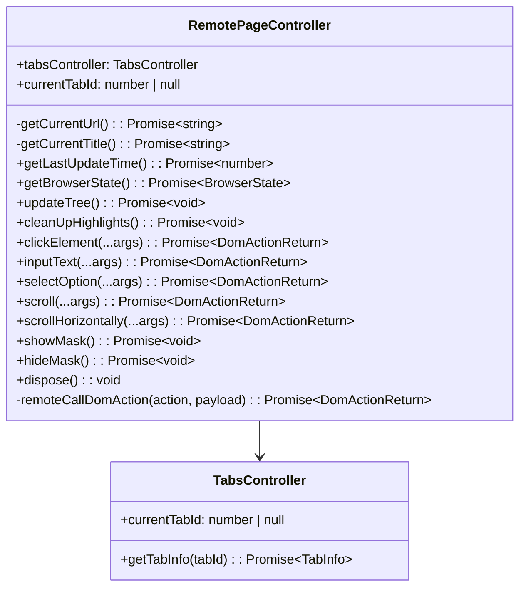
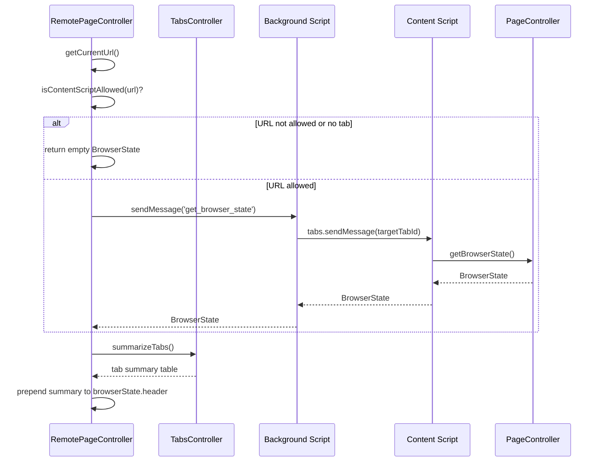
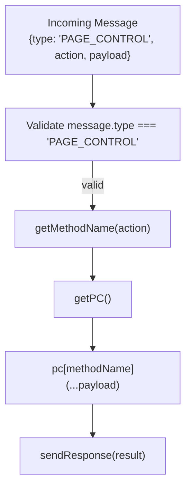

<!-- source: DeepWiki mcp.deepwiki.com · repo alibaba/page-agent · page 7.4 Remote Page Control · fetched 2026-10-29 -->

# Remote Page Control

<details>
<summary>Relevant source files</summary>

The following files were used as context for generating this wiki page:

- [packages/extension/src/agent/MultiPageAgent.ts](packages/extension/src/agent/MultiPageAgent.ts)
- [packages/extension/src/agent/RemotePageController.content.ts](packages/extension/src/agent/RemotePageController.content.ts)
- [packages/extension/src/agent/RemotePageController.ts](packages/extension/src/agent/RemotePageController.ts)
- [packages/page-controller/src/dom/index.ts](packages/page-controller/src/dom/index.ts)
- [packages/website/src/pages/docs/advanced/page-controller/page.tsx](packages/website/src/pages/docs/advanced/page-controller/page.tsx)

</details>


This document explains the `RemotePageController` architecture, which enables cross-context DOM operations in the browser extension. The `RemotePageController` provides a `PageController`-compatible interface for the extension's `MultiPageAgent` to control web pages from the side panel or background contexts, where direct DOM access is not possible.

For information about the `PageController` class that executes actual DOM operations, see [Page Controller System](5). For information about the `MultiPageAgent` that uses this system, see [MultiPageAgent](7.2). For tab management operations, see [Tab Management](7.3).

## Architecture Overview

The `RemotePageController` implements a three-context architecture that bridges the Chrome extension's isolated execution environments:

Title: Remote Page Control Architecture
```mermaid
graph TB
    subgraph "Side Panel / Extension Context"
        MPA["MultiPageAgent"]
        RPC["RemotePageController"]
        TC["TabsController"]
    end
    
    subgraph "Service Worker Context"
        BG["background.ts"]
        HPC["handlePageControlMessage()"]
        HTC["handleTabControlMessage()"]
    end
    
    subgraph "Content Script Context (Per Tab)"
        CS["RemotePageController.content.ts"]
        PC["PageController instance"]
        DOM["Web Page DOM"]
    end
    
    subgraph "Chrome Storage API"
        STORAGE["chrome.storage.local"]
        HEARTBEAT["agentHeartbeat: timestamp"]
        RUNNING["isAgentRunning: boolean"]
        CURRENT["currentTabId: number"]
    end
    
    MPA -->|"uses"| RPC
    RPC -->|"uses"| TC
    RPC -->|"chrome.runtime.sendMessage"| BG
    
    BG -->|"chrome.tabs.sendMessage"| CS
    
    CS -->|"instantiates"| PC
    PC -->|"operates"| DOM
    
    MPA -->|"writes"| STORAGE
    CS -->|"polls every 500ms"| STORAGE
    
    STORAGE -->|"contains"| HEARTBEAT
    STORAGE -->|"contains"| RUNNING
    STORAGE -->|"contains"| CURRENT
    
    CS -.| "polls storage" | PC
```

Sources: [packages/extension/src/agent/RemotePageController.ts:22-25](), [packages/extension/src/agent/RemotePageController.content.ts:6-104](), [packages/extension/src/agent/MultiPageAgent.ts:24-29]()

## RemotePageController Class

The `RemotePageController` class lives in the extension page context (side panel or hub tab) and provides a `PageController`-compatible interface by proxying method calls to content scripts via message passing.

### Class Structure

Title: RemotePageController Class Relationship


The constructor takes a `TabsController` instance and delegates `currentTabId` management to it: [packages/extension/src/agent/RemotePageController.ts:29-35]().

### Message Sending Pattern

All operations use a common `sendMessage()` helper that wraps Chrome runtime messaging with error handling: [packages/extension/src/agent/RemotePageController.ts:9-19]().

Messages follow this structure:
```typescript
{
  type: 'PAGE_CONTROL',
  action: string,          // e.g., 'get_browser_state', 'click_element'
  targetTabId: number,     // which tab to control
  payload?: any            // method arguments
}
```

Sources: [packages/extension/src/agent/RemotePageController.ts:9-19](), [packages/extension/src/agent/RemotePageController.ts:29-35]()

### Browser State Retrieval

The `getBrowserState()` method coordinates state from both the remote content script and the local `TabsController`:

Title: Browser State Retrieval Flow


The method handles cases where content scripts cannot run (e.g., `chrome://` pages) by returning an empty state: [packages/extension/src/agent/RemotePageController.ts:65-72](). Tab information from `TabsController.summarizeTabs()` is prepended to the browser state header to give the LLM context about other open tabs: [packages/extension/src/agent/RemotePageController.ts:81-82]().

Sources: [packages/extension/src/agent/RemotePageController.ts:58-87](), [packages/extension/src/agent/RemotePageController.ts:175-192]()

### DOM Action Execution

DOM actions (click, input, scroll, etc.) are proxied through a common `remoteCallDomAction()` method: [packages/extension/src/agent/RemotePageController.ts:145-164]().

The method performs validation before sending messages:
1. Checks if `currentTabId` is initialized: [packages/extension/src/agent/RemotePageController.ts:146-148]().
2. Validates the URL allows content script execution via `isContentScriptAllowed()`: [packages/extension/src/agent/RemotePageController.ts:150-156]().
3. Sends the message with the action name and payload: [packages/extension/src/agent/RemotePageController.ts:158-163]().

Special handling for `clickElement()` includes a 1-second wait after execution to allow for page navigation to start before the next step: [packages/extension/src/agent/RemotePageController.ts:113-118]().

Sources: [packages/extension/src/agent/RemotePageController.ts:113-134](), [packages/extension/src/agent/RemotePageController.ts:145-164]()

### URL Restrictions

Content scripts cannot run on certain browser internal pages. The `isContentScriptAllowed()` function validates URLs against restricted patterns: [packages/extension/src/agent/RemotePageController.ts:175-192]().

Restricted patterns include:
- `chrome://`, `chrome-extension://` (Chrome internal)
- `about:` pages
- `edge://`, `brave://`, `opera://`, `vivaldi://` (browser-specific)
- `file://` (local files)
- `view-source:`, `devtools://` (special views)

When operations are attempted on restricted URLs, the agent is notified that it should use tab tools to navigate to a web page first: [packages/extension/src/agent/RemotePageController.ts:150-156]().

Sources: [packages/extension/src/agent/RemotePageController.ts:175-192](), [packages/extension/src/agent/RemotePageController.ts:65-72](), [packages/extension/src/agent/RemotePageController.ts:150-156]()

## Content Script Integration

The content script side instantiates and manages a `PageController` instance, receives messages from the background script, and executes actual DOM operations.

### Initialization and Lifecycle

The content script initializes upon injection and maintains a single `PageController` instance: [packages/extension/src/agent/RemotePageController.content.ts:6-28]().

The `PageController` is configured with:
- `enableMask: false` - Mask management is handled separately via storage polling: [packages/extension/src/agent/RemotePageController.content.ts:23]().
- `viewportExpansion: 400` - Extended viewport for better element capture: [packages/extension/src/agent/RemotePageController.content.ts:24]().

### Message Handling

The content script listens for `PAGE_CONTROL` messages and dispatches them to the appropriate `PageController` methods:

Title: Content Script Message Dispatcher


Supported actions include: `get_browser_state`, `update_tree`, `click_element`, `input_text`, etc. [packages/extension/src/agent/RemotePageController.content.ts:74-84](). Action name conversion from snake_case to camelCase is handled by `getMethodName`: [packages/extension/src/agent/RemotePageController.content.ts:106-135]().

Sources: [packages/extension/src/agent/RemotePageController.content.ts:60-103](), [packages/extension/src/agent/RemotePageController.content.ts:106-135]()

### Tab Identification

The content script determines its own tab ID by querying the background script with the `get_my_tab_id` action: [packages/extension/src/agent/RemotePageController.content.ts:10-18](). This tab ID is used to determine if the current tab should display the visual mask.

Sources: [packages/extension/src/agent/RemotePageController.content.ts:10-18]()

## Mask Management via Storage Polling

Unlike the direct `PageController` where mask visibility is controlled by method calls, the extension context uses a storage-based polling mechanism to coordinate mask visibility across tabs.

### Storage Schema

Three keys in `chrome.storage.local` control mask behavior:

| Key | Type | Purpose |
|-----|------|---------|
| `isAgentRunning` | boolean | Set to true during task execution |
| `agentHeartbeat` | number (timestamp) | Updated every 1 second while agent is active |
| `currentTabId` | number | ID of the tab currently being controlled |

### Heartbeat Mechanism

The heartbeat provides a fallback mechanism because the side panel's lifecycle is hard to predict. If the heartbeat timestamp becomes stale (>2 seconds old), content scripts know the agent has stopped: [packages/extension/src/agent/MultiPageAgent.ts:43-52]().

The `MultiPageAgent` updates the heartbeat every 1 second while running: [packages/extension/src/agent/MultiPageAgent.ts:88-91]().

### Content Script Polling

Content scripts poll storage every 500ms to determine whether to show the mask: [packages/extension/src/agent/RemotePageController.content.ts:30-58]().

The mask is shown if all conditions are met:
1. `isAgentRunning` is true: [packages/extension/src/agent/RemotePageController.content.ts:35]().
2. `agentHeartbeat` is recent (within 2 seconds): [packages/extension/src/agent/RemotePageController.content.ts:31-33]().
3. `currentTabId` matches the content script's tab ID: [packages/extension/src/agent/RemotePageController.content.ts:38]().

If conditions are not met, the mask is hidden and highlights are cleaned up: [packages/extension/src/agent/RemotePageController.content.ts:46-50](). When the agent stops and heartbeat goes stale, the `PageController` is disposed to free resources: [packages/extension/src/agent/RemotePageController.content.ts:52-57]().

Sources: [packages/extension/src/agent/RemotePageController.content.ts:30-58](), [packages/extension/src/agent/MultiPageAgent.ts:85-98](), [packages/extension/src/agent/RemotePageController.ts:139-143]()

## Error Handling and Limitations

### Error Propagation

Errors at each layer are caught and propagated back to the caller:

1. **Content Script**: Catches `PageController` errors and wraps them in `{success: false, error: message}`: [packages/extension/src/agent/RemotePageController.content.ts:87-92]().
2. **RemotePageController**: Catches runtime message errors and logs them, returning null: [packages/extension/src/agent/RemotePageController.ts:15-18]().

### Limitations

The `RemotePageController` has several limitations compared to direct `PageController` usage:

1. **Message Passing Overhead**: Each operation requires multiple message hops (agent → background → content script → response).
2. **No Synchronous Access**: All operations are asynchronous due to message passing.
3. **No Javascript Execution**: `execute_javascript` is intentionally not implemented because `AbortSignal` cannot cross execution contexts: [packages/extension/src/agent/RemotePageController.ts:136]().
4. **URL Restrictions**: Cannot operate on browser internal pages (`chrome://`, `edge://`, etc.): [packages/extension/src/agent/RemotePageController.ts:175-192]().

Sources: [packages/extension/src/agent/RemotePageController.ts:9-19](), [packages/extension/src/agent/RemotePageController.ts:136](), [packages/extension/src/agent/RemotePageController.content.ts:87-92]()

---

