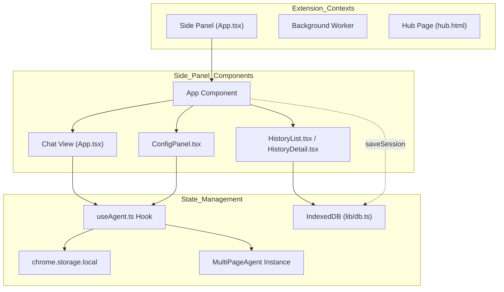
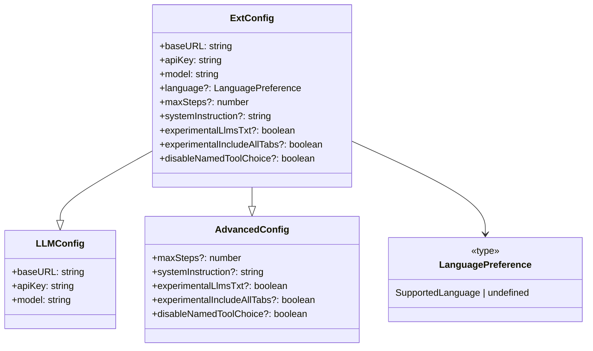
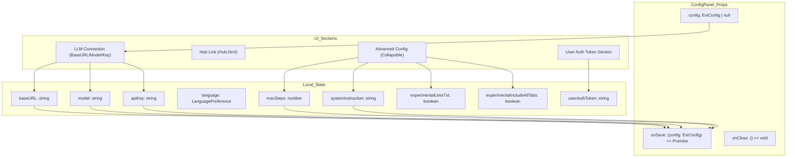
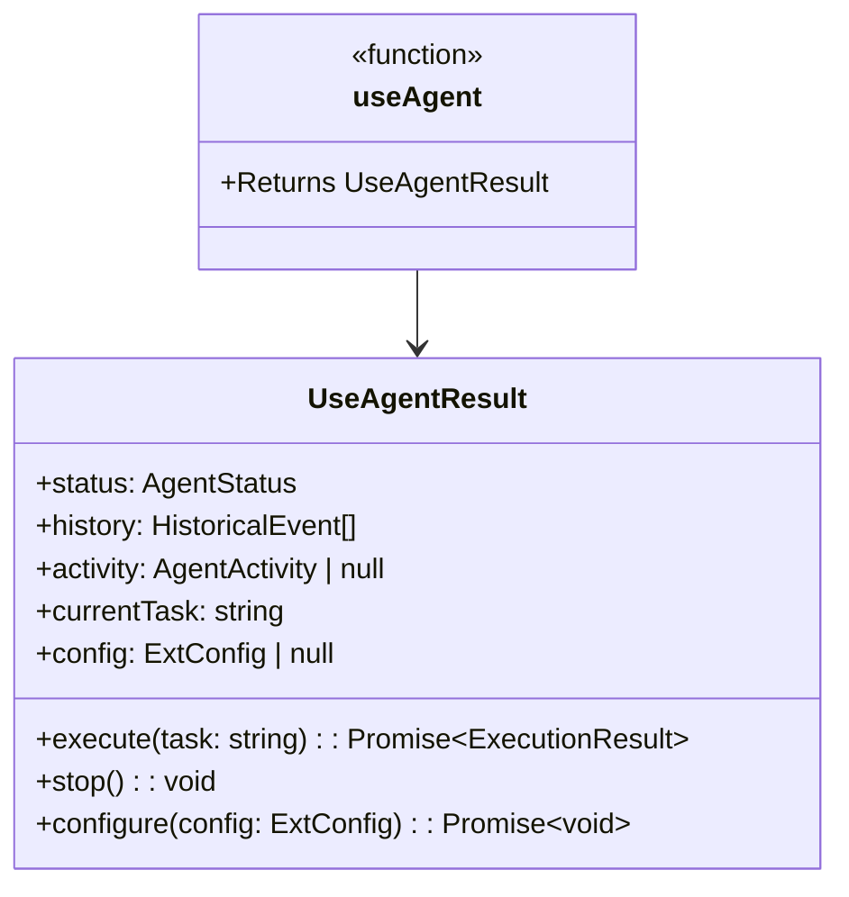

<!-- source: DeepWiki mcp.deepwiki.com · repo alibaba/page-agent · page 7.5 Extension UI and Configuration · fetched 2026-10-29 -->

# Extension UI and Configuration

Relevant source files

The following files were used as context for generating this wiki page:

- [packages/extension/PRIVACY.md](packages/extension/PRIVACY.md)
- [packages/extension/src/agent/constants.ts](packages/extension/src/agent/constants.ts)
- [packages/extension/src/agent/useAgent.ts](packages/extension/src/agent/useAgent.ts)
- [packages/extension/src/components/ConfigPanel.tsx](packages/extension/src/components/ConfigPanel.tsx)
- [packages/extension/src/components/HistoryDetail.tsx](packages/extension/src/components/HistoryDetail.tsx)
- [packages/extension/src/components/HistoryList.tsx](packages/extension/src/components/HistoryList.tsx)
- [packages/extension/src/components/misc.tsx](packages/extension/src/components/misc.tsx)
- [packages/extension/src/entrypoints/hub/App.tsx](packages/extension/src/entrypoints/hub/App.tsx)
- [packages/extension/src/entrypoints/hub/hub-ws.ts](packages/extension/src/entrypoints/hub/hub-ws.ts)
- [packages/extension/src/entrypoints/hub/index.html](packages/extension/src/entrypoints/hub/index.html)
- [packages/extension/src/entrypoints/hub/main.tsx](packages/extension/src/entrypoints/hub/main.tsx)
- [packages/extension/src/entrypoints/sidepanel/App.tsx](packages/extension/src/entrypoints/sidepanel/App.tsx)
- [packages/extension/src/lib/db.ts](packages/extension/src/lib/db.ts)
- [packages/extension/src/lib/history-export.ts](packages/extension/src/lib/history-export.ts)
- [packages/page-agent/src/demo.ts](packages/page-agent/src/demo.ts)

This document covers the browser extension's user interface components and configuration management system. It focuses on the side panel UI, the `ConfigPanel` component, configuration storage, and settings persistence mechanisms.

For information about the extension's overall architecture and execution contexts, see [7.1 Extension Architecture](). For details on the agent implementation that uses these configurations, see [7.2 MultiPageAgent](). For authentication mechanisms, see [7.6 Authentication and Security]().

## UI Architecture

The extension provides a side panel interface that serves as the primary user interaction point. The side panel hosts the agent control interface, history management, and the configuration panel.

Title: Extension UI Component Structure

The side panel runs as a separate extension context with its own React application. It maintains its own UI state and routes between `chat`, `config`, and `history` views using a simple state-based router [packages/extension/src/entrypoints/sidepanel/App.tsx:20-27]().

Sources: [packages/extension/src/entrypoints/sidepanel/App.tsx:20-128](), [packages/extension/src/agent/useAgent.ts:43-162]()

## Configuration Types

The extension uses a layered configuration system that combines LLM settings, language preferences, and advanced options.

Title: Configuration Type Hierarchy

| Type | Purpose | Storage Key |
|------|---------|-------------|
| `LLMConfig` | LLM provider connection settings | `llmConfig` [packages/extension/src/agent/useAgent.ts:52]() |
| `LanguagePreference` | UI language preference | `language` [packages/extension/src/agent/useAgent.ts:52]() |
| `AdvancedConfig` | Agent behavior settings | `advancedConfig` [packages/extension/src/agent/useAgent.ts:52]() |
| `ExtConfig` | Combined configuration interface | N/A (composite) [packages/extension/src/agent/useAgent.ts:28-30]() |

The `ExtConfig` interface extends `LLMConfig` and `AdvancedConfig`, providing a unified configuration surface for the UI [packages/extension/src/agent/useAgent.ts:28-30]().

Sources: [packages/extension/src/agent/useAgent.ts:18-30](), [packages/extension/src/agent/useAgent.ts:51-68]()

## ConfigPanel Component

The `ConfigPanel` component manages the extension settings UI. It handles local form state and persists changes to storage.

Title: ConfigPanel Data Flow

### User Auth Token Display

The `ConfigPanel` includes a section for the User Auth Token [packages/extension/src/components/ConfigPanel.tsx:132-178](), which allows external websites to authenticate with the extension for programmatic control via the Hub.

The component polls `chrome.storage.local` for `PageAgentExtUserAuthToken` every second until found [packages/extension/src/components/ConfigPanel.tsx:67-88](). This token is masked by default and can be toggled or copied to the clipboard [packages/extension/src/components/ConfigPanel.tsx:90-96]().

Sources: [packages/extension/src/components/ConfigPanel.tsx:52-178]()

### Testing Endpoint Detection

The component displays a notice when the demo/testing endpoint is detected [packages/extension/src/components/ConfigPanel.tsx:205-218](). This detection relies on constants defined in the agent module [packages/extension/src/agent/constants.ts:19-22](). When detected, a warning banner appears informing users about the terms of use and privacy policy associated with the free testing API [packages/extension/src/components/ConfigPanel.tsx:205-218]().

Sources: [packages/extension/src/components/ConfigPanel.tsx:205-218](), [packages/extension/src/agent/constants.ts:19-22]()

## useAgent Hook

The `useAgent()` hook [packages/extension/src/agent/useAgent.ts:43-162]() provides the React interface for agent management and configuration.

Title: useAgent Hook Interface

### State Management Flow

The hook automatically recreates the `MultiPageAgent` instance whenever the `config` state changes [packages/extension/src/agent/useAgent.ts:70-107](). It listens for agent events (`statuschange`, `historychange`, `activity`) and updates local React state accordingly [packages/extension/src/agent/useAgent.ts:80-99]().

The `configure()` function [packages/extension/src/agent/useAgent.ts:122-149]() persists settings to `chrome.storage.local`. It separates `llmConfig` from `advancedConfig` and `language` preferences to maintain a clean storage schema.

Sources: [packages/extension/src/agent/useAgent.ts:70-150]()

## History and Session Management

The Side Panel includes a history management system that persists agent sessions to IndexedDB via `saveSession` when a task completes, errors, or is stopped [packages/extension/src/entrypoints/sidepanel/App.tsx:34-50]().

### History Components

- **HistoryList**: Lists all previous sessions using `listSessions()` from the database [packages/extension/src/lib/db.ts:51-55](). It displays status icons, step counts, and relative timestamps [packages/extension/src/components/HistoryList.tsx:101-178]().
- **HistoryDetail**: Displays the full event log for a specific session using `getSession(sessionId)` [packages/extension/src/components/HistoryDetail.tsx:9-80]().
- **History Export**: Users can download session history as a JSON file via `downloadHistoryExport` [packages/extension/src/components/HistoryList.tsx:59-62]().

The database implementation uses `idb` to manage a `sessions` object store with an index on the `createdAt` field [packages/extension/src/lib/db.ts:27-32]().

Sources: [packages/extension/src/components/HistoryList.tsx:123-178](), [packages/extension/src/components/HistoryDetail.tsx:9-80](), [packages/extension/src/lib/db.ts:7-71](), [packages/extension/src/entrypoints/sidepanel/App.tsx:34-50]()

## Hub and External Control

The Extension UI includes a specialized "Hub" view (`hub.html`) for remote automation [packages/extension/src/entrypoints/hub/App.tsx:12-144]().

- **useHubWs Hook**: Bridges the `MultiPageAgent` to a WebSocket server [packages/extension/src/entrypoints/hub/hub-ws.ts:199-243](). It receives `execute` and `stop` commands from external callers [packages/extension/src/entrypoints/hub/hub-ws.ts:149-157]().
- **Approval System**: By default, the Hub requires manual user approval for each external session via `window.confirm` [packages/extension/src/entrypoints/hub/hub-ws.ts:159-173](). Users can toggle `allowAllHubConnection` in the Hub UI to skip this [packages/extension/src/entrypoints/hub/App.tsx:146-190]().

Sources: [packages/extension/src/entrypoints/hub/App.tsx:12-190](), [packages/extension/src/entrypoints/hub/hub-ws.ts:199-243]()

## Default Configuration

The extension provides demo configuration constants for users without their own LLM API access [packages/extension/src/agent/constants.ts:4-12]().

| Constant | Value | Purpose |
|----------|-------|---------|
| `DEMO_MODEL` | `'qwen3.5-plus'` | Default model for testing |
| `DEMO_BASE_URL` | `'https://page-ag-testing-ohftxirgbn.cn-shanghai.fcapp.run'` | Free testing API endpoint |

The `useAgent` hook performs an auto-migration for legacy testing endpoints to ensure users are always on the latest supported testing infrastructure [packages/extension/src/agent/useAgent.ts:57-64]().

Sources: [packages/extension/src/agent/constants.ts:4-31](), [packages/extension/src/agent/useAgent.ts:57-64]()

---

