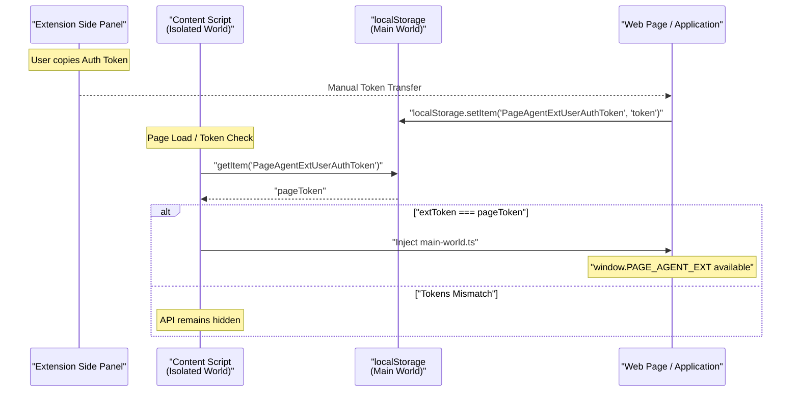
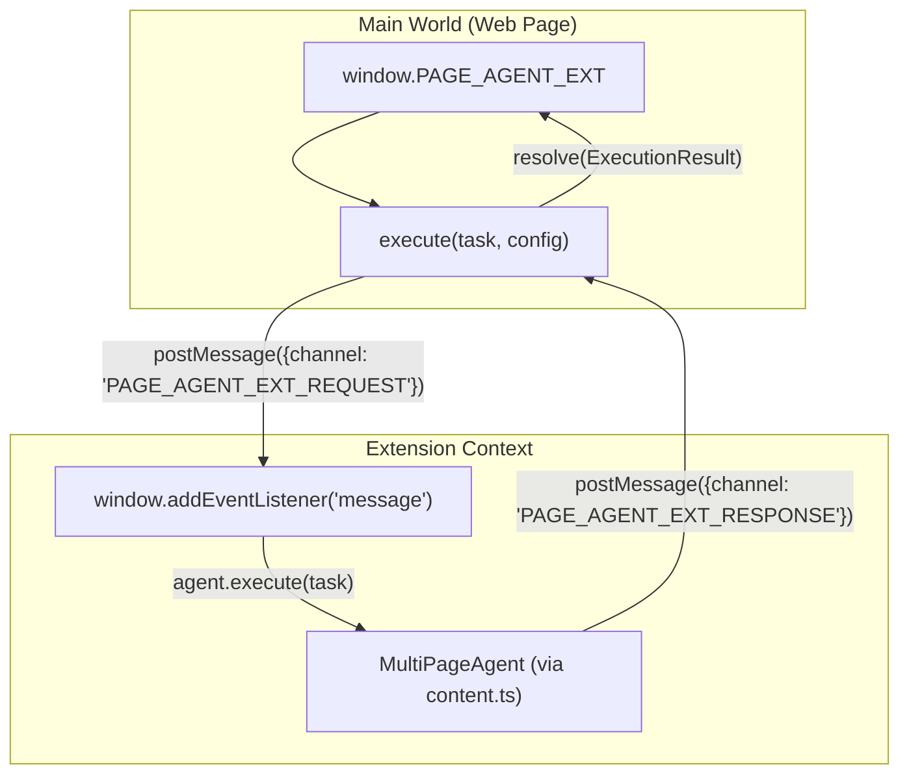

<!-- source: DeepWiki mcp.deepwiki.com · repo alibaba/page-agent · page 7.6 Authentication and Security · fetched 2026-10-29 -->

# Authentication and Security

<details>
<summary>Relevant source files</summary>

The following files were used as context for generating this wiki page:

- [packages/extension/PRIVACY.md](packages/extension/PRIVACY.md)
- [packages/extension/docs/extension_api.md](packages/extension/docs/extension_api.md)
- [packages/extension/src/agent/constants.ts](packages/extension/src/agent/constants.ts)
- [packages/extension/src/agent/useAgent.ts](packages/extension/src/agent/useAgent.ts)
- [packages/extension/src/entrypoints/main-world.ts](packages/extension/src/entrypoints/main-world.ts)
- [packages/page-agent/src/demo.ts](packages/page-agent/src/demo.ts)
- [packages/website/src/pages/docs/features/chrome-extension/page.tsx](packages/website/src/pages/docs/features/chrome-extension/page.tsx)
- [tsconfig.base.json](tsconfig.base.json)

</details>


This document describes the security mechanisms implemented in the PageAgent browser extension. These mechanisms control access to the extension's agent functionality, manage cross-context communication, and restrict operations on protected browser pages.

For information about secure LLM API key management when using the NPM package, see **Section 15.1: API Key Management**. For extension architecture and multi-page capabilities, see **Section 7.1: Extension Architecture**.

## Purpose and Scope

The extension implements multiple security layers to:

1.  **Authenticate page access** to the `MultiPageAgent` via a token-based system [packages/extension/docs/extension_api.md:23-31]().
2.  **Expose a controlled API** (`window.PAGE_AGENT_EXT`) to the web page's main world [packages/extension/src/entrypoints/main-world.ts:125-130]().
3.  **Restrict content script execution** on protected browser URLs [packages/extension/docs/extension_api.md:99-101]().
4.  **Isolate execution contexts** between extension and page scripts [packages/extension/docs/extension_api.md:72-72]().
5.  **Prevent concurrent agent execution** through singleton state management [packages/extension/src/agent/useAgent.ts:70-107]().

## User Auth Token System

The extension uses a token-based system to control which web pages can access the `MultiPageAgent`. This prevents unauthorized pages from executing agent operations or accessing browser-level controls.

### Token Verification Flow

Access to the `window.PAGE_AGENT_EXT` API is protected by a user-provided token. The extension has broad permissions (page access, navigation, multi-tab control), which necessitates an explicit trust relationship [packages/extension/docs/extension_api.md:27-31]().

**Verification Steps:**

1.  **Extension Side Token**: The user opens the extension side panel to retrieve their unique auth token [packages/extension/docs/extension_api.md:35-35]().
2.  **Page Side Token**: The user (or the trusted application) must set this token in the page's `localStorage` [packages/extension/docs/extension_api.md:38-40]().
3.  **Token Comparison**: The extension's content script compares the token in the page's `localStorage` with the one stored in the extension's private storage.
4.  **API Injection**: Only after a successful token match does the extension inject the `main-world.ts` script to expose the global `window.PAGE_AGENT_EXT` API [packages/extension/docs/extension_api.md:72-72]().

### Authentication Flow Diagram



**Sources:** [packages/extension/docs/extension_api.md:23-41](), [packages/extension/src/entrypoints/main-world.ts:125-131]()

### Security Properties

| Property | Implementation |
| :--- | :--- |
| **Isolated Storage** | The master token is stored within the extension context, inaccessible to page scripts [packages/extension/docs/extension_api.md:27-31](). |
| **Explicit Opt-In** | Users must manually share the token only with applications they trust [packages/extension/docs/extension_api.md:31-31](). |
| **Protection from Abuse** | Prevents untrusted scripts from utilizing the extension's cross-tab and navigation capabilities [packages/extension/docs/extension_api.md:29-30](). |

## Global API and Execution Contexts

The extension uses Chrome's content script isolated world feature to maintain a security boundary while providing a high-level API to the page.

### window.PAGE_AGENT_EXT

Once authenticated, the `main-world.ts` script populates the global namespace:

[packages/extension/src/entrypoints/main-world.ts:125-130]()

*   `window.PAGE_AGENT_EXT_VERSION`: Current version string for capability checks [packages/extension/src/entrypoints/main-world.ts:125-125]().
*   `window.PAGE_AGENT_EXT.execute(task, config)`: Triggers a multi-page task using the `MultiPageAgent` [packages/extension/src/entrypoints/main-world.ts:37-110]().
*   `window.PAGE_AGENT_EXT.stop()`: Stops the current task execution [packages/extension/src/entrypoints/main-world.ts:112-123]().

### Message Passing Bridge

Communication between the Web Page (Main World) and the `MultiPageAgent` (which runs in the extension context) happens via `window.postMessage`.



**Sources:** [packages/extension/src/entrypoints/main-world.ts:37-130](), [packages/extension/docs/extension_api.md:78-98]()

## Singleton Enforcement and Safety

To prevent resource conflicts and unpredictable browser behavior, the extension manages the lifecycle of the `MultiPageAgent` instance carefully.

### Execution Guard

The `useAgent` hook in the extension UI manages the active agent instance. When a new task is initiated, the `execute` function resets the history and calls the agent's execute method [packages/extension/src/agent/useAgent.ts:109-116]().

### Instance Lifecycle

The `useAgent` hook ensures that only one `MultiPageAgent` instance is active per configuration state. When the configuration changes or the component unmounts, the existing agent is disposed of [packages/extension/src/agent/useAgent.ts:70-107]().

[packages/extension/src/agent/useAgent.ts:101-106]()

```typescript
return () => {
    agent.removeEventListener('statuschange', handleStatusChange)
    agent.removeEventListener('historychange', handleHistoryChange)
    agent.removeEventListener('activity', handleActivity)
    agent.dispose()
}
```

**Sources:** [packages/extension/src/agent/useAgent.ts:70-120](), [packages/extension/src/entrypoints/main-world.ts:112-123]()

## Content Script Permissions and Restrictions

The extension respects browser security boundaries and specific API limitations.

### API Limitations

*   **Window Types**: The extension relies on the tab group API, which does not work for pop-up windows or PWA App windows [packages/extension/docs/extension_api.md:101-101]().
*   **Initial Tab Control**: Users can configure whether the task includes the initial tab where the script was triggered [packages/extension/src/entrypoints/main-world.ts:17-20]().

### Security Considerations for Third-Party Integration

The `PAGE_AGENT_EXT` API is designed for third-party integration but carries risks due to its broad permissions.

| Risk | Mitigation |
| :--- | :--- |
| **Unauthorized Task Triggering** | Protected by the `PageAgentExtUserAuthToken` requirement [packages/extension/docs/extension_api.md:23-31](). |
| **Sensitive Data Exposure** | Users are warned to only provide tokens to trusted applications [packages/extension/docs/extension_api.md:31-31](). |
| **Input Validation** | The `execute` function validates that the task is a non-empty string and that required config (baseURL, model) is present [packages/extension/src/entrypoints/main-world.ts:38-42](). |

## Configuration Management and Heartbeat

The extension maintains configuration state using `chrome.storage.local`, which is monitored by the `useAgent` hook to ensure the agent instance is always aligned with user settings.

### Configuration Syncing

The `useAgent` hook initializes by fetching `llmConfig`, `language`, and `advancedConfig` from storage [packages/extension/src/agent/useAgent.ts:52-55](). It also performs auto-migration of legacy testing endpoints to ensure compatibility with the current `DEMO_BASE_URL` [packages/extension/src/agent/useAgent.ts:57-64](), [packages/extension/src/agent/constants.ts:24-30]().

### LLM Config Safety

The extension provides a `DEMO_CONFIG` for testing, but for production use, users must provide their own `baseURL` and `apiKey` [packages/extension/src/agent/constants.ts:8-12](), [packages/extension/src/entrypoints/main-world.ts:96-99](). These are passed from the main world to the extension context during execution [packages/extension/src/entrypoints/main-world.ts:89-107]().

**Sources:** [packages/extension/src/agent/useAgent.ts:51-68](), [packages/extension/src/agent/constants.ts:1-30](), [packages/extension/src/entrypoints/main-world.ts:37-107]()

---

