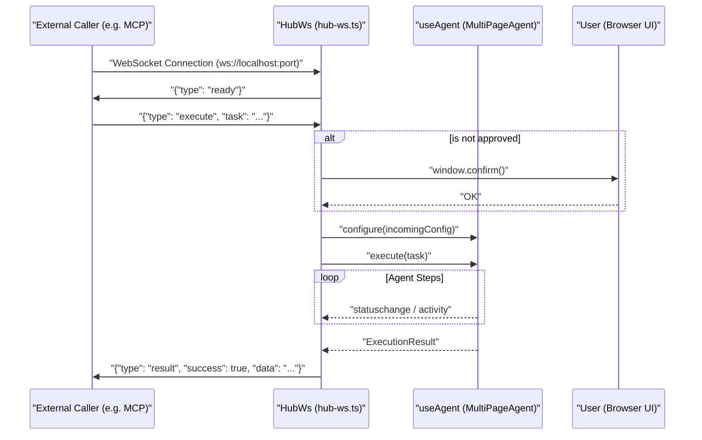
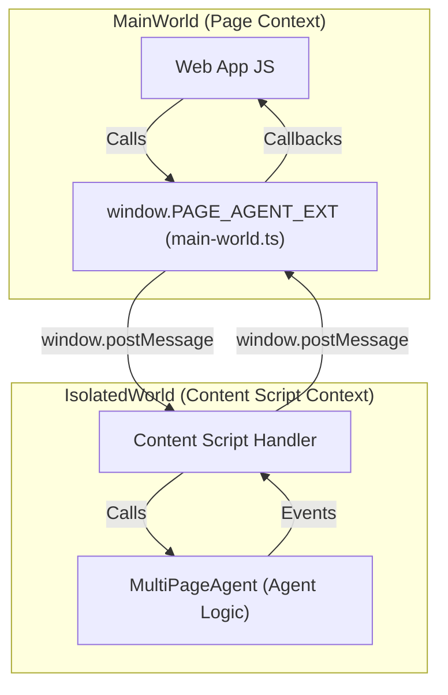

<!-- source: DeepWiki mcp.deepwiki.com · repo alibaba/page-agent · page 7.7 Hub and External Control API · fetched 2026-10-29 -->

# Hub and External Control API

Relevant source files

The following files were used as context for generating this wiki page:

- [packages/extension/docs/extension_api.md](packages/extension/docs/extension_api.md)
- [packages/extension/src/components/ConfigPanel.tsx](packages/extension/src/components/ConfigPanel.tsx)
- [packages/extension/src/components/misc.tsx](packages/extension/src/components/misc.tsx)
- [packages/extension/src/entrypoints/hub/App.tsx](packages/extension/src/entrypoints/hub/App.tsx)
- [packages/extension/src/entrypoints/hub/hub-ws.ts](packages/extension/src/entrypoints/hub/hub-ws.ts)
- [packages/extension/src/entrypoints/hub/index.html](packages/extension/src/entrypoints/hub/index.html)
- [packages/extension/src/entrypoints/hub/main.tsx](packages/extension/src/entrypoints/hub/main.tsx)
- [packages/extension/src/entrypoints/main-world.ts](packages/extension/src/entrypoints/main-world.ts)
- [packages/website/src/pages/docs/features/chrome-extension/page.tsx](packages/website/src/pages/docs/features/chrome-extension/page.tsx)
- [tsconfig.base.json](tsconfig.base.json)

The PageAgent extension provides two primary mechanisms for external control: the **Hub** (a WebSocket-based bridge for local applications) and the **Window API** (a JavaScript bridge for web applications). These interfaces allow external callers to leverage the extension's multi-page automation capabilities, bypassing the single-page limitations of standard library integration.

## 1. The Hub Entrypoint (`hub.html`)

The Hub is a dedicated extension page (`hub.html`) that acts as a bridge between the browser environment and external local processes (such as the PageAgent MCP server). It provides a visual dashboard for monitoring remote tasks and managing connection security.

### 1.1 Implementation and UI
The Hub is built as a React application [packages/extension/src/entrypoints/hub/main.tsx:19-25](). It consists of:
- **Protocol Documentation**: Instructions for connecting via WebSocket [packages/extension/src/entrypoints/hub/App.tsx:35-47](), including a collapsible section for detailed protocol specs [packages/extension/src/entrypoints/hub/App.tsx:192-212]().
- **Live Session Monitor**: A real-time stream of agent activity, status, and history using the `useAgent` hook [packages/extension/src/entrypoints/hub/App.tsx:13-15](), [packages/extension/src/entrypoints/hub/App.tsx:123-142]().
- **Connection Management**: A toggle for "Auto-approve connections" stored in `chrome.storage.local` under the key `allowAllHubConnection` [packages/extension/src/entrypoints/hub/App.tsx:150-159]().
- **Visual Feedback**: A full-screen glow overlay (`MotionOverlay`) that activates while the agent is running [packages/extension/src/entrypoints/hub/App.tsx:92](), [packages/extension/src/components/misc.tsx:43-93]().

### 1.2 WebSocket Protocol
The Hub connects as a client to a local WebSocket server (usually provided by an MCP host) using a port specified in the URL query parameter `?ws=PORT` [packages/extension/src/entrypoints/hub/hub-ws.ts:205-206]().

**Protocol Message Schema:**
| Direction | Message Type | Payload | Description |
| :--- | :--- | :--- | :--- |
| Inbound (Caller → Hub) | `execute` | `{ task: string, config?: object }` | Starts a new agent task [packages/extension/src/entrypoints/hub/hub-ws.ts:23-27](). |
| Inbound (Caller → Hub) | `stop` | N/A | Aborts the current task [packages/extension/src/entrypoints/hub/hub-ws.ts:29-31](). |
| Outbound (Hub → Caller) | `ready` | N/A | Signal that Hub is connected and idle [packages/extension/src/entrypoints/hub/hub-ws.ts:35-37](). |
| Outbound (Hub → Caller) | `result` | `{ success: boolean, data: string }` | Final task output [packages/extension/src/entrypoints/hub/hub-ws.ts:39-43](). |
| Outbound (Hub → Caller) | `error` | `{ message: string }` | Error details or rejection [packages/extension/src/entrypoints/hub/hub-ws.ts:45-48](). |

**Sources:** [packages/extension/src/entrypoints/hub/hub-ws.ts:1-15](), [packages/extension/src/entrypoints/hub/hub-ws.ts:23-50]().

### 1.3 Connection Data Flow
The following diagram illustrates how the `HubWs` class manages the lifecycle of an external request.

**Hub Connection and Execution Flow**

**Sources:** [packages/extension/src/entrypoints/hub/hub-ws.ts:92-114](), [packages/extension/src/entrypoints/hub/hub-ws.ts:136-157](), [packages/extension/src/entrypoints/hub/hub-ws.ts:159-173](), [packages/extension/src/entrypoints/hub/hub-ws.ts:220-227]().

---

## 2. Window External Control API (`PAGE_AGENT_EXT`)

For web applications, the extension injects a global API into the `window` object of authorized pages. This allows a website to trigger the extension's `MultiPageAgent` directly from its own JavaScript context.

### 2.1 Authorization and Security
To prevent malicious sites from hijacking the extension's broad permissions, the API is only exposed if a specific handshake occurs:
1. The user copies an **Auth Token** from the extension side panel `ConfigPanel` [packages/extension/src/components/ConfigPanel.tsx:133-178]().
2. The web application stores this token in `localStorage.setItem('PageAgentExtUserAuthToken', '...')` [packages/extension/src/entrypoints/content.ts:23-24](). (Note: `content.ts` is the standard location for these checks, though the code provided focuses on the UI and main-world bridge).
3. The extension compares the page's token with the internal token (`PageAgentExtUserAuthToken` in `chrome.storage.local`) [packages/extension/src/components/ConfigPanel.tsx:71-79]().
4. If they match, the extension exposes the API to the page context [packages/website/src/pages/docs/features/chrome-extension/page.tsx:125-148]().

### 2.2 The `window.PAGE_AGENT_EXT` Interface
The injected API provides a high-level interface for task execution and lifecycle monitoring.

| Property | Type | Description |
| :--- | :--- | :--- |
| `version` | `string` | The extension version [packages/extension/src/entrypoints/main-world.ts:127](). |
| `execute` | `Function` | Triggers a task. Returns `Promise<ExecutionResult>` [packages/extension/src/entrypoints/main-world.ts:37](). |
| `stop` | `Function` | Immediately stops the running task [packages/extension/src/entrypoints/main-world.ts:112](). |

**ExecuteConfig Object:**
Applications can pass configuration including LLM settings and event callbacks:
- `baseURL`, `model`, `apiKey`: LLM credentials [packages/extension/src/entrypoints/main-world.ts:6-8]().
- `systemInstruction`: Global system-level instructions for the agent [packages/extension/src/entrypoints/main-world.ts:14]().
- `onStatusChange`: Callback for agent state (`idle`, `running`, etc.) [packages/extension/src/entrypoints/main-world.ts:25]().
- `onActivity`: Callback for specific tool actions or thinking steps [packages/extension/src/entrypoints/main-world.ts:26]().
- `onHistoryUpdate`: Callback for the full historical event log [packages/extension/src/entrypoints/main-world.ts:27]().

**Sources:** [packages/extension/src/entrypoints/main-world.ts:3-28](), [packages/extension/docs/extension_api.md:110-133]().

---

## 3. Communication Architecture

The `window.PAGE_AGENT_EXT` API acts as a proxy that communicates across the boundary between the **Main World** (the page's JS context) and the **Isolated World** (the content script's context).

**Cross-Context API Bridge**

### 3.1 Data Flow Detail
1. **Request**: `main-world.ts` wraps the `execute` call into a `PAGE_AGENT_EXT_REQUEST` message and sends it via `window.postMessage` [packages/extension/src/entrypoints/main-world.ts:89-107]().
2. **Execution**: The underlying extension listener catches this message and manages the execution lifecycle using the provided configuration [packages/extension/src/entrypoints/main-world.ts:37-44]().
3. **Events**: As the agent progresses, status changes and activities are posted back to the window via `PAGE_AGENT_EXT_RESPONSE` [packages/extension/src/entrypoints/main-world.ts:52-70]().
4. **Resolution**: Once the agent finishes, the final `execute_result` is posted back to resolve the original Promise in the page context [packages/extension/src/entrypoints/main-world.ts:72-82]().

**Sources:** [packages/extension/src/entrypoints/main-world.ts:30-131](), [packages/extension/docs/extension_api.md:71-98]().

---

