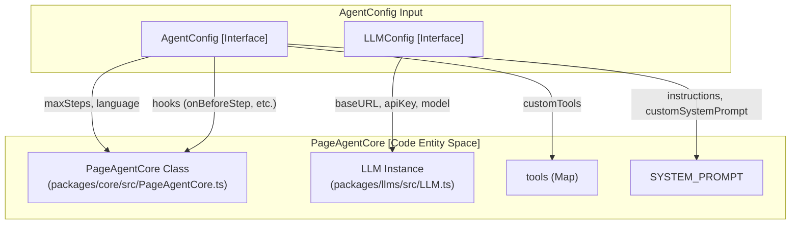
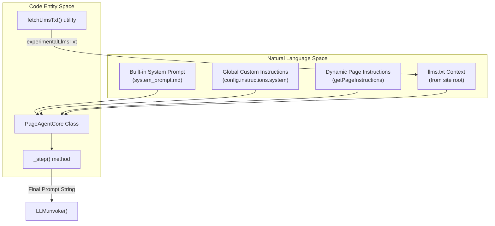

<!-- source: DeepWiki mcp.deepwiki.com · repo alibaba/page-agent · page 8.1 Agent Configuration · fetched 2026-10-29 -->

# Agent Configuration

<details>
<summary>Relevant source files</summary>

The following files were used as context for generating this wiki page:

- [packages/core/src/types.ts](packages/core/src/types.ts)
- [packages/ui/src/panel/Panel.ts](packages/ui/src/panel/Panel.ts)
- [packages/ui/src/panel/types.ts](packages/ui/src/panel/types.ts)

</details>


This document covers the `AgentConfig` interface, which provides options for customizing the `PageAgentCore` behavior. It includes settings for language, step limits, custom instructions, tool management, and experimental features.

**Sources:** [packages/core/src/types.ts:10-161]()

---

## Overview

The `AgentConfig` interface extends `LLMConfig` [packages/core/src/types.ts:10-10](), meaning it encompasses both the high-level agent strategy and the low-level LLM connection parameters (like `apiKey`, `model`, and `baseURL`). It is used by `PageAgentCore` to orchestrate the Re-act loop and manage the tool registry.

### Configuration Data Flow

The diagram below illustrates how `AgentConfig` properties are distributed into the core system components during the instantiation of `PageAgentCore`.

Title: Agent Configuration Data Flow


**Sources:** [packages/core/src/PageAgentCore.ts:108-147](), [packages/core/src/types.ts:10-161]()

---

## Core Execution Settings

These settings control the fundamental constraints and localization of the agent's execution loop.

| Property | Type | Default | Description |
|----------|------|---------|-------------|
| `maxSteps` | `number` | `40` | The maximum number of steps (observe-think-act cycles) the agent can perform for a single task [packages/core/src/types.ts:13-17](). |
| `language` | `'en-US' \| 'zh-CN'` | - | Controls the UI language and internal prompt localization [packages/core/src/types.ts:8-11](). |
| `stepDelay` | `number` | `0.4` | The delay in seconds between consecutive steps to prevent overwhelming the browser or LLM [packages/core/src/types.ts:157-160](). |

**Sources:** [packages/core/src/types.ts:11-17](), [packages/core/src/types.ts:157-160](), [packages/core/src/PageAgentCore.ts:111-111]()

---

## Instructions and Prompts

PageAgent allows fine-grained control over the "persona" and guidelines provided to the LLM through system-level and page-level instructions.

### Configuration Structure

| Property | Type | Description |
|----------|------|-------------|
| `instructions.system` | `string` | Global instructions appended to the internal system prompt for all tasks [packages/core/src/types.ts:55-58](). |
| `instructions.getPageInstructions` | `(url: string) => string` | A callback that provides context-specific instructions based on the current URL [packages/core/src/types.ts:60-67](). |
| `customSystemPrompt` | `string` | **Experimental.** Completely replaces the built-in system prompt [packages/core/src/types.ts:150-154](). |

### Instruction Precedence

When assembling the prompt for the LLM, `PageAgentCore` combines these sources in a specific order to ensure the agent follows both general rules and specific page logic.

Title: Prompt Construction Logic


**Sources:** [packages/core/src/types.ts:54-67](), [packages/core/src/types.ts:150-154](), [packages/core/src/PageAgentCore.ts:11-12](), [packages/core/src/utils/index.ts:83-115]()

---

## Custom Tools System

The `customTools` property is a powerful extension point. It allows developers to add new capabilities, modify existing ones, or restrict access to specific tools [packages/core/src/types.ts:20-49]().

### Configuration Interface

| Property | Type | Description |
|----------|------|-------------|
| `customTools` | `Record<string, PageAgentTool \| null>` | A map where the key is the tool name [packages/core/src/types.ts:49-49](). |

- **Adding a Tool:** Provide a new `PageAgentTool` definition using the `tool()` helper [packages/core/src/PageAgentCore.ts:26-26]().
- **Overriding a Tool:** Use the name of a built-in tool (e.g., `ask_user`) to replace its logic [packages/core/src/types.ts:29-41]().
- **Removing a Tool:** Set the value to `null` to disable the tool entirely [packages/core/src/PageAgentCore.ts:135-138]().

### Example: Disabling the "Ask User" Tool

```typescript
const config: AgentConfig = {
  customTools: {
    ask_user: null // The agent will never ask the user for clarification
  }
}
```

**Sources:** [packages/core/src/types.ts:20-49](), [packages/core/src/PageAgentCore.ts:133-141]()

---

## Experimental Features

PageAgent includes several experimental flags for advanced or "risky" behaviors.

### Script Execution
- **`experimentalScriptExecutionTool`**: If `true`, the agent gains access to the `execute_javascript` tool [packages/core/src/types.ts:119-124](). This allows the LLM to write and run arbitrary code in the browser context.
- **Implementation Note:** If this flag is false, `PageAgentCore` explicitly deletes the `execute_javascript` tool from its internal `tools` Map during construction [packages/core/src/PageAgentCore.ts:144-146]().

### LLM Metadata
- **`experimentalLlmsTxt`**: If enabled, the agent will attempt to fetch `/llms.txt` from the current website's origin [packages/core/src/types.ts:127-132](). The `fetchLlmsTxt` utility handles the origin extraction and caching [packages/core/src/utils/index.ts:83-115]().

### Data Masking
- **`transformPageContent`**: A hook called after DOM extraction but before the content is sent to the LLM [packages/core/src/types.ts:135-148](). It is primarily used for PII (Personally Identifiable Information) masking.

```typescript
transformPageContent: async (content) => {
  // Mask phone numbers before the LLM sees the page text
  return content.replace(/1[3-9]\d{9}/g, '***********')
}
```

**Sources:** [packages/core/src/types.ts:119-148](), [packages/core/src/PageAgentCore.ts:143-146](), [packages/core/src/utils/index.ts:83-115]()

---

## Lifecycle Hooks

`AgentConfig` supports several hooks that allow developers to monitor or intervene at various stages of the task execution [packages/core/src/types.ts:70-114]().

| Hook | Parameters | Description |
|------|------------|-------------|
| `onBeforeTask` | `(agent)` | Called once before the Re-act loop starts [packages/core/src/types.ts:93-97](). |
| `onBeforeStep` | `(agent, stepCount)` | Called before every observation/thinking phase [packages/core/src/types.ts:77-82](). |
| `onAfterStep` | `(agent, history)` | Called after a tool has been executed [packages/core/src/types.ts:85-90](). |
| `onAfterTask` | `(agent, result)` | Called when the task reaches 'completed' or 'error' state [packages/core/src/types.ts:99-105](). |
| `onDispose` | `(agent, reason)` | Called when the agent instance is being cleaned up [packages/core/src/types.ts:108-114](). |

**Sources:** [packages/core/src/types.ts:70-114](), [packages/core/src/PageAgentCore.ts:210-224]()

---

