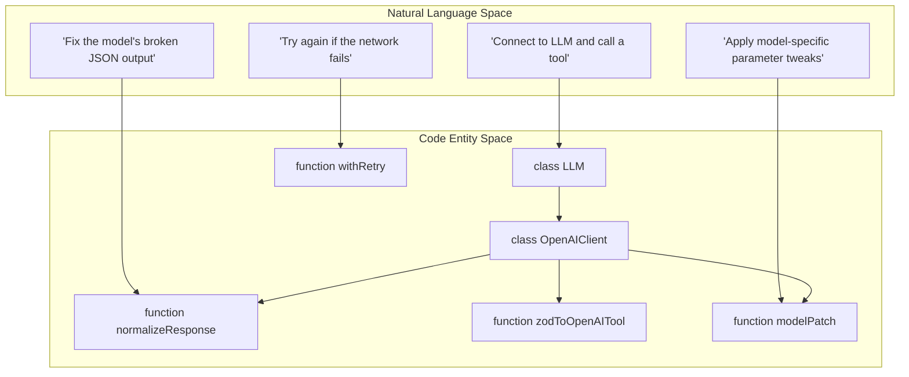
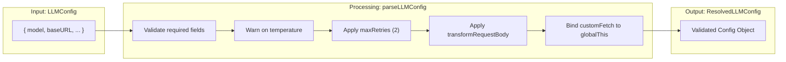
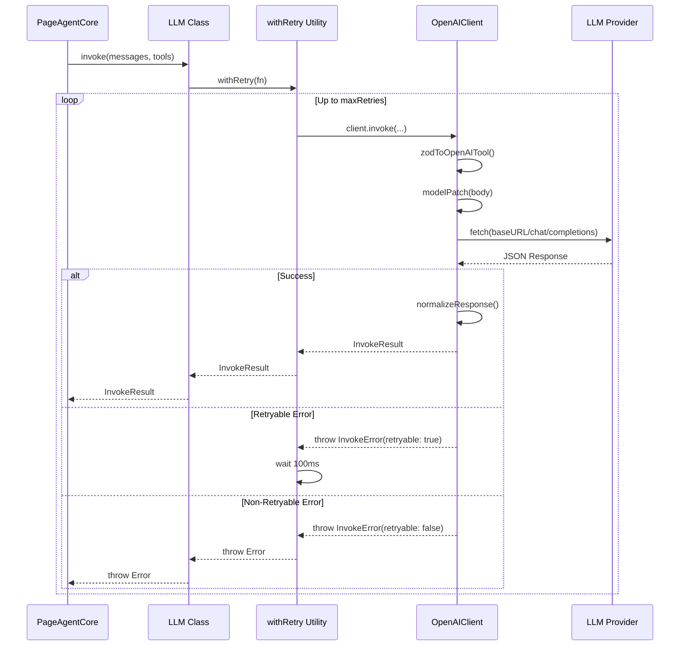

<!-- source: DeepWiki mcp.deepwiki.com · repo alibaba/page-agent · page 8.2 LLM Configuration · fetched 2026-10-29 -->

# LLM Configuration

Relevant source files

The following files were used as context for generating this wiki page:

- [packages/llms/src/types.ts](packages/llms/src/types.ts)
- [packages/llms/src/utils.test.ts](packages/llms/src/utils.test.ts)
- [packages/llms/src/utils.ts](packages/llms/src/utils.ts)
- [packages/website/src/pages/docs/features/models/page.tsx](packages/website/src/pages/docs/features/models/page.tsx)

## Purpose and Scope

This document details the `LLMConfig` interface and the `LLM` class implementation within the `@page-agent/llms` package. These components control how PageAgent connects to, authenticates with, and communicates with Large Language Model providers. The system is designed around an OpenAI-compatible interface but includes robust patching for multi-provider support (Qwen, Claude, Gemini, DeepSeek, etc.), automatic retry logic, and an `autoFixer` mechanism to handle non-standard model outputs.

---

## LLMConfig Interface

The `LLMConfig` interface defines the parameters required to initialize an LLM client. While many fields are optional, `model` and `baseURL` are functionally required for the agent to operate.

### Interface Definition

| Parameter | Type | Description |
|-----------|------|-------------|
| `baseURL` | `string` | The base URL of the OpenAI-compatible API (e.g., `https://api.openai.com/v1`). [packages/llms/src/types.ts:91-91]() |
| `model` | `string` | The specific model identifier (e.g., `gpt-4o`, `qwen-max`). [packages/llms/src/types.ts:92-92]() |
| `apiKey` | `string` | (Optional) API key for Bearer authentication. [packages/llms/src/types.ts:93-93]() |
| `temperature` | `number` | **Deprecated**. Controls randomness. Use `transformRequestBody` instead. [packages/llms/src/types.ts:95-99]() |
| `maxRetries` | `number` | (Optional) Number of retry attempts for transient errors. Defaults to `2`. [packages/llms/src/types.ts:101-101]() |
| `transformRequestBody` | `Function` | (Optional) Hook to mutate the JSON body before the network request. [packages/llms/src/types.ts:103-111]() |
| `disableNamedToolChoice` | `boolean` | (Optional) If true, removes specific tool forcing to fix compatibility with certain LLMs. [packages/llms/src/types.ts:113-117]() |
| `customFetch` | `typeof fetch` | (Optional) A custom fetch implementation for proxying or adding headers. [packages/llms/src/types.ts:119-124]() |

**Sources:** [packages/llms/src/types.ts:90-125](), [packages/llms/src/index.ts:83-109]()

---

## LLM Client Architecture

The LLM integration follows a provider-agnostic pattern where the `LLM` class acts as a high-level orchestrator for retries and event dispatching, while the `OpenAIClient` handles the protocol-specific details.

### Natural Language to Code Entity Mapping

The following diagram bridges the conceptual requirements of an LLM request to the specific classes and functions in the codebase.

**Sources:** [packages/llms/src/index.ts:19-53](), [packages/llms/src/OpenAIClient.ts:20-290](), [packages/llms/src/utils.ts:15-15](), [packages/llms/src/utils.ts:39-39]()

---

## Configuration Processing and Validation

The `parseLLMConfig` function ensures that the configuration is valid at runtime and applies default values.

### Logic Flow

1. **Validation**: Checks if `baseURL` and `model` are present; throws an error otherwise. [packages/llms/src/index.ts:85-90]()
2. **Deprecation Check**: Warns if `temperature` is used directly in the config. [packages/llms/src/index.ts:92-97]()
3. **Defaults**: 
    - `maxRetries` defaults to `2`. [packages/llms/src/index.ts:104-104]()
    - `transformRequestBody` defaults to an identity function. [packages/llms/src/index.ts:105-105]()
    - `customFetch` defaults to the global `fetch`, bound to `globalThis`. [packages/llms/src/index.ts:107-107]()

**Sources:** [packages/llms/src/index.ts:83-109](), [packages/llms/src/types.ts:127-127]()

---

## Model Specific Patching (`modelPatch`)

The `modelPatch` utility is critical for multi-provider compatibility. It reconciles parameter schema differences and enforces behavior required for reliable browser automation.

### Key Patching Logic
- **Thinking/Reasoning**: Automatically disables or minimizes "thinking" tokens (e.g., `enable_thinking: false` for Qwen, `reasoning_effort: minimal` for GPT-5) to ensure faster response times and better tool-calling reliability. [packages/llms/src/utils.ts:47-86]()
- **Tool Choice Mapping**: Converts standard OpenAI `tool_choice` to provider-specific formats, such as Claude's `{ type: 'any' }` or Kimi's requirement to remove parallel calls when thinking is active. [packages/llms/src/utils.ts:93-104](), [packages/llms/src/utils.ts:154-158]()
- **Normalization**: Uses `normalizeModelName` to strip prefixes and special characters, ensuring consistent application of patches across different providers (e.g., `openai/gpt-5.2` becomes `gpt-52`). [packages/llms/src/utils.ts:213-221]()

**Sources:** [packages/llms/src/utils.ts:39-196](), [packages/llms/src/utils.ts:213-225]()

---

## Response Normalization (Auto-Fixer)

The `normalizeResponse` utility is used by the client to fix common LLM formatting errors before tool execution. It is particularly useful for models that struggle with strict JSON schemas or tool-calling structures.

### Fixed Issues
- **Missing Tool Calls**: Extracts JSON from `message.content` if the model fails to use the `tool_calls` field. [packages/core/src/utils/autoFixer.ts:44-46]()
- **Wrapped Arguments**: Unwraps double-stringified JSON or nested function call formats. [packages/core/src/utils/autoFixer.ts:82-86]()
- **Primitive Coercion**: Converts simple values into object format for single-field tools (e.g., `2` becomes `{"index": 2}`). [packages/core/src/utils/autoFixer.ts:149-157]()
- **Fallback Actions**: Inserts a `wait` action if the model provides thinking but no valid action. [packages/core/src/utils/autoFixer.ts:94-97]()

**Sources:** [packages/core/src/utils/autoFixer.ts:10-21](), [packages/core/src/utils/autoFixer.ts:130-168]()

---

## Error Handling and Retry Mechanism

The `LLM.invoke` method wraps the client call in a `withRetry` utility. This utility distinguishes between retryable and non-retryable errors using the `InvokeError` class.

### Retryable vs. Non-Retryable Errors

| Error Type | Retryable? | Description |
|------------|------------|-------------|
| `NETWORK_ERROR` | Yes | Request failed at the network layer. [packages/llms/src/errors.ts:7-7]() |
| `RATE_LIMIT` | Yes | HTTP 429 received. [packages/llms/src/errors.ts:8-8]() |
| `SERVER_ERROR` | Yes | HTTP 5xx received. [packages/llms/src/errors.ts:9-9]() |
| `NO_TOOL_CALL` | Yes | Model did not call tool. [packages/llms/src/errors.ts:10-10]() |
| `INVALID_TOOL_ARGS`| Yes | Tool args don't match schema. [packages/llms/src/errors.ts:11-11]() |
| `AUTH_ERROR` | No | HTTP 401/403 (Invalid API Key). [packages/llms/src/errors.ts:20-20]() |
| `CONTEXT_LENGTH` | No | Prompt exceeded model limits. [packages/llms/src/errors.ts:21-21]() |
| `CONTENT_FILTER` | No | Safety system blocked response. [packages/llms/src/errors.ts:22-22]() |

**Sources:** [packages/llms/src/errors.ts:5-37](), [packages/llms/src/index.ts:58-81]()

### Invocation Data Flow

**Sources:** [packages/llms/src/index.ts:36-52](), [packages/llms/src/OpenAIClient.ts:29-285](), [packages/llms/src/index.ts:58-81](), [packages/llms/src/utils.ts:39-39]()

---

## Custom Fetch and Security

The `customFetch` parameter allows developers to intercept and modify outgoing LLM requests. This is critical for production security to avoid exposing API keys in the browser or to implement custom request signing.

### Implementation Logic
The `OpenAIClient` uses `this.fetch` (assigned from `config.customFetch`) for all network operations. [packages/llms/src/OpenAIClient.ts:22-27](). If a custom function is provided, it must be bound to `globalThis` during configuration parsing to ensure it has access to standard browser APIs. [packages/llms/src/index.ts:107-107]().

**Sources:** [packages/llms/src/types.ts:119-124](), [packages/llms/src/OpenAIClient.ts:76-84]()

---

