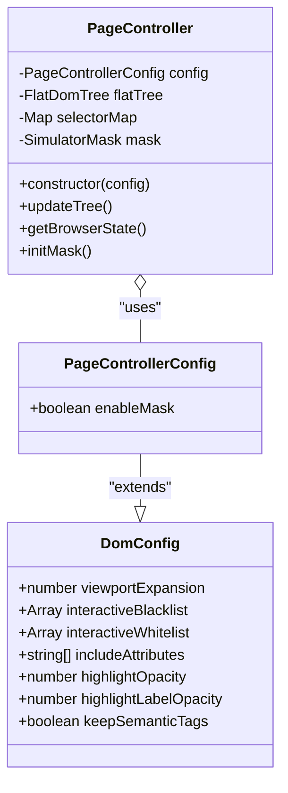
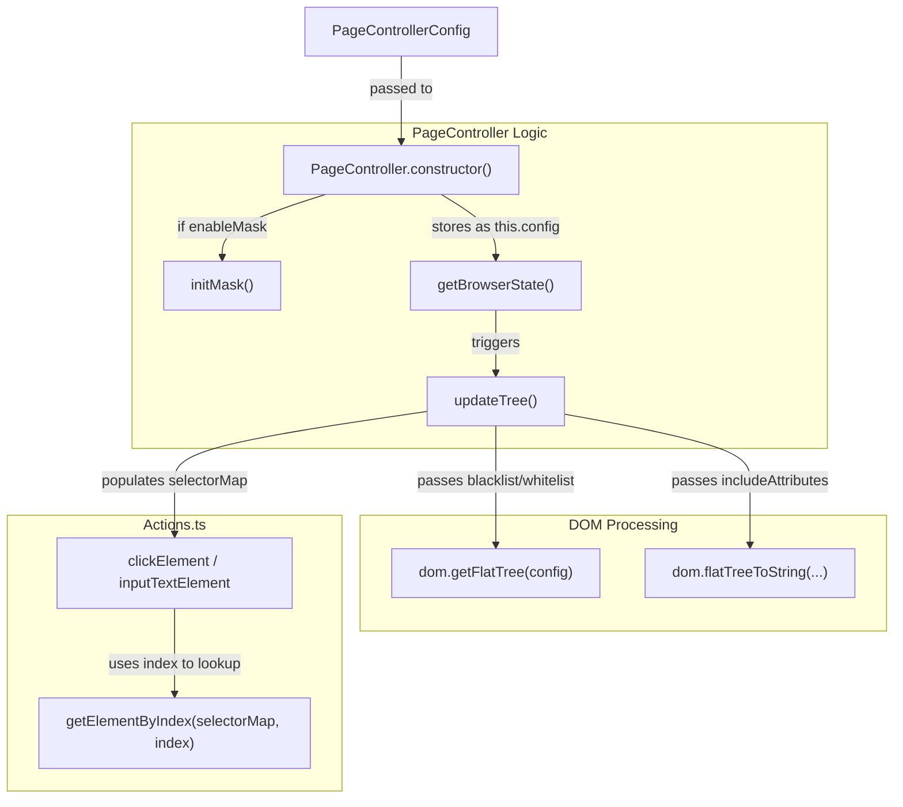

<!-- source: DeepWiki mcp.deepwiki.com · repo alibaba/page-agent · page 8.3 PageController Configuration · fetched 2026-10-29 -->

# PageController Configuration

<details>
<summary>Relevant source files</summary>

The following files were used as context for generating this wiki page:

- [packages/page-agent/src/PageAgent.ts](packages/page-agent/src/PageAgent.ts)
- [packages/page-controller/package.json](packages/page-controller/package.json)
- [packages/page-controller/src/PageController.ts](packages/page-controller/src/PageController.ts)
- [packages/page-controller/src/actions.ts](packages/page-controller/src/actions.ts)
- [packages/page-controller/src/utils/index.ts](packages/page-controller/src/utils/index.ts)
- [packages/ui/package.json](packages/ui/package.json)

</details>


## Purpose and Scope

This document covers the configuration options available for the `PageController` class, which manages DOM interaction, element detection, and browser state extraction. The `PageController` is configured via the `PageControllerConfig` interface, which extends `DomConfig` to provide control over visual feedback, viewport handling, element filtering, and DOM tree processing behavior.

For agent-level configuration such as `maxSteps` and `instructions`, see [8.1 Agent Configuration](). For LLM provider settings, see [8.2 LLM Configuration](). For the overall PageController architecture and methods, see [5.1 PageController Architecture]().

## Configuration Interface Structure

The `PageController` configuration is defined through two interfaces that form an inheritance hierarchy. The configuration is consumed by `PageController` to initialize its state and internal components like the `SimulatorMask`.

**PageController Config Entity Association**


**Sources:** [packages/page-controller/src/PageController.ts:26-29](), [packages/page-controller/src/PageController.ts:58-97]()

## Configuration Options Reference

### enableMask

**Type:** `boolean`  
**Default:** `true` (when initialized via `PageAgent`)  
**Purpose:** Controls whether the visual mask overlay is initialized and available for use during automation.

When enabled, the `PageController` dynamically imports the `SimulatorMask` component. The mask provides visual feedback to users during automation (like a virtual cursor) and blocks user interaction with the page while the agent is acting.

```typescript
const controller = new PageController({
  enableMask: true
});
```

The mask is implemented as a lazy-loaded module to avoid CSS loading issues in non-browser environments (e.g., unit tests in Node.js). The initialization process is tracked through the `maskReady` promise in `initMask()`.

**Sources:** [packages/page-controller/src/PageController.ts:28](), [packages/page-controller/src/PageController.ts:102-108](), [packages/page-agent/src/PageAgent.ts:19-20]()

### viewportExpansion

**Type:** `number`  
**Default:** `-1` (full page)  
**Purpose:** Controls which portion of the page is included in DOM tree extraction.

This setting determines the scope of interactive elements detected and included in the `BrowserState` sent to the LLM. It is resolved using `dom.resolveViewportExpansion`.

| Value | Behavior | Use Case |
|-------|----------|----------|
| `-1` | Full page extraction | Default behavior, captures all interactive elements regardless of scroll position |
| `0` | Viewport only | Restricts extraction to elements currently visible in the window |
| `> 0` | Viewport + pixels | Expands viewport by specified pixel amount for context |

The setting affects the header and footer hints in `BrowserState` generated by `getBrowserState()`. If expansion is not `-1`, the system adds scroll hints like `... X pixels above ...` or `... Y pixels below ...`.

**Sources:** [packages/page-controller/src/PageController.ts:133-163](), [packages/page-controller/src/PageController.ts:34-43]()

### interactiveBlacklist

**Type:** `(Element | (() => Element))[]`  
**Default:** `[]`  
**Purpose:** Excludes specific elements from being detected as interactive.

Elements in the blacklist are filtered out during DOM tree processing in `updateTree()` and will not receive highlight indices or appear in the simplified HTML. The configuration accepts both direct element references and functions.

The blacklist is also automatically populated with elements marked with the `data-page-agent-not-interactive` attribute during the update cycle.

**Sources:** [packages/page-controller/src/PageController.ts:186-194]()

### interactiveWhitelist

**Type:** `(Element | (() => Element))[]`  
**Default:** `[]`  
**Purpose:** Forces specific elements to be treated as interactive, overriding the default detection logic.

This is useful for custom components or elements that don't match standard interactive element patterns (like a `div` with a custom click listener) but should be made available to the agent.

**Sources:** [packages/page-controller/src/PageController.ts:191-194]()

### includeAttributes

**Type:** `string[]`  
**Purpose:** Controls which HTML attributes are included in the simplified HTML representation.

The system uses these to provide semantic context (like `placeholder`, `aria-label`, `title`) without overwhelming the LLM with unnecessary data like style or internal IDs.

**Sources:** [packages/page-controller/src/PageController.ts:198-199]()

### keepSemanticTags

**Type:** `boolean`  
**Default:** `false`  
**Purpose:** Preserve semantic landmark tags (e.g., `nav`, `header`, `footer`) in the dehydrated output even if they are not directly interactive.

**Sources:** [packages/page-controller/src/PageController.ts:199]()

## Configuration Flow and Implementation

The following diagram shows how configuration options flow from initialization through to DOM processing and action execution within the `PageController` lifecycle.

**Data Flow from Config to Execution**


**Sources:** [packages/page-controller/src/PageController.ts:89-97](), [packages/page-controller/src/PageController.ts:129-165](), [packages/page-controller/src/PageController.ts:174-219](), [packages/page-controller/src/actions.ts:23-42]()

## Action Configuration & Side Effects

Configuration affects how actions are executed. For example, `clickElement` and `inputTextElement` rely on the `selectorMap` generated during the last `updateTree()` call.

1.  **Mask Interaction**: During `updateTree()`, the `PageController` temporarily sets `pointerEvents = 'none'` on the mask to allow the DOM extraction logic to "see" the underlying elements without the mask interfering with hit-tests.
2.  **Element Verification**: Before any index-based operation (like typing into an element at index 5), `assertIndexed()` is called to ensure `updateTree()` has been executed at least once.

```typescript
// Example of how config influences action execution
private assertIndexed(): void {
    if (!this.isIndexed) {
        throw new Error('PageController not indexed. Call updateTree() first.')
    }
}
```

**Sources:** [packages/page-controller/src/PageController.ts:180-182](), [packages/page-controller/src/PageController.ts:212-214](), [packages/page-controller/src/PageController.ts:235-239]()

## Integration with PageAgent

When using the top-level `PageAgent` class, the `PageControllerConfig` is merged into the main `PageAgentConfig`. The `PageAgent` constructor defaults `enableMask` to `true` if not specified.

```typescript
export type PageAgentConfig = AgentConfig & PageControllerConfig & Omit<PanelConfig, 'language'>

export class PageAgent extends PageAgentCore {
    constructor(config: PageAgentConfig) {
        const pageController = new PageController({
            ...config,
            enableMask: config.enableMask ?? true,
        })
        super({ ...config, pageController })
        // ...
    }
}
```

**Sources:** [packages/page-agent/src/PageAgent.ts:11-29]()

---

