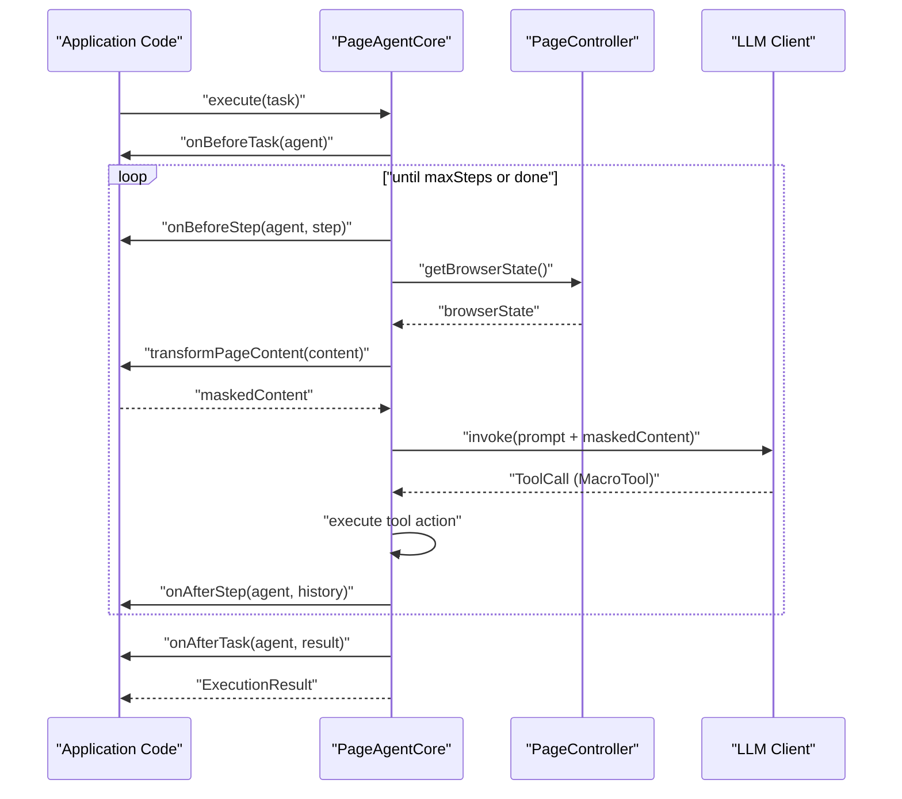
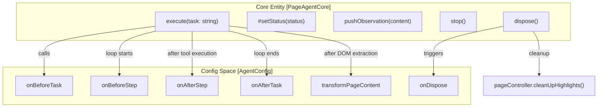

<!-- source: DeepWiki mcp.deepwiki.com · repo alibaba/page-agent · page 8.4 Lifecycle Hooks · fetched 2026-10-29 -->

# Lifecycle Hooks

<details>
<summary>Relevant source files</summary>

The following files were used as context for generating this wiki page:

- [packages/core/src/PageAgentCore.ts](packages/core/src/PageAgentCore.ts)
- [packages/core/src/types.ts](packages/core/src/types.ts)
- [packages/core/src/utils/index.ts](packages/core/src/utils/index.ts)
- [packages/ui/src/panel/Panel.ts](packages/ui/src/panel/Panel.ts)
- [packages/ui/src/panel/types.ts](packages/ui/src/panel/types.ts)

</details>


## Purpose and Scope

This document describes PageAgent's lifecycle hook system, which provides observation and intervention points throughout the agent's execution. Lifecycle hooks are callback functions defined in the `AgentConfig` that execute at specific stages during task execution, step processing, and agent disposal. They enable developers to monitor agent behavior, log execution details, implement custom control flow, or transform data before it reaches the LLM.

The hooks are primarily implemented within the `PageAgentCore` class, which manages the Re-act loop (Observe-Think-Act) [packages/core/src/PageAgentCore.ts:35-42]().

## Overview

PageAgent provides several lifecycle hooks that cover the complete execution lifecycle. These hooks are defined in the `AgentConfig` interface [packages/core/src/types.ts:70-114]() and integrated into the `PageAgentCore` execution flow.

| Hook | Timing | Purpose | File Reference |
|------|--------|---------|----------------|
| `onBeforeTask` | Before task execution begins | Initialize resources, validate preconditions | [packages/core/src/types.ts:97-97]() |
| `onAfterTask` | After task completes or fails | Cleanup, log results, report metrics | [packages/core/src/types.ts:105-105]() |
| `onBeforeStep` | Before each step starts | Log step start, modify state | [packages/core/src/types.ts:82-82]() |
| `onAfterStep` | After each step completes | Log step results, analyze history | [packages/core/src/types.ts:90-90]() |
| `onDispose` | When agent is disposed | Release resources, persist state | [packages/core/src/types.ts:114-114]() |
| `transformPageContent` | After DOM extraction | Mask sensitive data or modify LLM context | [packages/core/src/types.ts:148-148]() |

**Sources:** [packages/core/src/types.ts:70-161](), [packages/core/src/PageAgentCore.ts:29-30]()

## Hook Definitions

### onBeforeTask
Called once before the agent begins processing a task, immediately after `execute()` is invoked but before the execution loop starts.
- **Parameters**: `agent: PageAgentCore`
- **Execution Site**: `PageAgentCore.execute` calls this immediately after initializing the task state [packages/core/src/PageAgentCore.ts:233-233]().

### onAfterTask
Called once after task execution completes, whether successful, failed, or manually stopped. It receives the final `ExecutionResult`.
- **Parameters**: `agent: PageAgentCore`, `result: ExecutionResult`
- **Execution Site**: Triggered at the end of the `execute` method's `finally` block [packages/core/src/PageAgentCore.ts:354-354]().

### onBeforeStep
Called at the beginning of every iteration in the Re-act loop, before the "Observe" phase (DOM extraction).
- **Parameters**: `agent: PageAgentCore`, `stepCount: number`
- **Execution Site**: Inside the `while` loop of `PageAgentCore.execute` [packages/core/src/PageAgentCore.ts:258-258]().

### onAfterStep
Called after a step completes, which includes the LLM "Think" phase and the "Act" phase (tool execution). It receives the current `history` of events.
- **Parameters**: `agent: PageAgentCore`, `history: HistoricalEvent[]`
- **Execution Site**: After the tool execution result is processed and added to history [packages/core/src/PageAgentCore.ts:341-341]().

### transformPageContent
A specialized hook called after the `PageController` extracts and simplifies the DOM, but before the content is sent to the LLM. This is the primary mechanism for PII masking.
- **Parameters**: `content: string` (The simplified HTML/Text)
- **Returns**: `Promise<string> | string`
- **Execution Site**: Within the step loop, before the LLM prompt is assembled [packages/core/src/PageAgentCore.ts:269-269]().

### onDispose
Triggered when the agent's `dispose()` method is called. This hook can be asynchronous and will block the disposal process until completion.
- **Parameters**: `agent: PageAgentCore`, `reason?: string`
- **Execution Site**: Within the `PageAgentCore.dispose` method [packages/core/src/PageAgentCore.ts:373-373]().

**Sources:** [packages/core/src/PageAgentCore.ts:210-376](), [packages/core/src/types.ts:70-161]()

## Data Flow and Execution Loop

The following diagram illustrates how hooks are interleaved with the core logic of `PageAgentCore.execute()`.

### Hook Invocation Flow

**Sources:** [packages/core/src/PageAgentCore.ts:210-360](), [packages/core/src/types.ts:70-161]()

## Implementation in Code Space

This diagram bridges the high-level hook concepts to the specific properties in the `AgentConfig` and the methods in `PageAgentCore`.

### Code Entity Mapping

**Sources:** [packages/core/src/PageAgentCore.ts:61-376](), [packages/core/src/types.ts:10-161]()

## Usage Examples

### PII Masking with transformPageContent
This hook allows developers to intercept the page content and redact sensitive information before the LLM sees it [packages/core/src/types.ts:143-148]().

```typescript
const agent = new PageAgentCore({
  pageController: controller,
  transformPageContent: async (content) => {
    // Redact phone numbers and emails
    return content
      .replace(/\d{3}-\d{3}-\d{4}/g, '[REDACTED PHONE]')
      .replace(/\S+@\S+\.\S+/g, '[REDACTED EMAIL]');
  }
});
```
**Sources:** [packages/core/src/types.ts:142-148](), [packages/core/src/PageAgentCore.ts:269-269]()

### Step Monitoring with onAfterStep
Use this to track progress or analyze the agent's historical events [packages/core/src/types.ts:85-90]().

```typescript
const agent = new PageAgentCore({
  pageController: controller,
  onAfterStep: (agent, history) => {
    const lastEvent = history[history.length - 1];
    if (lastEvent.type === 'step') {
      console.log(`Step ${lastEvent.stepIndex} finished`);
    }
  }
});
```
**Sources:** [packages/core/src/types.ts:85-90](), [packages/core/src/PageAgentCore.ts:341-341]()

### Disposal Cleanup
The `onDispose` hook is triggered when the agent is terminal and cannot be reused [packages/core/src/types.ts:108-114]().

```typescript
const agent = new PageAgentCore({
  pageController: controller,
  onDispose: (agent, reason) => {
    console.log(`Agent ${agent.id} disposed. Reason: ${reason}`);
    // Custom cleanup like closing external connections
  }
});
```
**Sources:** [packages/core/src/types.ts:108-114](), [packages/core/src/PageAgentCore.ts:373-373]()

## Summary of Execution Result
The `onAfterTask` hook receives the `ExecutionResult` object, which contains the final state of the task [packages/core/src/types.ts:105-105]().

| Property | Type | Description |
|----------|------|-------------|
| `success` | `boolean` | Whether the task reached a "done" state |
| `message` | `string` | Final summary or error message |
| `history` | `HistoricalEvent[]` | The full sequence of steps and observations |

**Sources:** [packages/core/src/types.ts:275-280](), [packages/core/src/PageAgentCore.ts:354-354]()

---

