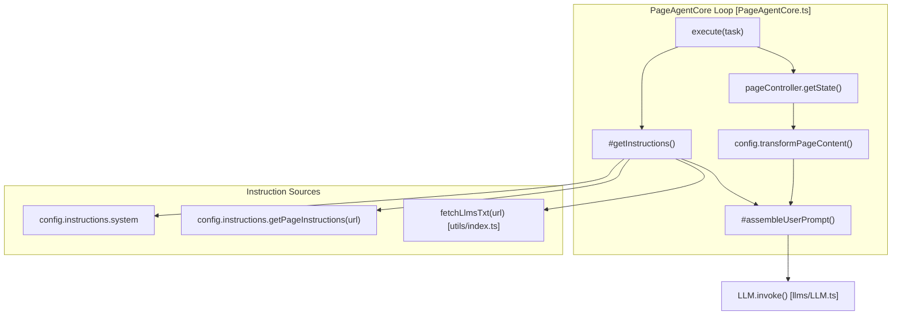
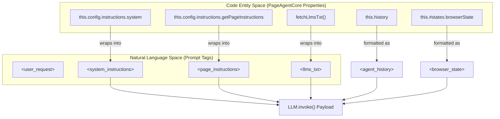

<!-- source: DeepWiki mcp.deepwiki.com · repo alibaba/page-agent · page 8.5 Custom Instructions · fetched 2026-10-29 -->

# Custom Instructions

<details>
<summary>Relevant source files</summary>

The following files were used as context for generating this wiki page:

- [packages/core/src/PageAgentCore.ts](packages/core/src/PageAgentCore.ts)
- [packages/core/src/utils/index.ts](packages/core/src/utils/index.ts)
- [packages/website/src/pages/docs/features/custom-instructions/page.tsx](packages/website/src/pages/docs/features/custom-instructions/page.tsx)
- [packages/website/src/pages/docs/features/data-masking/page.tsx](packages/website/src/pages/docs/features/data-masking/page.tsx)

</details>


This document explains the instruction system that guides PageAgent's behavior. Instructions provide domain-specific knowledge, behavioral guidelines, and page-specific rules to the LLM during task execution.

---

## Purpose and Scope

The instruction system allows developers to inject custom knowledge into the agent's decision-making process. Instructions are assembled and included in the prompt before each LLM invocation, enabling:

- **System-wide guidelines**: Global rules that apply to all tasks across all pages.
- **Page-specific rules**: Dynamic instructions based on the current URL.
- **Site-provided hints**: Integration with the `/llms.txt` convention for site-specific guidance.
- **Data Transformation**: Sanitizing or modifying page content before it reaches the LLM.

Instructions augment the default system prompts defined in `packages/core/src/prompts/system_prompt.md` [packages/core/src/PageAgentCore.ts:11]() or `packages/extension/src/agent/system_prompt.md`. They provide additional context that helps the agent navigate complex workflows and respect business rules.

---

## Configuration Interface

The `instructions` field and related hooks in `AgentConfig` define how custom instructions and content transformations are provided:

```typescript
export interface AgentConfig extends LLMConfig {
	instructions?: {
		/** Global system-level instructions, applied to all tasks */
		system?: string

		/**
		 * Dynamic page-level instructions callback
		 * Called before each step to get instructions for the current page
		 */
		getPageInstructions?: (url: string) => string | undefined | null
	}
    /** Fetch /llms.txt from current site origin and include as context */
	experimentalLlmsTxt?: boolean
    /** Completely override the default system prompt */
	customSystemPrompt?: string
    /** Transform page content before sending to LLM (e.g., for data masking) */
    transformPageContent?: (content: string) => Promise<string> | string
}
```

Sources: [packages/website/src/pages/docs/features/custom-instructions/page.tsx:32-44](), [packages/website/src/pages/docs/features/custom-instructions/page.tsx:62-89](), [packages/website/src/pages/docs/features/data-masking/page.tsx:25-32](), [packages/core/src/PageAgentCore.ts:13-23]()

---

## Instruction Types

### System Instructions

System-level instructions are static text applied to every task regardless of the current page. Use this for global behavioral rules, organizational policies, or defining a specific persona.

**Configuration:**
```typescript
const agent = new PageAgent({
  instructions: {
    system: "You are a professional e-commerce assistant. Always confirm before submitting orders."
  }
})
```

System instructions are wrapped in `<system_instructions>` tags when assembled into the prompt [packages/website/src/pages/docs/features/custom-instructions/page.tsx:108-111]().

Sources: [packages/website/src/pages/docs/features/custom-instructions/page.tsx:32-44]()

---

### Page-Level Instructions

Page-level instructions are dynamically generated based on the current page URL. The `getPageInstructions` callback is invoked before each step. This is useful for providing targeted guidance on specific routes (e.g., checkout pages vs. product listings).

**Configuration:**
```typescript
const agent = new PageAgent({
  instructions: {
    getPageInstructions: (url) => {
      if (url.includes('/checkout')) {
        return "Verify shipping address before proceeding."
      }
      return undefined
    }
  }
})
```

The callback receives the full URL and returns a string which is then wrapped in `<page_instructions>` tags [packages/website/src/pages/docs/features/custom-instructions/page.tsx:112-115]().

Sources: [packages/website/src/pages/docs/features/custom-instructions/page.tsx:62-89]()

---

### llms.txt Integration

PageAgent supports the `/llms.txt` convention for site-specific guidance. When `experimentalLlmsTxt` is enabled, the agent uses `fetchLlmsTxt` to retrieve guidance directly from the website's origin [packages/core/src/utils/index.ts:83-115]().

**Implementation Details:**
- **Caching**: Results are cached in `llmsTxtCache` per origin to avoid redundant network requests [packages/core/src/utils/index.ts:80-93]().
- **Timeout**: Fetches have a 3000ms timeout via `AbortSignal.timeout(3000)` [packages/core/src/utils/index.ts:99]().
- **Truncation**: Content is truncated to 1000 characters to preserve context window space [packages/core/src/utils/index.ts:103-106]().

Sources: [packages/core/src/utils/index.ts:80-115]()

---

## Data Masking and Transformation

The `transformPageContent` hook allows modifying the browser state content before it is presented to the LLM. This is primarily used for **Data Masking** to hide sensitive information like phone numbers, emails, or IDs.

**Example Masking Patterns:**
| Data Type | Regex Pattern | Replacement |
| :--- | :--- | :--- |
| China Phone | `/\b(1[3-9]\d)(\d{4})(\d{4})\b/g` | `$1****$3` |
| Email | `/\b([a-zA-Z0-9._%+-])[^@]*(@[a-zA-Z0-9.-]+\.[a-zA-Z]{2,})\b/g` | `$1***$2` |
| China ID | `/\b(\d{6})(19\|20\d{2})(0[1-9]\|1[0-2])(0[1-9]\|[12]\d\|3[01])(\d{3}[\dXx])\b/g` | `$1********$5` |
| Bank Card | `/\b(\d{4})\d{8,11}(\d{4})\b/g` | `$1********$2` |

Sources: [packages/website/src/pages/docs/features/data-masking/page.tsx:47-69]()

---

## Instruction Assembly Flow

The following diagram shows how the `PageAgentCore` gathers instructions and transforms content during the execution loop.

**Instruction and Content Processing Flow**



Sources: [packages/core/src/PageAgentCore.ts:210-240](), [packages/core/src/utils/index.ts:83-115](), [packages/website/src/pages/docs/features/custom-instructions/page.tsx:93-119](), [packages/website/src/pages/docs/features/data-masking/page.tsx:25-32]()

---

## Prompt Structure Mapping

This diagram bridges the natural language directives provided by developers to the internal prompt assembly logic within `PageAgentCore`.

**Context Space Mapping**



Sources: [packages/core/src/PageAgentCore.ts:61-106](), [packages/website/src/pages/docs/features/custom-instructions/page.tsx:107-119]()

---

## Best Practices

1.  **Token Efficiency**: Instructions are included in every LLM call. Keep them concise. PageAgent automatically truncates `llms.txt` to 1000 chars [packages/core/src/utils/index.ts:103-106]().
2.  **Contextual Relevance**: Use `getPageInstructions` for logic that only applies to specific URLs to avoid cluttering the context window on unrelated pages [packages/website/src/pages/docs/features/custom-instructions/page.tsx:54-58]().
3.  **Language Consistency**: Ensure custom instructions match the target language if the agent is operating in a non-English environment.
4.  **Safety First**: Use `transformPageContent` to ensure PII (Personally Identifiable Information) never leaves the client environment before being sent to the LLM [packages/website/src/pages/docs/features/data-masking/page.tsx:12-16]().

Sources: [packages/core/src/utils/index.ts:103-106](), [packages/website/src/pages/docs/features/custom-instructions/page.tsx:54-58](), [packages/website/src/pages/docs/features/data-masking/page.tsx:12-16]()

---

