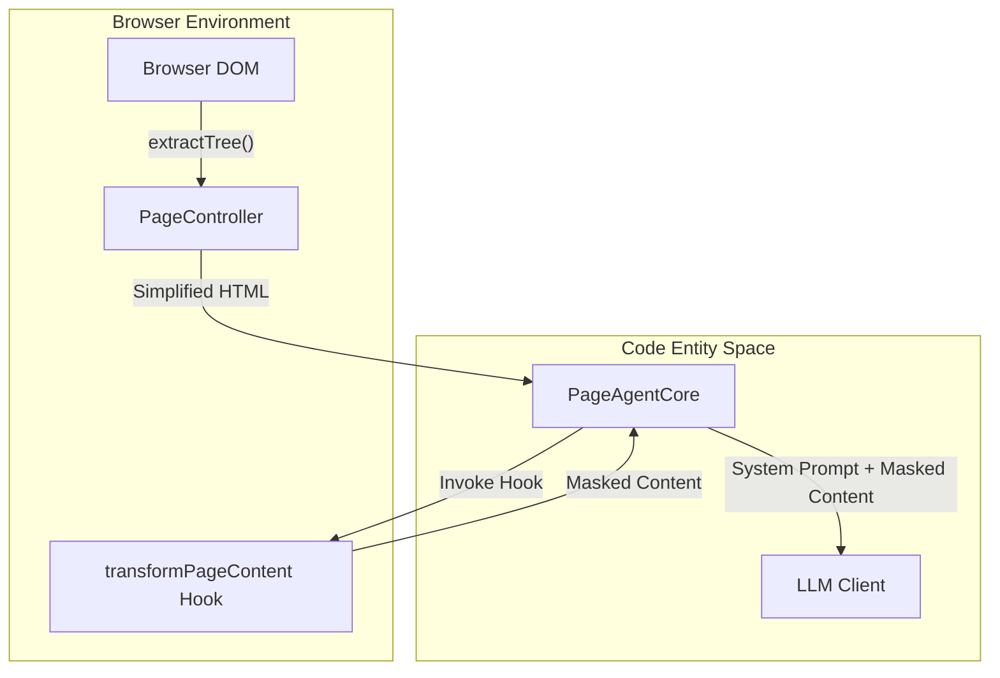
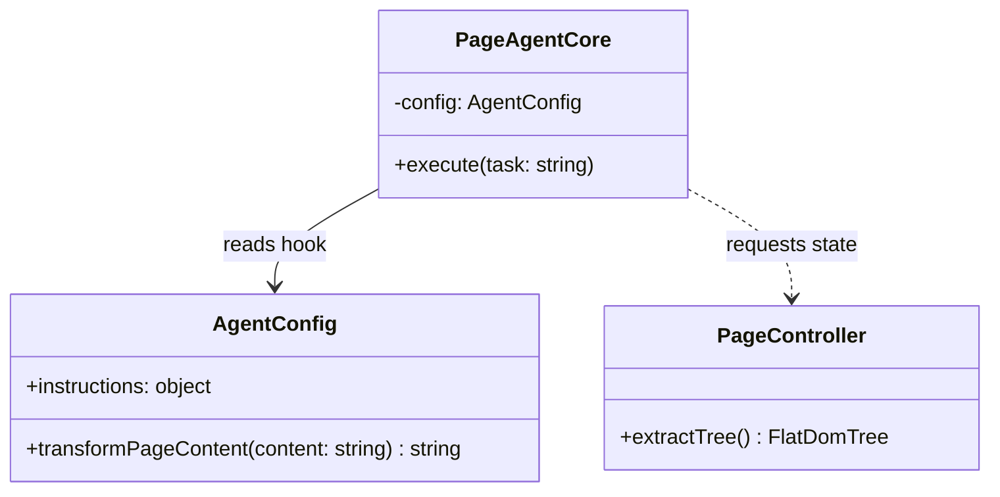

<!-- source: DeepWiki mcp.deepwiki.com · repo alibaba/page-agent · page 8.6 Data Masking and Content Transformation · fetched 2026-10-29 -->

# Data Masking and Content Transformation

<details>
<summary>Relevant source files</summary>

The following files were used as context for generating this wiki page:

- [packages/core/src/types.ts](packages/core/src/types.ts)
- [packages/ui/src/panel/Panel.ts](packages/ui/src/panel/Panel.ts)
- [packages/ui/src/panel/types.ts](packages/ui/src/panel/types.ts)
- [packages/website/src/pages/docs/features/custom-instructions/page.tsx](packages/website/src/pages/docs/features/custom-instructions/page.tsx)
- [packages/website/src/pages/docs/features/data-masking/page.tsx](packages/website/src/pages/docs/features/data-masking/page.tsx)

</details>


Data masking and content transformation in PageAgent provide a critical security and privacy layer. By utilizing the `transformPageContent` hook, developers can intercept the simplified DOM representation after extraction but before it is transmitted to the Large Language Model (LLM). This ensures that sensitive information such as personally identifiable information (PII), credentials, or internal identifiers are redacted or modified within the client environment.

## Overview and Purpose

The primary goal of content transformation is to maintain data privacy without sacrificing the agent's ability to understand the page structure. The `transformPageContent` function is a lifecycle hook defined in the `AgentConfig` [packages/core/src/types.ts:135-148](). It acts on the "Simplified HTML" generated by the `PageController` system.

### Data Flow for Content Transformation

The following diagram illustrates how page content is processed and where the transformation hook intercepts the data flow.

**Content Processing Pipeline**



**Sources:** [packages/core/src/types.ts:135-148](), [packages/website/src/pages/docs/features/data-masking/page.tsx:12-16]()

## Implementation

The `transformPageContent` hook is part of the `AgentConfig` interface [packages/core/src/types.ts:10-161](). It accepts the extracted string content and returns a modified string (or a Promise resolving to one).

### API Definition
The hook is defined as follows:
```typescript
transformPageContent?: (content: string) => Promise<string> | string
```
**Sources:** [packages/core/src/types.ts:148](), [packages/website/src/pages/docs/features/data-masking/page.tsx:25-31]()

### Hook Invocation Logic
1. **DOM Extraction**: The `PageController` processes the active tab's DOM into a `FlatDomTree` and subsequently into a simplified HTML string.
2. **Transformation**: `PageAgentCore` receives this string and checks if `transformPageContent` is defined in the configuration.
3. **LLM Submission**: The result of the transformation is bundled into the prompt context and sent to the LLM provider.

**Entity Association Diagram**



**Sources:** [packages/core/src/types.ts:135-148](), [packages/ui/src/panel/types.ts:30-81]()

## Common Masking Patterns

Developers typically use Regular Expressions (Regex) within the hook to identify and replace sensitive patterns. Below are standard implementations for common data types.

| Data Type | Masking Strategy | Regex Example |
| :--- | :--- | :--- |
| **Phone Numbers** | Keep prefix/suffix, mask middle | `\b(1[3-9]\d)(\d{4})(\d{4})\b` |
| **Email Addresses** | Keep first char and domain | `\b([a-zA-Z0-9._%+-])[^@]*(@[a-zA-Z0-9.-]+\.[a-zA-Z]{2,})\b` |
| **ID Cards** | Keep prefix and last char | `\b(\d{6})(19|20\d{2})(0[1-9]|1[0-2])(0[1-9]|[12]\d|3[01])(\d{3}[\dXx])\b` |
| **Bank Cards** | Keep first 4 and last 4 | `\b(\d{4})\d{8,11}(\d{4})\b` |

### Code Example: Multi-Pattern Masking

```typescript
const agent = new PageAgent({
  transformPageContent: async (content) => {
    // 1. China phone number (11 digits starting with 1)
    content = content.replace(/\b(1[3-9]\d)(\d{4})(\d{4})\b/g, '$1****$3');

    // 2. Email address (e.g., u***@example.com)
    content = content.replace(
      /\b([a-zA-Z0-9._%+-])[^@]*(@[a-zA-Z0-9.-]+\.[a-zA-Z]{2,})\b/g,
      '$1***$2'
    );

    // 3. Bank card number (16-19 digits)
    content = content.replace(/\b(\d{4})\d{8,11}(\d{4})\b/g, '$1********$2');

    return content;
  }
});
```
**Sources:** [packages/website/src/pages/docs/features/data-masking/page.tsx:47-70](), [packages/core/src/types.ts:143-147]()

## Security Considerations

*   **Experimental Tools**: Note that the `experimentalScriptExecutionTool` [packages/core/src/types.ts:124]() may bypass some data-masking mechanisms if the LLM generates code to read the DOM directly via `eval`.
*   **Prompt Injection**: While masking protects data sent *to* the LLM, developers should still ensure that instructions [packages/core/src/types.ts:54-67]() do not inadvertently encourage the LLM to seek out masked values.
*   **Performance**: Since this hook is called before every step in the Re-act loop, expensive transformation logic (e.g., calling an external NLP service for PII detection) will increase the latency of each agent action.

**Sources:** [packages/core/src/types.ts:119-124](), [packages/website/src/pages/docs/features/custom-instructions/page.tsx:93-133]()

---

