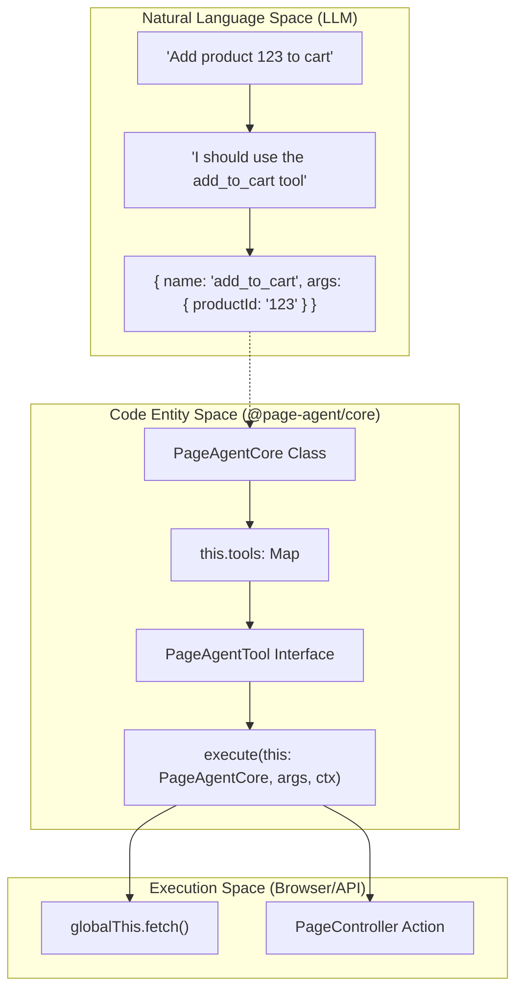
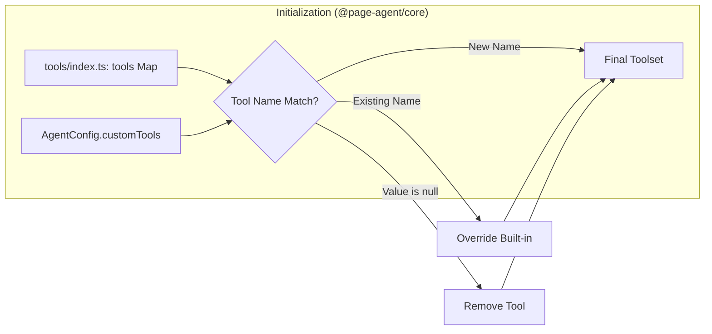

<!-- source: DeepWiki mcp.deepwiki.com · repo alibaba/page-agent · page 9 Custom Tools System · fetched 2026-10-29 -->

# Custom Tools System

Relevant source files

The following files were used as context for generating this wiki page:

- [packages/core/src/tools/index.ts](packages/core/src/tools/index.ts)
- [packages/extension/src/agent/TabsController.test.ts](packages/extension/src/agent/TabsController.test.ts)
- [packages/extension/src/agent/tabTools.ts](packages/extension/src/agent/tabTools.ts)
- [packages/extension/vitest.config.js](packages/extension/vitest.config.js)
- [packages/website/src/pages/docs/advanced/custom-ui/page.tsx](packages/website/src/pages/docs/advanced/custom-ui/page.tsx)
- [packages/website/src/pages/docs/advanced/page-agent/page.tsx](packages/website/src/pages/docs/advanced/page-agent/page.tsx)
- [packages/website/src/pages/docs/features/custom-tools/page.tsx](packages/website/src/pages/docs/features/custom-tools/page.tsx)
- [packages/website/src/pages/docs/introduction/limitations/page.tsx](packages/website/src/pages/docs/introduction/limitations/page.tsx)
- [packages/website/src/pages/docs/introduction/overview/page.tsx](packages/website/src/pages/docs/introduction/overview/page.tsx)
- [packages/website/src/pages/docs/introduction/quick-start/page.tsx](packages/website/src/pages/docs/introduction/quick-start/page.tsx)

## Purpose and Scope

The Custom Tools System enables developers to extend PageAgent's capabilities by defining new actions that the LLM can invoke, overriding built-in tools with custom implementations, or removing tools entirely. This system provides the primary extensibility mechanism for adapting PageAgent to domain-specific workflows, enterprise requirements, or specialized use cases.

This is a **parent page**. For implementation details, refer to the following child pages:
- **[Tool Definition](#9.1)**: Explains the `PageAgentTool` interface, Zod schemas, and execution logic.
- **[Registering and Managing Tools](#9.2)**: Documents how to add, override, or remove tools via configuration.
- **[Built-in Tools Reference](#9.3)**: Provides a comprehensive list of standard browser and tab management tools.

## Tool System Architecture

The tool system is integrated into the `PageAgentCore` class, which maintains a registry of available tools used during the **Observe-Think-Act** loop. The LLM interacts with these tools through a schema-driven interface that leverages **Zod** (specifically `zod/v4`) for validation [packages/core/src/tools/index.ts:5](), [packages/website/src/pages/docs/features/custom-tools/page.tsx:28-32]().

### Natural Language to Code Entity Mapping

The following diagram bridges the gap between the LLM's natural language tool calls and the underlying TypeScript entities.

**Sources:** [packages/core/src/tools/index.ts:21-26](), [packages/website/src/pages/docs/features/custom-tools/page.tsx:53-67]()

## Tool Definition Overview

A tool is defined by the `PageAgentTool` interface. It requires a natural language `description` to guide the LLM, an `inputSchema` defined via **Zod** for validation and type inference, and an `execute` function that performs the actual work [packages/core/src/tools/index.ts:21-26]().

| Component | Code Entity | Role |
|-----------|-------------|------|
| **Description** | `description: string` | Instructs the LLM on when and how to use the tool [packages/core/src/tools/index.ts:23](). |
| **Schema** | `inputSchema: z.ZodType` | Defines parameters (e.g., `productId`, `index`) and validates LLM output [packages/core/src/tools/index.ts:24](). |
| **Logic** | `execute: Function` | Implementation that has access to `PageAgentCore` via `this` and an `AbortSignal` for cancellation [packages/core/src/tools/index.ts:25](). |

For details, see **[Tool Definition](#9.1)**.

**Sources:** [packages/core/src/tools/index.ts:14-26](), [packages/website/src/pages/docs/features/custom-tools/page.tsx:20-32]()

## Registering and Managing Tools

Tools are managed during the instantiation of `PageAgent`. The configuration allows users to pass a `customTools` record to modify the agent's capabilities [packages/website/src/pages/docs/features/custom-tools/page.tsx:49-50]().

### Tool Registry Flow

The diagram below illustrates how built-in tools are merged with user-defined custom tools during initialization.

**Sources:** [packages/core/src/tools/index.ts:36-38](), [packages/website/src/pages/docs/features/custom-tools/page.tsx:91-109]()

### Key Management Capabilities:
- **Adding**: Introduce domain-specific tools like `add_to_cart` or `search_knowledge_base` [packages/website/src/pages/docs/features/custom-tools/page.tsx:53-84]().
- **Overriding**: Replace default behavior by using an existing tool name in the `customTools` configuration [packages/website/src/pages/docs/features/custom-tools/page.tsx:91-98]().
- **Removing**: Disable tools (e.g., `execute_javascript` or `scroll`) by setting them to `null` in the config [packages/website/src/pages/docs/features/custom-tools/page.tsx:102-106]().

For details, see **[Registering and Managing Tools](#9.2)**.

## Built-in Tools Reference

PageAgent provides a robust set of default tools for web automation. These are categorized into core interaction tools and extension-specific tab management tools.

### Core Interaction Tools
Located in `@page-agent/core`, these handle basic DOM operations via the `PageController` [packages/core/src/tools/index.ts:38-198]():
- `click_element_by_index`: Interaction with buttons/links [packages/core/src/tools/index.ts:94-105]().
- `input_text`: Typing into forms [packages/core/src/tools/index.ts:108-120]().
- `select_dropdown_option`: Selecting from `<select>` elements [packages/core/src/tools/index.ts:123-136]().
- `scroll`: Moving through the viewport vertically [packages/core/src/tools/index.ts:142-160]().
- `wait`: Pausing execution, accounting for LLM latency [packages/core/src/tools/index.ts:55-73]().
- `ask_user`: Requesting clarification from the user [packages/core/src/tools/index.ts:76-91]().
- `execute_javascript`: Running custom scripts (requires caution) [packages/core/src/tools/index.ts:183-198]().
- `done`: Finalizing the task [packages/core/src/tools/index.ts:38-52]().

### Extension Tab Tools
When running in the Chrome Extension context, tools created via `createTabTools` are injected to manage browser tabs [packages/extension/src/agent/tabTools.ts:25-77]():
- `open_new_tab`: Opens a URL in a new tab [packages/extension/src/agent/tabTools.ts:27-43]().
- `switch_to_tab`: Switches focus between existing tabs [packages/extension/src/agent/tabTools.ts:45-59]().
- `close_tab`: Closes specific tabs [packages/extension/src/agent/tabTools.ts:61-75]().

For a full list of parameters and schemas, see **[Built-in Tools Reference](#9.3)**.

**Sources:** [packages/core/src/tools/index.ts:38-198](), [packages/extension/src/agent/tabTools.ts:25-77]()

---

