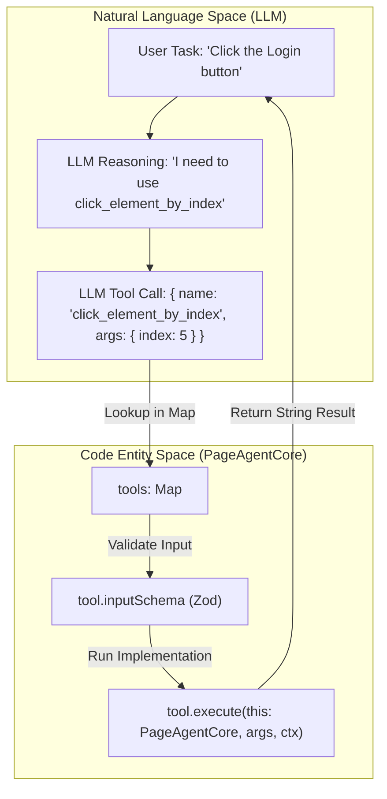
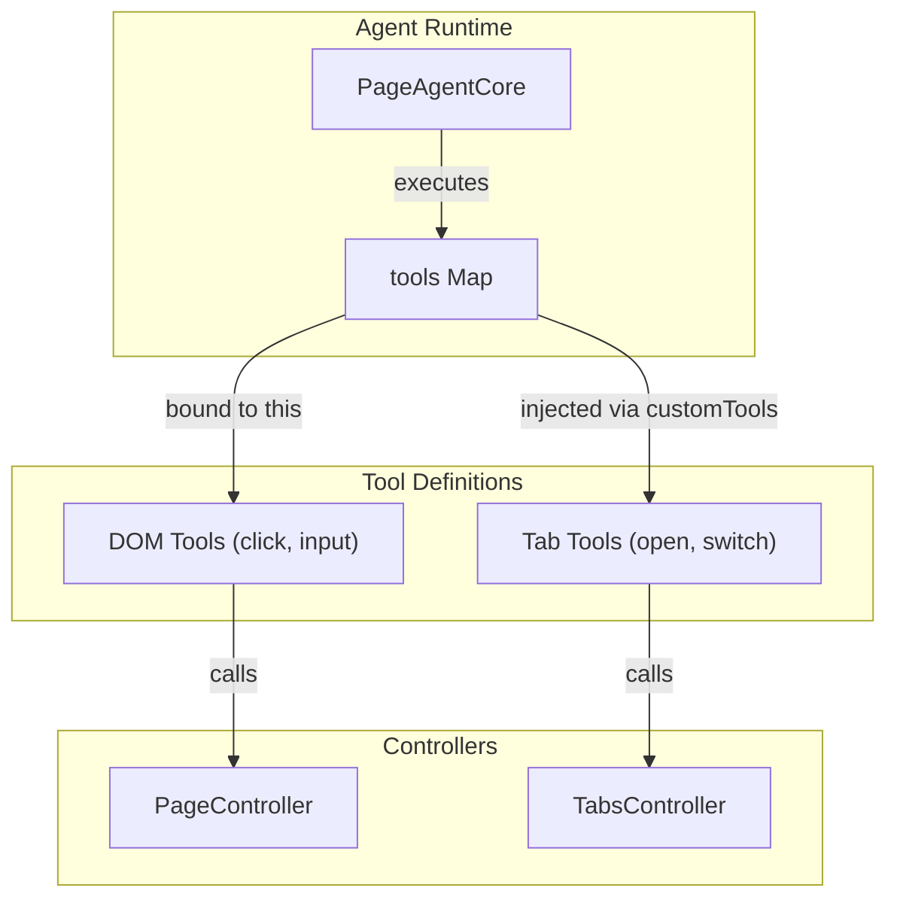

<!-- source: DeepWiki mcp.deepwiki.com · repo alibaba/page-agent · page 9.1 Tool Definition · fetched 2026-10-29 -->

# Tool Definition

<details>
<summary>Relevant source files</summary>

The following files were used as context for generating this wiki page:

- [packages/core/src/tools/index.ts](packages/core/src/tools/index.ts)
- [packages/extension/src/agent/TabsController.test.ts](packages/extension/src/agent/TabsController.test.ts)
- [packages/extension/src/agent/tabTools.ts](packages/extension/src/agent/tabTools.ts)
- [packages/extension/vitest.config.js](packages/extension/vitest.config.js)
- [packages/llms/src/types.ts](packages/llms/src/types.ts)

</details>


## Purpose and Scope

This document explains the technical implementation of the `Tool` interface within PageAgent. It details how tools are defined using Zod schemas for input validation, how they interact with the `PageAgentCore` context, and how the system bridges the gap between natural language instructions and executable code. It also covers the distinction between built-in DOM-level tools and extension-level tab management tools.

## Tool Interface and Structure

In PageAgent, a tool is a structured object that allows the LLM to perform actions on the browser or interact with the user. The core definition is found in the `Tool` interface (generic) and the `PageAgentTool` interface (core-specific).

### The Tool Interfaces

| Interface | File | Description |
|-----------|------|-------------|
| `Tool<TParams, TResult>` | [packages/llms/src/types.ts:28-33]() | LLM-agnostic definition using Zod for parameters. |
| `PageAgentTool<TParams>` | [packages/core/src/tools/index.ts:21-26]() | Internal definition bound to the `PageAgentCore` context (`this`). |
| `ToolContext` | [packages/core/src/tools/index.ts:14-16]() | Per-invocation context providing an `AbortSignal`. |

**Key Properties:**

| Property | Type | Description |
|----------|------|-------------|
| `description` | `string` | Natural language explanation used by the LLM to decide when to invoke the tool. |
| `inputSchema` | `z.ZodType<TParams>` | A Zod schema defining arguments. Converted to JSON Schema for the LLM. |
| `execute` | `Function` | An asynchronous function performing the action. |

### The `tool()` Helper
A utility function `tool<TParams>(options: PageAgentTool<TParams>)` is used to provide type inference and ensure that the implementation adheres to the expected structure.

**Implementation Reference:**
[packages/core/src/tools/index.ts:28-30]()

## Natural Language to Code Entity Mapping

The following diagram illustrates how a natural language request from an LLM is transformed into a concrete execution of a code entity (a Tool) within the agent system.

**LLM Tool Invocation Flow**

Sources: [packages/core/src/tools/index.ts:36-36](), [packages/core/src/tools/index.ts:94-105](), [packages/llms/src/types.ts:9-22]()

## Data Flow: Input Validation and Execution

When the LLM triggers a tool, the agent performs the following steps:
1. **Argument Parsing**: Raw arguments from the LLM (usually JSON strings) are parsed. [packages/llms/src/types.ts:17-17]()
2. **Validation**: The parsed arguments are validated against the `inputSchema` defined in the tool. [packages/core/src/tools/index.ts:24-24]()
3. **Execution Context**: The `execute` function is called. For internal tools, `this` is bound to `PageAgentCore`, granting access to `this.pageController`. [packages/core/src/tools/index.ts:25-25]()
4. **Cooperative Cancellation**: Tools receive a `ToolContext` containing an `AbortSignal`. Long-running tools like `wait` or `execute_javascript` must honor this signal. [packages/core/src/tools/index.ts:14-16](), [packages/core/src/tools/index.ts:67-67]()

### Example: `input_text` Implementation
```typescript
tools.set(
	'input_text',
	tool({
		description: 'Click and type text into an interactive input element',
		inputSchema: z.object({
			index: z.int().min(0),
			text: z.string(),
		}),
		execute: async function (this: PageAgentCore, input) {
			const result = await this.pageController.inputText(input.index, input.text)
			return result.message
		},
	})
)
```
Sources: [packages/core/src/tools/index.ts:108-120]()

## Built-in vs. Extension Tools

Tools are categorized by their execution environment and the controller they interact with.

### Core Browser Tools
Reside in `@page-agent/core` and focus on DOM interaction via `PageController`.

| Tool Name | Purpose | Implementation Detail |
|-----------|---------|-----------------------|
| `click_element_by_index` | Performs a click on a specific element index. | [packages/core/src/tools/index.ts:94-105]() |
| `input_text` | Types text into an element. | [packages/core/src/tools/index.ts:108-120]() |
| `scroll` | Vertical scrolling of the page or containers. | [packages/core/src/tools/index.ts:142-160]() |
| `execute_javascript` | Runs arbitrary JS in the page context. | [packages/core/src/tools/index.ts:183-198]() |
| `wait` | Pauses execution, subtracting LLM calling time from actual wait. | [packages/core/src/tools/index.ts:55-72]() |
| `ask_user` | Requests information from the user via callback. | [packages/core/src/tools/index.ts:76-91]() |
| `done` | Signals task completion and provides final text. | [packages/core/src/tools/index.ts:38-52]() |

### Extension Tab Tools
The Chrome extension introduces tools for multi-tab management via a `TabsController` instance. These are injected into the agent via the `customTools` configuration.

| Tool Name | Purpose | Key File |
|-----------|---------|----------|
| `open_new_tab` | Opens a URL in a new browser tab. | [packages/extension/src/agent/tabTools.ts:27-43]() |
| `switch_to_tab` | Changes the active tab context by ID. | [packages/extension/src/agent/tabTools.ts:45-59]() |
| `close_tab` | Closes a specific tab. | [packages/extension/src/agent/tabTools.ts:61-75]() |

## Tool Interaction Diagram

The following diagram shows how different tool implementations (Core vs. Extension) interface with the system components.

**Component Interaction for Tools**

Sources: [packages/core/src/tools/index.ts:25-25](), [packages/extension/src/agent/tabTools.ts:25-26](), [packages/core/src/tools/index.ts:101-101](), [packages/extension/src/agent/tabTools.ts:36-36]()

## Best Practices for Tool Definition

1. **Schema Constraints**: Use Zod's `.min()`, `.max()`, and `.default()` to prevent the LLM from passing invalid parameters. [packages/core/src/tools/index.ts:59-60]()
2. **Clear Feedback**: The string returned by `execute` is the only feedback the LLM receives. Include success markers (✅) or detailed error messages (❌). [packages/core/src/tools/index.ts:70-70](), [packages/extension/src/agent/tabTools.ts:40-40]()
3. **Cancellation Awareness**: Long-running async code MUST honor the `AbortSignal`. For example, the `execute_javascript` tool passes the signal to the controller and checks for abortion before returning. [packages/core/src/tools/index.ts:193-195]()
4. **Time Awareness**: The `wait` tool calculates the `actualWaitTime` by subtracting the time already spent on LLM processing since the last page update. [packages/core/src/tools/index.ts:63-67]()
5. **Generics Support**: The `Tool` interface supports generics `TParams` and `TResult` for type-safe integration in codebases consuming the LLM package. [packages/llms/src/types.ts:28-33]()

---

