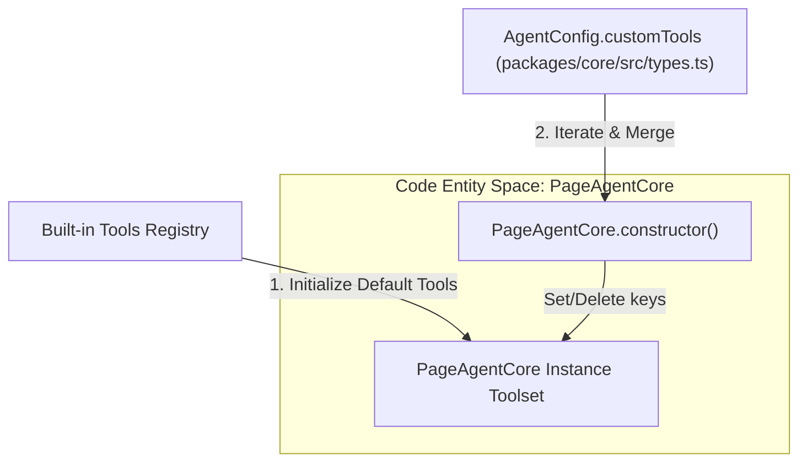
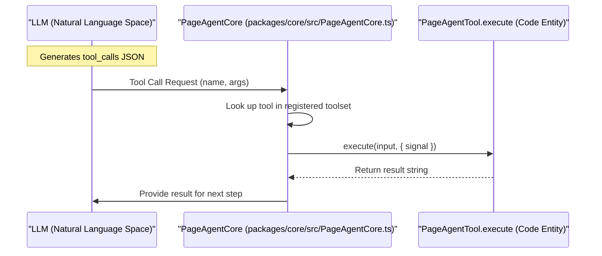

<!-- source: DeepWiki mcp.deepwiki.com · repo alibaba/page-agent · page 9.2 Registering and Managing Tools · fetched 2026-10-29 -->

# Registering and Managing Tools

<details>
<summary>Relevant source files</summary>

The following files were used as context for generating this wiki page:

- [packages/core/src/types.ts](packages/core/src/types.ts)
- [packages/ui/src/panel/Panel.ts](packages/ui/src/panel/Panel.ts)
- [packages/ui/src/panel/types.ts](packages/ui/src/panel/types.ts)
- [packages/website/src/pages/docs/advanced/custom-ui/page.tsx](packages/website/src/pages/docs/advanced/custom-ui/page.tsx)
- [packages/website/src/pages/docs/advanced/page-agent/page.tsx](packages/website/src/pages/docs/advanced/page-agent/page.tsx)
- [packages/website/src/pages/docs/features/custom-tools/page.tsx](packages/website/src/pages/docs/features/custom-tools/page.tsx)
- [packages/website/src/pages/docs/introduction/limitations/page.tsx](packages/website/src/pages/docs/introduction/limitations/page.tsx)
- [packages/website/src/pages/docs/introduction/overview/page.tsx](packages/website/src/pages/docs/introduction/overview/page.tsx)
- [packages/website/src/pages/docs/introduction/quick-start/page.tsx](packages/website/src/pages/docs/introduction/quick-start/page.tsx)

</details>


## Purpose and Scope

This page documents the `customTools` configuration system within `PageAgentCore`. It details how to add new capabilities, override existing internal tools, and remove tools from the agent's repertoire. The tool management system is the primary mechanism for extending the agent's "Code Entity Space" to include domain-specific business logic or specialized browser controls.

---

## Tool Registration via Configuration

Custom tools are registered during the initialization of `PageAgentCore` (or the `PageAgent` wrapper) through the `customTools` property in the `AgentConfig` object [packages/core/src/types.ts:10-50]().

### The customTools Interface
The `customTools` parameter is defined as a `Record<string, PageAgentTool | null>` [packages/core/src/types.ts:49]():
- **Key**: The name of the tool as it will appear to the LLM.
- **Value**: A `PageAgentTool` object (created via the `tool()` helper) or `null` to disable a tool [packages/core/src/types.ts:45-47]().

### Implementation Logic
When `PageAgentCore` is instantiated, it performs the following steps to manage its toolset:
1. Loads the default internal tools from the internal registry into a local collection.
2. Iterates through the `customTools` record provided in the config [packages/core/src/types.ts:49-50]().
3. If a tool value is `null`, it removes that tool from the available toolset [packages/core/src/types.ts:45-47]().
4. If a tool value is a `PageAgentTool`, it registers (or overwrites) the tool using the provided key [packages/core/src/types.ts:29-41]().
5. Checks the `experimentalScriptExecutionTool` flag; if false, the `execute_javascript` tool is restricted [packages/core/src/types.ts:119-124]().

**Sources:** [packages/core/src/types.ts:10-50](), [packages/core/src/types.ts:119-124]()

---

## Tool Management Operations

### 1. Defining and Adding New Tools
To extend the agent, define a tool using the `tool()` helper. Tools must include a `description`, an `inputSchema` (using Zod), and an `execute` function [packages/website/src/pages/docs/features/custom-tools/page.tsx:41-43](). 

**Note on Zod:** Page Agent requires Zod 3 (>=3.25.0) or Zod 4, imported specifically from the `zod/v4` subpath [packages/website/src/pages/docs/features/custom-tools/page.tsx:29-30]().

```typescript
import { z } from 'zod/v4';
import { tool, PageAgent } from 'page-agent';

const agent = new PageAgent({
  customTools: {
    add_to_cart: tool({
      description: 'Add a product to the shopping cart by its product ID.',
      inputSchema: z.object({
        productId: z.string(),
        quantity: z.number().min(1).default(1),
      }),
      execute: async function (input, { signal }) {
        // Business logic must honor the AbortSignal for cancellation
        const res = await fetch('/api/cart', {
          method: 'POST',
          body: JSON.stringify(input),
          signal,
        });
        return `Added ${input.quantity}x ${input.productId} to cart.`;
      },
    }),
  }
});
```
**Sources:** [packages/website/src/pages/docs/features/custom-tools/page.tsx:46-88](), [packages/core/src/types.ts:25-41]()

### 2. Overriding Internal Tools
By using the same name as a built-in tool (e.g., `ask_user`), you replace the default implementation with custom logic [packages/core/src/types.ts:26-41]().

### 3. Removing Tools
Setting a tool key to `null` removes it from the agent's context [packages/website/src/pages/docs/features/custom-tools/page.tsx:102-109]().

```typescript
const agent = new PageAgent({
  customTools: {
    scroll: null, // remove scroll tool
    execute_javascript: null, // remove script execution capability
  },
});
```
**Sources:** [packages/core/src/types.ts:45-47](), [packages/website/src/pages/docs/features/custom-tools/page.tsx:92-110]()

---

## Data Flow: From Registration to Execution

The following diagrams illustrate how tools move from the "Natural Language Space" (LLM reasoning) to the "Code Entity Space" (JavaScript execution).

### Tool Initialization and Storage
This diagram shows how `PageAgentCore` assembles the final toolset during construction based on `AgentConfig`.


**Sources:** [packages/core/src/types.ts:10-50](), [packages/website/src/pages/docs/advanced/page-agent/page.tsx:80-84]()

### Tool Invocation Flow
This diagram tracks how a tool call moves from the LLM's response through the core logic to the actual `execute` function.


**Sources:** [packages/core/src/types.ts:183-193](), [packages/website/src/pages/docs/features/custom-tools/page.tsx:59-66]()

---

## Contextual Tool Availability

### User-Interaction Tools
The `ask_user` tool is handled by the `onAskUser` callback [packages/ui/src/panel/types.ts:66-71](). In the standard `PageAgent` implementation, the `Panel` component sets this callback to handle user questions via the UI [packages/ui/src/panel/Panel.ts:70-71](). If this callback is unset, the tool may be disabled or fail.

### Scripting Tools
The `execute_javascript` tool is controlled by the `experimentalScriptExecutionTool` boolean flag in the configuration [packages/core/src/types.ts:124](). This provides a high-level toggle for a tool that allows executing generated JavaScript code on the page, which can cause unpredictable side effects [packages/core/src/types.ts:119-121]().

---

## Configuration Summary Table

| Feature | Configuration Property | Type | Description |
| :--- | :--- | :--- | :--- |
| **Custom Tools** | `customTools` | `Record<string, PageAgentTool \| null>` | Add, override, or remove tools [packages/core/src/types.ts:49](). |
| **JS Execution** | `experimentalScriptExecutionTool` | `boolean` | Toggle the built-in `execute_javascript` tool [packages/core/src/types.ts:124](). |
| **User Prompting** | `onAskUser` | `(q: string, opt?: {signal: AbortSignal}) => Promise<string>` | Callback required to enable the `ask_user` tool [packages/ui/src/panel/types.ts:71](). |
| **Instruction Overrides** | `customSystemPrompt` | `string` | Completely override the default system prompt [packages/core/src/types.ts:154](). |

**Sources:** [packages/core/src/types.ts:49-50](), [packages/core/src/types.ts:119-124](), [packages/ui/src/panel/types.ts:66-71](), [packages/core/src/types.ts:151-154]()

---

