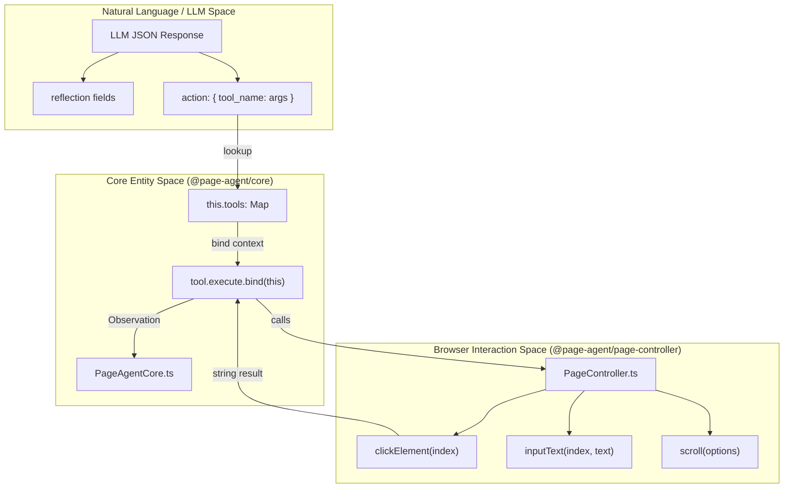
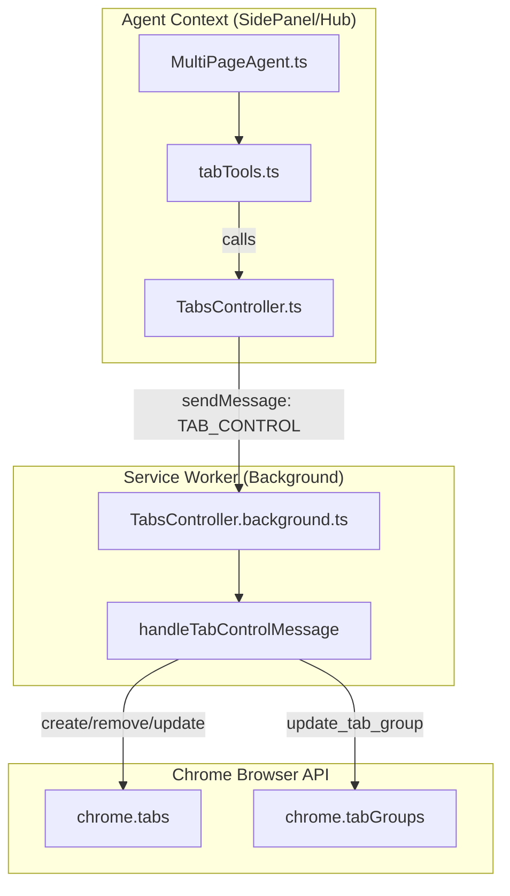

<!-- source: DeepWiki mcp.deepwiki.com · repo alibaba/page-agent · page 9.3 Built-in Tools Reference · fetched 2026-10-29 -->

# Built-in Tools Reference

Relevant source files

The following files were used as context for generating this wiki page:

- [packages/core/src/tools/index.ts](packages/core/src/tools/index.ts)
- [packages/extension/src/agent/RemotePageController.background.ts](packages/extension/src/agent/RemotePageController.background.ts)
- [packages/extension/src/agent/TabsController.background.ts](packages/extension/src/agent/TabsController.background.ts)
- [packages/extension/src/agent/TabsController.test.ts](packages/extension/src/agent/TabsController.test.ts)
- [packages/extension/src/agent/TabsController.ts](packages/extension/src/agent/TabsController.ts)
- [packages/extension/src/agent/tabTools.ts](packages/extension/src/agent/tabTools.ts)
- [packages/extension/vitest.config.js](packages/extension/vitest.config.js)

This page documents all built-in tools provided by PageAgent. Built-in tools are the pre-configured actions that the agent can execute to interact with web pages or manage browser states during task execution.

## Overview

Built-in tools are defined as `PageAgentTool` objects, which include a description, a Zod-based input schema, and an execution function. These tools are stored in a central registry and exposed to the LLM through a "MacroTool" wrapper that enforces a "Reflection-before-Action" pattern.

In the core library, tools primarily focus on DOM interaction via the `PageController`. In the browser extension, additional tools are injected to manage tabs and cross-page navigation.

**Sources:** [packages/core/src/tools/index.ts:21-36](), [packages/core/src/tools/index.ts:38-52]()

## Tool Execution Architecture

The following diagram bridges the Natural Language "Thinking" space to the Code Entity space, showing how a tool call moves from the LLM to the `PageController`.

### Tool Dispatch Flow
"From LLM JSON to PageController Method"

**Sources:** [packages/core/src/tools/index.ts:94-160](), [packages/core/src/tools/index.ts:47-50]()

---

## Core Interaction Tools

These tools are defined in `@page-agent/core` and are available in all environments (CDN, NPM, and Extension).

| Tool Name | Description | Key Code Reference |
|:---|:---|:---|
| `click_element_by_index` | Clicks an element by its numeric index in the simplified DOM. | [packages/core/src/tools/index.ts:94-105]() |
| `input_text` | Clicks and types text into an interactive input element. | [packages/core/src/tools/index.ts:108-120]() |
| `select_dropdown_option` | Selects a dropdown option by matching the provided text. | [packages/core/src/tools/index.ts:123-136]() |
| `scroll` | Vertically scrolls the document or a specific scrollable container. | [packages/core/src/tools/index.ts:141-160]() |
| `scroll_horizontally` | Horizontally scrolls the document or a specific container. | [packages/core/src/tools/index.ts:166-180]() |

### Implementation Details: Interaction
The interaction tools directly wrap `PageController` methods. For example, `click_element_by_index` calls `this.pageController.clickElement(input.index)` and returns the `message` property of the result [packages/core/src/tools/index.ts:101-102](). In extension environments, this is handled via `RemotePageController.background.ts` which proxies the request to the local `PageController` instance within the target tab [packages/extension/src/agent/RemotePageController.background.ts:24-39]().

---

## Control & Lifecycle Tools

These tools manage the agent's state, timing, and human-in-the-loop interactions.

### `done`
Signals task completion. The `text` parameter is the final response shown to the user.
- **Input:** `{ text: string, success: boolean }`
- **Source:** [packages/core/src/tools/index.ts:38-52]()

### `wait`
Pauses execution. It intelligently subtracts the time spent by the LLM during the "thinking" phase from the requested wait duration to ensure accuracy.
- **Input:** `{ seconds: number }` (Max 10s)
- **Logic:** `Math.max(0, input.seconds - (Date.now() - lastTimeUpdate) / 1000)`
- **Source:** [packages/core/src/tools/index.ts:55-73]()

### `ask_user`
Pauses the agent and waits for a manual response from the user. This requires the `onAskUser` callback to be implemented in the agent configuration.
- **Input:** `{ question: string }`
- **Source:** [packages/core/src/tools/index.ts:75-91]()

---

## Extension-Specific Tab Tools

When running within the Chrome Extension, the `MultiPageAgent` injects specialized tools to manage the browser's tab system via the `TabsController`. These tools use `chrome.runtime.sendMessage` to communicate with the background script [packages/extension/src/agent/TabsController.ts:7-16]().

### Tab Management Flow
"Cross-Tab Coordination via Background Script"

**Sources:** [packages/extension/src/agent/tabTools.ts:25-77](), [packages/extension/src/agent/TabsController.ts:132-214](), [packages/extension/src/agent/TabsController.background.ts:47-166]()

### Tool Reference: Tabs

| Tool Name | Description | Input Schema |
|:---|:---|:---|
| `open_new_tab` | Opens a URL in a new tab and sets it as the active control target. | `{ url: string }` [packages/extension/src/agent/tabTools.ts:27-43]() |
| `switch_to_tab` | Switches focus to an existing tab ID. | `{ tab_id: number }` [packages/extension/src/agent/tabTools.ts:45-59]() |
| `close_tab` | Closes a specific tab. Note: Cannot close the initial tab. | `{ tab_id: number }` [packages/extension/src/agent/tabTools.ts:61-75]() |

---

## Experimental & Security-Sensitive Tools

### `execute_javascript`
Allows the LLM to run arbitrary JS code on the page.
- **Risk:** High. Can bypass safety constraints or cause infinite loops.
- **Implementation:** Calls `pageController.executeJavascript(input.script)` and honors the `AbortSignal` for cancellation [packages/core/src/tools/index.ts:192-196]().
- **Source:** [packages/core/src/tools/index.ts:183-198]()

---

## Data Flow Summary

1.  **Input Validation:** Every tool uses `zod` to validate parameters before the `execute` function runs [packages/core/src/tools/index.ts:24]().
2.  **Context Binding:** Tools are executed with `this` bound to the `PageAgentCore` instance, allowing access to `this.pageController` and `this.history` [packages/core/src/tools/index.ts:25]().
3.  **Observation Feedback:** The string returned by `execute` is appended to the agent's history as an "observation", which the LLM uses to plan the next step.
4.  **Extension Routing:** In the extension, tool calls for DOM actions are routed through `handlePageControlMessage` in the background script, which proxies messages to the correct content script based on `targetTabId` [packages/extension/src/agent/RemotePageController.background.ts:6-42]().
5.  **Tab Lifecycle:** The `TabsController` manages tab state and can wait for page loads using `waitUntilTabLoaded`, which polls for the `complete` status [packages/extension/src/agent/TabsController.ts:164](), [packages/extension/src/agent/TabsController.test.ts:34-43]().

**Sources:**
- `packages/core/src/tools/index.ts`
- `packages/extension/src/agent/tabTools.ts`
- `packages/extension/src/agent/RemotePageController.background.ts`
- `packages/extension/src/agent/TabsController.ts`
- `packages/extension/src/agent/TabsController.test.ts`

---

