# Page: Overview

# Overview

<details>
<summary>Relevant source files</summary>

The following files were used as context for generating this wiki page:

- [.gitignore](.gitignore)
- [AGENTS.md](AGENTS.md)
- [CLAUDE.md](CLAUDE.md)
- [CONTRIBUTING.md](CONTRIBUTING.md)
- [README.md](README.md)
- [docs/README-zh.md](docs/README-zh.md)
- [package-lock.json](package-lock.json)
- [package.json](package.json)
- [packages/website/src/constants.ts](packages/website/src/constants.ts)

</details>


This document provides a high-level introduction to the PageAgent system, its architecture, and organization. PageAgent is a client-side GUI agent framework that enables natural language control of web applications through text-based DOM manipulation. The system is organized as a TypeScript monorepo containing multiple npm packages, a Chrome extension, and an MCP server. [package.json:1-15]()

For detailed information about specific subsystems, see:
- [What is PageAgent](#1.1) — Project philosophy and approach
- [Key Features and Use Cases](#1.2) — Main capabilities and applications
- [System Architecture](#1.3) — High-level architecture and data flow

## Project Purpose and Scope

PageAgent is a **client-side web automation framework** powered by Large Language Models (LLMs). Unlike traditional browser automation tools that require server-side infrastructure or complex headless environments, PageAgent runs primarily within the webpage as JavaScript code. The system converts natural language commands into DOM operations through an iterative observe-think-act loop. [README.md:33-37]()

**Key Characteristics:**

| Aspect | Description |
|--------|-------------|
| **Execution Model** | Client-side JavaScript, runs in-page [README.md:34-35]() |
| **DOM Interaction** | Text-based representation, no screenshots or OCR [README.md:36-37]() |
| **LLM Integration** | Provider-agnostic, supports OpenAI-compatible APIs and local models [README.md:38-39]() |
| **Architecture Pattern** | Re-act loop (Observe-Think-Act) [README.md:109-118]() |
| **Deployment Options** | NPM package, CDN script, Chrome extension, MCP server [README.md:53-89]() |

**Out of Scope:**
- Server-side browser automation (Selenium/Playwright equivalents) [README.md:111]()
- Vision-only or screenshot-dependent models [README.md:36-37]()
- Mobile native app automation

Sources: [README.md:1-126](), [package.json:1-136]()

## Monorepo Package Structure

PageAgent is organized as a monorepo with eight workspace packages. Five packages are core libraries, while others provide integration layers for different environments. [package.json:6-15]()

### Package Dependency Graph

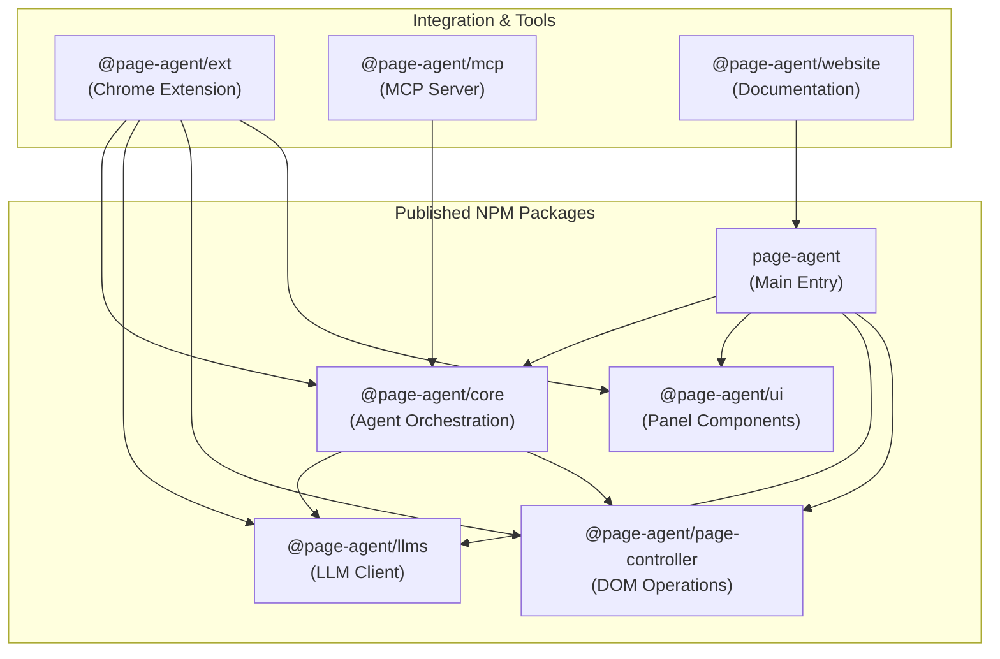

**Package Responsibilities:**

| Package | Workspace Name | Purpose |
|---------|----------------|---------|
| `packages/page-agent` | `page-agent` | Main entry point for web integration with UI [AGENTS.md:82-86]() |
| `packages/core` | `@page-agent/core` | Headless agent orchestration and Re-act loop [AGENTS.md:89-96]() |
| `packages/llms` | `@page-agent/llms` | LLM client with OpenAI-compatible support [AGENTS.md:98-104]() |
| `packages/page-controller` | `@page-agent/page-controller` | DOM operations and element interactions [AGENTS.md:106-113]() |
| `packages/ui` | `@page-agent/ui` | UI components like the agent Panel [AGENTS.md:54]() |
| `packages/extension` | `@page-agent/ext` | Chrome extension for multi-page tasks [AGENTS.md:42]() |
| `packages/mcp` | `@page-agent/mcp` | Model Context Protocol server for external control [package.json:12]() |
| `packages/website` | `@page-agent/website` | Documentation and interactive demos [AGENTS.md:40]() |

Sources: [package.json:1-15](), [AGENTS.md:7-16](), [README.md:33-49]()

## Core Architecture

The system operates through a layered architecture. The core agent logic orchestrates the execution flow, utilizing an LLM client for intelligence and a Page Controller for physical interaction with the browser environment.

### System Component Layers

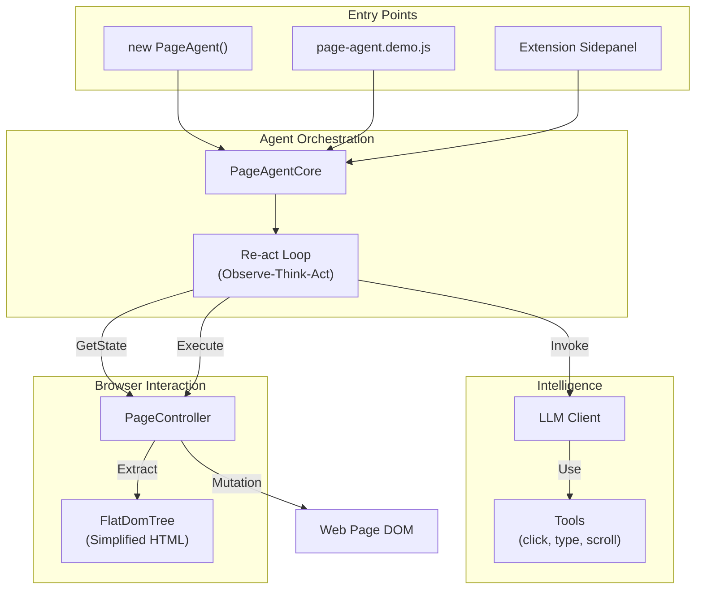

Sources: [AGENTS.md:30-80](), [README.md:53-89](), [package.json:28-45]()

### Execution Cycle

The agent follows an iterative cycle:
1.  **Observe**: `PageController` extracts the current DOM state into a `FlatDomTree` and then into a simplified text format suitable for LLM consumption. [AGENTS.md:75-76]()
2.  **Think**: The `LLM` client processes the state and historical context to decide on the next step. [AGENTS.md:77]()
3.  **Act**: The chosen tool (e.g., `click`, `type`) is executed via `PageController` on the live DOM using indexed operations. [AGENTS.md:78-79]()

For a detailed breakdown of the internal logic, see [System Architecture](#1.3).

## Deployment Models

PageAgent supports three primary deployment strategies to accommodate different technical requirements:

| Deployment | Target Users | Use Case |
|------------|-------------|--------------|
| **CDN Script** | Quick Demos | Testing PageAgent on any site via a single `<script>` tag. [README.md:53-70]() |
| **NPM Package** | SaaS Developers | Building a native AI Copilot inside an existing web application. [README.md:72-89]() |
| **Chrome Extension** | Power Users | Performing tasks that span across multiple browser tabs. [README.md:40, 48]() |

Additionally, the **MCP Server** allows external AI clients (like Claude Desktop or Cursor) to control the browser through the PageAgent infrastructure. [README.md:41, 49]()

Sources: [README.md:33-89](), [packages/website/src/constants.ts:1-11]()

## Technology Stack

- **Language**: TypeScript (Monorepo with npm workspaces) [package.json:6, 65]()
- **Build System**: Vite for libraries and website [package.json:68]()
- **UI Framework**: React [package.json:55]()
- **Styling**: Tailwind CSS [package.json:52]()
- **Version Management**: Custom `sync-version.js` script [package.json:36]()

Sources: [package.json:1-136]()

---

# Page: What is PageAgent

# What is PageAgent

<details>
<summary>Relevant source files</summary>

The following files were used as context for generating this wiki page:

- [.gitignore](.gitignore)
- [AGENTS.md](AGENTS.md)
- [CLAUDE.md](CLAUDE.md)
- [CONTRIBUTING.md](CONTRIBUTING.md)
- [README.md](README.md)
- [docs/README-zh.md](docs/README-zh.md)
- [packages/website/src/constants.ts](packages/website/src/constants.ts)

</details>


## Purpose and Scope

This document introduces PageAgent as a client-side GUI agent system for web automation. It explains the text-based DOM manipulation approach, core architectural components, and key differentiators from traditional automation tools. PageAgent is designed specifically for **client-side web enhancement**, prioritizing ease of integration within existing web applications over server-side automation [README.md:110-112]().

## Core Concept: Text-Based GUI Agent

PageAgent is a **client-side GUI agent** that enables natural language control of web interfaces through text-based DOM manipulation. Unlike server-side automation tools or screenshot-based agents, PageAgent operates entirely within the browser's JavaScript runtime, interacting directly with the Document Object Model (DOM) [README.md:33-37]().

The system converts web page structure into simplified textual representations that Large Language Models (LLMs) can understand, then executes actions by dispatching synthetic DOM events. This approach eliminates the need for visual processing, headless browsers, or server-side infrastructure [README.md:33-37]().

### Deployment Context

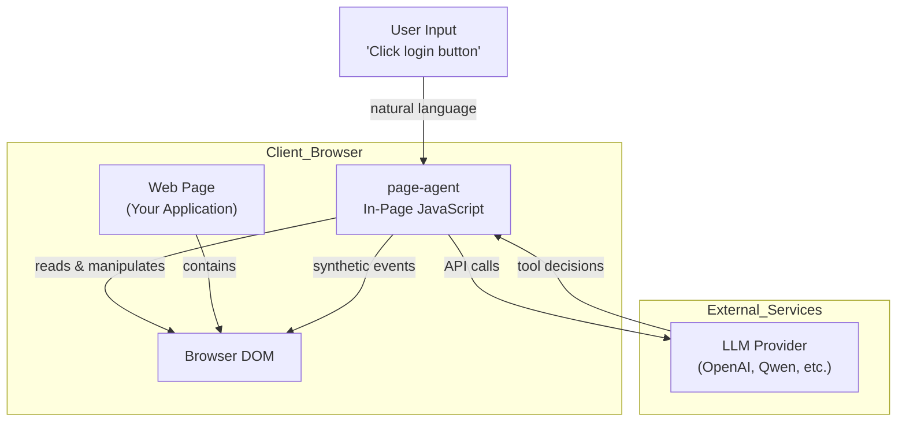

**Sources:** [README.md:31-41](), [docs/README-zh.md:31-40]()

## Key Characteristics

### In-Page JavaScript Execution

PageAgent runs as standard JavaScript code within the web page context. Installation options include:

| Method | Integration | Use Case |
|--------|-------------|----------|
| CDN Script | `<script src="...">` | Quick testing, technical evaluation [README.md:53-62]() |
| NPM Package | `import { PageAgent }` | Production SaaS applications [README.md:72-89]() |
| Chrome Extension | Browser addon | Multi-page tasks across tabs [README.md:40]() |

The `PageAgent` class in `packages/page-agent/src/PageAgent.ts` serves as the main entry point for programmatic integration, extending the headless `PageAgentCore` [AGENTS.md:84-86]().

**Sources:** [README.md:53-89](), [packages/website/src/constants.ts:1-11](), [AGENTS.md:84-86]()

### Text-Based DOM Manipulation

The system converts interactive elements into indexed textual representations rather than processing screenshots. This "No screenshots" approach means no multi-modal LLMs or special visual permissions are required [README.md:36-37]().

### DOM Pipeline

1.  **DOM Extraction**: The live DOM is converted into a `FlatDomTree` via the engine in `packages/page-controller/src/dom/dom_tree/` [AGENTS.md:75]().
2.  **Dehydration**: The DOM tree is simplified into text for the LLM [AGENTS.md:76]().
3.  **LLM Processing**: The AI returns action plans based on indexed elements [AGENTS.md:77]().
4.  **Indexed Operations**: The agent calls `PageController` methods (e.g., `clickElement`) using the element index [AGENTS.md:78]().

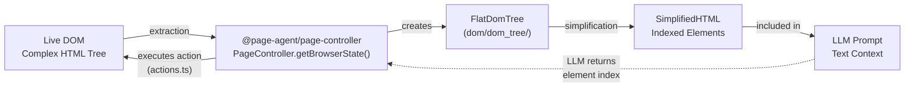

**Example Output:**
```html
[42] <button id="login">Login</button>
[43] <input type="text" placeholder="Username">
```

**Sources:** [README.md:36-37](), [AGENTS.md:73-78](), [AGENTS.md:108-113]()

### Bring Your Own LLM

PageAgent supports any OpenAI-compatible LLM provider. The integration provides:

*   **OpenAI-compatible API client** via `OpenAIClient.ts` [AGENTS.md:104]().
*   **Model-specific support** for Qwen, Claude, GPT, and local models like Ollama [README.md:38-39]().
*   **Mental Model**: Implements a reflection-before-action approach defined in the `LLM` class [AGENTS.md:102]().

**Sources:** [README.md:38-39](), [README.md:81-89](), [AGENTS.md:98-105]()

## Architecture Overview

### Component Hierarchy

The system is organized as a monorepo with clear module boundaries [AGENTS.md:49-56]().

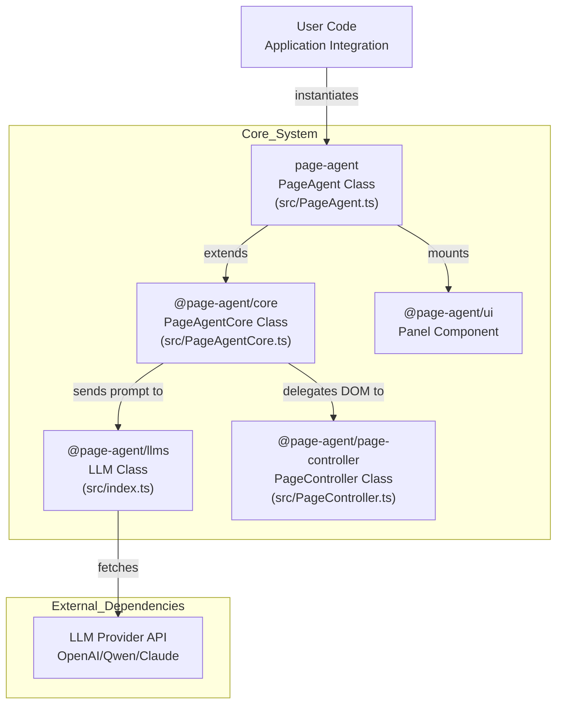

**Sources:** [AGENTS.md:32-45](), [AGENTS.md:51-56](), [AGENTS.md:82-113]()

### Re-act Execution Model

PageAgent implements a reasoning-action loop. The `PageAgentCore` manages the lifecycle, while specific tools in `packages/core/src/tools/` interact with the `PageController` [AGENTS.md:93-94]().

1.  **Observe Phase**: Current page state is extracted via `pageController.updateTree()` [AGENTS.md:63]().
2.  **Think Phase**: System sends state + history to LLM for reasoning.
3.  **Act Phase**: Selected tool executes a DOM action like `clickElement(index)` or `inputText(index, text)` [AGENTS.md:64-65]().

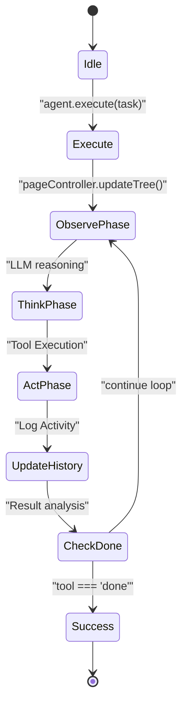

**Sources:** [AGENTS.md:57-71](), [AGENTS.md:93-94](), [AGENTS.md:117-121]()

## How It Differs from Traditional Automation

| Aspect | PageAgent | Selenium/Playwright | Screenshot-Based Agents |
| :--- | :--- | :--- | :--- |
| **Execution Environment** | Client-side JavaScript [README.md:35]() | Server-side/Headless | Server-side + Vision API |
| **DOM Access** | Direct (in-page) [README.md:35]() | WebDriver protocol | OCR/Multi-modal LLM |
| **Integration** | Single script tag [README.md:53-62]() | Separate infrastructure | Heavy infrastructure |
| **Use Case** | SaaS Copilot/Accessibility [README.md:45-47]() | E2E Testing | General automation |

**Design Philosophy**: PageAgent avoids "heavy" dependencies and is built for **traceability and predictability** rather than just success rate [AGENTS.md:150-151]().

**Sources:** [README.md:33-49](), [README.md:109-112](), [AGENTS.md:150-152]()

---

# Page: Key Features and Use Cases

# Key Features and Use Cases

<details>
<summary>Relevant source files</summary>

The following files were used as context for generating this wiki page:

- [README.md](README.md)
- [docs/README-zh.md](docs/README-zh.md)
- [packages/website/src/components/ui/magic-card.tsx](packages/website/src/components/ui/magic-card.tsx)
- [packages/website/src/components/ui/marquee.tsx](packages/website/src/components/ui/marquee.tsx)
- [packages/website/src/constants.ts](packages/website/src/constants.ts)
- [packages/website/src/pages/home/FeaturesSection.tsx](packages/website/src/pages/home/FeaturesSection.tsx)
- [packages/website/src/pages/home/ScenariosSection.tsx](packages/website/src/pages/home/ScenariosSection.tsx)

</details>


## Purpose and Scope

This document provides a detailed overview of PageAgent's key features and their practical applications. It explains the technical capabilities that distinguish PageAgent from traditional web automation tools—such as its in-page JavaScript execution and text-based DOM processing—and illustrates how these features enable specific use cases like SaaS Copilots, Smart Form Filling, and Accessibility enhancements.

---

## Core Features

### In-Page JavaScript Integration

PageAgent operates entirely within the browser context as client-side JavaScript, eliminating the need for server-side infrastructure, Python environments, or headless browser drivers like Playwright/Puppeteer [README.md:33-35]().

**Deployment Models:**

| Model | Package | Use Case | Complexity |
|-------|---------|----------|------------|
| CDN Script | `page-agent.demo.js` | Quick testing, demos | Minimal (one `<script>` tag) [README.md:53-62]() |
| NPM Package | `page-agent` | Production integration | Low (standard npm workflow) [README.md:72-79]() |
| Browser Extension | `page-agent-ext` | Multi-page automation | Medium (Chrome extension APIs) [README.md:40-41]() |

The NPM package exports a `PageAgent` class that integrates the core logic with a built-in UI panel [README.md:77-85](). The demo CDN build includes auto-initialization logic that creates a global `PageAgent` instance with pre-configured LLM settings for immediate evaluation [README.md:63-65]().

**Deployment Architecture:**

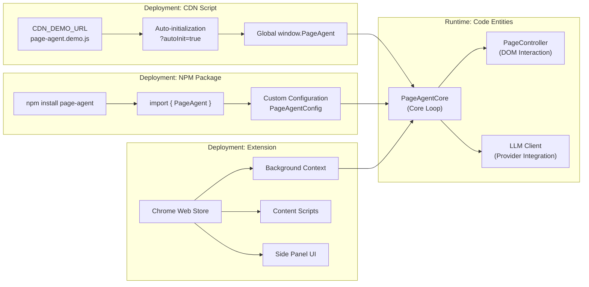

**Sources:** [README.md:33-35](), [README.md:53-89](), [packages/website/src/constants.ts:1-5]()

---

### Text-Based DOM Manipulation

PageAgent uses a text-based approach to represent and interact with web pages, eliminating the need for screenshots or multimodal LLMs [README.md:36-37]().

**DOM Processing Data Flow:**

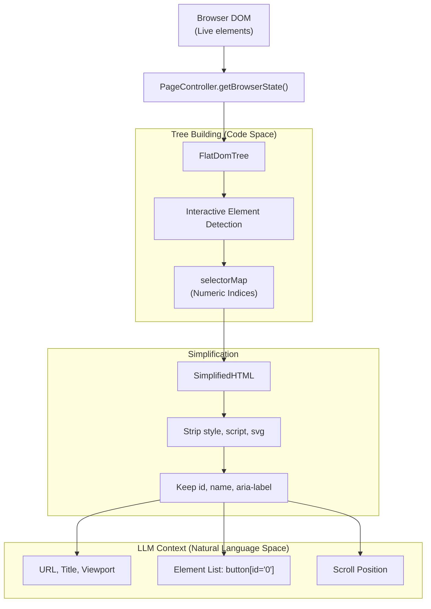

The system transforms the live DOM into a simplified structure. It assigns unique numeric IDs to interactive elements, allowing the LLM to target them precisely using tools like `click` or `type` without needing complex CSS selectors [README.md:36-37](). This process removes visual clutter while retaining critical accessibility markers [README.md:107-122]().

**Sources:** [README.md:36-37](), [README.md:107-122]()

---

### LLM Provider Flexibility

PageAgent supports any OpenAI-compatible API through its LLM integration layer, with optimizations for various providers [README.md:38-39]().

**Supported Providers and Models:**

| Provider | Model Examples | Configuration |
|----------|---------------|---------------|
| OpenAI | `gpt-4o`, `gpt-4o-mini` | `baseURL: https://api.openai.com/v1` |
| Qwen (Alibaba) | `qwen3.5-plus`, `qwen3.5-flash` | `baseURL: https://dashscope.aliyuncs.com/...` [README.md:81-83]() |
| Local (Ollama) | `qwen2.5`, `llama3.1` | Local deployment support [README.md:38-39]() |

The website demo specifically utilizes `qwen3.5-flash` for high-speed interactions [packages/website/src/constants.ts:8-9](). The `LLM_CLOUD` configuration in the website showcases the breadth of supported models, including Claude, Gemini, DeepSeek, and local providers like LM Studio [packages/website/src/pages/home/FeaturesSection.tsx:10-29]().

**Sources:** [README.md:38-39](), [README.md:81-85](), [packages/website/src/constants.ts:8-10](), [packages/website/src/pages/home/FeaturesSection.tsx:10-29]()

---

### Human-in-the-Loop Interface

PageAgent includes a visual panel for monitoring and controlling agent execution, facilitating user oversight and manual intervention [README.md:17-18]().

**Panel Interaction Flow:**

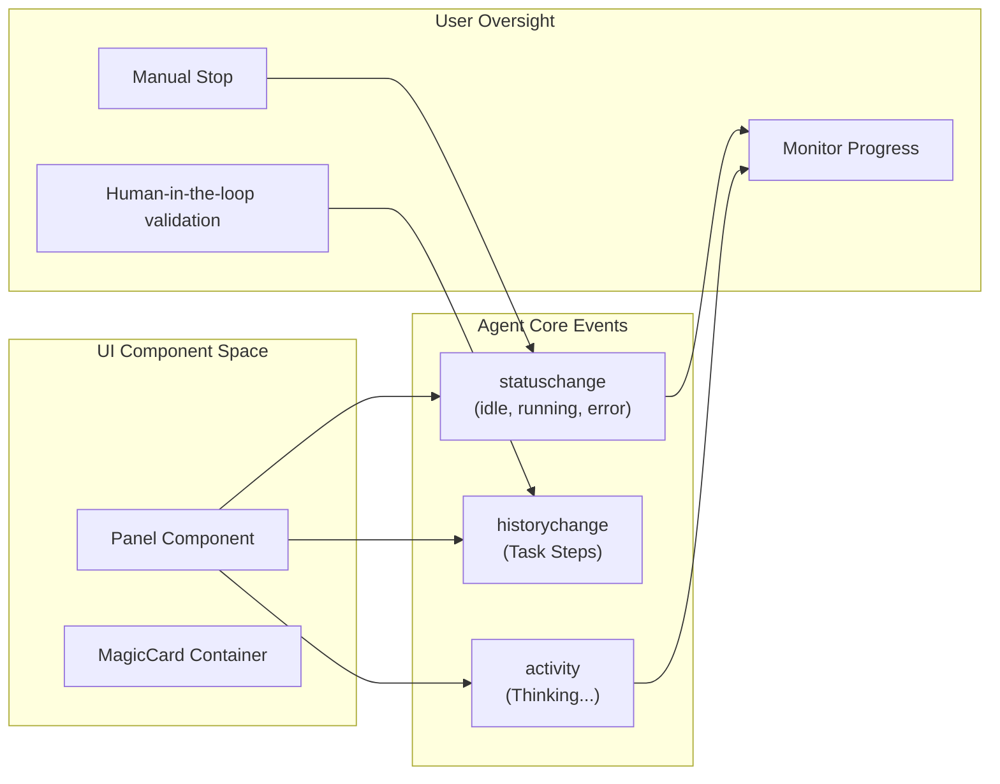

The UI utilizes a "Human-in-the-Loop" pattern where the agent can pause and wait for user confirmation or clarification during complex tasks [packages/website/src/pages/home/FeaturesSection.tsx:143-167]().

**Sources:** [packages/website/src/pages/home/FeaturesSection.tsx:133-167](), [README.md:17-18]()

---

## Use Cases

### SaaS AI Copilot
Ship an AI copilot in your product with minimal code and no backend rewrite [README.md:45]().
- **Implementation**: Instantiate `PageAgent` within your application code to handle product-specific tasks [packages/website/src/pages/home/ScenariosSection.tsx:34-53]().
- **Benefit**: Turn complex software features into natural language commands [docs/README-zh.md:44]().

### Smart Form Filling
Turn complex, multi-click workflows into a single natural language sentence [README.md:46]().
- **Application**: Perfect for ERP, CRM, and admin systems where users perform repetitive data entry [docs/README-zh.md:45]().
- **Example**: "Fill the expense report for Friday's trip" translates to a sequence of `input` and `click` actions [packages/website/src/pages/home/ScenariosSection.tsx:80-84]().

### Accessibility Enhancement
Make any web app accessible through natural language, removing barriers for users who struggle with complex UIs [README.md:47]().
- **Natural Language**: Voice commands replace manual navigation [packages/website/src/pages/home/ScenariosSection.tsx:128-129]().
- **Execution**: The agent interprets commands like "Click the submit button" and executes the corresponding DOM action [packages/website/src/pages/home/ScenariosSection.tsx:138-142]().

### Multi-page Agent & MCP
Extend automation across browser tabs or allow external clients to control the browser [README.md:48-49]().
- **Cross-Tab Tasks**: The optional Chrome extension allows the agent to coordinate actions across multiple open tabs [README.md:40]().
- **MCP Server**: Allows external AI tools (e.g., Claude Desktop, Cursor) to control the browser as a tool [README.md:41]().

**Sources:** [README.md:43-50](), [docs/README-zh.md:42-48](), [packages/website/src/pages/home/ScenariosSection.tsx:27-152]()

---

# Page: System Architecture

# System Architecture

<details>
<summary>Relevant source files</summary>

The following files were used as context for generating this wiki page:

- [.gitignore](.gitignore)
- [AGENTS.md](AGENTS.md)
- [CLAUDE.md](CLAUDE.md)
- [CONTRIBUTING.md](CONTRIBUTING.md)
- [packages/core/src/PageAgentCore.ts](packages/core/src/PageAgentCore.ts)
- [packages/core/src/utils/index.ts](packages/core/src/utils/index.ts)
- [packages/page-agent/src/PageAgent.ts](packages/page-agent/src/PageAgent.ts)
- [packages/page-controller/src/PageController.ts](packages/page-controller/src/PageController.ts)
- [packages/page-controller/src/actions.ts](packages/page-controller/src/actions.ts)
- [packages/page-controller/src/utils/index.ts](packages/page-controller/src/utils/index.ts)

</details>


## Purpose and Scope

This document describes the high-level system architecture of PageAgent, including the monorepo structure, package organization, runtime component interactions, and data flow. It provides a technical overview of how the packages work together to enable GUI automation through natural language processing.

For specific implementation details of individual packages, see:
- Core agent logic: [4.1 PageAgentCore and Re-act Loop]()
- DOM manipulation: [5.1 PageController Architecture]()
- LLM integration: [6.1 LLM Client Architecture]()
- Browser extension: [7.1 Extension Architecture]()

---

## Monorepo Package Structure

PageAgent is organized as an npm workspace monorepo containing several packages, divided into published libraries and private runtime packages.

### Package Organization

Title: Monorepo Workspace Relationships
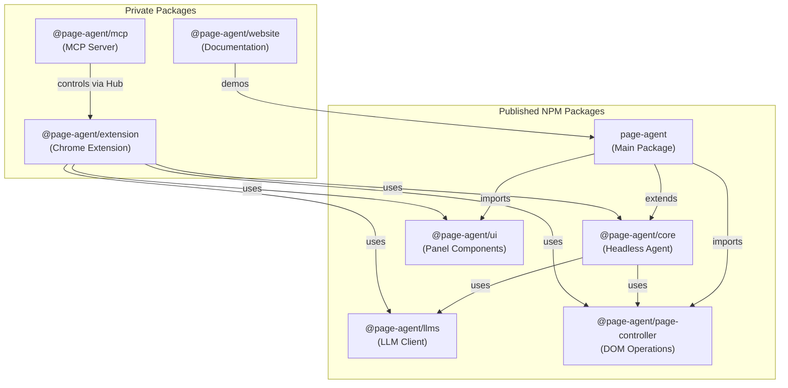
**Sources:** [AGENTS.md:7-16](), [packages/page-agent/src/PageAgent.ts:5-7](), [packages/core/src/PageAgentCore.ts:6-7]()

### Package Responsibilities

| Package | NPM Name | Status | Purpose |
|---------|----------|--------|---------|
| **page-agent** | `page-agent` | Published | Main entry point with `PageAgent` class, includes UI panel integration [packages/page-agent/src/PageAgent.ts:13-29](). |
| **core** | `@page-agent/core` | Published | Headless `PageAgentCore` class with Re-act loop and tool system [packages/core/src/PageAgentCore.ts:61-204](). |
| **llms** | `@page-agent/llms` | Published | `LLM` client with retry logic and multi-provider support [packages/llms/src/index.ts:25-35](). |
| **page-controller** | `@page-agent/page-controller` | Published | `PageController` for DOM extraction and element interaction [packages/page-controller/src/PageController.ts:58-219](). |
| **ui** | `@page-agent/ui` | Published | `Panel` component for human-in-the-loop interaction [packages/ui/src/index.ts:1-10](). |
| **extension** | `@page-agent/extension` | Private | Chrome extension for multi-page automation [packages/extension/package.json:2-5](). |
| **mcp** | `@page-agent/mcp` | Private | Model Context Protocol server for external control via tools like Claude Desktop [AGENTS.md:16-16](). |
| **website** | `@page-agent/website` | Private | Documentation site and interactive demo environment [AGENTS.md:9-9](). |

---

## Runtime Architecture

At runtime, PageAgent orchestrates a loop where the core agent extracts DOM state through `PageController`, generates plans via `LLM`, and executes actions.

### Component Interaction and Data Flow

Title: Runtime Loop and Entity Mapping
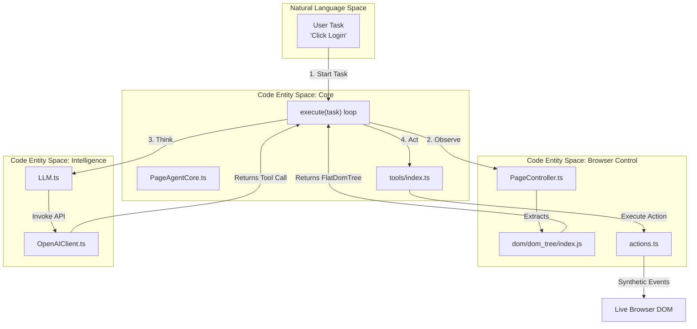
**Sources:** [packages/core/src/PageAgentCore.ts:35-42](), [packages/page-controller/src/PageController.ts:129-165](), [packages/page-controller/src/actions.ts:64-126]()

### Core Classes and Methods

| Class | Key Method | Responsibility |
|-------|------------|----------------|
| `PageAgentCore` | `execute(task)` | Manages the Re-act loop (Observe-Think-Act) and maintains task `history` [packages/core/src/PageAgentCore.ts:210-223](). |
| `PageController` | `getBrowserState()` | Generates `BrowserState` including simplified HTML and viewport info [packages/page-controller/src/PageController.ts:129-165](). |
| `LLM` | `invoke()` | Handles LLM communication, schema validation, and retry logic [packages/llms/src/index.ts:117-132](). |
| `SimulatorMask` | `initMask()` | Provides a visual overlay to block user interaction during automation [packages/page-controller/src/PageController.ts:102-108](). |

---

## Data Flow: DOM to LLM

PageAgent uses a "text-based" approach where the DOM is simplified into a structure the LLM can easily parse.

Title: DOM Extraction Pipeline
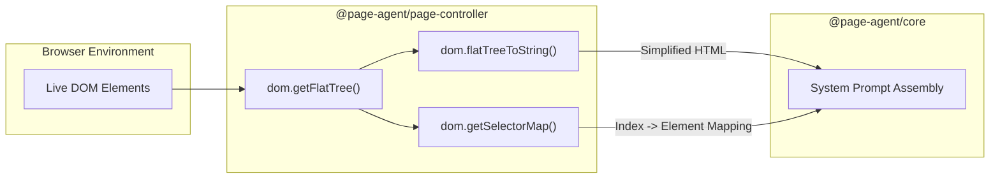
**Sources:** [packages/page-controller/src/PageController.ts:174-219](), [packages/page-controller/src/dom/dom_tree/index.js:1-10]()

---

## Build and Distribution Architecture

The project uses a source-first monorepo strategy. Libraries are published to NPM, while the extension and website are deployed as standalone artifacts.

### Build Formats

| Target | Tooling | Format | File Path |
|--------|---------|--------|-----------|
| **NPM Library** | Vite / TS | ESM | `packages/*/dist/index.js` |
| **Browser Extension** | WXT | Chrome Zip | `packages/extension/.output/` |
| **CDN Demo** | Vite | IIFE | `packages/page-agent/dist/demo.iife.js` |

**Sources:** [AGENTS.md:32-34](), [packages/page-agent/package.json:10-20]()

### Build Pipeline

Title: Monorepo Build Flow
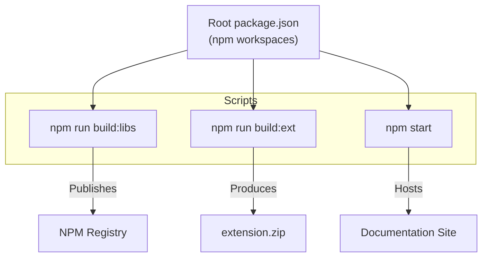
**Sources:** [AGENTS.md:20-28](), [package.json:28-40]()

---

# Page: Monorepo Structure

# Monorepo Structure

<details>
<summary>Relevant source files</summary>

The following files were used as context for generating this wiki page:

- [.gitignore](.gitignore)
- [AGENTS.md](AGENTS.md)
- [CLAUDE.md](CLAUDE.md)
- [CONTRIBUTING.md](CONTRIBUTING.md)
- [package-lock.json](package-lock.json)
- [package.json](package.json)

</details>


This document describes the monorepo organization of the PageAgent codebase, including workspace configuration, package dependencies, build system setup, and version management. For information about building and publishing these packages, see [Version Management and Publishing](#2.3). For details on development workflows and environment setup, see [Development Guide](#13).

## Overview

The PageAgent repository uses a **native npm workspaces** monorepo structure with TypeScript project references and Vite for bundling. This approach avoids additional monorepo tooling dependencies while maintaining clear module boundaries and efficient builds.

The monorepo contains eight packages organized into two distribution categories:
- **Published NPM Packages**: Packages distributed via npm for programmatic use (e.g., `core`, `llms`, `page-agent`).
- **Private Packages**: Packages for the Chrome extension, MCP server, and documentation website.

**Key Design Principles**:
- **Source-first development**: Library `package.json` exports point to `src/*.ts` during development for hot-reloading without pre-building [AGENTS.md:32-34]().
- **Topological Ordering**: Workspaces are listed in order of dependency to ensure correct resolution during `npm install` [package.json:6-15](), [AGENTS.md:47-48]().
- **Decoupled Architecture**: UI is decoupled from the agent via the `PanelAgentAdapter` interface, and `PageController` remains independent of LLM logic [AGENTS.md:49-56]().

Sources: [package.json:6-15](), [package-lock.json:11-20](), [AGENTS.md:32-56]()

## Workspace Configuration

### Root Package Definition

The root `package.json` defines the workspace structure with packages listed in topological dependency order:

```json
"workspaces": [
    "packages/page-controller",
    "packages/ui",
    "packages/llms",
    "packages/core",
    "packages/page-agent",
    "packages/mcp",
    "packages/extension",
    "packages/website"
]
```

**Node Version Requirements**: The repository requires Node.js `^22.22.1 || >=24` and npm `^11.6.3` as specified in the engines field [package.json:24-27]().

Sources: [package.json:6-15](), [package.json:24-27](), [package-lock.json:47-50]()

### Workspace Scripts

The root package provides unified build and development commands using `npm workspaces` flags or custom Node.js scripts:

| Script | Command | Description |
|--------|---------|-------------|
| `start` | `npm run dev --workspace=@page-agent/website` | Start documentation dev server [package.json:29]() |
| `dev:ext` | `npm run dev -w @page-agent/ext` | Start extension dev mode [package.json:30]() |
| `dev:demo` | `npm run dev:demo --workspace=page-agent` | Serve IIFE demo with auto-rebuild [package.json:31]() |
| `build` | `node scripts/build.js` | Full build pipeline (cleanup + parallel build) [package.json:32]() |
| `build:libs` | `node scripts/build-libs.js` | Build all library packages in parallel [package.json:33]() |
| `build:website` | `npm run build:website --workspace=@page-agent/website` | Build documentation site [package.json:34]() |
| `build:ext` | `npm run zip -w @page-agent/ext` | Build and package extension [package.json:35]() |
| `cleanup` | `rm -rf packages/*/dist && rm -rf packages/*/.output` | Clean build artifacts [package.json:43]() |

Sources: [package.json:28-45](), [AGENTS.md:18-28]()

## Package Organization

For a detailed breakdown of each package's role and dependencies, see [Package Organization](#2.1).

### Package Dependency Graph

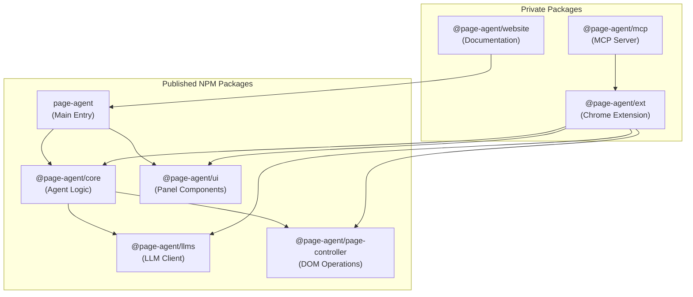

Sources: [package.json:6-15](), [AGENTS.md:37-45](), [AGENTS.md:49-56]()

### Module Boundaries

The following diagram maps high-level system components to their corresponding code entities within the monorepo structure.

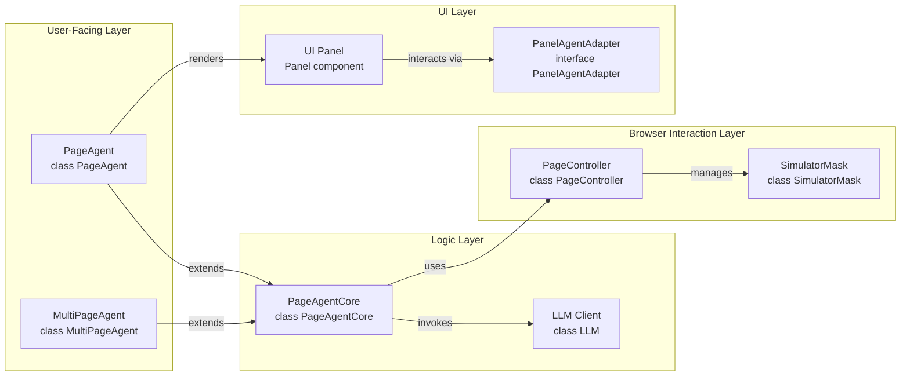

**System-to-Code Mapping**:
- **PageAgent**: The main entry class located in `packages/page-agent/src/PageAgent.ts` [AGENTS.md:86]().
- **PageAgentCore**: The headless core logic in `packages/core/src/PageAgentCore.ts` [AGENTS.md:93]().
- **PageController**: Handles DOM extraction and synthetic events in `packages/page-controller/src/PageController.ts` [AGENTS.md:110]().
- **LLM**: The client for AI communication in `packages/llms/src/index.ts` [AGENTS.md:102]().

Sources: [AGENTS.md:49-56](), [AGENTS.md:82-113]()

## Build System and Workspaces

The repository uses **Vite** for all package builds. For details on configuration and scripts, see [Build System and Workspaces](#2.2).

### Build Pipeline

The full build pipeline defined in `scripts/build.js` executes the following sequence:
1. **Cleanup**: Runs `npm run cleanup` at the root to remove `dist` and `.output` directories [package.json:43]().
2. **Parallel Build**: Executes builds across all workspaces. Library packages use `scripts/build-libs.js` to build `@page-agent/core`, `@page-agent/llms`, etc., in parallel [package.json:33]().

Sources: [package.json:32-35](), [package.json:43](), [AGENTS.md:22-23]()

## Version Management and Publishing

Core library packages maintain synchronized versions while private packages may follow independent release cycles. For details on the publishing workflow, see [Version Management and Publishing](#2.3).

### Synchronized Versioning

The `sync-version.js` script (triggered via `npm run version`) maintains version consistency across the monorepo [package.json:36](). It ensures that when the root version (currently `1.12.2`) is updated, all internal cross-package dependencies in the workspace are updated to match the new version string [package.json:4]().

Sources: [package.json:4](), [package.json:36]()

---

# Page: Package Organization

# Package Organization

<details>
<summary>Relevant source files</summary>

The following files were used as context for generating this wiki page:

- [package-lock.json](package-lock.json)
- [package.json](package.json)
- [packages/core/package.json](packages/core/package.json)
- [packages/llms/package.json](packages/llms/package.json)
- [packages/page-agent/package.json](packages/page-agent/package.json)
- [packages/page-controller/package.json](packages/page-controller/package.json)
- [packages/ui/package.json](packages/ui/package.json)

</details>


This document describes the structure and organization of packages within the PageAgent monorepo. It covers the roles of each package, their dependencies, and how they are distributed.

## Overview

The PageAgent monorepo contains eight packages organized under the `packages/` directory. Six packages are published to NPM as public libraries (including the MCP server), while two are private packages for the Chrome extension and documentation website. All packages use npm workspaces for dependency management and share common development tooling.

**Sources:** [package.json:6-15](), [package-lock.json:11-20]()

## Package Directory Structure

The monorepo follows a flat package structure under the `packages/` directory:

```
packages/
├── page-controller/    # @page-agent/page-controller (published)
├── ui/                 # @page-agent/ui (published)
├── llms/               # @page-agent/llms (published)
├── core/               # @page-agent/core (published)
├── page-agent/         # page-agent (published)
├── mcp/                # @page-agent/mcp (published)
├── extension/          # @page-agent/ext (private)
└── website/            # @page-agent/website (private)
```

**Sources:** [package.json:6-15](), [package-lock.json:11-20]()

## Published NPM Packages

The following table lists all packages distributed via NPM:

| Package Name | Version | Description | Entry Point |
|-------------|---------|-------------|-------------|
| `page-agent` | 1.12.2 | Main integration package extending `PageAgentCore` with UI panel | [packages/page-agent/src/PageAgent.ts]() |
| `@page-agent/core` | 1.12.2 | Headless agent orchestration and Re-act loop | [packages/core/src/PageAgentCore.ts]() |
| `@page-agent/llms` | 1.12.2 | LLM client with reflection-before-action mental model | [packages/llms/src/index.ts]() |
| `@page-agent/page-controller` | 1.12.2 | DOM operations and browser state extraction | [packages/page-controller/src/PageController.ts]() |
| `@page-agent/ui` | 1.12.2 | Panel components and i18n support | [packages/ui/src/index.ts]() |
| `@page-agent/mcp` | 1.12.2 | MCP server for controlling the browser via extension | [packages/mcp/package.json:2]() |

All published packages include `files` configuration specifying the `dist/` directory for distribution.

**Sources:** [packages/page-agent/package.json:1-28](), [packages/core/package.json:1-28](), [packages/llms/package.json:1-26](), [packages/page-controller/package.json:1-27](), [packages/ui/package.json:1-27]()

### page-agent (Main Package)

The top-level `page-agent` package serves as the primary entry point for users. It extends `PageAgentCore` with integrated UI panel functionality.

**Key characteristics:**
- **Package name:** `page-agent` (no scope) [packages/page-agent/package.json:2]()
- **Main dependency:** Extends `@page-agent/core` [packages/page-agent/package.json:57]()
- **Additional dependencies:** `@page-agent/llms`, `@page-agent/page-controller`, `@page-agent/ui` [packages/page-agent/package.json:58-60]()
- **Exports:** ESM format at `dist/esm/page-agent.js` [packages/page-agent/package.json:21]()
- **Special builds:** Includes IIFE build for CDN usage via `vite.iife.config.js` [packages/page-agent/package.json:51]()

**Sources:** [packages/page-agent/package.json:1-69]()

### @page-agent/core

The core package implements the headless agent orchestration layer, including the Re-act loop, tool system, and prompt assembly.

**Key characteristics:**
- **Role:** Agent orchestration engine
- **Dependencies:** `@page-agent/llms`, `@page-agent/page-controller` [packages/core/package.json:58-59]()
- **Exports:** ESM format at `dist/esm/page-agent-core.js` [packages/core/package.json:21]()
- **Usage:** Can be used independently for headless automation

**Sources:** [packages/core/package.json:1-66]()

### @page-agent/llms

The LLM package provides OpenAI-compatible client implementations with model-specific patches and retry logic.

**Key characteristics:**
- **Role:** LLM communication layer
- **External dependencies:** None (peer dependency on `zod` only) [packages/llms/package.json:51-54]()
- **Exports:** ESM format at `dist/lib/page-agent-llms.js` [packages/llms/package.json:20]()
- **Features:** Error categorization, retry mechanism, tool call validation

**Sources:** [packages/llms/package.json:1-58]()

### @page-agent/page-controller

The page-controller package handles all DOM interactions and browser state extraction.

**Key characteristics:**
- **Role:** Browser control and DOM manipulation
- **External dependencies:** `ai-motion` (for smooth pointer movements) [packages/page-controller/package.json:50]()
- **Exports:** ESM format at `dist/lib/page-controller.js` [packages/page-controller/package.json:20]()
- **Features:** FlatDomTree extraction, synthetic event generation, element highlighting

**Sources:** [packages/page-controller/package.json:1-51]()

### @page-agent/ui

The UI package contains the Panel component and i18n resources.

**Key characteristics:**
- **Role:** User interface components
- **Exports:** ESM format at `dist/lib/page-agent-ui.js` [packages/ui/package.json:20]()
- **Languages:** Supports `en-US` and `zh-CN`

**Sources:** [packages/ui/package.json:1-48]()

### @page-agent/mcp

The MCP package enables AI agent clients (like Claude Desktop or Cursor) to control the browser via the Model Context Protocol.

**Key characteristics:**
- **Role:** MCP Server implementation
- **Integration:** Bridges external LLM clients to the browser environment via a WebSocket/HTTP bridge to the extension Hub.

**Sources:** [package.json:12]()

## Private Packages

Two packages are marked as `"private": true` or are not published to NPM:

| Package Name | Version | Purpose |
|-------------|---------|---------|
| `@page-agent/ext` | 1.12.2 | Chrome extension for multi-page agent capabilities |
| `@page-agent/website` | 1.12.2 | Documentation site and interactive demos |

**Sources:** [package.json:13-14]()

### @page-agent/ext (Extension)

The extension package implements `MultiPageAgent` for cross-tab coordination using Chrome APIs.

**Key characteristics:**
- **Dev Script:** `npm run dev:ext` [package.json:30]()
- **Build Script:** `npm run build:ext` [package.json:35]()
- **Role:** Provides a persistent environment for the agent, cross-tab control, and a "Hub" for external connections (like MCP).

**Sources:** [package.json:30, 35]()

### @page-agent/website

The website package is a React SPA built with Vite, containing documentation and demos.

**Key characteristics:**
- **Start Script:** `npm run start` (aliased to website dev) [package.json:29]()
- **Build output:** Static HTML/JS/CSS for GitHub Pages [package.json:23, 34]()
- **Purpose:** Demonstrates `page-agent` usage via CDN script

**Sources:** [package.json:23, 29, 34]()

## Package Dependency Graph

The following diagram illustrates the dependency relationships between packages:

**Package Dependency Structure**

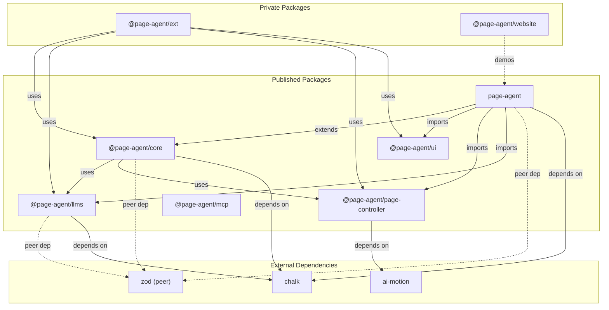

**Sources:** [packages/page-agent/package.json:56-62](), [packages/core/package.json:57-60](), [packages/page-controller/package.json:49-51]()

## Export Configurations

Each published package uses standard ESM exports with TypeScript definitions. The export structure follows a consistent pattern:

**Standard Export Pattern**

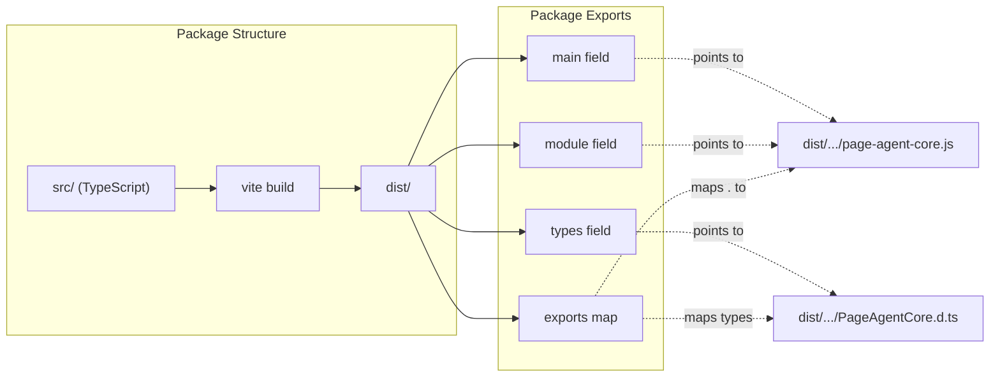

**Sources:** [packages/core/package.json:6-24](), [packages/llms/package.json:5-23](), [packages/page-controller/package.json:5-23](), [packages/ui/package.json:5-23]()

### Export Field Mapping

All packages define four export-related fields in their `package.json`:

| Field | Purpose | Example Value |
|-------|---------|---------------|
| `main` | CommonJS/legacy entry | `./src/PageController.ts` (dev) / `./dist/lib/page-controller.js` (pub) |
| `module` | ESM entry point | `./dist/lib/page-controller.js` |
| `types` | TypeScript definitions | `./dist/lib/PageController.d.ts` |
| `exports["."]` | Modern resolution map | `{ "types": "...", "import": "..." }` |

The `exports` field provides granular control over package entry points and is the preferred resolution mechanism for modern tools.

**Sources:** [packages/page-controller/package.json:5-24](), [packages/ui/package.json:5-24]()

## Peer Dependencies and Version Constraints

All packages that use Zod for schema validation declare it as a peer dependency rather than a direct dependency:

**Peer Dependency Pattern**

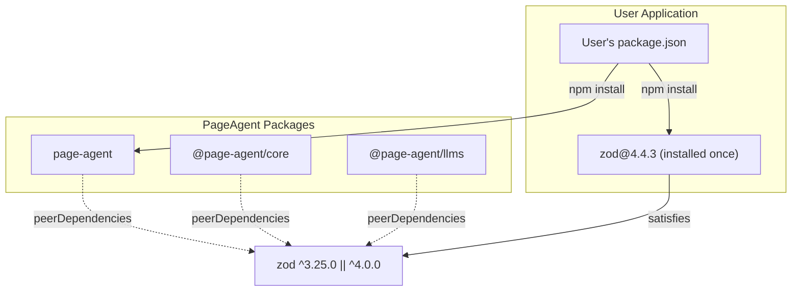

**Sources:** [packages/page-agent/package.json:63-65](), [packages/core/package.json:61-63](), [packages/llms/package.json:54-56]()

### Peer Dependency Rationale

The peer dependency pattern ensures:

1. **Single Zod instance:** Prevents multiple Zod versions in the dependency tree.
2. **Schema compatibility:** All packages share the same Zod schemas and validators.
3. **Bundle size reduction:** Users install Zod once, not per package.
4. **Version flexibility:** Supports both Zod v3 and v4.

The constraint `"^3.25.0 || ^4.0.0"` allows users to choose their Zod version while maintaining compatibility.

**Sources:** [packages/llms/package.json:54-56](), [packages/core/package.json:61-63]()

## Version Synchronization

All packages in the monorepo share the same version number (1.12.2). This synchronization is managed by the `scripts/sync-version.js` script.

**Version Distribution:**

| Package Type | Version | Sync Strategy |
|-------------|---------|---------------|
| Published NPM packages | 1.12.2 | Synchronized via `npm run version` |
| Extension | 1.12.2 | Synchronized via `npm run version` |
| Website | 1.12.2 | Synchronized via `npm run version` |

**Sources:** [package.json:4, 36](), [packages/core/package.json:4](), [packages/page-agent/package.json:4]()

## Development Dependencies

Shared development dependencies are defined at the root level and include:

- **Build tools:** Vite, TypeScript, unplugin-dts [package.json:65, 67-68]()
- **Code quality:** ESLint, Prettier, Husky, lint-staged [package.json:59, 62-64]()
- **Commit standards:** Commitlint with conventional config [package.json:47-48]()
- **UI libraries:** React, Tailwind (shared across website and extension) [package.json:52, 55]()

Individual packages declare only their runtime dependencies, leveraging the workspace hoisting for development tooling.

**Sources:** [package.json:46-71]()

---

# Page: Build System and Workspaces

# Build System and Workspaces

<details>
<summary>Relevant source files</summary>

The following files were used as context for generating this wiki page:

- [package-lock.json](package-lock.json)
- [package.json](package.json)
- [packages/core/vite.config.js](packages/core/vite.config.js)
- [packages/llms/vite.config.js](packages/llms/vite.config.js)
- [packages/page-agent/vite.config.js](packages/page-agent/vite.config.js)
- [packages/page-agent/vite.iife.config.js](packages/page-agent/vite.iife.config.js)
- [packages/page-controller/vite.config.js](packages/page-controller/vite.config.js)
- [packages/ui/vite.config.js](packages/ui/vite.config.js)
- [packages/website/vite.config.js](packages/website/vite.config.js)
- [scripts/build-libs.js](scripts/build-libs.js)
- [scripts/build.js](scripts/build.js)
- [scripts/parallel-task.js](scripts/parallel-task.js)

</details>


This document explains the monorepo build system used by PageAgent, including npm workspaces configuration, TypeScript project references, Vite bundling setup, and the relationship between development and production build workflows.

## NPM Workspaces Setup

PageAgent uses npm workspaces to manage a monorepo containing internal and public packages. The workspace configuration is defined in the root `package.json` [package.json:6-15](). The monorepo structure allows for shared logic while maintaining clear boundaries between DOM manipulation, LLM interaction, and UI components.

**Workspace Dependency Resolution**

The following diagram maps the natural language names of system components to their corresponding code entities and package boundaries.

**System Component to Code Entity Mapping**
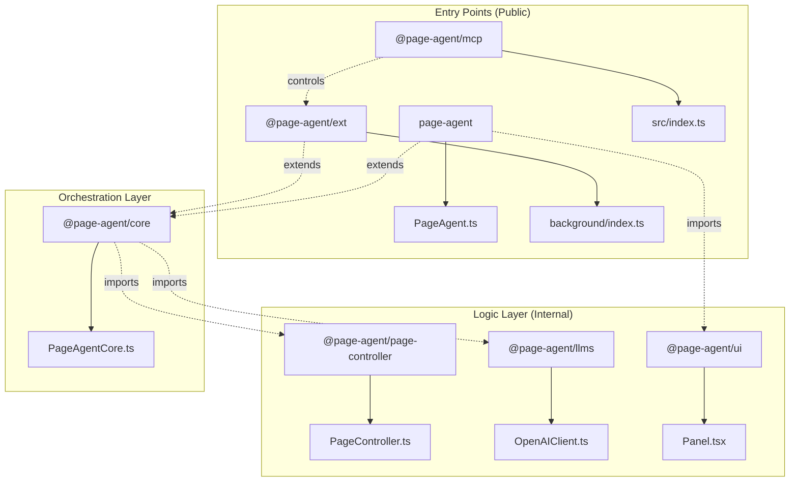
Sources: [packages/page-agent/vite.config.js:28-35](), [packages/core/vite.config.js:28-35](), [packages/page-controller/vite.config.js:30-37](), [packages/llms/vite.config.js:28-35](), [package.json:6-15]()

### Build Automation Scripts

The project utilizes specialized Node.js scripts to manage complex build pipelines across workspaces.

*   **`scripts/build.js`**: Executes the full pipeline including cleanup, parallel library builds, website generation, and extension zipping [scripts/build.js:8-10](). It uses `npm run cleanup` before starting parallel tasks [scripts/build.js:24]().
*   **`scripts/build-libs.js`**: Specifically targets library packages. It reads the root `package.json` workspaces, filters for those with a `build` script, and runs them concurrently using `parallelTask` [scripts/build-libs.js:15-25]().
*   **`scripts/parallel-task.js`**: A utility that uses `child_process.spawn` to run multiple shell commands in parallel with a custom progress reporter and a default 30s timeout per task [scripts/parallel-task.js:11-45]().

Sources: [scripts/build.js:1-46](), [scripts/build-libs.js:1-26](), [scripts/parallel-task.js:1-116]()

## TypeScript Project References

The monorepo uses TypeScript project references to enable incremental compilation and enforce module boundaries.

**Unified Typechecking**
The project uses `npm run typecheck` which executes `tsc` against specific configurations like `tsconfig.typecheck.json` and the extension-specific `tsconfig.json` [package.json:38]().

**Key Compiler Options**:
*   `composite: true`: Enabled within the `dts` plugin configuration to support project references and incremental builds [packages/page-agent/vite.config.js:19]().
*   `emitDeclarationOnly: true`: Used during library builds to generate types without transpiling JS (which Vite handles) [packages/page-agent/vite.config.js:21]().
*   `declaration: true`: Ensures `.d.ts` files are generated alongside the build [packages/page-agent/vite.config.js:22]().

Sources: [package.json:38](), [packages/page-agent/vite.config.js:14-23]()

## Vite Configuration

Library packages (Core, LLMs, Page-Controller, UI, Page-Agent) use Vite for bundling.

### Standard ESM Build
The primary build target for NPM distribution is ES Modules. The configurations typically exclude internal `@page-agent/` packages from the bundle via regex in `rollupOptions.external` to allow consumers to manage dependencies [packages/page-agent/vite.config.js:37-43]().

Key plugins include:
*   **`unplugin-dts`**: Configured to include source files and bundle types while excluding test files [packages/page-agent/vite.config.js:14-24]().
*   **`vite-plugin-css-injected-by-js`**: Inlines CSS into the JS bundle, ensuring that styles for the agent UI are loaded automatically without requiring a separate CSS import from the user [packages/page-agent/vite.config.js:25]().

```javascript
// Example from packages/page-agent/vite.config.js
export default defineConfig({
	plugins: [
		dts({ include: ['src/**/*.ts'], bundleTypes: true }),
		cssInjectedByJsPlugin({ relativeCSSInjection: true }),
	],
	build: {
		lib: {
			entry: resolve(__dirname, 'src/PageAgent.ts'),
			formats: ['es'],
		},
		outDir: resolve(__dirname, 'dist', 'esm'),
		rollupOptions: {
			external: ['chalk', 'zod', /^@page-agent\//],
		},
	}
})
```
Sources: [packages/page-agent/vite.config.js:11-52](), [packages/core/vite.config.js:11-52](), [packages/page-controller/vite.config.js:13-52](), [packages/llms/vite.config.js:12-45](), [packages/ui/vite.config.js:13-48]()

### IIFE Build for CDN/Bookmarklets
The `page-agent` package provides a secondary configuration `vite.iife.config.js` to generate a standalone "demo" script [packages/page-agent/vite.iife.config.js:13]().

**Key IIFE Build Logic**:
1. **Bundling**: Unlike the ESM build, it does not mark internal packages as external, bundling everything into one file for browser use [packages/page-agent/vite.iife.config.js:14-15]().
2. **Environment Inlining**: Variables like `LLM_MODEL_NAME`, `LLM_API_KEY`, and `LLM_BASE_URL` are loaded from the root `.env` and injected via the `define` object [packages/page-agent/vite.iife.config.js:11, 44-48]().
3. **Format**: Uses the `iife` format with a global name `PageAgent` and an entry point at `src/demo.ts` [packages/page-agent/vite.iife.config.js:24-28]().

Sources: [packages/page-agent/vite.iife.config.js:1-50]()

### Website SPA Routing
The `packages/website` configuration includes a custom `spaRoutes` plugin. This plugin copies `index.html` to various subdirectories (e.g., `docs/introduction/overview`) to support direct access on static hosts like GitHub Pages [packages/website/vite.config.js:19-53](). It also generates a `sitemap.xml` for all defined routes [packages/website/vite.config.js:55-66]().

Sources: [packages/website/vite.config.js:19-69]()

## Build Pipeline and Data Flow

The following diagram illustrates how source code flows through the build system to produce different distribution formats.

**Build Pipeline and Output Flow**
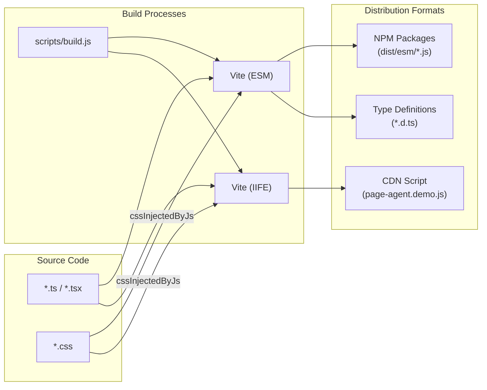
Sources: [packages/page-agent/vite.config.js:14-25](), [packages/page-agent/vite.iife.config.js:23-30](), [scripts/build.js:26-45](), [packages/website/vite.config.js:75]()

---

# Page: Version Management and Publishing

# Version Management and Publishing

<details>
<summary>Relevant source files</summary>

The following files were used as context for generating this wiki page:

- [packages/extension/package.json](packages/extension/package.json)
- [packages/extension/src/types/globals.d.ts](packages/extension/src/types/globals.d.ts)
- [packages/website/package.json](packages/website/package.json)
- [scripts/post-publish.js](scripts/post-publish.js)
- [scripts/pre-publish.js](scripts/pre-publish.js)
- [scripts/sync-version.js](scripts/sync-version.js)

</details>


This document describes the versioning strategy, version synchronization mechanisms, and publishing workflow for the PageAgent monorepo. It covers how versions are kept in sync across published packages, the automated scripts that manage versioning, and the processes for distributing packages to NPM and CDNs.

---

## Versioning Strategy

The PageAgent monorepo employs a **synchronized versioning strategy** where all published packages share the same version number. This approach simplifies dependency management and ensures version compatibility across the package ecosystem.

### Published vs Private Packages

| Package | Name | Published to NPM | Distribution |
|---------|------|------------------|--------------|
| `page-agent` | `page-agent` | ✅ Yes | NPM / CDN (IIFE) |
| `core` | `@page-agent/core` | ✅ Yes | NPM |
| `llms` | `@page-agent/llms` | ✅ Yes | NPM |
| `page-controller` | `@page-agent/page-controller` | ✅ Yes | NPM |
| `ui` | `@page-agent/ui` | ✅ Yes | NPM |
| `mcp` | `@page-agent/mcp` | ✅ Yes | NPM |
| `website` | `@page-agent/website` | ❌ No (Private) | GitHub Pages [packages/website/package.json:3-4]() |
| `extension` | `@page-agent/ext` | ❌ No (Private) | Chrome Web Store [packages/extension/package.json:3-4]() |

**Sources:** [packages/website/package.json:2-4](), [packages/extension/package.json:2-4](), [scripts/sync-version.js:45-50](), [scripts/sync-version.js:56-58]()

---

## Version Synchronization Mechanism

### Synchronized Package Versions

The root `package.json` serves as the single source of truth for the version number. The `sync-version.js` script propagates this version to all internal packages and updates inter-package dependency constraints.

**Version Propagation Flow**

```mermaid
graph TB
    ROOT["Root package.json<br/>(Source of Truth)"]
    
    subgraph "Internal Packages (Synchronized)"
        PA["page-agent"]
        CORE["@page-agent/core"]
        LLMS["@page-agent/llms"]
        PC["@page-agent/page-controller"]
        UI["@page-agent/ui"]
        MCP["@page-agent/mcp"]
    end
    
    subgraph "External References"
        DOCS["README.md / docs/*.md<br/>(CDN URLs)"]
        CONST["website/src/constants.ts<br/>(Demo URLs)"]
    end
    
    SYNC["scripts/sync-version.js"]
    
    ROOT -->|"CLI Arg or root version"| SYNC
    SYNC -->|"pkg.version = newVersion"| PA
    SYNC -->|"pkg.version = newVersion"| CORE
    SYNC -->|"pkg.version = newVersion"| LLMS
    SYNC -->|"pkg.version = newVersion"| PC
    SYNC -->|"pkg.version = newVersion"| UI
    SYNC -->|"pkg.version = newVersion"| MCP
    
    SYNC -->|"Update CDN URLs"| DOCS
    SYNC -->|"Update CDN URLs"| CONST
```

**Sources:** [scripts/sync-version.js:1-132]()

### The sync-version.js Script

Located at `scripts/sync-version.js`, this script performs the following operations:

1.  **Version Determination**: Reads the version from the root `package.json` or accepts a new version as a command-line argument [scripts/sync-version.js:20-24]().
2.  **Package Traversal**: Iterates through all directories in the `packages/` folder [scripts/sync-version.js:46-49]().
3.  **Internal Dependency Update**: Updates `dependencies` in each `package.json` if they refer to an internal package (e.g., `@page-agent/core`). It uses the `isInternalPackage` helper to identify these [scripts/sync-version.js:56-74](). Note that `devDependencies` are generally kept as `*` or managed separately, while production `dependencies` are strictly pinned to the new version [scripts/sync-version.js:89-92]().
4.  **CDN URL Replacement**: Replaces hardcoded CDN URLs in documentation (`README.md`, `docs/README-zh.md`) and source code (`packages/website/src/constants.ts`) to point to the new version on `jsdelivr` and `npmmirror` [scripts/sync-version.js:107-130]().

**Sources:** [scripts/sync-version.js:1-145]()

---

## Publishing Workflow

The publishing process is automated via scripts that ensure manifest integrity and proper asset distribution.

### Manifest Pre-processing and Restoration

To maintain a clean development environment while providing optimized NPM manifests, PageAgent uses pre- and post-publish hooks.

**NPM Publishing Lifecycle**

```mermaid
graph LR
    subgraph "Publishing Cycle"
        PRE["scripts/pre-publish.js"]
        PUB["npm publish"]
        POST["scripts/post-publish.js"]
    end

    PRE -->|"1. Backup package.json"| BAK[".bak file"]
    PRE -->|"2. Promote publishConfig"| NEW_JSON["package.json (modified)"]
    PRE -->|"3. Copy LICENSE/README"| ASSETS["Asset Files"]
    
    NEW_JSON --> PUB
    ASSETS --> PUB
    
    PUB --> POST
    POST -->|"1. Restore backup"| OLD_JSON["package.json (original)"]
    POST -->|"2. Clean assets"| CLEAN["Cleanup"]
```

*   **`pre-publish.js`**: Backs up the original `package.json` [scripts/pre-publish.js:24-25](), promotes fields from `publishConfig` to the top level [scripts/pre-publish.js:27-30](), and copies the project `LICENSE` (and `README.md` for the main `page-agent` package) into the package directory [scripts/pre-publish.js:35-42]().
*   **`post-publish.js`**: Restores the original `package.json` from the backup [scripts/post-publish.js:21-22]() and removes the temporary license and readme files [scripts/post-publish.js:24-30]().

**Sources:** [scripts/pre-publish.js:1-43](), [scripts/post-publish.js:1-31]()

---

## Distribution Channels

### NPM Packages
The primary distribution channel for developers. Packages are published under the `@page-agent/` scope (except the main `page-agent` wrapper). Internal dependencies are synchronized to ensure that, for example, `@page-agent/ext` version `1.12.2` depends specifically on `@page-agent/core` version `1.12.2` [packages/extension/package.json:42-45]().

### CDN (IIFE)
The `page-agent` package includes an IIFE (Immediately Invoked Function Expression) build intended for direct browser use via script tags.
*   **Primary CDN**: `https://cdn.jsdelivr.net/npm/page-agent@{version}/dist/iife/page-agent.demo.js` [scripts/sync-version.js:108-109]()
*   **Mirror (China)**: `https://registry.npmmirror.com/page-agent/{version}/files/dist/iife/page-agent.demo.js` [scripts/sync-version.js:110-111]()

### Chrome Extension
The extension identifies its version at runtime using a global constant `__VERSION__` [packages/extension/src/types/globals.d.ts:1](). It is built using `wxt` [packages/extension/package.json:7-9]() and distributed as a ZIP file for store upload.

**Sources:** [packages/extension/package.json:7-9](), [packages/extension/package.json:42-45](), [scripts/sync-version.js:108-111](), [packages/extension/src/types/globals.d.ts:1]()

---

# Page: Getting Started

# Getting Started

<details>
<summary>Relevant source files</summary>

The following files were used as context for generating this wiki page:

- [README.md](README.md)
- [docs/README-zh.md](docs/README-zh.md)
- [packages/website/src/constants.ts](packages/website/src/constants.ts)
- [packages/website/src/pages/docs/advanced/custom-ui/page.tsx](packages/website/src/pages/docs/advanced/custom-ui/page.tsx)
- [packages/website/src/pages/docs/advanced/page-agent/page.tsx](packages/website/src/pages/docs/advanced/page-agent/page.tsx)
- [packages/website/src/pages/docs/features/custom-tools/page.tsx](packages/website/src/pages/docs/features/custom-tools/page.tsx)
- [packages/website/src/pages/docs/introduction/limitations/page.tsx](packages/website/src/pages/docs/introduction/limitations/page.tsx)
- [packages/website/src/pages/docs/introduction/overview/page.tsx](packages/website/src/pages/docs/introduction/overview/page.tsx)
- [packages/website/src/pages/docs/introduction/quick-start/page.tsx](packages/website/src/pages/docs/introduction/quick-start/page.tsx)

</details>


This page guides you through installing PageAgent and executing your first AI-powered web automation task. PageAgent can be integrated via CDN script tag, NPM package, or browser extension, depending on your use case.

For detailed installation instructions, see [Installation Methods](#3.1). For a step-by-step walkthrough, see [Quick Start Guide](#3.2). For LLM provider configuration, see [LLM Provider Setup](#3.3).

## Prerequisites

PageAgent requires:

| Requirement | Details |
|------------|---------|
| **LLM API Access** | OpenAI-compatible API endpoint with tool calling support (see [LLM Provider Setup](#3.3)) |
| **Modern Browser** | Chrome, Firefox, Safari, or Edge with ES6+ support |
| **Client-Side JavaScript** | No server-side components required (runs entirely in the browser) |

Note that for production use, you should configure an LLM API key via environment variables or a backend proxy. The demo CDN uses a free testing API for evaluation purposes only [README.md:67-67]().

Sources: [README.md:53-91](), [packages/website/src/pages/docs/introduction/quick-start/page.tsx:23-56]()

## Installation Methods Overview

PageAgent provides three primary installation methods to suit different development environments:

**Installation Method Selection**

```mermaid
graph TB
    [START] --> [CDN]
    [START] --> [NPM]
    [START] --> [EXT]
    
    [CDN] -- "dist/iife/page-agent.demo.js" --> [CDN_USE]
    [NPM] -- "npm install page-agent" --> [NPM_USE]
    [EXT] -- "Chrome Extension" --> [EXT_USE]

    [CDN_USE]["Quick testing<br/>Static HTML pages<br/>No build tooling"]
    [NPM_USE]["Production apps<br/>React/Vue/Angular<br/>Build system integration"]
    [EXT_USE]["Multi-page tasks<br/>Cross-tab automation<br/>User-side tools"]
```

| Method | Distribution Artifact | Global Access | Use Case |
|--------|----------------------|---------------|----------|
| **CDN** | `page-agent.demo.js` | `window.PageAgent` | Fast testing, static demos |
| **NPM** | `page-agent` package | ES Module Import | Production SaaS integration |
| **Extension** | Chrome Extension | Side Panel / Hub | Cross-tab automation |

For detailed installation instructions for each method, see [Installation Methods](#3.1).

Sources: [README.md:53-91](), [packages/website/src/pages/docs/introduction/quick-start/page.tsx:22-99](), [packages/website/src/pages/docs/introduction/limitations/page.tsx:24-83]()

## Quick Example: CDN Demo

The fastest way to try PageAgent is via the demo CDN, which includes a pre-configured testing LLM.

```html
<!-- Demo CDN with free testing LLM (evaluation only) -->
<script 
    src="https://cdn.jsdelivr.net/npm/page-agent@1.12.2/dist/iife/page-agent.demo.js" 
    crossorigin="anonymous"
></script>
```

This automatically initializes a `PageAgent` instance and shows the UI panel. The demo uses a free testing API [packages/website/src/constants.ts:9-9]() with the model `qwen3.5-flash` [packages/website/src/constants.ts:8-8]().

**Warning**: The demo CDN is for technical evaluation only. By using it, you agree to the [testing API terms](https://github.com/alibaba/page-agent/blob/main/docs/terms-and-privacy.md). Do not use in production or with sensitive data [README.md:67-67]().

| Mirror | URL |
|--------|-----|
| Global | [https://cdn.jsdelivr.net/npm/page-agent@1.12.2/dist/iife/page-agent.demo.js](https://cdn.jsdelivr.net/npm/page-agent@1.12.2/dist/iife/page-agent.demo.js) |
| China | [https://registry.npmmirror.com/page-agent/1.12.2/files/dist/iife/page-agent.demo.js](https://registry.npmmirror.com/page-agent/1.12.2/files/dist/iife/page-agent.demo.js) |

Sources: [README.md:53-71](), [packages/website/src/constants.ts:1-11](), [packages/website/src/pages/docs/introduction/quick-start/page.tsx:23-85]()

## Quick Example: NPM Package

For production applications, install via NPM and configure your own LLM:

```bash
npm install page-agent
```

```javascript
import { PageAgent } from 'page-agent'

const agent = new PageAgent({
    model: 'qwen3.5-plus',
    baseURL: 'https://dashscope.aliyuncs.com/compatible-mode/v1',
    apiKey: 'YOUR_API_KEY',
    language: 'en-US',
})

await agent.execute('Click the login button')
```

**Class Instantiation Flow**

```mermaid
graph TB
    [IMPORT] -- "Import from 'page-agent'" --> [CONSTRUCTOR]
    [CONSTRUCTOR] -- "Init PageAgent" --> [CORE]
    [CORE] -- "Extends" --> [PageAgentCore]
    
    subgraph "Internal Components"
        [PageAgentCore] --> [LLM]
        [PageAgentCore] --> [PageController]
    end

    [CONSTRUCTOR] --> [PanelUI]

    [IMPORT]["packages/page-agent/src/index.ts"]
    [CONSTRUCTOR]["packages/page-agent/src/PageAgent.ts"]
    [PageAgentCore]["packages/core/src/PageAgentCore.ts"]
    [LLM]["packages/llms/src/LLM.ts"]
    [PageController]["packages/page-controller/src/PageController.ts"]
    [PanelUI]["packages/ui/src/Panel.tsx"]
```

The `PageAgent` class extends `PageAgentCore` and adds the `panel` UI property [packages/website/src/pages/docs/advanced/page-agent/page.tsx:80-85](). It automatically creates a `PageController` for DOM extraction and element actions [packages/website/src/pages/docs/advanced/page-agent/page.tsx:32-35]().

Sources: [README.md:72-89](), [packages/website/src/pages/docs/introduction/quick-start/page.tsx:89-114](), [packages/website/src/pages/docs/advanced/page-agent/page.tsx:16-18]()

## Executing Tasks

The `PageAgent` instance provides two execution modes: programmatic and interactive.

**Execution Modes**

```mermaid
graph LR
    [User] -- "Natural Language" --> [PageAgent]
    
    subgraph "Execution Paths"
        [PageAgent] -- "agent.execute(task)" --> [Programmatic]
        [PageAgent] -- "agent.panel.show()" --> [Interactive]
    end

    [Programmatic] --> [ReActLoop]
    [Interactive] --> [UI_Panel]
    [UI_Panel] -- "User clicks Run" --> [ReActLoop]

    [ReActLoop]["packages/core/src/PageAgentCore.ts<br/>(Observe-Think-Act)"]
    [UI_Panel]["packages/ui/src/Panel.tsx<br/>(Human-in-the-loop)"]
```

**Programmatic Execution**
```javascript
// Execute task from code
const result = await agent.execute('Click the login button')
```

**Interactive Panel Execution**
```javascript
// Show UI panel for user input
agent.panel.show()
```

The `execute()` method implements the Re-act loop (observe page state, invoke LLM for decision, execute action, repeat). The `PageAgentCore` logic is fully decoupled from the UI through events like `statuschange`, `historychange`, and `activity` [packages/website/src/pages/docs/advanced/custom-ui/page.tsx:125-154]().

Sources: [README.md:88-88](), [packages/website/src/pages/docs/introduction/quick-start/page.tsx:116-130](), [packages/website/src/pages/docs/advanced/page-agent/page.tsx:151-164](), [packages/website/src/pages/docs/advanced/custom-ui/page.tsx:15-17]()

## Next Steps

After completing basic setup and your first execution:

1.  **Configure LLMs**: Learn how to set up OpenAI, Claude, or local Ollama in [LLM Provider Setup](#3.3).
2.  **Explore Installation**: Deep dive into the Chrome Extension or NPM configuration in [Installation Methods](#3.1).
3.  **Custom Tools**: Extend the agent's capabilities by writing your own tools using the `tool()` helper and Zod schemas [packages/website/src/pages/docs/features/custom-tools/page.tsx:46-86](). See [Custom Tools System](#9).
4.  **Architecture**: Understand how the DOM is processed via text-based manipulation without screenshots [packages/website/src/pages/docs/introduction/limitations/page.tsx:136-154](). See [Page Controller System](#5).

Sources: [README.md:1-125](), [packages/website/src/pages/docs/introduction/quick-start/page.tsx:1-134](), [packages/website/src/pages/docs/features/custom-tools/page.tsx:1-114]()

---

# Page: Installation Methods

# Installation Methods

<details>
<summary>Relevant source files</summary>

The following files were used as context for generating this wiki page:

- [README.md](README.md)
- [docs/README-zh.md](docs/README-zh.md)
- [packages/website/src/constants.ts](packages/website/src/constants.ts)
- [packages/website/src/pages/docs/advanced/custom-ui/page.tsx](packages/website/src/pages/docs/advanced/custom-ui/page.tsx)
- [packages/website/src/pages/docs/advanced/page-agent/page.tsx](packages/website/src/pages/docs/advanced/page-agent/page.tsx)
- [packages/website/src/pages/docs/features/custom-tools/page.tsx](packages/website/src/pages/docs/features/custom-tools/page.tsx)
- [packages/website/src/pages/docs/introduction/limitations/page.tsx](packages/website/src/pages/docs/introduction/limitations/page.tsx)
- [packages/website/src/pages/docs/introduction/overview/page.tsx](packages/website/src/pages/docs/introduction/overview/page.tsx)
- [packages/website/src/pages/docs/introduction/quick-start/page.tsx](packages/website/src/pages/docs/introduction/quick-start/page.tsx)

</details>


This document provides detailed technical information about the three primary methods for integrating PageAgent into web environments: the CDN script tag (for quick demos), the NPM package (for production integration), and the Chrome extension (for cross-tab automation).

---

## Distribution Architecture

PageAgent is organized as a monorepo, producing different artifacts for various integration patterns. The core logic resides in `page-agent`, which depends on internal packages like `@page-agent/core`, `@page-agent/llms`, and `@page-agent/page-controller` [packages/page-agent/package.json:57-60]().

TITLE: Distribution and Build Data Flow
```mermaid
graph TB
    subgraph "BuildProcess[packages/page-agent/]"
        SRC["PageAgent.ts"]
        VITE["vite build"]
        VITE_IIFE["vite build --config vite.iife.config.js"]
    end
    
    subgraph "BuildArtifacts"
        LIB["dist/esm/page-agent.js<br/>(ES Module)"]
        IIFE["dist/iife/page-agent.demo.js<br/>(IIFE Bundle)"]
        EXT_CRX["Chrome Extension<br/>Artifacts"]
    end
    
    subgraph "DistributionChannels"
        NPM["NPM Registry<br/>'page-agent'"]
        CDN["Global/China CDN<br/>jsDelivr / npmmirror"]
        STORE["Chrome Web Store"]
    end
    
    subgraph "IntegrationMethods"
        NPM_INSTALL["NPM Install<br/>import { PageAgent }"]
        SCRIPT_TAG["Script Tag<br/>window.PageAgent"]
        EXT_INSTALL["Browser Extension<br/>Side Panel UI"]
    end
    
    SRC --> VITE
    SRC --> VITE_IIFE
    VITE --> LIB
    VITE_IIFE --> IIFE
    
    LIB --> NPM
    IIFE --> CDN
    NPM --> NPM_INSTALL
    CDN --> SCRIPT_TAG
    STORE --> EXT_INSTALL
```

**Sources:** [packages/page-agent/package.json:49-62](), [README.md:67-71](), [packages/website/src/constants.ts:1-5]()

---

## Method 1: CDN Script Integration (Demo)

### Overview
The CDN method loads PageAgent as an IIFE (Immediately Invoked Function Expression) bundle. It is designed for rapid prototyping and trying the library without a local build environment [README.md:53-55]().

### Implementation
Add the script tag to your HTML. The demo bundle is pre-configured to use a free testing LLM API [README.md:64-64](). The latest version is `1.12.2` [packages/website/src/constants.ts:3-5]().

```html
<!-- Global Mirror (jsDelivr) -->
<script 
    src="https://cdn.jsdelivr.net/npm/page-agent@1.12.2/dist/iife/page-agent.demo.js" 
    crossorigin="anonymous"
></script>

<!-- China Mirror (npmmirror) -->
<script 
    src="https://registry.npmmirror.com/page-agent/1.12.2/files/dist/iife/page-agent.demo.js" 
    crossorigin="anonymous"
></script>
```

### Initialization Control
By default, the demo script automatically initializes a demo agent. To load the script without automatic creation, append `?autoInit=false` to the script source URL [README.md:69-69](). You can also pass a language parameter like `?lang=zh-CN` to set the default UI language [packages/website/src/pages/docs/introduction/quick-start/page.tsx:14-14]().

```javascript
// Manual instantiation when autoInit=false
const agent = new window.PageAgent({
    model: 'qwen3.5-plus',
    baseURL: 'https://dashscope.aliyuncs.com/compatible-mode/v1',
    apiKey: 'YOUR_API_KEY',
    language: 'en-US'
});
```

**Sources:** [README.md:57-71](), [packages/website/src/constants.ts:2-5](), [packages/website/src/pages/docs/introduction/quick-start/page.tsx:13-15]()

---

## Method 2: NPM Package (Recommended)

### Overview
The recommended method for production applications. It provides full TypeScript definitions and allows for integration into modern build pipelines [packages/page-agent/package.json:6-13]().

### Installation
```bash
npm install page-agent
```

### Integration Code
The `PageAgent` class serves as the primary entry point, integrating the core agent logic with the UI panel [README.md:78-89](). It automatically creates a `PageController` for DOM extraction and element actions [packages/website/src/pages/docs/advanced/page-agent/page.tsx:32-34]().

```typescript
import { PageAgent } from 'page-agent'

const agent = new PageAgent({
    model: 'qwen3.5-plus',
    baseURL: 'https://dashscope.aliyuncs.com/compatible-mode/v1',
    apiKey: 'YOUR_API_KEY',
    language: 'en-US',
})

// Execute a task programmatically
await agent.execute('Click the login button')
```

### Package Metadata
| Property | Value |
|----------|-------|
| **Main Entry** | `./src/PageAgent.ts` (source) / `./dist/esm/page-agent.js` (published) |
| **Peer Dependencies** | `zod` (^3.25.0 \|\| ^4.0.0) |
| **Internal Deps** | `@page-agent/core`, `@page-agent/llms`, `@page-agent/page-controller`, `@page-agent/ui` |

**Sources:** [packages/page-agent/package.json:1-25](), [packages/page-agent/package.json:56-65](), [README.md:72-89](), [packages/website/src/pages/docs/advanced/page-agent/page.tsx:16-17]()

---

## Method 3: Chrome Extension

### Overview
The Chrome extension extends PageAgent's reach across multiple browser tabs [README.md:40-40](). It provides a side panel UI and handles cross-context communication that isn't possible with a single-page script [README.md:48-48]().

### Multi-Context Architecture
The extension splits the agent logic across different execution environments. It uses a `MultiPageAgent` for cross-tab operations and a `RemotePageController` for DOM manipulation in individual tabs [packages/website/src/pages/docs/introduction/limitations/page.tsx:29-30]().

TITLE: Extension Execution Contexts and Data Flow
```mermaid
graph LR
    subgraph "Extension_Context"
        SP["SidePanelUI<br/>(React)"]
        BG["BackgroundScript<br/>(MultiPageAgent)"]
    end
    
    subgraph "Browser_Tabs"
        CS["ContentScript<br/>(RemotePageController)"]
        DOM["WebPageDOM"]
    end
    
    SP -- "UserCommand" --> BG
    BG -- "RemoteAction" --> CS
    CS -- "SyntheticEvent" --> DOM
    DOM -- "DOMTreeUpdate" --> CS
    CS -- "BrowserState" --> BG
    BG -- "AgentStatus" --> SP
```

### Key Differences
1.  **Scope**: Unlike the script/NPM version which is limited to the current page, the extension can manage multiple tabs and perform cross-tab navigation, such as opening, switching, or closing tabs [packages/website/src/pages/docs/introduction/limitations/page.tsx:68-79]().
2.  **Deployment**: Distributed via the Chrome Web Store [README.md:14-14]().
3.  **Permissions**: Uses standard browser extension APIs for DOM access and tab management, removing the need for site-specific script injection by developers [packages/website/src/pages/docs/introduction/limitations/page.tsx:57-59]().

**Sources:** [README.md:14-14](), [README.md:40-48](), [packages/website/src/pages/docs/introduction/limitations/page.tsx:23-82]()

---

## Comparison of Methods

| Feature | CDN (Demo) | NPM Package | Chrome Extension |
| :--- | :--- | :--- | :--- |
| **Target Audience** | Quick Evaluators | Product Developers | End Users / Power Users |
| **Primary Artifact** | `page-agent.demo.js` | `page-agent` package | Chrome Web Store CRX |
| **Automation Scope** | Single Page | Single Page (SPA) | Multi-Tab / Browser-wide |
| **UI Integration** | Built-in Panel | Customizable Panel | Browser Side Panel |
| **Installation** | `<script>` tag | `npm install` | Extension Store |

**Sources:** [README.md:53-89](), [packages/page-agent/package.json:1-5](), [packages/website/src/pages/docs/introduction/limitations/page.tsx:32-82]()

---

# Page: Quick Start Guide

# Quick Start Guide

<details>
<summary>Relevant source files</summary>

The following files were used as context for generating this wiki page:

- [README.md](README.md)
- [docs/README-zh.md](docs/README-zh.md)
- [packages/extension/PRIVACY.md](packages/extension/PRIVACY.md)
- [packages/extension/src/agent/constants.ts](packages/extension/src/agent/constants.ts)
- [packages/extension/src/agent/useAgent.ts](packages/extension/src/agent/useAgent.ts)
- [packages/page-agent/src/demo.ts](packages/page-agent/src/demo.ts)
- [packages/website/src/constants.ts](packages/website/src/constants.ts)
- [packages/website/src/pages/docs/advanced/custom-ui/page.tsx](packages/website/src/pages/docs/advanced/custom-ui/page.tsx)
- [packages/website/src/pages/docs/advanced/page-agent/page.tsx](packages/website/src/pages/docs/advanced/page-agent/page.tsx)
- [packages/website/src/pages/docs/features/custom-tools/page.tsx](packages/website/src/pages/docs/features/custom-tools/page.tsx)
- [packages/website/src/pages/docs/introduction/limitations/page.tsx](packages/website/src/pages/docs/introduction/limitations/page.tsx)
- [packages/website/src/pages/docs/introduction/overview/page.tsx](packages/website/src/pages/docs/introduction/overview/page.tsx)
- [packages/website/src/pages/docs/introduction/quick-start/page.tsx](packages/website/src/pages/docs/introduction/quick-start/page.tsx)

</details>


## Purpose and Scope

This guide provides a step-by-step walkthrough for integrating `page-agent` into your web application. It covers installation via CDN or NPM, initialization with LLM configurations, and executing your first natural language task. 

PageAgent is a purely web-based GUI Agent that understands web pages via DOM structure rather than visual screenshots [packages/website/src/pages/docs/introduction/limitations/page.tsx:136-143](). It is designed to be integrated in minutes, providing a GUI agent that can manipulate the DOM based on natural language instructions [packages/website/src/pages/docs/introduction/quick-start/page.tsx:11-15]().

---

## Integration Path Overview

PageAgent offers two primary integration methods depending on your environment:

```mermaid
graph TB
    Start["Start Integration"]
    
    subgraph CDN["Demo CDN (Quick Try)"]
        CDN_Script["&lt;script src='...'&gt; tag"]
        CDN_Global["window.PageAgent available"]
        CDN_Terms["Accept Terms of Use"]
    end
    
    subgraph NPM["NPM Package (Recommended)"]
        NPM_Install["npm install page-agent"]
        NPM_Import["import { PageAgent } from 'page-agent'"]
        NPM_Build["Bundler Integration (Vite/Webpack)"]
    end
    
    Start --> CDN_Script
    Start --> NPM_Install
    
    CDN_Script --> CDN_Global
    CDN_Global --> Init["new PageAgent(config)"]
    
    NPM_Install --> NPM_Import
    NPM_Import --> NPM_Build
    NPM_Build --> Init
    
    Init --> Execute["agent.execute(task)"]
    Init --> Panel["agent.panel.show()"]
    
    Execute --> Done["✅ Task Execution"]
    Panel --> Done
```

**Sources:** [packages/website/src/pages/docs/introduction/quick-start/page.tsx:21-125]()

---

## Installation Steps

### Method 1: Demo CDN (Quick Try)

For rapid prototyping or testing, you can include the PageAgent script directly in your HTML. This version uses a free testing LLM API provided by the project [packages/website/src/pages/docs/introduction/quick-start/page.tsx:23-56]().

**Global Mirror:**
```html
<script src="https://cdn.jsdelivr.net/npm/page-agent@1.12.2/dist/iife/page-agent.demo.js" crossorigin="anonymous"></script>
```

**China Mirror:**
```html
<script src="https://registry.npmmirror.com/page-agent/1.12.2/files/dist/iife/page-agent.demo.js" crossorigin="anonymous"></script>
```

**Note:** By default, the demo script automatically initializes using `DEMO_MODEL` (`qwen3.5-plus`) and a pre-configured `DEMO_BASE_URL` [packages/page-agent/src/demo.ts:20-22](). To prevent this and initialize manually via `new window.PageAgent(...)`, append `?autoInit=false` to the script URL [README.md:67-69](), [packages/page-agent/src/demo.ts:8-13]().

**Sources:** [packages/website/src/pages/docs/introduction/quick-start/page.tsx:57-85](), [README.md:53-71](), [packages/website/src/constants.ts:2-5](), [packages/page-agent/src/demo.ts:1-55]()

### Method 2: NPM Install (Recommended)

For production applications, install the package via your preferred package manager to get full TypeScript support and build-time optimizations [packages/website/src/pages/docs/introduction/quick-start/page.tsx:84-94]().

```bash
npm install page-agent
```

---

## Initialization and Configuration

Once installed, you must initialize a `PageAgent` instance. This requires providing LLM credentials (endpoint, model, and API key) and optional settings like language [packages/website/src/pages/docs/introduction/quick-start/page.tsx:96-109]().

```javascript
import { PageAgent } from 'page-agent'

const agent = new PageAgent({
  model: 'qwen3.5-plus', // Model name
  baseURL: 'https://dashscope.aliyuncs.com/compatible-mode/v1', // API Endpoint
  apiKey: 'YOUR_API_KEY', // Your provider API key
  language: 'en-US' // 'zh-CN' or 'en-US'
})
```

### Configuration to Code Entity Mapping

The following diagram shows how the `PageAgentConfig` maps to internal system components during instantiation in the `PageAgent` constructor:

```mermaid
graph TD
    Config["PageAgentConfig"]
    
    subgraph Core["PageAgent Instance"]
        PA["PageAgent (packages/page-agent/src/PageAgent.ts)"]
        PAC["PageAgentCore (packages/core/src/PageAgentCore.ts)"]
        PC["PageController (packages/page-controller/src/PageController.ts)"]
        PN["Panel (packages/ui/src/Panel.ts)"]
    end

    subgraph LLM_Space["LLM Entity Space"]
        LLMC["LLM Client (packages/llms/src/LLM.ts)"]
    end

    Config -->|model/baseURL/apiKey| LLMC
    Config -->|language/maxSteps| PAC
    Config -->|enableMask/viewportExpansion| PC
    Config -->|language/promptForNextTask| PN
    
    PA --> PAC
    PAC --> PC
    PAC --> LLMC
    PA --> PN
```

**Sources:** [packages/website/src/pages/docs/introduction/quick-start/page.tsx:101-114](), [packages/website/src/pages/docs/advanced/page-agent/page.tsx:75-85](), [packages/website/src/pages/docs/advanced/custom-ui/page.tsx:19-43]()

---

## Executing Your First Task

There are two ways to interact with the agent: programmatically via code, or interactively via the built-in UI panel [packages/website/src/pages/docs/introduction/quick-start/page.tsx:111-125]().

### 1. Programmatic Execution
Use the `execute` method to send a natural language string directly to the agent. This returns a promise that resolves with a result object containing success status, data, and history [packages/website/src/pages/docs/advanced/page-agent/page.tsx:66-72]().

```javascript
const result = await agent.execute('Click submit button, then fill username as John');
console.log(result.success); // true or false
```

### 2. Interactive Panel
Display the built-in sidebar/dialog that allows users to type instructions, view the agent's "thought" process, and see execution history [packages/website/src/pages/docs/advanced/page-agent/page.tsx:142-164]().

```javascript
agent.panel.show();
```

---

## Task Execution Flow

When `agent.execute()` is called, the system enters a Re-act (Reasoning and Acting) loop. This diagram maps the logical flow to specific code modules:

```mermaid
sequenceDiagram
    participant U as User/Code
    participant PA as PageAgent
    participant PC as PageController
    participant LLM as LLM Module
    participant Tool as Built-in Tools

    U->>PA: execute("Click Search")
    loop Agent Loop
        PA->>PC: getBrowserState()
        Note over PC: packages/page-controller/src/PageController.ts
        PC-->>PA: { html: "...", interactiveElements: [...] }
        
        PA->>LLM: invoke(prompt)
        Note over LLM: packages/llms/src/LLM.ts
        LLM-->>PA: ToolCall (Thought + Action)
        
        PA->>Tool: execute(params)
        Note over Tool: click, input, scroll, etc.
        Tool->>PC: actionExecutor()
        PC-->>Tool: Success
        Tool-->>PA: ToolResult
    end
    PA-->>U: Task Finished
```

**Sources:** [packages/website/src/pages/docs/introduction/quick-start/page.tsx:117-130](), [packages/website/src/pages/docs/advanced/page-agent/page.tsx:12-18](), [packages/website/src/pages/docs/advanced/custom-ui/page.tsx:45-120]()

---

## Verifying the Setup

To ensure your integration is working correctly, check the following:

1.  **Global Availability:** If using CDN, `window.PageAgent` should be defined [packages/page-agent/src/demo.ts:16]().
2.  **Panel Initialization:** Calling `agent.panel.show()` should inject the UI element into the DOM [packages/website/src/pages/docs/advanced/page-agent/page.tsx:142-153]().
3.  **Network Activity:** When calling `execute()`, check the browser Network tab for outgoing requests to your configured `baseURL`.
4.  **Interaction Limits:** Ensure the task does not involve unsupported interactions like hover or drag-and-drop [packages/website/src/pages/docs/introduction/limitations/page.tsx:111-133]().

**Sources:** [packages/website/src/pages/docs/introduction/quick-start/page.tsx:117-130](), [packages/website/src/pages/docs/introduction/limitations/page.tsx:86-133](), [packages/page-agent/src/demo.ts:15-18]()

---

# Page: LLM Provider Setup

# LLM Provider Setup

<details>
<summary>Relevant source files</summary>

The following files were used as context for generating this wiki page:

- [packages/llms/src/types.ts](packages/llms/src/types.ts)
- [packages/llms/src/utils.test.ts](packages/llms/src/utils.test.ts)
- [packages/llms/src/utils.ts](packages/llms/src/utils.ts)
- [packages/website/src/pages/docs/features/models/page.tsx](packages/website/src/pages/docs/features/models/page.tsx)

</details>


This document explains how to configure LLM (Large Language Model) providers for PageAgent. It covers the `LLMConfig` interface, supported providers, model-specific patches, authentication patterns, and testing endpoints.

For general agent configuration options, see [Agent Configuration](#8.1). For detailed LLM integration architecture, see [LLM Integration Layer](#6).

## Configuration Interface

PageAgent requires three mandatory configuration parameters to connect to an LLM provider: `baseURL`, `apiKey`, and `model`. These are validated by the `parseLLMConfig` function which throws an error if any are missing [packages/llms/src/index.ts:85-90]().

Title: LLM Configuration Validation Flow
```mermaid
graph TB
    UserConfig["LLMConfig<br/>packages/llms/src/types.ts"]
    ParseConfig["parseLLMConfig()<br/>packages/llms/src/index.ts:83"]
    ValidatedConfig["ResolvedLLMConfig<br/>packages/llms/src/types.ts"]
    LLMClass["LLM class instance<br/>packages/llms/src/index.ts:19"]
    OpenAIClient["OpenAIClient<br/>packages/llms/src/OpenAIClient.ts:20"]
    
    UserConfig --> ParseConfig
    ParseConfig -->|"validates & fills defaults"| ValidatedConfig
    ValidatedConfig --> LLMClass
    LLMClass --> OpenAIClient
    
    ParseConfig -.->|"Throws Error if missing"| RequiredFields["baseURL<br/>model"]
```

**Sources:** [packages/llms/src/types.ts:90-125](), [packages/llms/src/index.ts:19-29](), [packages/llms/src/index.ts:83-109]()

### LLMConfig Interface Structure

| Field | Type | Required | Default | Description |
|-------|------|----------|---------|-------------|
| `baseURL` | `string` | Yes | - | LLM API endpoint URL [packages/llms/src/types.ts:91]() |
| `apiKey` | `string` | No | `""` | Authentication key [packages/llms/src/types.ts:93]() |
| `model` | `string` | Yes | - | Model identifier [packages/llms/src/types.ts:92]() |
| `temperature` | `number` | No | - | Sampling temperature (Deprecated) [packages/llms/src/types.ts:96-99]() |
| `maxRetries` | `number` | No | `2` | Maximum retry attempts [packages/llms/src/types.ts:101]() |
| `customFetch` | `function` | No | `fetch` | Custom fetch implementation [packages/llms/src/types.ts:124]() |
| `disableNamedToolChoice` | `boolean` | No | `false` | Remove named `tool_choice` logic [packages/llms/src/types.ts:117]() |
| `transformRequestBody` | `function` | No | `identity` | Transform request body before sending [packages/llms/src/types.ts:109]() |

**Sources:** [packages/llms/src/types.ts:90-125](), [packages/llms/src/index.ts:83-109]()

## Supported Providers and Models

PageAgent supports any OpenAI-compatible API endpoint with tool calling capabilities [packages/website/src/pages/docs/features/models/page.tsx:96-97]().

### Tested Model Matrix

Title: Supported Model Ecosystem
```mermaid
graph LR
    subgraph "Cloud Providers"
        Qwen["Qwen<br/>qwen3.7-max<br/>qwen3.5-plus ⭐<br/>qwen3.5-flash ⭐"]
        OpenAI["OpenAI<br/>gpt-5.6-sol<br/>gpt-5.4-mini ⭐<br/>gpt-5.4-nano ⭐"]
        DeepSeek["DeepSeek<br/>deepseek-v4-pro<br/>deepseek-v4-flash ⭐"]
        Anthropic["Anthropic<br/>claude-sonnet-5<br/>claude-haiku-4.5 ⭐"]
        Google["Google<br/>gemini-3.5-flash ⭐<br/>gemini-3.1-pro"]
    end
    
    subgraph "Self-Hosted"
        Ollama["Ollama (via OpenAI compatibility)<br/>qwen3.5-plus<br/>localhost:11434"]
    end
    
    PageAgent["LLM Integration Layer<br/>packages/llms/src/index.ts"]
    
    Qwen --> PageAgent
    OpenAI --> PageAgent
    DeepSeek --> PageAgent
    Anthropic --> PageAgent
    Google --> PageAgent
    Ollama --> PageAgent
```

**Baseline models** (marked ⭐) have been tested extensively and provide strong tool-calling capabilities with reliable performance [packages/website/src/pages/docs/features/models/page.tsx:8-16]().

**Sources:** [packages/website/src/pages/docs/features/models/page.tsx:19-73]()

### Model Requirements

- **Tool Call Support:** Recommended: Fast, lightweight models with strong ToolCall capabilities [packages/website/src/pages/docs/features/models/page.tsx:130-131]().
- **Format Compliance:** Models with weaker ToolCall capabilities may return incorrect formats. Common errors usually auto-recover [packages/website/src/pages/docs/features/models/page.tsx:135-136]().
- **Complexity:** Small models or those unable to handle complex tool definitions typically perform poorly [packages/website/src/pages/docs/features/models/page.tsx:140-141]().

## Provider Configuration Examples

### OpenAI-Compatible Services (e.g., Alibaba Bailian)

```javascript
const pageAgent = new PageAgent({
  baseURL: 'https://dashscope.aliyuncs.com/compatible-mode/v1',
  apiKey: 'your-api-key',
  model: 'qwen3.5-plus'
});
```

**Sources:** [packages/website/src/pages/docs/features/models/page.tsx:151-155]()

## Model-Specific Patches

The `modelPatch` function in `packages/llms/src/utils.ts` reconciles differences in parameter schemas across different providers to improve agent reliability [packages/llms/src/utils.ts:27-38]().

- **Qwen:** Disables thinking (`enable_thinking = false`) and raises temperature to 1.0 for non-max/plus models to improve auto-recovery odds [packages/llms/src/utils.ts:47-54]().
- **DeepSeek:** Disables thinking (`thinking = { type: 'disabled' }`) and removes `tool_choice` [packages/llms/src/utils.ts:56-60]().
- **GPT-5 series:** Adjusts `reasoning_effort` (none/minimal) and sets `verbosity` to low for GPT-5.6 models [packages/llms/src/utils.ts:62-86]().
- **Claude:** Disables thinking and converts OpenAI-style `tool_choice` to Claude-specific format (`any` or `tool` type) unless using OpenRouter [packages/llms/src/utils.ts:88-114]().
- **Gemini:** Sets `reasoning_effort` to `low` or `minimal` for Flash and Lite models [packages/llms/src/utils.ts:116-130]().
- **Kimi:** Kimi K3 models receive a specific patch to use `required` tool choice and disable parallel tool calls while thinking [packages/llms/src/utils.ts:153-164]().

**Sources:** [packages/llms/src/utils.ts:39-196]()

## Auto-Fixer and Normalization

The `normalizeResponse` function in `autoFixer.ts` handles common LLM format errors, such as JSON returned in content instead of `tool_calls` [packages/core/src/utils/autoFixer.ts:44-47](). It also coerces primitive inputs for single-field tools (e.g., `{"click_element_by_index": 2}` → `{"click_element_by_index": {"index": 2}}`) [packages/core/src/utils/autoFixer.ts:149-157]().

**Sources:** [packages/core/src/utils/autoFixer.ts:21-121]()

## Authentication and Security

### Production Authentication Pattern

For production web applications, it is recommended to implement a backend proxy to protect API keys.

Title: Authentication via customFetch Proxy
```mermaid
sequenceDiagram
    participant Agent as PageAgent (Frontend)
    participant Client as OpenAIClient
    participant Proxy as Backend Proxy
    participant LLM as LLM Provider (Cloud)
    
    Agent->>Client: invoke()
    Client->>Client: Prepare RequestBody
    Client->>Proxy: fetch(url, { headers, body, signal })
    Note over Proxy: Backend adds API Key from ENV
    Proxy->>LLM: POST /chat/completions (with Bearer Token)
    LLM-->>Proxy: JSON Response
    Proxy-->>Client: Forward JSON
    Client-->>Agent: InvokeResult
```

**Sources:** [packages/llms/src/OpenAIClient.ts:76-84](), [packages/llms/src/types.ts:124]()

## Error Handling and Retries

The `LLM` class uses `withRetry` to handle transient failures [packages/llms/src/index.ts:42]().

- **Retryable Errors:** `NETWORK_ERROR`, `RATE_LIMIT` (429), `SERVER_ERROR` (5xx), `NO_TOOL_CALL`, `INVALID_TOOL_ARGS`, `TOOL_EXECUTION_ERROR`, `INVALID_RESPONSE`, `INVALID_SCHEMA` [packages/llms/src/errors.ts:7-14]().
- **Non-Retryable Errors:** `CONFIG_ERROR`, `AUTH_ERROR` (401/403), `CONTEXT_LENGTH`, `CONTENT_FILTER` [packages/llms/src/errors.ts:19-22]().
- **Retry Logic:** Max retries default to 2. Retries occur only for errors marked as `retryable` [packages/llms/src/index.ts:71-73]().

**Sources:** [packages/llms/src/index.ts:58-81](), [packages/llms/src/errors.ts:5-56]()

## Free Testing API

A free testing endpoint is provided for technical evaluation and testing.

- **Base URL:** `https://page-ag-testing-ohftxirgbn.cn-shanghai.fcapp.run`
- **Models:** `qwen3.5-plus`, `qwen3.5-flash`

⚠️ **Warning:** Strictly for technical evaluation and R&D. Data is processed via servers in Mainland China. Do not input any PII or sensitive data [packages/website/src/pages/docs/features/models/page.tsx:167-171]().

**Sources:** [packages/website/src/pages/docs/features/models/page.tsx:201-204]()

---

# Page: Core Agent System

# Core Agent System

<details>
<summary>Relevant source files</summary>

The following files were used as context for generating this wiki page:

- [packages/core/package.json](packages/core/package.json)
- [packages/core/src/PageAgentCore.ts](packages/core/src/PageAgentCore.ts)
- [packages/core/src/utils/index.ts](packages/core/src/utils/index.ts)

</details>


This document describes the core orchestration layer of PageAgent, centered around the `PageAgentCore` class. This system implements the Re-act agent loop (observe-think-act), manages agent state and history, enforces reflection-before-action through the MacroTool pattern, and provides an event system for UI integration.

For details on specific components, see the following child pages:
- [PageAgentCore and Re-act Loop](#4.1) — Detailed execution flow and lifecycle management.
- [Agent State and History](#4.2) — Status transitions, historical events, and memory.
- [Tool System and MacroTool](#4.3) — Reflection-before-action pattern and tool registration.
- [Prompt Assembly and Context](#4.4) — System prompts, instructions, and browser state formatting.
- [PageAgent Integration Class](#4.5) — The UI-integrated wrapper class.

## Architecture Overview

The Core Agent System consists of two primary classes: `PageAgentCore` (the headless agent orchestrator) and `PageAgent` (the UI-integrated wrapper).

### Core System Architecture

```mermaid
graph TB
    subgraph "Core_Agent_System"
        PAC["PageAgentCore<br/>(packages/core/src/PageAgentCore.ts)"]
        
        subgraph "Agent_State"
            STATUS["#status: AgentStatus<br/>idle | running | completed | error"]
            HISTORY["history: HistoricalEvent[]<br/>Persistent memory"]
            TASK["task: string<br/>taskId: string"]
            STATES["#states<br/>totalWaitTime, lastURL, browserState"]
        end
        
        subgraph "Dependencies"
            LLM_CLIENT["#llm: LLM<br/>(packages/llms/src/index.ts)"]
            PC["pageController: PageController<br/>(packages/page-controller)"]
            TOOLS["tools: Map[string, Tool]<br/>Action executors"]
        end
        
        subgraph "Event_System"
            EVENTS["EventTarget inheritance<br/>statuschange | historychange<br/>activity | dispose"]
        end
        
        PAC --> STATUS
        PAC --> HISTORY
        PAC --> TASK
        PAC --> STATES
        PAC --> LLM_CLIENT
        PAC --> PC
        PAC --> TOOLS
        PAC --> EVENTS
    end
    
    subgraph "Integration_Layer"
        PA["PageAgent<br/>(packages/page-agent/src/PageAgent.ts)"]
        PANEL["panel: Panel<br/>UI component"]
        
        PA -->|extends| PAC
        PA --> PANEL
    end
    
    CONFIG["PageAgentCoreConfig<br/>AgentConfig + PageController"]
    CONFIG --> PAC
```

**Sources:** [packages/core/src/PageAgentCore.ts:61-146](), [packages/core/src/PageAgentCore.ts:29-30]()

`PageAgentCore` is the headless orchestration engine defined in `packages/core`. It extends `EventTarget` to provide a standard event API for monitoring agent execution [packages/core/src/PageAgentCore.ts:61](). The class manages the agent lifecycle, state, tool orchestration, and LLM communication via the `LLM` client [packages/core/src/PageAgentCore.ts:113]().

`PageAgent` (defined in `packages/page-agent`) extends `PageAgentCore` and adds the `Panel` UI component for human-in-the-loop interaction.

## Re-act Agent Loop

The core execution model follows the Re-act (Reasoning + Acting) pattern, where each step consists of three phases: observe, think, and act [packages/core/src/PageAgentCore.ts:35-42]().

### Execution Flow

```mermaid
stateDiagram-v2
    [*] --> Idle
    
    Idle --> Initialize: "execute(task)"
    
    state Initialize {
        [*] --> ResetState
        ResetState --> ShowMask
        ShowMask --> [*]
    }
    
    Initialize --> ObservePhase
    
    state ObservePhase {
        [*] --> GetBrowserState
        GetBrowserState --> HandleObservations
        HandleObservations --> [*]
    }
    
    ObservePhase --> ThinkPhase
    
    state ThinkPhase {
        [*] --> AssemblePrompt
        AssemblePrompt --> InvokeLLM: "this.#llm.invoke()"
        InvokeLLM --> ParseResponse
        ParseResponse --> [*]
    }
    
    ThinkPhase --> UpdateHistory
    UpdateHistory --> CheckAction
    
    CheckAction --> Done: "action = 'done'"
    CheckAction --> ActPhase: "continue"
    
    state ActPhase {
        [*] --> ExecuteTool: "tool.execute()"
        ExecuteTool --> EmitActivity
        EmitActivity --> [*]
    }
    
    ActPhase --> Wait
    Wait --> ObservePhase: "stepDelay"
    
    Done --> Cleanup
    Cleanup --> Idle
```

**Sources:** [packages/core/src/PageAgentCore.ts:210-348]()

The loop continues until the agent completes the task via the `done` tool or reaches the `maxSteps` limit, which defaults to 40 [packages/core/src/PageAgentCore.ts:111](). For details, see [PageAgentCore and Re-act Loop](#4.1).

## Agent State and History

The agent maintains multiple state tracking systems. The `#status` property tracks the lifecycle state (idle, running, completed, error, stopped) and triggers `statuschange` events [packages/core/src/PageAgentCore.ts:150-184]().

### Historical Events vs. Activity

| System | Storage | Purpose | LLM Context |
| :--- | :--- | :--- | :--- |
| **History** | `history` array | Persistent memory | Included in future steps |
| **Activity** | Transient Events | Real-time UI feedback | NOT included in context |

**Sources:** [packages/core/src/PageAgentCore.ts:50-60](), [packages/core/src/PageAgentCore.ts:70-71]()

The `history` array stores `HistoricalEvent` objects, including steps, observations, retries, and errors [packages/core/src/PageAgentCore.ts:70-71](). Activity events are transient and used for UI updates like "thinking" or "executing" [packages/core/src/PageAgentCore.ts:174-176](). For details, see [Agent State and History](#4.2).

## Tool System and MacroTool

PageAgent uses a "MacroTool" pattern to enforce a reflection-before-action mental model.

### Reflection-to-Code Mapping

```mermaid
graph LR
    subgraph "MacroToolInput_Object"
        R["AgentReflection<br/>(packages/core/src/types.ts)"]
        R1["evaluation_previous_goal"]
        R2["memory"]
        R3["next_goal"]
        A["action: Record<string, any>"]
    end
    
    LLM["LLM_Response"] --> R
    LLM --> A
    
    A --> EXEC["PageAgentTool.execute()<br/>(packages/core/src/tools/index.ts)"]
```

**Sources:** [packages/core/src/PageAgentCore.ts:359-377](), [packages/core/src/tools/index.ts:26]()

Every LLM response must include reflection fields (`evaluation_previous_goal`, `memory`, `next_goal`) before the actual action is executed [packages/core/src/PageAgentCore.ts:359-377](). Tools are managed in a `Map` and can be customized or overridden via `config.customTools` [packages/core/src/PageAgentCore.ts:134-142](). For details, see [Tool System and MacroTool](#4.3).

## Prompt Assembly and Context

Prompts are assembled from multiple sources to provide the LLM with full context of the current task and environment.

- **System Prompt**: Loaded from `system_prompt.md` [packages/core/src/PageAgentCore.ts:11]().
- **Instructions**: Includes global `system` instructions and dynamic `getPageInstructions` callback.
- **Browser State**: The current `BrowserState` provided by the `PageController` [packages/core/src/PageAgentCore.ts:105]().

The agent also supports a `transformPageContent` hook to mask sensitive data before it is sent to the LLM. For details, see [Prompt Assembly and Context](#4.4).

## PageAgent Integration Class

The `PageAgent` class is the standard integration point. It automatically initializes the core logic and the interactive UI panel.

```mermaid
classDiagram
    class PageAgentCore {
        +execute(task)
        +stop()
        +history: HistoricalEvent[]
        #status: AgentStatus
    }
    class PageAgent {
        +panel: Panel
        +constructor(config)
    }
    PageAgentCore <|-- PageAgent
    PageAgent *-- PageController
    PageAgent *-- Panel
```

**Sources:** [packages/core/src/PageAgentCore.ts:61-146](), [packages/core/src/PageAgentCore.ts:29-30]()

This class simplifies deployment by bundling the core logic with the interactive UI panel. For details, see [PageAgent Integration Class](#4.5).

---

# Page: PageAgentCore and Re-act Loop

# PageAgentCore and Re-act Loop

<details>
<summary>Relevant source files</summary>

The following files were used as context for generating this wiki page:

- [packages/core/src/PageAgentCore.ts](packages/core/src/PageAgentCore.ts)
- [packages/core/src/utils/index.ts](packages/core/src/utils/index.ts)
- [packages/website/src/pages/docs/advanced/page-agent-core/page.tsx](packages/website/src/pages/docs/advanced/page-agent-core/page.tsx)

</details>


## Purpose and Scope

This document describes the implementation of the core autonomous agent logic within `PageAgentCore`. It details the Re-act (Reasoning and Acting) loop that drives the agent's behavior, the step-by-step execution flow, and the lifecycle management of a browser automation task.

The `PageAgentCore` class serves as the headless engine for the agent, managing the state machine, LLM interactions, and tool executions. It is designed to be decoupled from the UI, allowing it to run in headless environments or within custom interface implementations.

Sources: [packages/core/src/PageAgentCore.ts:61-95](), [packages/core/src/PageAgentCore.ts:210-225](), [packages/website/src/pages/docs/advanced/page-agent-core/page.tsx:15-19]()

---

## Re-act Loop Architecture

The agent operates on a cyclic "Observe-Think-Act" pattern. Each iteration is a "step," and the agent continues looping until the task is finished, an error occurs, or the maximum step limit is reached.

### Core Loop Flow

```mermaid
graph TD
    subgraph "Initialization"
        Start["PageAgentCore.execute(task)"] --> Init["Reset history & states<br/>Show SimulatorMask"]
    end

    subgraph "Re-act Step Loop"
        Init --> StepStart["Step N"]
        StepStart --> Observe["Observe:<br/>PageController.getBrowserState()"]
        Observe --> Think["Think:<br/>LLM.invoke() with MacroTool"]
        Think --> Act["Act:<br/>Execute Tool (MacroTool)"]
        Act --> Record["Record Step:<br/>Update history with AgentStepEvent"]
        Record --> Check{"Task Done?"}
        Check -- "No" --> StepStart
    end

    subgraph "Termination"
        Check -- "Yes / Max Steps / Error" --> Cleanup["Hide Mask<br/>onAfterTask hook"]
        Cleanup --> End["Return ExecutionResult"]
    end
```

Sources: [packages/core/src/PageAgentCore.ts:31-43](), [packages/core/src/PageAgentCore.ts:210-330]()

---

## Step Execution Details

Each step in the `while(true)` loop within the `execute` method performs the following operations:

### 1. Observation Phase
The agent gathers the current environment context.
- **Browser State**: Calls `pageController.getBrowserState()` to get the simplified DOM tree, URL, and interactive elements [packages/core/src/PageAgentCore.ts:242-243]().
- **Contextual Data**: Optionally fetches `llms.txt` from the site origin if `experimentalLlmsTxt` is enabled [packages/core/src/PageAgentCore.ts:246-250]().
- **Data Masking**: If `transformPageContent` is provided in the `AgentConfig`, the simplified HTML is passed through it to mask sensitive data before reaching the LLM [packages/core/src/PageAgentCore.ts:253-255]().

### 2. Thinking Phase (LLM Invocation)
The agent constructs a prompt and calls the LLM.
- **Prompt Assembly**: Combines the `SYSTEM_PROMPT`, task description, historical events, and current `BrowserState` [packages/core/src/PageAgentCore.ts:271-279]().
- **Tool Definition**: Provides the `MacroTool` schema to the LLM. The `MacroTool` is a wrapper that forces the LLM to provide "Reflection" (evaluation, memory, next goal) before the "Action" [packages/core/src/PageAgentCore.ts:16-22]().
- **Invocation**: Calls `llm.invoke()` with an `AbortSignal` from the internal `#abortController` to allow task cancellation [packages/core/src/PageAgentCore.ts:281-285]().

### 3. Action Phase
The agent executes the tool selected by the LLM.
- **MacroTool Execution**: The `MacroTool` extracts the specific tool name and arguments from the LLM's response and executes the corresponding function from the `this.tools` map [packages/core/src/PageAgentCore.ts:287-293]().
- **State Updates**: If the action involves waiting or navigation, internal states like `totalWaitTime` and `lastURL` are updated [packages/core/src/PageAgentCore.ts:310-316]().

Sources: [packages/core/src/PageAgentCore.ts:242-316](), [packages/core/src/PageAgentCore.ts:91-91]()

---

## Data Flow: Observation to Action

This diagram bridges the gap between the high-level concepts and the specific code entities involved in a single execution step.

```mermaid
sequenceDiagram
    participant C as PageAgentCore
    participant PC as PageController
    participant L as LLM
    participant T as PageAgentTool

    C->>PC: getBrowserState()
    PC-->>C: BrowserState (FlatDomTree + URL)
    
    Note over C: assembleUserPrompt(BrowserState, history)
    
    C->>L: invoke(messages, tools: [MacroTool])
    L-->>C: InvokeResult (MacroToolInput)
    
    Note over C: AgentReflection: evaluation_previous_goal, memory, next_goal
    
    C->>T: execute(input, ctx)
    T-->>C: Action Result (string)
    
    Note over C: Push AgentStepEvent to history
```

Sources: [packages/core/src/PageAgentCore.ts:242-243](), [packages/core/src/PageAgentCore.ts:281-285](), [packages/core/src/PageAgentCore.ts:310-316](), [packages/core/src/PageAgentCore.ts:26-27]()

---

## Lifecycle Management and Hooks

`PageAgentCore` provides several lifecycle hooks and event emitters to allow external monitoring and intervention.

### Event System
The class extends `EventTarget` and emits the following:
- `statuschange`: Triggered when the agent transitions between `idle`, `running`, `completed`, or `error` [packages/core/src/PageAgentCore.ts:160-162]().
- `historychange`: Triggered whenever a new `HistoricalEvent` (step, observation, retry, or error) is added to the memory [packages/core/src/PageAgentCore.ts:165-168]().
- `activity`: Emits transient `AgentActivity` (e.g., `thinking`, `executing`, `retrying`) for real-time UI updates [packages/core/src/PageAgentCore.ts:174-176]().

### Configuration Hooks
Users can provide async callbacks in `AgentConfig` to tap into the execution flow:

| Hook | Timing | Parameters |
| :--- | :--- | :--- |
| `onBeforeTask` | Before the loop starts | `agent: PageAgentCore` |
| `onBeforeStep` | At the start of every iteration | `agent, stepCount` |
| `onAfterStep` | After tool execution and history update | `agent, history` |
| `onAfterTask` | After loop termination (success or fail) | `agent, result` |
| `onDispose` | When `dispose()` is called | `agent, reason` |

Sources: [packages/core/src/PageAgentCore.ts:227-233](), [packages/website/src/pages/docs/advanced/page-agent-core/page.tsx:203-230]()

---

## Termination and Results

The loop terminates under four conditions, resulting in an `ExecutionResult`:

1.  **Success**: The LLM calls the `done` tool with `success: true` [packages/core/src/PageAgentCore.ts:333-339]().
2.  **Failure**: The LLM calls the `done` tool with `success: false` [packages/core/src/PageAgentCore.ts:333-339]().
3.  **Step Limit**: The `step` counter exceeds `config.maxSteps` (default 40) [packages/core/src/PageAgentCore.ts:111-111](), [packages/core/src/PageAgentCore.ts:324-331]().
4.  **Abort**: The `stop()` method is called, triggering the `#abortController` [packages/core/src/PageAgentCore.ts:200-204]().

### ExecutionResult Structure
The `ExecutionResult` [packages/core/src/PageAgentCore.ts:19-19]() returned by `execute()` contains the final outcome and the full trace.

```typescript
export interface ExecutionResult {
    success: boolean;    // Final outcome
    data: string;       // Message from the 'done' tool or error message
    history: HistoricalEvent[]; // Full trace of the task
}
```

Sources: [packages/core/src/PageAgentCore.ts:333-356](), [packages/core/src/PageAgentCore.ts:111-111]()

---

# Page: Agent State and History

# Agent State and History

<details>
<summary>Relevant source files</summary>

The following files were used as context for generating this wiki page:

- [packages/core/src/PageAgentCore.ts](packages/core/src/PageAgentCore.ts)
- [packages/core/src/types.ts](packages/core/src/types.ts)
- [packages/core/src/utils/index.ts](packages/core/src/utils/index.ts)
- [packages/ui/src/panel/Panel.ts](packages/ui/src/panel/Panel.ts)
- [packages/ui/src/panel/types.ts](packages/ui/src/panel/types.ts)

</details>


## Purpose and Scope

This document describes the state management and memory systems within `PageAgentCore`. It covers the agent's status lifecycle, historical event tracking, activity reporting, and memory system. The agent uses a dual-stream information architecture: a persistent **History** stream for long-term reasoning and a transient **Activity** stream for real-time UI feedback.

For information about the execution flow, see [packages/core/src/PageAgentCore.ts:35-42](). For details on how history is assembled into LLM prompts, see [packages/core/src/PageAgentCore.ts:50-55]().

## Agent Status Lifecycle

The agent maintains an internal status that reflects its current execution state. The `AgentStatus` type defines five possible states:

```typescript
export type AgentStatus = 'idle' | 'running' | 'completed' | 'error' | 'stopped'
```
[packages/core/src/types.ts:263-263]()

**Status State Machine**

The following diagram maps the logical status transitions to the code methods and triggers that drive them.

```mermaid
stateDiagram-v2
    [*] --> idle: "new PageAgentCore()"
    
    idle --> running: "execute(task) called"
    
    running --> completed: "done tool called (success=true)"
    running --> error: "done tool called (success=false)"
    running --> error: "Exception thrown in loop"
    running --> error: "maxSteps exceeded"
    running --> stopped: "stop() called / AbortController.abort()"
    
    completed --> idle: "execute(task) called again"
    error --> idle: "execute(task) called again"
    stopped --> idle: "execute(task) called again"
    
    note right of running
        Update via:
        "#setStatus(status)"
    end note
    
    note right of idle
        Status can be read via:
        "agent.status" getter
    end note
```

**Status Management Implementation**

The status is stored as a private field and exposed through a public getter. Changes to the status trigger a `statuschange` event.

- **Private Field**: `#status: AgentStatus = 'idle'` [packages/core/src/PageAgentCore.ts:83-83]()
- **Public Getter**: `get status(): AgentStatus` [packages/core/src/PageAgentCore.ts:150-152]()
- **Update Method**: `#setStatus(status: AgentStatus)` [packages/core/src/PageAgentCore.ts:179-184]()
- **Reset Point**: Status is set to `running` at the beginning of the `execute` method [packages/core/src/PageAgentCore.ts:241]().

**Sources:** [packages/core/src/PageAgentCore.ts:83-241](), [packages/core/src/types.ts:263-263]()

## Historical Events System

The agent maintains a persistent `history` array that serves as the agent's memory across execution steps. This history is included in LLM prompts, enabling the agent to maintain context and learn from previous successes or failures.

### HistoricalEvent Types

The `HistoricalEvent` union type encompasses several distinct event categories:

| Event Type | Purpose | Included in LLM Context | Trigger |
|------------|---------|-------------------------|---------|
| `AgentStepEvent` | Records a completed step with reflection and action | **Yes** | After each LLM tool call execution |
| `ObservationEvent` | System-generated messages (navigation, custom notes) | **Yes** | Navigation detection or `pushObservation()` |
| `UserTakeoverEvent` | User manually controlled the page | **Yes** | When the controller detects external interaction |
| `RetryEvent` | LLM call retry attempt | **Yes** | LLM client retry logic [packages/core/src/PageAgentCore.ts:117-132]() |
| `AgentErrorEvent` | Fatal errors from LLM or execution | **Yes** | LLM errors or execution exceptions |

**Event Type Hierarchy**

```mermaid
graph TD
    HistoricalEvent["HistoricalEvent (Union)"]
    
    HistoricalEvent --> AgentStepEvent["AgentStepEvent<br/>type: 'step'"]
    HistoricalEvent --> ObservationEvent["ObservationEvent<br/>type: 'observation'"]
    HistoricalEvent --> UserTakeoverEvent["UserTakeoverEvent<br/>type: 'user_takeover'"]
    HistoricalEvent --> RetryEvent["RetryEvent<br/>type: 'retry'"]
    HistoricalEvent --> AgentErrorEvent["AgentErrorEvent<br/>type: 'error'"]
    
    AgentStepEvent --> StepFields["Fields:<br/>- stepIndex: number<br/>- reflection: Partial&lt;AgentReflection&gt;<br/>- action: {name, input, output}<br/>- usage: token counts"]
    
    ObservationEvent --> ObsFields["Fields:<br/>- content: string"]
    
    RetryEvent --> RetryFields["Fields:<br/>- attempt: number<br/>- maxAttempts: number"]
```

**Sources:** [packages/core/src/types.ts:198-258](), [packages/core/src/PageAgentCore.ts:117-132]()

### AgentStepEvent and Reflection

The `AgentStepEvent` is the primary record of agent behavior. It incorporates the **AgentReflection** model, which enforces a "reflection-before-action" pattern.

```typescript
export interface AgentReflection {
	evaluation_previous_goal: string // How well did the previous action work?
	memory: string                   // Key info to remember for the future
	next_goal: string                // What is the immediate next goal?
}
```
[packages/core/src/types.ts:171-175]()

This reflection is generated by the LLM as part of the `MacroToolInput` [packages/core/src/types.ts:183-185]() and is stored in the `history` to provide a "chain of thought" for subsequent steps.

**Sources:** [packages/core/src/types.ts:171-175](), [packages/core/src/types.ts:183-218]()

### History Management

- **Initialization**: The history is cleared (`this.history = []`) every time `execute()` is called [packages/core/src/PageAgentCore.ts:219-219]().
- **Persistence**: Unlike the activity stream, the `history` array is persistent for the duration of a task and is the source of truth for the context sent to the LLM [packages/core/src/PageAgentCore.ts:50-53]().
- **Emission**: Any change to history triggers `#emitHistoryChange()`, which dispatches a `historychange` event [packages/core/src/PageAgentCore.ts:165-168]().

**Sources:** [packages/core/src/PageAgentCore.ts:50-219]()

## Event System Architecture

`PageAgentCore` extends `EventTarget` [packages/core/src/PageAgentCore.ts:61-61]() to provide a standard event-driven API. This allows UI components (like the `@page-agent/ui` Panel) to stay synchronized with the agent's internal state.

**Event Emission Flow**

```mermaid
graph LR
    subgraph "PageAgentCore Internal"
        SetStatus["#setStatus(status)"]
        PushHistory["#emitHistoryChange(event)"]
        EmitActivity["#emitActivity(activity)"]
    end
    
    subgraph "DOM Event Dispatcher"
        E1["dispatchEvent('statuschange')"]
        E2["dispatchEvent('historychange')"]
        E3["dispatchEvent('activity')"]
    end
    
    subgraph "UI Panel (Panel.ts)"
        L1["#onStatusChange"]
        L2["#onHistoryChange"]
        L3["#onActivity"]
    end
    
    SetStatus --> E1
    PushHistory --> E2
    EmitActivity --> E3
    
    E1 --> L1
    E2 --> L2
    E3 --> L3
```

**Sources:** [packages/core/src/PageAgentCore.ts:61-184](), [packages/ui/src/panel/Panel.ts:51-53]()

## Activity Tracking

Activities represent transient, real-time feedback. While **History** is what the agent *remembers*, **Activity** is what the agent is *doing right now*. Activities are never included in the LLM context [packages/core/src/PageAgentCore.ts:56-59]().

### AgentActivity Type

Activities are emitted via `CustomEvent` with a `detail` property of type `AgentActivity` [packages/core/src/PageAgentCore.ts:174-176]().

```typescript
export type AgentActivity =
	| { type: 'thinking' }
	| { type: 'executing'; tool: string; input: unknown }
	| { type: 'executed'; tool: string; input: unknown; output: string; duration: number }
	| { type: 'retrying'; attempt: number; maxAttempts: number }
	| { type: 'error'; message: string }
```
[packages/ui/src/panel/types.ts:12-17]()

**Activity Lifecycle**

1. **Thinking**: Emitted before the LLM is invoked [packages/ui/src/panel/Panel.ts:145-148]().
2. **Executing**: Emitted after the LLM returns a tool call but before the tool finishes execution [packages/ui/src/panel/Panel.ts:150-153]().
3. **Executed**: Emitted after the tool completes, including the duration and output [packages/ui/src/panel/Panel.ts:155-157]().
4. **Retrying**: Emitted when the `LLM` class triggers a retry due to network or validation errors [packages/core/src/PageAgentCore.ts:117-132]().

**Sources:** [packages/ui/src/panel/types.ts:12-17](), [packages/core/src/PageAgentCore.ts:117-132](), [packages/ui/src/panel/Panel.ts:145-157]()

## Observations and Memory

Observations are system-generated context injected into the history. They allow the agent to "notice" things that aren't strictly DOM elements, such as navigation events or resource limits.

### Observation Mechanism

Observations are buffered in a private `#observations` array [packages/core/src/PageAgentCore.ts:92-92]() and flushed to the persistent `history` at the start of each step.

- **`pushObservation(content)`**: Public method to add a system message to the next step's context [packages/core/src/PageAgentCore.ts:192-194]().
- **Automatic Observations**:
    - **Navigation**: The agent tracks `lastURL` in its internal `#states`. If a navigation occurs, an observation is generated [packages/core/src/PageAgentCore.ts:103-103]().
    - **External Interaction**: If the agent detects user interaction on the page, it can push a `user_takeover` event into history [packages/core/src/types.ts:231-233]().

### Memory and Prompts

The history is formatted into the prompt to provide the agent with its "past self". The `AgentStepEvent` entries provide the reflection (`evaluation_previous_goal`, `memory`, `next_goal`) which acts as a summary of progress [packages/core/src/types.ts:171-175]().

**Sources:** [packages/core/src/PageAgentCore.ts:92-194](), [packages/core/src/types.ts:171-233]()

## Human-in-the-Loop: ask_user

The state system handles human intervention via the `onAskUser` callback. When the `ask_user` tool is called, the agent enters a waiting state that is managed through the `Panel` UI.

- **`onAskUser`**: A callback property on `PageAgentCore` that implementations (like the UI Panel) must define [packages/core/src/PageAgentCore.ts:81-81]().
- **UI Integration**: The `Panel` class sets this callback to display a question card and an input area [packages/ui/src/panel/Panel.ts:71-71]().
- **Abort Logic**: If the task is stopped or the agent is disposed while waiting for a user answer, the `AbortSignal` is triggered to reject the pending promise and clean up the UI [packages/ui/src/panel/Panel.ts:201-211]().

**Sources:** [packages/core/src/PageAgentCore.ts:81-81](), [packages/ui/src/panel/Panel.ts:71-211]()

---

# Page: Tool System and MacroTool

# Tool System and MacroTool

<details>
<summary>Relevant source files</summary>

The following files were used as context for generating this wiki page:

- [packages/core/src/PageAgentCore.ts](packages/core/src/PageAgentCore.ts)
- [packages/core/src/tools/index.ts](packages/core/src/tools/index.ts)
- [packages/core/src/utils/index.ts](packages/core/src/utils/index.ts)
- [packages/extension/src/agent/TabsController.test.ts](packages/extension/src/agent/TabsController.test.ts)
- [packages/extension/src/agent/tabTools.ts](packages/extension/src/agent/tabTools.ts)
- [packages/extension/vitest.config.js](packages/extension/vitest.config.js)

</details>


## Purpose and Scope

This document describes the tool system architecture in PageAgent, specifically focusing on the `PageAgentCore` implementation. It details how tools are defined, the "reflection-before-action" pattern enforced by the `MacroTool`, and the mechanism for extending the agent with custom capabilities.

## Tool Architecture Overview

### Tool Interface

Tools in PageAgent follow a standard interface defined as `PageAgentTool`. This interface ensures that every tool provides a clear description for the LLM, a structured input schema for validation, and an execution function. Tools must honor the `AbortSignal` provided in the `ToolContext` to support cooperative cancellation.

| Property | Type | Description |
| :--- | :--- | :--- |
| `description` | `string` | Natural language description used by the LLM to understand when and how to use the tool. |
| `inputSchema` | `zod.ZodType` | A Zod schema (v4) that defines and validates the arguments passed to the tool. |
| `execute` | `Function` | An async function that performs the action. It is called with the `PageAgentCore` instance as its `this` context and a `ToolContext`. |

Sources: [packages/core/src/tools/index.ts:14-26](), [packages/core/src/PageAgentCore.ts:6-9]()

### The Tool Registry

The `PageAgentCore` maintains a local registry of tools in a `Map`. During initialization, it loads a set of built-in tools and then applies any user-defined `customTools` provided in the configuration.

**Tool Initialization Flow**

```mermaid
graph TD
    subgraph "Registry_Setup [PageAgentCore.constructor]"
        START["Start Constructor"]
        BUILTIN["Import built-in tools Map"]
        INIT_MAP["this.tools = new Map(tools)"]
        CUSTOM_CHECK{"config.customTools?"}
        APPLY_CUSTOM["Iterate customTools entries"]
        DELETE_TOOL["this.tools.delete(name)"]
        SET_TOOL["this.tools.set(name, tool)"]
        SCRIPT_CHECK{"experimentalScriptExecutionTool?"}
        DISABLE_JS["this.tools.delete('execute_javascript')"]
    end

    START --> BUILTIN
    BUILTIN --> INIT_MAP
    INIT_MAP --> CUSTOM_CHECK
    CUSTOM_CHECK -- "Yes" --> APPLY_CUSTOM
    APPLY_CUSTOM -- "value === null" --> DELETE_TOOL
    APPLY_CUSTOM -- "value === tool" --> SET_TOOL
    CUSTOM_CHECK -- "No" --> SCRIPT_CHECK
    SET_TOOL --> SCRIPT_CHECK
    DELETE_TOOL --> SCRIPT_CHECK
    SCRIPT_CHECK -- "false" --> DISABLE_JS
```

Sources: [packages/core/src/PageAgentCore.ts:114-147](), [packages/core/src/tools/index.ts:36]()

## MacroTool: Reflection-Before-Action

PageAgent employs a "MacroTool" pattern. Instead of providing the LLM with a flat list of individual tools, it wraps available tools into a structure that forces the model to perform a "reflection" step before selecting an action. This is defined by the `MacroToolInput` interface.

### The Reflection Model

Every step requires the LLM to populate the `AgentReflection` state, which acts as the agent's internal monologue and short-term memory:
- `evaluation_previous_goal`: An assessment of whether the previous action achieved its intended result.
- `memory`: Critical information the agent needs to remember for future steps (e.g., a value found on a previous page).
- `next_goal`: The immediate objective for the action about to be taken.

Sources: [packages/core/src/types.ts:171-175]()

### MacroTool Data Flow

The `MacroToolInput` combines this reflection with exactly one tool call (the `action`). This ensures that the agent's reasoning is captured alongside its interaction with the page.

**Natural Language to Code Entity Mapping**

```mermaid
graph LR
    subgraph "NaturalLanguageSpace [LLM Prompt]"
        THINK["'I need to click the login button'"]
        REFLECT["'The previous page loaded correctly'"]
    end

    subgraph "CodeEntitySpace [Data Structures]"
        INPUT["MacroToolInput [types.ts]"]
        REFL["AgentReflection [types.ts]"]
        ACT["action: Record&lt;string, any&gt;"]
        
        INPUT --> REFL
        INPUT --> ACT
    end

    THINK -.-> ACT
    REFLECT -.-> REFL
```

Sources: [packages/core/src/types.ts:183-185](), [packages/core/src/PageAgentCore.ts:38-41]()

## Built-in Tools Reference

The core package provides a suite of tools for DOM interaction and agent control. Most of these tools delegate execution to the `PageController`.

| Tool Name | Description | Key Parameters |
| :--- | :--- | :--- |
| `click_element_by_index` | Clicks a specific element found in the simplified DOM tree. | `index` (number) |
| `input_text` | Focuses and types text into an interactive input element. | `index`, `text` |
| `select_dropdown_option` | Selects an option from a `<select>` element by its text. | `index`, `text` |
| `scroll` | Vertical scrolling of the document or specific containers. | `down`, `num_pages`, `index` |
| `scroll_horizontally` | Horizontal scrolling for wide elements or tables. | `right`, `pixels`, `index` |
| `wait` | Pauses execution. It attempts to subtract LLM latency from the wait duration. | `seconds` |
| `ask_user` | Requests clarification from the user via the `onAskUser` callback. | `question` |
| `done` | Signals task completion and provides the final response. | `text`, `success` |
| `execute_javascript` | Runs raw JS on the page (requires `experimentalScriptExecutionTool`). | `script` |

Sources: [packages/core/src/tools/index.ts:38-198](), [packages/core/src/PageAgentCore.ts:61-67]()

### Extension Tools (Tab Management)

When running within the Chrome Extension context, the `MultiPageAgent` injects additional tools via `createTabTools` to handle browser-level operations across multiple tabs. These tools are bound to a `TabsController` instance.

| Tool Name | Description | Key Parameters |
| :--- | :--- | :--- |
| `open_new_tab` | Opens a URL in a new browser tab and sets it as active. | `url` (string) |
| `switch_to_tab` | Changes the active tab context by ID. | `tab_id` (number) |
| `close_tab` | Closes a specific tab. | `tab_id` (number) |

**Tab Management Mapping**

```mermaid
graph LR
    subgraph "BrowserAction [Natural Language]"
        OPEN["'Open google.com in a new tab'"]
        SWITCH["'Go back to the first tab'"]
    end

    subgraph "CodeEntity [Extension Logic]"
        TC["TabsController [TabsController.ts]"]
        TT["createTabTools [tabTools.ts]"]
        ONT["open_new_tab"]
        STT["switch_to_tab"]

        TT --> ONT
        TT --> STT
        ONT --> TC
        STT --> TC
    end

    OPEN -.-> ONT
    SWITCH -.-> STT
```

Sources: [packages/extension/src/agent/tabTools.ts:24-74](), [packages/extension/src/agent/TabsController.ts:1-20]()

## Tool Execution Lifecycle

When the `PageAgentCore` loop reaches the "Act" phase, it processes the tool selected by the LLM:

1. **Extraction**: The core identifies the tool name and arguments from the `MacroToolInput.action`.
2. **Context Binding**: The tool's `execute` function is invoked. Built-in tools use `this: PageAgentCore` to access the `pageController` or internal state.
3. **Observation Tracking**: The string returned by `execute` is treated as the "observation" for that step and added to the history.
4. **Internal State Updates**:
    - The `wait` tool calculates `actualWaitTime` by comparing the requested time against `pageController.getLastUpdateTime()`.
    - The `ask_user` tool triggers the `onAskUser` callback if defined.

**Execution Sequence**

```mermaid
sequenceDiagram
    participant LLM as LLM Client
    participant Core as PageAgentCore
    participant Tool as Specific Tool (e.g., input_text)
    participant PC as PageController

    Core->>LLM: invoke(MacroToolSchema)
    LLM-->>Core: MacroToolInput (Reflection + Action)
    Core->>Core: Extract tool name & params
    Core->>Tool: execute(params)
    Note over Tool, PC: Tool logic calls PageController
    Tool->>PC: inputText(index, text)
    PC-->>Tool: { success: true, message: "..." }
    Tool-->>Core: "✅ Inputted 'search' into element 12"
    Core->>Core: Update History & Activity
```

Sources: [packages/core/src/PageAgentCore.ts:31-43](), [packages/core/src/tools/index.ts:54-72](), [packages/core/src/tools/index.ts:115-119]()

## Custom Tools and Overrides

Developers can extend the agent's capabilities via the `customTools` property in `AgentConfig`.

- **Addition**: Provide a new key and a `PageAgentTool` implementation.
- **Override**: Provide an implementation using an existing tool name (e.g., `ask_user`) to change how the agent interacts with the user.
- **Removal**: Set a tool name to `null` to disable it (e.g., disabling `ask_user` for fully autonomous mode).

```typescript
// Example: Removing a tool
const config = {
  customTools: {
    ask_user: null 
  }
}
```

Sources: [packages/core/src/types.ts:25-49](), [packages/core/src/PageAgentCore.ts:134-142]()

---

# Page: Prompt Assembly and Context

# Prompt Assembly and Context

<details>
<summary>Relevant source files</summary>

The following files were used as context for generating this wiki page:

- [.vscode/cspell.json](.vscode/cspell.json)
- [.vscode/settings.json](.vscode/settings.json)
- [packages/core/src/PageAgentCore.ts](packages/core/src/PageAgentCore.ts)
- [packages/core/src/prompts/system_prompt.md](packages/core/src/prompts/system_prompt.md)
- [packages/core/src/utils/index.ts](packages/core/src/utils/index.ts)
- [packages/extension/src/agent/system_prompt.md](packages/extension/src/agent/system_prompt.md)
- [packages/website/index.html](packages/website/index.html)

</details>


This document explains how `PageAgentCore` assembles prompts for LLM invocation and manages context across execution steps. The prompt structure enforces the reflection-before-action pattern and provides the agent with comprehensive awareness of its task, history, and current browser state.

For information about the Re-act loop that invokes these prompts, see [4.1 PageAgentCore and Re-act Loop](). For details on how the LLM processes these prompts, see [6. Core LLM Integration Layer](). For browser state extraction, see [5. Page Controller System]().

## Prompt Structure Overview

Every LLM invocation receives two messages: a **system prompt** and a **user prompt**. The system prompt defines the agent's identity and capabilities, while the user prompt provides task-specific context that accumulates across steps.

### Prompt Assembly Architecture

```mermaid
graph TD
    subgraph "System Message"
        SYS_BASE["SYSTEM_PROMPT.md<br/>Base instructions"]
        SYS_LANG["Language replacement<br/>en-US or zh-CN"]
        SYS_CUSTOM["customSystemPrompt<br/>(optional override)"]
        
        SYS_CUSTOM -->|if provided| SYSTEM_MSG["System Message"]
        SYS_BASE -->|default| SYS_LANG
        SYS_LANG --> SYSTEM_MSG
    end
    
    subgraph "User Message"
        INSTRUCTIONS["Instructions Section<br/>system + page + llms.txt"]
        AGENT_STATE["Agent State<br/>task + step info"]
        AGENT_HISTORY["Agent History<br/>steps + observations"]
        BROWSER_STATE["Browser State<br/>DOM content"]
        
        INSTRUCTIONS --> USER_MSG["User Message"]
        AGENT_STATE --> USER_MSG
        AGENT_HISTORY --> USER_MSG
        BROWSER_STATE --> USER_MSG
    end
    
    SYSTEM_MSG --> LLM_INVOKE["LLM.invoke()"]
    USER_MSG --> LLM_INVOKE
    
    LLM_INVOKE --> MACRO_TOOL["MacroTool Response<br/>reflection + action"]
```

**Sources:** [packages/core/src/PageAgentCore.ts:447-459](), [packages/core/src/PageAgentCore.ts:549-556]()

## System Prompt Construction

The system prompt is generated by the `#getSystemPrompt()` method and defines the agent's core behavior and capabilities.

### Default System Prompt
The base system prompt is loaded from `packages/core/src/prompts/system_prompt.md` at build time [packages/core/src/PageAgentCore.ts:11-11](). This markdown file contains:
- Agent identity and role (e.g., "AI agent designed to automate browser tasks") [packages/core/src/prompts/system_prompt.md:1-1]().
- Input format descriptions (`<agent_history>`, `<agent_state>`, `<browser_state>`) [packages/core/src/prompts/system_prompt.md:17-22]().
- Rules for browser interaction and navigation [packages/core/src/prompts/system_prompt.md:65-85]().
- Reasoning patterns and the reflection-before-action model [packages/core/src/prompts/system_prompt.md:113-122]().

### Language Configuration
The system prompt dynamically replaces the default working language based on the configured `language` option in `AgentConfig`:

| Configuration | Replacement |
|---------------|-------------|
| `language: 'en-US'` | `Default working language: **English**` |
| `language: 'zh-CN'` | `Default working language: **中文**` |

**Sources:** [packages/core/src/PageAgentCore.ts:447-459](), [packages/core/src/prompts/system_prompt.md:12-15]()

### Custom System Prompt Override
Users can completely override the default system prompt using the `customSystemPrompt` configuration option. When provided, this bypasses the default prompt entirely [packages/core/src/PageAgentCore.ts:449-451]().

## User Prompt Assembly

The user prompt is assembled by `#assembleUserPrompt()` and contains all task-specific, step-specific, and page-specific context. It is regenerated at every step to reflect the latest state [packages/core/src/PageAgentCore.ts:549-556]().

### Instructions Section
The instructions section is generated by `#getInstructions()` and aggregates guidance from multiple sources [packages/core/src/PageAgentCore.ts:461-503]():

1.  **System Instructions**: Global instructions configured via `instructions.system`.
2.  **Page Instructions**: Dynamic instructions specific to the current URL, provided by the `instructions.getPageInstructions` callback.
3.  **llms.txt Integration**: When `experimentalLlmsTxt: true` is enabled, the agent fetches `/llms.txt` from the current origin. The fetch is performed by `fetchLlmsTxt()` and is cached per origin [packages/core/src/utils/index.ts:83-115]().

### Agent State Section
The agent state section provides the core task context and step metadata [packages/core/src/PageAgentCore.ts:558-573]():
- **User Request**: The original task description passed to `execute(task)` [packages/core/src/PageAgentCore.ts:216-216]().
- **Step Information**: Current execution metadata, including `stepIndex` and `maxSteps` [packages/core/src/PageAgentCore.ts:566-571]().

### Agent History Section
The history section provides the agent with memory of previous steps and system observations [packages/core/src/PageAgentCore.ts:575-601]().

#### Event Inclusion Logic
| Event Type | Included in Prompt? | Format |
|------------|---------------------|--------|
| `step` | Yes | `<step_{n}>` containing reflection and action results [packages/core/src/PageAgentCore.ts:511-534]() |
| `observation` | Yes | `<sys>` tag [packages/core/src/PageAgentCore.ts:536-538]() |
| `user_takeover` | Yes | `<sys>` tag indicating user manual control [packages/core/src/PageAgentCore.ts:540-542]() |
| `retry` | No | Excluded from context, used for UI only [packages/core/src/PageAgentCore.ts:544-544]() |
| `error` | No | Excluded from context, used for UI only [packages/core/src/PageAgentCore.ts:544-544]() |

### Browser State Section
The browser state section contains the current DOM representation extracted by `PageController` [packages/core/src/PageAgentCore.ts:603-614]().

#### Content Transformation
Before the browser state is added to the prompt, it passes through an optional `transformPageContent()` hook. This allows masking sensitive data or modifying the page representation after DOM extraction but before LLM invocation [packages/core/src/PageAgentCore.ts:605-608]().

## Context Accumulation and Normalization

The prompt assembly relies on `normalizeResponse` from `autoFixer.ts` to ensure that the LLM's output conforms to the expected structure before it is saved into history and used for future context [packages/core/src/utils/autoFixer.ts:21-121]().

### Natural Language to Code Entity Space

This diagram bridges the conceptual prompt components (Natural Language Space) to the actual classes and variables in the codebase (Code Entity Space).

```mermaid
graph LR
    subgraph "Natural Language Space"
        REQ["User Request"]
        HIST["Agent History"]
        DOM["Browser State"]
        REFL["Reflection"]
    end

    subgraph "Code Entity Space"
        PAC["PageAgentCore.task"]
        HE["HistoricalEvent[]"]
        BS["BrowserState"]
        AR["AgentReflection"]
        MTI["MacroToolInput"]
    end

    REQ --> PAC
    HIST --> HE
    DOM --> BS
    REFL --> AR
    AR --> MTI
    HE -.->|Formatted in| PAC
    BS -.->|Extracted by| PAC
```

**Sources:** [packages/core/src/PageAgentCore.ts:68-71](), [packages/core/src/PageAgentCore.ts:603-614](), [packages/core/src/PageAgentCore.ts:511-534]()

### Step Context Flow

```mermaid
sequenceDiagram
    participant PC as "PageController"
    participant CORE as "PageAgentCore"
    participant FIX as "autoFixer.ts"
    participant LLM as "LLM Client"

    CORE->>PC: "getBrowserState()"
    PC-->>CORE: "BrowserState"
    CORE->>CORE: "#assembleUserPrompt()"
    CORE->>LLM: "invoke(messages)"
    LLM-->>CORE: "Raw Response"
    CORE->>FIX: "normalizeResponse(response)"
    FIX-->>CORE: "Normalized AgentOutput"
    CORE->>CORE: "history.push(AgentStepEvent)"
```

**Sources:** [packages/core/src/PageAgentCore.ts:243-294](), [packages/core/src/utils/autoFixer.ts:21-121]()

## Key Implementation Details

### Observation Handling
Observations are generated by `#handleObservations()` and include:
- **Navigation**: Detection of URL changes [packages/core/src/PageAgentCore.ts:420-424]().
- **Wait Time**: Warning if the agent has spent too much time waiting [packages/core/src/PageAgentCore.ts:426-430]().
- **Step Limits**: Alert when the agent is approaching `maxSteps` [packages/core/src/PageAgentCore.ts:432-436]().

### Token and Format Normalization
The `normalizeResponse` function handles common LLM format errors, such as:
- Returning JSON in `message.content` instead of `tool_calls` [packages/core/src/utils/autoFixer.ts:44-76]().
- Incorrectly wrapping tool arguments [packages/core/src/utils/autoFixer.ts:82-86]().
- Missing the `action` field (fallbacks to `wait`) [packages/core/src/utils/autoFixer.ts:94-97]().

**Sources:** [packages/core/src/PageAgentCore.ts:411-445](), [packages/core/src/utils/autoFixer.ts:3-121]()

---

# Page: PageAgent Integration Class

# PageAgent Integration Class

<details>
<summary>Relevant source files</summary>

The following files were used as context for generating this wiki page:

- [packages/llms/package.json](packages/llms/package.json)
- [packages/page-agent/package.json](packages/page-agent/package.json)
- [packages/page-agent/src/PageAgent.ts](packages/page-agent/src/PageAgent.ts)
- [packages/page-controller/src/PageController.ts](packages/page-controller/src/PageController.ts)
- [packages/page-controller/src/actions.ts](packages/page-controller/src/actions.ts)
- [packages/page-controller/src/utils/index.ts](packages/page-controller/src/utils/index.ts)

</details>


The `PageAgent` class is the primary integration wrapper that combines the core agent logic from `PageAgentCore` with a built-in UI panel and automated `PageController` management. It is designed for "out-of-the-box" usage where a visible interaction panel and automatic DOM handling are required.

---

## Overview

While `PageAgentCore` provides the headless Re-act loop and tool execution logic, `PageAgent` extends this functionality by automatically instantiating a `PageController` for DOM operations and a `Panel` for user interaction. This class serves as the main entry point for the `page-agent` package, bundling multiple sub-packages into a single usable entity.

**Sources:** [packages/page-agent/src/PageAgent.ts:13-13](), [packages/page-agent/package.json:29-29]()

---

## Class Architecture

The `PageAgent` class acts as a coordinator between three major modules:
1. **Core Logic**: Inherited from `PageAgentCore` (from `@page-agent/core`).
2. **DOM Interaction**: Managed via an internal `PageController` (from `@page-agent/page-controller`).
3. **User Interface**: Managed via an internal `Panel` (from `@page-agent/ui`).

### Entity Relationship Diagram

```mermaid
classDiagram
    class PageAgent {
        +Panel panel
        +constructor(config: PageAgentConfig)
    }
    
    class PageAgentCore {
        +PageController pageController
        +execute(task: string)
        +stop()
        +dispose()
    }
    
    class PageController {
        -FlatDomTree flatTree
        -Map selectorMap
        +getBrowserState()
        +updateTree()
    }
    
    class Panel {
        +constructor(agent, config)
    }

    PageAgent --|> PageAgentCore : "extends [PageAgent.ts:13]"
    PageAgent *-- "Panel" : "composes [PageAgent.ts:14]"
    PageAgentCore *-- "PageController" : "uses [PageAgent.ts:22]"
```

**Sources:** [packages/page-agent/src/PageAgent.ts:13-29](), [packages/page-controller/src/PageController.ts:58-86]()

---

## Configuration

`PageAgent` uses a composite configuration type `PageAgentConfig` which merges settings from all underlying systems to provide a unified initialization interface.

| Config Source | Description |
| :--- | :--- |
| `AgentConfig` | LLM settings (`model`, `apiKey`, `baseURL`), `maxSteps`, and `language`. |
| `PageControllerConfig` | DOM settings like `enableMask` and `viewportExpansion`. |
| `PanelConfig` | UI settings like `promptForNextTask` (excluding redundant `language`). |

**Sources:** [packages/page-agent/src/PageAgent.ts:11-11](), [packages/page-controller/src/PageController.ts:26-29]()

---

## Implementation Details

### Constructor Logic
When initialized, the `PageAgent` performs the following sequence:
1. **PageController Setup**: It creates a new `PageController` instance. It defaults `enableMask` to `true` [packages/page-agent/src/PageAgent.ts:19-19](), which triggers the initialization of the `SimulatorMask` to block manual user interference during automation [packages/page-controller/src/PageController.ts:96-96]().
2. **Super Initialization**: It calls the `PageAgentCore` constructor, injecting the `pageController` into the core logic [packages/page-agent/src/PageAgent.ts:22-22]().
3. **UI Initialization**: It instantiates the `Panel`, passing `this` (the agent instance) so the UI can subscribe to agent lifecycle events [packages/page-agent/src/PageAgent.ts:24-27]().

```typescript
// packages/page-agent/src/PageAgent.ts:16-28
constructor(config: PageAgentConfig) {
    const pageController = new PageController({
        ...config,
        enableMask: config.enableMask ?? true,
    })

    super({ ...config, pageController })

    this.panel = new Panel(this, {
        language: config.language,
        promptForNextTask: config.promptForNextTask,
    })
}
```

### UI Integration (The Panel)
The `panel` property allows developers to programmatically access the agent's UI overlay. The `Panel` class from `@page-agent/ui` is specifically designed to consume the state and events from a `PageAgentCore` (or its derivative).

**Sources:** [packages/page-agent/src/PageAgent.ts:14-14](), [packages/page-agent/src/PageAgent.ts:24-27]()

---

## Comparison: PageAgent vs. PageAgentCore

Choosing between the integration class and the core class depends on the deployment environment and UI requirements.

| Feature | `PageAgent` | `PageAgentCore` |
| :--- | :--- | :--- |
| **UI Panel** | Built-in (`Panel` class) | None (must build custom UI) |
| **PageController** | Automatically instantiated | Must be provided in constructor |
| **Target Use Case** | Browser-side Copilots, Bookmarklets | Headless tests, Custom Agent Apps |
| **Package** | `page-agent` | `@page-agent/core` |

**Sources:** [packages/page-agent/src/PageAgent.ts:13-29](), [packages/page-agent/package.json:56-60]()

---

## Data Flow: Natural Language to Code Execution

This diagram illustrates how a natural language request flows through the `PageAgent` integration into the specific code entities of the sub-packages.

### Task Execution Flow

```mermaid
sequenceDiagram
    participant User as "User (Browser UI)"
    participant PA as "PageAgent [PageAgent.ts]"
    participant PAC as "PageAgentCore [@page-agent/core]"
    participant PC as "PageController [PageController.ts]"
    participant Actions as "actions.ts [page-controller]"

    User->>PA: "Input Task in Panel"
    PA->>PAC: "execute(task)"
    PAC->>PC: "getBrowserState()"
    PC->>PC: "updateTree()"
    Note over PC: Generates simplifiedHTML
    PC-->>PAC: "Return BrowserState"
    PAC->>PAC: "LLM Think/Act"
    PAC->>PC: "click(index)"
    PC->>Actions: "getElementByIndex(selectorMap, index)"
    Actions->>Actions: "clickElement(element)"
    Note over Actions: Dispatch Pointer/Mouse Events
    Actions-->>User: "Visual Feedback (Mask/Highlight)"
```

**Sources:** [packages/page-agent/src/PageAgent.ts:13-29](), [packages/page-controller/src/PageController.ts:129-165](), [packages/page-controller/src/actions.ts:64-126]()

### Input and Selection Logic

The following diagram bridges the high-level intent of "filling a form" to the internal utility functions that handle specific HTML element types.

```mermaid
graph TD
    subgraph "Intent: User Input"
        Task["Execute Task: 'Enter name'"]
    end

    subgraph "Code Entity Space: PageController"
        PACore["PageAgentCore"] -->|calls| PC["PageController.ts"]
        PC -->|calls| ITA["inputTextElement() [actions.ts]"]
    end

    subgraph "Code Entity Space: Utilities"
        ITA -->|checks| IIE["isInputElement() [utils/index.ts]"]
        ITA -->|checks| ITE["isTextAreaElement() [utils/index.ts]"]
        ITA -->|uses| NV["getNativeValueSetter() [utils/index.ts]"]
        ITA -->|triggers| CE["clickElement() [actions.ts]"]
    end

    Task -.-> PACore
```

**Sources:** [packages/page-controller/src/actions.ts:131-213](), [packages/page-controller/src/utils/index.ts:9-15](), [packages/page-controller/src/utils/index.ts:39-43]()

---

# Page: Page Controller System

# Page Controller System

<details>
<summary>Relevant source files</summary>

The following files were used as context for generating this wiki page:

- [packages/page-agent/src/PageAgent.ts](packages/page-agent/src/PageAgent.ts)
- [packages/page-controller/package.json](packages/page-controller/package.json)
- [packages/page-controller/src/PageController.ts](packages/page-controller/src/PageController.ts)
- [packages/page-controller/src/actions.ts](packages/page-controller/src/actions.ts)
- [packages/page-controller/src/utils/index.ts](packages/page-controller/src/utils/index.ts)
- [packages/ui/package.json](packages/ui/package.json)

</details>


The Page Controller System is the DOM interaction layer of PageAgent, responsible for extracting page state, managing element interactions, and providing visual feedback during automation. This package (`@page-agent/page-controller`) operates independently of LLM logic and is designed to be testable in isolation [packages/page-controller/src/PageController.ts:5-8]().

For information about how the core agent uses PageController, see [Core Agent System](#4). For details on custom tool integration with PageController actions, see [Custom Tools System](#9).

## Purpose and Scope

The PageController package provides:
- **DOM State Extraction**: Converts the live DOM into a structured `FlatDomTree` representation [packages/page-controller/src/PageController.ts:191-194]().
- **Simplified HTML Generation**: Produces LLM-consumable HTML with indexed interactive elements [packages/page-controller/src/PageController.ts:196-200]().
- **Action Execution**: Performs browser actions (click, input, scroll) via synthetic events and high-level interaction helpers [packages/page-controller/src/PageController.ts:9-16]().
- **Visual Feedback**: Highlights elements and overlays a blocking mask during automation [packages/page-controller/src/PageController.ts:85-87]().
- **Browser State API**: Generates structured `BrowserState` objects for agent consumption [packages/page-controller/src/PageController.ts:34-43]().

This document covers the overall architecture and data flow. For implementation details, see:
- [PageController Architecture](#5.1) — Class structure, lifecycle, and initialization.
- [DOM Tree Processing](#5.2) — `FlatDomTree` structure and simplified HTML generation logic.
- [Action Executors](#5.3) — DOM action methods and event synthesis.
- [Visual Feedback System](#5.4) — Element highlighting and `SimulatorMask` overlay.

## System Architecture

The following diagram maps high-level system components to their corresponding code entities within the `page-controller` package.

**PageController Data Flow and Code Mapping**

```mermaid
graph TB
    subgraph "PageController Class"
        PC["PageController<br/>(packages/page-controller/src/PageController.ts)"]
        CONFIG["PageControllerConfig<br/>(packages/page-controller/src/PageController.ts:26)"]
    end
    
    subgraph "Internal State"
        FLAT["flatTree: FlatDomTree<br/>(packages/page-controller/src/dom/dom_tree/type.ts)"]
        SELMAP["selectorMap: Map&lt;number, InteractiveElementDomNode&gt;"]
        SHTML["simplifiedHTML: string"]
        TEXTMAP["elementTextMap: Map&lt;number, string&gt;"]
    end
    
    subgraph "DOM Processing Logic"
        DOMTREE["getFlatTree()<br/>(packages/page-controller/src/PageController.ts:191)"]
        TOSTRING["flatTreeToString()<br/>(packages/page-controller/src/PageController.ts:196)"]
        GETMAP["getSelectorMap()<br/>(packages/page-controller/src/PageController.ts:203)"]
        PAGEINFO["getPageInfo()<br/>(packages/page-controller/src/dom/getPageInfo.ts)"]
    end
    
    subgraph "Action Implementation"
        CLICK["clickElement()<br/>(packages/page-controller/src/actions.ts:64)"]
        INPUT["inputTextElement()<br/>(packages/page-controller/src/actions.ts:131)"]
        SCROLLV["scrollVertically()<br/>(packages/page-controller/src/actions.ts)"]
        SELECT["selectOptionElement()<br/>(packages/page-controller/src/actions.ts)"]
        GETELEM["getElementByIndex()<br/>(packages/page-controller/src/actions.ts:23)"]
    end
    
    subgraph "Visual Feedback"
        MASK["SimulatorMask<br/>(packages/page-controller/src/PageController.ts:86)"]
        HIGHLIGHT["cleanUpHighlights()<br/>(packages/page-controller/src/PageController.ts:184)"]
    end
    
    subgraph "Live Browser Context"
        DOM["Live HTML DOM"]
        EVENTS["Synthetic Events<br/>(PointerEvent, MouseEvent, etc.)"]
    end
    
    CONFIG --> PC
    PC --> FLAT
    PC --> SELMAP
    PC --> SHTML
    
    PC -->|"updateTree()"| DOMTREE
    DOMTREE --> FLAT
    FLAT --> TOSTRING
    TOSTRING --> SHTML
    FLAT --> GETMAP
    GETMAP --> SELMAP
    
    PC -->|"getBrowserState()"| PAGEINFO
    PAGEINFO --> BROWSERSTATE["BrowserState<br/>(packages/page-controller/src/PageController.ts:34)"]
    
    PC -->|"clickElement(index)"| GETELEM
    GETELEM --> SELMAP
    GETELEM --> CLICK
    CLICK --> EVENTS
    
    EVENTS --> DOM
    
    PC -->|"initMask()"| MASK
    PC --> HIGHLIGHT
    
    DOM -->|"reads state"| DOMTREE

    style PC stroke-width:4px
    style BROWSERSTATE stroke-dasharray: 5 5
```

Sources: [packages/page-controller/src/PageController.ts:1-220](), [packages/page-controller/src/actions.ts:1-131]()

## Core Data Structures

### FlatDomTree

The `FlatDomTree` is the internal representation of the DOM, extracted by the `getFlatTree` function [packages/page-controller/src/PageController.ts:191](). It provides a flattened structure where nodes are indexed and categorized by type.

**FlatDomTree Node Characteristics**

| Property | TextDomNode | ElementDomNode | InteractiveElementDomNode |
|----------|-------------|----------------|---------------------------|
| `type` | `'TEXT_NODE'` | - | - |
| `tagName` | - | ✓ | ✓ |
| `text` | ✓ | - | - |
| `children` | - | ✓ | ✓ |
| `isVisible` | ✓ | ✓ | ✓ |
| `isInteractive` | - | `false` | `true` |
| `highlightIndex` | - | optional | required |
| `ref` | - | - | ✓ (HTMLElement) |

Sources: [packages/page-controller/src/dom/dom_tree/type.ts:1-52](), [packages/page-controller/src/PageController.ts:18-22]()

### BrowserState

The `BrowserState` interface is the structured output consumed by the LLM. It packages page metadata with the simplified HTML string [packages/page-controller/src/PageController.ts:34-43]().

```typescript
export interface BrowserState {
  url: string
  title: string
  header: string    // Viewport info + scroll position hints
  content: string   // Simplified HTML of interactive elements
  footer: string    // Scroll position hints (e.g., "[End of page]")
}
```

Sources: [packages/page-controller/src/PageController.ts:34-43](), [packages/page-controller/src/PageController.ts:129-165]()

## Key Workflows

### 1. DOM Tree Update Workflow

The `updateTree()` method is the primary mechanism for refreshing the page state. It triggers DOM extraction, element indexing, and simplified HTML generation while managing the visual mask state [packages/page-controller/src/PageController.ts:174-219]().

```mermaid
sequenceDiagram
    participant PC as PageController
    participant Actions as actions.ts
    participant Browser as Browser DOM

    PC->>PC: dispatchEvent('beforeUpdate')
    PC->>PC: Disable mask pointer events
    PC->>PC: cleanUpHighlights()
    PC->>PC: getFlatTree(config)
    PC->>Browser: Traverse DOM, check visibility & interactivity
    PC->>PC: flatTreeToString(flatTree)
    PC->>PC: getSelectorMap(flatTree)
    PC->>PC: Restore mask pointer events
    PC->>PC: dispatchEvent('afterUpdate')
```

Sources: [packages/page-controller/src/PageController.ts:174-219](), [packages/page-controller/src/actions.ts:1-16]()

### 2. Action Execution Workflow

Actions like `clickElement` or `inputText` use the `selectorMap` to resolve numeric indices back to live `HTMLElement` references before invoking synthetic interaction logic [packages/page-controller/src/actions.ts:23-42]().

```mermaid
sequenceDiagram
    participant Agent as PageAgentCore
    participant PC as PageController
    participant Actions as actions.ts
    participant Browser as Browser DOM

    Agent->>PC: clickElement(index)
    PC->>PC: assertIndexed()
    PC->>Actions: getElementByIndex(selectorMap, index)
    Actions-->>PC: targetElement
    PC->>Actions: clickElement(targetElement)
    Actions->>Browser: scrollIntoViewIfNeeded()
    Actions->>Browser: Dispatch Pointer/Mouse Events
    Actions->>Browser: target.click()
    Actions-->>PC: ActionResult { success, message }
```

Sources: [packages/page-controller/src/PageController.ts:235-260](), [packages/page-controller/src/actions.ts:23-126]()

## Configuration Options

The `PageController` is configured via `PageControllerConfig`, which controls DOM extraction behavior and visual feedback [packages/page-controller/src/PageController.ts:26-29]().

| Option | Type | Default | Description |
|--------|------|---------|-------------|
| `enableMask` | `boolean` | `false` | Enable visual mask overlay to block user interaction [packages/page-controller/src/PageController.ts:28](). |
| `viewportExpansion` | `number` | `-1` | Pixels to expand extraction beyond viewport. `-1` means full page [packages/page-controller/src/PageController.ts:133-147](). |
| `interactiveBlacklist` | `string[]` | `[]` | Selectors to exclude from interactive detection [packages/page-controller/src/PageController.ts:186-189](). |
| `includeAttributes` | `string[]` | [...] | Extra HTML attributes to include in simplified HTML [packages/page-controller/src/PageController.ts:198](). |
| `keepSemanticTags` | `boolean` | `false` | Preserve tags like `nav`, `header` even if not interactive [packages/page-controller/src/PageController.ts:199](). |

Sources: [packages/page-controller/src/PageController.ts:26-29](), [packages/page-controller/src/PageController.ts:180-200]()

## Remote Control Support

The Page Controller System is designed to support remote execution, particularly for the Chrome Extension. The `PageController` instance in the content script provides the actual implementation, while the agent (potentially in a background script) triggers these actions via a proxy mechanism. The `PageController` class itself uses `EventTarget` to allow external listeners to react to lifecycle events like `beforeUpdate` and `afterUpdate` [packages/page-controller/src/PageController.ts:58-97]().

Sources: [packages/page-controller/src/PageController.ts:58-97](), [packages/page-agent/src/PageAgent.ts:13-29]()

---

# Page: PageController Architecture

# PageController Architecture

<details>
<summary>Relevant source files</summary>

The following files were used as context for generating this wiki page:

- [packages/extension/src/agent/RemotePageController.content.ts](packages/extension/src/agent/RemotePageController.content.ts)
- [packages/page-agent/src/PageAgent.ts](packages/page-agent/src/PageAgent.ts)
- [packages/page-controller/src/PageController.ts](packages/page-controller/src/PageController.ts)
- [packages/page-controller/src/actions.ts](packages/page-controller/src/actions.ts)
- [packages/page-controller/src/dom/index.ts](packages/page-controller/src/dom/index.ts)
- [packages/page-controller/src/utils/index.ts](packages/page-controller/src/utils/index.ts)
- [packages/website/src/pages/docs/advanced/page-controller/page.tsx](packages/website/src/pages/docs/advanced/page-controller/page.tsx)

</details>


The PageController is the DOM interaction layer of the PageAgent system. It provides a clean abstraction for extracting browser state, indexing interactive elements, and executing DOM actions. This document explains the PageController's architecture, state management, and integration points with the core agent system.

For information about the action executors (click, scroll, input methods), see [5.3 Action Executors](). For visual feedback implementation details, see [5.4 Visual Feedback System](). For DOM tree processing internals, see [5.2 DOM Tree Processing]().

## Purpose and Responsibilities

The `PageController` class serves three primary functions:

1.  **State Extraction**: Converts the live DOM into a structured `BrowserState` object that LLMs can understand [packages/page-controller/src/PageController.ts:34-43]().
2.  **Element Indexing**: Maintains a mapping between numeric indices and interactive elements for deterministic action targeting [packages/page-controller/src/PageController.ts:68-71]().
3.  **Action Execution**: Provides async methods for clicking, typing, scrolling, and other DOM manipulations [packages/page-controller/src/PageController.ts:9-16]().

The PageController is designed to be independent of LLM logic and can be tested in isolation. All public methods are async to support potential remote calling scenarios, such as browser extension content script communication [packages/page-controller/src/PageController.ts:5-8]().

**Sources**: [packages/page-controller/src/PageController.ts:1-72]()

## Class Structure and Configuration

Title: PageController Entity Architecture
```mermaid
graph TB
    subgraph "PageController Class [packages/page-controller/src/PageController.ts]"
        PC["PageController<br/>extends EventTarget"]
        CONFIG["PageControllerConfig<br/>extends DomConfig"]
        
        subgraph "Internal State"
            FLAT["flatTree: FlatDomTree | null"]
            SELECTOR["selectorMap: Map&lt;number, InteractiveElementDomNode&gt;"]
            ELEMTEXT["elementTextMap: Map&lt;number, string&gt;"]
            SIMPLIFIED["simplifiedHTML: string"]
            INDEXED["isIndexed: boolean"]
            MASK["mask: SimulatorMask | null"]
        end
        
        subgraph "Configuration Options [packages/page-controller/src/dom/index.ts]"
            ENABLE_MASK["enableMask: boolean"]
            VIEWPORT["viewportExpansion: number"]
            BLACKLIST["interactiveBlacklist: Element[]"]
            WHITELIST["interactiveWhitelist: Element[]"]
            ATTRS["includeAttributes: string[]"]
        end
        
        subgraph "Public Methods"
            GET_STATE["getBrowserState()"]
            UPDATE_TREE["updateTree()"]
            CLICK["clickElement(index)"]
            INPUT["inputText(index, text)"]
            SCROLL["scroll(options)"]
            EXEC_JS["executeJavascript(script)"]
        end
    end
    
    CONFIG --> PC
    ENABLE_MASK --> CONFIG
    VIEWPORT --> CONFIG
    BLACKLIST --> CONFIG
    WHITELIST --> CONFIG
    ATTRS --> CONFIG
    
    PC --> FLAT
    PC --> SELECTOR
    PC --> ELEMTEXT
    PC --> SIMPLIFIED
    PC --> INDEXED
    PC --> MASK
    
    PC --> GET_STATE
    PC --> UPDATE_TREE
    PC --> CLICK
    PC --> INPUT
    PC --> SCROLL
    PC --> EXEC_JS
```

**Sources**: [packages/page-controller/src/PageController.ts:26-96](), [packages/page-controller/src/dom/index.ts:24-37]()

### Configuration Interface

The `PageControllerConfig` interface extends `DomConfig` and controls DOM extraction behavior:

| Property | Type | Default | Description |
| :--- | :--- | :--- | :--- |
| `enableMask` | `boolean` | `false` | Enable visual overlay to block user interaction [packages/page-controller/src/PageController.ts:28]() |
| `viewportExpansion` | `number` | `-1` | `-1` = full page, `0` = viewport only, `N` = expand by N pixels [packages/page-controller/src/dom/index.ts:18-22]() |
| `interactiveBlacklist` | `Element[]` | `[]` | Elements to exclude from interactive detection [packages/page-controller/src/dom/index.ts:26]() |
| `interactiveWhitelist` | `Element[]` | `[]` | Elements to force include as interactive [packages/page-controller/src/dom/index.ts:27]() |
| `includeAttributes` | `string[]` | See defaults | HTML attributes to include in simplified output [packages/page-controller/src/dom/index.ts:28]() |
| `highlightOpacity` | `number` | `0.0` | Opacity of element highlight overlays [packages/page-controller/src/dom/index.ts:29]() |
| `highlightLabelOpacity` | `number` | `0.1` | Opacity of index labels [packages/page-controller/src/dom/index.ts:30]() |

**Sources**: [packages/page-controller/src/PageController.ts:26-29](), [packages/page-controller/src/dom/index.ts:18-37]()

## State Management Workflow

The PageController maintains internal state that represents the current DOM structure. The state is updated on-demand and cached until the next update.

Title: PageController State Lifecycle
```mermaid
stateDiagram-v2
    [*] --> Uninitialized
    
    Uninitialized --> Extracting: getBrowserState() called
    
    Extracting --> DOMExtraction: Dispatch beforeUpdate event
    DOMExtraction --> FlatTreeBuild: dom.getFlatTree(config)
    FlatTreeBuild --> Simplification: dom.flatTreeToString()
    Simplification --> MapBuilding: Build selectorMap & elementTextMap
    MapBuilding --> Indexed: Set isIndexed = true
    Indexed --> Ready: Dispatch afterUpdate event
    
    Ready --> Extracting: Next getBrowserState() call
    Ready --> ActionExecution: Element action called
    
    ActionExecution --> AssertIndexed: Check isIndexed
    AssertIndexed --> GetElement: getElementByIndex(selectorMap, index)
    GetElement --> PerformAction: Execute action (click, input, etc.)
    PerformAction --> Ready: Return ActionResult
    
    Ready --> Disposed: dispose() called
    Disposed --> [*]
    
    note right of FlatTreeBuild
        Creates FlatDomTree with:
        - Indexed interactive elements
        - Visibility detection
        - Top element determination
    end note
    
    note right of ActionExecution
        Actions throw if not indexed:
        "DOM tree not indexed yet"
    end note
```

**Sources**: [packages/page-controller/src/PageController.ts:129-165](), [packages/page-controller/src/PageController.ts:174-219](), [packages/page-controller/src/PageController.ts:235-239]()

### State Update Process

The `updateTree()` method is the core state synchronization mechanism:

1.  **Dispatch `beforeUpdate` event**: Notify listeners that extraction is starting [packages/page-controller/src/PageController.ts:175]().
2.  **Bypass mask**: Temporarily set `pointerEvents = 'none'` to allow DOM access [packages/page-controller/src/PageController.ts:180-182]().
3.  **Clean highlights**: Remove any existing element overlays from previous updates [packages/page-controller/src/PageController.ts:184]().
4.  **Extract DOM**: Call `dom.getFlatTree()` to build the flat tree structure [packages/page-controller/src/PageController.ts:191-194]().
5.  **Generate simplified HTML**: Convert tree to string representation via `dom.flatTreeToString()` [packages/page-controller/src/PageController.ts:196-200]().
6.  **Build maps**: Create `selectorMap` (index → element) and `elementTextMap` (index → description) [packages/page-controller/src/PageController.ts:202-206]().
7.  **Mark indexed**: Set `isIndexed = true` to allow element actions [packages/page-controller/src/PageController.ts:209]().
8.  **Restore mask**: Re-enable mask blocking with `pointerEvents = 'auto'` [packages/page-controller/src/PageController.ts:212-214]().
9.  **Dispatch `afterUpdate` event**: Notify listeners that extraction completed [packages/page-controller/src/PageController.ts:216]().

**Sources**: [packages/page-controller/src/PageController.ts:174-219]()

## BrowserState Generation

The `getBrowserState()` method packages the DOM state into a structured format optimized for LLM consumption. It automatically triggers `updateTree()` to ensure freshness [packages/page-controller/src/PageController.ts:135]().

Title: BrowserState Construction Data Flow
```mermaid
graph LR
    subgraph "Input"
        DOM["Live DOM<br/>window.document"]
        PI["Page Info<br/>getPageInfo()"]
    end
    
    subgraph "Processing [packages/page-controller/src/PageController.ts]"
        UPDATE["updateTree()<br/>Extract & Simplify"]
        HEADER["Build Header<br/>Title + URL + PageInfo + ScrollHint"]
        CONTENT["Get Content<br/>simplifiedHTML"]
        FOOTER["Build Footer<br/>ScrollHint or End"]
    end
    
    subgraph "Output: BrowserState"
        URL["url: string"]
        TITLE["title: string"]
        H["header: string"]
        C["content: string"]
        F["footer: string"]
    end
    
    DOM --> UPDATE
    PI --> HEADER
    
    UPDATE --> CONTENT
    PI --> HEADER
    PI --> FOOTER
    
    HEADER --> H
    CONTENT --> C
    FOOTER --> F
    
    URL --> H
    TITLE --> H
```

### BrowserState Structure

```typescript
export interface BrowserState {
	url: string
	title: string
	header: string
	content: string
	footer: string
}
```

**Example header format**:
```
Current Page: [Example Site](https://example.com)
Page info: 1920x1080px viewport, 1920x3240px total page size, 0.5 pages above, 1.5 pages below, 3.0 total pages, at 25% of page

Interactive elements from top layer of the current page inside the viewport:

... 540 pixels above (0.5 pages) - scroll to see more ...
```

**Example content format**:
```
[0]<a aria-label="Home" />
[1]<button type="submit">Login</button>
[2]<input type="email" placeholder="Email" />
    [3]<input type="password" placeholder="Password" />
```

**Example footer format**:
```
... 1620 pixels below (1.5 pages) - scroll to see more ...
```

**Sources**: [packages/page-controller/src/PageController.ts:34-43](), [packages/page-controller/src/PageController.ts:129-165]()

## Element Indexing System

The PageController uses a numeric indexing system to enable deterministic element targeting. Instead of CSS selectors (which can become stale), each interactive element is assigned an index during tree extraction.

Title: Element Indexing and Lookup Logic
```mermaid
graph TB
    subgraph "DOM Extraction [packages/page-controller/src/dom/index.ts]"
        RAW_DOM["Raw DOM Tree"]
        FLAT_TREE["FlatDomTree<br/>Map&lt;string, DomNode&gt;"]
        INTERACTIVE["Interactive Element<br/>Detection"]
    end
    
    subgraph "Index Assignment"
        HIGHLIGHT["Assign highlightIndex<br/>Sequential numbering"]
        SELECTOR_MAP["selectorMap<br/>Map&lt;number, InteractiveElementDomNode&gt;"]
        ELEM_TEXT["elementTextMap<br/>Map&lt;number, string&gt;"]
    end
    
    subgraph "Simplified Output"
        HTML["simplifiedHTML: string<br/>[0]&lt;button&gt;...&lt;/&gt;<br/>[1]&lt;input&gt;...&lt;/&gt;"]
    end
    
    subgraph "Action Execution [packages/page-controller/src/actions.ts]"
        ACTION["clickElement(index)<br/>inputText(index, text)"]
        LOOKUP["getElementByIndex(selectorMap, index)"]
        DOM_ACTION["Perform DOM operation"]
    end
    
    RAW_DOM --> FLAT_TREE
    FLAT_TREE --> INTERACTIVE
    INTERACTIVE --> HIGHLIGHT
    
    HIGHLIGHT --> SELECTOR_MAP
    HIGHLIGHT --> HTML
    HTML --> ELEM_TEXT
    
    SELECTOR_MAP --> LOOKUP
    ACTION --> LOOKUP
    LOOKUP --> DOM_ACTION
```

### SelectorMap Construction

The `selectorMap` is built by iterating over all nodes in the `FlatDomTree` and collecting those marked as interactive with an assigned `highlightIndex` via `dom.getSelectorMap` [packages/page-controller/src/PageController.ts:202-203]().

### ElementTextMap Construction

The `elementTextMap` provides human-readable descriptions for each indexed element by parsing the simplified HTML via `dom.getElementTextMap` [packages/page-controller/src/PageController.ts:205-206]().

This map is used to generate informative success messages like:
`✅ Clicked element ([5]<button type="submit">Login</button>).`

**Sources**: [packages/page-controller/src/PageController.ts:191-206](), [packages/page-controller/src/dom/index.ts:193-207]()

## Action Execution Flow

All action methods follow a consistent pattern:

1.  **Assert indexed**: Verify `updateTree()` has been called at least once [packages/page-controller/src/PageController.ts:235-239]().
2.  **Lookup element**: Retrieve the DOM element from `selectorMap` using the index [packages/page-controller/src/PageController.ts:241-255]().
3.  **Execute action**: Call the appropriate action executor from `actions.ts` [packages/page-controller/src/actions.ts:1-16]().
4.  **Return result**: Provide structured `ActionResult` with success status and message.

Title: Action Execution Sequence
```mermaid
sequenceDiagram
    participant Agent as PageAgentCore
    participant PC as PageController
    participant Action as Action Executor [packages/page-controller/src/actions.ts]
    participant DOM as Browser DOM
    
    Agent->>PC: clickElement(5)
    
    PC->>PC: assertIndexed()
    alt Not indexed
        PC-->>Agent: throw Error("DOM tree not indexed yet")
    end
    
    PC->>PC: getElementByIndex(selectorMap, 5)
    PC->>PC: elementTextMap.get(5)
    
    PC->>Action: clickElement(element)
    Action->>Action: scrollIntoViewIfNeeded(element)
    Action->>Action: movePointerToElement(element)
    Action->>DOM: Dispatch mouseenter
    Action->>DOM: Dispatch mousedown
    Action->>DOM: Dispatch mouseup
    Action->>DOM: Dispatch click
    Action-->>PC: void
    
    PC-->>Agent: ActionResult { success: true, message: "✅ Clicked..." }
```

**Sources**: [packages/page-controller/src/PageController.ts:235-263](), [packages/page-controller/src/actions.ts:1-16]()

## Mask System Integration

When `enableMask` is configured, PageController manages a `SimulatorMask` overlay that blocks user interaction during automation [packages/page-controller/src/PageController.ts:96]().

Title: SimulatorMask Lifecycle and Control
```mermaid
graph TB
    subgraph "Mask Lifecycle [packages/page-controller/src/PageController.ts]"
        INIT["PageController constructor"]
        LAZY["initMask() - Lazy load"]
        IMPORT["Dynamic import SimulatorMask"]
        READY["maskReady Promise resolved"]
    end
    
    subgraph "Mask Operations"
        SHOW["showMask()"]
        HIDE["hideMask()"]
        BYPASS["Bypass during updateTree()"]
    end
    
    subgraph "SimulatorMask"
        WRAPPER["wrapper div<br/>pointerEvents: auto"]
        OVERLAY["Visual overlay<br/>Blocks user clicks"]
    end
    
    INIT --> LAZY
    LAZY --> IMPORT
    IMPORT --> READY
    
    READY --> SHOW
    READY --> HIDE
    READY --> BYPASS
    
    SHOW --> WRAPPER
    HIDE --> WRAPPER
    BYPASS --> WRAPPER
    
    WRAPPER --> OVERLAY
```

The mask is dynamically imported to avoid loading CSS in Node.js environments [packages/page-controller/src/PageController.ts:102-108]().

**Bypass mechanism**: During `updateTree()`, the mask's `pointerEvents` is temporarily set to `'none'` to allow DOM queries [packages/page-controller/src/PageController.ts:180-182](), then restored to `'auto'` to resume blocking [packages/page-controller/src/PageController.ts:212-214]().

**Sources**: [packages/page-controller/src/PageController.ts:85-108](), [packages/page-controller/src/PageController.ts:179-215]()

## Event System

PageController extends `EventTarget` and emits lifecycle events [packages/page-controller/src/PageController.ts:58]():

| Event | When | Use Case |
| :--- | :--- | :--- |
| `beforeUpdate` | Before DOM tree extraction starts | Prepare for state changes [packages/page-controller/src/PageController.ts:175]() |
| `afterUpdate` | After DOM tree extraction completes | React to new state [packages/page-controller/src/PageController.ts:216]() |

**Sources**: [packages/page-controller/src/PageController.ts:54-58](), [packages/page-controller/src/PageController.ts:175-216]()

## Relationship with Extension

In the browser extension, the `RemotePageController` initializes a `PageController` within the content script context [packages/extension/src/agent/RemotePageController.content.ts:6-28](). It listens for messages from the background script and proxies them to the local `PageController` instance [packages/extension/src/agent/RemotePageController.content.ts:60-104]().

**Sources**: [packages/extension/src/agent/RemotePageController.content.ts:1-136](), [packages/page-controller/src/PageController.ts:1-8]()

---

# Page: DOM Tree Processing

# DOM Tree Processing

<details>
<summary>Relevant source files</summary>

The following files were used as context for generating this wiki page:

- [packages/extension/src/agent/RemotePageController.content.ts](packages/extension/src/agent/RemotePageController.content.ts)
- [packages/page-controller/src/dom/dom_tree/index.js](packages/page-controller/src/dom/dom_tree/index.js)
- [packages/page-controller/src/dom/dom_tree/type.ts](packages/page-controller/src/dom/dom_tree/type.ts)
- [packages/page-controller/src/dom/getPageInfo.ts](packages/page-controller/src/dom/getPageInfo.ts)
- [packages/page-controller/src/dom/index.ts](packages/page-controller/src/dom/index.ts)
- [packages/page-controller/src/mask/SimulatorMask.ts](packages/page-controller/src/mask/SimulatorMask.ts)
- [packages/website/src/pages/docs/advanced/page-controller/page.tsx](packages/website/src/pages/docs/advanced/page-controller/page.tsx)

</details>


This document explains how the `PageController` extracts and processes the browser's DOM tree into a structured format suitable for LLM consumption. It details the `FlatDomTree` structure, interactive element detection heuristics, and the pipeline for generating simplified HTML.

The DOM tree processing system converts a live HTML document into a `FlatDomTree` structure, identifies interactive elements, assigns numeric indices to them, and generates simplified HTML that an LLM can use to understand page structure and select elements for interaction. [packages/page-controller/src/PageController.ts:13-18]()

## FlatDomTree Structure

The `FlatDomTree` is the internal representation of the DOM tree used by `PageController`. Unlike the browser's hierarchical DOM structure, it uses a flat hash map indexed by string IDs, with parent-child relationships maintained through ID references. [packages/page-controller/src/dom/dom_tree/type.ts:4-7]()

**FlatDomTree Data Model**

```mermaid
graph TB
    subgraph "FlatDomTree Interface [packages/page-controller/src/dom/dom_tree/type.ts]"
        FDT["FlatDomTree"]
        ROOTID["rootId: string"]
        MAP["map: Record<string, DomNode>"]
    end
    
    subgraph "DomNode Union Type"
        TEXTNODE["TextDomNode"]
        ELEMNODE["ElementDomNode"]
        INTERNODE["InteractiveElementDomNode"]
    end
    
    subgraph "TextDomNode Fields"
        TN_TYPE["type: 'TEXT_NODE'"]
        TN_TEXT["text: string"]
        TN_VIS["isVisible: boolean"]
    end
    
    subgraph "ElementDomNode Fields"
        EN_TAG["tagName: string"]
        EN_ATTRS["attributes?: Record<string, string>"]
        EN_CHILDREN["children?: string[]"]
        EN_VIS["isVisible?: boolean"]
        EN_TOP["isTopElement?: boolean"]
        EN_INTER["isInteractive?: false"]
        EN_EXTRA["extra?: Record<string, any>"]
    end
    
    subgraph "InteractiveElementDomNode Fields"
        IN_TAG["tagName: string"]
        IN_INTER["isInteractive: true"]
        IN_IDX["highlightIndex: number"]
        IN_REF["ref: HTMLElement"]
        IN_NEW["isNew?: boolean"]
    end
    
    FDT --> ROOTID
    FDT --> MAP
    MAP --> TEXTNODE
    MAP --> ELEMNODE
    MAP --> INTERNODE
    
    TEXTNODE --> TN_TYPE
    TEXTNODE --> TN_TEXT
    TEXTNODE --> TN_VIS
    
    ELEMNODE --> EN_TAG
    ELEMNODE --> EN_ATTRS
    ELEMNODE --> EN_CHILDREN
    ELEMNODE --> EN_VIS
    ELEMNODE --> EN_TOP
    ELEMNODE --> EN_INTER
    ELEMNODE --> EN_EXTRA
    
    INTERNODE --> IN_TAG
    INTERNODE --> IN_INTER
    INTERNODE --> IN_IDX
    INTERNODE --> IN_REF
    INTERNODE --> IN_NEW
```
Sources: [packages/page-controller/src/dom/dom_tree/type.ts:4-51]()

### Node Types

The system distinguishes three types of nodes within the flat map:

| Node Type | Purpose | Key Fields |
|-----------|---------|------------|
| `TextDomNode` | Visible text content | `text`, `isVisible` [packages/page-controller/src/dom/dom_tree/type.ts:11-17]() |
| `ElementDomNode` | Non-interactive HTML elements | `tagName`, `attributes`, `children`, `isTopElement` [packages/page-controller/src/dom/dom_tree/type.ts:19-33]() |
| `InteractiveElementDomNode` | Elements that can be clicked/typed/scrolled | `highlightIndex`, `ref`, `isNew` [packages/page-controller/src/dom/dom_tree/type.ts:35-51]() |

**InteractiveElementDomNode** is critical as it represents elements the agent can act upon. Each gets a unique `highlightIndex` (numeric ID) and maintains a direct reference (`ref`) to the live `HTMLElement`. [packages/page-controller/src/dom/dom_tree/type.ts:44-48]()

## DOM Tree Extraction Pipeline

The extraction process transforms the live browser DOM into a `FlatDomTree` through filtering and enrichment stages. It utilizes a caching mechanism for bounding rects and computed styles to improve performance during tree construction. [packages/page-controller/src/dom/dom_tree/index.js:61-70]()

**DOM Extraction Flow**

```mermaid
flowchart TD
    START["document.body"] --> BUILDTREE["domTree() function [packages/page-controller/src/dom/dom_tree/index.js]"]
    
    BUILDTREE --> FILTER1{"Filter: Accepted Elements"}
    FILTER1 -->|Reject script, style, svg| SKIP1[Skip Node]
    FILTER1 -->|Accept div, body, a, button, etc| FILTER2
    
    FILTER2{"Filter: Visibility"}
    FILTER2 -->|Outside viewport<br/>viewportExpansion != -1| SKIP2[Skip Node]
    FILTER2 -->|Inside expanded viewport| FILTER3
    
    FILTER3{"Filter: aria-hidden"}
    FILTER3 -->|aria-hidden=true| SKIP3[Skip Node]
    FILTER3 -->|Not hidden| FILTER4
    
    FILTER4{"Filter: data-browser-use-ignore"}
    FILTER4 -->|Ignore attribute present| SKIP4[Skip Node]
    FILTER4 -->|Not ignored| PROCESS
    
    PROCESS["Process Node"] --> NODETYPE{"Node Type"}
    
    NODETYPE -->|TEXT_NODE| TEXTPROC["Create TextDomNode<br/>isTextNodeVisible()"]
    NODETYPE -->|ELEMENT_NODE| ELEMPROC["Create ElementDomNode"]
    
    ELEMPROC --> INTERACTIVE{"isInteractiveElement()"}
    INTERACTIVE -->|True| INTPROC["Create InteractiveElementDomNode<br/>Assign highlightIndex<br/>Store HTMLElement ref"]
    INTERACTIVE -->|False| NONINT["Non-interactive ElementDomNode"]
    
    INTPROC --> HIGHLIGHT{"doHighlightElements?"}
    HIGHLIGHT -->|True| HIGHLIGHTELEM["highlightElement()<br/>Create visual overlay"]
    HIGHLIGHT -->|False| STORE
    
    NONINT --> STORE
    HIGHLIGHTELEM --> STORE
    TEXTPROC --> STORE
    
    STORE["Store in DOM_HASH_MAP[id]"] --> CHILDREN{"Has Children?"}
    CHILDREN -->|Yes| RECURSE["Recursively process children"]
    CHILDREN -->|No| DONE
    RECURSE --> BUILDTREE
    
    DONE["Return node id"] --> FLATTREE["FlatDomTree complete"]
```
Sources: [packages/page-controller/src/dom/dom_tree/index.js:24-49](), [packages/page-controller/src/dom/index.ts:57-111]()

### Configuration Parameters

The extraction process is configured via `DomConfig`:

```typescript
export interface DomConfig {
	viewportExpansion?: number           // -1 = full page, 0 = viewport only
	interactiveBlacklist?: (Element | (() => Element))[]
	interactiveWhitelist?: (Element | (() => Element))[]
	includeAttributes?: string[]         // Extra attributes for simplified HTML
	highlightOpacity?: number
	highlightLabelOpacity?: number
	keepSemanticTags?: boolean           // Preserve nav, header, footer, etc.
}
```
Sources: [packages/page-controller/src/dom/index.ts:24-37]()

### Viewport Expansion

The `viewportExpansion` parameter controls the extraction boundary:
- **`-1`**: Extract the entire page (no viewport restriction). [packages/page-controller/src/dom/index.ts:10-18]()
- **`0`**: Extract only elements within the current viewport. [packages/page-controller/src/dom/index.ts:12-12]()
- **Positive value**: Expand viewport by that many pixels. [packages/page-controller/src/dom/index.ts:13-13]()

This affects `isTopElement` detection as it depends on `elementFromPoint`, which returns `null` outside the viewport. [packages/page-controller/src/dom/index.ts:15-16]()

## Interactive Element Detection

Interactive elements are those actionable by the agent. Detection combines heuristics like tag names, ARIA roles, event listeners, and computed styles. [packages/page-controller/src/dom/dom_tree/index.js:9-21]()

**Interactive Element Detection Logic**

```mermaid
flowchart TD
    START["isInteractiveElement(element) [packages/page-controller/src/dom/dom_tree/index.js]"] --> BLACKLIST{"In interactiveBlacklist?"}
    BLACKLIST -->|Yes| REJECT[Return false]
    BLACKLIST -->|No| WHITELIST
    
    WHITELIST{"In interactiveWhitelist?"}
    WHITELIST -->|Yes| ACCEPT[Return true]
    WHITELIST -->|No| CURSOR
    
    CURSOR["Check computed cursor style"] --> INTERCURSOR{"Interactive cursor?<br/>pointer, move, text,<br/>grab, zoom-in, etc."}
    INTERCURSOR -->|Yes| ACCEPT
    INTERCURSOR -->|No| NONCURSOR
    
    NONCURSOR{"Non-interactive cursor?<br/>not-allowed,<br/>wait, progress"}
    NONCURSOR -->|Yes| REJECT
    NONCURSOR -->|No| TAGS
    
    TAGS{"Interactive tag?<br/>a, button, input,<br/>select, textarea,<br/>label, etc."}
    TAGS -->|Yes| DISABLED
    TAGS -->|No| ROLES
    
    DISABLED{"Disabled or readonly?<br/>disabled attribute,<br/>readonly property"}
    DISABLED -->|Yes| REJECT
    DISABLED -->|No| ACCEPT
    
    ROLES{"Interactive role?<br/>button, checkbox,<br/>tab, switch,<br/>menuitem, etc."}
    ROLES -->|Yes| ACCEPT
    ROLES -->|No| CONTENTEDITABLE
    
    CONTENTEDITABLE{"contenteditable=true?"}
    CONTENTEDITABLE -->|Yes| ACCEPT
    CONTENTEDITABLE -->|No| LISTENERS
    
    LISTENERS{"Has event listeners?<br/>onclick, mousedown,<br/>keydown, etc."}
    LISTENERS -->|Yes| ACCEPT
    LISTENERS -->|No| SCROLLABLE
    
    SCROLLABLE{"isScrollableElement()?"}
    SCROLLABLE -->|Yes| ACCEPT
    SCROLLABLE -->|No| REJECT
```
Sources: [packages/page-controller/src/dom/dom_tree/index.js:35-37](), [packages/page-controller/src/dom/index.ts:60-76]()

### Scrollable Element Detection

Elements with scrollable overflow are considered interactive. The detection logic checks for overflow properties and ensures the element actually has scrollable content. [packages/page-controller/src/dom/dom_tree/index.js:16-16]()

## Simplified HTML Generation

`flatTreeToString()` converts the `FlatDomTree` into a human-readable format with numeric indices. [packages/page-controller/src/dom/index.ts:193-197]()

### Output Format

The output uses a specific syntax to help the LLM:
- **Indexed elements**: `[N]<tag ...>text />`. [packages/page-controller/src/dom/index.ts:173-189]()
- **New elements**: Elements detected for the first time are marked as `isNew` using a `WeakMap` cache. [packages/page-controller/src/dom/index.ts:55-56](), [packages/page-controller/src/dom/index.ts:97-108]()
- **Semantic tags**: Optional preservation of tags like `nav`, `header`, `footer`, `aside`, and `dialog` even if not interactive. [packages/page-controller/src/dom/index.ts:40-50]()

### Attribute Filtering

To reduce token usage, the system filters attributes:
1. **Default Whitelist**: Includes `title`, `type`, `checked`, `role`, `placeholder`, `aria-label`, `id`, `for`, `contenteditable`, etc. [packages/page-controller/src/dom/index.ts:198-227]()
2. **Wildcard Support**: Supports glob patterns (e.g., `aria-*`) to include related groups of attributes. [packages/page-controller/src/dom/index.ts:113-123](), [packages/page-controller/src/dom/index.ts:131-138]()

## Element Indexing and Maps

The `PageController` maintains internal state to bridge the simplified HTML indices back to live DOM elements. [packages/website/src/pages/docs/advanced/page-controller/page.tsx:160-165]()

**Element Indexing System**

```mermaid
graph TB
    subgraph "PageController State [packages/page-controller/src/PageController.ts]"
        FLATTREE["flatTree: FlatDomTree"]
        SELMAP["selectorMap: Map<number, InteractiveElementDomNode>"]
        SIMHTML["simplifiedHTML: string"]
    end
    
    subgraph "updateTree() Processing"
        DOMTREE["getFlatTree()<br/>Extract DOM to FlatDomTree"]
        TOSTRING["flatTreeToString()<br/>Generate simplified HTML"]
        GETSELECTOR["getSelectorMap()<br/>Extract index → node mapping"]
    end
    
    subgraph "Action Execution [packages/page-controller/src/PageController.ts]"
        GETELEM["clickElement(index)<br/>inputText(index, text)"]
        NODEREF["InteractiveElementDomNode.ref"]
        HTMLELEM["HTMLElement"]
    end
    
    DOMTREE --> FLATTREE
    TOSTRING --> SIMHTML
    GETSELECTOR --> SELMAP
    
    FLATTREE --> TOSTRING
    FLATTREE --> GETSELECTOR
    
    SELMAP --> GETELEM
    GETELEM --> NODEREF
    NODEREF --> HTMLELEM
```
Sources: [packages/website/src/pages/docs/advanced/page-controller/page.tsx:134-146](), [packages/page-controller/src/dom/dom_tree/type.ts:44-48]()

## Visual Feedback and Masking

The `SimulatorMask` provides visual feedback and prevents user interference during automation. [packages/page-controller/src/mask/SimulatorMask.ts:8-10]()

- **Event Blocking**: Captures and stops propagation of `click`, `mousedown`, `wheel`, and `keydown` events to prevent user interaction while the agent is active. [packages/page-controller/src/mask/SimulatorMask.ts:43-71]()
- **AI Cursor**: Renders a synthetic cursor that moves and performs click animations based on global events like `PageAgent::MovePointerTo` and `PageAgent::ClickPointer`. [packages/page-controller/src/mask/SimulatorMask.ts:85-102]()
- **Dark Mode Support**: Automatically detects page theme to adjust mask appearance. [packages/page-controller/src/mask/SimulatorMask.ts:32-33]()

Sources: [packages/page-controller/src/mask/SimulatorMask.ts:1-216]()

---

# Page: Action Executors

# Action Executors

<details>
<summary>Relevant source files</summary>

The following files were used as context for generating this wiki page:

- [packages/page-agent/src/PageAgent.ts](packages/page-agent/src/PageAgent.ts)
- [packages/page-controller/src/PageController.ts](packages/page-controller/src/PageController.ts)
- [packages/page-controller/src/actions.ts](packages/page-controller/src/actions.ts)
- [packages/page-controller/src/utils/index.ts](packages/page-controller/src/utils/index.ts)

</details>


## Purpose and Scope

Action Executors are the low-level DOM manipulation functions within the `PageController` that translate high-level agent commands into precise browser interactions. These functions simulate realistic user behavior by dispatching synthetic events in the correct sequence to ensure compatibility with modern JavaScript frameworks like React, Vue, and Angular.

This page documents the action executor functions, their implementation details, and the event sequences they generate.

## Architecture Overview

Action executors operate on DOM elements retrieved from the `selectorMap` using numeric indices provided by the LLM. Each executor function performs three key steps: element retrieval, prerequisite actions (scrolling, focusing), and synthetic event dispatch.

### Action Execution Data Flow
The following diagram maps the flow from the `PageController` public API to the internal utility functions and native DOM events.

```mermaid
graph TD
    subgraph "Code Entity Space: PageController"
        ["PageController.clickElement(index)"]
        ["PageController.inputText(index, text)"]
        ["PageController.scroll(options)"]
    end

    subgraph "Code Entity Space: actions.ts"
        ["getElementByIndex()"]
        ["clickElement(element)"]
        ["inputTextElement(element, text)"]
        ["scrollVertically()"]
        ["blurLastClickedElement()"]
    end

    subgraph "Code Entity Space: utils/index.ts"
        ["movePointerToElement()"]
        ["clickPointer()"]
        ["waitFor()"]
    end

    ["PageController.clickElement(index)"] --> ["getElementByIndex()"]
    ["PageController.inputText(index, text)"] --> ["getElementByIndex()"]
    ["PageController.clickElement(index)"] --> ["clickElement(element)"]
    ["PageController.inputText(index, text)"] --> ["inputTextElement(element, text)"]
    ["PageController.scroll(options)"] --> ["scrollVertically()"]

    ["clickElement(element)"] --> ["blurLastClickedElement()"]
    ["clickElement(element)"] --> ["movePointerToElement()"]
    ["clickElement(element)"] --> ["clickPointer()"]
    ["inputTextElement(element, text)"] --> ["clickElement(element)"]
    
    ["clickPointer()"] --> Dispatch["window.dispatchEvent<br/>('PageAgent::ClickPointer')"]
```
**Sources:** [packages/page-controller/src/actions.ts:23-42](), [packages/page-controller/src/utils/index.ts:58-81](), [packages/page-controller/src/PageController.ts:9-16]()

## Element Retrieval System

### getElementByIndex Function

The `getElementByIndex` function is the foundation of all action executors. It retrieves DOM elements from the `selectorMap` (a `Map<number, InteractiveElementDomNode>`) using the index provided by the LLM.

```mermaid
graph LR
    subgraph "Input"
        Index["Index: number"]
    end

    subgraph "Logic: getElementByIndex"
        Map["selectorMap: Map<number, InteractiveElementDomNode>"]
        Check1{"Found in Map?"}
        Check2{"Has .ref?"}
        Check3{"Is HTMLElement?"}
        Return["Return HTMLElement"]
    end

    Index --> Map
    Map --> Check1
    Check1 -- "Yes" --> Check2
    Check2 -- "Yes" --> Check3
    Check3 -- "Yes" --> Return
    
    Check1 -- "No" --> Err1["Error: No interactive element"]
    Check2 -- "No" --> Err2["Error: No reference"]
    Check3 -- "No" --> Err3["Error: Not HTMLElement"]
```

| Error Case | Condition | Message |
|------------|-----------|---------|
| Missing Element | `!selectorMap.get(index)` | `No interactive element found at index ${index}` |
| Missing Reference | `!interactiveNode.ref` | `Element at index ${index} does not have a reference` |
| Invalid Type | `!isHTMLElement(element)` | `Element at index ${index} is not an HTMLElement` |

**Sources:** [packages/page-controller/src/actions.ts:23-42](), [packages/page-controller/src/utils/index.ts:4-7]()

## Click Action Executor

### clickElement Function

The `clickElement` function simulates a complete mouse click interaction, including hover, focus, and the full event sequence required by modern frameworks. It follows the W3C Pointer Events and UI Events specification order.

**Event Sequence:**
1. `blurLastClickedElement()`: Clears previous focus and dispatches `pointerout`/`mouseleave` [packages/page-controller/src/actions.ts:46-55]().
2. `scrollIntoViewIfNeeded(element)`: Ensures the target is visible [packages/page-controller/src/actions.ts:69]().
3. `movePointerToElement()`: Dispatches `PageAgent::MovePointerTo` for visual feedback [packages/page-controller/src/utils/index.ts:58-68]().
4. `clickPointer()`: Dispatches `PageAgent::ClickPointer` [packages/page-controller/src/utils/index.ts:70-72]().
5. **Hover Phase**: Dispatches `pointerover` → `pointerenter` → `mouseover` → `mouseenter` [packages/page-controller/src/actions.ts:103-106]().
6. **Press Phase**: Dispatches `pointerdown` → `mousedown` [packages/page-controller/src/actions.ts:109-110]().
7. **Focus Phase**: Calls `element.focus({ preventScroll: true })` [packages/page-controller/src/actions.ts:115]().
8. **Release Phase**: Dispatches `pointerup` → `mouseup` [packages/page-controller/src/actions.ts:118-119]().
9. **Activation Phase**: Calls `target.click()` to trigger navigation or form submission [packages/page-controller/src/actions.ts:123]().

**Sources:** [packages/page-controller/src/actions.ts:64-126]()

## Input Action Executor

### inputTextElement Function

The `inputTextElement` function handles text input for three element types: `HTMLInputElement`, `HTMLTextAreaElement`, and `contenteditable` elements.

#### Contenteditable Strategy
For rich-text editors, PageAgent employs a two-plan strategy:
1. **Plan A (Synthetic Events)**: Dispatches `beforeinput` → DOM mutation (`innerText`) → `input`. This works for React and Quill [packages/page-controller/src/actions.ts:154-191]().
2. **Plan B (execCommand Fallback)**: If Plan A fails to update the text, it uses the (deprecated but widely supported) `execCommand('insertText')`. This integrates with the browser's native undo stack and works for Slate.js [packages/page-controller/src/actions.ts:196-215]().

#### Native Value Setters for Form Elements
For `<input>` and `<textarea>`, PageAgent bypasses framework-level property shadowing by using native setters obtained from the prototype via `getNativeValueSetter`. This ensures React's `onChange` listeners are correctly triggered.

```mermaid
graph TD
    subgraph "Code Entity: actions.ts"
        ["getNativeValueSetter()"]
        ["inputTextElement()"]
    end

    ["inputTextElement()"] -- "1. Click element" --> Click["clickElement()"]
    ["inputTextElement()"] -- "2. Get Native Setter" --> ["getNativeValueSetter()"]
    ["getNativeValueSetter()"] -- "3. Apply Value" --> Apply["setter.call(element, text)"]
    Apply -- "4. Dispatch Event" --> Dispatch["element.dispatchEvent(new Event('input'))"]
```

**Sources:** [packages/page-controller/src/actions.ts:131-290](), [packages/page-controller/src/utils/index.ts:39-43]()

## Scroll Executors

### Scroll Logic Hierarchy
The scroll executors implement a sophisticated algorithm that attempts to scroll the most appropriate container, traversing up the DOM tree to find scrollable parents.

| Function | Axis | Style Check | Property Check |
|----------|------|-------------|----------------|
| `scrollVertically` | Y | `overflowY` | `scrollHeight > clientHeight` |
| `scrollHorizontally` | X | `overflowX` | `scrollWidth > clientWidth` |

**Execution Flow:**
1. **Target Identification**: If an element index is provided, it checks that element and its ancestors for scrollability.
2. **Page Fallback**: If no element is provided or no scrollable container is found, it targets `document.activeElement` or `document.scrollingElement`.
3. **Smooth Execution**: Uses `element.scrollBy({ behavior: 'smooth' })`.
4. **Boundary Detection**: Compares `scrollTop` or `scrollLeft` before and after to determine if the start/end of the scroll area was reached.

**Sources:** [packages/page-controller/src/actions.ts:297-483]()

## Visual Feedback System

During execution, the executors interact with a `SimulatorMask` to provide visual cues to the user.

- **Pointer Movement**: `movePointerToElement` calculates the element's center (accounting for iframe offsets via `getIframeOffset`) and dispatches a `PageAgent::MovePointerTo` event [packages/page-controller/src/utils/index.ts:58-68]().
- **Pointer Clicking**: `clickPointer` dispatches a `PageAgent::ClickPointer` event to trigger a "click" animation on the overlay [packages/page-controller/src/utils/index.ts:70-72]().
- **Pass-Through Control**: During hit-testing in `clickElement`, `enablePassThrough` is called to temporarily make the mask non-interactive so `elementFromPoint` can reach the real DOM [packages/page-controller/src/actions.ts:87-89]().

**Sources:** [packages/page-controller/src/utils/index.ts:58-80](), [packages/page-controller/src/actions.ts:82-92]()

---

# Page: Visual Feedback System

# Visual Feedback System

<details>
<summary>Relevant source files</summary>

The following files were used as context for generating this wiki page:

- [packages/page-controller/src/dom/dom_tree/index.js](packages/page-controller/src/dom/dom_tree/index.js)
- [packages/page-controller/src/dom/dom_tree/type.ts](packages/page-controller/src/dom/dom_tree/type.ts)
- [packages/page-controller/src/dom/getPageInfo.ts](packages/page-controller/src/dom/getPageInfo.ts)
- [packages/page-controller/src/mask/SimulatorMask.module.css](packages/page-controller/src/mask/SimulatorMask.module.css)
- [packages/page-controller/src/mask/SimulatorMask.ts](packages/page-controller/src/mask/SimulatorMask.ts)
- [packages/page-controller/src/mask/checkDarkMode.ts](packages/page-controller/src/mask/checkDarkMode.ts)
- [packages/page-controller/src/mask/cursor-border.svg](packages/page-controller/src/mask/cursor-border.svg)
- [packages/page-controller/src/mask/cursor-fill.svg](packages/page-controller/src/mask/cursor-fill.svg)
- [packages/page-controller/src/mask/cursor.module.css](packages/page-controller/src/mask/cursor.module.css)

</details>


The Visual Feedback System provides visual indicators during agent execution to show which elements are being considered and to prevent user interference. This system consists of two primary components: **element highlighting** that marks interactive elements with index labels, and **SimulatorMask** that overlays the page to block user interaction during automation while providing a simulated AI cursor.

## Overview

The visual feedback system serves two primary purposes:

1.  **Visual Element Identification**: Highlights interactive elements with numeric indices that correspond to the simplified HTML representation sent to the LLM.
2.  **User Interaction Blocking**: Displays an overlay mask during agent execution to prevent accidental user clicks from interfering with automation.

Both features are optional and controlled through configuration passed to the DOM processing and mask initialization logic.

**Sources:** [packages/page-controller/src/dom/dom_tree/index.js:24-41](), [packages/page-controller/src/mask/SimulatorMask.ts:8-30]()

## System Architecture

The following diagram bridges the high-level feedback concepts to the internal code entities and event flow.

### Architecture Entity Map

```mermaid
graph TB
    subgraph "Configuration Space"
        CFG["PageControllerConfig"]
        ENABLE_MASK["enableMask: boolean"]
        OPACITY["highlightOpacity: number"]
        LABEL_OPACITY["highlightLabelOpacity: number"]
        EXPANSION["viewportExpansion: number"]
    end
    
    subgraph "SimulatorMask Entity Space"
        SM["class SimulatorMask"]
        MOTION["ai-motion instance"]
        WRAPPER["this.wrapper: HTMLDivElement"]
        CURSOR["#cursor: HTMLDivElement"]
        ANIM["triggerClickAnimation()"]
    end
    
    subgraph "DOM Feedback Logic"
        EXTRACT["domTree() Execution"]
        H_FUNC["highlightElement()"]
        BYPASS["PageAgent::EnablePassThrough"]
        RESTORE["PageAgent::DisablePassThrough"]
        CONTAINER["ID: playwright-highlight-container"]
    end
    
    CFG --> ENABLE_MASK
    ENABLE_MASK -->|"if true"| SM
    SM --> WRAPPER
    SM --> MOTION
    SM --> CURSOR
    
    EXTRACT --> H_FUNC
    H_FUNC --> CONTAINER
    
    BYPASS -->|"window listener"| WRAPPER
    WRAPPER -->|"pointerEvents = 'none'"| BYPASS
    
    RESTORE -->|"window listener"| WRAPPER
    WRAPPER -->|"pointerEvents = 'auto'"| RESTORE
```

**Sources:** [packages/page-controller/src/dom/dom_tree/index.js:144-167](), [packages/page-controller/src/mask/SimulatorMask.ts:85-109](), [packages/page-controller/src/mask/SimulatorMask.module.css:1-14]()

## Element Highlighting

### Highlight Creation Process

Element highlighting is performed during the DOM tree extraction phase. The `highlightElement` function is responsible for creating the visual overlays.

1.  **Container Management**: It creates or retrieves a container with ID `playwright-highlight-container` [packages/page-controller/src/dom/dom_tree/index.js:144-181]().
2.  **Z-Index Control**: The container is assigned a high z-index (`2147483640`) to ensure visibility above page content but below the `SimulatorMask` [packages/page-controller/src/dom/dom_tree/index.js:197]().
3.  **Rect Calculation**: It uses `element.getClientRects()` to handle multi-line elements accurately [packages/page-controller/src/dom/dom_tree/index.js:204]().
4.  **Color Assignment**: Colors are cycled from a predefined list of 12 hex codes based on the element's `highlightIndex` [packages/page-controller/src/dom/dom_tree/index.js:209-225]().

### Highlight Configuration

The appearance and scope of highlights are controlled by parameters passed to the DOM processing logic:

| Parameter | Default | Purpose |
| :--- | :--- | :--- |
| `highlightOpacity` | `0.1` | Opacity of the colored overlay on interactive elements [packages/page-controller/src/dom/dom_tree/index.js:38](). |
| `highlightLabelOpacity` | `0.5` | Opacity of the background behind numeric index labels [packages/page-controller/src/dom/dom_tree/index.js:39](). |
| `viewportExpansion` | `0` | Margin (in pixels) outside the viewport where elements are still considered for highlighting [packages/page-controller/src/dom/dom_tree/index.js:28](). |

**Sources:** [packages/page-controller/src/dom/dom_tree/index.js:24-41]()

## SimulatorMask Overlay

### Implementation and Interaction Blocking

The `SimulatorMask` is a component that prevents user interference. It captures and stops propagation for nearly all user input events:

*   **Mouse Events**: `click`, `mousedown`, `mouseup`, `mousemove` [packages/page-controller/src/mask/SimulatorMask.ts:44-59]().
*   **Scroll/Keyboard**: `wheel`, `keydown`, `keyup` [packages/page-controller/src/mask/SimulatorMask.ts:60-71]().

It is placed at `z-index: 2147483641`, which is one level higher than the element highlights [packages/page-controller/src/mask/SimulatorMask.module.css:4]().

### Dark Mode Detection

The mask uses a heuristic check in `isPageDark()` to determine if it should initialize the `ai-motion` background in dark or light mode [packages/page-controller/src/mask/SimulatorMask.ts:32-33]().

The detection logic checks:
1.  **CSS Classes**: Searches for `.dark`, `.night`, `.theme-dark` on `<html>` or `<body>` [packages/page-controller/src/mask/checkDarkMode.ts:24-38]().
2.  **Data Attributes**: Checks `data-theme` or `data-color-mode` [packages/page-controller/src/mask/checkDarkMode.ts:43-58]().
3.  **Color Scheme**: Inspects the `color-scheme` CSS property and meta tags [packages/page-controller/src/mask/checkDarkMode.ts:64-74]().
4.  **Luminance**: Calculates perceived luminance of the background color and text color [packages/page-controller/src/mask/checkDarkMode.ts:79-112]().

**Sources:** [packages/page-controller/src/mask/checkDarkMode.ts:5-19]()

### AI Cursor and Animations

The system provides a visual representation of the agent's focus through a simulated cursor.

### Cursor Interaction Logic

```mermaid
graph LR
    subgraph "SimulatorMask Logic"
        SET_POS["setCursorPosition(x, y)"]
        MOVE_LOOP["#moveCursorToTarget()"]
        CLICK_ANIM["triggerClickAnimation()"]
    end
    
    subgraph "Cursor DOM Elements"
        C_DIV["div.cursor"]
        C_FILL["div.cursorFilling"]
        C_RIPPLE["div.cursorRipple"]
    end
    
    SET_POS -->|"updates target"| MOVE_LOOP
    MOVE_LOOP -->|"lerp 0.2"| C_DIV
    CLICK_ANIM -->|"adds .clicking class"| C_RIPPLE
```

*   **Smooth Motion**: The cursor position is updated via `requestAnimationFrame` using a linear interpolation (lerp) factor of `0.2` to provide a "floaty" AI-like movement [packages/page-controller/src/mask/SimulatorMask.ts:133-160]().
*   **Visual Assets**: The cursor uses custom SVG masks (`cursor-border.svg` and `cursor-fill.svg`) and a linear gradient for its border [packages/page-controller/src/mask/cursor.module.css:10-37]().
*   **Click Feedback**: A ripple animation is triggered by adding the `.clicking` class, which scales a circular border from `0` to `2` [packages/page-controller/src/mask/cursor.module.css:57-70]().

**Sources:** [packages/page-controller/src/mask/SimulatorMask.ts:112-131](), [packages/page-controller/src/mask/cursor.module.css:1-71]()

### Event-Driven Communication

The `SimulatorMask` decouples itself from the core agent logic by listening for specific window events:

| Event Name | Action |
| :--- | :--- |
| `PageAgent::MovePointerTo` | Updates the `#targetCursorX` and `#targetCursorY` [packages/page-controller/src/mask/SimulatorMask.ts:85-88](). |
| `PageAgent::ClickPointer` | Invokes `triggerClickAnimation()` [packages/page-controller/src/mask/SimulatorMask.ts:89-91](). |
| `PageAgent::EnablePassThrough` | Sets `pointerEvents = 'none'` to allow DOM inspection [packages/page-controller/src/mask/SimulatorMask.ts:92-94](). |
| `PageAgent::DisablePassThrough` | Sets `pointerEvents = 'auto'` to resume blocking user input [packages/page-controller/src/mask/SimulatorMask.ts:95-97](). |

**Sources:** [packages/page-controller/src/mask/SimulatorMask.ts:99-102]()

## Lifecycle and Disposal

The `SimulatorMask` includes a `dispose()` method to clean up resources when the agent is stopped or the controller is destroyed.

1.  **Flagging**: Sets `#disposed = true` to stop the `requestAnimationFrame` loop [packages/page-controller/src/mask/SimulatorMask.ts:211]().
2.  **Motion Cleanup**: Calls `this.motion?.dispose()` to stop the background animation [packages/page-controller/src/mask/SimulatorMask.ts:212]().
3.  **DOM Removal**: Removes the `wrapper` element from the document body [packages/page-controller/src/mask/SimulatorMask.ts:213]().
4.  **Event Unbinding**: Removes the window-level listeners for `PageAgent::*` events [packages/page-controller/src/mask/SimulatorMask.ts:104-109]().

**Sources:** [packages/page-controller/src/mask/SimulatorMask.ts:210-216]()

---

# Page: LLM Integration Layer

# LLM Integration Layer

<details>
<summary>Relevant source files</summary>

The following files were used as context for generating this wiki page:

- [packages/core/src/utils/autoFixer.ts](packages/core/src/utils/autoFixer.ts)
- [packages/llms/package.json](packages/llms/package.json)
- [packages/llms/src/OpenAIClient.ts](packages/llms/src/OpenAIClient.ts)
- [packages/llms/src/errors.ts](packages/llms/src/errors.ts)
- [packages/llms/src/index.ts](packages/llms/src/index.ts)
- [packages/page-agent/package.json](packages/page-agent/package.json)

</details>


## Purpose and Scope

The LLM Integration Layer manages all communication with Large Language Models. It provides a unified interface for invoking LLMs with tool schemas, handling multiple provider APIs, parsing responses, and executing tool calls. This layer is designed as a standalone module (`@page-agent/llms`) that abstracts away the complexities of different model providers and ensures type-safety through Zod integration.

This is a **PARENT** page. For detailed technical specifications, refer to the following child pages:
- [LLM Client Architecture](#6.1) — Detailed look at the `LLM` class and `OpenAIClient` implementation.
- [Multi-Provider Support](#6.2) — Documentation on supported models (Qwen, Claude, GPT, etc.) and model-specific patches.
- [Error Handling and Retry Logic](#6.3) — Explanation of the `withRetry` mechanism and `InvokeError` types.
- [Tool Call Processing](#6.4) — How Zod schemas are converted to OpenAI format and how responses are validated.

---

## Architecture Overview

The LLM module acts as a bridge between the "Natural Language Space" (Prompts/Messages) and the "Code Entity Space" (Zod Schemas/Tool Executors).

```mermaid
graph TB
    subgraph CoreSpace["@page-agent/core"]
        PAC["PageAgentCore"]
        AF["autoFixer.ts"]
    end
    
    subgraph LLMModule["@page-agent/llms"]
        LLM["LLM Class"]
        Client["LLMClient Interface"]
        OAIClient["OpenAIClient"]
        Utils["utils.ts"]
        Errors["errors.ts"]
    end
    
    subgraph Providers["External LLM APIs"]
        OpenAI["OpenAI / GPT"]
        Qwen["Alibaba / Qwen"]
        Claude["Anthropic / Claude"]
        Ollama["Local / Ollama"]
    end
    
    PAC -->|"invoke(messages, tools)"| LLM
    LLM -->|"withRetry()"| OAIClient
    OAIClient -.implements.-> Client
    
    OAIClient -->|"fetch()"| OpenAI
    OAIClient -->|"fetch()"| Qwen
    OAIClient -->|"fetch()"| Claude
    OAIClient -->|"fetch()"| Ollama
    
    OAIClient --"zodToOpenAITool"--> Utils
    OAIClient --"modelPatch"--> Utils
    LLM --"InvokeError"--> Errors
    OAIClient --"normalizeResponse"--> AF
```

**Diagram Description**: This diagram illustrates how `PageAgentCore` utilizes the `LLM` class to communicate with various providers. The `OpenAIClient` serves as the primary implementation, utilizing utilities for schema conversion and model-specific patching. The `autoFixer` from core provides response normalization.

Sources: [packages/llms/src/index.ts:19-29](), [packages/llms/src/OpenAIClient.ts:20-27](), [packages/llms/src/index.ts:36-52](), [packages/core/src/utils/autoFixer.ts:21-30]()

---

## Core Components

### The LLM Class
The `LLM` class is the main entry point. It manages the lifecycle of an LLM request, including configuration parsing via `parseLLMConfig`, client instantiation, and retry logic. It extends `EventTarget` to emit `retry` events for UI feedback.
- **Key Method**: `invoke(messages, tools, abortSignal, options)` [packages/llms/src/index.ts:36-52]()
- **Default Client**: Instantiates `OpenAIClient` by default [packages/llms/src/index.ts:28]().

### Client Implementations
While the codebase currently focuses on an `OpenAIClient` [packages/llms/src/OpenAIClient.ts:20](), the architecture is designed around the `LLMClient` interface. This allows PageAgent to support any provider that follows the OpenAI chat completions standard.
- **Customization**: Supports `transformRequestBody` and `customFetch` for deep integration with proxy servers or specialized providers [packages/llms/src/index.ts:105-107]().

### Tool Integration
The system bridges Zod-defined tools to the LLM's expected format.
- **Schema Conversion**: `zodToOpenAITool` converts Zod objects into OpenAI-compatible JSON schemas [packages/llms/src/OpenAIClient.ts:38]().
- **Validation**: Uses `tool.inputSchema.safeParse(parsedArgs)` to ensure model output matches expected types before execution [packages/llms/src/OpenAIClient.ts:225-234]().
- **Execution**: Directly executes the tool's `execute` function and returns the `toolResult` within an `InvokeResult` object [packages/llms/src/OpenAIClient.ts:240-257]().

---

## Bridging Language and Code

The following diagram demonstrates how the LLM module maps natural language concepts to specific code entities within the PageAgent ecosystem.

```mermaid
graph LR
    subgraph NL_Space["Natural Language Space"]
        Prompt["System Prompt / User Task"]
        ModelResponse["LLM Response (JSON String)"]
    end

    subgraph Bridge["LLM Integration Layer"]
        direction TB
        Msg["Message Interface"]
        ZodConv["zodToOpenAITool()"]
        ArgParse["JSON.parse(arguments)"]
        AF["normalizeResponse()"]
    end

    subgraph Code_Space["Code Entity Space"]
        ToolDef["Tool.inputSchema (Zod)"]
        ToolExec["Tool.execute()"]
        InvRes["InvokeResult"]
    end

    Prompt --> Msg
    ToolDef --> ZodConv
    ModelResponse --> AF
    AF --> ArgParse
    ArgParse --> ToolExec
    ToolExec --> InvRes
```

**Diagram Description**: This mapping shows how a `Tool.inputSchema` (Code) becomes a tool definition for the LLM (Language), and how the LLM's string response is normalized by `normalizeResponse` and parsed back into a type-safe `InvokeResult`.

Sources: [packages/llms/src/OpenAIClient.ts:202-222](), [packages/core/src/utils/autoFixer.ts:21-121]()

---

## Error and Retry Strategy

The module distinguishes between errors that are worth retrying (like network glitches or rate limits) and those that are terminal (like authentication failures).

| Error Type | Retryable? | Description |
| :--- | :--- | :--- |
| `NETWORK_ERROR` | Yes | Network error, retry [packages/llms/src/errors.ts:7]() |
| `RATE_LIMIT` | Yes | Rate limit, retry [packages/llms/src/errors.ts:8]() |
| `SERVER_ERROR` | Yes | 5xx server error, retry [packages/llms/src/errors.ts:9]() |
| `AUTH_ERROR` | No | Authentication failed (401/403) [packages/llms/src/errors.ts:20]() |
| `CONTEXT_LENGTH` | No | Prompt too long [packages/llms/src/errors.ts:21]() |
| `INVALID_TOOL_ARGS` | Yes | Tool arguments don't match schema [packages/llms/src/errors.ts:11]() |

The `withRetry` utility handles the loop, applying a `100ms` delay between attempts and checking the `retryable` flag on `InvokeError` [packages/llms/src/index.ts:58-81]().

---

## Response Normalization

Models frequently hallucinate JSON formats or fail to trigger formal tool calls. The `normalizeResponse` utility in the core package (passed to the LLM client via options) fixes common issues:
- **JSON in Content**: Extracts JSON from `message.content` if `tool_calls` is missing [packages/core/src/utils/autoFixer.ts:44-76]().
- **Double Stringification**: Fixes arguments that are wrapped in redundant JSON strings [packages/core/src/utils/autoFixer.ts:82-86]().
- **Primitive Coercion**: Converts primitive inputs for single-field tools (e.g., `{"click_element_by_index": 2}` to `{"click_element_by_index": {"index": 2}}`) [packages/core/src/utils/autoFixer.ts:148-157]().

For details, see [Tool Call Processing](#6.4).

Sources: [packages/core/src/utils/autoFixer.ts:21-168]()

---

# Page: LLM Client Architecture

# LLM Client Architecture

<details>
<summary>Relevant source files</summary>

The following files were used as context for generating this wiki page:

- [packages/core/src/utils/autoFixer.ts](packages/core/src/utils/autoFixer.ts)
- [packages/llms/src/OpenAIClient.ts](packages/llms/src/OpenAIClient.ts)
- [packages/llms/src/errors.ts](packages/llms/src/errors.ts)
- [packages/llms/src/index.ts](packages/llms/src/index.ts)
- [packages/llms/src/types.ts](packages/llms/src/types.ts)

</details>


## Purpose and Scope

This document describes the architecture of the LLM integration layer in PageAgent, specifically the `LLM` class and its design philosophy. The LLM module is responsible for **single-turn invocation** of Large Language Models with tool calling capabilities, acting as a stateless adapter between the PageAgent core and various LLM providers.

The module handles the conversion of tool schemas (Zod to JSON Schema), API communication via an OpenAI-compatible interface, response validation, and automatic retry logic.

**Sources:** [packages/llms/src/index.ts:1-53](), [packages/llms/src/types.ts:1-64]()

---

## Design Philosophy

The LLM module follows a strict **separation of concerns** between LLM invocation and agent orchestration. This architectural decision addresses the inherent coupling between tool calling and LLM APIs while maintaining clean boundaries.

### Key Principles

| Principle | Description |
|-----------|-------------|
| **Stateless Design** | The LLM module maintains no state between invocations. All agent state (history, memory, goals) is managed by `PageAgentCore`. |
| **Single-Turn Only** | Each `invoke()` call handles exactly one LLM request and one tool execution. Multi-turn logic is orchestrated by the main Re-act loop. |
| **Tool Call as Output** | PageAgent enforces structured output. The LLM client validates that the model returns a valid tool call matching the provided schemas. |
| **Provider Agnostic** | The `LLM` class abstracts provider differences through the `LLMClient` interface, with `OpenAIClient` serving as the primary implementation for compatible APIs. |

### Natural Language to Code Entity Space: Architecture

The following diagram maps high-level conceptual responsibilities to the specific code entities in the `llms` package.

```mermaid
graph TB
    subgraph "PageAgentCore (Stateful Logic)"
        STATE["Agent State<br/>(History, Status)"]
        LOOP["Re-act Loop<br/>(Observe-Think-Act)"]
        CONTEXT["Prompt Assembly"]
    end
    
    subgraph "LLM Module (Stateless Adapter)"
        API["OpenAIClient.invoke<br/>(API Communication)"]
        VALIDATE["Zod Validation<br/>(tool.inputSchema)"]
        TOOL["Tool Execution<br/>(tool.execute)"]
    end
    
    STATE --> LOOP
    LOOP --> CONTEXT
    CONTEXT --> API
    API --> VALIDATE
    VALIDATE --> TOOL
    TOOL --> STATE
    
    note1["Manages History<br/>& Step Logic"]
    note2["Handles Network<br/>& Tool Execution"]
    
    note1 -.-> STATE
    note2 -.-> API
```

**Sources:** [packages/llms/src/index.ts:36-52](), [packages/llms/src/OpenAIClient.ts:29-34]()

---

## LLM Class Architecture

### Class Structure

The `LLM` class extends `EventTarget` to provide lifecycle hooks (like retries and errors) to the rest of the system. [packages/llms/src/index.ts:19-24]()

```mermaid
classDiagram
    class LLM {
        +ResolvedLLMConfig config
        +LLMClient client
        +constructor(config: LLMConfig)
        +invoke(messages, tools, abortSignal, options) Promise~InvokeResult~
    }
    
    class LLMClient {
        <<interface>>
        +invoke(messages, tools, abortSignal, options) Promise~InvokeResult~
    }
    
    class OpenAIClient {
        +ResolvedLLMConfig config
        -fetch customFetch
        +invoke(messages, tools, abortSignal, options) Promise~InvokeResult~
    }
    
    LLM --> LLMClient : delegates to
    LLMClient <|.. OpenAIClient : implements
```

**Diagram: LLM Class Structure**

### Core Method: invoke()

The `invoke()` method is the primary entry point. It wraps the underlying client call in a `withRetry` utility to handle transient failures. [packages/llms/src/index.ts:36-52]()

```typescript
async invoke(
    messages: Message[],
    tools: Record<string, Tool>,
    abortSignal: AbortSignal,
    options?: InvokeOptions
): Promise<InvokeResult>
```

**Sources:** [packages/llms/src/index.ts:36-81]()

---

## OpenAIClient Implementation

The `OpenAIClient` is the standard implementation for interacting with OpenAI-compatible endpoints (including Qwen, DeepSeek, and local Ollama instances). [packages/llms/src/OpenAIClient.ts:20-27]()

### Execution Flow

1.  **Tool Conversion**: Converts Zod schemas in `tools` to OpenAI-compatible JSON schemas using `zodToOpenAITool`. [packages/llms/src/OpenAIClient.ts:38-38]()
2.  **Model Patching**: Applies model-specific request tweaks (e.g., fixing `tool_choice` for specific providers) via `modelPatch`. [packages/llms/src/OpenAIClient.ts:59-59]()
3.  **API Call**: Executes the request using the configured `customFetch`. [packages/llms/src/OpenAIClient.ts:76-84]()
4.  **Response Normalization**: If `options.normalizeResponse` is provided, it fixes common LLM formatting errors before parsing. This is often handled by the `normalizeResponse` utility in the core package to fix JSON wrapping or missing action fields. [packages/llms/src/OpenAIClient.ts:177-178](), [packages/core/src/utils/autoFixer.ts:21-121]()
5.  **Validation**: Validates that a tool was called and that the arguments match the Zod `inputSchema`. [packages/llms/src/OpenAIClient.ts:225-235]()
6.  **Tool Execution**: Executes the tool's `execute` function and returns the result alongside token usage data. [packages/llms/src/OpenAIClient.ts:238-250]()

### Response Auto-Fixing

The `normalizeResponse` function in `@page-agent/core` provides a robust "AutoFixer" layer that handles several common LLM failure modes:
*   **JSON in Content**: Extracts JSON from `message.content` if `tool_calls` is empty. [packages/core/src/utils/autoFixer.ts:44-76]()
*   **Double Stringification**: Unwraps arguments that have been JSON-stringified twice. [packages/core/src/utils/autoFixer.ts:82-86]()
*   **Primitive Coercion**: Converts a single primitive value (like a number) into the expected object format for single-field tools. [packages/core/src/utils/autoFixer.ts:148-157]()

**Sources:** [packages/llms/src/OpenAIClient.ts:20-262](), [packages/core/src/utils/autoFixer.ts:9-168]()

---

## Error Handling and Retry Logic

The system distinguishes between retryable and non-retryable errors using the `InvokeError` class. [packages/llms/src/errors.ts:39-56]()

### Error Categorization

| Error Type | Retryable | Description |
|-----------|-----------|-------------|
| `NETWORK_ERROR` | Yes | Network error, retry [packages/llms/src/errors.ts:7-7]() |
| `RATE_LIMIT` | Yes | HTTP 429 received [packages/llms/src/errors.ts:8-8]() |
| `SERVER_ERROR` | Yes | HTTP 5xx received [packages/llms/src/errors.ts:9-9]() |
| `INVALID_TOOL_ARGS` | Yes | LLM generated invalid JSON or failed schema validation [packages/llms/src/errors.ts:11-11]() |
| `AUTH_ERROR` | No | HTTP 401/403 (Invalid API Key) [packages/llms/src/errors.ts:20-20]() |
| `CONTEXT_LENGTH` | No | Prompt exceeded model's token limit [packages/llms/src/errors.ts:21-21]() |

**Sources:** [packages/llms/src/errors.ts:5-56]()

### Retry Mechanism

The `withRetry` function implements a loop that respects the `maxRetries` setting (defaulting to 2). It emits `retry` events that listeners (like `PageAgentCore`) can use to update UI status. [packages/llms/src/index.ts:58-81]()

```mermaid
flowchart TD
    START["LLM.invoke()"] --> TRY["Try Client.invoke()"]
    TRY --> SUCCESS["Return InvokeResult"]
    TRY -- "Error" --> RETRYABLE{"Is Retryable?"}
    RETRYABLE -- "No" --> THROW["Throw InvokeError"]
    RETRYABLE -- "Yes" --> LIMIT{"Attempts <= maxRetries?"}
    LIMIT -- "No" --> THROW
    LIMIT -- "Yes" --> EVENT["Emit 'retry' event"]
    EVENT --> WAIT["Wait 100ms"]
    WAIT --> TRY
```

**Diagram: Internal Retry Flow**

**Sources:** [packages/llms/src/index.ts:58-81](), [packages/llms/src/errors.ts:27-37]()

---

## Data Flow Summary

The following diagram bridges the high-level request to the specific code entities involved in the LLM transaction.

```mermaid
sequenceDiagram
    participant Core as "PageAgentCore"
    participant LLM as "LLM (packages/llms/src/index.ts)"
    participant Client as "OpenAIClient (packages/llms/src/OpenAIClient.ts)"
    participant Fixer as "autoFixer (packages/core/src/utils/autoFixer.ts)"
    participant API as "LLM Provider API"

    Core->>LLM: invoke(messages, tools)
    LLM->>LLM: parseLLMConfig(config)
    LLM->>Client: invoke(messages, tools, signal, options)
    Client->>API: fetch(/chat/completions)
    API-->>Client: Response (JSON)
    Client->>Fixer: normalizeResponse(data)
    Fixer-->>Client: Normalized Data
    Client->>Client: tool.inputSchema.safeParse(args)
    Client->>Core: tool.execute(args)
    Client-->>LLM: InvokeResult
    LLM-->>Core: InvokeResult
```

**Diagram: LLM Transaction Data Flow**

**Sources:** [packages/llms/src/index.ts:36-52](), [packages/llms/src/OpenAIClient.ts:29-262](), [packages/core/src/utils/autoFixer.ts:21-121]()

---

# Page: Multi-Provider Support

# Multi-Provider Support

<details>
<summary>Relevant source files</summary>

The following files were used as context for generating this wiki page:

- [packages/core/src/utils/autoFixer.ts](packages/core/src/utils/autoFixer.ts)
- [packages/llms/src/OpenAIClient.ts](packages/llms/src/OpenAIClient.ts)
- [packages/llms/src/errors.ts](packages/llms/src/errors.ts)
- [packages/llms/src/index.ts](packages/llms/src/index.ts)
- [packages/llms/src/utils.test.ts](packages/llms/src/utils.test.ts)
- [packages/llms/src/utils.ts](packages/llms/src/utils.ts)
- [packages/website/src/pages/docs/features/models/page.tsx](packages/website/src/pages/docs/features/models/page.tsx)

</details>


## Purpose and Scope

This document describes how PageAgent integrates with multiple Large Language Model (LLM) providers through an OpenAI-compatible API interface. It covers the architecture that enables provider flexibility, configuration requirements, model-specific compatibility patches, and error handling strategies.

PageAgent is designed to be model-agnostic, supporting any provider that complies with the OpenAI Chat Completions API specification and supports tool calling (Function Calling) [packages/website/src/pages/docs/features/models/page.tsx:93-98]().

## OpenAI-Compatible API Standard

PageAgent implements a single client interface, `OpenAIClient`, which communicates with any LLM provider supporting the OpenAI format. The `LLM` class acts as a high-level orchestrator that manages configuration parsing and retry logic.

Title: LLM Provider Data Flow
```mermaid
graph TB
    subgraph "PageAgentCoreSpace"
        PAC["PageAgentCore<br/>packages/core/src/PageAgentCore.ts"]
        LLM_M["LLM Class<br/>packages/llms/src/index.ts"]
    end
    
    subgraph "ClientLayerSpace"
        OAI["OpenAIClient<br/>packages/llms/src/OpenAIClient.ts"]
    end
    
    subgraph "RequestProcessingSpace"
        ZOD["zodToOpenAITool()<br/>packages/llms/src/utils.ts"]
        PATCH["modelPatch()<br/>packages/llms/src/utils.ts"]
        NORM["normalizeModelName()<br/>packages/llms/src/utils.ts"]
        AFIX["normalizeResponse()<br/>packages/core/src/utils/autoFixer.ts"]
        FETCH["customFetch / fetch()"]
    end
    
    subgraph "ExternalProvidersSpace"
        OPENAI["OpenAI (GPT-5/4)"]
        QWEN["Alibaba Qwen"]
        CLAUDE["Anthropic Claude"]
        DEEPSEEK["DeepSeek"]
        LOCAL["Local (Ollama/vLLM)"]
    end
    
    PAC -->|"invoke()"| LLM_M
    LLM_M -->|"invoke()"| OAI
    OAI --> ZOD
    OAI --> NORM
    OAI --> PATCH
    PATCH --> FETCH
    FETCH -->|"JSON Response"| OAI
    OAI --> AFIX
    
    FETCH --> OPENAI
    FETCH --> QWEN
    FETCH --> CLAUDE
    FETCH --> DEEPSEEK
    FETCH --> LOCAL
```
**Sources:** [packages/llms/src/utils.ts:15-24](), [packages/llms/src/utils.ts:39-46](), [packages/llms/src/OpenAIClient.ts:20-59](), [packages/core/src/utils/autoFixer.ts:21-30](), [packages/website/src/pages/docs/features/models/page.tsx:93-98]()

The client makes standard HTTP POST requests to `${baseURL}/chat/completions`. The `baseURL` and `model` configuration parameters determine the routing and behavior of the agent [packages/website/src/pages/docs/features/models/page.tsx:150-158]().

## Supported Providers and Models

### Tested Models
The project maintains a list of "Baseline" models (marked with ⭐) which are highly recommended due to their strong ToolCall capabilities and speed [packages/website/src/pages/docs/features/models/page.tsx:8-16]().

| Brand | Models |
| :--- | :--- |
| **Qwen** | qwen3.7-max, qwen3.7-plus, qwen3.6-max, qwen3.5-plus ⭐, qwen3.5-flash ⭐ |
| **OpenAI** | gpt-5.6-sol, gpt-5.5, gpt-5.4-mini ⭐, gpt-5.4-nano ⭐, gpt-5.1, gpt-4.1 |
| **Anthropic** | claude-sonnet-5, claude-opus-4.5, claude-sonnet-4.5, claude-haiku-4.5 ⭐ |
| **DeepSeek** | deepseek-v4-pro, deepseek-v4-flash ⭐, deepseek-3.2 |
| **Google** | gemini-3.5-flash ⭐, gemini-3.1-pro, gemini-2.5-flash |
| **xAI** | grok-4.5, grok-4.3, grok-build-0.1 |
| **MoonshotAI** | kimi-k3, kimi-k2.7-code, kimi-k2.6, kimi-k2.5 |
| **Z.AI** | glm-5.2, glm-5.1, glm-5, glm-4.7 |

**Sources:** [packages/website/src/pages/docs/features/models/page.tsx:19-73]()

### Configuration Examples

```typescript
// OpenAI-compatible services (e.g., Alibaba Bailian)
const pageAgent = new PageAgent({
  baseURL: 'https://dashscope.aliyuncs.com/compatible-mode/v1',
  apiKey: 'your-api-key',
  model: 'qwen3.5-plus'
});
```
**Sources:** [packages/website/src/pages/docs/features/models/page.tsx:150-158]()

## Model-Specific Patches

Because different providers have slight variations in their API implementations, the `modelPatch()` function in `packages/llms/src/utils.ts` performs in-place modification of the request body before it is sent. This is crucial for disabling "thinking/reasoning" tokens which can interfere with tool-calling reliability [packages/llms/src/utils.ts:27-38]().

Title: modelPatch logic flow
```mermaid
graph LR
    subgraph "InputSpace"
        REQ["Request Body"]
    end

    subgraph "NormalizationSpace"
        NORM["normalizeModelName()<br/>packages/llms/src/utils.ts"]
    end

    subgraph "PatchLogicSpace"
        QWEN_P["Qwen: enable_thinking=false<br/>Temp=1.0 if not max/plus"]
        CLAUDE_P["Claude: thinking=disabled<br/>tool_choice to 'any' or 'tool'"]
        GPT_P["GPT: verbosity=low<br/>reasoning_effort adjustment"]
        GEMINI_P["Gemini: reasoning_effort=minimal/none"]
        DEEPSEEK_P["DeepSeek: thinking=disabled<br/>delete tool_choice"]
        MINIMAX_P["MiniMax: delete parallel_tool_calls<br/>thinking=disabled (M3)"]
        KIMI_P["Kimi K3: required tool choice<br/>remove parallel_tool_calls"]
    end

    REQ --> NORM
    NORM -->|"qwen*"| QWEN_P
    NORM -->|"claude*"| CLAUDE_P
    NORM -->|"gpt*"| GPT_P
    NORM -->|"gemini*"| GEMINI_P
    NORM -->|"deepseek*"| DEEPSEEK_P
    NORM -->|"minimax*"| MINIMAX_P
    NORM -->|"kimi*"| KIMI_P
```
**Sources:** [packages/llms/src/utils.ts:39-191]()

### Key Patch Details:
*   **Normalization**: The `normalizeModelName` function strips slashes, underscores, and dots (e.g., `gpt-5.2` becomes `gpt-52`) to ensure consistent matching across providers like OpenRouter [packages/llms/src/utils.ts:208-223]().
*   **Qwen**: Sets `enable_thinking = false`. If temperature is undefined and it's a lightweight model, it raises `temperature` to `1.0` to improve recovery odds [packages/llms/src/utils.ts:47-54]().
*   **Claude**: Disables thinking. Converts `tool_choice: "required"` to `{ type: "any" }` and standardizes tool object formats unless the provider is `openrouter` [packages/llms/src/utils.ts:88-104]().
*   **GPT**: Sets `verbosity = 'low'` for GPT-5. It adjusts `reasoning_effort` based on version (e.g., `none` for 5.1/5.2, `minimal` for 5.0) or removes it entirely for `chat-latest` [packages/llms/src/utils.ts:62-86]().
*   **Gemini**: Sets `reasoning_effort` to `minimal` or `none` for Flash/Lite variants [packages/llms/src/utils.ts:116-130]().
*   **DeepSeek**: Sets `thinking = { type: 'disabled' }` and deletes `tool_choice` [packages/llms/src/utils.ts:56-60]().
*   **Kimi**: Kimi K3 models are forced to use `required` tool choice and parallel calls are disabled to ensure stability during thinking [packages/llms/src/utils.ts:153-158]().
*   **OpenRouter**: Maps `reasoning_effort` or `thinking` flags to the specific `reasoning: { enabled: boolean, effort: string }` object required by OpenRouter [packages/llms/src/utils.ts:174-188]().

## Response Normalization and Auto-Fixing

Models often fail to adhere strictly to the tool-calling schema. The `normalizeResponse` utility in `packages/core/src/utils/autoFixer.ts` handles common failures [packages/core/src/utils/autoFixer.ts:9-20]():

1.  **JSON in Content**: If the model returns JSON in the `content` field instead of `tool_calls`, the fixer extracts it [packages/core/src/utils/autoFixer.ts:44-50]().
2.  **Incorrect Tool Wrapping**: Fixes cases where the model returns the action name as the tool name instead of using the `AgentOutput` wrapper [packages/core/src/utils/autoFixer.ts:38-41]().
3.  **Primitive Coercion**: If a model provides a primitive (e.g., `2`) for a single-field tool (e.g., `click_element_by_index`), the fixer wraps it into the expected object structure `{"index": 2}` [packages/core/src/utils/autoFixer.ts:149-157]().
4.  **Double Stringification**: Handles arguments that are accidentally double-encoded as JSON strings [packages/core/src/utils/autoFixer.ts:82-86]().

## Production Authentication (Backend Proxy)

Exposing API keys in frontend code is a security risk. For production, PageAgent supports a `customFetch` parameter. This allows developers to point `baseURL` to a local backend proxy that injects the real API key and handles session-based authentication [packages/llms/src/index.ts:107-108]().

```typescript
const agent = new PageAgentCore({
  pageController: new PageController({ enableMask: true }),
  baseURL: '/api/llm-proxy',
  model: 'qwen3.5-plus',
  customFetch: (url, init) => 
    fetch(url, { ...init, credentials: 'include' })
})
```

## Error Handling and Retry Logic

The LLM integration includes a robust error handling system. The `withRetry` wrapper in `packages/llms/src/index.ts` automatically retries requests based on the `InvokeError.retryable` flag [packages/llms/src/index.ts:58-81]().

### Error Categories
*   **Retryable**: Network errors, 429 Rate Limits, 5xx Server Errors, and malformed tool arguments that might resolve with a fresh attempt [packages/llms/src/errors.ts:27-37]().
*   **Non-Retryable**: Configuration errors, 401/403 Auth errors, Context Length exceeded, and Content Filter triggers [packages/llms/src/errors.ts:18-23]().

### Tool Transformation
The `zodToOpenAITool` function ensures that tool definitions are correctly converted from Zod schemas into the OpenAI `function` format, targeting `openapi-3.0` for maximum compatibility [packages/llms/src/utils.ts:15-24]().

**Sources:** [packages/llms/src/utils.ts:1-223](), [packages/llms/src/index.ts:58-109](), [packages/llms/src/errors.ts:1-56](), [packages/core/src/utils/autoFixer.ts:1-121](), [packages/website/src/pages/docs/features/models/page.tsx:8-104]()

---

# Page: Error Handling and Retry Logic

# Error Handling and Retry Logic

<details>
<summary>Relevant source files</summary>

The following files were used as context for generating this wiki page:

- [packages/core/src/utils/autoFixer.ts](packages/core/src/utils/autoFixer.ts)
- [packages/llms/src/OpenAIClient.ts](packages/llms/src/OpenAIClient.ts)
- [packages/llms/src/errors.ts](packages/llms/src/errors.ts)
- [packages/llms/src/index.ts](packages/llms/src/index.ts)

</details>


This document describes PageAgent's error handling and retry mechanisms in the LLM integration layer. It covers the `InvokeError` type system, automatic retry logic via the `withRetry` function, and response validation strategies.

## InvokeError Type System

PageAgent uses a custom `InvokeError` class to categorize and handle different failure modes when communicating with LLM providers. Each error type determines whether the operation is retryable and how the system should respond.

### Error Type Enumeration

The following error types are defined in `packages/llms/src/errors.ts` and thrown by the LLM client implementations:

| Error Type | HTTP Status | Description | Retryable |
|------------|-------------|-------------|-----------|
| `NETWORK_ERROR` | N/A | Network request failed (DNS, timeout, connection issues) | Yes |
| `AUTH_ERROR` | 401, 403 | Authentication or authorization failure | No |
| `RATE_LIMIT` | 429 | API rate limit exceeded | Yes |
| `SERVER_ERROR` | 5xx | Provider server error | Yes |
| `CONTEXT_LENGTH` | 200 | Response truncated due to max tokens limit (`finish_reason: length`) | No |
| `CONTENT_FILTER` | 200 | Content blocked by safety system (`finish_reason: content_filter`) | No |
| `NO_TOOL_CALL` | 200 | Model did not invoke any tool in the response | Yes |
| `INVALID_TOOL_ARGS` | 200 | Tool arguments failed JSON parsing or Zod schema validation | Yes |
| `TOOL_EXECUTION_ERROR` | 200 | The `tool.execute` function threw an exception | Yes |
| `INVALID_RESPONSE` | 200 | Response body is not valid JSON | Yes |
| `INVALID_SCHEMA` | 200 | Response is valid JSON but doesn't match expected shape | Yes |
| `CONFIG_ERROR` | N/A | Local configuration error (e.g., `transformRequestBody` failed) | No |
| `UNKNOWN` | Any | Unexpected error condition or unexpected `finish_reason` | Yes |

**Sources:** [packages/llms/src/errors.ts:5-23](), [packages/llms/src/errors.ts:27-37](), [packages/llms/src/OpenAIClient.ts:85-89](), [packages/llms/src/OpenAIClient.ts:92-127](), [packages/llms/src/OpenAIClient.ts:148-174]()

### InvokeError Structure

The `InvokeError` class wraps the original error with additional metadata used by the retry logic.

**Entity Mapping: Error Classes**

```mermaid
classDiagram
    class InvokeError {
        +InvokeErrorType type
        +string message
        +boolean retryable
        +number statusCode
        +unknown rawError
        +unknown rawResponse
        +constructor(type, message, rawError, rawResponse)
    }
    
    class InvokeErrorType {
        <<enumeration>>
        NETWORK_ERROR
        AUTH_ERROR
        RATE_LIMIT
        SERVER_ERROR
        CONTEXT_LENGTH
        CONTENT_FILTER
        NO_TOOL_CALL
        INVALID_TOOL_ARGS
        TOOL_EXECUTION_ERROR
        INVALID_RESPONSE
        INVALID_SCHEMA
        CONFIG_ERROR
        UNKNOWN
    }
    
    InvokeError --> InvokeErrorType
```

The `retryable` property is calculated during construction by checking if the `type` is included in the `RETRYABLE_TYPES` array.

**Sources:** [packages/llms/src/errors.ts:27-56]()

## Retry Mechanism

The `LLM.invoke()` method wraps the underlying client call in a `withRetry` helper function. This function implements a loop that attempts the request until it succeeds, reaches the retry limit, or encounters a non-retryable error.

### Retry Flow Logic

**Process Mapping: Retry Logic**

```mermaid
stateDiagram-v2
    [*] --> Attempt: "LLM.invoke()"
    
    Attempt --> CheckError: "Exception thrown"
    Attempt --> Success: "InvokeResult returned"
    
    CheckError --> NoRetry_Abort: "error.name === 'AbortError'"
    CheckError --> NoRetry_NonRetryable: "error instanceof InvokeError AND !error.retryable"
    CheckError --> CheckRetryLimit: "error is retryable"
    
    CheckRetryLimit --> Retry: "attempt <= maxRetries"
    CheckRetryLimit --> ThrowError: "attempt > maxRetries"
    
    Retry --> Wait: "await 100ms"
    Wait --> Attempt: "increment attempt"
    
    NoRetry_Abort --> [*]: "throw error"
    NoRetry_NonRetryable --> [*]: "throw error"
    ThrowError --> [*]: "throw lastError"
    Success --> [*]: "return result"
```

### withRetry Implementation

The `withRetry` function in `packages/llms/src/index.ts` manages the lifecycle of a request:

1.  **Iteration**: It loops indefinitely (`while (true)`) until a result is returned or an error is thrown [packages/llms/src/index.ts:66-80]().
2.  **Abort Check**: It explicitly checks if `(error as any)?.name === 'AbortError'` to prevent retrying when a user has cancelled the task [packages/llms/src/index.ts:70]().
3.  **Non-Retryable Check**: It checks `if (error instanceof InvokeError && !error.retryable)` to terminate the loop early [packages/llms/src/index.ts:71]().
4.  **Retry Limit**: If the current `attempt` exceeds `settings.maxRetries`, the error is re-thrown [packages/llms/src/index.ts:73]().
5.  **Delay**: It performs a `setTimeout` of 100ms before retrying to provide a small backoff [packages/llms/src/index.ts:78]().
6.  **Event Dispatching**: It triggers a `retry` event on the `LLM` instance via the `onRetry` callback [packages/llms/src/index.ts:44-50]().

**Sources:** [packages/llms/src/index.ts:42-52](), [packages/llms/src/index.ts:58-81]()

## Client-Side Error Detection

The `OpenAIClient` is responsible for translating raw fetch responses and model outputs into the `InvokeError` system.

### HTTP Status Handling

When the API response is not `ok`, the client maps HTTP status codes to specific error types:

```mermaid
graph TD
    Fetch["OpenAIClient.fetch() call"] --> Response{"response.ok?"}
    Response -->|Yes| ParseBody["Parse JSON body"]
    Response -->|No| MapStatus{"Status Code"}
    
    MapStatus -->|401/403| Auth["InvokeErrorTypes.AUTH_ERROR"]
    MapStatus -->|429| Rate["InvokeErrorTypes.RATE_LIMIT"]
    MapStatus -->|5xx| Server["InvokeErrorTypes.SERVER_ERROR"]
    MapStatus -->|Other| Unknown["InvokeErrorTypes.UNKNOWN"]
    
    Auth --> Throw["throw InvokeError"]
    Rate --> Throw
    Server --> Throw
    Unknown --> Throw
```

**Sources:** [packages/llms/src/OpenAIClient.ts:92-127]()

### Response Validation and Parsing

Once a successful HTTP response is received, the client validates the model's output:

1.  **JSON Parsing**: It attempts to parse the response body. Failure throws `INVALID_RESPONSE` [packages/llms/src/OpenAIClient.ts:130-140]().
2.  **Finish Reason**: It checks `choice.finish_reason`. Reasons like `length` or `content_filter` trigger specific non-retryable error types [packages/llms/src/OpenAIClient.ts:148-174]().
3.  **Tool Call Presence**: It ensures a tool call exists in the response. If missing, it throws `NO_TOOL_CALL` [packages/llms/src/OpenAIClient.ts:181-189]().
4.  **Argument Parsing**: It attempts to parse `tool_calls[0].function.arguments` as JSON. Failure throws `INVALID_TOOL_ARGS` [packages/llms/src/OpenAIClient.ts:202-222]().
5.  **Schema Validation**: It uses `tool.inputSchema.safeParse(parsedArgs)` to validate arguments against the expected Zod schema. Failure throws `INVALID_TOOL_ARGS` [packages/llms/src/OpenAIClient.ts:225-234]().
6.  **Execution**: Finally, it calls `tool.execute(toolInput)`. Any error during this call is wrapped as a `TOOL_EXECUTION_ERROR` [packages/llms/src/OpenAIClient.ts:238-249]().

**Sources:** [packages/llms/src/OpenAIClient.ts:130-140](), [packages/llms/src/OpenAIClient.ts:148-174](), [packages/llms/src/OpenAIClient.ts:181-235](), [packages/llms/src/OpenAIClient.ts:238-249]()

## Automatic Response Fixing

The `autoFixer.ts` utility provides a `normalizeResponse` function used by the agent to correct common LLM formatting errors before they reach the validation logic. This reduces the number of `INVALID_TOOL_ARGS` errors that trigger retries.

### Normalization Capabilities
- **JSON Extraction**: Extracts JSON from plain text `message.content` using `retrieveJsonFromString` if the model fails to use the `tool_calls` field [packages/core/src/utils/autoFixer.ts:44-79]().
- **Unwrapping**: Fixes cases where the model wraps the tool call in extra layers (e.g., `{"type": "function", ...}`) or returns the action name as the tool name instead of `AgentOutput` [packages/core/src/utils/autoFixer.ts:38-41](), [packages/core/src/utils/autoFixer.ts:51-60]().
- **Primitive Coercion**: If a tool expects an object with a single required key (e.g., `{"index": 2}`) but the model provides a primitive (e.g., `2`), the `validateAction` function wraps it correctly [packages/core/src/utils/autoFixer.ts:149-157]().
- **Fallback Actions**: If no action is found in the response, it defaults to a `wait` action with `seconds: 1` [packages/core/src/utils/autoFixer.ts:94-97]().

**Sources:** [packages/core/src/utils/autoFixer.ts:21-121](), [packages/core/src/utils/autoFixer.ts:130-168]()

## Configuration and Defaults

The retry behavior is configurable via the `LLMConfig` interface, processed by `parseLLMConfig`.

| Property | Default Value | Description |
|----------|---------------|-------------|
| `maxRetries` | 2 | Number of times to retry a failed request. |
| `temperature` | N/A | (Deprecated) User-provided temperature for the model. |
| `customFetch` | `globalThis.fetch` | The fetch implementation used for API calls. |

**Sources:** [packages/llms/src/index.ts:83-109]()

---

# Page: Tool Call Processing

# Tool Call Processing

<details>
<summary>Relevant source files</summary>

The following files were used as context for generating this wiki page:

- [packages/core/src/utils/autoFixer.ts](packages/core/src/utils/autoFixer.ts)
- [packages/llms/src/OpenAIClient.ts](packages/llms/src/OpenAIClient.ts)
- [packages/llms/src/errors.ts](packages/llms/src/errors.ts)
- [packages/llms/src/index.ts](packages/llms/src/index.ts)
- [packages/llms/src/utils.test.ts](packages/llms/src/utils.test.ts)
- [packages/llms/src/utils.ts](packages/llms/src/utils.ts)
- [packages/website/src/pages/docs/features/models/page.tsx](packages/website/src/pages/docs/features/models/page.tsx)

</details>


This page documents how the LLM integration layer processes tool calls, including Zod schema conversion to OpenAI tool format, model-specific patching, response parsing, automatic fixing of common model errors, and validation.

## Overview

Tool call processing is the mechanism by which the agent translates LLM responses into executable actions. The system uses **Zod v4 schemas** for type-safe tool definitions and validation, converting them to OpenAI-compatible tool formats for LLM communication.

The processing pipeline consists of five stages:

1.  **Schema Conversion**: Zod schemas → OpenAI tool format [packages/llms/src/utils.ts:15-24]().
2.  **Model Patching**: Adjusting request parameters (e.g., disabling thinking, adjusting temperature) based on the specific model name [packages/llms/src/utils.ts:39-196]().
3.  **API Invocation**: Send tools to LLM with request [packages/llms/src/OpenAIClient.ts:37-53]().
4.  **Response Normalization**: Auto-fix common LLM format issues using `autoFixer` [packages/core/src/utils/autoFixer.ts:21-121]().
5.  **Argument Validation**: Validate arguments against Zod schema [packages/llms/src/OpenAIClient.ts:225-236]().
6.  **Tool Execution**: Execute the validated tool and return results [packages/llms/src/OpenAIClient.ts:238-249]().

Sources: [packages/llms/src/OpenAIClient.ts:29-266](), [packages/llms/src/types.ts:7-14](), [packages/llms/src/utils.ts:39-196]()

## Tool Definition Structure

Tools are defined using the `Tool` interface, which requires a Zod schema for input validation and an async `execute` function:

```typescript
export interface Tool<TParams = any, TResult = any> {
	description?: string
	inputSchema: z.ZodType<TParams>
	execute: (args: TParams) => Promise<TResult>
}
```

The `inputSchema` field uses Zod's type system to define the expected input parameters. This schema serves dual purposes:
*   **Type safety**: TypeScript infers the `TParams` type from the schema.
*   **Runtime validation**: Arguments are validated before tool execution using `safeParse` [packages/llms/src/OpenAIClient.ts:225]().

Sources: [packages/llms/src/types.ts:7-14](), [packages/llms/src/OpenAIClient.ts:225-236]()

## Schema Conversion to OpenAI Format

### zodToOpenAITool Function

The `zodToOpenAITool` function converts a Zod schema to the OpenAI tool calling format. This conversion happens before each LLM API call:

```typescript
export function zodToOpenAITool(name: string, tool: Tool) {
	return {
		type: 'function' as const,
		function: {
			name,
			description: tool.description,
			parameters: z.toJSONSchema(tool.inputSchema, { target: 'openapi-3.0' }),
		},
	}
}
```

Key aspects:
*   **Zod v4 Native Support**: Uses `z.toJSONSchema()` from Zod v4, which provides native JSON Schema conversion [packages/llms/src/utils.ts:21]().
*   **OpenAPI 3.0 Target**: Generates schemas compatible with OpenAI's tool calling specification [packages/llms/src/utils.ts:21]().
*   **Tool Name Externalization**: Tool names are provided as keys in the tools object, not stored in the tool definition itself [packages/llms/src/OpenAIClient.ts:38]().

**Conversion Flow Diagram**

```mermaid
graph LR
    subgraph "Tool Definition (Code Entity Space)"
        TOOL["Tool Interface"]
        NAME["Tool Name (Record Key)"]
        DESC["Tool.description"]
        SCHEMA["Tool.inputSchema (ZodType)"]
    end
    
    subgraph "Zod v4 Transformation"
        ZJSON["z.toJSONSchema()"]
        TARGET["target: 'openapi-3.0'"]
    end
    
    subgraph "Natural Language Space (LLM Protocol)"
        OAITOOL["OpenAI Tool Object"]
        TYPE["type: 'function'"]
        FUNC["function block"]
        FNAME["name: string"]
        FDESC["description: string"]
        PARAMS["parameters: JSONSchema"]
    end
    
    NAME --> FNAME
    DESC --> FDESC
    SCHEMA --> ZJSON
    TARGET --> ZJSON
    ZJSON --> PARAMS
    
    FNAME --> FUNC
    FDESC --> FUNC
    PARAMS --> FUNC
    
    TYPE --> OAITOOL
    FUNC --> OAITOOL
```

Sources: [packages/llms/src/utils.ts:15-24](), [packages/llms/src/OpenAIClient.ts:38]()

## Model-Specific Patching

The `modelPatch` function reconciles differences in how different LLM providers handle parameters. This ensures high success rates across diverse models like Qwen, DeepSeek, GPT, Claude, and Gemini [packages/llms/src/utils.ts:39-46]().

### Common Patching Actions
*   **Disabling Thinking**: Most models (Qwen, DeepSeek, Claude, GLM, etc.) have reasoning/thinking capabilities disabled or set to "minimal" to focus on tool execution [packages/llms/src/utils.ts:49, 58, 91, 134]().
*   **Temperature Adjustment**: Small models like Qwen-Flash may have their temperature raised to 1.0 to improve auto-recovery odds if not explicitly set by the user [packages/llms/src/utils.ts:50-54]().
*   **Tool Choice Translation**: Claude's `tool_choice` is converted from OpenAI format (`required`) to Claude-specific formats (`{ type: 'any' }`) [packages/llms/src/utils.ts:95-104]().
*   **Parallel Call Suppression**: Models like Kimi K3 or MiniMax have `parallel_tool_calls` disabled to prevent multi-tool hallucination [packages/llms/src/utils.ts:157, 168]().

Sources: [packages/llms/src/utils.ts:39-196]()

## Response Normalization and Auto-Fixing

The system includes a sophisticated `autoFixer` to handle common model hallucinations or formatting errors. This is particularly useful for smaller or non-OpenAI models that may struggle with strict tool-calling syntax.

### The normalizeResponse Logic

The `normalizeResponse` function in `@page-agent/core` acts as a middleware between the LLM and the tool executor [packages/core/src/utils/autoFixer.ts:21](). It addresses several edge cases:

*   **JSON in Content**: If a model returns JSON in `message.content` instead of `tool_calls`, the fixer extracts and moves it [packages/core/src/utils/autoFixer.ts:44-76]().
*   **Incorrect Tool Name**: If a model calls a specific action name (e.g., `click`) instead of the required `AgentOutput` wrapper, the fixer wraps the arguments into an `AgentOutput` structure [packages/core/src/utils/autoFixer.ts:38-41]().
*   **Double Stringification**: Fixes cases where the model returns arguments as a double-encoded JSON string [packages/core/src/utils/autoFixer.ts:82-86]().
*   **Primitive Coercion**: Converts primitive inputs for single-field tools (e.g., `{"click_element_by_index": 2}` → `{"click_element_by_index": {"index": 2}}`) [packages/core/src/utils/autoFixer.ts:149-157]().

Sources: [packages/core/src/utils/autoFixer.ts:21-121](), [packages/llms/src/OpenAIClient.ts:177-178]()

### Finish Reason Handling

The `OpenAIClient` validates the `finish_reason` field to ensure the response was not truncated or filtered [packages/llms/src/OpenAIClient.ts:148-174]().

| Finish Reason | Handling | Error Type |
| :--- | :--- | :--- |
| `tool_calls` | ✓ Continue processing | - |
| `function_call` | ✓ Continue (Gemini compatibility) | - |
| `stop` | ✓ Continue (some models use this) | - |
| `length` | ✗ Throw error | `CONTEXT_LENGTH` |
| `content_filter` | ✗ Throw error | `CONTENT_FILTER` |
| Other | ✗ Throw error | `INVALID_SCHEMA` |

Sources: [packages/llms/src/OpenAIClient.ts:148-174](), [packages/llms/src/errors.ts:5-23]()

## Argument Validation Pipeline

### Zod Schema Validation

After parsing and normalization, arguments are validated against the tool's Zod schema using `safeParse()`:

```typescript
const validation = tool.inputSchema.safeParse(parsedArgs)
if (!validation.success) {
    console.error(z.prettifyError(validation.error))
    throw new InvokeError(
        InvokeErrorTypes.INVALID_TOOL_ARGS,
        'Tool arguments validation failed',
        validation.error,
        data
    )
}
const toolInput = validation.data
```

Key aspects:
*   **Safe Parsing**: Uses `safeParse()` to avoid throwing exceptions and allow custom error handling [packages/llms/src/OpenAIClient.ts:225]().
*   **Pretty Error Output**: Validation errors are formatted using `z.prettifyError()` for clear debugging logs [packages/llms/src/OpenAIClient.ts:227]().
*   **Retryable Error**: `INVALID_TOOL_ARGS` errors are marked as retryable, allowing the agent to attempt self-correction [packages/llms/src/errors.ts:32]().

**Validation Flow Diagram**

```mermaid
sequenceDiagram
    participant LLM as "LLM API Response"
    participant Fixer as "autoFixer.normalizeResponse()"
    participant Client as "OpenAIClient.invoke()"
    participant Zod as "Tool.inputSchema.safeParse()"
    participant Tool as "Tool.execute()"
    
    LLM->>Client: "Raw Response"
    Client->>Fixer: "normalizeResponse(data)"
    Fixer-->>Client: "Standardized Tool Call"
    
    Client->>Client: "JSON.parse(arguments)"
    
    Client->>Zod: "safeParse(parsedArgs)"
    
    alt Validation Success
        Zod-->>Client: "{ success: true, data: TParams }"
        Client->>Tool: "execute(toolInput)"
        Tool-->>Client: "toolResult: TResult"
    else Validation Failure
        Zod-->>Client: "{ success: false, error }"
        Client-->>Client: "throw InvokeError(INVALID_TOOL_ARGS)"
    end
```

Sources: [packages/llms/src/OpenAIClient.ts:177-235](), [packages/core/src/utils/autoFixer.ts:21-121]()

## Tool Execution and Result Packaging

### Execution

The tool's `execute` function is called with the validated arguments. Errors during this phase are wrapped in a `TOOL_EXECUTION_ERROR` [packages/llms/src/OpenAIClient.ts:238-249]().

### Result Packaging

The final `InvokeResult` includes metadata for debugging and token usage tracking:

```typescript
return {
    toolCall: {
        name: toolCallName,
        args: toolInput,
    },
    toolResult,
    usage: {
        promptTokens: data.usage?.prompt_tokens ?? 0,
        completionTokens: data.usage?.completion_tokens ?? 0,
        totalTokens: data.usage?.total_tokens ?? 0,
        cachedTokens: data.usage?.prompt_tokens_details?.cached_tokens,
        reasoningTokens: data.usage?.completion_tokens_details?.reasoning_tokens,
    },
    rawResponse: data,
    rawRequest: finalRequestBody,
}
```

Sources: [packages/llms/src/OpenAIClient.ts:252-266](), [packages/llms/src/types.ts:46-67]()

---

# Page: Browser Extension

# Browser Extension

<details>
<summary>Relevant source files</summary>

The following files were used as context for generating this wiki page:

- [packages/extension/package.json](packages/extension/package.json)
- [packages/extension/src/entrypoints/background.ts](packages/extension/src/entrypoints/background.ts)
- [packages/extension/src/entrypoints/content.ts](packages/extension/src/entrypoints/content.ts)
- [packages/extension/wxt.config.js](packages/extension/wxt.config.js)
- [packages/website/package.json](packages/website/package.json)

</details>


The Browser Extension package (`@page-agent/ext`) provides a Chrome extension implementation of PageAgent with multi-page agent capabilities. Unlike the NPM package which operates within a single page, the extension can coordinate actions across multiple browser tabs, manage tab lifecycles, and interact with Chrome APIs.

This document provides an overview of the extension's architecture and components. For detailed information about specific subsystems, see:
- Extension execution contexts and message passing: [Extension Architecture](#7.1)
- Multi-page agent implementation: [MultiPageAgent](#7.2)
- Tab lifecycle management: [Tab Management](#7.3)
- Cross-context DOM operations: [Remote Page Control](#7.4)
- Side panel UI and React hooks: [Extension UI and Configuration](#7.5)
- Security mechanisms and token system: [Authentication and Security](#7.6)
- External Control API and WebSocket Hub: [Hub and External Control API](#7.7)

For the standard single-page implementation, see [PageAgent Integration Class](#4.5). For core agent concepts, see [Core Agent System](#4).

## Extension vs NPM Package

The extension differs from the NPM package in several fundamental ways:

| Aspect | NPM Package | Browser Extension |
|--------|-------------|-------------------|
| **Execution Context** | Single in-page JavaScript context | Multiple: background, content script, side panel, hub |
| **Page Scope** | Single page, direct DOM access | Multiple tabs with cross-context communication |
| **Core Class** | `PageAgent` extends `PageAgentCore` | `MultiPageAgent` extends `PageAgentCore` |
| **Page Controller** | `PageController` (direct) | `RemotePageController` (message-passing) |
| **Initialization** | User code instantiates | Content script auto-injects or side panel starts |
| **Security** | User manages LLM credentials | Extension storage with token mechanism |

Sources: [packages/extension/package.json:41-45](), [packages/extension/src/entrypoints/background.ts:18-27]()

## Architecture Overview

The extension uses a **split-context architecture** where different components run in isolated JavaScript environments and communicate via Chrome's messaging APIs.

### Execution Contexts

```mermaid
graph TB
    subgraph Browser["Chrome Browser"]
        subgraph BG["Background Context<br/>(Service Worker)"]
            SW["background.ts"]
            TabBG["handleTabControlMessage"]
            PageBG["handlePageControlMessage"]
        end
        
        subgraph Panel["Side Panel / Hub Context<br/>(Extension Page)"]
            UI["ConfigPanel"]
            MPA["MultiPageAgent"]
            TabsCtrl["TabsController"]
            RemotePC["RemotePageController"]
        end
        
        subgraph Tab1["Tab 1 Context<br/>(Content Script)"]
            CS1["content.ts"]
            PC1["initPageController"]
        end
        
        subgraph Tab2["Tab 2 Context<br/>(Content Script)"]
            CS2["content.ts"]
            PC2["initPageController"]
        end
    end
    
    Panel -->|"chrome.runtime.sendMessage<br/>{type: 'TAB_CONTROL'}"| BG
    Panel -->|"chrome.runtime.sendMessage<br/>{type: 'PAGE_CONTROL'}"| BG
    
    BG -->|"chrome.tabs.sendMessage"| Tab1
    BG -->|"chrome.tabs.sendMessage"| Tab2
    
    Tab1 -->|"chrome.runtime.sendMessage"| BG
    Tab2 -->|"chrome.runtime.sendMessage"| BG
    
    MPA -.->|"uses"| TabsCtrl
    MPA -.->|"uses"| RemotePC
    
    RemotePC -.->|"delegates to"| TabsCtrl
```

**Diagram: Extension execution contexts and message routing**

The extension consists of isolated JavaScript environments:

1. **Background Service Worker** [packages/extension/src/entrypoints/background.ts:4-44](): Manages Chrome APIs, proxies messages, and handles external connections from `onMessageExternal` [packages/extension/src/entrypoints/background.ts:31-39]().
2. **Side Panel / Hub**: Hosts the `MultiPageAgent` instance and the user interface. Configured via `side_panel` in manifest [packages/extension/wxt.config.js:62-64]().
3. **Content Scripts**: Injected into each tab via `defineContentScript` [packages/extension/src/entrypoints/content.ts:7-11](), hosting the remote-controlled `PageController` logic [packages/extension/src/entrypoints/content.ts:13]().

Sources: [packages/extension/src/entrypoints/background.ts:4-44](), [packages/extension/src/entrypoints/content.ts:7-13](), [packages/extension/wxt.config.js:42-68]()

## Core Components

### MultiPageAgent

The `MultiPageAgent` class extends `PageAgentCore` and serves as the main agent orchestrator for cross-tab operations. It is designed to run in extension contexts like the Side Panel or Hub. In the content script context, it can be exposed to the page if auth tokens match [packages/extension/src/entrypoints/content.ts:16-35]().

- **Remote Control**: Uses `RemotePageController` to operate DOM across tabs.
- **Tab Coordination**: Integrates `TabsController` for tab switching and lifecycle management.
- **Event Forwarding**: When running in content scripts, it forwards `statuschange`, `activity`, and `historychange` events to the main world via `window.postMessage` [packages/extension/src/entrypoints/content.ts:87-124]().

Sources: [packages/extension/src/entrypoints/content.ts:39-164](), [packages/extension/package.json:42-45]()

### TabsController

The `TabsController` manages the browser's tab state for the agent.

- **Tab Groups**: Automatically creates and manages tab groups to isolate agent activities. The manifest explicitly requests `tabGroups` permissions [packages/extension/wxt.config.js:48]().
- **Cross-Tab Operations**: Provides methods for opening, switching, and closing tabs via `handleTabControlMessage` [packages/extension/src/entrypoints/background.ts:19-20]().

Sources: [packages/extension/src/entrypoints/background.ts:2-20](), [packages/extension/wxt.config.js:48]()

### RemotePageController

The `RemotePageController` acts as a bridge between the agent and the DOM in specific tabs.

- **Message Proxy**: Every DOM action (click, input, scroll) is sent as a `PAGE_CONTROL` message to the background script [packages/extension/src/entrypoints/background.ts:21-22]().
- **Content Script Initialization**: The `initPageController` function is called in the content script context to set up listeners for these messages [packages/extension/src/entrypoints/content.ts:1-13]().
- **Permissions**: Operates under `host_permissions` for `<all_urls>` [packages/extension/wxt.config.js:49]().

Sources: [packages/extension/src/entrypoints/background.ts:1-22](), [packages/extension/src/entrypoints/content.ts:1-13](), [packages/extension/wxt.config.js:49]()

## Message Passing Architecture

The extension uses two primary message types to coordinate operations.

### TAB_CONTROL Messages

Sent from the agent context to the background worker to invoke Chrome Tab APIs. These are handled by `handleTabControlMessage` [packages/extension/src/entrypoints/background.ts:19-20]().

### PAGE_CONTROL Messages

Proxied through the background worker to the content script of a specific target tab. These are handled by `handlePageControlMessage` [packages/extension/src/entrypoints/background.ts:21-22]().

```mermaid
sequenceDiagram
    participant Agent as "MultiPageAgent (Panel)"
    participant BG as "background.ts"
    participant CS as "Content Script (Tab)"
    
    Agent->>BG: chrome.runtime.sendMessage({type: 'PAGE_CONTROL', action: 'click'})
    BG->>BG: handlePageControlMessage()
    BG->>CS: chrome.tabs.sendMessage(targetTabId, {action: 'click'})
    CS-->>BG: { success: true }
    BG-->>Agent: response
```

Sources: [packages/extension/src/entrypoints/background.ts:18-27]()

## External Control and API

The extension exposes a public API to external callers, specifically `localhost` for development and local tools.

- **Authorization**: The background script generates a `PageAgentExtUserAuthToken` on startup and stores it in `chrome.storage.local` [packages/extension/src/entrypoints/background.ts:9-14]().
- **External Connections**: The `externally_connectable` manifest setting allows `http://localhost/*` to communicate with the extension [packages/extension/wxt.config.js:65-67]().
- **Hub Entrypoint**: External callers can trigger the opening of the Hub tab via the `OPEN_HUB` message, which supports passing a WebSocket port (`wsPort`) [packages/extension/src/entrypoints/background.ts:31-39]().

Sources: [packages/extension/src/entrypoints/background.ts:9-39](), [packages/extension/wxt.config.js:65-67]()

## Initialization and Persistence

- **Auth Persistence**: The user auth token is persisted in local storage to identify the session [packages/extension/src/entrypoints/background.ts:9-14]().
- **Side Panel**: The extension is configured to open the side panel automatically on action click [packages/extension/src/entrypoints/background.ts:43]().
- **Hub Management**: The `openOrFocusHubTab` function ensures only one Hub tab is active, pinned for easy access, and updates the URL with the WebSocket port [packages/extension/src/entrypoints/background.ts:46-59]().

Sources: [packages/extension/src/entrypoints/background.ts:9-59]()

---

# Page: Extension Architecture

# Extension Architecture

<details>
<summary>Relevant source files</summary>

The following files were used as context for generating this wiki page:

- [packages/extension/docs/extension_api.md](packages/extension/docs/extension_api.md)
- [packages/extension/src/entrypoints/background.ts](packages/extension/src/entrypoints/background.ts)
- [packages/extension/src/entrypoints/content.ts](packages/extension/src/entrypoints/content.ts)
- [packages/extension/src/entrypoints/main-world.ts](packages/extension/src/entrypoints/main-world.ts)
- [packages/extension/wxt.config.js](packages/extension/wxt.config.js)
- [packages/website/src/pages/docs/features/chrome-extension/page.tsx](packages/website/src/pages/docs/features/chrome-extension/page.tsx)
- [tsconfig.base.json](tsconfig.base.json)

</details>


This document describes the Chrome extension's architecture, focusing on its execution contexts, message passing system, and how components are distributed across different browser environments. The extension enables multi-tab agent capabilities by coordinating between background service workers, content scripts, and extension pages.

For details on specific subsystems, see [MultiPageAgent](#7.2), [Tab Management](#7.3), [Remote Page Control](#7.4), [Extension UI and Configuration](#7.5), and [Authentication and Security](#7.6).

## Execution Contexts

Chrome extensions operate across three isolated JavaScript execution contexts, each with different capabilities and restrictions:

### Background Service Worker Context

The background service worker runs independently of any web page and has access to all Chrome extension APIs. It serves as the central message router and manages browser-level operations.

**Location:** [packages/extension/src/entrypoints/background.ts:4-44]()

**Key responsibilities:**
- Message routing between content scripts and extension pages for tab and page control via `handleTabControlMessage` and `handlePageControlMessage` ([packages/extension/src/entrypoints/background.ts:18-27]()).
- User authentication token generation and management using `chrome.storage.local` ([packages/extension/src/entrypoints/background.ts:9-14]()).
- Handling external messages (e.g., from a local launcher) via `chrome.runtime.onMessageExternal` to open or focus the Hub tab ([packages/extension/src/entrypoints/background.ts:31-39]()).
- Configuring the side panel behavior to open on action click ([packages/extension/src/entrypoints/background.ts:43-43]()).
- Accessing privileged Chrome APIs (tabs, tabGroups, sidePanel, storage) as defined in the manifest ([packages/extension/wxt.config.js:48-48]()).

### Content Script Context

Content scripts are injected into each web page matching the `<all_urls>` pattern. They run in an isolated JavaScript world with DOM access but limited Chrome API access.

**Location:** [packages/extension/src/entrypoints/content.ts:7-37]()

**Key responsibilities:**
- Initializing DOM manipulation capabilities via `initPageController` ([packages/extension/src/entrypoints/content.ts:13-13]()).
- Proxying requests from the injected "Main World" script to the `MultiPageAgent` ([packages/extension/src/entrypoints/content.ts:48-163]()).
- Authentication token validation by comparing `chrome.storage.local` with page `localStorage` ([packages/extension/src/entrypoints/content.ts:16-35]()).
- Injecting the `main-world.js` script to expose `window.PAGE_AGENT_EXT` to the web page ([packages/extension/src/entrypoints/content.ts:31-34]()).

**Injection configuration:** [packages/extension/wxt.config.js:49-49]() specifies `host_permissions: ['<all_urls>']` and the content script entry point handles `runAt: 'document_end'` ([packages/extension/src/entrypoints/content.ts:9-9]()).

### Extension Pages Context (Side Panel & Hub)

Extension pages (side panel, hub) run with full Chrome API access and can import the full agent system. The side panel serves as the primary human-in-the-loop UI.

**Configuration:** [packages/extension/wxt.config.js:62-64]() defines the side panel path as `sidepanel/index.html`. The Hub entry point is `hub.html` and is managed by `openOrFocusHubTab` ([packages/extension/src/entrypoints/background.ts:46-59]()).

**Key responsibilities:**
- User interface for agent control and configuration.
- Instantiating the `MultiPageAgent` for cross-tab tasks.
- Displaying real-time activity and history updates.

## Architecture Overview

The following diagram illustrates how the PageAgent extension bridges the gap between the user's web page and the agent's multi-page capabilities.

### System Component Map
```mermaid
graph TB
    subgraph "Extension Side Panel / UI"
        PANEL["Side Panel UI"]
        MPA["MultiPageAgent<br/>(@/agent/MultiPageAgent)"]
    end
    
    subgraph "Background Context"
        BG["background.ts<br/>(Service Worker)"]
        TC_BG["handleTabControlMessage<br/>(TabsController.background)"]
        RPC_BG["handlePageControlMessage<br/>(RemotePageController.background)"]
    end
    
    subgraph "Content Script Context (Isolated)"
        CS["content.ts<br/>(Content Script)"]
        RPC_CS["initPageController<br/>(RemotePageController.content)"]
        PC["PageController<br/>(DOM Actions)"]
    end
    
    subgraph "Main World (Web Page)"
        MW["main-world.ts<br/>(window.PAGE_AGENT_EXT)"]
        PAGE_JS["Third-party JS<br/>(localStorage Auth)"]
    end

    PAGE_JS -->|"Calls"| MW
    MW -->|"window.postMessage<br/>(PAGE_AGENT_EXT_REQUEST)"| CS
    CS -->|"Validates Token"| CS
    CS -->|"Instantiates"| MPA
    
    MPA -->|"chrome.runtime.sendMessage"| BG
    BG -->|"Routes to"| TC_BG
    BG -->|"Routes to"| RPC_BG
    
    RPC_BG -->|"chrome.tabs.sendMessage"| CS
    CS -->|"Calls"| RPC_CS
    RPC_CS -->|"Executes via"| PC
    PC -->|"Manipulates"| DOM["Browser DOM"]
```
**Sources:** [packages/extension/src/entrypoints/content.ts:48-163](), [packages/extension/src/entrypoints/main-world.ts:37-131](), [packages/extension/src/entrypoints/background.ts:18-27]()

## Message Passing Architecture

The extension uses a multi-layered message passing system to coordinate across execution boundaries.

### 1. Page-to-Extension (Window Messaging)
The `main-world.ts` script communicates with the content script via `window.postMessage`. This allows web pages to trigger the agent without having direct access to extension APIs.

*   **Request Channel:** `PAGE_AGENT_EXT_REQUEST` ([packages/extension/src/entrypoints/main-world.ts:91-91]())
*   **Response Channel:** `PAGE_AGENT_EXT_RESPONSE` ([packages/extension/src/entrypoints/main-world.ts:52-52]())

### 2. Context-to-Background (Runtime Messaging)
Components like `TabsController` and `RemotePageController` send messages to the background service worker using `chrome.runtime.sendMessage`.

*   **Action Routing:** The background listener identifies the request type (`TAB_CONTROL` or `PAGE_CONTROL`) and forwards it to the appropriate controller ([packages/extension/src/entrypoints/background.ts:18-27]()).

### 3. Background-to-Content (Tab Messaging)
When the agent needs to interact with a specific tab's DOM, the background script sends a message to that tab's content script using `chrome.tabs.sendMessage`.

## Data Flow: External Task Execution

This diagram shows the sequence when an external web page calls `window.PAGE_AGENT_EXT.execute()`.

```mermaid
sequenceDiagram
    participant WebPage as "Web Page JS"
    participant MW as "main-world.ts"
    participant CS as "content.ts"
    participant MPA as "MultiPageAgent"
    participant BG as "Background SW"

    WebPage->>WebPage: Set localStorage Auth Token
    Note over WebPage, MW: User calls window.PAGE_AGENT_EXT.execute()
    MW->>CS: window.postMessage({action: 'execute'})
    CS->>CS: Verify Auth Token (chrome.storage vs localStorage)
    
    create participant MPA
    CS->>MPA: new MultiPageAgent(config)
    CS->>MPA: multiPageAgent.execute(task)
    
    loop Agent Loop
        MPA->>BG: chrome.runtime.sendMessage({type: 'PAGE_CONTROL'})
        BG->>CS: chrome.tabs.sendMessage(targetTabId)
        CS->>CS: Execute DOM Action
        CS-->>MPA: Return BrowserState / Result
    end
    
    MPA-->>CS: Task Finished
    CS->>MW: window.postMessage({action: 'execute_result'})
    MW-->>WebPage: Resolve Promise
```
**Sources:** [packages/extension/src/entrypoints/content.ts:16-35](), [packages/extension/src/entrypoints/content.ts:128-138](), [packages/extension/src/entrypoints/main-world.ts:89-107]()

## Component Distribution

### Content Script (`content.ts`)
The content script acts as a gatekeeper and a singleton host for the `MultiPageAgent` when tasks are initiated from the page context.

*   **Auth Verification:** It compares the `PageAgentExtUserAuthToken` from `chrome.storage.local` with the one in the page's `localStorage` ([packages/extension/src/entrypoints/content.ts:16-27]()).
*   **Agent Lifecycle:** It manages a singleton instance of `MultiPageAgent`, ensuring only one task runs at a time ([packages/extension/src/entrypoints/content.ts:59-71]()).
*   **Event Forwarding:** It listens to agent events (`statuschange`, `activity`, `historychange`) and forwards them to the web page via `window.postMessage` ([packages/extension/src/entrypoints/content.ts:87-124]()).

### Main World Script (`main-world.ts`)
This script is injected into the web page's own execution context as an unlisted script ([packages/extension/src/entrypoints/main-world.ts:30-30]()).

*   **Public API:** It defines `window.PAGE_AGENT_EXT`, providing `execute` and `stop` methods ([packages/extension/src/entrypoints/main-world.ts:126-130]()).
*   **Promise Wrapping:** It converts the asynchronous `postMessage` flow into standard JavaScript Promises for the end user ([packages/extension/src/entrypoints/main-world.ts:46-87]()).

### Background Service Worker (`background.ts`)
*   **Initialization:** Sets up side panel behavior and generates initial `PageAgentExtUserAuthToken` if it doesn't exist ([packages/extension/src/entrypoints/background.ts:9-14]()).
*   **Message Hub:** Centralizes logic for tab control and remote page interaction via `handleTabControlMessage` and `handlePageControlMessage` ([packages/extension/src/entrypoints/background.ts:18-27]()).

## Security Boundaries

### Token-Based Authorization
The extension requires an explicit `PageAgentExtUserAuthToken` to be present in the page's `localStorage` ([packages/extension/src/entrypoints/content.ts:23-26]()). This ensures that only sites trusted by the user (who must copy the token from the extension side panel) can control the browser.

### Isolated Worlds
By default, the `MultiPageAgent` and `PageController` logic reside in the **Isolated World** (Content Script context). Even if a malicious script on the web page attempts to interfere, it cannot access the internal state or the Chrome APIs available to the isolated world ([packages/extension/src/entrypoints/content.ts:18-18]()).

**Sources:** [packages/extension/src/entrypoints/content.ts:16-35](), [packages/extension/src/entrypoints/main-world.ts:1-131](), [packages/extension/src/entrypoints/background.ts:9-39](), [packages/extension/wxt.config.js:42-68]()

---

# Page: MultiPageAgent

# MultiPageAgent

<details>
<summary>Relevant source files</summary>

The following files were used as context for generating this wiki page:

- [packages/extension/src/agent/MultiPageAgent.ts](packages/extension/src/agent/MultiPageAgent.ts)
- [packages/extension/src/agent/RemotePageController.ts](packages/extension/src/agent/RemotePageController.ts)

</details>


The `MultiPageAgent` class extends `PageAgentCore` to provide multi-tab web automation capabilities within the browser extension environment. Unlike the single-page `PageAgent` used in the NPM package, `MultiPageAgent` coordinates actions across multiple browser tabs through Chrome Extension APIs, using a message-passing architecture to bridge different execution contexts.

## Purpose and Scope

`MultiPageAgent` serves as the main agent orchestrator in the browser extension, providing:

- **Cross-tab coordination** via `TabsController` for managing multiple browser tabs [[packages/extension/src/agent/MultiPageAgent.ts:27]]().
- **Remote DOM control** through `RemotePageController` using message-passing to content scripts [[packages/extension/src/agent/MultiPageAgent.ts:28]]().
- **Extension-specific tools** including tab management tools created via `createTabTools` [[packages/extension/src/agent/MultiPageAgent.ts:29]]().
- **Agent lifecycle management** with a heartbeat mechanism for tracking agent status across contexts to handle side-panel closures [[packages/extension/src/agent/MultiPageAgent.ts:43-51]]().

This class is typically instantiated within the extension's UI layer (like the side panel) or the Hub entry point.

**Sources:** [[packages/extension/src/agent/MultiPageAgent.ts:24-100]]()

## Architecture Overview

The following diagram shows how `MultiPageAgent` integrates with the extension's multi-context architecture, bridging the Natural Language Space (Tasks) to Code Entity Space (Controllers).

**Multi-Context Agent Architecture**
```mermaid
graph TB
    subgraph "Agent Execution Context (Side Panel / Hub)"
        MPA["MultiPageAgent (extends PageAgentCore)"]
        RPC["RemotePageController"]
        TC["TabsController"]
    end
    
    subgraph "Background Service Worker"
        BG_MSG["background.ts: onMessage listener"]
        BG_TAB["handleTabControlMessage()"]
        BG_PAGE["handlePageControlMessage()"]
    end
    
    subgraph "Target Browser Tab (Content Script)"
        CS_MSG["RemotePageController.ts: sendMessage() receiver"]
        PC["PageController (Direct DOM Access)"]
    end
    
    subgraph "State Management"
        STORAGE["chrome.storage.local"]
    end
    
    MPA -->|"executes"| RPC
    MPA -->|"manages"| TC
    
    RPC -->|"sendMessage: PAGE_CONTROL"| BG_MSG
    TC -->|"sendMessage: TAB_CONTROL"| BG_MSG
    
    BG_MSG --> BG_TAB
    BG_MSG --> BG_PAGE
    
    BG_PAGE -->|"chrome.tabs.sendMessage"| CS_MSG
    CS_MSG --> PC
    
    MPA -->|"writes agentHeartbeat"| STORAGE
    MPA -->|"sets isAgentRunning"| STORAGE
```

**Sources:** [[packages/extension/src/agent/MultiPageAgent.ts:24-100]](), [[packages/extension/src/agent/RemotePageController.ts:9-19]]()

## Key Differences from PageAgentCore

| Aspect | PageAgentCore (Standard) | MultiPageAgent (Extension) |
|--------|-----------|----------------|
| **Context** | Single execution context | Multi-context (Extension/Content Scripts) [[packages/extension/src/agent/MultiPageAgent.ts:22]]() |
| **Page Controller** | Local `PageController` | `RemotePageController` (Proxy) [[packages/extension/src/agent/MultiPageAgent.ts:28]]() |
| **Tab Capability** | Single page only | Multi-tab via `TabsController` [[packages/extension/src/agent/MultiPageAgent.ts:27]]() |
| **Lifecycle** | Standard Re-act loop | Heartbeat-backed loop for extension stability [[packages/extension/src/agent/MultiPageAgent.ts:43-51]]() |
| **JS Execution** | Supported | Disabled (AbortSignal cannot cross contexts) [[packages/extension/src/agent/MultiPageAgent.ts:57]]() |

**Sources:** [[packages/extension/src/agent/MultiPageAgent.ts:24-100]](), [[packages/extension/src/agent/RemotePageController.ts:136]]()

## Constructor and Configuration

### Configuration Options

`MultiPageAgent` extends the standard `AgentConfig` with extension-specific flags defined in `MultiPageAgentConfig` [[packages/extension/src/agent/MultiPageAgent.ts:14-17]]():

| Option | Type | Default | Description |
|--------|------|---------|-------------|
| `includeInitialTab` | `boolean` | `true` | Whether to include the active tab in the agent's initial managed set [[packages/extension/src/agent/MultiPageAgent.ts:39]](). |
| `experimentalIncludeAllTabs` | `boolean` | `false` | Whether to attempt to control all open tabs in the window [[packages/extension/src/agent/MultiPageAgent.ts:40]](). |

### Language Auto-detection
The agent automatically detects the browser language using `navigator.language` to set the `Default working language` in the system prompt [[packages/extension/src/agent/MultiPageAgent.ts:9-12]](). It replaces the placeholder in `SYSTEM_PROMPT` with either "中文" or "English" [[packages/extension/src/agent/MultiPageAgent.ts:32-37]]().

**Sources:** [[packages/extension/src/agent/MultiPageAgent.ts:9-40]]()

## Implementation Details

### Remote Page Control
`RemotePageController` acts as a proxy for the agent, delegating DOM operations to content scripts via the background service worker [[packages/extension/src/agent/RemotePageController.ts:26]]().

- **Message Routing:** Uses `chrome.runtime.sendMessage` with a `PAGE_CONTROL` type [[packages/extension/src/agent/RemotePageController.ts:9-14]]().
- **Restricted URLs:** Operations are blocked on internal browser pages (e.g., `chrome://`, `about:`) via `isContentScriptAllowed` [[packages/extension/src/agent/RemotePageController.ts:175-192]]().
- **State Assembly:** Combines the local tab summary from `TabsController` with the remote `BrowserState` from the active tab [[packages/extension/src/agent/RemotePageController.ts:58-86]]().

### Tab Management Integration
The agent leverages `TabsController` to manage the lifecycle of tabs relevant to the task [[packages/extension/src/agent/MultiPageAgent.ts:27]]().

- **Initialization:** During `onBeforeTask`, it initializes the controller with the task description to identify relevant tabs [[packages/extension/src/agent/MultiPageAgent.ts:62-64]]().
- **Step Sync:** Before every step (`onBeforeStep`), it synchronizes tab states and waits for the current tab to be fully loaded [[packages/extension/src/agent/MultiPageAgent.ts:66-72]]().

**Code Entity Mapping: MultiPageAgent Components**
```mermaid
graph LR
    subgraph "MultiPageAgent.ts"
        MPA["class MultiPageAgent"]
        HB["Heartbeat Logic"]
    end
    
    subgraph "RemotePageController.ts"
        RPC["class RemotePageController"]
        MSG["sendMessage()"]
    end
    
    subgraph "TabsController.ts"
        TC["class TabsController"]
        SYNC["syncTabs()"]
    end
    
    MPA -->|"instantiates"| RPC
    MPA -->|"instantiates"| TC
    RPC -->|"uses"| TC
    MPA -- "statuschange" --> HB
    HB -->|"chrome.storage.local.set"| STORAGE[("Chrome Storage")]
```

**Sources:** [[packages/extension/src/agent/MultiPageAgent.ts:24-100]](), [[packages/extension/src/agent/RemotePageController.ts:26-31]]()

## Lifecycle and Heartbeat

Because the extension side-panel can be closed by the user without triggering standard `unload` events, `MultiPageAgent` implements a heartbeat mechanism [[packages/extension/src/agent/MultiPageAgent.ts:43-51]]().

1. **Heartbeat Generation:** When the agent status changes to `running`, a `setInterval` is started that writes the current timestamp to `chrome.storage.local.agentHeartbeat` every 1 second [[packages/extension/src/agent/MultiPageAgent.ts:88-91]]().
2. **Status Sync:** The agent status (`isAgentRunning`) is mirrored to `chrome.storage.local` on every status change event [[packages/extension/src/agent/MultiPageAgent.ts:85-98]]().
3. **Disposal:** During `onDispose`, the heartbeat interval is cleared and `isAgentRunning` is explicitly set to `false` [[packages/extension/src/agent/MultiPageAgent.ts:74-82]]().

**Sources:** [[packages/extension/src/agent/MultiPageAgent.ts:74-100]]()

---

# Page: Tab Management

# Tab Management

<details>
<summary>Relevant source files</summary>

The following files were used as context for generating this wiki page:

- [packages/core/src/tools/index.ts](packages/core/src/tools/index.ts)
- [packages/extension/src/agent/RemotePageController.background.ts](packages/extension/src/agent/RemotePageController.background.ts)
- [packages/extension/src/agent/TabsController.background.ts](packages/extension/src/agent/TabsController.background.ts)
- [packages/extension/src/agent/TabsController.test.ts](packages/extension/src/agent/TabsController.test.ts)
- [packages/extension/src/agent/TabsController.ts](packages/extension/src/agent/TabsController.ts)
- [packages/extension/src/agent/tabTools.ts](packages/extension/src/agent/tabTools.ts)
- [packages/extension/vitest.config.js](packages/extension/vitest.config.js)

</details>


## Purpose and Scope

This document describes the tab management system used by the browser extension to control and coordinate browser tabs during multi-page agent operations. The `TabsController` class provides the core functionality for opening, closing, switching between tabs, organizing tabs into groups, and synchronizing tab state across extension contexts.

For information about how `TabsController` integrates with the multi-page agent, see [MultiPageAgent](packages/extension/src/agent/MultiPageAgent.ts). For details on how tab state is used for cross-context DOM operations, see [Remote Page Control](packages/extension/src/agent/RemotePageController.ts).

## Architecture Overview

The tab management system operates across multiple extension contexts. The `TabsController` resides in the agent's environment (such as the Side Panel or Hub tab) but delegates actual browser operations to the Background Service Worker.

### Code Entity Interaction Diagram
```mermaid
graph TB
    subgraph "Agent Context [extension/src/agent/]"
        TC["TabsController"]
        MPA["MultiPageAgent"]
        RPC["RemotePageController"]
    end
    
    subgraph "Background Service Worker [extension/src/agent/]"
        MSG_HANDLER["handleTabControlMessage()"]
        CHROME_TABS["chrome.tabs API"]
        CHROME_GROUPS["chrome.tabGroups API"]
    end
    
    subgraph "Browser State"
        TAB1["Tab 1"]
        TAB2["Tab 2"]
        GROUP["Tab Group"]
    end
    
    MPA -->|"calls init()"| TC
    RPC -->|"queries currentTabId"| TC
    
    TC -->|"sendMessage({ type: 'TAB_CONTROL' })"| MSG_HANDLER
    MSG_HANDLER -->|"calls"| CHROME_TABS
    MSG_HANDLER -->|"calls"| CHROME_GROUPS
    
    CHROME_TABS -->|"manages"| TAB1
    CHROME_TABS -->|"manages"| TAB2
    CHROME_GROUPS -->|"manages"| GROUP
    
    GROUP -.->|"contains"| TAB1
    GROUP -.->|"contains"| TAB2
```

**Sources:** [packages/extension/src/agent/TabsController.ts:38-40](), [packages/extension/src/agent/TabsController.background.ts:47-52](), [packages/extension/src/agent/RemotePageController.background.ts:6-15]()

The `TabsController` maintains the local state of managed tabs while the background script `handleTabControlMessage` [packages/extension/src/agent/TabsController.background.ts:47-51]() executes Chrome API calls. State is synchronized via `chrome.storage.local` to allow other components to react to tab changes [packages/extension/src/agent/TabsController.ts:248-253]().

## TabsController Class

### Core Responsibilities

The `TabsController` class [packages/extension/src/agent/TabsController.ts:38-40]() manages the lifecycle and state of browser tabs:

| Responsibility | Implementation |
|---|---|
| **Tab Lifecycle** | Opens new tabs [packages/extension/src/agent/TabsController.ts:132](), switches focus [packages/extension/src/agent/TabsController.ts:169](), and closes tabs [packages/extension/src/agent/TabsController.ts:182](). |
| **Tab Grouping** | Automatically groups managed tabs into a named group [packages/extension/src/agent/TabsController.ts:216](). |
| **State Tracking** | Maintains an array of `TabMeta` objects and the `currentTabId` [packages/extension/src/agent/TabsController.ts:39-46](). |
| **Context Awareness** | Identifies its own window context to ensure operations happen in the correct window [packages/extension/src/agent/TabsController.ts:26-30](). |
| **Wait Condition** | Provides `waitUntilTabLoaded` to poll for tab status completion [packages/extension/src/agent/TabsController.ts:301-325](). |

### Initialization and Setup

The initialization process establishes the controller's state and identifies the starting tab.

### Initialization Sequence
```mermaid
sequenceDiagram
    participant MPA as "MultiPageAgent"
    participant TC as "TabsController"
    participant BG as "TabsController.background"
    participant Storage as "chrome.storage.local"
    
    MPA->>TC: "init(task, options)"
    TC->>TC: "Reset internal state (tabs = [])"
    TC->>BG: "action: 'get_active_tab'"
    BG-->>TC: "{ success: true, tab: TabInfo }"
    
    alt experimentalIncludeAllTabs = true
        TC->>BG: "action: 'get_window_tabs'"
        BG-->>TC: "{ tabs: Tab[] }"
        TC->>TC: "Add allowed tabs to group"
    else includeInitialTab = true
        TC->>BG: "action: 'get_tab_info'"
        BG-->>TC: "Tab metadata"
        TC->>TC: "addTab(initialTabId)"
        TC->>TC: "createTabGroup()"
    end
    
    TC->>Storage: "set({ currentTabId })"
```

**Sources:** [packages/extension/src/agent/TabsController.ts:52-130](), [packages/extension/src/agent/TabsController.background.ts:55-66]()

The `init()` method [packages/extension/src/agent/TabsController.ts:52]() determines the `windowId` and `initialTabId` by communicating with the background script. It filters tabs using `isContentScriptAllowed` [packages/extension/src/agent/TabsController.ts:93]() to ensure the agent only interacts with valid web pages.

## Tab Operations

### Opening and Grouping Tabs

When `openNewTab(url)` is called [packages/extension/src/agent/TabsController.ts:132](), the following occurs:
1. **Creation**: A message is sent to the background script to `chrome.tabs.create` with `active: false` [packages/extension/src/agent/TabsController.background.ts:82-89]().
2. **Tracking**: The new ID is added to the internal `tabs` list [packages/extension/src/agent/TabsController.ts:147-150]().
3. **Grouping**: The tab is added to the agent's tab group. If no group exists, `createTabGroup` is called [packages/extension/src/agent/TabsController.ts:154-161]().
4. **Synchronization**: The group is named `PageAgent(${this.task})` [packages/extension/src/agent/TabsController.ts:235]() and assigned a random color.

### Switching and Closing

- **`switchToTab(tabId)`**: Validates that the target tab is in the managed list [packages/extension/src/agent/TabsController.ts:172-175]() and updates the current tab ID in both local state and `chrome.storage.local` [packages/extension/src/agent/TabsController.ts:248-253]().
- **`closeTab(tabId)`**: Specifically prevents closing the `isInitial` tab to avoid terminating the user's entry point [packages/extension/src/agent/TabsController.ts:189-191](). If the closed tab was the active one, the controller automatically falls back to the last remaining tab [packages/extension/src/agent/TabsController.ts:201-208]().

**Sources:** [packages/extension/src/agent/TabsController.ts:169-214](), [packages/extension/src/agent/TabsController.background.ts:137-148]()

## Agent Tool Integration

Tab management capabilities are exposed to the LLM via `createTabTools` [packages/extension/src/agent/tabTools.ts:25](). These tools wrap `TabsController` methods into the `PageAgentTool` interface used by `PageAgentCore`.

| Tool Name | Action | Parameters |
|---|---|---|
| `open_new_tab` | Opens a URL and makes it the active target [packages/extension/src/agent/tabTools.ts:27-43](). | `url: string` |
| `switch_to_tab` | Changes the active tab context [packages/extension/src/agent/tabTools.ts:45-59](). | `tab_id: number` |
| `close_tab` | Closes a specific tab [packages/extension/src/agent/tabTools.ts:61-75](). | `tab_id: number` |

**Sources:** [packages/extension/src/agent/tabTools.ts:25-77](), [packages/core/src/tools/index.ts:21-26]()

## Cross-Context Coordination

Tab management is critical for the `RemotePageController` to know which content script should receive DOM commands.

### Tab State Flow
```mermaid
graph LR
    subgraph "Extension Context [extension/src/agent/]"
        TC["TabsController"]
        RPC_A["RemotePageController"]
    end
    
    subgraph "Background Context [extension/src/agent/]"
        RPC_B["handlePageControlMessage"]
    end
    
    subgraph "Content Script Context"
        PC["PageController"]
    end
    
    TC -- "currentTabId" --> RPC_A
    RPC_A -- "targetTabId" --> RPC_B
    RPC_B -- "chrome.tabs.sendMessage" --> PC
```

**Sources:** [packages/extension/src/agent/RemotePageController.background.ts:15-29](), [packages/extension/src/agent/TabsController.ts:248-253]()

1. **Targeting**: The `RemotePageController` in the agent context queries `TabsController.currentTabId` to set the `targetTabId` for messages [packages/extension/src/agent/RemotePageController.background.ts:7-15]().
2. **Persistence**: The `currentTabId` is stored in `chrome.storage.local` whenever it changes [packages/extension/src/agent/TabsController.ts:252](), allowing visual components (like highlights) to know if they are in the active agent tab.

**Sources:** [packages/extension/src/agent/TabsController.ts:248-253](), [packages/extension/src/agent/RemotePageController.background.ts:6-42]()

---

# Page: Remote Page Control

# Remote Page Control

<details>
<summary>Relevant source files</summary>

The following files were used as context for generating this wiki page:

- [packages/extension/src/agent/MultiPageAgent.ts](packages/extension/src/agent/MultiPageAgent.ts)
- [packages/extension/src/agent/RemotePageController.content.ts](packages/extension/src/agent/RemotePageController.content.ts)
- [packages/extension/src/agent/RemotePageController.ts](packages/extension/src/agent/RemotePageController.ts)
- [packages/page-controller/src/dom/index.ts](packages/page-controller/src/dom/index.ts)
- [packages/website/src/pages/docs/advanced/page-controller/page.tsx](packages/website/src/pages/docs/advanced/page-controller/page.tsx)

</details>


This document explains the `RemotePageController` architecture, which enables cross-context DOM operations in the browser extension. The `RemotePageController` provides a `PageController`-compatible interface for the extension's `MultiPageAgent` to control web pages from the side panel or background contexts, where direct DOM access is not possible.

For information about the `PageController` class that executes actual DOM operations, see [Page Controller System](5). For information about the `MultiPageAgent` that uses this system, see [MultiPageAgent](7.2). For tab management operations, see [Tab Management](7.3).

## Architecture Overview

The `RemotePageController` implements a three-context architecture that bridges the Chrome extension's isolated execution environments:

Title: Remote Page Control Architecture
```mermaid
graph TB
    subgraph "Side Panel / Extension Context"
        MPA["MultiPageAgent"]
        RPC["RemotePageController"]
        TC["TabsController"]
    end
    
    subgraph "Service Worker Context"
        BG["background.ts"]
        HPC["handlePageControlMessage()"]
        HTC["handleTabControlMessage()"]
    end
    
    subgraph "Content Script Context (Per Tab)"
        CS["RemotePageController.content.ts"]
        PC["PageController instance"]
        DOM["Web Page DOM"]
    end
    
    subgraph "Chrome Storage API"
        STORAGE["chrome.storage.local"]
        HEARTBEAT["agentHeartbeat: timestamp"]
        RUNNING["isAgentRunning: boolean"]
        CURRENT["currentTabId: number"]
    end
    
    MPA -->|"uses"| RPC
    RPC -->|"uses"| TC
    RPC -->|"chrome.runtime.sendMessage"| BG
    
    BG -->|"chrome.tabs.sendMessage"| CS
    
    CS -->|"instantiates"| PC
    PC -->|"operates"| DOM
    
    MPA -->|"writes"| STORAGE
    CS -->|"polls every 500ms"| STORAGE
    
    STORAGE -->|"contains"| HEARTBEAT
    STORAGE -->|"contains"| RUNNING
    STORAGE -->|"contains"| CURRENT
    
    CS -.| "polls storage" | PC
```

Sources: [packages/extension/src/agent/RemotePageController.ts:22-25](), [packages/extension/src/agent/RemotePageController.content.ts:6-104](), [packages/extension/src/agent/MultiPageAgent.ts:24-29]()

## RemotePageController Class

The `RemotePageController` class lives in the extension page context (side panel or hub tab) and provides a `PageController`-compatible interface by proxying method calls to content scripts via message passing.

### Class Structure

Title: RemotePageController Class Relationship
```mermaid
classDiagram
    class RemotePageController {
        +tabsController: TabsController
        +currentTabId: number | null
        -getCurrentUrl(): Promise~string~
        -getCurrentTitle(): Promise~string~
        +getLastUpdateTime(): Promise~number~
        +getBrowserState(): Promise~BrowserState~
        +updateTree(): Promise~void~
        +cleanUpHighlights(): Promise~void~
        +clickElement(...args): Promise~DomActionReturn~
        +inputText(...args): Promise~DomActionReturn~
        +selectOption(...args): Promise~DomActionReturn~
        +scroll(...args): Promise~DomActionReturn~
        +scrollHorizontally(...args): Promise~DomActionReturn~
        +showMask(): Promise~void~
        +hideMask(): Promise~void~
        +dispose(): void
        -remoteCallDomAction(action, payload): Promise~DomActionReturn~
    }
    
    class TabsController {
        +currentTabId: number | null
        +getTabInfo(tabId): Promise~TabInfo~
    }
    
    RemotePageController --> TabsController
```

The constructor takes a `TabsController` instance and delegates `currentTabId` management to it: [packages/extension/src/agent/RemotePageController.ts:29-35]().

### Message Sending Pattern

All operations use a common `sendMessage()` helper that wraps Chrome runtime messaging with error handling: [packages/extension/src/agent/RemotePageController.ts:9-19]().

Messages follow this structure:
```typescript
{
  type: 'PAGE_CONTROL',
  action: string,          // e.g., 'get_browser_state', 'click_element'
  targetTabId: number,     // which tab to control
  payload?: any            // method arguments
}
```

Sources: [packages/extension/src/agent/RemotePageController.ts:9-19](), [packages/extension/src/agent/RemotePageController.ts:29-35]()

### Browser State Retrieval

The `getBrowserState()` method coordinates state from both the remote content script and the local `TabsController`:

Title: Browser State Retrieval Flow
```mermaid
sequenceDiagram
    participant RPC as RemotePageController
    participant TC as TabsController
    participant BG as Background Script
    participant CS as Content Script
    participant PC as PageController
    
    RPC->>RPC: getCurrentUrl()
    RPC->>RPC: isContentScriptAllowed(url)?
    
    alt URL not allowed or no tab
        RPC->>RPC: return empty BrowserState
    else URL allowed
        RPC->>BG: sendMessage('get_browser_state')
        BG->>CS: tabs.sendMessage(targetTabId)
        CS->>PC: getBrowserState()
        PC-->>CS: BrowserState
        CS-->>BG: BrowserState
        BG-->>RPC: BrowserState
    end
    
    RPC->>TC: summarizeTabs()
    TC-->>RPC: tab summary table
    RPC->>RPC: prepend summary to browserState.header
```

The method handles cases where content scripts cannot run (e.g., `chrome://` pages) by returning an empty state: [packages/extension/src/agent/RemotePageController.ts:65-72](). Tab information from `TabsController.summarizeTabs()` is prepended to the browser state header to give the LLM context about other open tabs: [packages/extension/src/agent/RemotePageController.ts:81-82]().

Sources: [packages/extension/src/agent/RemotePageController.ts:58-87](), [packages/extension/src/agent/RemotePageController.ts:175-192]()

### DOM Action Execution

DOM actions (click, input, scroll, etc.) are proxied through a common `remoteCallDomAction()` method: [packages/extension/src/agent/RemotePageController.ts:145-164]().

The method performs validation before sending messages:
1. Checks if `currentTabId` is initialized: [packages/extension/src/agent/RemotePageController.ts:146-148]().
2. Validates the URL allows content script execution via `isContentScriptAllowed()`: [packages/extension/src/agent/RemotePageController.ts:150-156]().
3. Sends the message with the action name and payload: [packages/extension/src/agent/RemotePageController.ts:158-163]().

Special handling for `clickElement()` includes a 1-second wait after execution to allow for page navigation to start before the next step: [packages/extension/src/agent/RemotePageController.ts:113-118]().

Sources: [packages/extension/src/agent/RemotePageController.ts:113-134](), [packages/extension/src/agent/RemotePageController.ts:145-164]()

### URL Restrictions

Content scripts cannot run on certain browser internal pages. The `isContentScriptAllowed()` function validates URLs against restricted patterns: [packages/extension/src/agent/RemotePageController.ts:175-192]().

Restricted patterns include:
- `chrome://`, `chrome-extension://` (Chrome internal)
- `about:` pages
- `edge://`, `brave://`, `opera://`, `vivaldi://` (browser-specific)
- `file://` (local files)
- `view-source:`, `devtools://` (special views)

When operations are attempted on restricted URLs, the agent is notified that it should use tab tools to navigate to a web page first: [packages/extension/src/agent/RemotePageController.ts:150-156]().

Sources: [packages/extension/src/agent/RemotePageController.ts:175-192](), [packages/extension/src/agent/RemotePageController.ts:65-72](), [packages/extension/src/agent/RemotePageController.ts:150-156]()

## Content Script Integration

The content script side instantiates and manages a `PageController` instance, receives messages from the background script, and executes actual DOM operations.

### Initialization and Lifecycle

The content script initializes upon injection and maintains a single `PageController` instance: [packages/extension/src/agent/RemotePageController.content.ts:6-28]().

The `PageController` is configured with:
- `enableMask: false` - Mask management is handled separately via storage polling: [packages/extension/src/agent/RemotePageController.content.ts:23]().
- `viewportExpansion: 400` - Extended viewport for better element capture: [packages/extension/src/agent/RemotePageController.content.ts:24]().

### Message Handling

The content script listens for `PAGE_CONTROL` messages and dispatches them to the appropriate `PageController` methods:

Title: Content Script Message Dispatcher
```mermaid
graph TB
    MSG["Incoming Message<br/>{type: 'PAGE_CONTROL', action, payload}"]
    VALIDATE["Validate message.type === 'PAGE_CONTROL'"]
    METHOD["getMethodName(action)"]
    PC["getPC()"]
    EXECUTE["pc[methodName](...payload)"]
    RESPOND["sendResponse(result)"]
    
    MSG --> VALIDATE
    VALIDATE -->|"valid"| METHOD
    METHOD --> PC
    PC --> EXECUTE
    EXECUTE --> RESPOND
```

Supported actions include: `get_browser_state`, `update_tree`, `click_element`, `input_text`, etc. [packages/extension/src/agent/RemotePageController.content.ts:74-84](). Action name conversion from snake_case to camelCase is handled by `getMethodName`: [packages/extension/src/agent/RemotePageController.content.ts:106-135]().

Sources: [packages/extension/src/agent/RemotePageController.content.ts:60-103](), [packages/extension/src/agent/RemotePageController.content.ts:106-135]()

### Tab Identification

The content script determines its own tab ID by querying the background script with the `get_my_tab_id` action: [packages/extension/src/agent/RemotePageController.content.ts:10-18](). This tab ID is used to determine if the current tab should display the visual mask.

Sources: [packages/extension/src/agent/RemotePageController.content.ts:10-18]()

## Mask Management via Storage Polling

Unlike the direct `PageController` where mask visibility is controlled by method calls, the extension context uses a storage-based polling mechanism to coordinate mask visibility across tabs.

### Storage Schema

Three keys in `chrome.storage.local` control mask behavior:

| Key | Type | Purpose |
|-----|------|---------|
| `isAgentRunning` | boolean | Set to true during task execution |
| `agentHeartbeat` | number (timestamp) | Updated every 1 second while agent is active |
| `currentTabId` | number | ID of the tab currently being controlled |

### Heartbeat Mechanism

The heartbeat provides a fallback mechanism because the side panel's lifecycle is hard to predict. If the heartbeat timestamp becomes stale (>2 seconds old), content scripts know the agent has stopped: [packages/extension/src/agent/MultiPageAgent.ts:43-52]().

The `MultiPageAgent` updates the heartbeat every 1 second while running: [packages/extension/src/agent/MultiPageAgent.ts:88-91]().

### Content Script Polling

Content scripts poll storage every 500ms to determine whether to show the mask: [packages/extension/src/agent/RemotePageController.content.ts:30-58]().

The mask is shown if all conditions are met:
1. `isAgentRunning` is true: [packages/extension/src/agent/RemotePageController.content.ts:35]().
2. `agentHeartbeat` is recent (within 2 seconds): [packages/extension/src/agent/RemotePageController.content.ts:31-33]().
3. `currentTabId` matches the content script's tab ID: [packages/extension/src/agent/RemotePageController.content.ts:38]().

If conditions are not met, the mask is hidden and highlights are cleaned up: [packages/extension/src/agent/RemotePageController.content.ts:46-50](). When the agent stops and heartbeat goes stale, the `PageController` is disposed to free resources: [packages/extension/src/agent/RemotePageController.content.ts:52-57]().

Sources: [packages/extension/src/agent/RemotePageController.content.ts:30-58](), [packages/extension/src/agent/MultiPageAgent.ts:85-98](), [packages/extension/src/agent/RemotePageController.ts:139-143]()

## Error Handling and Limitations

### Error Propagation

Errors at each layer are caught and propagated back to the caller:

1. **Content Script**: Catches `PageController` errors and wraps them in `{success: false, error: message}`: [packages/extension/src/agent/RemotePageController.content.ts:87-92]().
2. **RemotePageController**: Catches runtime message errors and logs them, returning null: [packages/extension/src/agent/RemotePageController.ts:15-18]().

### Limitations

The `RemotePageController` has several limitations compared to direct `PageController` usage:

1. **Message Passing Overhead**: Each operation requires multiple message hops (agent → background → content script → response).
2. **No Synchronous Access**: All operations are asynchronous due to message passing.
3. **No Javascript Execution**: `execute_javascript` is intentionally not implemented because `AbortSignal` cannot cross execution contexts: [packages/extension/src/agent/RemotePageController.ts:136]().
4. **URL Restrictions**: Cannot operate on browser internal pages (`chrome://`, `edge://`, etc.): [packages/extension/src/agent/RemotePageController.ts:175-192]().

Sources: [packages/extension/src/agent/RemotePageController.ts:9-19](), [packages/extension/src/agent/RemotePageController.ts:136](), [packages/extension/src/agent/RemotePageController.content.ts:87-92]()

---

# Page: Extension UI and Configuration

# Extension UI and Configuration

<details>
<summary>Relevant source files</summary>

The following files were used as context for generating this wiki page:

- [packages/extension/PRIVACY.md](packages/extension/PRIVACY.md)
- [packages/extension/src/agent/constants.ts](packages/extension/src/agent/constants.ts)
- [packages/extension/src/agent/useAgent.ts](packages/extension/src/agent/useAgent.ts)
- [packages/extension/src/components/ConfigPanel.tsx](packages/extension/src/components/ConfigPanel.tsx)
- [packages/extension/src/components/HistoryDetail.tsx](packages/extension/src/components/HistoryDetail.tsx)
- [packages/extension/src/components/HistoryList.tsx](packages/extension/src/components/HistoryList.tsx)
- [packages/extension/src/components/misc.tsx](packages/extension/src/components/misc.tsx)
- [packages/extension/src/entrypoints/hub/App.tsx](packages/extension/src/entrypoints/hub/App.tsx)
- [packages/extension/src/entrypoints/hub/hub-ws.ts](packages/extension/src/entrypoints/hub/hub-ws.ts)
- [packages/extension/src/entrypoints/hub/index.html](packages/extension/src/entrypoints/hub/index.html)
- [packages/extension/src/entrypoints/hub/main.tsx](packages/extension/src/entrypoints/hub/main.tsx)
- [packages/extension/src/entrypoints/sidepanel/App.tsx](packages/extension/src/entrypoints/sidepanel/App.tsx)
- [packages/extension/src/lib/db.ts](packages/extension/src/lib/db.ts)
- [packages/extension/src/lib/history-export.ts](packages/extension/src/lib/history-export.ts)
- [packages/page-agent/src/demo.ts](packages/page-agent/src/demo.ts)

</details>


This document covers the browser extension's user interface components and configuration management system. It focuses on the side panel UI, the `ConfigPanel` component, configuration storage, and settings persistence mechanisms.

For information about the extension's overall architecture and execution contexts, see [7.1 Extension Architecture](). For details on the agent implementation that uses these configurations, see [7.2 MultiPageAgent](). For authentication mechanisms, see [7.6 Authentication and Security]().

## UI Architecture

The extension provides a side panel interface that serves as the primary user interaction point. The side panel hosts the agent control interface, history management, and the configuration panel.

Title: Extension UI Component Structure
```mermaid
graph TB
    subgraph "Extension_Contexts"
        SP["Side Panel (App.tsx)"]
        BG["Background Worker"]
        HUB["Hub Page (hub.html)"]
    end
    
    subgraph "Side_Panel_Components"
        ROOT["App Component"]
        AGENT_UI["Chat View (App.tsx)"]
        CONFIG["ConfigPanel.tsx"]
        HISTORY["HistoryList.tsx / HistoryDetail.tsx"]
    end
    
    subgraph "State_Management"
        HOOK["useAgent.ts Hook"]
        STORAGE["chrome.storage.local"]
        AGENT_INST["MultiPageAgent Instance"]
        DB["IndexedDB (lib/db.ts)"]
    end
    
    SP --> ROOT
    ROOT --> AGENT_UI
    ROOT --> CONFIG
    ROOT --> HISTORY
    
    AGENT_UI --> HOOK
    CONFIG --> HOOK
    HISTORY --> DB
    
    HOOK --> AGENT_INST
    HOOK --> STORAGE
    
    ROOT -.->|"saveSession"| DB
```

The side panel runs as a separate extension context with its own React application. It maintains its own UI state and routes between `chat`, `config`, and `history` views using a simple state-based router [packages/extension/src/entrypoints/sidepanel/App.tsx:20-27]().

Sources: [packages/extension/src/entrypoints/sidepanel/App.tsx:20-128](), [packages/extension/src/agent/useAgent.ts:43-162]()

## Configuration Types

The extension uses a layered configuration system that combines LLM settings, language preferences, and advanced options.

Title: Configuration Type Hierarchy
```mermaid
classDiagram
    class ExtConfig {
        +baseURL: string
        +apiKey: string
        +model: string
        +language?: LanguagePreference
        +maxSteps?: number
        +systemInstruction?: string
        +experimentalLlmsTxt?: boolean
        +experimentalIncludeAllTabs?: boolean
        +disableNamedToolChoice?: boolean
    }
    
    class LLMConfig {
        +baseURL: string
        +apiKey: string
        +model: string
    }
    
    class AdvancedConfig {
        +maxSteps?: number
        +systemInstruction?: string
        +experimentalLlmsTxt?: boolean
        +experimentalIncludeAllTabs?: boolean
        +disableNamedToolChoice?: boolean
    }
    
    class LanguagePreference {
        <<type>>
        SupportedLanguage | undefined
    }
    
    ExtConfig --|> LLMConfig
    ExtConfig --|> AdvancedConfig
    ExtConfig --> LanguagePreference
```

| Type | Purpose | Storage Key |
|------|---------|-------------|
| `LLMConfig` | LLM provider connection settings | `llmConfig` [packages/extension/src/agent/useAgent.ts:52]() |
| `LanguagePreference` | UI language preference | `language` [packages/extension/src/agent/useAgent.ts:52]() |
| `AdvancedConfig` | Agent behavior settings | `advancedConfig` [packages/extension/src/agent/useAgent.ts:52]() |
| `ExtConfig` | Combined configuration interface | N/A (composite) [packages/extension/src/agent/useAgent.ts:28-30]() |

The `ExtConfig` interface extends `LLMConfig` and `AdvancedConfig`, providing a unified configuration surface for the UI [packages/extension/src/agent/useAgent.ts:28-30]().

Sources: [packages/extension/src/agent/useAgent.ts:18-30](), [packages/extension/src/agent/useAgent.ts:51-68]()

## ConfigPanel Component

The `ConfigPanel` component manages the extension settings UI. It handles local form state and persists changes to storage.

Title: ConfigPanel Data Flow
```mermaid
graph TB
    subgraph "ConfigPanel_Props"
        PROPS_CONFIG["config: ExtConfig | null"]
        PROPS_SAVE["onSave: (config: ExtConfig) => Promise<void>"]
        PROPS_CLOSE["onClose: () => void"]
    end
    
    subgraph "Local_State"
        STATE_API["apiKey: string"]
        STATE_BASE["baseURL: string"]
        STATE_MODEL["model: string"]
        STATE_LANG["language: LanguagePreference"]
        STATE_STEPS["maxSteps: number"]
        STATE_INST["systemInstruction: string"]
        STATE_LLMSTXT["experimentalLlmsTxt: boolean"]
        STATE_TABS["experimentalIncludeAllTabs: boolean"]
        STATE_TOKEN["userAuthToken: string"]
    end
    
    subgraph "UI_Sections"
        SEC_TOKEN["User Auth Token Section"]
        SEC_HUB["Hub Link (/hub.html)"]
        SEC_LLM["LLM Connection (BaseURL/Model/Key)"]
        SEC_ADV["Advanced Config (Collapsible)"]
    end
    
    PROPS_CONFIG --> SEC_LLM
    SEC_LLM --> STATE_BASE
    SEC_LLM --> STATE_MODEL
    SEC_LLM --> STATE_API
    
    SEC_ADV --> STATE_STEPS
    SEC_ADV --> STATE_INST
    SEC_ADV --> STATE_LLMSTXT
    SEC_ADV --> STATE_TABS
    
    SEC_TOKEN --> STATE_TOKEN
    
    STATE_BASE & STATE_MODEL & STATE_API & STATE_STEPS & STATE_INST --> PROPS_SAVE
```

### User Auth Token Display

The `ConfigPanel` includes a section for the User Auth Token [packages/extension/src/components/ConfigPanel.tsx:132-178](), which allows external websites to authenticate with the extension for programmatic control via the Hub.

The component polls `chrome.storage.local` for `PageAgentExtUserAuthToken` every second until found [packages/extension/src/components/ConfigPanel.tsx:67-88](). This token is masked by default and can be toggled or copied to the clipboard [packages/extension/src/components/ConfigPanel.tsx:90-96]().

Sources: [packages/extension/src/components/ConfigPanel.tsx:52-178]()

### Testing Endpoint Detection

The component displays a notice when the demo/testing endpoint is detected [packages/extension/src/components/ConfigPanel.tsx:205-218](). This detection relies on constants defined in the agent module [packages/extension/src/agent/constants.ts:19-22](). When detected, a warning banner appears informing users about the terms of use and privacy policy associated with the free testing API [packages/extension/src/components/ConfigPanel.tsx:205-218]().

Sources: [packages/extension/src/components/ConfigPanel.tsx:205-218](), [packages/extension/src/agent/constants.ts:19-22]()

## useAgent Hook

The `useAgent()` hook [packages/extension/src/agent/useAgent.ts:43-162]() provides the React interface for agent management and configuration.

Title: useAgent Hook Interface
```mermaid
classDiagram
    class UseAgentResult {
        +status: AgentStatus
        +history: HistoricalEvent[]
        +activity: AgentActivity | null
        +currentTask: string
        +config: ExtConfig | null
        +execute(task: string): Promise~ExecutionResult~
        +stop(): void
        +configure(config: ExtConfig): Promise~void~
    }
    
    class useAgent {
        <<function>>
        +Returns UseAgentResult
    }
    
    useAgent --> UseAgentResult
```

### State Management Flow

The hook automatically recreates the `MultiPageAgent` instance whenever the `config` state changes [packages/extension/src/agent/useAgent.ts:70-107](). It listens for agent events (`statuschange`, `historychange`, `activity`) and updates local React state accordingly [packages/extension/src/agent/useAgent.ts:80-99]().

The `configure()` function [packages/extension/src/agent/useAgent.ts:122-149]() persists settings to `chrome.storage.local`. It separates `llmConfig` from `advancedConfig` and `language` preferences to maintain a clean storage schema.

Sources: [packages/extension/src/agent/useAgent.ts:70-150]()

## History and Session Management

The Side Panel includes a history management system that persists agent sessions to IndexedDB via `saveSession` when a task completes, errors, or is stopped [packages/extension/src/entrypoints/sidepanel/App.tsx:34-50]().

### History Components

- **HistoryList**: Lists all previous sessions using `listSessions()` from the database [packages/extension/src/lib/db.ts:51-55](). It displays status icons, step counts, and relative timestamps [packages/extension/src/components/HistoryList.tsx:101-178]().
- **HistoryDetail**: Displays the full event log for a specific session using `getSession(sessionId)` [packages/extension/src/components/HistoryDetail.tsx:9-80]().
- **History Export**: Users can download session history as a JSON file via `downloadHistoryExport` [packages/extension/src/components/HistoryList.tsx:59-62]().

The database implementation uses `idb` to manage a `sessions` object store with an index on the `createdAt` field [packages/extension/src/lib/db.ts:27-32]().

Sources: [packages/extension/src/components/HistoryList.tsx:123-178](), [packages/extension/src/components/HistoryDetail.tsx:9-80](), [packages/extension/src/lib/db.ts:7-71](), [packages/extension/src/entrypoints/sidepanel/App.tsx:34-50]()

## Hub and External Control

The Extension UI includes a specialized "Hub" view (`hub.html`) for remote automation [packages/extension/src/entrypoints/hub/App.tsx:12-144]().

- **useHubWs Hook**: Bridges the `MultiPageAgent` to a WebSocket server [packages/extension/src/entrypoints/hub/hub-ws.ts:199-243](). It receives `execute` and `stop` commands from external callers [packages/extension/src/entrypoints/hub/hub-ws.ts:149-157]().
- **Approval System**: By default, the Hub requires manual user approval for each external session via `window.confirm` [packages/extension/src/entrypoints/hub/hub-ws.ts:159-173](). Users can toggle `allowAllHubConnection` in the Hub UI to skip this [packages/extension/src/entrypoints/hub/App.tsx:146-190]().

Sources: [packages/extension/src/entrypoints/hub/App.tsx:12-190](), [packages/extension/src/entrypoints/hub/hub-ws.ts:199-243]()

## Default Configuration

The extension provides demo configuration constants for users without their own LLM API access [packages/extension/src/agent/constants.ts:4-12]().

| Constant | Value | Purpose |
|----------|-------|---------|
| `DEMO_MODEL` | `'qwen3.5-plus'` | Default model for testing |
| `DEMO_BASE_URL` | `'https://page-ag-testing-ohftxirgbn.cn-shanghai.fcapp.run'` | Free testing API endpoint |

The `useAgent` hook performs an auto-migration for legacy testing endpoints to ensure users are always on the latest supported testing infrastructure [packages/extension/src/agent/useAgent.ts:57-64]().

Sources: [packages/extension/src/agent/constants.ts:4-31](), [packages/extension/src/agent/useAgent.ts:57-64]()

---

# Page: Authentication and Security

# Authentication and Security

<details>
<summary>Relevant source files</summary>

The following files were used as context for generating this wiki page:

- [packages/extension/PRIVACY.md](packages/extension/PRIVACY.md)
- [packages/extension/docs/extension_api.md](packages/extension/docs/extension_api.md)
- [packages/extension/src/agent/constants.ts](packages/extension/src/agent/constants.ts)
- [packages/extension/src/agent/useAgent.ts](packages/extension/src/agent/useAgent.ts)
- [packages/extension/src/entrypoints/main-world.ts](packages/extension/src/entrypoints/main-world.ts)
- [packages/page-agent/src/demo.ts](packages/page-agent/src/demo.ts)
- [packages/website/src/pages/docs/features/chrome-extension/page.tsx](packages/website/src/pages/docs/features/chrome-extension/page.tsx)
- [tsconfig.base.json](tsconfig.base.json)

</details>


This document describes the security mechanisms implemented in the PageAgent browser extension. These mechanisms control access to the extension's agent functionality, manage cross-context communication, and restrict operations on protected browser pages.

For information about secure LLM API key management when using the NPM package, see **Section 15.1: API Key Management**. For extension architecture and multi-page capabilities, see **Section 7.1: Extension Architecture**.

## Purpose and Scope

The extension implements multiple security layers to:

1.  **Authenticate page access** to the `MultiPageAgent` via a token-based system [packages/extension/docs/extension_api.md:23-31]().
2.  **Expose a controlled API** (`window.PAGE_AGENT_EXT`) to the web page's main world [packages/extension/src/entrypoints/main-world.ts:125-130]().
3.  **Restrict content script execution** on protected browser URLs [packages/extension/docs/extension_api.md:99-101]().
4.  **Isolate execution contexts** between extension and page scripts [packages/extension/docs/extension_api.md:72-72]().
5.  **Prevent concurrent agent execution** through singleton state management [packages/extension/src/agent/useAgent.ts:70-107]().

## User Auth Token System

The extension uses a token-based system to control which web pages can access the `MultiPageAgent`. This prevents unauthorized pages from executing agent operations or accessing browser-level controls.

### Token Verification Flow

Access to the `window.PAGE_AGENT_EXT` API is protected by a user-provided token. The extension has broad permissions (page access, navigation, multi-tab control), which necessitates an explicit trust relationship [packages/extension/docs/extension_api.md:27-31]().

**Verification Steps:**

1.  **Extension Side Token**: The user opens the extension side panel to retrieve their unique auth token [packages/extension/docs/extension_api.md:35-35]().
2.  **Page Side Token**: The user (or the trusted application) must set this token in the page's `localStorage` [packages/extension/docs/extension_api.md:38-40]().
3.  **Token Comparison**: The extension's content script compares the token in the page's `localStorage` with the one stored in the extension's private storage.
4.  **API Injection**: Only after a successful token match does the extension inject the `main-world.ts` script to expose the global `window.PAGE_AGENT_EXT` API [packages/extension/docs/extension_api.md:72-72]().

### Authentication Flow Diagram

```mermaid
sequenceDiagram
    participant SidePanel as "Extension Side Panel"
    participant CS as "Content Script<br/>(Isolated World)"
    participant LS as "localStorage<br/>(Main World)"
    participant Page as "Web Page / Application"
    
    Note over SidePanel: User copies Auth Token
    SidePanel-->>Page: Manual Token Transfer
    Page->>LS: "localStorage.setItem('PageAgentExtUserAuthToken', 'token')"
    
    Note over CS: Page Load / Token Check
    CS->>LS: "getItem('PageAgentExtUserAuthToken')"
    LS-->>CS: "pageToken"
    
    alt "extToken === pageToken"
        CS->>Page: "Inject main-world.ts"
        Note over Page: "window.PAGE_AGENT_EXT available"
    else "Tokens Mismatch"
        Note over CS: API remains hidden
    end
```

**Sources:** [packages/extension/docs/extension_api.md:23-41](), [packages/extension/src/entrypoints/main-world.ts:125-131]()

### Security Properties

| Property | Implementation |
| :--- | :--- |
| **Isolated Storage** | The master token is stored within the extension context, inaccessible to page scripts [packages/extension/docs/extension_api.md:27-31](). |
| **Explicit Opt-In** | Users must manually share the token only with applications they trust [packages/extension/docs/extension_api.md:31-31](). |
| **Protection from Abuse** | Prevents untrusted scripts from utilizing the extension's cross-tab and navigation capabilities [packages/extension/docs/extension_api.md:29-30](). |

## Global API and Execution Contexts

The extension uses Chrome's content script isolated world feature to maintain a security boundary while providing a high-level API to the page.

### window.PAGE_AGENT_EXT

Once authenticated, the `main-world.ts` script populates the global namespace:

[packages/extension/src/entrypoints/main-world.ts:125-130]()

*   `window.PAGE_AGENT_EXT_VERSION`: Current version string for capability checks [packages/extension/src/entrypoints/main-world.ts:125-125]().
*   `window.PAGE_AGENT_EXT.execute(task, config)`: Triggers a multi-page task using the `MultiPageAgent` [packages/extension/src/entrypoints/main-world.ts:37-110]().
*   `window.PAGE_AGENT_EXT.stop()`: Stops the current task execution [packages/extension/src/entrypoints/main-world.ts:112-123]().

### Message Passing Bridge

Communication between the Web Page (Main World) and the `MultiPageAgent` (which runs in the extension context) happens via `window.postMessage`.

```mermaid
graph TD
    subgraph "Main World (Web Page)"
        API["window.PAGE_AGENT_EXT"]
        MW_EXEC["execute(task, config)"]
    end

    subgraph "Extension Context"
        CS_LISTENER["window.addEventListener('message')"]
        MPA["MultiPageAgent (via content.ts)"]
    end

    API --> MW_EXEC
    MW_EXEC -->|"postMessage({channel: 'PAGE_AGENT_EXT_REQUEST'})"| CS_LISTENER
    CS_LISTENER -->|"agent.execute(task)"| MPA
    MPA -->|"postMessage({channel: 'PAGE_AGENT_EXT_RESPONSE'})"| MW_EXEC
    MW_EXEC -->|"resolve(ExecutionResult)"| API
```

**Sources:** [packages/extension/src/entrypoints/main-world.ts:37-130](), [packages/extension/docs/extension_api.md:78-98]()

## Singleton Enforcement and Safety

To prevent resource conflicts and unpredictable browser behavior, the extension manages the lifecycle of the `MultiPageAgent` instance carefully.

### Execution Guard

The `useAgent` hook in the extension UI manages the active agent instance. When a new task is initiated, the `execute` function resets the history and calls the agent's execute method [packages/extension/src/agent/useAgent.ts:109-116]().

### Instance Lifecycle

The `useAgent` hook ensures that only one `MultiPageAgent` instance is active per configuration state. When the configuration changes or the component unmounts, the existing agent is disposed of [packages/extension/src/agent/useAgent.ts:70-107]().

[packages/extension/src/agent/useAgent.ts:101-106]()

```typescript
return () => {
    agent.removeEventListener('statuschange', handleStatusChange)
    agent.removeEventListener('historychange', handleHistoryChange)
    agent.removeEventListener('activity', handleActivity)
    agent.dispose()
}
```

**Sources:** [packages/extension/src/agent/useAgent.ts:70-120](), [packages/extension/src/entrypoints/main-world.ts:112-123]()

## Content Script Permissions and Restrictions

The extension respects browser security boundaries and specific API limitations.

### API Limitations

*   **Window Types**: The extension relies on the tab group API, which does not work for pop-up windows or PWA App windows [packages/extension/docs/extension_api.md:101-101]().
*   **Initial Tab Control**: Users can configure whether the task includes the initial tab where the script was triggered [packages/extension/src/entrypoints/main-world.ts:17-20]().

### Security Considerations for Third-Party Integration

The `PAGE_AGENT_EXT` API is designed for third-party integration but carries risks due to its broad permissions.

| Risk | Mitigation |
| :--- | :--- |
| **Unauthorized Task Triggering** | Protected by the `PageAgentExtUserAuthToken` requirement [packages/extension/docs/extension_api.md:23-31](). |
| **Sensitive Data Exposure** | Users are warned to only provide tokens to trusted applications [packages/extension/docs/extension_api.md:31-31](). |
| **Input Validation** | The `execute` function validates that the task is a non-empty string and that required config (baseURL, model) is present [packages/extension/src/entrypoints/main-world.ts:38-42](). |

## Configuration Management and Heartbeat

The extension maintains configuration state using `chrome.storage.local`, which is monitored by the `useAgent` hook to ensure the agent instance is always aligned with user settings.

### Configuration Syncing

The `useAgent` hook initializes by fetching `llmConfig`, `language`, and `advancedConfig` from storage [packages/extension/src/agent/useAgent.ts:52-55](). It also performs auto-migration of legacy testing endpoints to ensure compatibility with the current `DEMO_BASE_URL` [packages/extension/src/agent/useAgent.ts:57-64](), [packages/extension/src/agent/constants.ts:24-30]().

### LLM Config Safety

The extension provides a `DEMO_CONFIG` for testing, but for production use, users must provide their own `baseURL` and `apiKey` [packages/extension/src/agent/constants.ts:8-12](), [packages/extension/src/entrypoints/main-world.ts:96-99](). These are passed from the main world to the extension context during execution [packages/extension/src/entrypoints/main-world.ts:89-107]().

**Sources:** [packages/extension/src/agent/useAgent.ts:51-68](), [packages/extension/src/agent/constants.ts:1-30](), [packages/extension/src/entrypoints/main-world.ts:37-107]()

---

# Page: Hub and External Control API

# Hub and External Control API

<details>
<summary>Relevant source files</summary>

The following files were used as context for generating this wiki page:

- [packages/extension/docs/extension_api.md](packages/extension/docs/extension_api.md)
- [packages/extension/src/components/ConfigPanel.tsx](packages/extension/src/components/ConfigPanel.tsx)
- [packages/extension/src/components/misc.tsx](packages/extension/src/components/misc.tsx)
- [packages/extension/src/entrypoints/hub/App.tsx](packages/extension/src/entrypoints/hub/App.tsx)
- [packages/extension/src/entrypoints/hub/hub-ws.ts](packages/extension/src/entrypoints/hub/hub-ws.ts)
- [packages/extension/src/entrypoints/hub/index.html](packages/extension/src/entrypoints/hub/index.html)
- [packages/extension/src/entrypoints/hub/main.tsx](packages/extension/src/entrypoints/hub/main.tsx)
- [packages/extension/src/entrypoints/main-world.ts](packages/extension/src/entrypoints/main-world.ts)
- [packages/website/src/pages/docs/features/chrome-extension/page.tsx](packages/website/src/pages/docs/features/chrome-extension/page.tsx)
- [tsconfig.base.json](tsconfig.base.json)

</details>


The PageAgent extension provides two primary mechanisms for external control: the **Hub** (a WebSocket-based bridge for local applications) and the **Window API** (a JavaScript bridge for web applications). These interfaces allow external callers to leverage the extension's multi-page automation capabilities, bypassing the single-page limitations of standard library integration.

## 1. The Hub Entrypoint (`hub.html`)

The Hub is a dedicated extension page (`hub.html`) that acts as a bridge between the browser environment and external local processes (such as the PageAgent MCP server). It provides a visual dashboard for monitoring remote tasks and managing connection security.

### 1.1 Implementation and UI
The Hub is built as a React application [packages/extension/src/entrypoints/hub/main.tsx:19-25](). It consists of:
- **Protocol Documentation**: Instructions for connecting via WebSocket [packages/extension/src/entrypoints/hub/App.tsx:35-47](), including a collapsible section for detailed protocol specs [packages/extension/src/entrypoints/hub/App.tsx:192-212]().
- **Live Session Monitor**: A real-time stream of agent activity, status, and history using the `useAgent` hook [packages/extension/src/entrypoints/hub/App.tsx:13-15](), [packages/extension/src/entrypoints/hub/App.tsx:123-142]().
- **Connection Management**: A toggle for "Auto-approve connections" stored in `chrome.storage.local` under the key `allowAllHubConnection` [packages/extension/src/entrypoints/hub/App.tsx:150-159]().
- **Visual Feedback**: A full-screen glow overlay (`MotionOverlay`) that activates while the agent is running [packages/extension/src/entrypoints/hub/App.tsx:92](), [packages/extension/src/components/misc.tsx:43-93]().

### 1.2 WebSocket Protocol
The Hub connects as a client to a local WebSocket server (usually provided by an MCP host) using a port specified in the URL query parameter `?ws=PORT` [packages/extension/src/entrypoints/hub/hub-ws.ts:205-206]().

**Protocol Message Schema:**
| Direction | Message Type | Payload | Description |
| :--- | :--- | :--- | :--- |
| Inbound (Caller → Hub) | `execute` | `{ task: string, config?: object }` | Starts a new agent task [packages/extension/src/entrypoints/hub/hub-ws.ts:23-27](). |
| Inbound (Caller → Hub) | `stop` | N/A | Aborts the current task [packages/extension/src/entrypoints/hub/hub-ws.ts:29-31](). |
| Outbound (Hub → Caller) | `ready` | N/A | Signal that Hub is connected and idle [packages/extension/src/entrypoints/hub/hub-ws.ts:35-37](). |
| Outbound (Hub → Caller) | `result` | `{ success: boolean, data: string }` | Final task output [packages/extension/src/entrypoints/hub/hub-ws.ts:39-43](). |
| Outbound (Hub → Caller) | `error` | `{ message: string }` | Error details or rejection [packages/extension/src/entrypoints/hub/hub-ws.ts:45-48](). |

**Sources:** [packages/extension/src/entrypoints/hub/hub-ws.ts:1-15](), [packages/extension/src/entrypoints/hub/hub-ws.ts:23-50]().

### 1.3 Connection Data Flow
The following diagram illustrates how the `HubWs` class manages the lifecycle of an external request.

**Hub Connection and Execution Flow**
```mermaid
sequenceDiagram
    participant Caller as "External Caller (e.g. MCP)"
    participant Hub as "HubWs (hub-ws.ts)"
    participant Agent as "useAgent (MultiPageAgent)"
    participant User as "User (Browser UI)"

    Caller->>Hub: "WebSocket Connection (ws://localhost:port)"
    Hub->>Caller: "{"type": "ready"}"
    
    Caller->>Hub: "{"type": "execute", "task": "..."}"
    
    alt is not approved
        Hub->>User: "window.confirm()"
        User-->>Hub: "OK"
    end

    Hub->>Agent: "configure(incomingConfig)"
    Hub->>Agent: "execute(task)"
    
    loop Agent Steps
        Agent-->>Hub: "statuschange / activity"
    end

    Agent-->>Hub: "ExecutionResult"
    Hub->>Caller: "{"type": "result", "success": true, "data": "..."}"
```
**Sources:** [packages/extension/src/entrypoints/hub/hub-ws.ts:92-114](), [packages/extension/src/entrypoints/hub/hub-ws.ts:136-157](), [packages/extension/src/entrypoints/hub/hub-ws.ts:159-173](), [packages/extension/src/entrypoints/hub/hub-ws.ts:220-227]().

---

## 2. Window External Control API (`PAGE_AGENT_EXT`)

For web applications, the extension injects a global API into the `window` object of authorized pages. This allows a website to trigger the extension's `MultiPageAgent` directly from its own JavaScript context.

### 2.1 Authorization and Security
To prevent malicious sites from hijacking the extension's broad permissions, the API is only exposed if a specific handshake occurs:
1. The user copies an **Auth Token** from the extension side panel `ConfigPanel` [packages/extension/src/components/ConfigPanel.tsx:133-178]().
2. The web application stores this token in `localStorage.setItem('PageAgentExtUserAuthToken', '...')` [packages/extension/src/entrypoints/content.ts:23-24](). (Note: `content.ts` is the standard location for these checks, though the code provided focuses on the UI and main-world bridge).
3. The extension compares the page's token with the internal token (`PageAgentExtUserAuthToken` in `chrome.storage.local`) [packages/extension/src/components/ConfigPanel.tsx:71-79]().
4. If they match, the extension exposes the API to the page context [packages/website/src/pages/docs/features/chrome-extension/page.tsx:125-148]().

### 2.2 The `window.PAGE_AGENT_EXT` Interface
The injected API provides a high-level interface for task execution and lifecycle monitoring.

| Property | Type | Description |
| :--- | :--- | :--- |
| `version` | `string` | The extension version [packages/extension/src/entrypoints/main-world.ts:127](). |
| `execute` | `Function` | Triggers a task. Returns `Promise<ExecutionResult>` [packages/extension/src/entrypoints/main-world.ts:37](). |
| `stop` | `Function` | Immediately stops the running task [packages/extension/src/entrypoints/main-world.ts:112](). |

**ExecuteConfig Object:**
Applications can pass configuration including LLM settings and event callbacks:
- `baseURL`, `model`, `apiKey`: LLM credentials [packages/extension/src/entrypoints/main-world.ts:6-8]().
- `systemInstruction`: Global system-level instructions for the agent [packages/extension/src/entrypoints/main-world.ts:14]().
- `onStatusChange`: Callback for agent state (`idle`, `running`, etc.) [packages/extension/src/entrypoints/main-world.ts:25]().
- `onActivity`: Callback for specific tool actions or thinking steps [packages/extension/src/entrypoints/main-world.ts:26]().
- `onHistoryUpdate`: Callback for the full historical event log [packages/extension/src/entrypoints/main-world.ts:27]().

**Sources:** [packages/extension/src/entrypoints/main-world.ts:3-28](), [packages/extension/docs/extension_api.md:110-133]().

---

## 3. Communication Architecture

The `window.PAGE_AGENT_EXT` API acts as a proxy that communicates across the boundary between the **Main World** (the page's JS context) and the **Isolated World** (the content script's context).

**Cross-Context API Bridge**
```mermaid
graph TD
    subgraph "MainWorld (Page Context)"
        UI["Web App JS"]
        API["window.PAGE_AGENT_EXT (main-world.ts)"]
    end

    subgraph "IsolatedWorld (Content Script Context)"
        CS["Content Script Handler"]
        MPA["MultiPageAgent (Agent Logic)"]
    end

    UI -->|Calls| API
    API -->|window.postMessage| CS
    CS -->|Calls| MPA
    MPA -->|Events| CS
    CS -->|window.postMessage| API
    API -->|Callbacks| UI
```

### 3.1 Data Flow Detail
1. **Request**: `main-world.ts` wraps the `execute` call into a `PAGE_AGENT_EXT_REQUEST` message and sends it via `window.postMessage` [packages/extension/src/entrypoints/main-world.ts:89-107]().
2. **Execution**: The underlying extension listener catches this message and manages the execution lifecycle using the provided configuration [packages/extension/src/entrypoints/main-world.ts:37-44]().
3. **Events**: As the agent progresses, status changes and activities are posted back to the window via `PAGE_AGENT_EXT_RESPONSE` [packages/extension/src/entrypoints/main-world.ts:52-70]().
4. **Resolution**: Once the agent finishes, the final `execute_result` is posted back to resolve the original Promise in the page context [packages/extension/src/entrypoints/main-world.ts:72-82]().

**Sources:** [packages/extension/src/entrypoints/main-world.ts:30-131](), [packages/extension/docs/extension_api.md:71-98]().

---

# Page: Configuration and Customization

# Configuration and Customization

<details>
<summary>Relevant source files</summary>

The following files were used as context for generating this wiki page:

- [packages/core/src/types.ts](packages/core/src/types.ts)
- [packages/llms/src/types.ts](packages/llms/src/types.ts)
- [packages/ui/src/panel/Panel.ts](packages/ui/src/panel/Panel.ts)
- [packages/ui/src/panel/types.ts](packages/ui/src/panel/types.ts)

</details>


PageAgent provides a comprehensive configuration system that controls agent behavior, LLM integration, DOM processing, and execution lifecycle. All configuration is passed to the `PageAgent` or `PageAgentCore` constructor as a single object.

This page documents all available configuration options across the three main domains: Agent Configuration, LLM Configuration, and PageController Configuration.

---

## Configuration Architecture

The configuration system consists of several primary interfaces. The high-level `AgentConfig` (used by `PageAgentCore`) combines agent logic and LLM settings. Internally, this is decomposed into specialized configurations for each subsystem.

**Configuration Structure Diagram**

```mermaid
graph TB
    subgraph "Input_Space"
        ["AgentConfig"]
    end
    
    subgraph "Core_Configuration_Interfaces"
        ["LLMConfig"]
        ["PageControllerConfig"]
    end
    
    subgraph "Code_Entity_Space"
        ["PageAgentCore"]
        ["LLM_Class"]
        ["PageController"]
        ["Panel"]
    end
    
    ["AgentConfig"] -- "extends" --> ["LLMConfig"]
    ["AgentConfig"] --> ["PageAgentCore"]
    ["LLMConfig"] --> ["LLM_Class"]
    ["PageControllerConfig"] --> ["PageController"]
    
    ["PageAgentCore"] -- "instantiates" --> ["LLM_Class"]
    ["PageAgentCore"] -- "uses" --> ["PageController"]
    ["Panel"] -- "adapts" --> ["PageAgentCore"]
```

**Sources:** [packages/core/src/types.ts:10](), [packages/core/src/PageAgentCore.ts:108-115](), [packages/ui/src/panel/Panel.ts:30-41](), [packages/llms/src/types.ts:90]()

The `PageAgentCoreConfig` type is the internal representation used by the core engine, requiring an instantiated `PageController`:

```typescript
export type PageAgentCoreConfig = AgentConfig & { pageController: PageController }
```

**Sources:** [packages/core/src/PageAgentCore.ts:29]()

---

## LLM Configuration (Section 8.2)

The LLM configuration controls how PageAgent connects to and invokes Large Language Models. All LLM configuration extends from the `LLMConfig` interface.

**LLM Configuration Mapping**

```mermaid
graph LR
    subgraph "Natural_Language_Config"
        ["Model_Name"]
        ["Endpoint_URL"]
        ["Auth_Key"]
        ["Retry_Limit"]
        ["Custom_Fetch"]
    end
    
    subgraph "Code_Entity_Space"
        ["LLMConfig.model"]
        ["LLMConfig.baseURL"]
        ["LLMConfig.apiKey"]
        ["LLMConfig.maxRetries"]
        ["LLMConfig.customFetch"]
        ["LLM_Class"]
    end
    
    ["Model_Name"] --> ["LLMConfig.model"]
    ["Endpoint_URL"] --> ["LLMConfig.baseURL"]
    ["Auth_Key"] --> ["LLMConfig.apiKey"]
    ["Retry_Limit"] --> ["LLMConfig.maxRetries"]
    ["Custom_Fetch"] --> ["LLMConfig.customFetch"]
    
    ["LLMConfig.model"] --> ["LLM_Class"]
    ["LLMConfig.baseURL"] --> ["LLM_Class"]
```

**Sources:** [packages/llms/src/types.ts:90-125](), [packages/core/src/types.ts:10](), [packages/core/src/PageAgentCore.ts:113]()

### Core LLM Parameters

| Parameter | Type | Required | Purpose |
|-----------|------|----------|---------|
| `model` | `string` | Yes | Model identifier (e.g., `gpt-4o`, `qwen-plus`) |
| `baseURL` | `string` | Yes | API endpoint URL |
| `apiKey` | `string` | No | Authentication key |
| `maxRetries` | `number` | No | Retries on transient errors |
| `customFetch` | `function` | No | Custom fetch implementation for proxying or custom auth headers [packages/llms/src/types.ts:120-124]() |
| `transformRequestBody` | `function` | No | Tweak request body for specific provider requirements [packages/llms/src/types.ts:104-111]() |

For details, see [LLM Configuration](#8.2).

---

## Agent Configuration (Section 8.1)

The `AgentConfig` interface controls agent behavior, task execution limits, and custom tool registration.

**Agent Behavior Diagram**

```mermaid
graph TB
    subgraph "AgentConfig_Properties"
        ["language"]
        ["maxSteps"]
        ["customTools"]
        ["stepDelay"]
    end
    
    subgraph "Internal_Code_Entities"
        ["PageAgentCore.tools"]
        ["PageAgentCore.execute"]
        ["PageAgentCore.history"]
        ["AgentStatus"]
    end
    
    ["language"] --> ["PageAgentCore.execute"]
    ["maxSteps"] --> ["PageAgentCore.execute"]
    ["stepDelay"] --> ["PageAgentCore.execute"]
    ["customTools"] --> ["PageAgentCore.tools"]
    ["AgentStatus"] -- "tracks" --> ["PageAgentCore.execute"]
```

**Sources:** [packages/core/src/types.ts:10-161](), [packages/core/src/PageAgentCore.ts:111-147]()

### Core Agent Parameters

| Parameter | Type | Default | Purpose |
|-----------|------|---------|---------|
| `language` | `'en-US' \| 'zh-CN'` | `undefined` | Target language for UI and prompts [packages/core/src/types.ts:8-11]() |
| `maxSteps` | `number` | `40` | Maximum steps per task [packages/core/src/types.ts:17]() |
| `stepDelay` | `number` | `0.4` | Delay in seconds between agent steps [packages/core/src/types.ts:160]() |
| `customTools` | `Record` | `undefined` | Map of custom tool definitions or `null` to disable internal tools [packages/core/src/types.ts:49]() |
| `experimentalScriptExecutionTool` | `boolean` | `false` | Enable the `execute_javascript` tool [packages/core/src/types.ts:124]() |

For details, see [Agent Configuration](#8.1).

---

## PageController Configuration (Section 8.3)

The `PageControllerConfig` governs how the agent perceives and interacts with the web page DOM.

| Parameter | Type | Default | Purpose |
|-----------|------|---------|---------|
| `enableMask` | `boolean` | `true` | Show/hide the interactive simulator overlay |
| `viewportExpansion` | `number` | `0` | Pixels beyond viewport to include in DOM extraction |
| `interactiveBlacklist`| `string[]` | `[]` | CSS selectors to ignore as interactive |
| `interactiveWhitelist`| `string[]` | `[]` | CSS selectors to force as interactive |

For details, see [PageController Configuration](#8.3).

**Sources:** [packages/core/src/PageAgentCore.ts:115]()

---

## Custom Instructions (Section 8.5)

PageAgent supports multi-layered instructions to guide agent reasoning and behavior.

- **System Instructions**: Global rules defined in `instructions.system` [packages/core/src/types.ts:54-58]() or via `customSystemPrompt` [packages/core/src/types.ts:154]().
- **Page Instructions**: Dynamic callback `getPageInstructions(url)` to provide context based on the current URL [packages/core/src/types.ts:61-66]().
- **llms.txt**: `experimentalLlmsTxt` flag to automatically fetch site-specific guidance from the site origin [packages/core/src/types.ts:127-132]().

For details, see [Custom Instructions](#8.5).

---

## Lifecycle Hooks (Section 8.4)

Hooks allow developers to intercept agent execution at key points for logging, analytics, or custom side effects.

- `onBeforeTask` / `onAfterTask`: Triggered at the start and end of a task execution [packages/core/src/types.ts:93-105]().
- `onBeforeStep` / `onAfterStep`: Triggered before and after each agent step [packages/core/src/types.ts:77-90]().
- `onDispose`: Triggered when the agent instance is destroyed [packages/core/src/types.ts:108-114]().

For details, see [Lifecycle Hooks](#8.4).

**Sources:** [packages/core/src/PageAgentCore.ts:210-310]()

---

## Data Transformation and Masking (Section 8.6)

The `transformPageContent` hook is a powerful tool for privacy and token optimization. It allows you to process the simplified DOM string after extraction but before it is sent to the LLM [packages/core/src/types.ts:135-148]().

```typescript
const agent = new PageAgent({
  transformPageContent: async (content) => {
    // Mask sensitive phone numbers before sending to LLM
    return content.replace(/1[3-9]\d{9}/g, '***********');
  }
})
```

**Sources:** [packages/core/src/types.ts:143-148]()

For details, see [Data Masking and Content Transformation](#8.6).

---

# Page: Agent Configuration

# Agent Configuration

<details>
<summary>Relevant source files</summary>

The following files were used as context for generating this wiki page:

- [packages/core/src/types.ts](packages/core/src/types.ts)
- [packages/ui/src/panel/Panel.ts](packages/ui/src/panel/Panel.ts)
- [packages/ui/src/panel/types.ts](packages/ui/src/panel/types.ts)

</details>


This document covers the `AgentConfig` interface, which provides options for customizing the `PageAgentCore` behavior. It includes settings for language, step limits, custom instructions, tool management, and experimental features.

**Sources:** [packages/core/src/types.ts:10-161]()

---

## Overview

The `AgentConfig` interface extends `LLMConfig` [packages/core/src/types.ts:10-10](), meaning it encompasses both the high-level agent strategy and the low-level LLM connection parameters (like `apiKey`, `model`, and `baseURL`). It is used by `PageAgentCore` to orchestrate the Re-act loop and manage the tool registry.

### Configuration Data Flow

The diagram below illustrates how `AgentConfig` properties are distributed into the core system components during the instantiation of `PageAgentCore`.

Title: Agent Configuration Data Flow
```mermaid
graph TD
    subgraph "AgentConfig Input"
        AC["AgentConfig [Interface]"]
        LLMC["LLMConfig [Interface]"]
    end

    subgraph "PageAgentCore [Code Entity Space]"
        PAC["PageAgentCore Class<br/>(packages/core/src/PageAgentCore.ts)"]
        LLM_INST["LLM Instance<br/>(packages/llms/src/LLM.ts)"]
        TR["tools (Map)"]
        SYSP["SYSTEM_PROMPT"]
    end

    AC -->|"maxSteps, language"| PAC
    LLMC -->|"baseURL, apiKey, model"| LLM_INST
    AC -->|"customTools"| TR
    AC -->|"instructions, customSystemPrompt"| SYSP
    AC -->|"hooks (onBeforeStep, etc.)"| PAC
```

**Sources:** [packages/core/src/PageAgentCore.ts:108-147](), [packages/core/src/types.ts:10-161]()

---

## Core Execution Settings

These settings control the fundamental constraints and localization of the agent's execution loop.

| Property | Type | Default | Description |
|----------|------|---------|-------------|
| `maxSteps` | `number` | `40` | The maximum number of steps (observe-think-act cycles) the agent can perform for a single task [packages/core/src/types.ts:13-17](). |
| `language` | `'en-US' \| 'zh-CN'` | - | Controls the UI language and internal prompt localization [packages/core/src/types.ts:8-11](). |
| `stepDelay` | `number` | `0.4` | The delay in seconds between consecutive steps to prevent overwhelming the browser or LLM [packages/core/src/types.ts:157-160](). |

**Sources:** [packages/core/src/types.ts:11-17](), [packages/core/src/types.ts:157-160](), [packages/core/src/PageAgentCore.ts:111-111]()

---

## Instructions and Prompts

PageAgent allows fine-grained control over the "persona" and guidelines provided to the LLM through system-level and page-level instructions.

### Configuration Structure

| Property | Type | Description |
|----------|------|-------------|
| `instructions.system` | `string` | Global instructions appended to the internal system prompt for all tasks [packages/core/src/types.ts:55-58](). |
| `instructions.getPageInstructions` | `(url: string) => string` | A callback that provides context-specific instructions based on the current URL [packages/core/src/types.ts:60-67](). |
| `customSystemPrompt` | `string` | **Experimental.** Completely replaces the built-in system prompt [packages/core/src/types.ts:150-154](). |

### Instruction Precedence

When assembling the prompt for the LLM, `PageAgentCore` combines these sources in a specific order to ensure the agent follows both general rules and specific page logic.

Title: Prompt Construction Logic
```mermaid
graph TB
    subgraph "Natural Language Space"
        BASE["Built-in System Prompt<br/>(system_prompt.md)"]
        SYS["Global Custom Instructions<br/>(config.instructions.system)"]
        PAGE["Dynamic Page Instructions<br/>(getPageInstructions)"]
        LLMTXT["llms.txt Context<br/>(from site root)"]
    end

    subgraph "Code Entity Space"
        PAC["PageAgentCore Class"]
        STEP["_step() method"]
        UTIL["fetchLlmsTxt() utility"]
    end

    BASE --> PAC
    SYS --> PAC
    PAGE --> PAC
    UTIL -->|"experimentalLlmsTxt"| LLMTXT
    LLMTXT --> PAC
    PAC --> STEP
    STEP -->|"Final Prompt String"| LLM_INVOKE["LLM.invoke()"]
```

**Sources:** [packages/core/src/types.ts:54-67](), [packages/core/src/types.ts:150-154](), [packages/core/src/PageAgentCore.ts:11-12](), [packages/core/src/utils/index.ts:83-115]()

---

## Custom Tools System

The `customTools` property is a powerful extension point. It allows developers to add new capabilities, modify existing ones, or restrict access to specific tools [packages/core/src/types.ts:20-49]().

### Configuration Interface

| Property | Type | Description |
|----------|------|-------------|
| `customTools` | `Record<string, PageAgentTool \| null>` | A map where the key is the tool name [packages/core/src/types.ts:49-49](). |

- **Adding a Tool:** Provide a new `PageAgentTool` definition using the `tool()` helper [packages/core/src/PageAgentCore.ts:26-26]().
- **Overriding a Tool:** Use the name of a built-in tool (e.g., `ask_user`) to replace its logic [packages/core/src/types.ts:29-41]().
- **Removing a Tool:** Set the value to `null` to disable the tool entirely [packages/core/src/PageAgentCore.ts:135-138]().

### Example: Disabling the "Ask User" Tool

```typescript
const config: AgentConfig = {
  customTools: {
    ask_user: null // The agent will never ask the user for clarification
  }
}
```

**Sources:** [packages/core/src/types.ts:20-49](), [packages/core/src/PageAgentCore.ts:133-141]()

---

## Experimental Features

PageAgent includes several experimental flags for advanced or "risky" behaviors.

### Script Execution
- **`experimentalScriptExecutionTool`**: If `true`, the agent gains access to the `execute_javascript` tool [packages/core/src/types.ts:119-124](). This allows the LLM to write and run arbitrary code in the browser context.
- **Implementation Note:** If this flag is false, `PageAgentCore` explicitly deletes the `execute_javascript` tool from its internal `tools` Map during construction [packages/core/src/PageAgentCore.ts:144-146]().

### LLM Metadata
- **`experimentalLlmsTxt`**: If enabled, the agent will attempt to fetch `/llms.txt` from the current website's origin [packages/core/src/types.ts:127-132](). The `fetchLlmsTxt` utility handles the origin extraction and caching [packages/core/src/utils/index.ts:83-115]().

### Data Masking
- **`transformPageContent`**: A hook called after DOM extraction but before the content is sent to the LLM [packages/core/src/types.ts:135-148](). It is primarily used for PII (Personally Identifiable Information) masking.

```typescript
transformPageContent: async (content) => {
  // Mask phone numbers before the LLM sees the page text
  return content.replace(/1[3-9]\d{9}/g, '***********')
}
```

**Sources:** [packages/core/src/types.ts:119-148](), [packages/core/src/PageAgentCore.ts:143-146](), [packages/core/src/utils/index.ts:83-115]()

---

## Lifecycle Hooks

`AgentConfig` supports several hooks that allow developers to monitor or intervene at various stages of the task execution [packages/core/src/types.ts:70-114]().

| Hook | Parameters | Description |
|------|------------|-------------|
| `onBeforeTask` | `(agent)` | Called once before the Re-act loop starts [packages/core/src/types.ts:93-97](). |
| `onBeforeStep` | `(agent, stepCount)` | Called before every observation/thinking phase [packages/core/src/types.ts:77-82](). |
| `onAfterStep` | `(agent, history)` | Called after a tool has been executed [packages/core/src/types.ts:85-90](). |
| `onAfterTask` | `(agent, result)` | Called when the task reaches 'completed' or 'error' state [packages/core/src/types.ts:99-105](). |
| `onDispose` | `(agent, reason)` | Called when the agent instance is being cleaned up [packages/core/src/types.ts:108-114](). |

**Sources:** [packages/core/src/types.ts:70-114](), [packages/core/src/PageAgentCore.ts:210-224]()

---

# Page: LLM Configuration

# LLM Configuration

<details>
<summary>Relevant source files</summary>

The following files were used as context for generating this wiki page:

- [packages/llms/src/types.ts](packages/llms/src/types.ts)
- [packages/llms/src/utils.test.ts](packages/llms/src/utils.test.ts)
- [packages/llms/src/utils.ts](packages/llms/src/utils.ts)
- [packages/website/src/pages/docs/features/models/page.tsx](packages/website/src/pages/docs/features/models/page.tsx)

</details>


## Purpose and Scope

This document details the `LLMConfig` interface and the `LLM` class implementation within the `@page-agent/llms` package. These components control how PageAgent connects to, authenticates with, and communicates with Large Language Model providers. The system is designed around an OpenAI-compatible interface but includes robust patching for multi-provider support (Qwen, Claude, Gemini, DeepSeek, etc.), automatic retry logic, and an `autoFixer` mechanism to handle non-standard model outputs.

---

## LLMConfig Interface

The `LLMConfig` interface defines the parameters required to initialize an LLM client. While many fields are optional, `model` and `baseURL` are functionally required for the agent to operate.

### Interface Definition

| Parameter | Type | Description |
|-----------|------|-------------|
| `baseURL` | `string` | The base URL of the OpenAI-compatible API (e.g., `https://api.openai.com/v1`). [packages/llms/src/types.ts:91-91]() |
| `model` | `string` | The specific model identifier (e.g., `gpt-4o`, `qwen-max`). [packages/llms/src/types.ts:92-92]() |
| `apiKey` | `string` | (Optional) API key for Bearer authentication. [packages/llms/src/types.ts:93-93]() |
| `temperature` | `number` | **Deprecated**. Controls randomness. Use `transformRequestBody` instead. [packages/llms/src/types.ts:95-99]() |
| `maxRetries` | `number` | (Optional) Number of retry attempts for transient errors. Defaults to `2`. [packages/llms/src/types.ts:101-101]() |
| `transformRequestBody` | `Function` | (Optional) Hook to mutate the JSON body before the network request. [packages/llms/src/types.ts:103-111]() |
| `disableNamedToolChoice` | `boolean` | (Optional) If true, removes specific tool forcing to fix compatibility with certain LLMs. [packages/llms/src/types.ts:113-117]() |
| `customFetch` | `typeof fetch` | (Optional) A custom fetch implementation for proxying or adding headers. [packages/llms/src/types.ts:119-124]() |

**Sources:** [packages/llms/src/types.ts:90-125](), [packages/llms/src/index.ts:83-109]()

---

## LLM Client Architecture

The LLM integration follows a provider-agnostic pattern where the `LLM` class acts as a high-level orchestrator for retries and event dispatching, while the `OpenAIClient` handles the protocol-specific details.

### Natural Language to Code Entity Mapping

The following diagram bridges the conceptual requirements of an LLM request to the specific classes and functions in the codebase.

```mermaid
graph TD
    subgraph "Natural Language Space"
        REQ["'Connect to LLM and call a tool'"]
        RETRY_LOGIC["'Try again if the network fails'"]
        FIX_LOGIC["'Fix the model's broken JSON output'"]
        PATCH_LOGIC["'Apply model-specific parameter tweaks'"]
    end

    subgraph "Code Entity Space"
        LLM_CLASS["class LLM"]
        OPENAI_CLIENT["class OpenAIClient"]
        WITH_RETRY["function withRetry"]
        NORMALIZE["function normalizeResponse"]
        ZOD_CONV["function zodToOpenAITool"]
        MODEL_PATCH["function modelPatch"]
    end

    REQ --> LLM_CLASS
    LLM_CLASS --> OPENAI_CLIENT
    RETRY_LOGIC --> WITH_RETRY
    FIX_LOGIC --> NORMALIZE
    PATCH_LOGIC --> MODEL_PATCH
    OPENAI_CLIENT --> ZOD_CONV
    OPENAI_CLIENT --> NORMALIZE
    OPENAI_CLIENT --> MODEL_PATCH
```

**Sources:** [packages/llms/src/index.ts:19-53](), [packages/llms/src/OpenAIClient.ts:20-290](), [packages/llms/src/utils.ts:15-15](), [packages/llms/src/utils.ts:39-39]()

---

## Configuration Processing and Validation

The `parseLLMConfig` function ensures that the configuration is valid at runtime and applies default values.

### Logic Flow

1. **Validation**: Checks if `baseURL` and `model` are present; throws an error otherwise. [packages/llms/src/index.ts:85-90]()
2. **Deprecation Check**: Warns if `temperature` is used directly in the config. [packages/llms/src/index.ts:92-97]()
3. **Defaults**: 
    - `maxRetries` defaults to `2`. [packages/llms/src/index.ts:104-104]()
    - `transformRequestBody` defaults to an identity function. [packages/llms/src/index.ts:105-105]()
    - `customFetch` defaults to the global `fetch`, bound to `globalThis`. [packages/llms/src/index.ts:107-107]()

```mermaid
graph LR
    subgraph "Input: LLMConfig"
        RAW["{ model, baseURL, ... }"]
    end

    subgraph "Processing: parseLLMConfig"
        VAL["Validate required fields"]
        WARN["Warn on temperature"]
        RET["Apply maxRetries (2)"]
        TRANS["Apply transformRequestBody"]
        BIND["Bind customFetch to globalThis"]
    end

    subgraph "Output: ResolvedLLMConfig"
        READY["Validated Config Object"]
    end

    RAW --> VAL
    VAL --> WARN
    WARN --> RET
    RET --> TRANS
    TRANS --> BIND
    BIND --> READY
```

**Sources:** [packages/llms/src/index.ts:83-109](), [packages/llms/src/types.ts:127-127]()

---

## Model Specific Patching (`modelPatch`)

The `modelPatch` utility is critical for multi-provider compatibility. It reconciles parameter schema differences and enforces behavior required for reliable browser automation.

### Key Patching Logic
- **Thinking/Reasoning**: Automatically disables or minimizes "thinking" tokens (e.g., `enable_thinking: false` for Qwen, `reasoning_effort: minimal` for GPT-5) to ensure faster response times and better tool-calling reliability. [packages/llms/src/utils.ts:47-86]()
- **Tool Choice Mapping**: Converts standard OpenAI `tool_choice` to provider-specific formats, such as Claude's `{ type: 'any' }` or Kimi's requirement to remove parallel calls when thinking is active. [packages/llms/src/utils.ts:93-104](), [packages/llms/src/utils.ts:154-158]()
- **Normalization**: Uses `normalizeModelName` to strip prefixes and special characters, ensuring consistent application of patches across different providers (e.g., `openai/gpt-5.2` becomes `gpt-52`). [packages/llms/src/utils.ts:213-221]()

**Sources:** [packages/llms/src/utils.ts:39-196](), [packages/llms/src/utils.ts:213-225]()

---

## Response Normalization (Auto-Fixer)

The `normalizeResponse` utility is used by the client to fix common LLM formatting errors before tool execution. It is particularly useful for models that struggle with strict JSON schemas or tool-calling structures.

### Fixed Issues
- **Missing Tool Calls**: Extracts JSON from `message.content` if the model fails to use the `tool_calls` field. [packages/core/src/utils/autoFixer.ts:44-46]()
- **Wrapped Arguments**: Unwraps double-stringified JSON or nested function call formats. [packages/core/src/utils/autoFixer.ts:82-86]()
- **Primitive Coercion**: Converts simple values into object format for single-field tools (e.g., `2` becomes `{"index": 2}`). [packages/core/src/utils/autoFixer.ts:149-157]()
- **Fallback Actions**: Inserts a `wait` action if the model provides thinking but no valid action. [packages/core/src/utils/autoFixer.ts:94-97]()

**Sources:** [packages/core/src/utils/autoFixer.ts:10-21](), [packages/core/src/utils/autoFixer.ts:130-168]()

---

## Error Handling and Retry Mechanism

The `LLM.invoke` method wraps the client call in a `withRetry` utility. This utility distinguishes between retryable and non-retryable errors using the `InvokeError` class.

### Retryable vs. Non-Retryable Errors

| Error Type | Retryable? | Description |
|------------|------------|-------------|
| `NETWORK_ERROR` | Yes | Request failed at the network layer. [packages/llms/src/errors.ts:7-7]() |
| `RATE_LIMIT` | Yes | HTTP 429 received. [packages/llms/src/errors.ts:8-8]() |
| `SERVER_ERROR` | Yes | HTTP 5xx received. [packages/llms/src/errors.ts:9-9]() |
| `NO_TOOL_CALL` | Yes | Model did not call tool. [packages/llms/src/errors.ts:10-10]() |
| `INVALID_TOOL_ARGS`| Yes | Tool args don't match schema. [packages/llms/src/errors.ts:11-11]() |
| `AUTH_ERROR` | No | HTTP 401/403 (Invalid API Key). [packages/llms/src/errors.ts:20-20]() |
| `CONTEXT_LENGTH` | No | Prompt exceeded model limits. [packages/llms/src/errors.ts:21-21]() |
| `CONTENT_FILTER` | No | Safety system blocked response. [packages/llms/src/errors.ts:22-22]() |

**Sources:** [packages/llms/src/errors.ts:5-37](), [packages/llms/src/index.ts:58-81]()

### Invocation Data Flow

```mermaid
sequenceDiagram
    participant A as PageAgentCore
    participant L as LLM Class
    participant R as withRetry Utility
    participant C as OpenAIClient
    participant API as LLM Provider

    A->>L: invoke(messages, tools)
    L->>R: withRetry(fn)
    loop Up to maxRetries
        R->>C: client.invoke(...)
        C->>C: zodToOpenAITool()
        C->>C: modelPatch(body)
        C->>API: fetch(baseURL/chat/completions)
        API-->>C: JSON Response
        alt Success
            C->>C: normalizeResponse()
            C-->>R: InvokeResult
            R-->>L: InvokeResult
            L-->>A: InvokeResult
        else Retryable Error
            C-->>R: throw InvokeError(retryable: true)
            R->>R: wait 100ms
        else Non-Retryable Error
            C-->>R: throw InvokeError(retryable: false)
            R-->>L: throw Error
            L-->>A: throw Error
        end
    end
```

**Sources:** [packages/llms/src/index.ts:36-52](), [packages/llms/src/OpenAIClient.ts:29-285](), [packages/llms/src/index.ts:58-81](), [packages/llms/src/utils.ts:39-39]()

---

## Custom Fetch and Security

The `customFetch` parameter allows developers to intercept and modify outgoing LLM requests. This is critical for production security to avoid exposing API keys in the browser or to implement custom request signing.

### Implementation Logic
The `OpenAIClient` uses `this.fetch` (assigned from `config.customFetch`) for all network operations. [packages/llms/src/OpenAIClient.ts:22-27](). If a custom function is provided, it must be bound to `globalThis` during configuration parsing to ensure it has access to standard browser APIs. [packages/llms/src/index.ts:107-107]().

**Sources:** [packages/llms/src/types.ts:119-124](), [packages/llms/src/OpenAIClient.ts:76-84]()

---

# Page: PageController Configuration

# PageController Configuration

<details>
<summary>Relevant source files</summary>

The following files were used as context for generating this wiki page:

- [packages/page-agent/src/PageAgent.ts](packages/page-agent/src/PageAgent.ts)
- [packages/page-controller/package.json](packages/page-controller/package.json)
- [packages/page-controller/src/PageController.ts](packages/page-controller/src/PageController.ts)
- [packages/page-controller/src/actions.ts](packages/page-controller/src/actions.ts)
- [packages/page-controller/src/utils/index.ts](packages/page-controller/src/utils/index.ts)
- [packages/ui/package.json](packages/ui/package.json)

</details>


## Purpose and Scope

This document covers the configuration options available for the `PageController` class, which manages DOM interaction, element detection, and browser state extraction. The `PageController` is configured via the `PageControllerConfig` interface, which extends `DomConfig` to provide control over visual feedback, viewport handling, element filtering, and DOM tree processing behavior.

For agent-level configuration such as `maxSteps` and `instructions`, see [8.1 Agent Configuration](). For LLM provider settings, see [8.2 LLM Configuration](). For the overall PageController architecture and methods, see [5.1 PageController Architecture]().

## Configuration Interface Structure

The `PageController` configuration is defined through two interfaces that form an inheritance hierarchy. The configuration is consumed by `PageController` to initialize its state and internal components like the `SimulatorMask`.

**PageController Config Entity Association**
```mermaid
classDiagram
    class DomConfig {
        +number viewportExpansion
        +Array interactiveBlacklist
        +Array interactiveWhitelist
        +string[] includeAttributes
        +number highlightOpacity
        +number highlightLabelOpacity
        +boolean keepSemanticTags
    }
    
    class PageControllerConfig {
        +boolean enableMask
    }
    
    PageControllerConfig --|> DomConfig : "extends"
    
    class PageController {
        -PageControllerConfig config
        -FlatDomTree flatTree
        -Map selectorMap
        -SimulatorMask mask
        +constructor(config)
        +updateTree()
        +getBrowserState()
        +initMask()
    }
    
    PageController o-- PageControllerConfig : "uses"
```

**Sources:** [packages/page-controller/src/PageController.ts:26-29](), [packages/page-controller/src/PageController.ts:58-97]()

## Configuration Options Reference

### enableMask

**Type:** `boolean`  
**Default:** `true` (when initialized via `PageAgent`)  
**Purpose:** Controls whether the visual mask overlay is initialized and available for use during automation.

When enabled, the `PageController` dynamically imports the `SimulatorMask` component. The mask provides visual feedback to users during automation (like a virtual cursor) and blocks user interaction with the page while the agent is acting.

```typescript
const controller = new PageController({
  enableMask: true
});
```

The mask is implemented as a lazy-loaded module to avoid CSS loading issues in non-browser environments (e.g., unit tests in Node.js). The initialization process is tracked through the `maskReady` promise in `initMask()`.

**Sources:** [packages/page-controller/src/PageController.ts:28](), [packages/page-controller/src/PageController.ts:102-108](), [packages/page-agent/src/PageAgent.ts:19-20]()

### viewportExpansion

**Type:** `number`  
**Default:** `-1` (full page)  
**Purpose:** Controls which portion of the page is included in DOM tree extraction.

This setting determines the scope of interactive elements detected and included in the `BrowserState` sent to the LLM. It is resolved using `dom.resolveViewportExpansion`.

| Value | Behavior | Use Case |
|-------|----------|----------|
| `-1` | Full page extraction | Default behavior, captures all interactive elements regardless of scroll position |
| `0` | Viewport only | Restricts extraction to elements currently visible in the window |
| `> 0` | Viewport + pixels | Expands viewport by specified pixel amount for context |

The setting affects the header and footer hints in `BrowserState` generated by `getBrowserState()`. If expansion is not `-1`, the system adds scroll hints like `... X pixels above ...` or `... Y pixels below ...`.

**Sources:** [packages/page-controller/src/PageController.ts:133-163](), [packages/page-controller/src/PageController.ts:34-43]()

### interactiveBlacklist

**Type:** `(Element | (() => Element))[]`  
**Default:** `[]`  
**Purpose:** Excludes specific elements from being detected as interactive.

Elements in the blacklist are filtered out during DOM tree processing in `updateTree()` and will not receive highlight indices or appear in the simplified HTML. The configuration accepts both direct element references and functions.

The blacklist is also automatically populated with elements marked with the `data-page-agent-not-interactive` attribute during the update cycle.

**Sources:** [packages/page-controller/src/PageController.ts:186-194]()

### interactiveWhitelist

**Type:** `(Element | (() => Element))[]`  
**Default:** `[]`  
**Purpose:** Forces specific elements to be treated as interactive, overriding the default detection logic.

This is useful for custom components or elements that don't match standard interactive element patterns (like a `div` with a custom click listener) but should be made available to the agent.

**Sources:** [packages/page-controller/src/PageController.ts:191-194]()

### includeAttributes

**Type:** `string[]`  
**Purpose:** Controls which HTML attributes are included in the simplified HTML representation.

The system uses these to provide semantic context (like `placeholder`, `aria-label`, `title`) without overwhelming the LLM with unnecessary data like style or internal IDs.

**Sources:** [packages/page-controller/src/PageController.ts:198-199]()

### keepSemanticTags

**Type:** `boolean`  
**Default:** `false`  
**Purpose:** Preserve semantic landmark tags (e.g., `nav`, `header`, `footer`) in the dehydrated output even if they are not directly interactive.

**Sources:** [packages/page-controller/src/PageController.ts:199]()

## Configuration Flow and Implementation

The following diagram shows how configuration options flow from initialization through to DOM processing and action execution within the `PageController` lifecycle.

**Data Flow from Config to Execution**
```mermaid
graph TB
    CONFIG["PageControllerConfig"]
    
    subgraph PageController_Logic ["PageController Logic"]
        CONSTRUCTOR["PageController.constructor()"]
        INIT_MASK["initMask()"]
        GET_STATE["getBrowserState()"]
        UPDATE_TREE["updateTree()"]
    end

    subgraph DOM_Processing ["DOM Processing"]
        DOM_GET_TREE["dom.getFlatTree(config)"]
        DOM_TO_STRING["dom.flatTreeToString(...)"]
    end
    
    subgraph Actions ["Actions.ts"]
        EXEC_ACTIONS["clickElement / inputTextElement"]
        GET_BY_INDEX["getElementByIndex(selectorMap, index)"]
    end
    
    CONFIG -->|"passed to"| CONSTRUCTOR
    CONSTRUCTOR -->|"stores as this.config"| GET_STATE
    CONSTRUCTOR -->|"if enableMask"| INIT_MASK
    
    GET_STATE -->|"triggers"| UPDATE_TREE
    UPDATE_TREE -->|"passes blacklist/whitelist"| DOM_GET_TREE
    UPDATE_TREE -->|"passes includeAttributes"| DOM_TO_STRING
    
    UPDATE_TREE -->|"populates selectorMap"| EXEC_ACTIONS
    EXEC_ACTIONS -->|"uses index to lookup"| GET_BY_INDEX
```

**Sources:** [packages/page-controller/src/PageController.ts:89-97](), [packages/page-controller/src/PageController.ts:129-165](), [packages/page-controller/src/PageController.ts:174-219](), [packages/page-controller/src/actions.ts:23-42]()

## Action Configuration & Side Effects

Configuration affects how actions are executed. For example, `clickElement` and `inputTextElement` rely on the `selectorMap` generated during the last `updateTree()` call.

1.  **Mask Interaction**: During `updateTree()`, the `PageController` temporarily sets `pointerEvents = 'none'` on the mask to allow the DOM extraction logic to "see" the underlying elements without the mask interfering with hit-tests.
2.  **Element Verification**: Before any index-based operation (like typing into an element at index 5), `assertIndexed()` is called to ensure `updateTree()` has been executed at least once.

```typescript
// Example of how config influences action execution
private assertIndexed(): void {
    if (!this.isIndexed) {
        throw new Error('PageController not indexed. Call updateTree() first.')
    }
}
```

**Sources:** [packages/page-controller/src/PageController.ts:180-182](), [packages/page-controller/src/PageController.ts:212-214](), [packages/page-controller/src/PageController.ts:235-239]()

## Integration with PageAgent

When using the top-level `PageAgent` class, the `PageControllerConfig` is merged into the main `PageAgentConfig`. The `PageAgent` constructor defaults `enableMask` to `true` if not specified.

```typescript
export type PageAgentConfig = AgentConfig & PageControllerConfig & Omit<PanelConfig, 'language'>

export class PageAgent extends PageAgentCore {
    constructor(config: PageAgentConfig) {
        const pageController = new PageController({
            ...config,
            enableMask: config.enableMask ?? true,
        })
        super({ ...config, pageController })
        // ...
    }
}
```

**Sources:** [packages/page-agent/src/PageAgent.ts:11-29]()

---

# Page: Lifecycle Hooks

# Lifecycle Hooks

<details>
<summary>Relevant source files</summary>

The following files were used as context for generating this wiki page:

- [packages/core/src/PageAgentCore.ts](packages/core/src/PageAgentCore.ts)
- [packages/core/src/types.ts](packages/core/src/types.ts)
- [packages/core/src/utils/index.ts](packages/core/src/utils/index.ts)
- [packages/ui/src/panel/Panel.ts](packages/ui/src/panel/Panel.ts)
- [packages/ui/src/panel/types.ts](packages/ui/src/panel/types.ts)

</details>


## Purpose and Scope

This document describes PageAgent's lifecycle hook system, which provides observation and intervention points throughout the agent's execution. Lifecycle hooks are callback functions defined in the `AgentConfig` that execute at specific stages during task execution, step processing, and agent disposal. They enable developers to monitor agent behavior, log execution details, implement custom control flow, or transform data before it reaches the LLM.

The hooks are primarily implemented within the `PageAgentCore` class, which manages the Re-act loop (Observe-Think-Act) [packages/core/src/PageAgentCore.ts:35-42]().

## Overview

PageAgent provides several lifecycle hooks that cover the complete execution lifecycle. These hooks are defined in the `AgentConfig` interface [packages/core/src/types.ts:70-114]() and integrated into the `PageAgentCore` execution flow.

| Hook | Timing | Purpose | File Reference |
|------|--------|---------|----------------|
| `onBeforeTask` | Before task execution begins | Initialize resources, validate preconditions | [packages/core/src/types.ts:97-97]() |
| `onAfterTask` | After task completes or fails | Cleanup, log results, report metrics | [packages/core/src/types.ts:105-105]() |
| `onBeforeStep` | Before each step starts | Log step start, modify state | [packages/core/src/types.ts:82-82]() |
| `onAfterStep` | After each step completes | Log step results, analyze history | [packages/core/src/types.ts:90-90]() |
| `onDispose` | When agent is disposed | Release resources, persist state | [packages/core/src/types.ts:114-114]() |
| `transformPageContent` | After DOM extraction | Mask sensitive data or modify LLM context | [packages/core/src/types.ts:148-148]() |

**Sources:** [packages/core/src/types.ts:70-161](), [packages/core/src/PageAgentCore.ts:29-30]()

## Hook Definitions

### onBeforeTask
Called once before the agent begins processing a task, immediately after `execute()` is invoked but before the execution loop starts.
- **Parameters**: `agent: PageAgentCore`
- **Execution Site**: `PageAgentCore.execute` calls this immediately after initializing the task state [packages/core/src/PageAgentCore.ts:233-233]().

### onAfterTask
Called once after task execution completes, whether successful, failed, or manually stopped. It receives the final `ExecutionResult`.
- **Parameters**: `agent: PageAgentCore`, `result: ExecutionResult`
- **Execution Site**: Triggered at the end of the `execute` method's `finally` block [packages/core/src/PageAgentCore.ts:354-354]().

### onBeforeStep
Called at the beginning of every iteration in the Re-act loop, before the "Observe" phase (DOM extraction).
- **Parameters**: `agent: PageAgentCore`, `stepCount: number`
- **Execution Site**: Inside the `while` loop of `PageAgentCore.execute` [packages/core/src/PageAgentCore.ts:258-258]().

### onAfterStep
Called after a step completes, which includes the LLM "Think" phase and the "Act" phase (tool execution). It receives the current `history` of events.
- **Parameters**: `agent: PageAgentCore`, `history: HistoricalEvent[]`
- **Execution Site**: After the tool execution result is processed and added to history [packages/core/src/PageAgentCore.ts:341-341]().

### transformPageContent
A specialized hook called after the `PageController` extracts and simplifies the DOM, but before the content is sent to the LLM. This is the primary mechanism for PII masking.
- **Parameters**: `content: string` (The simplified HTML/Text)
- **Returns**: `Promise<string> | string`
- **Execution Site**: Within the step loop, before the LLM prompt is assembled [packages/core/src/PageAgentCore.ts:269-269]().

### onDispose
Triggered when the agent's `dispose()` method is called. This hook can be asynchronous and will block the disposal process until completion.
- **Parameters**: `agent: PageAgentCore`, `reason?: string`
- **Execution Site**: Within the `PageAgentCore.dispose` method [packages/core/src/PageAgentCore.ts:373-373]().

**Sources:** [packages/core/src/PageAgentCore.ts:210-376](), [packages/core/src/types.ts:70-161]()

## Data Flow and Execution Loop

The following diagram illustrates how hooks are interleaved with the core logic of `PageAgentCore.execute()`.

### Hook Invocation Flow
```mermaid
sequenceDiagram
    participant App as "Application Code"
    participant Core as "PageAgentCore"
    participant PC as "PageController"
    participant LLM as "LLM Client"

    App->>Core: "execute(task)"
    Core->>App: "onBeforeTask(agent)"
    
    loop "until maxSteps or done"
        Core->>App: "onBeforeStep(agent, step)"
        
        Core->>PC: "getBrowserState()"
        PC-->>Core: "browserState"
        
        Core->>App: "transformPageContent(content)"
        App-->>Core: "maskedContent"
        
        Core->>LLM: "invoke(prompt + maskedContent)"
        LLM-->>Core: "ToolCall (MacroTool)"
        
        Core->>Core: "execute tool action"
        
        Core->>App: "onAfterStep(agent, history)"
    end
    
    Core->>App: "onAfterTask(agent, result)"
    Core-->>App: "ExecutionResult"
```
**Sources:** [packages/core/src/PageAgentCore.ts:210-360](), [packages/core/src/types.ts:70-161]()

## Implementation in Code Space

This diagram bridges the high-level hook concepts to the specific properties in the `AgentConfig` and the methods in `PageAgentCore`.

### Code Entity Mapping
```mermaid
graph TD
    subgraph "Config Space [AgentConfig]"
        A1["onBeforeTask"]
        A2["onBeforeStep"]
        A3["onAfterStep"]
        A4["onAfterTask"]
        A5["transformPageContent"]
        A6["onDispose"]
    end

    subgraph "Core Entity [PageAgentCore]"
        C1["execute(task: string)"]
        C2["#setStatus(status)"]
        C3["pushObservation(content)"]
        C4["stop()"]
        C5["dispose()"]
    end

    C1 -->|"calls"| A1
    C1 -->|"loop starts"| A2
    C1 -->|"after DOM extraction"| A5
    C1 -->|"after tool execution"| A3
    C1 -->|"loop ends"| A4

    C5 -->|"triggers"| A6
    C5 -->|"cleanup"| PC_Clean["pageController.cleanUpHighlights()"]
```
**Sources:** [packages/core/src/PageAgentCore.ts:61-376](), [packages/core/src/types.ts:10-161]()

## Usage Examples

### PII Masking with transformPageContent
This hook allows developers to intercept the page content and redact sensitive information before the LLM sees it [packages/core/src/types.ts:143-148]().

```typescript
const agent = new PageAgentCore({
  pageController: controller,
  transformPageContent: async (content) => {
    // Redact phone numbers and emails
    return content
      .replace(/\d{3}-\d{3}-\d{4}/g, '[REDACTED PHONE]')
      .replace(/\S+@\S+\.\S+/g, '[REDACTED EMAIL]');
  }
});
```
**Sources:** [packages/core/src/types.ts:142-148](), [packages/core/src/PageAgentCore.ts:269-269]()

### Step Monitoring with onAfterStep
Use this to track progress or analyze the agent's historical events [packages/core/src/types.ts:85-90]().

```typescript
const agent = new PageAgentCore({
  pageController: controller,
  onAfterStep: (agent, history) => {
    const lastEvent = history[history.length - 1];
    if (lastEvent.type === 'step') {
      console.log(`Step ${lastEvent.stepIndex} finished`);
    }
  }
});
```
**Sources:** [packages/core/src/types.ts:85-90](), [packages/core/src/PageAgentCore.ts:341-341]()

### Disposal Cleanup
The `onDispose` hook is triggered when the agent is terminal and cannot be reused [packages/core/src/types.ts:108-114]().

```typescript
const agent = new PageAgentCore({
  pageController: controller,
  onDispose: (agent, reason) => {
    console.log(`Agent ${agent.id} disposed. Reason: ${reason}`);
    // Custom cleanup like closing external connections
  }
});
```
**Sources:** [packages/core/src/types.ts:108-114](), [packages/core/src/PageAgentCore.ts:373-373]()

## Summary of Execution Result
The `onAfterTask` hook receives the `ExecutionResult` object, which contains the final state of the task [packages/core/src/types.ts:105-105]().

| Property | Type | Description |
|----------|------|-------------|
| `success` | `boolean` | Whether the task reached a "done" state |
| `message` | `string` | Final summary or error message |
| `history` | `HistoricalEvent[]` | The full sequence of steps and observations |

**Sources:** [packages/core/src/types.ts:275-280](), [packages/core/src/PageAgentCore.ts:354-354]()

---

# Page: Custom Instructions

# Custom Instructions

<details>
<summary>Relevant source files</summary>

The following files were used as context for generating this wiki page:

- [packages/core/src/PageAgentCore.ts](packages/core/src/PageAgentCore.ts)
- [packages/core/src/utils/index.ts](packages/core/src/utils/index.ts)
- [packages/website/src/pages/docs/features/custom-instructions/page.tsx](packages/website/src/pages/docs/features/custom-instructions/page.tsx)
- [packages/website/src/pages/docs/features/data-masking/page.tsx](packages/website/src/pages/docs/features/data-masking/page.tsx)

</details>


This document explains the instruction system that guides PageAgent's behavior. Instructions provide domain-specific knowledge, behavioral guidelines, and page-specific rules to the LLM during task execution.

---

## Purpose and Scope

The instruction system allows developers to inject custom knowledge into the agent's decision-making process. Instructions are assembled and included in the prompt before each LLM invocation, enabling:

- **System-wide guidelines**: Global rules that apply to all tasks across all pages.
- **Page-specific rules**: Dynamic instructions based on the current URL.
- **Site-provided hints**: Integration with the `/llms.txt` convention for site-specific guidance.
- **Data Transformation**: Sanitizing or modifying page content before it reaches the LLM.

Instructions augment the default system prompts defined in `packages/core/src/prompts/system_prompt.md` [packages/core/src/PageAgentCore.ts:11]() or `packages/extension/src/agent/system_prompt.md`. They provide additional context that helps the agent navigate complex workflows and respect business rules.

---

## Configuration Interface

The `instructions` field and related hooks in `AgentConfig` define how custom instructions and content transformations are provided:

```typescript
export interface AgentConfig extends LLMConfig {
	instructions?: {
		/** Global system-level instructions, applied to all tasks */
		system?: string

		/**
		 * Dynamic page-level instructions callback
		 * Called before each step to get instructions for the current page
		 */
		getPageInstructions?: (url: string) => string | undefined | null
	}
    /** Fetch /llms.txt from current site origin and include as context */
	experimentalLlmsTxt?: boolean
    /** Completely override the default system prompt */
	customSystemPrompt?: string
    /** Transform page content before sending to LLM (e.g., for data masking) */
    transformPageContent?: (content: string) => Promise<string> | string
}
```

Sources: [packages/website/src/pages/docs/features/custom-instructions/page.tsx:32-44](), [packages/website/src/pages/docs/features/custom-instructions/page.tsx:62-89](), [packages/website/src/pages/docs/features/data-masking/page.tsx:25-32](), [packages/core/src/PageAgentCore.ts:13-23]()

---

## Instruction Types

### System Instructions

System-level instructions are static text applied to every task regardless of the current page. Use this for global behavioral rules, organizational policies, or defining a specific persona.

**Configuration:**
```typescript
const agent = new PageAgent({
  instructions: {
    system: "You are a professional e-commerce assistant. Always confirm before submitting orders."
  }
})
```

System instructions are wrapped in `<system_instructions>` tags when assembled into the prompt [packages/website/src/pages/docs/features/custom-instructions/page.tsx:108-111]().

Sources: [packages/website/src/pages/docs/features/custom-instructions/page.tsx:32-44]()

---

### Page-Level Instructions

Page-level instructions are dynamically generated based on the current page URL. The `getPageInstructions` callback is invoked before each step. This is useful for providing targeted guidance on specific routes (e.g., checkout pages vs. product listings).

**Configuration:**
```typescript
const agent = new PageAgent({
  instructions: {
    getPageInstructions: (url) => {
      if (url.includes('/checkout')) {
        return "Verify shipping address before proceeding."
      }
      return undefined
    }
  }
})
```

The callback receives the full URL and returns a string which is then wrapped in `<page_instructions>` tags [packages/website/src/pages/docs/features/custom-instructions/page.tsx:112-115]().

Sources: [packages/website/src/pages/docs/features/custom-instructions/page.tsx:62-89]()

---

### llms.txt Integration

PageAgent supports the `/llms.txt` convention for site-specific guidance. When `experimentalLlmsTxt` is enabled, the agent uses `fetchLlmsTxt` to retrieve guidance directly from the website's origin [packages/core/src/utils/index.ts:83-115]().

**Implementation Details:**
- **Caching**: Results are cached in `llmsTxtCache` per origin to avoid redundant network requests [packages/core/src/utils/index.ts:80-93]().
- **Timeout**: Fetches have a 3000ms timeout via `AbortSignal.timeout(3000)` [packages/core/src/utils/index.ts:99]().
- **Truncation**: Content is truncated to 1000 characters to preserve context window space [packages/core/src/utils/index.ts:103-106]().

Sources: [packages/core/src/utils/index.ts:80-115]()

---

## Data Masking and Transformation

The `transformPageContent` hook allows modifying the browser state content before it is presented to the LLM. This is primarily used for **Data Masking** to hide sensitive information like phone numbers, emails, or IDs.

**Example Masking Patterns:**
| Data Type | Regex Pattern | Replacement |
| :--- | :--- | :--- |
| China Phone | `/\b(1[3-9]\d)(\d{4})(\d{4})\b/g` | `$1****$3` |
| Email | `/\b([a-zA-Z0-9._%+-])[^@]*(@[a-zA-Z0-9.-]+\.[a-zA-Z]{2,})\b/g` | `$1***$2` |
| China ID | `/\b(\d{6})(19\|20\d{2})(0[1-9]\|1[0-2])(0[1-9]\|[12]\d\|3[01])(\d{3}[\dXx])\b/g` | `$1********$5` |
| Bank Card | `/\b(\d{4})\d{8,11}(\d{4})\b/g` | `$1********$2` |

Sources: [packages/website/src/pages/docs/features/data-masking/page.tsx:47-69]()

---

## Instruction Assembly Flow

The following diagram shows how the `PageAgentCore` gathers instructions and transforms content during the execution loop.

**Instruction and Content Processing Flow**

```mermaid
flowchart TD
    subgraph "PageAgentCore Loop [PageAgentCore.ts]"
        STEP["execute(task)"]
        GET_INST["#getInstructions()"]
        EXTRACT["pageController.getState()"]
        TRANSFORM["config.transformPageContent()"]
        ASSEMBLE["#assembleUserPrompt()"]
    end

    subgraph "Instruction Sources"
        SYS_INST["config.instructions.system"]
        PAGE_FN["config.instructions.getPageInstructions(url)"]
        LLMS_TXT["fetchLlmsTxt(url) [utils/index.ts]"]
    end

    STEP --> GET_INST
    GET_INST --> SYS_INST
    GET_INST --> PAGE_FN
    GET_INST --> LLMS_TXT
    
    STEP --> EXTRACT
    EXTRACT --> TRANSFORM
    
    GET_INST --> ASSEMBLE
    TRANSFORM --> ASSEMBLE
    
    ASSEMBLE --> LLM_CALL["LLM.invoke() [llms/LLM.ts]"]
```

Sources: [packages/core/src/PageAgentCore.ts:210-240](), [packages/core/src/utils/index.ts:83-115](), [packages/website/src/pages/docs/features/custom-instructions/page.tsx:93-119](), [packages/website/src/pages/docs/features/data-masking/page.tsx:25-32]()

---

## Prompt Structure Mapping

This diagram bridges the natural language directives provided by developers to the internal prompt assembly logic within `PageAgentCore`.

**Context Space Mapping**

```mermaid
graph TB
    subgraph "Natural Language Space (Prompt Tags)"
        UserReq["&lt;user_request&gt;"]
        SysInst["&lt;system_instructions&gt;"]
        PageInst["&lt;page_instructions&gt;"]
        LlmsTxt["&lt;llms_txt&gt;"]
    end

    subgraph "Code Entity Space (PageAgentCore Properties)"
        direction LR
        CFG_SYS["this.config.instructions.system"]
        CFG_PAGE["this.config.instructions.getPageInstructions"]
        UTIL_LLM["fetchLlmsTxt()"]
        CORE_HIST["this.history"]
        CORE_STATE["this.#states.browserState"]
    end

    CFG_SYS -->|wraps into| SysInst
    CFG_PAGE -->|wraps into| PageInst
    UTIL_LLM -->|wraps into| LlmsTxt
    
    CORE_HIST -->|formatted as| HistoryTag["&lt;agent_history&gt;"]
    CORE_STATE -->|formatted as| BrowserTag["&lt;browser_state&gt;"]
    
    SysInst & PageInst & LlmsTxt & HistoryTag & BrowserTag --> FinalPrompt["LLM.invoke() Payload"]
```

Sources: [packages/core/src/PageAgentCore.ts:61-106](), [packages/website/src/pages/docs/features/custom-instructions/page.tsx:107-119]()

---

## Best Practices

1.  **Token Efficiency**: Instructions are included in every LLM call. Keep them concise. PageAgent automatically truncates `llms.txt` to 1000 chars [packages/core/src/utils/index.ts:103-106]().
2.  **Contextual Relevance**: Use `getPageInstructions` for logic that only applies to specific URLs to avoid cluttering the context window on unrelated pages [packages/website/src/pages/docs/features/custom-instructions/page.tsx:54-58]().
3.  **Language Consistency**: Ensure custom instructions match the target language if the agent is operating in a non-English environment.
4.  **Safety First**: Use `transformPageContent` to ensure PII (Personally Identifiable Information) never leaves the client environment before being sent to the LLM [packages/website/src/pages/docs/features/data-masking/page.tsx:12-16]().

Sources: [packages/core/src/utils/index.ts:103-106](), [packages/website/src/pages/docs/features/custom-instructions/page.tsx:54-58](), [packages/website/src/pages/docs/features/data-masking/page.tsx:12-16]()

---

# Page: Data Masking and Content Transformation

# Data Masking and Content Transformation

<details>
<summary>Relevant source files</summary>

The following files were used as context for generating this wiki page:

- [packages/core/src/types.ts](packages/core/src/types.ts)
- [packages/ui/src/panel/Panel.ts](packages/ui/src/panel/Panel.ts)
- [packages/ui/src/panel/types.ts](packages/ui/src/panel/types.ts)
- [packages/website/src/pages/docs/features/custom-instructions/page.tsx](packages/website/src/pages/docs/features/custom-instructions/page.tsx)
- [packages/website/src/pages/docs/features/data-masking/page.tsx](packages/website/src/pages/docs/features/data-masking/page.tsx)

</details>


Data masking and content transformation in PageAgent provide a critical security and privacy layer. By utilizing the `transformPageContent` hook, developers can intercept the simplified DOM representation after extraction but before it is transmitted to the Large Language Model (LLM). This ensures that sensitive information such as personally identifiable information (PII), credentials, or internal identifiers are redacted or modified within the client environment.

## Overview and Purpose

The primary goal of content transformation is to maintain data privacy without sacrificing the agent's ability to understand the page structure. The `transformPageContent` function is a lifecycle hook defined in the `AgentConfig` [packages/core/src/types.ts:135-148](). It acts on the "Simplified HTML" generated by the `PageController` system.

### Data Flow for Content Transformation

The following diagram illustrates how page content is processed and where the transformation hook intercepts the data flow.

**Content Processing Pipeline**

```mermaid
graph TD
    subgraph "Browser Environment"
        DOM["Browser DOM"]
        PC["PageController"]
        TPC["transformPageContent Hook"]
    end

    subgraph "Code Entity Space"
        PAC["PageAgentCore"]
        LLM["LLM Client"]
    end

    DOM -->|"extractTree()"| PC
    PC -->|"Simplified HTML"| PAC
    PAC -->|"Invoke Hook"| TPC
    TPC -->|"Masked Content"| PAC
    PAC -->|"System Prompt + Masked Content"| LLM
```

**Sources:** [packages/core/src/types.ts:135-148](), [packages/website/src/pages/docs/features/data-masking/page.tsx:12-16]()

## Implementation

The `transformPageContent` hook is part of the `AgentConfig` interface [packages/core/src/types.ts:10-161](). It accepts the extracted string content and returns a modified string (or a Promise resolving to one).

### API Definition
The hook is defined as follows:
```typescript
transformPageContent?: (content: string) => Promise<string> | string
```
**Sources:** [packages/core/src/types.ts:148](), [packages/website/src/pages/docs/features/data-masking/page.tsx:25-31]()

### Hook Invocation Logic
1. **DOM Extraction**: The `PageController` processes the active tab's DOM into a `FlatDomTree` and subsequently into a simplified HTML string.
2. **Transformation**: `PageAgentCore` receives this string and checks if `transformPageContent` is defined in the configuration.
3. **LLM Submission**: The result of the transformation is bundled into the prompt context and sent to the LLM provider.

**Entity Association Diagram**

```mermaid
classDiagram
    class AgentConfig {
        +transformPageContent(content: string) string
        +instructions: object
    }
    class PageAgentCore {
        -config: AgentConfig
        +execute(task: string)
    }
    class PageController {
        +extractTree() FlatDomTree
    }
    
    PageAgentCore --> AgentConfig : reads hook
    PageAgentCore ..> PageController : requests state
```

**Sources:** [packages/core/src/types.ts:135-148](), [packages/ui/src/panel/types.ts:30-81]()

## Common Masking Patterns

Developers typically use Regular Expressions (Regex) within the hook to identify and replace sensitive patterns. Below are standard implementations for common data types.

| Data Type | Masking Strategy | Regex Example |
| :--- | :--- | :--- |
| **Phone Numbers** | Keep prefix/suffix, mask middle | `\b(1[3-9]\d)(\d{4})(\d{4})\b` |
| **Email Addresses** | Keep first char and domain | `\b([a-zA-Z0-9._%+-])[^@]*(@[a-zA-Z0-9.-]+\.[a-zA-Z]{2,})\b` |
| **ID Cards** | Keep prefix and last char | `\b(\d{6})(19|20\d{2})(0[1-9]|1[0-2])(0[1-9]|[12]\d|3[01])(\d{3}[\dXx])\b` |
| **Bank Cards** | Keep first 4 and last 4 | `\b(\d{4})\d{8,11}(\d{4})\b` |

### Code Example: Multi-Pattern Masking

```typescript
const agent = new PageAgent({
  transformPageContent: async (content) => {
    // 1. China phone number (11 digits starting with 1)
    content = content.replace(/\b(1[3-9]\d)(\d{4})(\d{4})\b/g, '$1****$3');

    // 2. Email address (e.g., u***@example.com)
    content = content.replace(
      /\b([a-zA-Z0-9._%+-])[^@]*(@[a-zA-Z0-9.-]+\.[a-zA-Z]{2,})\b/g,
      '$1***$2'
    );

    // 3. Bank card number (16-19 digits)
    content = content.replace(/\b(\d{4})\d{8,11}(\d{4})\b/g, '$1********$2');

    return content;
  }
});
```
**Sources:** [packages/website/src/pages/docs/features/data-masking/page.tsx:47-70](), [packages/core/src/types.ts:143-147]()

## Security Considerations

*   **Experimental Tools**: Note that the `experimentalScriptExecutionTool` [packages/core/src/types.ts:124]() may bypass some data-masking mechanisms if the LLM generates code to read the DOM directly via `eval`.
*   **Prompt Injection**: While masking protects data sent *to* the LLM, developers should still ensure that instructions [packages/core/src/types.ts:54-67]() do not inadvertently encourage the LLM to seek out masked values.
*   **Performance**: Since this hook is called before every step in the Re-act loop, expensive transformation logic (e.g., calling an external NLP service for PII detection) will increase the latency of each agent action.

**Sources:** [packages/core/src/types.ts:119-124](), [packages/website/src/pages/docs/features/custom-instructions/page.tsx:93-133]()

---

# Page: Custom Tools System

# Custom Tools System

<details>
<summary>Relevant source files</summary>

The following files were used as context for generating this wiki page:

- [packages/core/src/tools/index.ts](packages/core/src/tools/index.ts)
- [packages/extension/src/agent/TabsController.test.ts](packages/extension/src/agent/TabsController.test.ts)
- [packages/extension/src/agent/tabTools.ts](packages/extension/src/agent/tabTools.ts)
- [packages/extension/vitest.config.js](packages/extension/vitest.config.js)
- [packages/website/src/pages/docs/advanced/custom-ui/page.tsx](packages/website/src/pages/docs/advanced/custom-ui/page.tsx)
- [packages/website/src/pages/docs/advanced/page-agent/page.tsx](packages/website/src/pages/docs/advanced/page-agent/page.tsx)
- [packages/website/src/pages/docs/features/custom-tools/page.tsx](packages/website/src/pages/docs/features/custom-tools/page.tsx)
- [packages/website/src/pages/docs/introduction/limitations/page.tsx](packages/website/src/pages/docs/introduction/limitations/page.tsx)
- [packages/website/src/pages/docs/introduction/overview/page.tsx](packages/website/src/pages/docs/introduction/overview/page.tsx)
- [packages/website/src/pages/docs/introduction/quick-start/page.tsx](packages/website/src/pages/docs/introduction/quick-start/page.tsx)

</details>


## Purpose and Scope

The Custom Tools System enables developers to extend PageAgent's capabilities by defining new actions that the LLM can invoke, overriding built-in tools with custom implementations, or removing tools entirely. This system provides the primary extensibility mechanism for adapting PageAgent to domain-specific workflows, enterprise requirements, or specialized use cases.

This is a **parent page**. For implementation details, refer to the following child pages:
- **[Tool Definition](#9.1)**: Explains the `PageAgentTool` interface, Zod schemas, and execution logic.
- **[Registering and Managing Tools](#9.2)**: Documents how to add, override, or remove tools via configuration.
- **[Built-in Tools Reference](#9.3)**: Provides a comprehensive list of standard browser and tab management tools.

## Tool System Architecture

The tool system is integrated into the `PageAgentCore` class, which maintains a registry of available tools used during the **Observe-Think-Act** loop. The LLM interacts with these tools through a schema-driven interface that leverages **Zod** (specifically `zod/v4`) for validation [packages/core/src/tools/index.ts:5](), [packages/website/src/pages/docs/features/custom-tools/page.tsx:28-32]().

### Natural Language to Code Entity Mapping

The following diagram bridges the gap between the LLM's natural language tool calls and the underlying TypeScript entities.

```mermaid
graph TD
    subgraph "Natural Language Space (LLM)"
        Task["'Add product 123 to cart'"]
        Thought["'I should use the add_to_cart tool'"]
        ActionCall["{ name: 'add_to_cart', args: { productId: '123' } }"]
    end

    subgraph "Code Entity Space (@page-agent/core)"
        Core["PageAgentCore Class"]
        ToolRegistry["this.tools: Map<string, PageAgentTool>"]
        ToolInterface["PageAgentTool Interface"]
        ExecuteFn["execute(this: PageAgentCore, args, ctx)"]
    end

    subgraph "Execution Space (Browser/API)"
        Fetch["globalThis.fetch()"]
        Controller["PageController Action"]
    end

    Task --> Thought
    Thought --> ActionCall
    ActionCall -.-> Core
    Core --> ToolRegistry
    ToolRegistry --> ToolInterface
    ToolInterface --> ExecuteFn
    ExecuteFn --> Fetch
    ExecuteFn --> Controller
```
**Sources:** [packages/core/src/tools/index.ts:21-26](), [packages/website/src/pages/docs/features/custom-tools/page.tsx:53-67]()

## Tool Definition Overview

A tool is defined by the `PageAgentTool` interface. It requires a natural language `description` to guide the LLM, an `inputSchema` defined via **Zod** for validation and type inference, and an `execute` function that performs the actual work [packages/core/src/tools/index.ts:21-26]().

| Component | Code Entity | Role |
|-----------|-------------|------|
| **Description** | `description: string` | Instructs the LLM on when and how to use the tool [packages/core/src/tools/index.ts:23](). |
| **Schema** | `inputSchema: z.ZodType` | Defines parameters (e.g., `productId`, `index`) and validates LLM output [packages/core/src/tools/index.ts:24](). |
| **Logic** | `execute: Function` | Implementation that has access to `PageAgentCore` via `this` and an `AbortSignal` for cancellation [packages/core/src/tools/index.ts:25](). |

For details, see **[Tool Definition](#9.1)**.

**Sources:** [packages/core/src/tools/index.ts:14-26](), [packages/website/src/pages/docs/features/custom-tools/page.tsx:20-32]()

## Registering and Managing Tools

Tools are managed during the instantiation of `PageAgent`. The configuration allows users to pass a `customTools` record to modify the agent's capabilities [packages/website/src/pages/docs/features/custom-tools/page.tsx:49-50]().

### Tool Registry Flow

The diagram below illustrates how built-in tools are merged with user-defined custom tools during initialization.

```mermaid
graph LR
    subgraph "Initialization (@page-agent/core)"
        BuiltIn["tools/index.ts: tools Map"]
        Config["AgentConfig.customTools"]
        Logic{"Tool Name Match?"}
        FinalMap["Final Toolset"]
    end

    BuiltIn --> Logic
    Config --> Logic
    Logic -- "New Name" --> FinalMap
    Logic -- "Existing Name" --> Override["Override Built-in"]
    Logic -- "Value is null" --> Remove["Remove Tool"]
    Override --> FinalMap
    Remove --> FinalMap
```
**Sources:** [packages/core/src/tools/index.ts:36-38](), [packages/website/src/pages/docs/features/custom-tools/page.tsx:91-109]()

### Key Management Capabilities:
- **Adding**: Introduce domain-specific tools like `add_to_cart` or `search_knowledge_base` [packages/website/src/pages/docs/features/custom-tools/page.tsx:53-84]().
- **Overriding**: Replace default behavior by using an existing tool name in the `customTools` configuration [packages/website/src/pages/docs/features/custom-tools/page.tsx:91-98]().
- **Removing**: Disable tools (e.g., `execute_javascript` or `scroll`) by setting them to `null` in the config [packages/website/src/pages/docs/features/custom-tools/page.tsx:102-106]().

For details, see **[Registering and Managing Tools](#9.2)**.

## Built-in Tools Reference

PageAgent provides a robust set of default tools for web automation. These are categorized into core interaction tools and extension-specific tab management tools.

### Core Interaction Tools
Located in `@page-agent/core`, these handle basic DOM operations via the `PageController` [packages/core/src/tools/index.ts:38-198]():
- `click_element_by_index`: Interaction with buttons/links [packages/core/src/tools/index.ts:94-105]().
- `input_text`: Typing into forms [packages/core/src/tools/index.ts:108-120]().
- `select_dropdown_option`: Selecting from `<select>` elements [packages/core/src/tools/index.ts:123-136]().
- `scroll`: Moving through the viewport vertically [packages/core/src/tools/index.ts:142-160]().
- `wait`: Pausing execution, accounting for LLM latency [packages/core/src/tools/index.ts:55-73]().
- `ask_user`: Requesting clarification from the user [packages/core/src/tools/index.ts:76-91]().
- `execute_javascript`: Running custom scripts (requires caution) [packages/core/src/tools/index.ts:183-198]().
- `done`: Finalizing the task [packages/core/src/tools/index.ts:38-52]().

### Extension Tab Tools
When running in the Chrome Extension context, tools created via `createTabTools` are injected to manage browser tabs [packages/extension/src/agent/tabTools.ts:25-77]():
- `open_new_tab`: Opens a URL in a new tab [packages/extension/src/agent/tabTools.ts:27-43]().
- `switch_to_tab`: Switches focus between existing tabs [packages/extension/src/agent/tabTools.ts:45-59]().
- `close_tab`: Closes specific tabs [packages/extension/src/agent/tabTools.ts:61-75]().

For a full list of parameters and schemas, see **[Built-in Tools Reference](#9.3)**.

**Sources:** [packages/core/src/tools/index.ts:38-198](), [packages/extension/src/agent/tabTools.ts:25-77]()

---

# Page: Tool Definition

# Tool Definition

<details>
<summary>Relevant source files</summary>

The following files were used as context for generating this wiki page:

- [packages/core/src/tools/index.ts](packages/core/src/tools/index.ts)
- [packages/extension/src/agent/TabsController.test.ts](packages/extension/src/agent/TabsController.test.ts)
- [packages/extension/src/agent/tabTools.ts](packages/extension/src/agent/tabTools.ts)
- [packages/extension/vitest.config.js](packages/extension/vitest.config.js)
- [packages/llms/src/types.ts](packages/llms/src/types.ts)

</details>


## Purpose and Scope

This document explains the technical implementation of the `Tool` interface within PageAgent. It details how tools are defined using Zod schemas for input validation, how they interact with the `PageAgentCore` context, and how the system bridges the gap between natural language instructions and executable code. It also covers the distinction between built-in DOM-level tools and extension-level tab management tools.

## Tool Interface and Structure

In PageAgent, a tool is a structured object that allows the LLM to perform actions on the browser or interact with the user. The core definition is found in the `Tool` interface (generic) and the `PageAgentTool` interface (core-specific).

### The Tool Interfaces

| Interface | File | Description |
|-----------|------|-------------|
| `Tool<TParams, TResult>` | [packages/llms/src/types.ts:28-33]() | LLM-agnostic definition using Zod for parameters. |
| `PageAgentTool<TParams>` | [packages/core/src/tools/index.ts:21-26]() | Internal definition bound to the `PageAgentCore` context (`this`). |
| `ToolContext` | [packages/core/src/tools/index.ts:14-16]() | Per-invocation context providing an `AbortSignal`. |

**Key Properties:**

| Property | Type | Description |
|----------|------|-------------|
| `description` | `string` | Natural language explanation used by the LLM to decide when to invoke the tool. |
| `inputSchema` | `z.ZodType<TParams>` | A Zod schema defining arguments. Converted to JSON Schema for the LLM. |
| `execute` | `Function` | An asynchronous function performing the action. |

### The `tool()` Helper
A utility function `tool<TParams>(options: PageAgentTool<TParams>)` is used to provide type inference and ensure that the implementation adheres to the expected structure.

**Implementation Reference:**
[packages/core/src/tools/index.ts:28-30]()

## Natural Language to Code Entity Mapping

The following diagram illustrates how a natural language request from an LLM is transformed into a concrete execution of a code entity (a Tool) within the agent system.

**LLM Tool Invocation Flow**
```mermaid
graph TD
    subgraph "Natural Language Space (LLM)"
        Task["User Task: 'Click the Login button'"]
        Reasoning["LLM Reasoning: 'I need to use click_element_by_index'"]
        ToolCall["LLM Tool Call: { name: 'click_element_by_index', args: { index: 5 } }"]
    end

    subgraph "Code Entity Space (PageAgentCore)"
        Registry["tools: Map<string, PageAgentTool>"]
        ZodSchema["tool.inputSchema (Zod)"]
        ExecFunc["tool.execute(this: PageAgentCore, args, ctx)"]
    end

    Task --> Reasoning
    Reasoning --> ToolCall
    ToolCall -- "Lookup in Map" --> Registry
    Registry -- "Validate Input" --> ZodSchema
    ZodSchema -- "Run Implementation" --> ExecFunc
    ExecFunc -- "Return String Result" --> Task
```
Sources: [packages/core/src/tools/index.ts:36-36](), [packages/core/src/tools/index.ts:94-105](), [packages/llms/src/types.ts:9-22]()

## Data Flow: Input Validation and Execution

When the LLM triggers a tool, the agent performs the following steps:
1. **Argument Parsing**: Raw arguments from the LLM (usually JSON strings) are parsed. [packages/llms/src/types.ts:17-17]()
2. **Validation**: The parsed arguments are validated against the `inputSchema` defined in the tool. [packages/core/src/tools/index.ts:24-24]()
3. **Execution Context**: The `execute` function is called. For internal tools, `this` is bound to `PageAgentCore`, granting access to `this.pageController`. [packages/core/src/tools/index.ts:25-25]()
4. **Cooperative Cancellation**: Tools receive a `ToolContext` containing an `AbortSignal`. Long-running tools like `wait` or `execute_javascript` must honor this signal. [packages/core/src/tools/index.ts:14-16](), [packages/core/src/tools/index.ts:67-67]()

### Example: `input_text` Implementation
```typescript
tools.set(
	'input_text',
	tool({
		description: 'Click and type text into an interactive input element',
		inputSchema: z.object({
			index: z.int().min(0),
			text: z.string(),
		}),
		execute: async function (this: PageAgentCore, input) {
			const result = await this.pageController.inputText(input.index, input.text)
			return result.message
		},
	})
)
```
Sources: [packages/core/src/tools/index.ts:108-120]()

## Built-in vs. Extension Tools

Tools are categorized by their execution environment and the controller they interact with.

### Core Browser Tools
Reside in `@page-agent/core` and focus on DOM interaction via `PageController`.

| Tool Name | Purpose | Implementation Detail |
|-----------|---------|-----------------------|
| `click_element_by_index` | Performs a click on a specific element index. | [packages/core/src/tools/index.ts:94-105]() |
| `input_text` | Types text into an element. | [packages/core/src/tools/index.ts:108-120]() |
| `scroll` | Vertical scrolling of the page or containers. | [packages/core/src/tools/index.ts:142-160]() |
| `execute_javascript` | Runs arbitrary JS in the page context. | [packages/core/src/tools/index.ts:183-198]() |
| `wait` | Pauses execution, subtracting LLM calling time from actual wait. | [packages/core/src/tools/index.ts:55-72]() |
| `ask_user` | Requests information from the user via callback. | [packages/core/src/tools/index.ts:76-91]() |
| `done` | Signals task completion and provides final text. | [packages/core/src/tools/index.ts:38-52]() |

### Extension Tab Tools
The Chrome extension introduces tools for multi-tab management via a `TabsController` instance. These are injected into the agent via the `customTools` configuration.

| Tool Name | Purpose | Key File |
|-----------|---------|----------|
| `open_new_tab` | Opens a URL in a new browser tab. | [packages/extension/src/agent/tabTools.ts:27-43]() |
| `switch_to_tab` | Changes the active tab context by ID. | [packages/extension/src/agent/tabTools.ts:45-59]() |
| `close_tab` | Closes a specific tab. | [packages/extension/src/agent/tabTools.ts:61-75]() |

## Tool Interaction Diagram

The following diagram shows how different tool implementations (Core vs. Extension) interface with the system components.

**Component Interaction for Tools**
```mermaid
graph TB
    subgraph "Agent Runtime"
        PAC["PageAgentCore"]
        T_Registry["tools Map"]
    end

    subgraph "Tool Definitions"
        T_DOM["DOM Tools (click, input)"]
        T_Tabs["Tab Tools (open, switch)"]
    end

    subgraph "Controllers"
        PC["PageController"]
        TC["TabsController"]
    end

    PAC -- "executes" --> T_Registry
    T_Registry -- "bound to this" --> T_DOM
    T_Registry -- "injected via customTools" --> T_Tabs
    
    T_DOM -- "calls" --> PC
    T_Tabs -- "calls" --> TC
```
Sources: [packages/core/src/tools/index.ts:25-25](), [packages/extension/src/agent/tabTools.ts:25-26](), [packages/core/src/tools/index.ts:101-101](), [packages/extension/src/agent/tabTools.ts:36-36]()

## Best Practices for Tool Definition

1. **Schema Constraints**: Use Zod's `.min()`, `.max()`, and `.default()` to prevent the LLM from passing invalid parameters. [packages/core/src/tools/index.ts:59-60]()
2. **Clear Feedback**: The string returned by `execute` is the only feedback the LLM receives. Include success markers (✅) or detailed error messages (❌). [packages/core/src/tools/index.ts:70-70](), [packages/extension/src/agent/tabTools.ts:40-40]()
3. **Cancellation Awareness**: Long-running async code MUST honor the `AbortSignal`. For example, the `execute_javascript` tool passes the signal to the controller and checks for abortion before returning. [packages/core/src/tools/index.ts:193-195]()
4. **Time Awareness**: The `wait` tool calculates the `actualWaitTime` by subtracting the time already spent on LLM processing since the last page update. [packages/core/src/tools/index.ts:63-67]()
5. **Generics Support**: The `Tool` interface supports generics `TParams` and `TResult` for type-safe integration in codebases consuming the LLM package. [packages/llms/src/types.ts:28-33]()

---

# Page: Registering and Managing Tools

# Registering and Managing Tools

<details>
<summary>Relevant source files</summary>

The following files were used as context for generating this wiki page:

- [packages/core/src/types.ts](packages/core/src/types.ts)
- [packages/ui/src/panel/Panel.ts](packages/ui/src/panel/Panel.ts)
- [packages/ui/src/panel/types.ts](packages/ui/src/panel/types.ts)
- [packages/website/src/pages/docs/advanced/custom-ui/page.tsx](packages/website/src/pages/docs/advanced/custom-ui/page.tsx)
- [packages/website/src/pages/docs/advanced/page-agent/page.tsx](packages/website/src/pages/docs/advanced/page-agent/page.tsx)
- [packages/website/src/pages/docs/features/custom-tools/page.tsx](packages/website/src/pages/docs/features/custom-tools/page.tsx)
- [packages/website/src/pages/docs/introduction/limitations/page.tsx](packages/website/src/pages/docs/introduction/limitations/page.tsx)
- [packages/website/src/pages/docs/introduction/overview/page.tsx](packages/website/src/pages/docs/introduction/overview/page.tsx)
- [packages/website/src/pages/docs/introduction/quick-start/page.tsx](packages/website/src/pages/docs/introduction/quick-start/page.tsx)

</details>


## Purpose and Scope

This page documents the `customTools` configuration system within `PageAgentCore`. It details how to add new capabilities, override existing internal tools, and remove tools from the agent's repertoire. The tool management system is the primary mechanism for extending the agent's "Code Entity Space" to include domain-specific business logic or specialized browser controls.

---

## Tool Registration via Configuration

Custom tools are registered during the initialization of `PageAgentCore` (or the `PageAgent` wrapper) through the `customTools` property in the `AgentConfig` object [packages/core/src/types.ts:10-50]().

### The customTools Interface
The `customTools` parameter is defined as a `Record<string, PageAgentTool | null>` [packages/core/src/types.ts:49]():
- **Key**: The name of the tool as it will appear to the LLM.
- **Value**: A `PageAgentTool` object (created via the `tool()` helper) or `null` to disable a tool [packages/core/src/types.ts:45-47]().

### Implementation Logic
When `PageAgentCore` is instantiated, it performs the following steps to manage its toolset:
1. Loads the default internal tools from the internal registry into a local collection.
2. Iterates through the `customTools` record provided in the config [packages/core/src/types.ts:49-50]().
3. If a tool value is `null`, it removes that tool from the available toolset [packages/core/src/types.ts:45-47]().
4. If a tool value is a `PageAgentTool`, it registers (or overwrites) the tool using the provided key [packages/core/src/types.ts:29-41]().
5. Checks the `experimentalScriptExecutionTool` flag; if false, the `execute_javascript` tool is restricted [packages/core/src/types.ts:119-124]().

**Sources:** [packages/core/src/types.ts:10-50](), [packages/core/src/types.ts:119-124]()

---

## Tool Management Operations

### 1. Defining and Adding New Tools
To extend the agent, define a tool using the `tool()` helper. Tools must include a `description`, an `inputSchema` (using Zod), and an `execute` function [packages/website/src/pages/docs/features/custom-tools/page.tsx:41-43](). 

**Note on Zod:** Page Agent requires Zod 3 (>=3.25.0) or Zod 4, imported specifically from the `zod/v4` subpath [packages/website/src/pages/docs/features/custom-tools/page.tsx:29-30]().

```typescript
import { z } from 'zod/v4';
import { tool, PageAgent } from 'page-agent';

const agent = new PageAgent({
  customTools: {
    add_to_cart: tool({
      description: 'Add a product to the shopping cart by its product ID.',
      inputSchema: z.object({
        productId: z.string(),
        quantity: z.number().min(1).default(1),
      }),
      execute: async function (input, { signal }) {
        // Business logic must honor the AbortSignal for cancellation
        const res = await fetch('/api/cart', {
          method: 'POST',
          body: JSON.stringify(input),
          signal,
        });
        return `Added ${input.quantity}x ${input.productId} to cart.`;
      },
    }),
  }
});
```
**Sources:** [packages/website/src/pages/docs/features/custom-tools/page.tsx:46-88](), [packages/core/src/types.ts:25-41]()

### 2. Overriding Internal Tools
By using the same name as a built-in tool (e.g., `ask_user`), you replace the default implementation with custom logic [packages/core/src/types.ts:26-41]().

### 3. Removing Tools
Setting a tool key to `null` removes it from the agent's context [packages/website/src/pages/docs/features/custom-tools/page.tsx:102-109]().

```typescript
const agent = new PageAgent({
  customTools: {
    scroll: null, // remove scroll tool
    execute_javascript: null, // remove script execution capability
  },
});
```
**Sources:** [packages/core/src/types.ts:45-47](), [packages/website/src/pages/docs/features/custom-tools/page.tsx:92-110]()

---

## Data Flow: From Registration to Execution

The following diagrams illustrate how tools move from the "Natural Language Space" (LLM reasoning) to the "Code Entity Space" (JavaScript execution).

### Tool Initialization and Storage
This diagram shows how `PageAgentCore` assembles the final toolset during construction based on `AgentConfig`.

```mermaid
graph TD
    Config["AgentConfig.customTools (packages/core/src/types.ts)"]
    Internal["Built-in Tools Registry"]
    Map["PageAgentCore Instance Toolset"]
    Constructor["PageAgentCore.constructor()"]

    Internal -->|"1. Initialize Default Tools"| Map
    Config -->|"2. Iterate & Merge"| Constructor
    Constructor -->|"Set/Delete keys"| Map
    
    subgraph "Code Entity Space: PageAgentCore"
        Map
        Constructor
    end
```
**Sources:** [packages/core/src/types.ts:10-50](), [packages/website/src/pages/docs/advanced/page-agent/page.tsx:80-84]()

### Tool Invocation Flow
This diagram tracks how a tool call moves from the LLM's response through the core logic to the actual `execute` function.

```mermaid
sequenceDiagram
    participant LLM as "LLM (Natural Language Space)"
    participant Core as "PageAgentCore (packages/core/src/PageAgentCore.ts)"
    participant Tool as "PageAgentTool.execute (Code Entity)"

    Note over LLM: Generates tool_calls JSON
    LLM->>Core: Tool Call Request (name, args)
    Core->>Core: Look up tool in registered toolset
    Core->>Tool: execute(input, { signal })
    Tool-->>Core: Return result string
    Core->>LLM: Provide result for next step
```
**Sources:** [packages/core/src/types.ts:183-193](), [packages/website/src/pages/docs/features/custom-tools/page.tsx:59-66]()

---

## Contextual Tool Availability

### User-Interaction Tools
The `ask_user` tool is handled by the `onAskUser` callback [packages/ui/src/panel/types.ts:66-71](). In the standard `PageAgent` implementation, the `Panel` component sets this callback to handle user questions via the UI [packages/ui/src/panel/Panel.ts:70-71](). If this callback is unset, the tool may be disabled or fail.

### Scripting Tools
The `execute_javascript` tool is controlled by the `experimentalScriptExecutionTool` boolean flag in the configuration [packages/core/src/types.ts:124](). This provides a high-level toggle for a tool that allows executing generated JavaScript code on the page, which can cause unpredictable side effects [packages/core/src/types.ts:119-121]().

---

## Configuration Summary Table

| Feature | Configuration Property | Type | Description |
| :--- | :--- | :--- | :--- |
| **Custom Tools** | `customTools` | `Record<string, PageAgentTool \| null>` | Add, override, or remove tools [packages/core/src/types.ts:49](). |
| **JS Execution** | `experimentalScriptExecutionTool` | `boolean` | Toggle the built-in `execute_javascript` tool [packages/core/src/types.ts:124](). |
| **User Prompting** | `onAskUser` | `(q: string, opt?: {signal: AbortSignal}) => Promise<string>` | Callback required to enable the `ask_user` tool [packages/ui/src/panel/types.ts:71](). |
| **Instruction Overrides** | `customSystemPrompt` | `string` | Completely override the default system prompt [packages/core/src/types.ts:154](). |

**Sources:** [packages/core/src/types.ts:49-50](), [packages/core/src/types.ts:119-124](), [packages/ui/src/panel/types.ts:66-71](), [packages/core/src/types.ts:151-154]()

---

# Page: Built-in Tools Reference

# Built-in Tools Reference

<details>
<summary>Relevant source files</summary>

The following files were used as context for generating this wiki page:

- [packages/core/src/tools/index.ts](packages/core/src/tools/index.ts)
- [packages/extension/src/agent/RemotePageController.background.ts](packages/extension/src/agent/RemotePageController.background.ts)
- [packages/extension/src/agent/TabsController.background.ts](packages/extension/src/agent/TabsController.background.ts)
- [packages/extension/src/agent/TabsController.test.ts](packages/extension/src/agent/TabsController.test.ts)
- [packages/extension/src/agent/TabsController.ts](packages/extension/src/agent/TabsController.ts)
- [packages/extension/src/agent/tabTools.ts](packages/extension/src/agent/tabTools.ts)
- [packages/extension/vitest.config.js](packages/extension/vitest.config.js)

</details>


This page documents all built-in tools provided by PageAgent. Built-in tools are the pre-configured actions that the agent can execute to interact with web pages or manage browser states during task execution.

## Overview

Built-in tools are defined as `PageAgentTool` objects, which include a description, a Zod-based input schema, and an execution function. These tools are stored in a central registry and exposed to the LLM through a "MacroTool" wrapper that enforces a "Reflection-before-Action" pattern.

In the core library, tools primarily focus on DOM interaction via the `PageController`. In the browser extension, additional tools are injected to manage tabs and cross-page navigation.

**Sources:** [packages/core/src/tools/index.ts:21-36](), [packages/core/src/tools/index.ts:38-52]()

## Tool Execution Architecture

The following diagram bridges the Natural Language "Thinking" space to the Code Entity space, showing how a tool call moves from the LLM to the `PageController`.

### Tool Dispatch Flow
"From LLM JSON to PageController Method"

```mermaid
graph TD
    subgraph "Natural Language / LLM Space"
        LLM_OUT["LLM JSON Response"]
        THOUGHT["reflection fields"]
        ACTION_CALL["action: { tool_name: args }"]
    end

    subgraph "Core Entity Space (@page-agent/core)"
        CORE["PageAgentCore.ts"]
        T_MAP["this.tools: Map<string, PageAgentTool>"]
        EXEC["tool.execute.bind(this)"]
    end

    subgraph "Browser Interaction Space (@page-agent/page-controller)"
        PC["PageController.ts"]
        CLICK["clickElement(index)"]
        INPUT["inputText(index, text)"]
        SCROLL["scroll(options)"]
    end

    LLM_OUT --> THOUGHT
    LLM_OUT --> ACTION_CALL
    ACTION_CALL -->|lookup| T_MAP
    T_MAP -->|bind context| EXEC
    EXEC -->|calls| PC
    PC --> CLICK
    PC --> INPUT
    PC --> SCROLL
    CLICK -->|string result| EXEC
    EXEC -->|Observation| CORE
```

**Sources:** [packages/core/src/tools/index.ts:94-160](), [packages/core/src/tools/index.ts:47-50]()

---

## Core Interaction Tools

These tools are defined in `@page-agent/core` and are available in all environments (CDN, NPM, and Extension).

| Tool Name | Description | Key Code Reference |
|:---|:---|:---|
| `click_element_by_index` | Clicks an element by its numeric index in the simplified DOM. | [packages/core/src/tools/index.ts:94-105]() |
| `input_text` | Clicks and types text into an interactive input element. | [packages/core/src/tools/index.ts:108-120]() |
| `select_dropdown_option` | Selects a dropdown option by matching the provided text. | [packages/core/src/tools/index.ts:123-136]() |
| `scroll` | Vertically scrolls the document or a specific scrollable container. | [packages/core/src/tools/index.ts:141-160]() |
| `scroll_horizontally` | Horizontally scrolls the document or a specific container. | [packages/core/src/tools/index.ts:166-180]() |

### Implementation Details: Interaction
The interaction tools directly wrap `PageController` methods. For example, `click_element_by_index` calls `this.pageController.clickElement(input.index)` and returns the `message` property of the result [packages/core/src/tools/index.ts:101-102](). In extension environments, this is handled via `RemotePageController.background.ts` which proxies the request to the local `PageController` instance within the target tab [packages/extension/src/agent/RemotePageController.background.ts:24-39]().

---

## Control & Lifecycle Tools

These tools manage the agent's state, timing, and human-in-the-loop interactions.

### `done`
Signals task completion. The `text` parameter is the final response shown to the user.
- **Input:** `{ text: string, success: boolean }`
- **Source:** [packages/core/src/tools/index.ts:38-52]()

### `wait`
Pauses execution. It intelligently subtracts the time spent by the LLM during the "thinking" phase from the requested wait duration to ensure accuracy.
- **Input:** `{ seconds: number }` (Max 10s)
- **Logic:** `Math.max(0, input.seconds - (Date.now() - lastTimeUpdate) / 1000)`
- **Source:** [packages/core/src/tools/index.ts:55-73]()

### `ask_user`
Pauses the agent and waits for a manual response from the user. This requires the `onAskUser` callback to be implemented in the agent configuration.
- **Input:** `{ question: string }`
- **Source:** [packages/core/src/tools/index.ts:75-91]()

---

## Extension-Specific Tab Tools

When running within the Chrome Extension, the `MultiPageAgent` injects specialized tools to manage the browser's tab system via the `TabsController`. These tools use `chrome.runtime.sendMessage` to communicate with the background script [packages/extension/src/agent/TabsController.ts:7-16]().

### Tab Management Flow
"Cross-Tab Coordination via Background Script"

```mermaid
graph TD
    subgraph "Agent Context (SidePanel/Hub)"
        MPA["MultiPageAgent.ts"]
        TC["TabsController.ts"]
        TOOLS["tabTools.ts"]
    end

    subgraph "Service Worker (Background)"
        SW["TabsController.background.ts"]
        HANDLER["handleTabControlMessage"]
    end

    subgraph "Chrome Browser API"
        C_TABS["chrome.tabs"]
        C_GROUPS["chrome.tabGroups"]
    end

    MPA --> TOOLS
    TOOLS -->|calls| TC
    TC -->|sendMessage: TAB_CONTROL| SW
    SW --> HANDLER
    HANDLER -->|create/remove/update| C_TABS
    HANDLER -->|update_tab_group| C_GROUPS
```

**Sources:** [packages/extension/src/agent/tabTools.ts:25-77](), [packages/extension/src/agent/TabsController.ts:132-214](), [packages/extension/src/agent/TabsController.background.ts:47-166]()

### Tool Reference: Tabs

| Tool Name | Description | Input Schema |
|:---|:---|:---|
| `open_new_tab` | Opens a URL in a new tab and sets it as the active control target. | `{ url: string }` [packages/extension/src/agent/tabTools.ts:27-43]() |
| `switch_to_tab` | Switches focus to an existing tab ID. | `{ tab_id: number }` [packages/extension/src/agent/tabTools.ts:45-59]() |
| `close_tab` | Closes a specific tab. Note: Cannot close the initial tab. | `{ tab_id: number }` [packages/extension/src/agent/tabTools.ts:61-75]() |

---

## Experimental & Security-Sensitive Tools

### `execute_javascript`
Allows the LLM to run arbitrary JS code on the page.
- **Risk:** High. Can bypass safety constraints or cause infinite loops.
- **Implementation:** Calls `pageController.executeJavascript(input.script)` and honors the `AbortSignal` for cancellation [packages/core/src/tools/index.ts:192-196]().
- **Source:** [packages/core/src/tools/index.ts:183-198]()

---

## Data Flow Summary

1.  **Input Validation:** Every tool uses `zod` to validate parameters before the `execute` function runs [packages/core/src/tools/index.ts:24]().
2.  **Context Binding:** Tools are executed with `this` bound to the `PageAgentCore` instance, allowing access to `this.pageController` and `this.history` [packages/core/src/tools/index.ts:25]().
3.  **Observation Feedback:** The string returned by `execute` is appended to the agent's history as an "observation", which the LLM uses to plan the next step.
4.  **Extension Routing:** In the extension, tool calls for DOM actions are routed through `handlePageControlMessage` in the background script, which proxies messages to the correct content script based on `targetTabId` [packages/extension/src/agent/RemotePageController.background.ts:6-42]().
5.  **Tab Lifecycle:** The `TabsController` manages tab state and can wait for page loads using `waitUntilTabLoaded`, which polls for the `complete` status [packages/extension/src/agent/TabsController.ts:164](), [packages/extension/src/agent/TabsController.test.ts:34-43]().

**Sources:**
- `packages/core/src/tools/index.ts`
- `packages/extension/src/agent/tabTools.ts`
- `packages/extension/src/agent/RemotePageController.background.ts`
- `packages/extension/src/agent/TabsController.ts`
- `packages/extension/src/agent/TabsController.test.ts`

---

# Page: User Interface System

# User Interface System

<details>
<summary>Relevant source files</summary>

The following files were used as context for generating this wiki page:

- [packages/page-controller/package.json](packages/page-controller/package.json)
- [packages/ui/package.json](packages/ui/package.json)
- [packages/ui/src/i18n/locales.ts](packages/ui/src/i18n/locales.ts)
- [packages/ui/src/index.ts](packages/ui/src/index.ts)
- [packages/ui/src/panel/Panel.module.css](packages/ui/src/panel/Panel.module.css)
- [packages/ui/src/panel/cards.ts](packages/ui/src/panel/cards.ts)

</details>


The User Interface System provides the visual layer for PageAgent, enabling users to interact with the agent, monitor its reasoning process, and provide feedback through a Human-in-the-Loop (HITL) mechanism. The system is designed to be decoupled from the core agent logic through a specialized adapter interface.

## Overview

The UI system is primarily contained within the `@page-agent/ui` package [packages/ui/package.json:2-2](). It focuses on providing a lightweight, non-intrusive control panel that can be injected into any webpage. It utilizes a custom CSS module system for styling [packages/ui/src/panel/Panel.module.css:1-1]() and a vanilla TypeScript implementation for the core UI logic to minimize external dependencies.

| Component | Role | Source |
| :--- | :--- | :--- |
| `Panel` | The main class managing the UI lifecycle, DOM elements, and event subscriptions. | [packages/ui/src/panel/Panel.ts:30-30]() |
| `PanelAgentAdapter` | Interface defining the contract between the UI and any Agent implementation. | [packages/ui/src/panel/types.ts:30-76]() |
| `AgentActivity` | Type definition for transient, real-time feedback events (e.g., "thinking", "executing"). | [packages/ui/src/panel/types.ts:12-17]() |
| `I18n` | Handles multi-language support for UI strings and tool descriptions. | [packages/ui/src/i18n/locales.ts:1-123]() |

### System Relationships

The following diagram illustrates how the Natural Language Space (User Intent) bridges to the Code Entity Space (UI Components) through the `PanelAgentAdapter`.

```mermaid
graph TD
    subgraph "Natural Language Space"
        UserIntent["'Search for shoes'"]
        AgentThought["'I should click the search bar'"]
        UserAnswer["'My size is 10'"]
    end

    subgraph "Code Entity Space (@page-agent/ui)"
        Adapter["PanelAgentAdapter (Interface)"]
        UI_Panel["Panel (Class)"]
        Activity["AgentActivity (Type)"]
        History["History Event (Type)"]
        
        UI_Panel -- "listens to" --> Adapter
        Adapter -- "dispatches" --> Activity
        Adapter -- "stores" --> History
        UI_Panel -- "calls" --> createCard["createCard (Function)"]
    end

    UserIntent -->|execute| Adapter
    AgentThought -->|activity: thinking| Activity
    Activity -->|updates| UI_Panel
    UserAnswer -->|onAskUser| UI_Panel
    History -->|renders cards| UI_Panel
```
Sources: [packages/ui/src/panel/types.ts:12-76](), [packages/ui/src/panel/Panel.ts:30-95](), [packages/ui/src/panel/cards.ts:18-33]()

## Panel Architecture

The `Panel` class manages a floating UI element (z-index: 2147483642) that displays the agent's status and history [packages/ui/src/panel/Panel.module.css:7-7](). It maintains a strict separation between **History** (persisted events) and **Activity** (transient state).

*   **History List**: Renders directly from `agent.history`. This is the single source of truth for completed actions and observations [packages/ui/src/panel/Panel.ts:24-27]().
*   **Header Bar**: Shows transient `AgentActivity` events, such as "Thinking..." or "Executing click...". These are not saved to history and provide immediate visual feedback [packages/ui/src/panel/Panel.ts:28-29]().
*   **Indicator System**: A visual dot that changes color and animation based on the current status (e.g., `.thinking` pulses blue, `.tool_executing` pulses purple) [packages/ui/src/panel/Panel.module.css:128-164]().

### Component Interaction

```mermaid
sequenceDiagram
    participant A as Agent (PanelAgentAdapter)
    participant P as Panel (UI)
    participant D as DOM (Browser)

    A->>P: dispatchEvent('statuschange')
    P->>P: #handleStatusChange()
    P->>D: Update .indicator class (thinking/executing/error)
    
    A->>P: dispatchEvent('activity') { type: 'executing', tool: 'click' }
    P->>P: #handleActivity()
    P->>D: Update .statusText via fadeIn/fadeOut animations

    A->>P: dispatchEvent('historychange')
    P->>P: #renderHistory()
    P->>D: Append Card via createCard()
```
Sources: [packages/ui/src/panel/Panel.ts:99-169](), [packages/ui/src/panel/cards.ts:18-33](), [packages/ui/src/panel/Panel.module.css:178-244]()

## Key UI Components

### Panel Component
The main interactive container. It handles expanding/collapsing the history view, starting/stopping tasks, and processing user input via a dedicated input section. It uses a `PanelConfig` to determine language and post-task behavior [packages/ui/src/panel/Panel.ts:11-18]().
For details, see [Panel Component](#10.1).

### Human-in-the-Loop (HITL)
The UI facilitates interaction when the agent requires clarification or data from the user. This is handled via the `onAskUser` callback, which pauses the agent and prompts the user through the panel's input field [packages/ui/src/panel/Panel.ts:174-199](). It generates a temporary `question` type card to ensure the user sees the query in context [packages/ui/src/panel/Panel.ts:186-194]().
For details, see [Human-in-the-Loop Features](#10.2).

### Internationalization (i18n)
The UI supports multiple languages (currently English and Chinese) for all status messages, tool descriptions, and error prompts. The `I18n` class manages the `locales` object and provides a type-safe translation schema [packages/ui/src/i18n/locales.ts:97-123]().

| Feature | English (`en-US`) | Chinese (`zh-CN`) |
| :--- | :--- | :--- |
| Thinking Status | "Thinking..." | "正在思考..." |
| Task Completion | "Task completed" | "任务结束" |
| Tool: Clicking | "Clicking element [{{index}}]..." | "正在点击元素 [{{index}}]..." |
| Error: Not Found | "No interactive element found..." | "未找到索引为 {{index}} 的交互元素" |

Sources: [packages/ui/src/i18n/locales.ts:1-123]()

### Custom UI Integration
Developers can bypass the built-in `Panel` by implementing the `PanelAgentAdapter` or listening directly to `PageAgentCore` events. This allows for embedding agent status into existing dashboards or custom chat interfaces.
For details, see [Custom UI Integration](#10.3).

## Visual Representation

History events are rendered as "Cards" using utility functions that generate HTML strings with specific styles based on the event type (e.g., `input`, `output`, `question`, `observation`) [packages/ui/src/panel/cards.ts:8-33]().

```mermaid
graph LR
    subgraph "History Card Types"
        Default["default"]
        Input["input (User)"]
        Output["output (Agent)"]
        Quest["question (HITL)"]
        Obs["observation (DOM)"]
    end

    createCard["createCard()"] --> Default
    createCard --> Input
    createCard --> Output
    createCard --> Quest
    createCard --> Obs
    
    createReflectionLines["createReflectionLines()"] --> Output
```
Sources: [packages/ui/src/panel/cards.ts:8-15](), [packages/ui/src/panel/cards.ts:36-52]()

---

**Child Pages:**
- [Panel Component](#10.1) — Detailed documentation of the Panel class, its DOM structure, and the adapter pattern.
- [Human-in-the-Loop Features](#10.2) — Explanation of how the UI handles user questions and manual overrides.
- [Custom UI Integration](#10.3) — Guidance on building custom interfaces by consuming core agent events.

---

# Page: Panel Component

# Panel Component

<details>
<summary>Relevant source files</summary>

The following files were used as context for generating this wiki page:

- [packages/core/src/types.ts](packages/core/src/types.ts)
- [packages/ui/src/i18n/locales.ts](packages/ui/src/i18n/locales.ts)
- [packages/ui/src/index.ts](packages/ui/src/index.ts)
- [packages/ui/src/panel/Panel.module.css](packages/ui/src/panel/Panel.module.css)
- [packages/ui/src/panel/Panel.ts](packages/ui/src/panel/Panel.ts)
- [packages/ui/src/panel/cards.ts](packages/ui/src/panel/cards.ts)
- [packages/ui/src/panel/types.ts](packages/ui/src/panel/types.ts)

</details>


The Panel Component is the primary user interface for PageAgent, providing real-time visual feedback, execution history, and human-in-the-loop (HITL) interaction capabilities. It is implemented as a floating control panel that attaches to the host page's DOM, displaying agent status, historical steps, and providing controls for task execution.

## Architecture and Data Flow

The `Panel` class [packages/ui/src/panel/Panel.ts:30]() is decoupled from the core agent logic through the `PanelAgentAdapter` interface [packages/ui/src/panel/types.ts:30-81](). This allows the UI to work with any agent implementation that satisfies the interface requirements.

The component follows a dual-track data consistency model:
1.  **History List**: Renders directly from `agent.history`. This is the single source of truth for persisted historical events [packages/ui/src/panel/Panel.ts:24-27]().
2.  **Header Bar**: Displays `AgentActivity` events. These are transient, ephemeral states (like "Thinking" or "Executing") that provide immediate UI feedback but are not saved to history [packages/ui/src/panel/Panel.ts:28-29]().

### UI Integration Diagram

```mermaid
graph TB
    subgraph "Code Entity Space"
        Panel["Panel Class<br/>(Panel.ts)"]
        Adapter["PanelAgentAdapter<br/>(types.ts)"]
        Activity["AgentActivity<br/>(types.ts)"]
        Cards["createCard<br/>(cards.ts)"]
        I18n["I18n Class<br/>(i18n/index.ts)"]
    end

    subgraph "Natural Language Space"
        Status["'What is the agent doing?'"]
        History["'What has the agent done?'"]
        HITL["'Agent needs my help'"]
        Locales["'Support English/Chinese'"]
    end

    Panel -- "implements" --> Adapter
    Adapter -- "emits" --> Activity
    Panel -- "renders" --> Status
    Panel -- "maps history to" --> Cards
    Cards -- "displays" --> History
    Panel -- "handles" --> HITL
    Panel -- "uses" --> I18n
    I18n -- "provides" --> Locales
```

**Sources:** [packages/ui/src/panel/Panel.ts:23-30](), [packages/ui/src/panel/types.ts:12-81](), [packages/ui/src/panel/cards.ts:18-33]()

## Core Interfaces

### PanelAgentAdapter
The interface defines the contract between the UI and the underlying agent.

| Property/Method | Type | Description |
| :--- | :--- | :--- |
| `status` | `'idle' \| 'running' \| 'completed' \| 'error' \| 'stopped'` | Current state of the agent [packages/ui/src/panel/types.ts:32]() |
| `lastResult` | `{ success: boolean } \| null` | The outcome of the most recent execution [packages/ui/src/panel/types.ts:35]() |
| `history` | `readonly HistoricalEvent[]` | Persisted list of steps, observations, and errors [packages/ui/src/panel/types.ts:38-60]() |
| `task` | `string` | The current objective being pursued [packages/ui/src/panel/types.ts:63]() |
| `onAskUser` | `(question, options) => Promise<string>` | Hook for the agent to request user input via the UI [packages/ui/src/panel/types.ts:71]() |

### AgentActivity
Transient states used for real-time header updates [packages/ui/src/panel/types.ts:12-17]():
*   `thinking`: LLM is processing.
*   `executing`: A specific tool is being invoked.
*   `executed`: Tool execution finished (includes duration and output).
*   `retrying`: Automatic retry attempt in progress.
*   `error`: Immediate execution error message.

**Sources:** [packages/ui/src/panel/types.ts:1-81]()

## UI Components and Rendering

The Panel is composed of several functional sections managed via private class fields [packages/ui/src/panel/Panel.ts:31-38]().

### History Cards
The history section is populated using `createCard` [packages/ui/src/panel/cards.ts:18-33](). It supports multiple types of entries defined by `CardType` [packages/ui/src/panel/cards.ts:8]():
*   **Step**: Shows the agent's reflection (Goal, Memory, Next Goal) using `createReflectionLines` [packages/ui/src/panel/cards.ts:36-52]().
*   **Observation**: Displays the result of a tool execution or page state change.
*   **Question**: Displays HITL queries.
*   **Input/Output**: Specific cards for user answers and tool results.

### Status Indicators
The panel uses a color-coded indicator dot to represent the agent's internal state [packages/ui/src/panel/Panel.module.css:128-164]():

| Status | Color | Animation | CSS Class |
| :--- | :--- | :--- | :--- |
| Thinking | Blue | Pulse (0.8s) | `.thinking` |
| Executing | Purple | Pulse (0.6s) | `.tool_executing` |
| Retry | Yellow | Retry Pulse (1s) | `.retry` |
| Completed | Green | None | `.completed` |
| Error | Red | None | `.error` |

**Sources:** [packages/ui/src/panel/Panel.ts:100-132](), [packages/ui/src/panel/cards.ts:1-52](), [packages/ui/src/panel/Panel.module.css:128-164]()

## Human-in-the-Loop (HITL) Integration

The Panel provides a bridge for the agent to pause execution and request information from the user via the `#askUser` method [packages/ui/src/panel/Panel.ts:176-213]().

```mermaid
sequenceDiagram
    participant Agent
    participant Panel
    participant DOM
    participant User

    Agent->>Panel: onAskUser("What is your zip code?")
    Panel->>Panel: #expand() history
    Panel->>DOM: Render temporary Question Card
    Panel->>DOM: #showInputArea() with prompt
    User->>DOM: Types answer + Enter
    DOM->>Panel: #handleInputSubmit()
    Panel->>Agent: Resolve Promise with "90210"
    Panel->>Panel: #removeTempCards()
```

When `onAskUser` is triggered, the panel:
1.  Sets `#isWaitingForUserAnswer` to `true` [packages/ui/src/panel/Panel.ts:179]().
2.  Stores the promise `resolve` function in `#userAnswerResolver` [packages/ui/src/panel/Panel.ts:180]().
3.  Expands the history panel so the user can see the context [packages/ui/src/panel/Panel.ts:184]().
4.  Renders a temporary card with the question [packages/ui/src/panel/Panel.ts:188-196]().
5.  Listens to the `AbortSignal` to clean up if the task is stopped [packages/ui/src/panel/Panel.ts:201-211]().

**Sources:** [packages/ui/src/panel/Panel.ts:176-213](), [packages/ui/src/i18n/locales.ts:8]()

## Localization (I18n)

The Panel uses a centralized `I18n` class and localized definitions [packages/ui/src/i18n/locales.ts]() to support multiple languages (currently `en-US` and `zh-CN`).

*   **UI Strings**: Labels for buttons, placeholders, and status messages (e.g., `ui.panel.thinking`, `ui.panel.taskInput`) [packages/ui/src/i18n/locales.ts:4-19]().
*   **Tool Descriptions**: Dynamic text generation for tool actions (e.g., "Clicking element [{{index}}]...") [packages/ui/src/i18n/locales.ts:20-37]().
*   **Error Messages**: User-facing error descriptions [packages/ui/src/i18n/locales.ts:38-45]().

**Sources:** [packages/ui/src/i18n/locales.ts:1-123](), [packages/ui/src/panel/Panel.ts:68]()

## Visual Effects and Layout

The Panel uses a sophisticated CSS layout with blurred backgrounds and animations to signify activity.

*   **Background Animation**: Uses a linear gradient with the `mask-running` keyframe to create a "glowing border" effect when the agent is active [packages/ui/src/panel/Panel.module.css:39-96]().
*   **Responsive Design**: The width adjusts automatically for mobile viewports [packages/ui/src/panel/Panel.module.css:34-37]().
*   **History Expansion**: The history section uses `max-height` transitions and `backdrop-filter` for a modern overlay look [packages/ui/src/panel/Panel.module.css:246-295]().

**Sources:** [packages/ui/src/panel/Panel.module.css:1-330]()

## Lifecycle Management

The Panel tracks the agent's lifecycle via event listeners [packages/ui/src/panel/Panel.ts:84-87]():

1.  **Initialization**: Created with a `PanelAgentAdapter`. It starts hidden [packages/ui/src/panel/Panel.ts:94]().
2.  **Execution**: When the agent status changes to `running`, the panel calls `show()` and hides the input area [packages/ui/src/panel/Panel.ts:118-121]().
3.  **Action Button Morphing**: The action button changes from a stop icon (■) during execution to a close icon (X) when idle [packages/ui/src/panel/Panel.ts:109-115]().
4.  **Disposal**: When the agent is disposed, the panel calls `dispose()` to remove DOM elements and event listeners [packages/ui/src/panel/Panel.ts:54]().

**Sources:** [packages/ui/src/panel/Panel.ts:65-95](), [packages/ui/src/panel/Panel.ts:100-132]()

---

# Page: Human-in-the-Loop Features

# Human-in-the-Loop Features

<details>
<summary>Relevant source files</summary>

The following files were used as context for generating this wiki page:

- [packages/ui/src/i18n/index.ts](packages/ui/src/i18n/index.ts)
- [packages/ui/src/i18n/locales.ts](packages/ui/src/i18n/locales.ts)
- [packages/ui/src/index.ts](packages/ui/src/index.ts)
- [packages/ui/src/panel/Panel.module.css](packages/ui/src/panel/Panel.module.css)
- [packages/ui/src/panel/cards.ts](packages/ui/src/panel/cards.ts)

</details>


This page explains the interactive UI features, status display, and user oversight capabilities of PageAgent. These features enable users to interact with the agent during task execution, providing a "Human-in-the-Loop" (HITL) workflow that includes question-answer mechanisms, activity tracking, and historical session management.

## Overview

PageAgent provides three primary HITL interaction mechanisms coordinated via the `Panel` class (in `@page-agent/ui`) and the Side Panel (in `@page-agent/extension`):

1.  **Ask User Tool**: The agent can pause execution to request information from the user via the `ask_user` tool [packages/ui/src/i18n/locales.ts:26-26]().
2.  **Activity Monitoring**: Real-time feedback on "what the agent is doing right now" through transient activity events and status indicators [packages/ui/src/panel/Panel.module.css:121-164]().
3.  **Session History**: Persistence and management of past steps, allowing users to review reflections and tool results [packages/ui/src/panel/cards.ts:18-33]().

## Ask User Mechanism

The `ask_user` tool enables the agent to request information (e.g., a 2FA code or a missing preference) during execution. When invoked, it suspends the agent's Re-act loop until the user provides a response via the UI.

### Interaction Flow

The following diagram illustrates how the `ask_user` tool bridges the Natural Language Space (the user's answer) to the Code Entity Space (the Agent's execution loop).

**Title: Ask User Interaction Logic**
```mermaid
sequenceDiagram
    participant Agent as "PanelAgentAdapter"
    participant Panel as "Panel"
    participant User as "User"
    
    Agent->>Panel: "onAskUser(question)"
    
    Note over Panel: "Set #isWaitingForUserAnswer = true"
    Note over Panel: "Store #userAnswerResolver"
    
    Panel->>Panel: "render question card via createCard()"
    Panel->>User: "Show inputArea with userAnswerPrompt"
    
    User->>Panel: "Types answer + Enter"
    
    Panel->>Panel: "#handleUserAnswer(input)"
    Note over Panel: "Call #userAnswerResolver(input)"
    
    Panel-->>Agent: "Promise Resolves with input string"
```
**Sources:** [packages/ui/src/panel/Panel.ts:174-199](), [packages/ui/src/panel/cards.ts:18-33](), [packages/ui/src/i18n/locales.ts:8-8]()

### Implementation Details

The `Panel` class implements `onAskUser` to handle the transition to a waiting state. It captures a resolver for a promise that the agent's tool execution is awaiting.

**Key State Variables in Panel:**

| Variable | Type | Purpose |
|----------|------|---------|
| `#isWaitingForUserAnswer` | `boolean` | Flag indicating the UI is in "Answer Mode" rather than "New Task Mode" [packages/ui/src/panel/Panel.ts:45-45](). |
| `#userAnswerResolver` | `Function` | The `resolve` function of the Promise returned to the agent [packages/ui/src/panel/Panel.ts:44-44](). |

When the user submits text, the `Panel` checks `#isWaitingForUserAnswer`. If true, it triggers the resolver and clears the waiting state [packages/ui/src/panel/Panel.ts:221-224]().

## Status Display and Feedback

The UI provides real-time feedback on the agent's internal state using localized strings and visual indicators.

### Localized Status Strings
The system uses an `I18n` class to fetch strings from `locales.ts` [packages/ui/src/i18n/index.ts:9-16]().

| Key | en-US Value | Purpose |
|-----|-------------|---------|
| `ui.panel.thinking` | "Thinking..." | Displayed when the LLM is processing [packages/ui/src/i18n/locales.ts:6-6](). |
| `ui.tools.executing` | "Executing {{toolName}}..." | Displayed during tool invocation [packages/ui/src/i18n/locales.ts:33-33](). |
| `ui.panel.taskCompleted`| "Task completed" | Final state success message [packages/ui/src/i18n/locales.ts:10-10](). |

### Visual Feedback System
PageAgent includes a sophisticated visual feedback system using CSS animations. When the agent is active, a status indicator dot changes color and animation style based on the activity.

**Title: Visual Status Architecture**
```mermaid
graph TD
    subgraph "Code Entity Space: packages/ui/src/panel/"
        P["Panel.ts"]
        CSS["Panel.module.css"]
        IND[".indicator"]
    end

    subgraph "Visual States"
        TH["thinking (blue pulse)"]
        EX["tool_executing (purple pulse)"]
        RE["retry (yellow pulse)"]
        ER["error (red)"]
        OK["completed (green)"]
    end

    P -->|"updates #indicator.className"| IND
    IND -->|"triggers @keyframes pulse"| TH
    IND -->|"triggers @keyframes pulse"| EX
    IND -->|"triggers @keyframes retryPulse"| RE
    IND -->|"static color"| ER
    IND -->|"static color"| OK
```
**Sources:** [packages/ui/src/panel/Panel.ts:143-169](), [packages/ui/src/panel/Panel.module.css:128-164]()

The `Panel` listens for `activity` events [packages/ui/src/panel/Panel.ts:143-143](). Transient activities like `thinking`, `executing`, and `retrying` update the `#indicator` element with specific CSS classes that trigger keyframe animations [packages/ui/src/panel/Panel.module.css:137-150]().

## History and Reflection Cards

The `Panel` renders a history of the agent's actions and internal reflections using specialized card components.

### Reflection Lines
The agent's internal reasoning (MacroTool reflection) is parsed into human-readable lines using `createReflectionLines` [packages/ui/src/panel/cards.ts:36-52]().
*   **Evaluation**: Prefixed with `🔍` to show assessment of previous goals [packages/ui/src/panel/cards.ts:43-43]().
*   **Memory**: Prefixed with `💾` to show what information the agent is retaining [packages/ui/src/panel/cards.ts:46-46]().
*   **Next Goal**: Prefixed with `🎯` to show the immediate objective [packages/ui/src/panel/cards.ts:49-49]().

### Card Rendering
The `createCard` utility generates HTML for history items, supporting different types such as `input`, `output`, `question`, and `observation` [packages/ui/src/panel/cards.ts:8-18]().
*   **Iconography**: Each card includes a status icon (e.g., `⌨️` for input, `🖱️` for click) [packages/ui/src/i18n/locales.ts:28-32]().
*   **Security**: All content is passed through `escapeHtml` to prevent XSS when rendering LLM-generated text or DOM content [packages/ui/src/panel/cards.ts:4-22]().

## Stop and Termination

The termination flow ensures that the agent stops immediately.
1.  **User Action**: User clicks the "Stop" button in the Panel header [packages/ui/src/panel/Panel.ts:110-110]().
2.  **Termination**: The UI calls the `adapter.stop()` method [packages/ui/src/panel/Panel.ts:111-111]().
3.  **Cleanup**: The UI resets the status text to "Task terminated" and updates the visual indicator [packages/ui/src/i18n/locales.ts:9-9]().

## Internationalization (i18n)

The HITL features rely on the `I18n` utility to support `en-US` and `zh-CN` [packages/ui/src/i18n/locales.ts:117-123]().
*   **Type Safety**: The `TranslationKey` type is generated from the base schema to ensure all requested keys exist [packages/ui/src/i18n/locales.ts:105-112]().
*   **Interpolation**: Supports dynamic values like `{{index}}` for element indices or `{{toolName}}` for current actions using a regex-based `interpolate` method [packages/ui/src/i18n/index.ts:36-41]().

**Sources:** [packages/ui/src/i18n/index.ts:1-46](), [packages/ui/src/i18n/locales.ts:1-123](), [packages/ui/src/panel/Panel.ts:1-250](), [packages/ui/src/panel/cards.ts:1-52]()

---

# Page: Custom UI Integration

# Custom UI Integration

<details>
<summary>Relevant source files</summary>

The following files were used as context for generating this wiki page:

- [packages/core/src/PageAgentCore.ts](packages/core/src/PageAgentCore.ts)
- [packages/core/src/types.ts](packages/core/src/types.ts)
- [packages/core/src/utils/index.ts](packages/core/src/utils/index.ts)
- [packages/ui/src/panel/Panel.ts](packages/ui/src/panel/Panel.ts)
- [packages/ui/src/panel/types.ts](packages/ui/src/panel/types.ts)
- [packages/website/src/pages/docs/advanced/page-agent-core/page.tsx](packages/website/src/pages/docs/advanced/page-agent-core/page.tsx)

</details>


The `PageAgentCore` class is designed with a strict separation between the agent logic and the user interface. While the default `Panel` provides a robust "Human-in-the-loop" experience, developers can build entirely custom interfaces by consuming the event-driven API provided by the core agent. This is particularly useful for embedding PageAgent into existing AI chat platforms, SaaS dashboards, or headless automation pipelines.

## Architecture Overview

PageAgent follows a reactive architecture where the `PageAgentCore` acts as the single source of truth for state, and the UI layer (whether the built-in `Panel` or a custom implementation) acts as a passive observer.

### Data Flow Diagram

The following diagram illustrates how state transitions in `PageAgentCore` are propagated to a custom UI implementation.

"UI Integration Data Flow"
```mermaid
graph TD
    subgraph "Agent Core Space" ["Agent Core Space"]
        PAC["PageAgentCore"]
        Loop["Re-act Loop"]
        History["history: HistoricalEvent[]"]
    end

    subgraph "Event System" ["Event System"]
        SC["'statuschange'"]
        HC["'historychange'"]
        AC["'activity'"]
    end

    subgraph "Custom UI Layer" ["Custom UI Layer"]
        CUI["CustomUIComponent"]
        State["Local UI State"]
    end

    PAC -->|Internal Update| Loop
    Loop -->|Update State| History
    PAC -->|dispatchEvent| SC
    PAC -->|dispatchEvent| HC
    PAC -->|dispatchEvent| AC

    SC -.->|Subscribe| CUI
    HC -.->|Subscribe| CUI
    AC -.->|Subscribe| CUI

    CUI -->|Update| State
    CUI -->|agent.execute(task)| PAC
    CUI -->|agent.stop()| PAC
```
**Sources:** [packages/core/src/PageAgentCore.ts:44-60](), [packages/core/src/PageAgentCore.ts:159-176]()

## Information Streams

To build a custom UI, you must handle three distinct types of information streams emitted by `PageAgentCore` [packages/core/src/PageAgentCore.ts:50-60]():

| Stream Type | Event Name | Persistence | Purpose |
| :--- | :--- | :--- | :--- |
| **Status** | `statuschange` | State-based | Tracks the high-level lifecycle (`idle`, `running`, `completed`, `error`, `stopped`). |
| **History** | `historychange` | Persistent | The "Source of Truth" for the agent's memory. Includes steps, observations, and LLM errors. |
| **Activity** | `activity` | Transient | Real-time feedback for the UI (e.g., "Thinking...", "Clicking element #4"). Not saved in memory. |

### 1. Handling Status Transitions
The `status` property indicates what the agent is currently doing at a macro level [packages/core/src/PageAgentCore.ts:149-152]().

**Sources:** [packages/core/src/types.ts:261-263]()

### 2. Rendering History
The `history` array contains `HistoricalEvent` objects. This is what you should render to show the user the progress of the task [packages/core/src/PageAgentCore.ts:70-71]().

**Sources:** [packages/core/src/types.ts:257-258](), [packages/ui/src/panel/types.ts:38-60]()

### 3. Capturing Real-time Activity
The `activity` event provides a `CustomEvent` where `detail` is an `AgentActivity` object. This is used to show "live" status updates that don't necessarily warrant a permanent entry in the history log [packages/core/src/PageAgentCore.ts:174-176]().

**Sources:** [packages/ui/src/panel/types.ts:12-17]()

## Implementation Guide

### Mapping Code Entities to UI Concepts

"Code Entity to UI Mapping"
```mermaid
classDiagram
    class PageAgentCore {
        +history: HistoricalEvent[]
        +status: AgentStatus
        +execute(task)
        +stop()
        +onAskUser
    }
    class HistoricalEvent {
        +type: "step" | "observation" | "retry" | "error"
        +reflection: AgentReflection
        +action: ActionDetails
    }
    class AgentActivity {
        +type: "thinking" | "executing" | "retrying"
    }

    PageAgentCore --* HistoricalEvent : "Persistent Log"
    PageAgentCore ..> AgentActivity : "Dispatches Transient"
    
    style PageAgentCore stroke-width:2px
```
**Sources:** [packages/core/src/PageAgentCore.ts:61-96](), [packages/core/src/types.ts:198-263]()

### Basic Integration Example

A custom UI should initialize the `PageAgentCore` and subscribe to its events immediately.

```typescript
import { PageAgentCore } from '@page-agent/core';
import { PageController } from '@page-agent/page-controller';

// 1. Initialize Core
const agent = new PageAgentCore({
  pageController: new PageController({ enableMask: true }),
  baseURL: '...',
  apiKey: '...',
  model: '...',
});

// 2. Subscribe to Status (e.g., to show/hide loading spinners)
agent.addEventListener('statuschange', () => {
  console.log(`Agent is now: ${agent.status}`);
});

// 3. Subscribe to History (e.g., to render a chat-like log)
agent.addEventListener('historychange', () => {
  const lastEvent = agent.history[agent.history.length - 1];
  renderHistoryCard(lastEvent);
});

// 4. Subscribe to Activity (e.g., for a status bar)
agent.addEventListener('activity', (e: any) => {
  const activity = e.detail;
  updateLiveStatusBar(activity.type);
});

// 5. Start a task
await agent.execute("Find the price of the first item");
```
**Sources:** [packages/website/src/pages/docs/advanced/page-agent-core/page.tsx:47-70]()

### Implementing "Ask User" (Human-in-the-Loop)

To support the `ask_user` tool, you must implement the `onAskUser` callback. This function must return a `Promise<string>` that resolves when the user provides an answer [packages/core/src/PageAgentCore.ts:76-81]().

**Important:** You must handle the `AbortSignal` to clean up your UI if the task is stopped while waiting for user input [packages/ui/src/panel/Panel.ts:176-213]().

```typescript
agent.onAskUser = async (question, options) => {
  const { signal } = options || {};
  
  return new Promise((resolve, reject) => {
    // Show your custom modal/input field
    showMyCustomModal(question, (answer) => resolve(answer));

    // Handle cancellation
    signal?.addEventListener('abort', () => {
      hideMyCustomModal();
      reject(new Error('Task stopped'));
    }, { once: true });
  });
};
```
**Sources:** [packages/ui/src/panel/Panel.ts:176-213](), [packages/ui/src/panel/types.ts:65-71]()

## UI Components Checklist

When building a custom UI, ensure you handle the following scenarios:

1.  **Step Reflection**: Display the agent's `evaluation_previous_goal` and `next_goal` from the `AgentStepEvent` to provide transparency into the agent's reasoning [packages/core/src/types.ts:171-175]().
2.  **Tool Output Truncation**: Tool outputs (especially `get_page_content`) can be very large. Use utility functions to truncate text for display [packages/core/src/utils/index.ts:31-36]().
3.  **Error States**: Differentiate between `InvokeError` (LLM communication issues) and execution errors in the `history` [packages/core/src/PageAgentCore.ts:117-132]().
4.  **Disposal**: Always call `agent.dispose()` when the UI component is unmounted to clean up event listeners and internal controllers [packages/core/src/PageAgentCore.ts:245-257]().

**Sources:** [packages/core/src/PageAgentCore.ts:44-60](), [packages/ui/src/panel/Panel.ts:23-29]()

---

# Page: MCP Server Integration

# MCP Server Integration

<details>
<summary>Relevant source files</summary>

The following files were used as context for generating this wiki page:

- [packages/mcp/package.json](packages/mcp/package.json)
- [packages/mcp/src/index.js](packages/mcp/src/index.js)

</details>


The `@page-agent/mcp` package enables external AI agent clients (such as Claude Desktop, GitHub Copilot, or Cursor) to control the browser by implementing the **Model Context Protocol (MCP)**. It acts as a bridge between the standard MCP stdio interface and the Page Agent Chrome extension.

## Overview

The MCP server allows users to provide natural language instructions to their local AI assistants, which then utilize the Page Agent extension to perform browser automation tasks. The server manages a local HTTP and WebSocket bridge to communicate with a "Hub" tab in the browser, which in turn orchestrates the `MultiPageAgent`.

### System Context Diagram

The following diagram illustrates how the MCP server bridges the "Natural Language Space" of an AI client to the "Code Entity Space" of the Page Agent system.

```mermaid
graph TD
    subgraph "NaturalLanguageSpace"
        A["AI Client (Claude/Cursor)"] -- "stdio (MCP)" --> B["McpServer"]
    end

    subgraph "CodeEntitySpace (@page-agent/mcp)"
        B["McpServer (src/index.js)"] -- "internal call" --> C["HubBridge (src/hub-bridge.js)"]
        D["Launcher Page (src/launcher.html)"] -- "WebSocket Handshake" --> C
    end

    subgraph "CodeEntitySpace (@page-agent/extension)"
        E["Extension Hub Tab"] -- "window.PAGE_AGENT_EXT" --> F["MultiPageAgent"]
        E -- "Connects to" --> C
    end

    B -- "registerTool" --> G["execute_task"]
    B -- "registerTool" --> H["get_status"]
    B -- "registerTool" --> I["stop_task"]
```
Sources: [packages/mcp/src/index.js:33-96](), [packages/mcp/src/hub-bridge.js:16-50]()

---

## MCP Server Architecture

The integration relies on a multi-step handshake to establish a secure link between the Node.js process and the browser extension.

1.  **Process Startup**: The AI client starts the MCP server via `stdio` using the binary defined in `package.json` [packages/mcp/package.json:6-8]() which executes `src/index.js` [packages/mcp/src/index.js:1-3]().
2.  **Bridge Initialization**: The `HubBridge` class starts an HTTP server and a `WebSocketServer` on a local port (default `38401`) [packages/mcp/src/hub-bridge.js:38-69]().
3.  **Browser Trigger**: The server automatically opens a `launcher.html` page in the default browser using platform-specific commands like `open` or `start` [packages/mcp/src/index.js:26-31]().
4.  **Extension Handshake**: The launcher page uses the hardcoded `EXT_ID` [packages/mcp/src/hub-bridge.js:7]() to signal the Page Agent extension to open a **Hub Tab**.
5.  **Persistent Connection**: The Hub Tab connects back to the `HubBridge` via WebSocket, allowing the MCP server to proxy `execute_task` commands directly to the extension [packages/mcp/src/hub-bridge.js:103-138]().

For details on the transport mechanisms and the launcher lifecycle, see [MCP Server Architecture](#11.1).

---

## MCP Tools and Configuration

The server exposes three primary tools to the AI client, allowing it to start, monitor, and cancel browser tasks.

### Registered Tools

| Tool Name | Input Schema | Description |
| :--- | :--- | :--- |
| `execute_task` | `{ task: string }` | Executes a natural language task. This is a blocking operation that returns the final result [packages/mcp/src/index.js:37-70](). |
| `get_status` | None | Returns the connection state (`connected`) and whether the agent is currently `busy` [packages/mcp/src/index.js:72-85](). |
| `stop_task` | None | Sends a stop signal to the Hub to abort the current automation [packages/mcp/src/index.js:87-96](). |

### Environment Configuration

The server is configured via environment variables, which are parsed in `index.js` [packages/mcp/src/index.js:11-20]() and passed to the extension during task execution.

| Variable | Description |
| :--- | :--- |
| `LLM_BASE_URL` | The API endpoint for the LLM that the *extension* will use [packages/mcp/src/index.js:17](). |
| `LLM_API_KEY` | The API key for the LLM [packages/mcp/src/index.js:19](). |
| `LLM_MODEL_NAME` | The specific model identifier (e.g., `gpt-4o`) [packages/mcp/src/index.js:18](). |
| `PORT` | The port for the local HTTP/WS bridge (default: `38401`) [packages/mcp/src/index.js:12](). |

For detailed setup instructions for Claude Desktop, Cursor, and Copilot, see [MCP Tools and Configuration](#11.2).

---

## Technical Details

### HubBridge Class
The `HubBridge` class in `packages/mcp/src/hub-bridge.js` is the core coordinator. It maintains the `#pendingTask` state [packages/mcp/src/hub-bridge.js:35]() to ensure only one task runs at a time and handles the serialization of results from the browser back to the MCP `stdio` stream via the `executeTask` method [packages/mcp/src/hub-bridge.js:84-92]().

### Connection State Flow
The following sequence diagram tracks the interaction between the `McpServer` and the `HubBridge` during a task execution.

```mermaid
sequenceDiagram
    participant C as AI Client (Claude)
    participant S as "McpServer (index.js)"
    participant B as "HubBridge (hub-bridge.js)"
    participant H as Browser Hub Tab
    
    Note over B: HubBridge.start() [hub-bridge.js:53]
    S->>H: Open launcher.html [index.js:29]
    H->>B: WebSocket Connection [hub-bridge.js:103]
    C->>S: Tool Call: execute_task [index.js:49]
    S->>B: executeTask(task, config) [index.js:52]
    B->>H: WS Send: {type: "execute"} [hub-bridge.js:90]
    H-->>B: WS Message: {type: "result"} [hub-bridge.js:121]
    B-->>S: Resolve Promise [hub-bridge.js:125]
    S->>C: Return Task Result [index.js:53]
```
Sources: [packages/mcp/src/index.js:21-69](), [packages/mcp/src/hub-bridge.js:84-138]()

---

# Page: MCP Server Architecture

# MCP Server Architecture

<details>
<summary>Relevant source files</summary>

The following files were used as context for generating this wiki page:

- [packages/mcp/src/hub-bridge.js](packages/mcp/src/hub-bridge.js)
- [packages/mcp/src/index.js](packages/mcp/src/index.js)
- [packages/mcp/src/launcher.html](packages/mcp/src/launcher.html)
- [packages/website/src/components/Header.tsx](packages/website/src/components/Header.tsx)
- [packages/website/src/pages/home/OneMoreThingSection.tsx](packages/website/src/pages/home/OneMoreThingSection.tsx)

</details>


The `@page-agent/mcp` package implements a Model Context Protocol (MCP) server that allows external AI clients (such as Claude Desktop, Cursor, or GitHub Copilot) to control the user's browser via the PageAgent Chrome extension. It acts as a bridge between the standard MCP `stdio` transport used by AI clients and the WebSocket-based communication required to interact with the browser extension's Hub tab.

## High-Level Architecture

The MCP server architecture consists of three primary layers: the **MCP Interface** (handling tool definitions and stdio), the **Hub Bridge** (managing local HTTP/WebSocket servers), and the **Launcher Page** (facilitating the connection to the Chrome extension).

### System Data Flow

The following diagram illustrates how a request from an AI client travels through the MCP server to the browser extension.

**Diagram: MCP Request Flow**
```mermaid
graph TD
    subgraph "AIClientSpace" ["AI Client Space (e.g. Claude Desktop)"]
        [Client]
    end

    subgraph "MCPServerProcess" ["MCP Server Process (Node.js)"]
        [McpServer] -- "calls executeTask()" --> [HubBridge]
    end

    subgraph "BrowserSpace" ["Browser Space"]
        [LauncherPage] -- "chrome.runtime.sendMessage" --> [ExtensionHub]
        [ExtensionHub] -- "Internal Message" --> [MultiPageAgent]
        
        [HubBridge] -- "WebSocket (JSON)" --> [ExtensionHub]
    end

    [Client] -- "JSON-RPC (stdio)" --> [McpServer]
```
Sources: [packages/mcp/src/index.js:33-100](), [packages/mcp/src/hub-bridge.js:16-21](), [packages/mcp/src/launcher.html:228-238]()

## Key Components

### 1. MCP Server (stdio)
The entry point of the package uses the `@modelcontextprotocol/sdk` to establish a `StdioServerTransport` [packages/mcp/src/index.js:98-99](). This allows the server to run as a sidecar process for AI IDEs. It registers three primary tools:
*   `execute_task`: Forwards a natural language task and optional LLM configuration (sourced from environment variables like `LLM_BASE_URL`) to the browser [packages/mcp/src/index.js:37-70]().
*   `get_status`: Returns the `connected` (WebSocket status) and `busy` (pending task status) state of the hub [packages/mcp/src/index.js:72-85]().
*   `stop_task`: Sends a signal to the hub to abort the current automation task [packages/mcp/src/index.js:87-96]().

### 2. HubBridge (HTTP + WebSocket)
The `HubBridge` class manages the local infrastructure required to talk to the browser. It starts an `http.Server` (defaulting to port `38401`) and a `WebSocketServer` [packages/mcp/src/hub-bridge.js:38-50]().

*   **HTTP Server**: Serves the `launcher.html` template, injecting the `EXT_ID`, `STORE_URL`, and `wsPort` [packages/mcp/src/hub-bridge.js:40-47]().
*   **WebSocket Server**: Maintains a persistent connection with the hub. It handles message types `result` and `error` to resolve or reject pending tasks [packages/mcp/src/hub-bridge.js:112-128]().
*   **Task Management**: The `executeTask` method returns a Promise that resolves when the hub sends a `result` message, bridging the asynchronous agent with the synchronous MCP tool call [packages/mcp/src/hub-bridge.js:84-92]().

### 3. Launcher Page (`launcher.html`)
Because Node.js processes cannot directly access Chrome Extension APIs due to security boundaries, the MCP server utilizes a "Launcher Page" as a proxy.

1.  When the MCP server starts, it uses `child_process.exec` to open `http://localhost:PORT` in the default browser [packages/mcp/src/index.js:27-31]().
2.  The Launcher Page checks for the presence of the extension via `chrome.runtime.sendMessage` [packages/mcp/src/launcher.html:229-235]().
3.  It triggers the extension to open the **Hub Tab** using the `OPEN_HUB` message type, passing the `wsPort` so the hub knows where to connect [packages/mcp/src/launcher.html:232]().
4.  The Hub Tab connects back to the `HubBridge` via WebSocket to receive commands [packages/mcp/src/hub-bridge.js:48-49]().

## Code Entity Mapping

The following diagram maps the logical architecture to specific classes and files within the `@page-agent/mcp` package.

**Diagram: Code Entity Association**
```mermaid
classDiagram
    class McpServerEntity {
        <<File: packages/mcp/src/index.js>>
        +mcpServer: McpServer
        +transport: StdioServerTransport
        +registerTool("execute_task")
        +registerTool("get_status")
        +registerTool("stop_task")
    }

    class HubBridgeEntity {
        <<File: packages/mcp/src/hub-bridge.js>>
        +start()
        +executeTask(task, config)
        +stopTask()
        +connected: boolean
        +busy: boolean
        -#wss: WebSocketServer
        -#httpServer: http.Server
        -#onConnection(ws)
    }

    class LauncherPage {
        <<File: packages/mcp/src/launcher.html>>
        +EXT_ID: string
        +wsPort: number
        +chrome.runtime.sendMessage()
    }

    McpServerEntity --> HubBridgeEntity : "instantiates"
    HubBridgeEntity ..> LauncherPage : "serves via httpServer"
```
Sources: [packages/mcp/src/index.js:23-35](), [packages/mcp/src/hub-bridge.js:21-50](), [packages/mcp/src/launcher.html:200-201]()

## Execution Lifecycle

| Step | Action | Implementation Detail |
| :--- | :--- | :--- |
| **1. Initialization** | MCP Server starts via `node index.js` | [packages/mcp/src/index.js:1-13]() |
| **2. Bridge Start** | `HubBridge` starts HTTP/WS server on `PORT` | [packages/mcp/src/hub-bridge.js:53-69]() |
| **3. Browser Link** | `exec` command opens launcher in default browser | [packages/mcp/src/index.js:27-31]() |
| **4. Hub Connection** | `launcher.html` triggers extension to open hub tab | [packages/mcp/src/launcher.html:232-235]() |
| **5. Tool Call** | AI Client sends `execute_task` via stdio | [packages/mcp/src/index.js:37-48]() |
| **6. Task Forwarding** | `hub.executeTask` sends JSON payload over WebSocket | [packages/mcp/src/hub-bridge.js:90]() |
| **7. Completion** | Hub sends `result` message; `HubBridge` resolves promise | [packages/mcp/src/hub-bridge.js:121-123]() |

Sources: [packages/mcp/src/index.js:1-100](), [packages/mcp/src/hub-bridge.js:1-139](), [packages/mcp/src/launcher.html:198-242]()

---

# Page: MCP Tools and Configuration

# MCP Tools and Configuration

<details>
<summary>Relevant source files</summary>

The following files were used as context for generating this wiki page:

- [packages/mcp/package.json](packages/mcp/package.json)
- [packages/website/src/components/LanguageSwitcher.tsx](packages/website/src/components/LanguageSwitcher.tsx)
- [packages/website/src/components/ThemeSwitcher.tsx](packages/website/src/components/ThemeSwitcher.tsx)
- [packages/website/src/pages/docs/features/mcp-server/page.tsx](packages/website/src/pages/docs/features/mcp-server/page.tsx)
- [packages/website/src/pages/docs/introduction/troubleshooting/page.tsx](packages/website/src/pages/docs/introduction/troubleshooting/page.tsx)

</details>


The `@page-agent/mcp` package implements a Model Context Protocol (MCP) server that allows external AI clients—such as Claude Desktop, Cursor, and GitHub Copilot—to control the user's browser via the PageAgent Chrome extension. It acts as a bridge between the MCP stdio transport and the extension's WebSocket-based Hub.

### Overview of MCP Integration
The MCP server exposes a set of tools to the LLM, which the LLM can invoke to perform web automation tasks. When a tool is called, the MCP server communicates with a "Hub" tab in the browser (managed by the extension) to execute the request.

**MCP Tool Execution Data Flow**

```mermaid
graph TD
    subgraph "AI_Client_(Claude/Cursor)"
        A["LLM"] -- "calls tool" --> B["MCP_Client"]
    end

    subgraph "MCP_Server_(@page-agent/mcp)"
        B -- "stdio" --> C["McpServer_Instance"]
        C -- "HubBridge.executeTask" --> D["HubBridge"]
    end

    subgraph "Browser_Hub_Tab"
        D -- "WebSocket" --> E["window.PAGE_AGENT_EXT.execute"]
        E -- "Control" --> F["MultiPageAgent"]
    end

    style C stroke-width:2px
    style D stroke-width:2px
```
Sources: [packages/mcp/package.json:12-17](), [packages/website/src/pages/docs/features/mcp-server/page.tsx:58-66]()

---

## MCP Tools Reference

The server provides three primary tools to manage the lifecycle of a browser task. These tools are registered with the MCP SDK to be discoverable by clients.

### 1. `execute_task`
This is the primary entry point for automation. It sends a natural language instruction to the PageAgent extension.

| Parameter | Type | Description |
| :--- | :--- | :--- |
| `task` | `string` | Task description. Give specific instructions for the task. Steps preferable. |

*   **Behavior**: This is a blocking operation that waits for the agent to complete the task in the browser. [packages/website/src/pages/docs/features/mcp-server/page.tsx:28-29]()
*   **Implementation**: It utilizes an `llmConfig` derived from environment variables to instruct the `MultiPageAgent` inside the extension.

### 2. `get_status`
Retrieves the current state of the bridge and extension connectivity.

*   **Returns**: An object containing `{ connected: boolean, busy: boolean }`.
*   **Purpose**: Allows the client to verify if the Hub tab is active and if an agent is already running a task.

### 3. `stop_task`
Immediately terminates the current execution loop within the browser extension.

Sources: [packages/mcp/package.json:30-34](), [packages/website/src/pages/docs/features/mcp-server/page.tsx:28-29]()

---

## Environment Variables and Configuration

The MCP server reads configuration from environment variables. These are typically defined in the configuration file of the MCP client (e.g., `claude_desktop_config.json`).

| Variable | Requirement | Description |
| :--- | :--- | :--- |
| `LLM_BASE_URL` | Optional | The base URL for the LLM provider (e.g., OpenAI-compatible endpoint). |
| `LLM_API_KEY` | Optional | The API key for the LLM that the browser agent will use. |
| `LLM_MODEL_NAME` | Optional | The model identifier (e.g., `gpt-4o`, `qwen-max`). |
| `PORT` | Optional | The port for the bridge HTTP and WebSocket server (defaults to `38401`). |

**Note:** These variables allow the MCP server to pass credentials and model preferences to the extension's `MultiPageAgent` so it can perform the "Think" part of the Re-act loop.

Sources: [packages/website/src/pages/docs/features/mcp-server/page.tsx:39-43]()

---

## Client Setup

To use PageAgent with local AI clients, you must configure them to launch the MCP server using `npx`.

### Claude Desktop Configuration
Add the following to your `claude_desktop_config.json` (typically located in `~/Library/Application Support/Claude/` on macOS):

```json
{
  "mcpServers": {
    "page-agent": {
      "command": "npx",
      "args": ["-y", "@page-agent/mcp"],
      "env": {
        "LLM_BASE_URL": "https://api.openai.com/v1",
        "LLM_API_KEY": "sk-xxx",
        "LLM_MODEL_NAME": "gpt-4o"
      }
    }
  }
}
```

### Cursor and Copilot
For Cursor or Copilot, use the same format in their respective MCP settings panels. When the server starts:
1. It initializes a local server on the specified `PORT`.
2. It opens a **Launcher page** in the default browser. [packages/website/src/pages/docs/features/mcp-server/page.tsx:62-63]()
3. The launcher page triggers the extension to open a **Hub tab** (`hub.html`). [packages/website/src/pages/docs/features/mcp-server/page.tsx:63-64]()
4. The Hub tab establishes a WebSocket connection back to the Node.js process. [packages/website/src/pages/docs/features/mcp-server/page.tsx:63-65]()

Sources: [packages/website/src/pages/docs/features/mcp-server/page.tsx:20-49](), [packages/website/src/pages/docs/features/mcp-server/page.tsx:62-66]()

---

## Implementation Details

The MCP server is a Node.js application (ESM) that utilizes the `@modelcontextprotocol/sdk`. [packages/mcp/package.json:5-7](), [packages/mcp/package.json:31-31]()

### Server Architecture
The server implements a bridge between the standard input/output (used by MCP clients) and the browser extension.

**Code Entity Relationship**

```mermaid
classDiagram
    class "McpServer" {
        <<@modelcontextprotocol/sdk>>
        +registerTool()
        +connect()
    }
    class "index.js" {
        <<Entry Point>>
        +CLI_Logic
        +Launcher_Opener
    }
    class "hub-bridge.js" {
        <<Bridge>>
        +HTTPServer
        +WebSocketBridge
    }
    class "HubTab" {
        <<Browser Context>>
        +window.PAGE_AGENT_EXT
        +WebSocketClient
    }

    "index.js" ..> "McpServer" : "initializes"
    "index.js" ..> "hub-bridge.js" : "uses"
    "hub-bridge.js" -- "WebSocket" : "HubTab"
    
    note for "hub-bridge.js" "Manages communication between\nNode.js and Browser Hub tab"
```

### Key Components
1. **`index.js`**: The CLI entry point. It handles the MCP lifecycle (stdio) and parses environment variables. [packages/mcp/package.json:7-7]()
2. **`@modelcontextprotocol/sdk`**: Used to implement the MCP server protocol. [packages/mcp/package.json:31-31]()
3. **`ws`**: Handles the WebSocket communication between the Node.js server and the browser Hub. [packages/mcp/package.json:32-32]()
4. **`zod`**: Input parameters for tools like `execute_task` are validated using `zod` to ensure the LLM provides the correct schema. [packages/mcp/package.json:33-33]()
5. **The Hub**: The control center for communication between Page Agent Ext and external callers. [packages/website/src/pages/docs/features/mcp-server/page.tsx:53-60]()

Sources: [packages/mcp/package.json:30-34](), [packages/website/src/pages/docs/features/mcp-server/page.tsx:53-67]()

---

# Page: Website and Documentation

# Website and Documentation

<details>
<summary>Relevant source files</summary>

The following files were used as context for generating this wiki page:

- [packages/extension/package.json](packages/extension/package.json)
- [packages/website/package.json](packages/website/package.json)
- [packages/website/src/pages/docs/Layout.tsx](packages/website/src/pages/docs/Layout.tsx)
- [packages/website/src/pages/docs/index.tsx](packages/website/src/pages/docs/index.tsx)
- [packages/website/src/router.tsx](packages/website/src/router.tsx)

</details>


The `@page-agent/website` package provides a React-based single-page application (SPA) that serves as the public-facing documentation site and demo platform for PageAgent. Built with Vite and Tailwind CSS [packages/website/package.json:7-8,30](), it is hosted on GitHub Pages.

This page provides a high-level overview of the website's structure and features. For details, see:
- [Website Architecture](#12.1) — React SPA structure, router configuration, and build process.
- [Documentation System](#12.2) — Docs layout, navigation structure, and content organization.
- [Static Hosting and Deployment](#12.3) — SPA routes plugin, static hosting strategy, and CDN distribution.

## Package Structure

The website package is located at `packages/website` and follows a modern React application structure [packages/website/package.json:2-5](). It utilizes a variety of UI libraries including Radix UI, Motion, and Lucide React to provide a polished user experience [packages/website/package.json:12-22]().

```
packages/website/
├── src/
│   ├── pages/
│   │   ├── home/              # Landing page with interactive demo
│   │   └── docs/              # Documentation pages and layout
│   ├── components/            # Shared UI components (Header, Footer, etc.)
│   ├── i18n/                  # Internationalization context
│   ├── router.tsx             # Top-level routing logic
│   └── main.tsx               # Application entry point
├── index.html                 # HTML template
└── package.json
```

**Sources:** [packages/website/package.json:1-34]()

## Core Routing and Navigation

The website uses `wouter` for lightweight client-side routing [packages/website/package.json:32](). The documentation section is lazily loaded and prefetched during idle time using `requestIdleCallback` to optimize performance [packages/website/src/router.tsx:8-9, 20-27]().

### Navigation Flow

```mermaid
graph TD
    subgraph "Natural Language Space"
        UserAction["User clicks 'Documentation' link"]
    end

    subgraph "Code Entity Space"
        Router["Router (router.tsx)"]
        DocsPages["DocsPages (lazy component)"]
        Switch["Switch (wouter)"]
        RouteDocs["Route path='/docs' nest"]
        
        Router --> Switch
        Switch --> RouteDocs
        RouteDocs --> DocsPages
    end

    UserAction -.->|"triggers"| Router
```

The `router.tsx` handles the primary application paths, including the home page and nested documentation routes [packages/website/src/router.tsx:34-57](). A `ScrollToTop` component ensures the viewport resets on navigation [packages/website/src/router.tsx:11-17]().

**Sources:** [packages/website/src/router.tsx:1-73]()

## Documentation System Structure

The documentation system is organized into three main categories: Introduction, Features, and Advanced [packages/website/src/pages/docs/Layout.tsx:29-69](). It uses a `DocsLayout` component to provide a consistent sidebar and main content area [packages/website/src/pages/docs/Layout.tsx:23]().

### Documentation Content Mapping

```mermaid
graph LR
    subgraph "Natural Language Space"
        NavTitle["'Custom Tools'"]
    end

    subgraph "Code Entity Space"
        NavItem["NavItem { title: 'Custom Tools', path: '/features/custom-tools' }"]
        DocsRouter["DocsRouter (index.tsx)"]
        CustomToolsPage["CustomTools (features/custom-tools/page.tsx)"]
        Layout["DocsLayout.tsx"]

        Layout -->|"renders"| NavItem
        DocsRouter -->|"routes /features/custom-tools to"| CustomToolsPage
    end

    NavTitle -.->|"maps to"| NavItem
```

The `DocsRouter` in `packages/website/src/pages/docs/index.tsx` maps specific URL paths to their respective page components, such as `PageAgentCoreDocs` or `ChromeExtension` [packages/website/src/pages/docs/index.tsx:6-12, 101-105, 79-83](). For more details on content organization, see [Documentation System](#12.2).

**Sources:** [packages/website/src/pages/docs/Layout.tsx:28-69](), [packages/website/src/pages/docs/index.tsx:33-130]()

## Internationalization (i18n)

The documentation supports English and Chinese (Simplified). The `DocsLayout` component utilizes the `useLanguage` hook to toggle navigation titles between languages [packages/website/src/pages/docs/Layout.tsx:24, 30-66](). It also manages the browser tab title via `useDocumentTitle` based on the active section [packages/website/src/pages/docs/Layout.tsx:71-75]().

**Sources:** [packages/website/src/pages/docs/Layout.tsx:24-75]()

## Build and Static Hosting

The website is built using the `build:website` script [packages/website/package.json:8](). Because it is a Single Page Application (SPA), it requires specific handling for nested routes on static hosts. For details on how the build process handles these routes and generates the static distribution, see [Static Hosting and Deployment](#12.3).

**Sources:** [packages/website/package.json:1-10]()

---

# Page: Website Architecture

# Website Architecture

<details>
<summary>Relevant source files</summary>

The following files were used as context for generating this wiki page:

- [packages/page-agent/tsconfig.json](packages/page-agent/tsconfig.json)
- [packages/page-agent/vite.iife.config.js](packages/page-agent/vite.iife.config.js)
- [packages/website/src/main.tsx](packages/website/src/main.tsx)
- [packages/website/src/pages/docs/Layout.tsx](packages/website/src/pages/docs/Layout.tsx)
- [packages/website/src/pages/docs/index.tsx](packages/website/src/pages/docs/index.tsx)
- [packages/website/src/router.tsx](packages/website/src/router.tsx)
- [packages/website/tsconfig.json](packages/website/tsconfig.json)
- [packages/website/vite.config.js](packages/website/vite.config.js)

</details>


## Purpose and Scope

This document describes the architecture of the `@page-agent/website` package, which provides the documentation website and live demo interface for PageAgent. It covers the React single-page application (SPA) structure, routing configuration using `wouter`, Vite build configuration, and the static hosting strategy for documentation.

The website serves as both the primary marketing landing page and the technical documentation hub, providing an interactive environment where users can test the agent directly in their browser.

## React SPA Overview

The website is a React single-page application built with Vite and styled with Tailwind CSS [packages/website/vite.config.js:75](). The application serves two primary functions:

1.  **Marketing/Demo Homepage**: The root route renders the `HomePage` component, which typically contains the interactive landing page and demo features [packages/website/src/router.tsx:35-42]().
2.  **Documentation Portal**: Comprehensive documentation with guides, managed via a lazy-loaded `DocsPages` component [packages/website/src/router.tsx:8-9]().

The SPA follows a standard React application structure with lazy-loaded route splitting and a skeleton loader to optimize perceived performance.

**Sources:** [packages/website/vite.config.js:72-106](), [packages/website/src/router.tsx:1-72]()

## Application Entry Point

The application bootstraps through a standard HTML entry point and React rendering pipeline.

### Initialization Flow
The `main.tsx` file initializes the React root using `createRoot` and wraps the application in a `LanguageProvider` and `Router` [packages/website/src/main.tsx:16-22](). It also includes logic to redirect legacy hash-based routes (e.g., `/#/docs/foo`) to clean URL paths used by the modern SPA by using `history.replaceState` to prepend the `/page-agent` base path [packages/website/src/main.tsx:10-14]().

```mermaid
graph TD
    "index.html"["index.html<br/>(HTML Entry)"]
    "main.tsx"["main.tsx<br/>(React Entry)"]
    "LanguageProvider"["LanguageProvider<br/>(i18n Context)"]
    "RouterContext"["Router (wouter)<br/>base='/page-agent'"]
    "PagesRouter"["PagesRouter<br/>(router.tsx)"]
    
    "index.html" --> "main.tsx"
    "main.tsx" --> "LanguageProvider"
    "LanguageProvider" --> "RouterContext"
    "RouterContext" --> "PagesRouter"
```

**Key Files:**

| File | Purpose |
|------|---------|
| `packages/website/src/main.tsx` | React application entry point; handles legacy hash route redirection [packages/website/src/main.tsx:1-22]() |
| `packages/website/src/router.tsx` | Top-level routing, layout structure, and doc preloading [packages/website/src/router.tsx:19-72]() |
| `packages/website/tsconfig.json` | TypeScript configuration using project references and `@/*` alias [packages/website/tsconfig.json:1-11]() |

**Sources:** [packages/website/src/main.tsx:1-22](), [packages/website/src/router.tsx:1-72](), [packages/website/tsconfig.json:1-11]()

## Router Architecture

The website uses the `wouter` library for client-side routing [packages/website/src/router.tsx:2](). The routing structure implements code splitting with lazy loading for the documentation section.

### Route Mapping
The `Router` component defines the primary navigation paths using a `Switch` block [packages/website/src/router.tsx:34-67]():

| Path | Component | Loading | Purpose |
|------|-----------|---------|---------|
| `/` | `HomePage` | Eager | Landing page and demo [packages/website/src/router.tsx:35-42]() |
| `/docs` | `DocsPages` | Lazy | Documentation (Nested routes) [packages/website/src/router.tsx:44-57]() |
| `*` | 404 UI | Inline | Catch-all for missing pages [packages/website/src/router.tsx:59-66]() |

### Lazy Loading and Preloading
To improve user experience, the documentation bundle is preloaded when the browser is idle. The `docsImport` function dynamically imports the documentation pages [packages/website/src/router.tsx:8](). The `Router` component uses `requestIdleCallback` (or a fallback `setTimeout`) to trigger this import without blocking the main thread [packages/website/src/router.tsx:20-27]().

### Scroll Management
The `ScrollToTop` component uses `useLayoutEffect` to ensure that the window scrolls to `(0, 0)` whenever the `pathname` changes, preventing the browser from maintaining scroll positions across different pages [packages/website/src/router.tsx:11-17]().

**Sources:** [packages/website/src/router.tsx:1-72]()

## Documentation System

The documentation is organized into sections (Introduction, Features, Advanced) and managed by a dedicated `DocsLayout` and sub-router.

### Navigation Structure
The `DocsLayout` component defines the `navigationSections` array, which maps user-friendly titles (with i18n support) to URL paths [packages/website/src/pages/docs/Layout.tsx:28-69]().

```mermaid
graph TD
    "DocsRouter"["DocsRouter (docs/index.tsx)"]
    "DocsLayout"["DocsLayout (Layout.tsx)"]
    "Overview"["Overview Page"]
    "QuickStart"["QuickStart Page"]
    "Advanced"["Advanced Pages"]

    "DocsRouter" --> "DocsLayout"
    "DocsLayout" --> "Overview"
    "DocsLayout" --> "QuickStart"
    "DocsLayout" --> "Advanced"
```

### Route Definitions
The `DocsRouter` in `packages/website/src/pages/docs/index.tsx` contains the detailed mapping for all sub-pages, such as `/features/custom-tools` and `/advanced/page-controller` [packages/website/src/pages/docs/index.tsx:34-130](). Each route is wrapped in a `DocsPage` component which provides the standard documentation layout [packages/website/src/pages/docs/index.tsx:25-31]().

**Sources:** [packages/website/src/pages/docs/Layout.tsx:28-141](), [packages/website/src/pages/docs/index.tsx:1-131]()

## Vite Build Configuration

The Vite configuration handles development setup, production optimizations, and environment variable injection.

### Static Asset and Versioning
The build process reads the version from the core `page-agent` package to inject it into the website's environment [packages/website/vite.config.js:11-13]().

### Environment Variable Injection
In development mode, Vite injects LLM credentials from the root `.env` file into `import.meta.env` to power the local demo [packages/website/vite.config.js:99-103](). In all modes, it injects the `VERSION` constant [packages/website/vite.config.js:104]().

### Rollup Optimizations
The build configuration uses manual chunking to separate vendor libraries like `react`, `react-dom`, and `wouter` into a dedicated `vendor` chunk to improve caching [packages/website/vite.config.js:85-90]().

**Sources:** [packages/website/vite.config.js:72-106]()

## SPA Routes Plugin

Since the website is hosted on static platforms (like GitHub Pages), direct access to deep links (e.g., `/docs/introduction/overview`) would normally result in a 404. The `spaRoutes` plugin solves this by duplicating `index.html` into specific route directories during the build process [packages/website/vite.config.js:42-69]().

### Implementation Detail
1.  **Route List**: `SPA_ROUTES` contains all valid documentation paths that require direct entry points [packages/website/vite.config.js:19-38]().
2.  **CloseBundle Hook**: After the build completes, the plugin iterates through `SPA_ROUTES`, creates the corresponding directories in `dist/`, and copies the main `index.html` into each [packages/website/vite.config.js:45-53]().
3.  **Sitemap Generation**: The plugin also generates a `sitemap.xml` for SEO based on these routes and the `SITE_URL` [packages/website/vite.config.js:55-66]().

**Sources:** [packages/website/vite.config.js:19-69]()

## IIFE Build for Demos
The codebase also includes a specific Vite configuration for generating an IIFE (Immediately Invoked Function Expression) bundle of the PageAgent [packages/page-agent/vite.iife.config.js:1-49](). This bundle is used for CDN distribution and bookmarklet testing. It uses the `cssInjectedByJsPlugin` to ensure styles are bundled within the JavaScript file for easy injection into third-party pages [packages/page-agent/vite.iife.config.js:19]().

**Sources:** [packages/page-agent/vite.iife.config.js:1-49]()

---

# Page: Documentation System

# Documentation System

<details>
<summary>Relevant source files</summary>

The following files were used as context for generating this wiki page:

- [packages/website/src/pages/docs/Layout.tsx](packages/website/src/pages/docs/Layout.tsx)
- [packages/website/src/pages/docs/advanced/custom-ui/page.tsx](packages/website/src/pages/docs/advanced/custom-ui/page.tsx)
- [packages/website/src/pages/docs/advanced/page-agent/page.tsx](packages/website/src/pages/docs/advanced/page-agent/page.tsx)
- [packages/website/src/pages/docs/features/custom-tools/page.tsx](packages/website/src/pages/docs/features/custom-tools/page.tsx)
- [packages/website/src/pages/docs/index.tsx](packages/website/src/pages/docs/index.tsx)
- [packages/website/src/pages/docs/introduction/limitations/page.tsx](packages/website/src/pages/docs/introduction/limitations/page.tsx)
- [packages/website/src/pages/docs/introduction/overview/page.tsx](packages/website/src/pages/docs/introduction/overview/page.tsx)
- [packages/website/src/pages/docs/introduction/quick-start/page.tsx](packages/website/src/pages/docs/introduction/quick-start/page.tsx)
- [packages/website/src/router.tsx](packages/website/src/router.tsx)

</details>


This document describes the documentation system within the PageAgent website package, including the navigation structure, routing architecture, and content organization. The documentation system provides a structured, navigable interface for users to learn about PageAgent's features and APIs.

For information about the overall website architecture and build system, see [12.1](). For deployment and hosting configuration, see [12.3]().

## Documentation Structure

The documentation is organized into three main sections, each containing multiple pages. This hierarchy is defined in the `navigationSections` array within the `DocsLayout` component [packages/website/src/pages/docs/Layout.tsx:28-69]().

| Section | Purpose | Pages |
|---------|---------|-------|
| **Introduction** | Getting started material for new users | Overview, Quick Start, Limitations, Troubleshooting |
| **Features** | Feature-specific guides and tutorials | Models, Custom Tools, Instructions, Data Masking, Chrome Extension, MCP Server (Beta), Third-party Agent |
| **Advanced** | API references and advanced usage | PageAgent, PageAgentCore, PageController, Custom UI, Security & Permissions |

### Navigation Section Configuration

The following diagram maps the navigation structure to the data defined in the `navigationSections` array.

Title: Navigation Structure Mapping
```mermaid
graph TB
    subgraph "navigationSections Array [packages/website/src/pages/docs/Layout.tsx:28-69]"
        ["INTRO"]["Introduction Section"]
        ["FEATURES"]["Features Section"]
        ["ADVANCED"]["Advanced Section"]
    end
    
    subgraph "Introduction Items"
        ["I1"]["Overview<br/>/introduction/overview"]
        ["I2"]["Quick Start<br/>/introduction/quick-start"]
        ["I3"]["Limitations<br/>/introduction/limitations"]
        ["I4"]["Troubleshooting<br/>/introduction/troubleshooting"]
    end
    
    subgraph "Features Items"
        ["F1"]["Models<br/>/features/models"]
        ["F2"]["Custom Tools<br/>/features/custom-tools"]
        ["F3"]["Instructions<br/>/features/custom-instructions"]
        ["F4"]["Data Masking<br/>/features/data-masking"]
        ["F5"]["Chrome Extension<br/>/features/chrome-extension"]
        ["F6"]["MCP Server (Beta)<br/>/features/mcp-server"]
        ["F7"]["Third-party Agent<br/>/features/third-party-agent"]
    end
    
    subgraph "Advanced Items"
        ["A1"]["PageAgent<br/>/advanced/page-agent"]
        ["A2"]["PageAgentCore<br/>/advanced/page-agent-core"]
        ["A3"]["PageController<br/>/advanced/page-controller"]
        ["A4"]["Custom UI<br/>/advanced/custom-ui"]
        ["A5"]["Security & Permissions<br/>/advanced/security-permissions"]
    end
    
    ["INTRO"] --> ["I1"]
    ["INTRO"] --> ["I2"]
    ["INTRO"] --> ["I3"]
    ["INTRO"] --> ["I4"]
    
    ["FEATURES"] --> ["F1"]
    ["FEATURES"] --> ["F2"]
    ["FEATURES"] --> ["F3"]
    ["FEATURES"] --> ["F4"]
    ["FEATURES"] --> ["F5"]
    ["FEATURES"] --> ["F6"]
    ["FEATURES"] --> ["F7"]
    
    ["ADVANCED"] --> ["A1"]
    ["ADVANCED"] --> ["A2"]
    ["ADVANCED"] --> ["A3"]
    ["ADVANCED"] --> ["A4"]
    ["ADVANCED"] --> ["A5"]
```

**Sources:** [packages/website/src/pages/docs/Layout.tsx:28-69]()

## Layout Component Architecture

The documentation system uses a two-column layout with a sidebar for navigation and a main content area for rendering documentation pages.

### DocsLayout Component

The `DocsLayout` component [packages/website/src/pages/docs/Layout.tsx:23-141]() provides:

- **Sidebar Navigation**: Fixed-width (`w-64`) sidebar with sticky positioning [packages/website/src/pages/docs/Layout.tsx:81-82]().
- **Main Content Area**: Flexible content area with prose styling [packages/website/src/pages/docs/Layout.tsx:135-137]().
- **Responsive Container**: Max width of `7xl` with horizontal scrolling support [packages/website/src/pages/docs/Layout.tsx:78-79]().
- **Accessibility**: ARIA labels and semantic HTML structure [packages/website/src/pages/docs/Layout.tsx:81-83]().

Title: DocsLayout Component Structure
```mermaid
graph TB
    ["DocsLayout"]["DocsLayout Component [packages/website/src/pages/docs/Layout.tsx]"]
    ["Container"]["Max-width Container<br/>max-w-7xl mx-auto"]
    ["Flex"]["Flex Container<br/>flex gap-8"]
    
    ["Aside"]["Sidebar<br/>aside w-64 shrink-0"]
    ["Nav"]["Navigation<br/>nav role='navigation'"]
    ["Sections"]["Section Loops<br/>navigationSections.map"]
    ["Items"]["NavItem Links<br/>items.map"]
    
    ["Main"]["Main Content<br/>main role='main'"]
    ["Prose"]["Prose Container<br/>prose dark:prose-invert"]
    ["Children"]["Page Content<br/>{children}"]
    
    ["DocsLayout"] --> ["Container"]
    ["Container"] --> ["Flex"]
    
    ["Flex"] --> ["Aside"]
    ["Flex"] --> ["Main"]
    
    ["Aside"] --> ["Nav"]
    ["Nav"] --> ["Sections"]
    ["Sections"] --> ["Items"]
    
    ["Main"] --> ["Prose"]
    ["Prose"] --> ["Children"]
    
    ["useLocation"]["useLocation Hook [packages/website/src/pages/docs/Layout.tsx:25]"]
    ["useLanguage"]["useLanguage Hook [packages/website/src/pages/docs/Layout.tsx:24]"]
    
    ["Items"] --> ["useLocation"]
    ["Sections"] --> ["useLanguage"]
```

**Sources:** [packages/website/src/pages/docs/Layout.tsx:23-141]()

### Sidebar Navigation Rendering

The sidebar navigation is rendered with the following features:

1. **Section Headers**: Uppercase, gray text with tracking [packages/website/src/pages/docs/Layout.tsx:86-88]().
2. **Active State Highlighting**: Blue background (`bg-blue-100`) and blue text (`text-blue-700`) for the current page [packages/website/src/pages/docs/Layout.tsx:91-101]().
3. **Hover Effects**: Gray hover state for non-active links [packages/website/src/pages/docs/Layout.tsx:100]().
4. **Special Icons**: The Chrome extension link includes a Google Chrome icon path from `simple-icons` and an animated `SparklesText` effect [packages/website/src/pages/docs/Layout.tsx:104-119]().

## Routing Architecture

The documentation routing is handled by the `DocsRouter` component [packages/website/src/pages/docs/index.tsx:33-130](), which maps URL paths to page components using the `wouter` library.

### Route Definition Pattern

Each documentation page follows this pattern:

```typescript
<Route path="/section/page-name">
  <DocsPage>
    <PageComponent />
  </DocsPage>
</Route>
```

The `DocsPage` wrapper component [packages/website/src/pages/docs/index.tsx:25-31]() provides layout wrapping via `DocsLayout` and `Suspense` boundaries for lazy loading [packages/website/src/pages/docs/index.tsx:28]().

Title: Routing Data Flow
```mermaid
graph LR
    ["URL"]["URL Path<br/>/introduction/overview"]
    ["Switch"]["Switch Component [packages/website/src/pages/docs/index.tsx:35]"]
    ["Route"]["Route Component<br/>path prop"]
    ["DocsPage"]["DocsPage Wrapper [packages/website/src/pages/docs/index.tsx:25]"]
    ["DocsLayout"]["DocsLayout Component [packages/website/src/pages/docs/Layout.tsx]"]
    ["PageComponent"]["Page Component<br/>Overview, QuickStart, etc."]
    
    ["URL"] --> ["Switch"]
    ["Switch"] --> ["Route"]
    ["Route"] --> ["DocsPage"]
    ["DocsPage"] --> ["DocsLayout"]
    ["DocsLayout"] --> ["PageComponent"]
```

**Sources:** [packages/website/src/pages/docs/index.tsx:33-130]()

### Complete Route Mapping

| Route Path | Component | Description |
|------------|-----------|-------------|
| `/introduction/overview` | `Overview` | Project introduction and overview [packages/website/src/pages/docs/index.tsx:37-41]() |
| `/introduction/quick-start` | `QuickStart` | Installation and first steps [packages/website/src/pages/docs/index.tsx:42-46]() |
| `/introduction/limitations` | `Limitations` | Known limitations and constraints [packages/website/src/pages/docs/index.tsx:47-51]() |
| `/introduction/troubleshooting` | `Troubleshooting` | Common issues and solutions [packages/website/src/pages/docs/index.tsx:52-56]() |
| `/features/custom-tools` | `CustomTools` | Custom tool development guide [packages/website/src/pages/docs/index.tsx:59-63]() |
| `/features/data-masking` | `DataMasking` | Data transformation and masking [packages/website/src/pages/docs/index.tsx:64-68]() |
| `/features/custom-instructions` | `Instructions` | System and page instructions [packages/website/src/pages/docs/index.tsx:69-73]() |
| `/features/models` | `Models` | LLM provider and model support [packages/website/src/pages/docs/index.tsx:74-78]() |
| `/features/chrome-extension` | `ChromeExtension` | Browser extension usage [packages/website/src/pages/docs/index.tsx:79-83]() |
| `/features/mcp-server` | `McpServerPage` | MCP Server integration details [packages/website/src/pages/docs/index.tsx:84-88]() |
| `/features/third-party-agent` | `ThirdPartyAgent` | Integration with other agents [packages/website/src/pages/docs/index.tsx:89-93]() |
| `/advanced/page-agent` | `PageAgentDocs` | PageAgent API reference [packages/website/src/pages/docs/index.tsx:96-100]() |
| `/advanced/page-agent-core` | `PageAgentCoreDocs` | PageAgentCore API reference [packages/website/src/pages/docs/index.tsx:101-105]() |
| `/advanced/page-controller` | `PageControllerDocs` | PageController API reference [packages/website/src/pages/docs/index.tsx:106-110]() |
| `/advanced/custom-ui` | `CustomUIDocs` | Custom UI integration [packages/website/src/pages/docs/index.tsx:111-115]() |
| `/advanced/security-permissions` | `SecurityPermissions` | Security best practices [packages/website/src/pages/docs/index.tsx:116-120]() |
| `/docs` (default) | `Overview` | Default redirect to overview [packages/website/src/pages/docs/index.tsx:123-127]() |

**Sources:** [packages/website/src/pages/docs/index.tsx:37-127]()

## Page Component Organization

### File Structure

Documentation pages are organized in a directory structure that mirrors the URL paths under `packages/website/src/pages/docs/`. Each `page.tsx` file exports a default React component rendering the content.

Title: Page Component Hierarchy
```mermaid
graph TB
    ["DocsRouter"]["DocsRouter Component<br/>index.tsx [packages/website/src/pages/docs/index.tsx]"]
    
    subgraph "Introduction Imports"
        ["ImpOverview"]["Overview<br/>./introduction/overview/page"]
        ["ImpQuickStart"]["QuickStart<br/>./introduction/quick-start/page"]
        ["ImpLimitations"]["Limitations<br/>./introduction/limitations/page"]
        ["ImpTroubleshooting"]["Troubleshooting<br/>./introduction/troubleshooting/page"]
    end
    
    subgraph "Features Imports"
        ["ImpCustomTools"]["CustomTools<br/>./features/custom-tools/page"]
        ["ImpDataMasking"]["DataMasking<br/>./features/data-masking/page"]
        ["ImpInstructions"]["Instructions<br/>./features/custom-instructions/page"]
        ["ImpModels"]["Models<br/>./features/models/page"]
        ["ImpChromeExt"]["ChromeExtension<br/>./features/chrome-extension/page"]
        ["ImpMcp"]["McpServerPage<br/>./features/mcp-server/page"]
        ["ImpThirdParty"]["ThirdPartyAgent<br/>./features/third-party-agent/page"]
    end
    
    subgraph "Advanced Imports"
        ["ImpPageAgent"]["PageAgentDocs<br/>./advanced/page-agent/page"]
        ["ImpPageAgentCore"]["PageAgentCoreDocs<br/>./advanced/page-agent-core/page"]
        ["ImpPageController"]["PageControllerDocs<br/>./advanced/page-controller/page"]
        ["ImpCustomUI"]["CustomUIDocs<br/>./advanced/custom-ui/page"]
        ["ImpSecurity"]["SecurityPermissions<br/>./advanced/security-permissions/page"]
    end
    
    ["DocsRouter"] --> ["ImpOverview"]
    ["DocsRouter"] --> ["ImpQuickStart"]
    ["DocsRouter"] --> ["ImpLimitations"]
    ["DocsRouter"] --> ["ImpTroubleshooting"]
    
    ["DocsRouter"] --> ["ImpCustomTools"]
    ["DocsRouter"] --> ["ImpDataMasking"]
    ["DocsRouter"] --> ["ImpInstructions"]
    ["DocsRouter"] --> ["ImpModels"]
    ["DocsRouter"] --> ["ImpChromeExt"]
    ["DocsRouter"] --> ["ImpMcp"]
    ["DocsRouter"] --> ["ImpThirdParty"]
    
    ["DocsRouter"] --> ["ImpPageAgent"]
    ["DocsRouter"] --> ["ImpPageAgentCore"]
    ["DocsRouter"] --> ["ImpPageController"]
    ["DocsRouter"] --> ["ImpCustomUI"]
    ["DocsRouter"] --> ["ImpSecurity"]
```

**Sources:** [packages/website/src/pages/docs/index.tsx:5-23]()

## Internationalization Support

The documentation navigation supports both English and Chinese languages through the `useLanguage` hook [packages/website/src/pages/docs/Layout.tsx:24]().

### Language-Specific Navigation Titles

The navigation section and item titles are dynamically rendered based on the `isZh` boolean:

```typescript
const { isZh } = useLanguage()

// Example section title
title: isZh ? '介绍' : 'Introduction'

// Example item title
title: isZh ? '概览' : 'Overview'
```

All section titles and navigation item titles support both `en-US` and `zh-CN` locales [packages/website/src/pages/docs/Layout.tsx:30-67]().

**Sources:** [packages/website/src/pages/docs/Layout.tsx:24, 30-67]()

## Active Page Detection and Styling

The documentation system highlights the currently active page in the sidebar navigation using `wouter`'s `useLocation` hook [packages/website/src/pages/docs/Layout.tsx:25]().

### Active State Logic

1. **Location Detection**: Gets the current path and strips trailing slashes [packages/website/src/pages/docs/Layout.tsx:25-26]().
2. **Comparison**: Compares current location with each navigation item's path [packages/website/src/pages/docs/Layout.tsx:91]().
3. **Conditional Styling**: Applies blue background (`bg-blue-100`) and blue text (`text-blue-700`) to the active page [packages/website/src/pages/docs/Layout.tsx:97-101]().
4. **ARIA Attribute**: Sets `aria-current="page"` for accessibility [packages/website/src/pages/docs/Layout.tsx:102]().
5. **Document Title**: Updates the browser tab title using `useDocumentTitle(activeTitle)` [packages/website/src/pages/docs/Layout.tsx:71-75]().

**Sources:** [packages/website/src/pages/docs/Layout.tsx:25-26, 71-75, 91-102]()

## Accessibility Features

The documentation system implements several accessibility features:

| Feature | Implementation | Location |
|---------|----------------|----------|
| Semantic HTML | `<aside>`, `<nav>`, `<main>` elements | [packages/website/src/pages/docs/Layout.tsx:81, 83, 135]() |
| ARIA Labels | `role="complementary"`, `aria-label="文档导航"` | [packages/website/src/pages/docs/Layout.tsx:81]() |
| Navigation Role | `role="navigation"`, `aria-label="文档章节"` | [packages/website/src/pages/docs/Layout.tsx:83]() |
| Current Page | `aria-current="page"` on active link | [packages/website/src/pages/docs/Layout.tsx:102]() |
| List Semantics | `role="list"` on navigation lists | [packages/website/src/pages/docs/Layout.tsx:89]() |
| Main Content ID | `id="main-content"` for skip links | [packages/website/src/pages/docs/Layout.tsx:135]() |

**Sources:** [packages/website/src/pages/docs/Layout.tsx:81-135]()

---

# Page: Static Hosting and Deployment

# Static Hosting and Deployment

<details>
<summary>Relevant source files</summary>

The following files were used as context for generating this wiki page:

- [packages/page-agent/vite.iife.config.js](packages/page-agent/vite.iife.config.js)
- [packages/website/AGENTS.md](packages/website/AGENTS.md)
- [packages/website/public/robots.txt](packages/website/public/robots.txt)
- [packages/website/src/lib/useDocumentTitle.ts](packages/website/src/lib/useDocumentTitle.ts)
- [packages/website/src/pages/home/index.tsx](packages/website/src/pages/home/index.tsx)
- [packages/website/vite.config.js](packages/website/vite.config.js)

</details>


## Purpose and Scope

This document explains the static hosting strategy for the PageAgent website package, including the Single Page Application (SPA) routing solution, build configuration, and deployment process. The website serves as both documentation and a demo platform, deployed to GitHub Pages and distributed via CDN.

For information about the website architecture and React components, see [12.1](). For documentation content organization, see [12.2]().

---

## The Static Hosting Challenge

The PageAgent website is a React Single Page Application (SPA) that uses client-side routing via the `wouter` library. This architecture creates a specific challenge for static hosting environments like GitHub Pages, where direct navigation to sub-routes (e.g., `/page-agent/docs/introduction/overview`) results in 404 errors because these paths don't correspond to actual HTML files on the server.

**The Problem:**
- Client accesses `https://alibaba.github.io/page-agent/docs/introduction/overview`
- Static server looks for `/docs/introduction/overview/index.html`
- File doesn't exist → 404 error
- Client-side router never initializes

**The Solution:**
A custom Vite plugin `spaRoutes()` copies `index.html` to every route directory during the build process, allowing the server to serve the SPA entry point regardless of which route is accessed directly [packages/website/vite.config.js:42-53]().

Sources: [packages/website/vite.config.js:18-53](), [packages/website/AGENTS.md:81-90]()

---

## Build and Deployment Architecture

```mermaid
flowchart TB
    subgraph "Code_Entity_Space"
        VITE_CONFIG["vite.config.js"]
        ROUTER_FILE["router.tsx"]
        SPA_ROUTES_LIST["SPA_ROUTES Array"]
    end
    
    subgraph "Build_Process"
        VITE_BUILD["vite build"]
        SPA_PLUGIN["spaRoutes() function"]
    end
    
    subgraph "Static_Output_Structure"
        DIST_INDEX["dist/index.html"]
        DIST_DOCS["dist/docs/index.html"]
        DIST_SITEMAP["dist/sitemap.xml"]
        IIFE_BUNDLE["dist/iife/page-agent.demo.js"]
    end
    
    subgraph "Hosting_Distribution"
        GH_PAGES["GitHub Pages (alibaba.github.io)"]
        CDN_JS["CDN (page-agent.demo.js)"]
    end
    
    VITE_CONFIG --> VITE_BUILD
    SPA_ROUTES_LIST --> SPA_PLUGIN
    VITE_BUILD --> SPA_PLUGIN
    
    SPA_PLUGIN --> DIST_INDEX
    SPA_PLUGIN --> DIST_DOCS
    SPA_PLUGIN --> DIST_SITEMAP
    
    DIST_INDEX --> GH_PAGES
    DIST_DOCS --> GH_PAGES
    DIST_SITEMAP --> GH_PAGES
    
    IIFE_BUNDLE --> CDN_JS
```

**Diagram: Build and Deployment Flow**

Sources: [packages/website/vite.config.js:19-69](), [packages/page-agent/vite.iife.config.js:23-30]()

---

## The spaRoutes() Vite Plugin

The `spaRoutes()` plugin is a custom Vite plugin that runs during the `closeBundle` lifecycle hook to duplicate `index.html` into all SPA route directories and generate a `sitemap.xml` [packages/website/vite.config.js:42-69]().

### Plugin Implementation

[packages/website/vite.config.js:42-69]() defines the plugin:

```javascript
function spaRoutes() {
	return {
		name: 'spa-routes',
		closeBundle() {
			const dist = resolve(__dirname, 'dist')
			const src = join(dist, 'index.html')
			for (const route of SPA_ROUTES) {
				const dir = join(dist, route)
				mkdirSync(dir, { recursive: true })
				copyFileSync(src, join(dir, 'index.html'))
			}
			// ... sitemap generation logic ...
		},
	}
}
```

### How It Works

| Step | Action | Purpose |
|------|--------|---------|
| 1 | Vite completes normal build | Generates `dist/index.html` and bundled assets |
| 2 | `closeBundle()` hook fires | Plugin executes after main build [packages/website/vite.config.js:45]() |
| 3 | Read root `index.html` | Source template for all routes [packages/website/vite.config.js:47]() |
| 4 | Iterate `SPA_ROUTES` array | Process each configured route [packages/website/vite.config.js:48]() |
| 5 | Create directory structure | `mkdirSync(..., { recursive: true })` [packages/website/vite.config.js:50]() |
| 6 | Copy `index.html` to route | Enables direct route access [packages/website/vite.config.js:51]() |
| 7 | Generate `sitemap.xml` | SEO optimization for all routes [packages/website/vite.config.js:55-65]() |

Sources: [packages/website/vite.config.js:42-69]()

---

## SPA_ROUTES Configuration

The `SPA_ROUTES` array [packages/website/vite.config.js:19-38]() defines all routes that require static HTML files for direct access:

```javascript
const SPA_ROUTES = [
	'docs',
	'docs/introduction/overview',
	'docs/introduction/quick-start',
	'docs/introduction/limitations',
	'docs/introduction/troubleshooting',
	'docs/features/custom-tools',
	'docs/features/data-masking',
	'docs/features/custom-instructions',
	'docs/features/models',
	'docs/features/local-llms',
	'docs/features/chrome-extension',
	'docs/features/mcp-server',
	'docs/features/third-party-agent',
	'docs/advanced/page-agent',
	'docs/advanced/page-agent-core',
	'docs/advanced/page-controller',
	'docs/advanced/custom-ui',
	'docs/advanced/security-permissions',
]
```

### Route Mapping

```mermaid
flowchart LR
    subgraph "Natural_Language_Space"
        NAV["User Navigates to Overview"]
        BROWSER["Browser Direct Request"]
    end

    subgraph "Code_Entity_Space"
        F1["dist/index.html"]
        F2["dist/docs/introduction/overview/index.html"]
        ROUTER["src/router.tsx"]
        W_ROUTER["wouter Router (base='/page-agent')"]
    end
    
    NAV --> BROWSER
    BROWSER --> F2
    F2 -- "loads" --> ROUTER
    ROUTER -- "initializes" --> W_ROUTER
```

**Diagram: Route to File Mapping**

Sources: [packages/website/vite.config.js:19-38](), [packages/website/AGENTS.md:81-90]()

---

## Build Configuration

### Base Path Configuration

[packages/website/vite.config.js:73]() sets the base path for GitHub Pages deployment:

```javascript
export default defineConfig(({ mode }) => ({
	base: '/page-agent/',
	// ...
}))
```

This ensures all asset URLs are prefixed with `/page-agent/`, matching the GitHub Pages subdirectory structure at `https://alibaba.github.io/page-agent/` [packages/website/vite.config.js:40]().

### Build Optimizations

| Configuration | Location | Purpose |
|---------------|----------|---------|
| **Manual Chunks** | [packages/website/vite.config.js:85-89]() | Separate vendor bundle for `react`, `react-dom`, and `wouter` |
| **CSS Code Split** | [packages/website/vite.config.js:78]() | Split CSS into separate files |
| **Chunk Size Limit** | [packages/website/vite.config.js:77]() | Set to 2000kb to accommodate large documentation components |
| **Rollup Warnings** | [packages/website/vite.config.js:80-83]() | Suppress `EVAL` warnings during bundling |

Sources: [packages/website/vite.config.js:72-92]()

---

## CDN Distribution

In addition to the documentation website, PageAgent provides a standalone IIFE (Immediately Invoked Function Expression) bundle for CDN distribution. This allows users to inject PageAgent into any webpage via a `<script>` tag or bookmarklet.

### IIFE Build Configuration
The build is managed by `vite.iife.config.js` in the `page-agent` package [packages/page-agent/vite.iife.config.js:17-49]().

- **Entry Point**: `src/demo.ts` [packages/page-agent/vite.iife.config.js:25]()
- **Format**: `iife` [packages/page-agent/vite.iife.config.js:28]()
- **Output Name**: `PageAgent` [packages/page-agent/vite.iife.config.js:26]()
- **CSS Handling**: Uses `cssInjectedByJsPlugin` to bundle styles directly into the JavaScript file [packages/page-agent/vite.iife.config.js:19]().

### Environment Injection
LLM credentials and model names are injected into the IIFE bundle during build time if provided in the `.env` file [packages/page-agent/vite.iife.config.js:44-48]().

Sources: [packages/page-agent/vite.iife.config.js:1-50]()

---

## Environment Variables and Versioning

During the website build process, several environment variables are defined to be used within the application:

| Variable | Source | Purpose |
|----------|--------|---------|
| `import.meta.env.VERSION` | `page-agent/package.json` | Displays the current agent version [packages/website/vite.config.js:104]() |
| `import.meta.env.LLM_MODEL_NAME` | `.env` | Default model for the demo [packages/website/vite.config.js:100]() |
| `import.meta.env.LLM_API_KEY` | `.env` | API key for the demo (dev mode) [packages/website/vite.config.js:101]() |
| `import.meta.env.LLM_BASE_URL` | `.env` | Proxy or provider URL [packages/website/vite.config.js:102]() |

The `VERSION` is specifically read from the sibling package `package.json` to ensure consistency across the monorepo [packages/website/vite.config.js:11-13]().

Sources: [packages/website/vite.config.js:11-13](), [packages/website/vite.config.js:98-105]()

---

# Page: Development Guide

# Development Guide

<details>
<summary>Relevant source files</summary>

The following files were used as context for generating this wiki page:

- [.github/workflows/ci.yml](.github/workflows/ci.yml)
- [.github/workflows/deploy-website.yml](.github/workflows/deploy-website.yml)
- [.github/workflows/main-ci.yml](.github/workflows/main-ci.yml)
- [.github/workflows/release.yml](.github/workflows/release.yml)
- [.gitignore](.gitignore)
- [AGENTS.md](AGENTS.md)
- [CLAUDE.md](CLAUDE.md)
- [CONTRIBUTING.md](CONTRIBUTING.md)

</details>


This document provides high-level guidance for contributors setting up a local development environment and understanding the core development workflows for the PageAgent project. It covers repository setup, build processes, feature development patterns, and quality assurance practices.

For information about the monorepo package structure, see [Monorepo Structure](#2). For deployment and publishing workflows, see [Deployment and Distribution](#14). For general contribution guidelines and project conventions, refer to [CONTRIBUTING.md]().

## Purpose and Scope

The PageAgent development environment is designed as a source-first monorepo to facilitate rapid iteration across packages. This guide serves as the entry point for developers to understand how to interact with the codebase, run the system locally, and extend its capabilities while maintaining strict module boundaries.

## Prerequisites and Environment Setup

The project requires a modern Node.js environment. The release pipeline specifically targets Node.js version 24. [ .github/workflows/release.yml:23-23]()

- **Node.js**: Version 24 is used in CI and release workflows. [ .github/workflows/ci.yml:20-20](), [ .github/workflows/release.yml:23-23]()
- **Package Manager**: `npm >= 11`. [ .github/workflows/release.yml:28-28]()
- **Workflow**: Contributors should use `npm ci` for clean dependency installation. [ .github/workflows/ci.yml:24-24]()

For detailed installation steps and environment troubleshooting, see [Development Setup](#13.1).

**Sources:** [ .github/workflows/ci.yml:17-24](), [ .github/workflows/release.yml:20-31]()

## Development Environment Architecture

### System to Code Mapping

The following diagram bridges high-level system components to their specific locations and implementation classes within the codebase.

```mermaid
graph TB
    subgraph "Natural Language Space (Systems)"
        CORE_SYS["Core Agent Logic"]
        LLM_SYS["LLM Interaction"]
        DOM_SYS["DOM Controller"]
        UI_SYS["User Interface"]
        EXT_SYS["Browser Extension"]
    end
    
    subgraph "Code Entity Space (Implementation)"
        CORE_CLS["PageAgentCore<br/>packages/core/src/PageAgentCore.ts"]
        LLM_CLS["LLM Client<br/>packages/llms/src/index.ts"]
        PC_CLS["PageController<br/>packages/page-controller/src/PageController.ts"]
        UI_CLS["Panel Component<br/>packages/ui/src/"]
        EXT_PKG["Extension Contexts<br/>packages/extension/"]
    end
    
    CORE_SYS -.-> ["Associates with"] CORE_CLS
    LLM_SYS -.-> ["Associates with"] LLM_CLS
    DOM_SYS -.-> ["Associates with"] PC_CLS
    UI_SYS -.-> ["Associates with"] UI_CLS
    EXT_SYS -.-> ["Associates with"] EXT_PKG
    
    CORE_CLS --> LLM_CLS
    CORE_CLS --> PC_CLS
    CORE_CLS --> UI_CLS
```

**Sources:** [AGENTS.md:36-44](), [AGENTS.md:93-93](), [AGENTS.md:102-102](), [AGENTS.md:110-110](), [AGENTS.md:51-55]()

### Monorepo Workflow

The project uses npm workspaces. During development, library `package.json` exports point directly to `src/*.ts` files, enabling live-reloading across the entire stack. [AGENTS.md:33-34](). A custom script `scripts/pre-publish.js` manages the transition from source-first to distribution-ready packages by swapping `publishConfig` fields. [AGENTS.md:34-34]()

**Sources:** [AGENTS.md:31-47]()

## Development Workflows

Contributors primarily interact with the codebase through a set of standardized npm scripts. These scripts handle everything from starting the documentation website to building the Chrome extension.

| Command | Purpose |
|---------|---------|
| `npm start` | Starts the website dev server for testing the core agent in a browser environment. [AGENTS.md:21-21]() |
| `npm run build` | Compiles all packages for production. [AGENTS.md:22-22]() |
| `npm run build:libs` | Specifically builds the library packages (core, llms, etc.). [AGENTS.md:23-23]() |
| `npm run build:ext` | Builds and zips the browser extension package. [AGENTS.md:24-24]() |
| `npm run typecheck` | Runs TypeScript compiler checks across all packages. [AGENTS.md:25-25]() |
| `npm run lint` | Runs ESLint to ensure code quality. [AGENTS.md:27-27]() |

For a complete reference of all available scripts and how to configure local development, see [Development Workflows](#13.2).

**Sources:** [AGENTS.md:18-28]()

## Adding Features

Adding new capabilities typically involves a bottom-up approach: starting with DOM actions in the `page-controller`, exposing them as tools in `core`, and finally reflecting them in the UI.

### Feature Implementation Flow

```mermaid
graph LR
    subgraph "Feature: New Browser Tool"
        A["1. Implement Action"]
        B["2. Expose in Controller"]
        C["3. Register Tool"]
    end
    
    subgraph "Code Entity Space"
        ACT["packages/page-controller/src/actions.ts"]
        PC["packages/page-controller/src/PageController.ts"]
        TOOL["packages/core/src/tools/index.ts"]
    end
    
    A --> ["Modify"] ACT
    B --> ["Modify"] PC
    C --> ["Modify"] TOOL
    
    ACT -.->|internal logic| PC
    PC -.->|DOM interface| TOOL
```

**Guidelines:**
- **DOM Ops**: New browser interactions must first be added to `packages/page-controller/src/actions.ts`. [AGENTS.md:125-125]()
- **Agent Tools**: Tools are defined in `packages/core/src/tools/index.ts` and should delegate DOM work to the `PageController`. [AGENTS.md:119-121]()

For detailed implementation patterns and module boundary rules, see [Adding Features](#13.3).

**Sources:** [AGENTS.md:115-128]()

## Testing and Quality

The project maintains high standards for code quality, including strict rules against "vibe coding" (AI-generated code without oversight) for core logic.

- **Unit Testing**: Powered by Vitest. Tests are co-located with source files (e.g., `src/foo.test.ts`). [AGENTS.md:131-132]()
- **Live Tests**: Tests hitting real external APIs are named `*.live.test.ts` and excluded from standard CI runs. [AGENTS.md:135-135]()
- **AI Policy**: AI assistance is recommended for UI and tests, but **not allowed** for the core library or extension logic. [CONTRIBUTING.md:27-33]()
- **Traceability**: Predictability and error visibility are prioritized over raw success rates. [AGENTS.md:150-152]()

For information on running tests, writing live API tests, and linting conventions, see [Testing and Quality](#13.4).

**Sources:** [AGENTS.md:129-143](), [CONTRIBUTING.md:18-40](), [ .github/workflows/ci.yml:26-29]()

## Child Pages
- [Development Setup](#13.1) — Instructions for cloning, installing dependencies, and running the dev server
- [Development Workflows](#13.2) — Document npm scripts for development: start, build, dev:ext, dev:demo, lint
- [Adding Features](#13.3) — Guidelines for adding new agent tools, page controller actions, and maintaining module boundaries
- [Testing and Quality](#13.4) — Document testing approaches, linting, code formatting, and commit conventions

---

# Page: Development Setup

# Development Setup

<details>
<summary>Relevant source files</summary>

The following files were used as context for generating this wiki page:

- [.gitignore](.gitignore)
- [AGENTS.md](AGENTS.md)
- [CLAUDE.md](CLAUDE.md)
- [CONTRIBUTING.md](CONTRIBUTING.md)
- [docs/developer-guide.md](docs/developer-guide.md)
- [packages/mcp/README.md](packages/mcp/README.md)
- [packages/website/src/pages/home/HeroSection.tsx](packages/website/src/pages/home/HeroSection.tsx)

</details>


This document provides instructions for setting up a local development environment to contribute to the PageAgent project. It covers system prerequisites, repository cloning, dependency installation, monorepo workspace configuration, and verification steps.

## Purpose and Scope

This page guides contributors through the initial setup required to:
- Clone the repository and install dependencies using npm workspaces.
- Understand the monorepo structure and TypeScript project references.
- Configure the development environment for LLM testing via `.env` files.
- Verify the setup by running the development server and building libraries.

The setup process establishes the foundation for all subsequent development activities.

## Prerequisites

The PageAgent development environment requires specific system configurations and tooling.

### System Requirements

| Requirement | Specification |
|:---|:---|
| **Operating System** | macOS, Linux, or Windows with WSL [docs/developer-guide.md:12]() |
| **Node.js** | `^22.13 || >=24` [docs/developer-guide.md:13]() |
| **npm** | `>= 11` [docs/developer-guide.md:13]() |
| **Editor** | IDE with TypeScript, ESLint, and Prettier support [docs/developer-guide.md:14]() |

The codebase requires a Unix-like environment. Windows users must use Windows Subsystem for Linux (WSL) rather than native Windows [docs/developer-guide.md:12]().

### Editor Configuration

The development environment requires three critical tooling integrations:

1.  **ESLint**: Linting must work correctly as un-linted code will fail CI checks [docs/developer-guide.md:15]().
2.  **Prettier**: Code formatting must be configured and functional [docs/developer-guide.md:15]().
3.  **Commitlint**: Commit messages must follow conventional commit format [docs/developer-guide.md:15]().

**Sources:** [docs/developer-guide.md:11-16](), [CONTRIBUTING.md:18-26]()

## Installation Flow

The following diagram illustrates the complete setup process from repository cloning through verification:

**Installation Process Overview**
```mermaid
flowchart TD
    Start["Start: Development Setup"]
    
    CheckPrereq["Check Prerequisites:<br/>Node.js >= 22.13<br/>npm >= 11<br/>Unix-like OS"]
    
    Clone["git clone<br/>https://github.com/alibaba/page-agent.git"]
    
    ChangeDir["cd page-agent"]
    
    Install["npm i<br/>(installs workspaces + hoisting)"]
    
    subgraph "NPM Workspace Setup"
        InstallRoot["Install root dependencies"]
        InstallWorkspaces["Install workspace packages:<br/>@page-agent/page-controller<br/>@page-agent/ui<br/>@page-agent/llms<br/>@page-agent/core<br/>page-agent<br/>@page-agent/extension<br/>@page-agent/website<br/>@page-agent/mcp"]
        HoistDeps["Hoist shared dependencies<br/>to root node_modules"]
        LinkWorkspaces["Create symlinks between<br/>workspace packages"]
    end
    
    ConfigEnv["Optional: Create .env<br/>LLM_MODEL_NAME<br/>LLM_API_KEY<br/>LLM_BASE_URL"]
    
    Verify["npm start<br/>(dev server on http://localhost:5173)"]
    
    Success["Setup Complete:<br/>Demo site running<br/>Ready for development"]
    
    Start --> CheckPrereq
    CheckPrereq --> Clone
    Clone --> ChangeDir
    ChangeDir --> Install
    Install --> InstallRoot
    InstallRoot --> InstallWorkspaces
    InstallWorkspaces --> HoistDeps
    HoistDeps --> LinkWorkspaces
    LinkWorkspaces --> ConfigEnv
    ConfigEnv --> Verify
    Verify --> Success
```

**Sources:** [AGENTS.md:5-27](), [docs/developer-guide.md:11-23](), [CONTRIBUTING.md:1-47]()

### Basic Installation Commands

```bash
# Clone the repository
git clone https://github.com/alibaba/page-agent.git
cd page-agent

# Install all dependencies
npm i # Or npm ci to preserve lockfile

# Start development server
npm start
```

The `npm i` command at the repository root triggers the npm workspaces installation process, which installs dependencies for all packages and creates symlinks between internal packages [AGENTS.md:33-35]().

**Sources:** [AGENTS.md:20-21](), [docs/developer-guide.md:19-23]()

## Monorepo Workspace Architecture

PageAgent uses a source-first monorepo architecture based on native npm workspaces. Library `package.json` exports point to `src/*.ts` during development to allow for live updates [AGENTS.md:33-34]().

### Workspace Topology

The monorepo contains several workspace packages defined in the root configuration [AGENTS.md:37-45]():

| Package | Directory | npm Name | Purpose |
|:---|:---|:---|:---|
| **Core** | `packages/core/` | `@page-agent/core` | Core agent logic (headless) [AGENTS.md:38]() |
| **Page Agent** | `packages/page-agent/` | `page-agent` | Main entry with UI + controller [AGENTS.md:39]() |
| **Website** | `packages/website/` | `@page-agent/website` | React docs and landing page [AGENTS.md:40]() |
| **LLMs** | `packages/llms/` | `@page-agent/llms` | LLM client and retry logic [AGENTS.md:41]() |
| **Extension** | `packages/extension/` | (extension) | Browser extension (WXT + React) [AGENTS.md:42]() |
| **Page Controller** | `packages/page-controller/` | `@page-agent/page-controller` | DOM operations and visual feedback [AGENTS.md:43]() |
| **UI** | `packages/ui/` | `@page-agent/ui` | Panel and i18n components [AGENTS.md:44]() |
| **MCP** | `packages/mcp/` | `@page-agent/mcp` | MCP server for browser control [docs/developer-guide.md:32]() |

### Code Entity Space Mapping

The following diagram maps high-level system components to their specific code entities and file paths.

**System Architecture to Code Mapping**
```mermaid
graph TB
    subgraph "Layer: Application (UI/Extension)"
        PA_Class["PageAgent Class<br/>packages/page-agent/src/PageAgent.ts"]
        Ext_MPA["MultiPageAgent Class<br/>packages/extension/src/MultiPageAgent.ts"]
        UI_Panel["Panel Component<br/>packages/ui/src/index.ts"]
    end

    subgraph "Layer: Core Logic"
        PACore["PageAgentCore Class<br/>packages/core/src/PageAgentCore.ts"]
        Tools["Tool Definitions<br/>packages/core/src/tools/index.ts"]
    end

    subgraph "Layer: Platform & LLM"
        PController["PageController Class<br/>packages/page-controller/src/PageController.ts"]
        LLMClient["LLM Class<br/>packages/llms/src/index.ts"]
        OpenAI["OpenAIClient<br/>packages/llms/src/OpenAIClient.ts"]
    end

    PA_Class -- "extends" --> PACore
    Ext_MPA -- "extends" --> PACore
    PACore -- "uses" --> PController
    PACore -- "uses" --> LLMClient
    LLMClient -- "uses" --> OpenAI
    PA_Class -- "uses" --> UI_Panel
```

**Sources:** [AGENTS.md:50-71](), [AGENTS.md:81-113]()

## TypeScript Configuration

The monorepo uses TypeScript project references and Vite aliases to enable incremental builds and enforce module boundaries [docs/developer-guide.md:43]().

### Module Resolution Strategy

| Mode | Strategy | Purpose |
|:---|:---|:---|
| **Development** | Source Exports | Direct source access via `package.json` pointing to `src/*.ts` [AGENTS.md:34]() |
| **Publishing** | `publishConfig` | Scripts promote `dist/` paths to top-level during publish [AGENTS.md:34]() |

**Sources:** [AGENTS.md:31-46](), [docs/developer-guide.md:43]()

## LLM API Configuration

The development server requires LLM credentials for testing agent functionality. These should be placed in a `.env` file at the repository root [docs/developer-guide.md:51-53]().

### Environment Variables

Configuration is handled via `.env` files. Key variables include:

- `LLM_MODEL_NAME`: The model to use (e.g., `gpt-4o`, `qwen-max`) [docs/developer-guide.md:56]().
- `LLM_API_KEY`: Your provider API key [docs/developer-guide.md:57]().
- `LLM_BASE_URL`: The endpoint for the LLM provider [docs/developer-guide.md:58]().

### Local Development (Ollama)

For local development with Ollama (tested on qwen3:14b), set the following in `.env` [docs/developer-guide.md:61-67]():
- `LLM_BASE_URL="http://localhost:11434/v1"`
- `LLM_API_KEY="NA"`
- `LLM_MODEL_NAME="qwen3:14b"`

**Sources:** [docs/developer-guide.md:51-72]()

## Common Development Commands

| Command | Description |
|:---|:---|
| `npm start` | Start website dev server [AGENTS.md:21]() |
| `npm run build` | Build all packages [AGENTS.md:22]() |
| `npm run build:libs` | Build all library packages (`core`, `llms`, etc.) [AGENTS.md:23]() |
| `npm run build:ext` | Build and zip the browser extension [AGENTS.md:24]() |
| `npm run typecheck` | Run TypeScript type checking across all packages [AGENTS.md:25]() |
| `npm run test` | Run unit tests across all workspaces [AGENTS.md:26]() |
| `npm run dev:ext` | Start extension development mode (WXT) [docs/developer-guide.md:77]() |
| `npm run dev:demo` | Serve IIFE script for testing on external sites [docs/developer-guide.md:88]() |

**Sources:** [AGENTS.md:18-28](), [docs/developer-guide.md:74-90]()

## Verification Checklist

After completing the installation, verify the setup:

- [ ] **Dependencies**: `npm i` completed without errors and `node_modules` is populated.
- [ ] **Dev Server**: `npm start` launches the website [docs/developer-guide.md:21]().
- [ ] **Library Build**: `npm run build:libs` successfully generates `dist` folders in library packages [AGENTS.md:23]().
- [ ] **Type Checking**: `npm run typecheck` passes without errors [AGENTS.md:25]().
- [ ] **Testing**: `npm test` passes for the core packages [AGENTS.md:26]().

**Sources:** [AGENTS.md:18-28](), [docs/developer-guide.md:11-23]()

---

# Page: Development Workflows

# Development Workflows

<details>
<summary>Relevant source files</summary>

The following files were used as context for generating this wiki page:

- [package-lock.json](package-lock.json)
- [package.json](package.json)
- [packages/llms/src/OpenAIClient.test.ts](packages/llms/src/OpenAIClient.test.ts)
- [packages/llms/src/index.test.ts](packages/llms/src/index.test.ts)
- [scripts/build-libs.js](scripts/build-libs.js)
- [scripts/build.js](scripts/build.js)
- [scripts/ci.js](scripts/ci.js)
- [scripts/parallel-task.js](scripts/parallel-task.js)

</details>


This document describes the npm scripts, development server setups, build processes, and testing workflows used in the PageAgent monorepo. It covers day-to-day development tasks from starting dev servers to building production artifacts.

For initial project setup and installation, see [Development Setup](#13.1). For guidelines on adding new features and maintaining code quality, see [Adding Features](#13.3) and [Testing and Quality](#13.4).

## Available NPM Scripts

### Root-Level Commands

The root `package.json` defines workspace-level commands that orchestrate the entire monorepo:

| Script | Command | Purpose |
|--------|---------|---------|
| `npm start` | `npm run dev --workspace=@page-agent/website` | Start website development server |
| `npm run dev:ext` | `npm run dev -w @page-agent/ext` | Start extension development with hot reload (WXT) |
| `npm run dev:demo` | `npm run dev:demo --workspace=page-agent` | Build and serve IIFE demo script at http://localhost:5174 |
| `npm run build` | `node scripts/build.js` | Full build pipeline (cleanup + parallel build) |
| `npm run build:libs` | `node scripts/build-libs.js` | Build all library packages concurrently |
| `npm run build:website` | `npm run build:website --workspace=@page-agent/website` | Build website for static deployment |
| `npm run build:ext` | `npm run zip -w @page-agent/ext` | Build and package extension as .zip |
| `npm run version` | `node scripts/sync-version.js` | Synchronize version across all packages |
| `npm run typecheck` | `tsc --noEmit -p tsconfig.typecheck.json ...` | Run TypeScript type checking across the repo |
| `npm run test` | `npm test --workspaces --if-present` | Run Vitest suites across all packages |
| `npm run lint` | `eslint .` | Run ESLint on entire monorepo |
| `npm run cleanup` | `rm -rf packages/*/dist && rm -rf packages/*/.output` | Remove all build artifacts |
| `npm run prepare` | `husky || true` | Install git hooks |

**Sources:** [package.json:28-44]()

### Script Orchestration Architecture

The root scripts use `parallel-task.js` to execute workspace commands efficiently. The `parallelTask` function handles task concurrency, timeouts (default 30s, overridden to 120s for builds), and captures output for reporting.

**Monorepo Script Orchestration**
```mermaid
graph TB
    subgraph "Root Scripts (package.json)"
        START["npm start"]
        BUILD["npm run build"]
        BUILD_LIBS["npm run build:libs"]
        DEV_EXT["npm run dev:ext"]
        DEV_DEMO["npm run dev:demo"]
        CI["npm run ci"]
    end
    
    subgraph "Build Logic (scripts/)"
        B_JS["build.js"]
        BL_JS["build-libs.js"]
        CI_JS["ci.js"]
        PT_JS["parallel-task.js"]
    end

    subgraph "Workspace Packages"
        PA["@page-agent/page-agent"]
        EXT["@page-agent/extension"]
        WEB["@page-agent/website"]
        CORE["@page-agent/core"]
    end
    
    START --> WEB
    BUILD --> B_JS
    BUILD_LIBS --> BL_JS
    CI --> CI_JS
    
    B_JS --> PT_JS
    BL_JS --> PT_JS
    CI_JS --> PT_JS
    
    PT_JS --> PA
    PT_JS --> CORE
    PT_JS --> WEB
    PT_JS --> EXT
    
    DEV_EXT --> EXT
    DEV_DEMO --> PA
```

**Sources:** [package.json:28-35](), [scripts/build.js:28-45](), [scripts/build-libs.js:17-25](), [scripts/parallel-task.js:11-15](), [scripts/ci.js:39-49]()

## Website Development Workflow

### Starting the Development Server

The website serves dual purposes: documentation/landing page and live testing environment for the agent.

```bash
npm start
# Runs the 'dev' script in packages/website
```

The website development server uses:
- Vite with hot module replacement (HMR) [package.json:68]().
- TailwindCSS via `@tailwindcss/vite` plugin [package.json:52]().
- React with Vite plugin for fast refresh [package.json:55]().

### Environment Variables for LLM Testing

The project uses `dotenv` [package.json:58]() to manage environment variables. Create a `.env` file in the repository root to configure LLM providers for the local environment.

**Sources:** [package.json:29,52,55,58,68]()

## Extension Development Workflow

### Prerequisites

The extension requires pre-built libraries since it imports from workspace packages.

```bash
# Build all libraries first
npm run build:libs

# Start extension development
npm run dev:ext
```

### Development Process

The extension uses WXT (Web Extension Tools) for development. The `dev:ext` script targets the `@page-agent/ext` workspace [package.json:30]().

**Extension Development Data Flow**
```mermaid
graph LR
    BUILD_LIBS["npm run build:libs"]
    DEV_EXT["npm run dev:ext"]
    WXT["WXT Dev Server"]
    CHROME["Chrome (Unpacked)"]
    
    BUILD_LIBS --> DEV_EXT
    DEV_EXT --> WXT
    WXT --> CHROME
    
    subgraph "Internal Dependencies"
        CORE["@page-agent/core"]
        PC["@page-agent/page-controller"]
    end
    
    CORE -.->|"Workspace Import"| DEV_EXT
    PC -.->|"Workspace Import"| DEV_EXT
```

**Workflow steps:**
1. **Initial build**: Run `npm run build:libs` to compile all workspace dependencies using `scripts/build-libs.js`.
2. **Start WXT**: Run `npm run dev:ext`.
3. **Load in Chrome**: Load the generated `.output/chrome-mv3` directory as an unpacked extension.
4. **Make changes**: The WXT server will hot-reload the extension when source files change.

**Sources:** [package.json:30,35](), [scripts/build-libs.js:17-25]()

## Demo/IIFE Development Workflow

### Purpose

The IIFE (Immediately Invoked Function Expression) build creates a standalone script for testing PageAgent on any website via bookmarklet or CDN distribution.

### Development Server

```bash
npm run dev:demo
# Runs 'dev:demo' in packages/page-agent
```

This command triggers the demo build in the `page-agent` package [package.json:31](), typically serving the bundle locally for injection into browser sessions.

**IIFE Injection Flow**
```mermaid
graph TB
    PA_WS["packages/page-agent"]
    VITE_IIFE["Vite (IIFE Config)"]
    LOCAL_JS["page-agent.demo.js"]
    
    BROWSER["Target Browser Tab"]
    BOOKMARKLET["Bookmarklet Script"]
    
    PA_WS --> VITE_IIFE
    VITE_IIFE --> LOCAL_JS
    BOOKMARKLET -->|"Fetches"| LOCAL_JS
    LOCAL_JS -->|"Injects into"| BROWSER
```

**Sources:** [package.json:31]()

## Build Workflows

### Library Build Pipeline

The `build:libs` command uses `scripts/build-libs.js` to read the workspace list from the root `package.json` and filters for packages containing a `build` script [scripts/build-libs.js:17-23](). It uses `parallelTask` to execute them concurrently with a 120-second timeout [scripts/build-libs.js:25]().

### Full Build Process

The `npm run build` command triggers `scripts/build.js`, which performs the following steps:
1. **Cleanup**: Runs `npm run cleanup` to clear previous artifacts [scripts/build.js:24]().
2. **Parallel Build**: Executes builds for all workspace libraries, the website, and the extension zip process concurrently using `parallelTask` [scripts/build.js:28-45]().

**Sources:** [scripts/build.js:1-46](), [scripts/build-libs.js:1-25](), [scripts/parallel-task.js:11-15]()

## Testing and CI Workflow

### CI Script

The `scripts/ci.js` script is used to verify the repository state before commits or during GitHub Actions. It executes the following checks in sequence or parallel:

1.  **Commitlint**: Validates commit messages (skipped on the `main` branch) [scripts/ci.js:32-37]().
2.  **Parallel Checks**: Runs `lint`, `format`, `typecheck`, and `test` concurrently [scripts/ci.js:41-49]().
3.  **Build**: Verifies that the full build pipeline succeeds [scripts/ci.js:52-56]().

### Test Execution

Unit and integration tests are managed via `vitest` [package.json:45](). Tests are written using standard BDD patterns (`describe`, `it`, `expect`) and often utilize `vi.fn()` for mocking LLM responses or browser APIs.

**Test Data Flow (LLM Example)**
```mermaid
graph LR
    VITEST["Vitest Runner"]
    TEST_FILE["OpenAIClient.test.ts"]
    LLM_CLIENT["OpenAIClient"]
    FETCH_MOCK["vi.fn (fetch mock)"]
    
    VITEST --> TEST_FILE
    TEST_FILE --> LLM_CLIENT
    LLM_CLIENT -->|"Calls"| FETCH_MOCK
    FETCH_MOCK -->|"Returns"| JSON["jsonResponse (Fixture)"]
```

**Sources:** [scripts/ci.js:1-57](), [packages/llms/src/OpenAIClient.test.ts:1-22](), [packages/llms/src/index.test.ts:20-29]()

## Code Quality Workflows

### Linting and Formatting

The project uses ESLint and Prettier to maintain code standards.

**Pre-commit Lifecycle**
```mermaid
graph LR
    COMMIT["git commit"]
    HUSKY["Husky Hook"]
    LINT_STAGED["lint-staged"]
    
    PRETTIER["Prettier --write"]
    ESLINT["ESLint --quiet"]
    
    COMMIT --> HUSKY
    HUSKY --> LINT_STAGED
    LINT_STAGED --> PRETTIER
    PRETTIER --> ESLINT
```

**Lint-staged configuration:**
- `*.{js,ts,cjs,cts,mjs,mts}`: Runs `prettier --write` then `eslint --quiet` [package.json:76-79]().
- `*.{jsx,tsx}`: Runs `prettier --write` then `eslint --quiet` [package.json:80-83]().
- `*.css`: Runs `prettier --write` [package.json:84-86]().
- `*.md`: Runs `prettier --write` [package.json:87-89]().

### Formatting Standards
- **Single Quotes**: Enabled [package.json:103]().
- **No Semicolons**: Enabled [package.json:104]().
- **Tabs**: Used for indentation [package.json:105]().
- **Import Sorting**: Handled by `@trivago/prettier-plugin-sort-imports` [package.json:108-117]().

**Sources:** [package.json:75-135]()

## Version Management

### Synchronizing Versions

PageAgent uses a `sync-version.js` script to ensure all packages in the monorepo stay on the same version [package.json:36](). This is triggered during the `version` lifecycle of npm to maintain consistency across `@page-agent/core`, `@page-agent/llms`, etc.

**Sources:** [package.json:36](), [package.json:4-15]()

---

# Page: Adding Features

# Adding Features

<details>
<summary>Relevant source files</summary>

The following files were used as context for generating this wiki page:

- [.gitignore](.gitignore)
- [AGENTS.md](AGENTS.md)
- [CLAUDE.md](CLAUDE.md)
- [CONTRIBUTING.md](CONTRIBUTING.md)
- [packages/core/src/tools/index.ts](packages/core/src/tools/index.ts)
- [packages/extension/src/agent/TabsController.test.ts](packages/extension/src/agent/TabsController.test.ts)
- [packages/extension/src/agent/tabTools.ts](packages/extension/src/agent/tabTools.ts)
- [packages/extension/vitest.config.js](packages/extension/vitest.config.js)

</details>


## Purpose and Scope

This document provides technical guidelines for adding new features to the PageAgent codebase, specifically focusing on:

- Adding new agent tools that extend the agent's capabilities.
- Adding new PageController actions for DOM manipulation.
- Adding tab-specific tools for the browser extension.
- Maintaining proper module boundaries in the monorepo architecture.

For general development setup and environment configuration, see [Development Setup](#13.1). For testing new features, see [Testing and Quality](#13.4).

**Sources:** [AGENTS.md:115-128](), [CONTRIBUTING.md:5-26]()

## Understanding Module Boundaries

The PageAgent monorepo enforces strict module boundaries to maintain separation of concerns. Understanding these boundaries is essential before adding new features.

### Layered Architecture

```mermaid
graph TB
    subgraph "Entry_Points"
        ["PageAgent"] -- "packages/page-agent/src/PageAgent.ts" --> PA[PageAgent]
        ["Extension"] -- "packages/extension/" --> EXT[Extension]
    end
    
    subgraph "Core_Logic_Layer"
        ["PageAgentCore"] -- "packages/core/src/PageAgentCore.ts" --> CORE[PageAgentCore]
        ["Tools"] -- "packages/core/src/tools/index.ts" --> TOOLS[tools]
    end
    
    subgraph "Intelligence_Layer"
        ["LLM_Client"] -- "packages/llms/src/index.ts" --> LLMS[LLM]
        ["OpenAIClient"] -- "packages/llms/src/OpenAIClient.ts" --> OPENAI[OpenAIClient]
    end
    
    subgraph "Browser_Control_Layer"
        ["PageController"] -- "packages/page-controller/src/PageController.ts" --> PC[PageController]
        ["Actions"] -- "packages/page-controller/src/actions.ts" --> ACTIONS[actions]
        ["DOM_Tree"] -- "packages/page-controller/src/dom/dom_tree/" --> DOM[dom_tree]
        ["SimulatorMask"] -- "packages/page-controller/src/SimulatorMask.ts" --> MASK[SimulatorMask]
    end
    
    subgraph "UI_Layer"
        ["Panel"] -- "packages/ui/" --> UI[Panel]
    end
    
    PA -->|"extends"| CORE
    PA -->|"imports"| UI
    EXT -->|"uses"| CORE
    
    CORE -->|"uses"| LLMS
    CORE -->|"uses"| PC
    CORE -->|"contains"| TOOLS
    
    LLMS -->|"implements"| OPENAI
    
    PC -->|"contains"| ACTIONS
    PC -->|"contains"| DOM
    PC -->|"manages"| MASK
```

**Diagram: Module Dependency Graph with Code Entities**

**Sources:** [AGENTS.md:31-56](), [AGENTS.md:82-113]()

### Module Responsibility Matrix

| Package | Primary Responsibility | Can Import From | Key Files |
|---------|----------------------|-----------------|-----------|
| `@page-agent/page-controller` | DOM operations, visual feedback | None (independent) | [packages/page-controller/src/PageController.ts](), [packages/page-controller/src/actions.ts]() |
| `@page-agent/llms` | LLM client, MacroTool contract | `zod` (peer) | [packages/llms/src/index.ts](), [packages/llms/src/types.ts]() |
| `@page-agent/ui` | Panel components, i18n | None (via adapter) | [packages/ui/]() |
| `@page-agent/core` | Agent orchestration, Re-act loop | `llms`, `page-controller` | [packages/core/src/PageAgentCore.ts](), [packages/core/src/tools/index.ts]() |
| `page-agent` | User-facing entry with UI | `core`, `ui`, `page-controller` | [packages/page-agent/src/PageAgent.ts]() |
| `@page-agent/extension` | Chrome extension | All packages | [packages/extension/]() |

**Sources:** [AGENTS.md:49-56]()

## Adding New Agent Tools

Agent tools extend the capabilities of the `PageAgentCore` Re-act loop. Tools are defined in the `@page-agent/core` package and can perform actions via `PageController` methods.

### Tool Implementation Flow

```mermaid
graph LR
    subgraph "Planning_Phase"
        PLAN["Define Tool:<br/>- description<br/>- inputSchema (Zod)<br/>- execute logic"]
    end
    
    subgraph "PageController_Phase"
        CHECK{"Needs new<br/>DOM operation?"}
        PC_ACTION["Add to<br/>actions.ts"]
        PC_EXPOSE["Expose in<br/>PageController.ts"]
    end
    
    subgraph "Core_Package_Phase"
        TOOL_IMPL["Implement in<br/>core/src/tools/index.ts"]
        TOOL_REGISTER["Register in<br/>built-in tools Map"]
    end
    
    PLAN --> CHECK
    CHECK -->|"Yes"| PC_ACTION
    PC_ACTION --> PC_EXPOSE
    PC_EXPOSE --> TOOL_IMPL
    CHECK -->|"No"| TOOL_IMPL
    TOOL_IMPL --> TOOL_REGISTER
```

**Diagram: Tool Addition Workflow**

**Sources:** [AGENTS.md:117-122](), [packages/core/src/PageAgentCore.ts:93-94]()

### Step-by-Step: Adding a New Tool

**1. Determine if New PageController Method is Required**
If your tool needs DOM operations not provided by existing methods, add them first. Existing methods available in `PageController` include:
- `clickElement(index)` [packages/core/src/tools/index.ts:101-101]()
- `inputText(index, text)` [packages/core/src/tools/index.ts:116-116]()
- `scroll(input)` [packages/core/src/tools/index.ts:153-156]()
- `executeJavascript(script, signal)` [packages/core/src/tools/index.ts:193-193]()

**2. Implement Tool Definition**
Add your tool to `packages/core/src/tools/index.ts` using the `tool()` helper [packages/core/src/tools/index.ts:28-30](). Tools must implement the `PageAgentTool` interface, which provides access to the `PageAgentCore` context via `this` [packages/core/src/tools/index.ts:21-26]().

```typescript
tools.set(
	'my_new_tool',
	tool({
		description: 'Description for LLM',
		inputSchema: z.object({ param: z.string() }),
		execute: async function (this: PageAgentCore, input, { signal }) {
			// Call PageController
			const result = await this.pageController.someMethod(input.param);
			return result.message;
		},
	})
)
```

**3. Cooperative Cancellation**
Tools MUST honor the `signal` provided in `ToolContext` to support cancellation [packages/core/src/tools/index.ts:11-16](). Use `waitFor` or pass the signal to async DOM operations [packages/core/src/tools/index.ts:67-67]().

**Sources:** [packages/core/src/tools/index.ts:1-203](), [AGENTS.md:117-122]()

### Adding Extension-Specific Tools
For the browser extension, tools that manage tabs are injected into the agent. These tools are defined in `packages/extension/src/agent/tabTools.ts` and bound to a `TabsController` [packages/extension/src/agent/tabTools.ts:25-25]().

Available extension tools include:
- `open_new_tab`: Opens a URL and sets the new tab as current [packages/extension/src/agent/tabTools.ts:27-43]().
- `switch_to_tab`: Switches focus to an existing tab ID [packages/extension/src/agent/tabTools.ts:45-59]().
- `close_tab`: Closes a specific tab [packages/extension/src/agent/tabTools.ts:61-75]().

**Sources:** [packages/extension/src/agent/tabTools.ts:1-77]()

## Adding PageController Actions

`PageController` actions are low-level DOM operations. These are defined in the `@page-agent/page-controller` package.

### PageController Modification Flow

```mermaid
graph TB
    subgraph "File_Modification_Sequence"
        ACTIONS["1. actions.ts<br/>Implement DOM logic"]
        CONTROLLER["2. PageController.ts<br/>Add async wrapper"]
        INDEX["3. index.ts<br/>Export for Core"]
    end
```

**Sources:** [AGENTS.md:123-128]()

### Step-by-Step: Adding an Action

1.  **Implement Logic**: Add the implementation in `packages/page-controller/src/actions.ts` [AGENTS.md:125-125]().
2.  **Expose in Class**: Add an async method to `PageController.ts` [AGENTS.md:126-126]().
3.  **Export**: Ensure the method is exported from `packages/page-controller/src/index.ts` [AGENTS.md:127-127]().

**Sources:** [AGENTS.md:106-113](), [AGENTS.md:123-128]()

## Maintaining Module Boundaries

### Communication Standards
All communication between `PageAgent` and `PageController` is async and isolated [AGENTS.md:59-60](). 
- `PageAgent` delegates DOM operations to `PageController` [AGENTS.md:62-66]().
- `PageController` exposes state via async methods like `getSimplifiedHTML()` [AGENTS.md:69-69]() or `getPageInfo()` [AGENTS.md:70-70]().

### Prohibited Dependencies
- **LLMs**: Must have no dependency on `page-agent` [AGENTS.md:53-53]().
- **Page Controller**: Must have no LLM dependency [AGENTS.md:55-55]().
- **Core**: PageAgentCore is headless and must not import from UI packages [AGENTS.md:52-52]().
- **UI**: Must be decoupled from PageAgent via the `PanelAgentAdapter` interface [AGENTS.md:54-54]().

**Sources:** [AGENTS.md:49-56]()

## Development Workflow

### Feature Implementation Checklist
1.  **Explicit Typing**: Use explicit typing for all public APIs [AGENTS.md:146-146]().
2.  **English Only**: All code and comments must be in English [AGENTS.md:149-149]().
3.  **Build Verification**: Run `npm run build:libs` to ensure internal package references are updated [AGENTS.md:23-23]().
4.  **Linting**: Ensure code passes `npm run lint` [AGENTS.md:27-27]().
5.  **Manual Testing**: Test in the demo website or Chrome extension [CONTRIBUTING.md:24-25]().
6.  **No Vibe Coding**: Vibe coding is prohibited for core libs and the extension [CONTRIBUTING.md:29-29]().

**Sources:** [AGENTS.md:144-152](), [CONTRIBUTING.md:18-32]()

---

# Page: Testing and Quality

# Testing and Quality

<details>
<summary>Relevant source files</summary>

The following files were used as context for generating this wiki page:

- [.agents/skills/git-cleanup/SKILL.md](.agents/skills/git-cleanup/SKILL.md)
- [.agents/skills/submit-pr-from-current-changes/SKILL.md](.agents/skills/submit-pr-from-current-changes/SKILL.md)
- [.agents/skills/update-changelog/SKILL.md](.agents/skills/update-changelog/SKILL.md)
- [eslint.config.js](eslint.config.js)
- [packages/core/src/PageAgentCore.test.ts](packages/core/src/PageAgentCore.test.ts)
- [packages/core/vitest.config.js](packages/core/vitest.config.js)
- [packages/llms/src/models.live.test.ts](packages/llms/src/models.live.test.ts)
- [packages/llms/tsconfig.json](packages/llms/tsconfig.json)
- [packages/llms/vitest.config.js](packages/llms/vitest.config.js)
- [packages/page-controller/src/PageController.test.ts](packages/page-controller/src/PageController.test.ts)
- [packages/page-controller/vitest.config.js](packages/page-controller/vitest.config.js)
- [packages/website/src/i18n/context.tsx](packages/website/src/i18n/context.tsx)

</details>


This document covers the quality assurance infrastructure, testing methodologies, and development workflows used to maintain code quality in the PageAgent monorepo. The focus is on automated testing via Vitest, static analysis, and CI/CD pipelines.

## Overview

PageAgent employs a multi-layered quality strategy:
- **Unit and Integration Testing**: Automated test suites for core logic and LLM interactions using Vitest.
- **Live Compatibility Testing**: Real-world API verification for multiple LLM providers.
- **Static Analysis**: ESLint with strict TypeScript rules and React-specific plugins.
- **CI Automation**: A centralized script for parallelizing linting, type-checking, and testing.
- **Commit Standards**: Enforced conventional commits and pre-commit hooks.

## Code Quality Infrastructure

### Quality Toolchain Architecture

The following diagram maps the quality enforcement process from local development to the final build artifacts.

```mermaid
graph TB
    subgraph "Developer_Workflow"
        DEV["Developer Changes"]
        COMMIT["git commit"]
        PUSH["git push"]
    end
    
    subgraph "Pre-commit_Hooks"
        HUSKY["husky<br/>.husky/pre-commit"]
        LINT_STAGED["lint-staged<br/>package.json"]
    end
    
    subgraph "Code_Quality_Tools"
        PRETTIER["prettier<br/>Auto-formatting"]
        ESLINT["eslint<br/>eslint.config.js"]
        TSC["tsc<br/>Type Checking"]
        VITEST["vitest<br/>Unit/Integration Tests"]
    end
    
    subgraph "Commit_Quality"
        COMMITLINT["commitlint<br/>.husky/commit-msg"]
    end
    
    subgraph "Build_System"
        VITE["vite build<br/>Bundle Validation"]
        DTS["unplugin-dts<br/>Type Gen"]
    end
    
    DEV --> COMMIT
    COMMIT --> HUSKY
    HUSKY --> LINT_STAGED
    
    LINT_STAGED -->|"*.{ts,tsx}"| PRETTIER
    PRETTIER --> ESLINT
    
    ESLINT -->|"Pass"| VITEST
    VITEST -->|"Pass"| COMMITLINT
    COMMITLINT -->|"Valid"| PUSH
    
    PUSH -->|"npm run build"| VITE
    VITE --> DTS
    
    ESLINT -.->|"Fail"| ABORT1["❌ Commit Blocked"]
    COMMITLINT -.->|"Invalid"| ABORT2["❌ Commit Blocked"]
```

**Quality Enforcement Points**:
1.  **Pre-commit**: Husky triggers `lint-staged` [.husky/pre-commit:1]().
2.  **Linting**: ESLint validates TypeScript files using strict rules [eslint.config.js:16-24]().
3.  **Testing**: Vitest runs package-specific test suites (e.g., `packages/core/src/PageAgentCore.test.ts`) [packages/core/vitest.config.js:6]().
4.  **Commit message**: Commitlint validates conventional commit format via a hook [.husky/commit-msg:1]().

Sources: [eslint.config.js:1-62](), [packages/core/vitest.config.js:1-10](), [.husky/pre-commit:1](), [.husky/commit-msg:1]()

### ESLint Configuration

The project uses ESLint Flat Config (`eslint.config.js`) with a focus on strict TypeScript and React rules.

**Core Configuration Strategy**:
The configuration utilizes `typescript-eslint`'s recommended, strict, and stylistic type-checked rulesets [eslint.config.js:19-22](). It also incorporates `eslint-react` for robust UI code validation [eslint.config.js:23]().

**Key Settings**:
- **Parser**: Uses `projectService: true` for optimized TypeScript parsing [eslint.config.js:27]().
- **Global Ignores**: Build artifacts (`dist`, `node_modules`, `.wxt`, `.output`) and standard UI components are excluded from linting [eslint.config.js:8-14]().

**Rule Customization**:
While strict, the project disables several rules to allow for rapid iteration in an AI-driven context. For example, `@typescript-eslint/no-explicit-any` and `@typescript-eslint/no-unsafe-assignment` are set to `off` [eslint.config.js:33-60]().

Sources: [eslint.config.js:1-62]()

## Automated Testing

### Unit and Integration Testing

The codebase uses Vitest for testing. Each package contains its own `vitest.config.js` and test files suffixed with `.test.ts`.

| Test File | Focus Area | Key Mocks/Tools |
| :--- | :--- | :--- |
| `PageAgentCore.test.ts` | Agent lifecycle, tool execution, and task abortion. | `createFetchMock`, `createPageController` [packages/core/src/PageAgentCore.test.ts:33-70]() |
| `PageController.test.ts` | DOM interaction, URL retrieval, and JS execution. | `happy-dom` environment [packages/page-controller/src/PageController.test.ts:5-40]() |
| `models.live.test.ts` | Real-world API compatibility for LLM providers. | `OpenAIClient`, `toOpenRouterModelId` [packages/llms/src/models.live.test.ts:1-30]() |

### Core Agent Testing
The `PageAgentCore` tests verify the Re-act loop behavior, ensuring the agent can run tasks to completion [packages/core/src/PageAgentCore.test.ts:122-131](), handle task failures reported by the LLM [packages/core/src/PageAgentCore.test.ts:133-141](), and correctly abort tasks when `stop()` or `dispose()` is called [packages/core/src/PageAgentCore.test.ts:156-202]().

### Live Compatibility Testing
The `llms` package includes a specialized suite for hitting real provider APIs (e.g., OpenRouter, Aliyun, DeepSeek) [packages/llms/src/models.live.test.ts:1-21]().
- **Purpose**: Verify request formatting and `modelPatch` work across providers [packages/llms/src/models.live.test.ts:4-8]().
- **Execution**: Excluded from standard `npm test` due to cost and speed; run via `npm run test:live` [packages/llms/vitest.config.js:3-4]().
- **Concurrency**: Limited to `maxConcurrency: 2` to avoid rate limits [packages/llms/vitest.config.js:22]().

Sources: [packages/core/src/PageAgentCore.test.ts:1-202](), [packages/llms/src/models.live.test.ts:1-220](), [packages/llms/vitest.config.js:1-27](), [packages/page-controller/src/PageController.test.ts:1-41]()

## CI and Development Workflows

### The CI Script (`scripts/ci.js`)
The project provides a `scripts/ci.js` utility that mirrors the checks performed in GitHub Actions. It executes the following in parallel to minimize developer wait time:
1. **Linting**: `npm run lint` [scripts/ci.js:43]().
2. **Formatting**: `prettier --check .` [scripts/ci.js:44]().
3. **Type-checking**: `npm run typecheck` [scripts/ci.js:45]().
4. **Testing**: `npm test` [scripts/ci.js:46]().

Sources: [scripts/ci.js:1-57]()

### Manual Testing and Verification

PageAgent relies on manual testing workflows using built-in website tools and the Chrome extension.

```mermaid
graph TB
    subgraph "Code_Entity_Space"
        JSC["JSConsole<br/>packages/website/src/components/JSConsole.tsx"]
        HS["HighlightSyntax<br/>packages/website/src/components/HighlightSyntax.tsx"]
        LP["LanguageProvider<br/>packages/website/src/i18n/context.tsx"]
        PAC["PageAgentCore<br/>packages/core/src/PageAgentCore.ts"]
        PC["PageController<br/>packages/page-controller/src/PageController.ts"]
    end

    subgraph "Natural_Language_Space"
        DEBUG["Interactive Debugging"]
        SYNTAX["Syntax Highlighting"]
        I18N["Internationalization (i18n)"]
        CORE_LOGIC["Agent Execution Logic"]
        DOM_OP["DOM Operations"]
    end

    JSC -.->|"implements"| DEBUG
    HS -.->|"provides"| SYNTAX
    LP -.->|"manages"| I18N
    PAC -.->|"defines"| CORE_LOGIC
    PC -.->|"executes"| DOM_OP
```

**Testing Tools in Codebase**:
- **JSConsole**: A debugging console suitable for running code snippets directly in the documentation to verify real-time results [packages/website/src/components/JSConsole.tsx:1-4]().
- **LanguageProvider**: Manages testing across different locales (`en-US` and `zh-CN`) [packages/website/src/i18n/context.tsx:3-9]().
- **PageController**: Facilitates direct DOM testing and JavaScript execution within the browser context [packages/page-controller/src/PageController.test.ts:12-38]().

Sources: [packages/website/src/components/JSConsole.tsx:1-170](), [packages/website/src/i18n/context.tsx:1-35](), [packages/page-controller/src/PageController.test.ts:1-41]()

## Commit and PR Conventions

### Branch and Commit Naming
The project follows Conventional Commits. Branches should be prefixed with `fix/`, `feat/`, `docs/`, `refactor/`, or `chore/` followed by a kebab-case topic [.agents/skills/submit-pr-from-current-changes/SKILL.md:69-74](). Commits must use the `type(scope): subject` format [.agents/skills/submit-pr-from-current-changes/SKILL.md:75-80]().

### Pull Request Standards
When submitting PRs, the following rules apply:
1. **Follow the Template**: Use the full structure from `.github/PULL_REQUEST_TEMPLATE.md` [.agents/skills/submit-pr-from-current-changes/SKILL.md:14]().
2. **Requirements Section**: AI agents must never check "Requirements" checkboxes (e.g., Code of Conduct); these are human-only declarations [.agents/skills/submit-pr-from-current-changes/SKILL.md:15]().
3. **Testing Section**: Only check boxes for tests actually executed in the current session [.agents/skills/submit-pr-from-current-changes/SKILL.md:16]().
4. **Health Checks**: Run `npm run ci` before creating a PR to ensure build, lint, and tests pass [.agents/skills/submit-pr-from-current-changes/SKILL.md:44, 85]().

Sources: [.agents/skills/submit-pr-from-current-changes/SKILL.md:1-97](), [.github/PULL_REQUEST_TEMPLATE.md:1-25]()

---

# Page: Deployment and Distribution

# Deployment and Distribution

<details>
<summary>Relevant source files</summary>

The following files were used as context for generating this wiki page:

- [.github/workflows/ci.yml](.github/workflows/ci.yml)
- [.github/workflows/deploy-website.yml](.github/workflows/deploy-website.yml)
- [.github/workflows/main-ci.yml](.github/workflows/main-ci.yml)
- [.github/workflows/release.yml](.github/workflows/release.yml)
- [package-lock.json](package-lock.json)
- [package.json](package.json)

</details>


This document provides an overview of PageAgent's deployment and distribution strategy. PageAgent is distributed through four primary channels: NPM packages for programmatic integration, CDN-hosted scripts for quick testing, a Chrome Web Store extension for multi-page automation, and an MCP server for integration with AI editors like Cursor or Claude Desktop.

The project uses a monorepo structure with multiple publishable packages, a version synchronization system, and automated build pipelines for each distribution channel.

---

## Distribution Model Overview

PageAgent supports four distinct distribution models, each optimized for different use cases:

**Distribution Architecture**

```mermaid
graph TB
    subgraph "Source: Monorepo [package.json]"
        [PACKAGES] ["packages/*<br/>8 workspace packages"]
    end
    
    subgraph "Published NPM Packages"
        [NPM_MAIN] ["page-agent<br/>Main package"]
        [NPM_CORE] ["@page-agent/core<br/>Headless agent"]
        [NPM_LLMS] ["@page-agent/llms<br/>LLM client"]
        [NPM_PC] ["@page-agent/page-controller<br/>DOM operations"]
        [NPM_UI] ["@page-agent/ui<br/>Panel components"]
        [NPM_MCP] ["@page-agent/mcp<br/>MCP Server"]
    end
    
    subgraph "CDN Distribution"
        [CDN_JSDELIVR] ["jsDelivr CDN<br/>page-agent.demo.js"]
        [CDN_NPMMIRROR] ["npmmirror CDN<br/>China mirror"]
    end
    
    subgraph "Extension Distribution"
        [EXT_BUILD] ["Chrome Extension<br/>WXT Bundle"]
        [EXT_STORE] ["Chrome Web Store<br/>(.zip artifact)"]
    end
    
    subgraph "Website Deployment"
        [GH_PAGES] ["GitHub Pages<br/>Documentation site"]
    end
    
    [PACKAGES] --> [NPM_MAIN]
    [PACKAGES] --> [NPM_CORE]
    [PACKAGES] --> [NPM_MCP]
    [PACKAGES] --> [EXT_BUILD]
    [PACKAGES] --> [GH_PAGES]
    
    [NPM_MAIN] --> [CDN_JSDELIVR]
    [NPM_MAIN] --> [CDN_NPMMIRROR]
```

**Sources:** [package.json:6-23](), [.github/workflows/release.yml:36-45]()

### Distribution Channels

| Channel | Package/Artifact | Primary Use Case | Access Method |
|---------|------------------|------------------|---------------|
| **NPM Registry** | `page-agent`, `@page-agent/*` | Production integration in web apps | `npm install page-agent` |
| **CDN (jsDelivr/npmmirror)** | `page-agent.demo.js` IIFE bundle | Quick testing, bookmarklets | `<script src="...">` |
| **Chrome Web Store** | Extension `.zip` package | Multi-page automation across tabs | Browser extension install |
| **GitHub Pages** | Static documentation site | Documentation and demos | `https://alibaba.github.io/page-agent/` |
| **MCP** | `@page-agent/mcp` | IDE/AI Client control (Cursor/Claude) | `npx @page-agent/mcp` |

**Sources:** [.github/workflows/release.yml:36-45](), [.github/workflows/deploy-website.yml:28-40]()

---

## Monorepo Package Structure

PageAgent is organized as an npm workspaces monorepo containing eight packages. Six packages are public, while two are primarily for distribution artifacts (extension and website).

**Workspace Organization**

```mermaid
graph TB
    subgraph "Public Packages"
        [PA] ["page-agent<br/>Main integration"]
        [CORE] ["@page-agent/core<br/>Headless agent logic"]
        [LLMS] ["@page-agent/llms<br/>LLM client"]
        [PC] ["@page-agent/page-controller<br/>DOM operations"]
        [UI] ["@page-agent/ui<br/>Panel components"]
        [MCP] ["@page-agent/mcp<br/>MCP Server"]
    end
    
    subgraph "Distribution Packages"
        [EXT] ["@page-agent/ext<br/>Chrome extension"]
        [WEB] ["@page-agent/website<br/>Documentation site"]
    end
    
    [PA] --> [CORE]
    [PA] --> [UI]
    [PA] --> [PC]
    
    [CORE] --> [LLMS]
    [CORE] --> [PC]
    
    [EXT] --> [CORE]
    [EXT] --> [UI]
    
    [MCP] --> [CORE]
```

**Sources:** [package.json:6-15]()

---

## Build System Architecture

PageAgent uses specialized build tools for different distribution formats. The root build script [package.json:32]() orchestrates parallel tasks across the workspace.

**Build Pipeline Flow**

```mermaid
graph TD
    [START] ["npm run build"] --> [CLEAN] ["npm run cleanup"]
    [CLEAN] --> [EXECUTION] ["Build Scripts"]
    
    subgraph "Parallel Build Execution"
        [LIBS] ["npm run build:libs<br/>Vite Library Mode"]
        [WEB_BUILD] ["npm run build:website<br/>Vite SPA Mode"]
        [EXT_ZIP] ["npm run build:ext<br/>WXT + ZIP"]
    end
    
    [EXECUTION] --> [LIBS]
    [EXECUTION] --> [WEB_BUILD]
    [EXECUTION] --> [EXT_ZIP]
    
    [LIBS] --> [NPM] ["NPM Registry"]
    [WEB_BUILD] --> [GHP] ["GitHub Pages"]
    [EXT_ZIP] --> [STORE] ["Chrome Web Store"]
```

**Sources:** [package.json:28-45]()

### Build Commands

The root `package.json` provides coordinated build scripts:

```bash
# Build all library packages for NPM
npm run build:libs
# Triggers internal build-libs script

# Build documentation website
npm run build:website
# Triggers 'npm run build:website' in packages/website

# Build everything (libs + website + extension)
npm run build
# Triggers full pipeline
```

**Sources:** [package.json:28-36]()

---

## Version Management and CI/CD

The project maintains synchronized versions across all workspace packages and automates distribution via GitHub Actions.

### Continuous Integration
The `CI` workflow [ .github/workflows/ci.yml:1-30]() runs on every pull request to `main`, executing `node scripts/ci.js` to verify code quality. For code already merged to `main`, the `Main CI` workflow [ .github/workflows/main-ci.yml:1-30]() runs on a trusted self-hosted runner.

### Production Release
The `Release` workflow [ .github/workflows/release.yml:1-46]() is triggered by version tags (e.g., `v*`). It:
1. Builds all library packages using `npm run build:libs` [ .github/workflows/release.yml:34]().
2. Publishes all public packages to the NPM registry [ .github/workflows/release.yml:36-45]().
3. Automatically handles pre-release tags (like `beta`) for npm publishing by extracting the tag name [ .github/workflows/release.yml:39-42]().

### Website Deployment
The `Deploy Website` workflow [ .github/workflows/deploy-website.yml:1-41]() automatically deploys the website to GitHub Pages upon pushes to the `main` branch. It builds the site using `npm run build:website` and uploads the `packages/website/dist` directory as an artifact [ .github/workflows/deploy-website.yml:28-36]().

---

## Next Steps

For detailed information about specific distribution channels:

- **[Building for Production](#14.1)** — Detailed build configurations and production optimization.
- **[NPM Package Distribution](#14.2)** — Versioning strategy and publishing workflow.
- **[CDN and Bookmarklet](#14.3)** — Using the IIFE build for quick injection.
- **[Extension Distribution](#14.4)** — Packaging for the Chrome Web Store.

---

# Page: Building for Production

# Building for Production

<details>
<summary>Relevant source files</summary>

The following files were used as context for generating this wiki page:

- [packages/core/vite.config.js](packages/core/vite.config.js)
- [packages/llms/vite.config.js](packages/llms/vite.config.js)
- [packages/page-agent/vite.config.js](packages/page-agent/vite.config.js)
- [packages/page-controller/vite.config.js](packages/page-controller/vite.config.js)
- [packages/ui/vite.config.js](packages/ui/vite.config.js)
- [scripts/build-libs.js](scripts/build-libs.js)
- [scripts/build.js](scripts/build.js)
- [scripts/parallel-task.js](scripts/parallel-task.js)

</details>


## Purpose and Scope

This document explains the build process for PageAgent's production artifacts, covering the library packages, the documentation website, and the Chrome extension. PageAgent utilizes a monorepo structure with npm workspaces, where packages are compiled independently or bundled together depending on the target distribution channel.

**Sources:** [scripts/build.js:1-10](), [packages/page-agent/vite.config.js:10-11]()

---

## Build Overview

The build system produces three primary categories of output using Vite, WXT (Web Extension Tools), and custom orchestration scripts.

| Output Category | Build Script | Key Technology | Distribution |
| :--- | :--- | :--- | :--- |
| **Library Packages** | `scripts/build-libs.js` | Vite (Library Mode) | NPM Registry |
| **Website & Demo** | `packages/website` | Vite + React | Static Hosting |
| **Chrome Extension** | `packages/extension` | WXT | Chrome Web Store |

### Build Orchestration Flow

The build process is managed by a top-level `scripts/build.js` which executes a cleanup phase followed by a parallelized execution of all workspace build scripts.

```mermaid
graph TB
    subgraph "Orchestration Layer"
        BUILD_JS["scripts/build.js"]
        PARALLEL["scripts/parallel-task.js"]
    end

    subgraph "Internal Packages (Source)"
        CORE["@page-agent/core"]
        LLMS["@page-agent/llms"]
        PC["@page-agent/page-controller"]
        UI["@page-agent/ui"]
        AGENT_PKG["page-agent"]
    end

    subgraph "Production Artifacts"
        NPM_DIST["NPM ESM Modules"]
        WEB_DIST["Static Website Assets"]
        EXT_ZIP["Extension .zip"]
    end

    BUILD_JS -- "execSync('npm run cleanup')" --> BUILD_JS
    BUILD_JS -- "parallelTask(tasks)" --> PARALLEL
    PARALLEL -- "npm run build" --> CORE
    PARALLEL -- "npm run build" --> LLMS
    PARALLEL -- "npm run build" --> PC
    PARALLEL -- "npm run build" --> UI
    PARALLEL -- "npm run build" --> AGENT_PKG
    PARALLEL -- "npm run build:website" --> WEB_DIST
    PARALLEL -- "npm run zip" --> EXT_ZIP
    
    CORE & LLMS & PC & UI & AGENT_PKG --> NPM_DIST
```
**Diagram: Production Build Pipeline**

**Sources:** [scripts/build.js:1-46](), [scripts/parallel-task.js:11-37](), [scripts/build-libs.js:17-25]()

---

## Library Package Compilation

The core libraries are built as ES Modules. The build process is orchestrated by `scripts/build-libs.js`, which identifies workspaces with a `build` script and executes them concurrently using `parallelTask`.

### Parallel Execution Logic
The `parallelTask` function in `scripts/parallel-task.js` manages the execution of multiple shell commands. It provides:
- **Progress Reporting**: A terminal spinner and status indicator showing `done/total` tasks [scripts/parallel-task.js:30-37]().
- **Concurrency**: Tasks run in parallel via `child_process.spawn` [scripts/parallel-task.js:49-53]().
- **Timeout Management**: A default 30s timeout (configurable, default 120s in build scripts) to prevent hanging builds [scripts/parallel-task.js:58-60](), [scripts/build.js:45]().

### Vite Library Configuration
Each package uses a `vite.config.js` optimized for library distribution. Common patterns include:
- **DTS Generation**: `unplugin-dts` is used with `emitDeclarationOnly: true` and `bundleTypes: true` to generate type definitions [packages/core/vite.config.js:14-22](), [packages/page-controller/vite.config.js:16-24]().
- **CSS Injection**: `vite-plugin-css-injected-by-js` ensures that component styles are bundled directly into the JS entry point, simplifying consumer integration [packages/ui/vite.config.js:27](), [packages/page-agent/vite.config.js:25]().
- **Externalization**: To prevent bloat, packages mark internal `@page-agent/*` dependencies and heavy libraries like `zod` as external [packages/page-agent/vite.config.js:36-44](), [packages/llms/vite.config.js:36-38]().

**Sources:** [scripts/parallel-task.js:11-115](), [packages/page-agent/vite.config.js:11-50](), [packages/llms/vite.config.js:12-43]()

---

## Distribution Formats

PageAgent supports multiple distribution formats to cater to different integration needs.

### ES Modules (NPM)
Targeted at developers using modern bundlers (Webpack, Vite, Rollup).
- **Output Directory**: Typically `dist/esm` or `dist/lib` [packages/core/vite.config.js:35](), [packages/llms/vite.config.js:35]().
- **Source Maps**: Enabled for production debugging [packages/page-agent/vite.config.js:46]().
- **Formats**: Configured as `['es']` in Vite [packages/page-controller/vite.config.js:35]().

### Extension and Website Assets
The top-level `scripts/build.js` coordinates the final assembly of the website and the extension.

```mermaid
graph LR
    subgraph "Vite Build Entity: Website"
        WEB_SRC["packages/website/src"]
        WEB_CMD["npm run build:website"]
    end

    subgraph "WXT Build Entity: Extension"
        EXT_SRC["packages/extension/src"]
        EXT_CMD["npm run zip"]
    end

    subgraph "Output Artifacts"
        WEB_ASSETS["Static HTML/JS/CSS"]
        EXT_BUNDLE["page-agent-extension.zip"]
    end

    WEB_SRC -- WEB_CMD --> WEB_ASSETS
    EXT_SRC -- EXT_CMD --> EXT_BUNDLE
```
**Diagram: Website and Extension Build Mapping**

**Sources:** [scripts/build.js:36-43](), [packages/page-agent/vite.config.js:29-35]()

---

## Production Optimizations

Across all build targets, several optimizations are applied:

| Optimization | Implementation | Benefit |
| :--- | :--- | :--- |
| **CSS Inlining** | `cssInjectedByJsPlugin` | Removes the need for users to manually import `.css` files [packages/page-agent/vite.config.js:25](). |
| **DTS Bundling** | `dts({ bundleTypes: true })` | Provides a clean, single-file API definition for consumers [packages/core/vite.config.js:17](). |
| **Environment Locking** | `define: { 'process.env.NODE_ENV': '"production"' }` | Triggers tree-shaking and performance modes in React and other libs [packages/ui/vite.config.js:46](). |
| **Minification Control** | `minify: false` (in libs) | Libraries often disable minification to allow the consumer's final bundler to handle it [packages/llms/vite.config.js:39](). |
| **Warning Suppression** | `onwarn` handler | Specifically ignores `EVAL` warnings in certain modules to keep build logs clean [packages/page-controller/vite.config.js:40-43](). |

**Sources:** [packages/page-agent/vite.config.js:25-50](), [packages/core/vite.config.js:14-52](), [packages/ui/vite.config.js:45-48](), [packages/page-controller/vite.config.js:40-43]()

---

# Page: NPM Package Distribution

# NPM Package Distribution

<details>
<summary>Relevant source files</summary>

The following files were used as context for generating this wiki page:

- [packages/extension/src/types/globals.d.ts](packages/extension/src/types/globals.d.ts)
- [scripts/post-publish.js](scripts/post-publish.js)
- [scripts/pre-publish.js](scripts/pre-publish.js)
- [scripts/sync-version.js](scripts/sync-version.js)

</details>


## Purpose and Scope

This document covers the NPM package distribution model for PageAgent, including which packages are published to the NPM registry, version management strategy, publishing workflows, and package structure. This page details the implementation of the `sync-version.js` utility and the manifest rewriting logic used during the publishing process to ensure clean, production-ready package metadata.

## Published vs Private Packages

The PageAgent monorepo contains several packages with different distribution targets. The internal dependency resolution is managed by `isInternalPackage` which identifies `page-agent` or `@page-agent/*` scoped packages [scripts/sync-version.js:56-58]().

### Published Packages

| Package Name | Description | Primary Consumers |
|--------------|-------------|-------------------|
| `page-agent` | Main integration package with UI panel | End users, application developers |
| `@page-agent/core` | Headless agent orchestration logic | Extension, advanced integrations |
| `@page-agent/llms` | LLM client with retry logic | Core package, extension |
| `@page-agent/page-controller` | DOM operations and browser state extraction | Core package, extension |
| `@page-agent/ui` | Panel components with i18n support | Main package, extension |
| `@page-agent/mcp` | Model Context Protocol server | Claude Desktop, Cursor, IDEs |

### Private Packages

- `@page-agent/extension` - Chrome extension (distributed via Chrome Web Store)
- `@page-agent/website` - Documentation and demo site (deployed to GitHub Pages)

**Sources:** [scripts/sync-version.js:45-50](), [scripts/sync-version.js:56-58]()

### Package Distribution Architecture

```mermaid
graph TB
    subgraph "Published_to_NPM_Registry"
        [page-agent]
        ["@page-agent/core"]
        ["@page-agent/llms"]
        ["@page-agent/page-controller"]
        ["@page-agent/ui"]
        ["@page-agent/mcp"]
    end
    
    subgraph "Private_Store_Distributed"
        ["@page-agent/extension"]
        ["@page-agent/website"]
    end
    
    subgraph "Release_Flow"
        ["Git Tag v*"] --> ["GitHub Actions Release"]
        ["GitHub Actions Release"] -->|npm_publish| [page-agent]
        ["GitHub Actions Release"] -->|npm_publish| ["@page-agent/core"]
        ["GitHub Actions Release"] -->|npm_publish| ["@page-agent/llms"]
        ["GitHub Actions Release"] -->|npm_publish| ["@page-agent/page-controller"]
        ["GitHub Actions Release"] -->|npm_publish| ["@page-agent/ui"]
        ["GitHub Actions Release"] -->|npm_publish| ["@page-agent/mcp"]
    end
```

**Sources:** [scripts/sync-version.js:45-50]()

## Version Management

The monorepo maintains synchronized versions across all packages using a centralized versioning script to ensure compatibility across the ecosystem.

### Version Synchronization Script

The `scripts/sync-version.js` script automates the process of propagating a version change from the root `package.json` to all sub-packages.

**Key Functions:**
- `isInternalPackage(name)`: Identifies if a dependency is a PageAgent internal package (`page-agent` or `@page-agent/*`) [scripts/sync-version.js:56-58]().
- `updateInternalDeps(deps, newVersion)`: Iterates through a `package.json`'s `dependencies` object and updates internal package versions to match the new release version, while ignoring devDependencies that typically use `"*"` [scripts/sync-version.js:64-74](), [scripts/sync-version.js:89-92]().

**Workflow of sync-version.js:**
1. **Version Resolution:** Reads the target version from CLI arguments or root `package.json` [scripts/sync-version.js:18-24]().
2. **Root Update:** Updates the root `package.json` if a new version argument was provided [scripts/sync-version.js:34-40]().
3. **Package Iteration:** Iterates through the `packages/` directory, updating the `version` field in each sub-package [scripts/sync-version.js:76-87]().
4. **Dependency Sync:** Updates internal cross-dependencies within each package's `dependencies` block [scripts/sync-version.js:90-92]().
5. **CDN URL Updates:** Automatically finds and replaces versioned CDN links (jsDelivr and npmmirror) in `README.md`, `docs/README-zh.md`, and `packages/website/src/constants.ts` [scripts/sync-version.js:107-130]().

**Sources:** [scripts/sync-version.js:1-145]()

### Versioning Logic Flow

```mermaid
graph TD
    ["Developer Run"] --> ["node scripts/sync-version.js 0.5.0"]
    ["node scripts/sync-version.js 0.5.0"] --> ["Update rootPkgPath package.json"]
    
    subgraph "Propagation_Logic"
        ["Update rootPkgPath package.json"] --> ["Iterate packagesDir"]
        ["Iterate packagesDir"] --> ["Update pkgJson version"]
        ["Update pkgJson version"] --> ["updateInternalDeps - Update internal dependencies"]
    end
    
    ["updateInternalDeps - Update internal dependencies"] --> ["Update CDN URLs in README.md and constants.ts"]
    ["Update CDN URLs in README.md and constants.ts"] --> ["Output Git Tag Commands Hint"]
```

**Sources:** [scripts/sync-version.js:34-43](), [scripts/sync-version.js:64-74](), [scripts/sync-version.js:76-105](), [scripts/sync-version.js:107-130]()

## Package Manifest Rewriting

To support dual-distribution (development vs. production) and clean NPM packages, the codebase utilizes pre-publish and post-publish scripts to modify `package.json` temporarily.

### Pre-Publish Logic (`pre-publish.js`)
This script prepares a package for the NPM registry by modifying the `package.json` manifest:
- **Manifest Rewriting:** It promotes fields from `publishConfig` (like `main`, `module`, `types`, `exports`) to the top level of the manifest and then deletes the `publishConfig` object [scripts/pre-publish.js:27-30]().
- **Backup:** A byte-for-byte backup of the original `package.json` is created as `package.json.bak` to allow restoration after publishing [scripts/pre-publish.js:24]().
- **Asset Injection:** Copies the root `LICENSE` to the package directory [scripts/pre-publish.js:36](). For the main `page-agent` package, it also copies the root `README.md` to ensure the NPM page is populated [scripts/pre-publish.js:39-42]().

### Post-Publish Logic (`post-publish.js`)
This script restores the development environment after the `npm publish` command completes:
- **Restoration:** Renames `bakPath` back to `pkgPath` [scripts/post-publish.js:21]().
- **Cleanup:** Removes the copied `LICENSE` and `README.md` files from the package directory to keep the source tree clean [scripts/post-publish.js:24-30]().

**Sources:** [scripts/pre-publish.js:1-43](), [scripts/post-publish.js:1-31]()

## Distribution Lifecycle Diagram

```mermaid
sequenceDiagram
    participant Dev as Developer
    participant Sync as sync-version.js
    participant Pre as pre-publish.js
    participant NPM as NPM Registry
    participant Post as post-publish.js

    Dev->>Sync: node scripts/sync-version.js 0.5.0
    Sync-->>Sync: Update all package.json & CDN URLs
    Dev->>Pre: npm publish (triggers pre-publish)
    Pre-->>Pre: copyFileSync(pkgPath, pkgPath + .bak)
    Pre-->>Pre: Rewrite pkgJson with publishConfig fields
    Pre-->>Pre: Copy LICENSE & README.md
    Pre->>NPM: npm publish (uploads rewritten manifest)
    NPM-->>Post: publish complete (triggers post-publish)
    Post-->>Post: renameSync(bakPath, pkgPath)
    Post-->>Post: rmSync(LICENSE) & rmSync(README.md)
```

**Sources:** [scripts/sync-version.js:1-145](), [scripts/pre-publish.js:1-43](), [scripts/post-publish.js:1-31]()

## Metadata and Global Constants

During the build process, the version is often injected into the source code to provide runtime version information. In the extension context, a global `__VERSION__` constant is declared in the global namespace [packages/extension/src/types/globals.d.ts:1]().

**Sources:** [packages/extension/src/types/globals.d.ts:1]()

---

# Page: CDN and Bookmarklet

# CDN and Bookmarklet

<details>
<summary>Relevant source files</summary>

The following files were used as context for generating this wiki page:

- [README.md](README.md)
- [docs/README-zh.md](docs/README-zh.md)
- [packages/page-agent/vite.iife.config.js](packages/page-agent/vite.iife.config.js)
- [packages/website/src/constants.ts](packages/website/src/constants.ts)
- [packages/website/vite.config.js](packages/website/vite.config.js)

</details>


## Purpose and Scope

This document covers the distribution of PageAgent via Content Delivery Networks (CDN) and the IIFE (Immediately Invoked Function Expression) build format. It explains how to integrate PageAgent into web pages without a build step, the configuration of the IIFE build process, and bookmarklet usage patterns for rapid testing on any website.

---

## Overview of Distribution Formats

PageAgent provides two primary distribution formats for browser consumption:

| Format | Use Case | Entry Point | Auto-initialization |
|--------|----------|-------------|---------------------|
| **ESM** | Modern bundlers, NPM install | `src/PageAgent.ts` | No |
| **IIFE Demo** | Quick testing, CDN script tag | `src/demo.ts` | Yes |

The IIFE demo build is specifically designed for zero-configuration testing, automatically initializing PageAgent with a testing LLM endpoint defined in the build environment.

Sources: [README.md:58-61](), [README.md:74-85](), [packages/page-agent/vite.iife.config.js:25-28]()

---

## IIFE Build System

### Build Configuration

The IIFE build is generated using `vite.iife.config.js`. Unlike the standard ESM build, this configuration targets a demo entry point and inlines all dependencies to create a single, self-contained bundle.

**Key Configuration Details:**
- **Entry Point**: Uses `src/demo.ts` as the entry point for the IIFE build, which typically handles auto-mounting [packages/page-agent/vite.iife.config.js:25-25]().
- **CSS Injection**: Uses `vite-plugin-css-injected-by-js` to bundle all styles into the JavaScript file, ensuring the agent UI renders correctly without external CSS links [packages/page-agent/vite.iife.config.js:6-6](), [packages/page-agent/vite.iife.config.js:19-19]().
- **Environment Variables**: Injects `LLM_MODEL_NAME`, `LLM_API_KEY`, and `LLM_BASE_URL` from the root `.env` file at build time using Vite's `define` property [packages/page-agent/vite.iife.config.js:44-48]().
- **Rollup Options**: Silences `EVAL` warnings which often occur when bundling certain LLM or UI dependencies [packages/page-agent/vite.iife.config.js:38-41]().

Sources: [packages/page-agent/vite.iife.config.js:1-49]()

### Code-to-System Mapping: IIFE Build

This diagram shows how the Vite configuration maps source entities into the final IIFE bundle.

```mermaid
graph TD
    subgraph "Source_Space_(@page-agent/*)"
        DEMO_ENTRY["packages/page-agent/src/demo.ts"]
        PC_SRC["packages/page-controller/src/PageController.ts"]
        LLM_SRC["packages/llms/src/index.ts"]
        CORE_SRC["packages/core/src/PageAgentCore.ts"]
        UI_SRC["packages/ui/src/index.ts"]
    end

    subgraph "Build_Entity_(vite.iife.config.js)"
        VITE_CFG["defineConfig"]
        CSS_PLUG["cssInjectedByJsPlugin"]
        DEFINE["define_(Env_Injection)"]
    end

    subgraph "Output_Space"
        IIFE_FILE["packages/page-agent/dist/iife/page-agent.demo.js"]
    end

    DEMO_ENTRY --> VITE_CFG
    PC_SRC -- "Bundled" --> VITE_CFG
    LLM_SRC -- "Bundled" --> VITE_CFG
    CORE_SRC -- "Bundled" --> VITE_CFG
    UI_SRC -- "Bundled" --> VITE_CFG
    
    CSS_PLUG --> VITE_CFG
    DEFINE --> VITE_CFG
    
    VITE_CFG -- "formats:['iife']" --> IIFE_FILE
```

**IIFE Mapping Architecture**

Sources: [packages/page-agent/vite.iife.config.js:24-30](), [packages/page-agent/vite.iife.config.js:44-48]()

---

## CDN Distribution

### Available CDN Mirrors

PageAgent IIFE builds are distributed through global and regional CDN mirrors. Users can reference the package published to NPM via these providers.

| Mirror | URL Pattern | Use Case |
|--------|-------------|----------|
| **jsDelivr** | `https://cdn.jsdelivr.net/npm/page-agent@1.12.2/dist/iife/page-agent.demo.js` | Global users |
| **npmmirror** | `https://registry.npmmirror.com/page-agent/1.12.2/files/dist/iife/page-agent.demo.js` | Mainland China (Lower latency) |

The versioned URLs ensure stability for integrations while allowing quick updates through the NPM publishing workflow.

Sources: [README.md:58-64](), [packages/website/src/constants.ts:2-5]()

---

## Bookmarklet Usage

### Concept and Implementation

A bookmarklet is a small snippet of JavaScript stored as a URL in a browser bookmark. When clicked, it injects the PageAgent IIFE script into the current page's DOM.

**Execution Flow:**
1. **Injection**: The bookmarklet creates a `<script>` element.
2. **Loading**: It sets the `src` to the CDN URL (e.g., from jsDelivr).
3. **Initialization**: Upon script load, the IIFE executes. By default, it automatically initializes the agent using the hardcoded demo LLM configuration unless `?autoInit=false` is appended to the URL [README.md:69-69]().

### Data Flow: Bookmarklet Injection

```mermaid
sequenceDiagram
    participant User
    participant Browser_Address_Bar as "Bookmark_(javascript:_URL)"
    participant DOM as "Document_DOM"
    participant CDN as "jsDelivr_/_npmmirror"
    participant PageAgent as "PageAgent_(IIFE_Bundle)"

    User->>Browser_Address_Bar: Click "Load PageAgent"
    Browser_Address_Bar->>DOM: document.createElement('script')
    DOM->>CDN: GET /dist/iife/page-agent.demo.js
    CDN-->>DOM: JavaScript Content
    DOM->>PageAgent: Execute IIFE (src/demo.ts)
    PageAgent->>PageAgent: process.env injection via 'define'
    PageAgent->>DOM: Mount Panel to body
    PageAgent-->>User: Show UI Panel
```

**Bookmarklet Injection Sequence**

Sources: [README.md:58-69](), [packages/page-agent/vite.iife.config.js:25-28](), [packages/page-agent/vite.iife.config.js:44-48]()

---

## Technical Detail: CSS Injection

Because the IIFE build is intended for third-party websites (via bookmarklet or CDN), it cannot rely on external CSS files which might be blocked by Content Security Policy (CSP) or relative path issues.

The `vite-plugin-css-injected-by-js` plugin is used in the build pipeline. It takes the styles defined in the project and wraps them in a JavaScript function that creates a `<style>` tag in the document head at runtime.

**Configuration Site:**
- **IIFE**: [packages/page-agent/vite.iife.config.js:19-19]()

---

## Security and Limitations

### Content Security Policy (CSP)
Many production websites use `script-src` and `connect-src` CSP headers.
- **Script Block**: If a site disallows scripts from `cdn.jsdelivr.net`, the bookmarklet will fail to load.
- **Connect Block**: If a site disallows connections to the LLM `baseURL` (e.g., the demo endpoint at `fcapp.run`), the agent will be able to load its UI but will fail when attempting to communicate with the LLM [packages/website/src/constants.ts:9-9]().

### Environment Variable Exposure
The IIFE demo build contains the `LLM_API_KEY` (if provided) and `LLM_BASE_URL` in plain text within the bundle because they are hardcoded at build time using Vite's `define` feature. 
- **Demo Build**: Intended for public-facing demos with restricted keys or free testing APIs [README.md:67-67](), [packages/website/src/constants.ts:8-10]().
- **Production Integration**: For secure production use, developers should use the NPM installation and provide their own LLM configuration [README.md:74-85]().

Sources: [README.md:67-69](), [packages/page-agent/vite.iife.config.js:44-48](), [packages/website/src/constants.ts:8-10]()

---

# Page: Extension Distribution

# Extension Distribution

<details>
<summary>Relevant source files</summary>

The following files were used as context for generating this wiki page:

- [.github/workflows/ci.yml](.github/workflows/ci.yml)
- [.github/workflows/deploy-website.yml](.github/workflows/deploy-website.yml)
- [.github/workflows/main-ci.yml](.github/workflows/main-ci.yml)
- [.github/workflows/release.yml](.github/workflows/release.yml)
- [packages/extension/package.json](packages/extension/package.json)
- [packages/website/package.json](packages/website/package.json)

</details>


This document describes the process of building, packaging, and preparing the Chrome extension for distribution to the Chrome Web Store. It covers the WXT-based build system, manifest configuration, artifact generation, and the automated release workflows.

For details on the extension's architecture and functionality, see [Browser Extension](#7). For information about building the NPM packages, see [NPM Package Distribution](#14.2).

---

## Build System Overview

The extension utilizes the **WXT framework** (Web Extension Tools) to build and package the Chrome extension. WXT provides a modern development experience with TypeScript support, React integration, and automatic manifest generation.

### Build Scripts

The extension can be built and managed using the following scripts from the root or the extension workspace:

| Script | Command | Purpose |
|--------|---------|---------|
| `npm run build` | Root workspace | Builds all packages including the extension |
| `npm run build:libs` | Root workspace | Builds core library dependencies required by the extension [ .github/workflows/release.yml:34]() |
| `npm run dev` | Extension package | Starts extension development mode with hot reload [packages/extension/package.json:7]() |
| `npm run build:ext` | Extension package | Compiles the extension for production using `wxt build` [packages/extension/package.json:8]() |
| `npm run zip` | Extension package | Creates the distributable ZIP file using `wxt zip` [packages/extension/package.json:9]() |

**Sources:** [packages/extension/package.json:6-11](), [ .github/workflows/release.yml:33-34]()

---

## Build Pipeline and Data Flow

The extension build process follows a multi-stage pipeline. The configuration in the extension package acts as the central definition for the build behavior and manifest generation.

### Build Sequence Diagram
This diagram maps the build process to the specific configurations and dependencies in the codebase.

```mermaid
graph TD
    subgraph "Initialization"
        A["package.json"] --> B["wxt prepare"]
        B --> B1["Generate .wxt directory"]
    end
    
    subgraph "Vite Compilation"
        C["wxt build"] --> C1["Tailwind CSS v4"]
        C1 --> C2["React Module"]
        C2 --> C3["TypeScript Transpilation"]
    end
    
    subgraph "Dependency Resolution"
        D["Local Workspace Deps"] --> D1["@page-agent/core"]
        D1 --> D2["@page-agent/llms"]
        D2 --> D3["@page-agent/page-controller"]
        D3 --> D4["@page-agent/ui"]
    end
    
    subgraph "Packaging"
        E["wxt zip"] --> F["Extension ZIP Artifact"]
    end

    B1 --> C
    D4 --> C
    C --> E
```

**Sources:** [packages/extension/package.json:7-11](), [packages/extension/package.json:42-45]()

---

## Automated Release Workflows

The project uses GitHub Actions to automate the distribution of packages and the demo website.

### Release Workflow (`release.yml`)
When a tag matching `v*` is pushed, the release workflow triggers to publish packages to NPM.

1.  **Environment Setup:** Uses Node.js 24 and updates to the latest npm [ .github/workflows/release.yml:20-28]().
2.  **Dependency Installation:** Runs `npm ci` [ .github/workflows/release.yml:31]().
3.  **Library Build:** Executes `npm run build:libs` to ensure all core logic is compiled [ .github/workflows/release.yml:34]().
4.  **Publishing:** Publishes all public workspaces. If the version contains a hyphen (e.g., `1.12.2-beta.1`), it extracts the tag name for a tagged release [ .github/workflows/release.yml:37-45]().

### Continuous Integration (`ci.yml`)
Ensures build stability on every Pull Request to `main`.

1.  **Validation:** Runs `node scripts/ci.js` which performs linting and build checks [ .github/workflows/ci.yml:27]().
2.  **Node Environment:** Standardized on Node.js 24 [ .github/workflows/ci.yml:18-22]().

### Website Deployment (`deploy-website.yml`)
Automates the deployment of the documentation and demo website to GitHub Pages.

1.  **Build:** Runs `npm run build:website` [ .github/workflows/deploy-website.yml:28]().
2.  **Upload:** Uploads the `./packages/website/dist` folder as an artifact [ .github/workflows/deploy-website.yml:33-36]().
3.  **Deploy:** Deploys the artifact to GitHub Pages [ .github/workflows/deploy-website.yml:38-41]().

**Sources:** [ .github/workflows/release.yml:1-46](), [ .github/workflows/ci.yml:1-30](), [ .github/workflows/deploy-website.yml:1-41]()

---

## Extension Dependencies

The extension package bundles several internal and external libraries to provide full agentic capabilities within the browser.

| Dependency | Role | Code Reference |
| :--- | :--- | :--- |
| `@page-agent/core` | Core Re-act loop and state management | [packages/extension/package.json:42]() |
| `@page-agent/llms` | LLM client and provider integration | [packages/extension/package.json:43]() |
| `@page-agent/page-controller` | DOM extraction and action execution | [packages/extension/package.json:44]() |
| `@page-agent/ui` | React components for the side panel | [packages/extension/package.json:45]() |
| `wxt` | Web Extension build framework | [packages/extension/package.json:39]() |
| `idb` | IndexedDB wrapper for persistent storage | [packages/extension/package.json:27]() |

**Sources:** [packages/extension/package.json:13-51]()

---

## Distribution Artifacts

The final output of the build process is a ZIP file ready for the Chrome Web Store.

### Artifact Mapping: Code to Package
This diagram shows how source entities are mapped to the final distribution artifact via the WXT build system.

```mermaid
graph LR
    subgraph "Source Entities"
        S1["packages/extension/src/"]
        S2["packages/ui/src/"]
        S3["packages/core/src/"]
    end

    subgraph "Build Commands"
        W1["npm run build:ext"]
        W2["npm run zip"]
    end

    subgraph "Distribution Artifacts"
        Z1["dist/chrome-mv3/"]
        Z2[".output/page-agent-ext-1.12.2.zip"]
    end

    S1 --> W1
    S2 --> W1
    S3 --> W1
    W1 --> Z1
    Z1 --> W2
    W2 --> Z2
```

**Sources:** [packages/extension/package.json:6-11](), [packages/extension/package.json:42-45]()

### Versioning
The extension version is synchronized across the monorepo. As of the current build, the extension version is `1.12.2` [packages/extension/package.json:4](). This version is used in the manifest and the final ZIP filename during the `wxt zip` process.

**Sources:** [packages/extension/package.json:1-5]()

---

# Page: Security Considerations

# Security Considerations

<details>
<summary>Relevant source files</summary>

The following files were used as context for generating this wiki page:

- [docs/SECURITY.md](docs/SECURITY.md)
- [docs/terms-and-privacy.md](docs/terms-and-privacy.md)

</details>


This document covers security features, best practices, and sensitive data handling in PageAgent. It focuses on protecting API credentials, masking sensitive information, restricting risky operations, and securing LLM communications.

For general configuration options, see [Configuration and Customization](#8). For LLM provider setup, see [LLM Provider Setup](#3.3).

---

## Overview of Security Concerns

PageAgent operates in the browser and interacts with LLMs, creating several security surfaces:

| Security Surface | Risk | Mitigation |
|-----------------|------|------------|
| **LLM API Keys** | Exposure in frontend code | Backend proxy with `customFetch` |
| **Sensitive Page Data** | PII sent to LLM | `transformPageContent` masking |
| **Risky Tool Execution** | Arbitrary JavaScript execution | Disable `execute_javascript` tool |
| **Cross-Origin Communication** | Content script isolation | Extension authentication mechanism |
| **User Data Leakage** | History logging raw responses | Careful logging configuration |

**Sources:** [packages/core/src/types.ts:135-148](), [packages/core/src/PageAgentCore.ts:142-144](), [docs/terms-and-privacy.md:9-15]()

---

## API Key Management

### The Security Problem

In client-side JavaScript applications, any API key embedded in the code is visible to users. This creates risks of key exposure and unauthorized usage leading to quota exhaustion. PageAgent follows a **"Bring Your Own Key" (BYOK)** architecture where data transmission occurs directly between the browser and the configured LLM provider [docs/terms-and-privacy.md:9-13]().

### Backend Proxy Pattern

To secure keys, developers should use a backend proxy. The `customFetch` option in `LLMConfig` allows injecting custom authentication logic to talk to your own server instead of the LLM provider directly.

**LLM Proxy Data Flow**

```mermaid
flowchart LR
    subgraph "Browser_Context"["Browser Context"]
        PA["PageAgent_Instance"]
        FETCH["customFetch_Function"]
    end
    
    subgraph "Your_Backend"["Your Backend"]
        PROXY["LLM_Proxy_Endpoint"]
        AUTH["Auth_Middleware"]
    end
    
    subgraph "LLM_Provider"["LLM Provider"]
        LLM_API["LLM_API_Endpoint"]
    end
    
    PA -->|"POST /proxy"| FETCH
    FETCH -->|"Cookie/Session"| PROXY
    PROXY --> AUTH
    AUTH -->|"Valid User"| LLM_API
    LLM_API -->|"Response"| PROXY
    PROXY --> PA
```

**Configuration with customFetch**

```typescript
const agent = new PageAgent({
  baseURL: '/api/llm-proxy',  // Your backend proxy
  apiKey: 'NA',               // Not needed - auth via cookies
  model: 'qwen-max',
  customFetch: (url, init) => 
    fetch(url, { ...init, credentials: 'include' }),
});
```

The `LLMConfig` interface supports the `customFetch` parameter for this purpose [packages/core/src/types.ts:10-25]().

**Sources:** [docs/terms-and-privacy.md:9-15](), [packages/core/src/types.ts:10-25]()

### Testing vs Production API Usage

PageAgent provides a free testing API (hosted on Alibaba Cloud Function Compute using BaiLian Qwen models) for evaluation purposes [docs/terms-and-privacy.md:21-31](). **This API MUST NOT be used in production**.

```typescript
// ❌ NEVER DO THIS IN PRODUCTION
const agent = new PageAgent({
  baseURL: 'https://page-ag-testing-ohftxirgbn.cn-shanghai.fcapp.run', 
  apiKey: 'NA',
  model: 'qwen-max'
});
```

The testing API terms strictly prohibit inputting Personal Identifiable Information (PII), confidential business data, or financial/medical records [docs/terms-and-privacy.md:27-28](). It is strictly for technical evaluation and R&D [docs/terms-and-privacy.md:23-25]().

For details, see [API Key Management](#15.1).

**Sources:** [docs/terms-and-privacy.md:19-42]()

---

## Sensitive Data Protection

### Data Flow and Masking Points

PageAgent cleans HTML to simplify structure for AI, but this process **does not guarantee removal of sensitive information** (e.g., visible text or form values) [docs/terms-and-privacy.md:58-59]().

**Data Extraction and Transformation Flow**

```mermaid
flowchart TB
    subgraph "DOM_Extraction"["DOM Extraction"]
        DOM["Browser_DOM"]
        PC["PageController"]
        SIMPLE["Simplified_HTML"]
    end
    
    subgraph "Data_Transformation"["Data Transformation"]
        TRANSFORM["transformPageContent_Hook"]
        MASK["Apply_Masking_Rules"]
    end
    
    subgraph "LLM_Communication"["LLM Communication"]
        PROMPT["Assemble_Prompt"]
        LLM["LLM_invoke"]
    end
    
    DOM --> PC
    PC --> SIMPLE
    SIMPLE --> TRANSFORM
    TRANSFORM --> MASK
    MASK --> PROMPT
    PROMPT --> LLM
```

### transformPageContent Hook

The `transformPageContent` configuration option intercepts page content immediately before LLM transmission [packages/core/src/types.ts:135-148](). It is called during the agent's observation phase in `PageAgentCore` [packages/core/src/PageAgentCore.ts:605-608]().

```typescript
const agent = new PageAgent({
  transformPageContent: async (content) => {
    // Mask phone numbers
    return content.replace(/1[3-9]\d{9}/g, '***********');
  }
});
```

**Sources:** [packages/core/src/PageAgentCore.ts:605-608](), [packages/core/src/types.ts:135-148](), [docs/terms-and-privacy.md:58-63]()

---

## Tool Permission Management

### Risky Tools and Removal Strategy

PageAgent allows restricting the tools available to the LLM to minimize the attack surface.

**Tool Control Mechanisms**

```mermaid
flowchart TB
    subgraph "Tool_Registry"["Tool Registry"]
        BUILTIN["Built-in_Tools"]
        CUSTOM["customTools_Config"]
        FINAL["Final_Tools_Map"]
    end
    
    subgraph "Risk_Assessment"["Risk Assessment"]
        EXEC["execute_javascript<br/>⚠️ High Risk"]
        ASK["ask_user<br/>⚠️ Medium Risk"]
    end
    
    BUILTIN --> FINAL
    CUSTOM --> FINAL
    
    EXEC -.->|"Disabled by default"| FINAL
    ASK -.->|"Disabled if no handler"| FINAL
```

### execute_javascript Tool

The `execute_javascript` tool is **disabled by default** and requires explicit opt-in via `experimentalScriptExecutionTool` [packages/core/src/PageAgentCore.ts:142-144](). Enabling this allows the LLM to run arbitrary code, which can bypass DOM masking and exfiltrate data.

### Removing Built-in Tools

Any tool can be removed by setting it to `null` in `customTools` [packages/core/src/PageAgentCore.ts:132-140]().

```typescript
const agent = new PageAgent({
  customTools: {
    execute_javascript: null, // Ensure it's disabled
    goto: null,               // Prevent navigation to other sites
  }
});
```

For details, see [Tool Permissions](#15.3).

**Sources:** [packages/core/src/PageAgentCore.ts:132-144](), [packages/core/src/PageAgentCore.ts:201-204]()

---

## Extension Security Model

The **Page Agent Ext** performs DOM analysis and automation locally in the browser [docs/terms-and-privacy.md:49-50]().

1.  **Local Storage**: Configuration like API keys and endpoints is stored via `chrome.storage.local` and never synced to external servers [docs/terms-and-privacy.md:65-68]().
2.  **No Analytics**: The extension does not include tracking or analytics code [docs/terms-and-privacy.md:68-69]().
3.  **User Control**: Users choose the LLM provider and can audit the open-source code [docs/terms-and-privacy.md:71-76]().
4.  **Reporting**: Security vulnerabilities should be reported privately via GitHub's vulnerability reporting flow [docs/SECURITY.md:15-21]().

**Sources:** [docs/terms-and-privacy.md:45-76](), [docs/SECURITY.md:15-21]()

---

# Page: API Key Management

# API Key Management

<details>
<summary>Relevant source files</summary>

The following files were used as context for generating this wiki page:

- [packages/llms/src/types.ts](packages/llms/src/types.ts)
- [packages/llms/src/utils.test.ts](packages/llms/src/utils.test.ts)
- [packages/llms/src/utils.ts](packages/llms/src/utils.ts)
- [packages/website/src/pages/docs/features/models/page.tsx](packages/website/src/pages/docs/features/models/page.tsx)

</details>


This document explains secure authentication strategies for LLM API access in PageAgent deployments. It covers the security risks of client-side API key exposure and provides implementation patterns for safe production integration using backend proxies and the `customFetch` hook.

## Purpose and Security Context

PageAgent runs as client-side JavaScript that makes direct API calls to LLM providers. This architectural choice enables zero-backend deployment but introduces security considerations when handling LLM API keys. Since all client-side code is visible to users, any API key embedded in the frontend can be extracted and misused.

**Key Security Principle**: Never expose production LLM API keys in client-side code or source control. For production environments, authentication should be handled via a server-side proxy that injects the secret keys.

Sources: `[packages/llms/src/types.ts:90-125]()`, `[packages/website/src/pages/docs/features/models/page.tsx:209-220]()`

---

## Authentication Flow Architecture

The following diagrams illustrate the transition from unsafe direct access to the recommended secure proxy pattern, mapping natural language concepts to code entities.

### Strategy Comparison: Code Entity Mapping

```mermaid
graph TB
    subgraph "Unsafe_Pattern[❌ Unsafe Pattern: Direct API Key]"
        ClientCode["LLMConfig (apiKey)"]
        LLM_Direct["OpenAI Compatible API"]
        ClientCode -->|"Authorization: Bearer sk-..."| LLM_Direct
    end
    
    subgraph "Safe_Pattern[✅ Safe Pattern: Backend Proxy]"
        Agent["LLMConfig (customFetch)"]
        Proxy["Backend Proxy Server (/api/llm)"]
        Provider["LLM Provider API"]
        
        Agent -->|"Fetch (with Auth Cookie)"| Proxy
        Proxy -->|"Inject API_KEY Header"| Provider
    end
```

### Data Flow: Secure Request Handling

```mermaid
sequenceDiagram
    participant L as "LLM (Core Class)"
    participant C as "OpenAIClient"
    participant CF as "customFetch (Hook)"
    participant BP as "Backend Proxy Server"
    participant LLM as "LLM Provider"
    
    L->>C: invoke(messages, tools)
    C->>CF: this.fetch(url, options)
    CF->>BP: fetch(url, { credentials: 'include' })
    Note over CF,BP: Session Cookie identifies User
    BP->>BP: Validate Session & Rate Limit
    BP->>LLM: POST /chat/completions (Authorization: Bearer sk-...)
    LLM-->>BP: JSON Response
    BP-->>C: Response Body
    C->>L: InvokeResult
```

Sources: `[packages/llms/src/types.ts:57-64]()`, `[packages/llms/src/types.ts:120-125]()`, `[packages/website/src/pages/docs/features/models/page.tsx:182-205]()`

---

## Authentication Strategies by Use Case

| Use Case | Strategy | API Key Location | Security Level | Implementation |
|----------|----------|------------------|----------------|----------------|
| **Personal Assistant** | Direct API Key | Client-side config | Low | `new PageAgent({ apiKey: 'sk-...' })` |
| **Development** | Env Variables | Vite/Dotenv injection | Medium | `apiKey: process.env.LLM_API_KEY` |
| **Production App** | Backend Proxy | Server-side only | High | `customFetch` + `baseURL` |
| **Free Testing** | Public Proxy | Alibaba Cloud FC | Low (Testing) | `baseURL: 'https://...fcapp.run'` |

Sources: `[packages/website/src/pages/docs/features/models/page.tsx:150-158]()`, `[packages/website/src/pages/docs/features/models/page.tsx:200-205]()`

---

## Production Implementation

### customFetch and Request Transformation

The `LLM` module provides two primary hooks for secure proxying: `customFetch` and `transformRequestBody`. These are defined in the `LLMConfig` interface.

```typescript
// Example configuration for a secure production environment
const config = {
  // Point to your own backend instead of OpenAI/Qwen
  baseURL: 'https://api.yourdomain.com/v1', 
  model: 'qwen3.5-plus',
  // Use customFetch to handle authentication
  customFetch: (url, init) =>
    fetch(url, { 
      ...init, 
      // Ensure session cookies are sent to the proxy
      credentials: 'include',
      headers: {
        ...init?.headers,
        'X-App-ID': 'my-secure-app'
      }
    }),
  // Modify the body before it leaves the client
  transformRequestBody: (body) => {
    // Add custom metadata or provider-specific flags
    return { ...body, user_context: 'internal-id-123' };
  }
};
```

**Key Configuration Properties**:
- **`baseURL`**: The target endpoint for the LLM service.
- **`customFetch`**: Replaces the global `fetch`. Use this to customize headers, credentials, or routing for LLM API requests `[packages/llms/src/types.ts:120-125]()`.
- **`transformRequestBody`**: A function to modify the final request body before sending it to the provider. This is useful for implementing provider-specific tweaks or caching hints `[packages/llms/src/types.ts:104-112]()`.
- **`disableNamedToolChoice`**: A flag to remove the `tool_choice` field, which fixes errors on specific LLMs that don't support object-based tool selection `[packages/llms/src/types.ts:114-118]()`.

Sources: `[packages/llms/src/types.ts:90-125]()`, `[packages/llms/src/utils.ts:39-196]()`

---

## Model-Specific Patches

The system includes a `modelPatch` utility that automatically adjusts request parameters based on the model name and provider to improve reliability and reduce costs.

- **Reasoning/Thinking**: For models like Qwen, DeepSeek, and Claude, the system attempts to disable "thinking" or "reasoning" modes to minimize token usage and latency `[packages/llms/src/utils.ts:47-60]()`, `[packages/llms/src/utils.ts:88-92]()`.
- **Tool Choice Conversion**: For Claude models (non-OpenRouter), it converts OpenAI-style `tool_choice` to Claude's native format (e.g., `any` or `tool`) `[packages/llms/src/utils.ts:93-104]()`.
- **Temperature Adjustments**: Raises temperature for specific smaller models to improve auto-recovery odds if not explicitly set by the user `[packages/llms/src/utils.ts:50-53]()`.

Sources: `[packages/llms/src/utils.ts:39-196]()`, `[packages/llms/src/utils.ts:213-220]()`

---

## Security Best Practices Checklist

1. **Never Hardcode Keys**: Avoid committing strings starting with `sk-` to source control.
2. **Session-Based Proxying**: Use `customFetch` with `credentials: 'include'` to rely on secure, HttpOnly cookies rather than client-accessible tokens `[packages/llms/src/types.ts:120-125]()`.
3. **Model Selection**: Prefer models with strong `ToolCall` capabilities to prevent format errors that might lead to unexpected agent behavior `[packages/website/src/pages/docs/features/models/page.tsx:128-144]()`.
4. **Data Masking**: Use `transformPageContent` hooks (see Section 15.2) to mask PII before content is sent to the proxy or provider.
5. **Rate Limiting**: Implement server-side rate limiting on your proxy to prevent API credit exhaustion.

Sources: `[packages/llms/src/types.ts:90-125]()`, `[packages/website/src/pages/docs/features/models/page.tsx:128-144]()`

---

# Page: Data Masking

# Data Masking

<details>
<summary>Relevant source files</summary>

The following files were used as context for generating this wiki page:

- [packages/core/src/types.ts](packages/core/src/types.ts)
- [packages/ui/src/panel/Panel.ts](packages/ui/src/panel/Panel.ts)
- [packages/ui/src/panel/types.ts](packages/ui/src/panel/types.ts)
- [packages/website/src/pages/docs/features/custom-instructions/page.tsx](packages/website/src/pages/docs/features/custom-instructions/page.tsx)
- [packages/website/src/pages/docs/features/data-masking/page.tsx](packages/website/src/pages/docs/features/data-masking/page.tsx)

</details>


Data masking in PageAgent is a security feature designed to prevent sensitive information from being sent to Large Language Models (LLMs). By using the `transformPageContent` hook, developers can intercept the simplified DOM representation and apply transformations, such as redaction or anonymization, before the data leaves the client environment.

## Overview and Purpose

The primary mechanism for data masking is the `transformPageContent` lifecycle hook defined in the `AgentConfig` interface [packages/core/src/types.ts:135-148](). This hook is executed after the `PageController` has extracted and simplified the DOM tree but before the final prompt is assembled for the LLM.

**Key capabilities:**
*   **Privacy Protection:** Redact PII (Personally Identifiable Information) like phone numbers, emails, and ID cards.
*   **Data Minimization:** Remove unnecessary page sections that might confuse the LLM or exceed token limits.
*   **Content Inspection:** Log or audit the exact content being sent to the LLM for debugging purposes.

### Data Flow and Code Entity Mapping

The following diagram illustrates how page content flows from the browser DOM through the masking layer to the LLM.

**Content Transformation Pipeline**
```mermaid
graph TD
    subgraph "Browser Space"
        DOM["DOM Tree"]
    end

    subgraph "Code Entity Space (Core/Page-Controller)"
        PC["PageController"]
        Extract["extractState()"]
        Simplifier["DOM Simplification"]
        Hook["transformPageContent Hook"]
    end

    subgraph "Natural Language Space (LLM)"
        Prompt["Assembled Prompt"]
        LLM["LLM Provider (OpenAI/Qwen)"]
    end

    DOM --> PC
    PC --> Extract
    Extract --> Simplifier
    Simplifier -- "Raw String Content" --> Hook
    Hook -- "Masked String Content" --> Prompt
    Prompt --> LLM
```
**Sources:** [packages/core/src/types.ts:135-148](), [packages/website/src/pages/docs/features/data-masking/page.tsx:23-33]()

---

## Implementation

The `transformPageContent` hook is an optional property of the `AgentConfig` [packages/core/src/types.ts:10-161](). It accepts the simplified page content as a string and returns either a string or a Promise resolving to a string.

### Configuration Structure

The hook is integrated into the `PageAgent` (or `PageAgentCore`) constructor:

| Property | Type | Description |
| :--- | :--- | :--- |
| `transformPageContent` | `(content: string) => Promise<string> \| string` | Intercepts and modifies the `BrowserState` text before LLM submission. |

**Sources:** [packages/core/src/types.ts:148-148](), [packages/website/src/pages/docs/features/data-masking/page.tsx:23-33]()

---

## Common Masking Patterns

Developers can use Regular Expressions (RegEx) within the hook to identify and replace sensitive patterns. Below are standard implementations for common data types.

### Recommended Regex Implementations

| Data Type | Pattern Description | Suggested Masking Logic |
| :--- | :--- | :--- |
| **Phone (CN)** | 11 digits starting with 1 | `content.replace(/\b(1[3-9]\d)(\d{4})(\d{4})\b/g, '$1****$3')` |
| **Email** | Standard user@domain format | `content.replace(/\b([a-zA-Z0-9._%+-])[^@]*(@[a-zA-Z0-9.-]+\.[a-zA-Z]{2,})\b/g, '$1***$2')` |
| **ID Card (CN)** | 18-digit resident ID | `content.replace(/\b(\d{6})(19|20\d{2})(0[1-9]|1[0-2])(0[1-9]|[12]\d|3[01])(\d{3}[\dXx])\b/g, '$1********$5')` |
| **Bank Card** | 16 to 19 digit numbers | `content.replace(/\b(\d{4})\d{8,11}(\d{4})\b/g, '$1********$2')` |

### Implementation Example

```typescript
const agent = new PageAgent({
  transformPageContent: async (content) => {
    // 1. Mask Phone Numbers (CN)
    let masked = content.replace(/\b(1[3-9]\d)(\d{4})(\d{4})\b/g, '$1****$3');

    // 2. Mask Emails
    masked = masked.replace(
      /\b([a-zA-Z0-9._%+-])[^@]*(@[a-zA-Z0-9.-]+\.[a-zA-Z]{2,})\b/g,
      '$1***$2'
    );

    // 3. Mask Bank Cards
    masked = masked.replace(/\b(\d{4})\d{8,11}(\d{4})\b/g, '$1********$2');

    return masked;
  }
});
```
**Sources:** [packages/website/src/pages/docs/features/data-masking/page.tsx:46-70](), [packages/core/src/types.ts:142-147]()

---

## Security Considerations and Limitations

While `transformPageContent` is effective for standard text-based interactions, developers should be aware of the following:

1.  **Experimental Script Execution:** If `experimentalScriptExecutionTool` is enabled [packages/core/src/types.ts:120-124](), the agent may generate JavaScript that executes directly in the page context. This code may bypass the masking hook as it interacts with the live DOM rather than the simplified text sent to the LLM [packages/core/src/types.ts:122-123]().
2.  **Visual Feedback:** Masking only affects the data sent to the LLM. It does not automatically mask the UI elements in the browser or the visual highlights generated by the `SimulatorMask` in the `page-controller` [packages/core/src/types.ts:135-137]().
3.  **Prompt Assembly:** Masking occurs before the system instructions and history are appended. The hook specifically transforms the "Observation" part of the Re-act loop [packages/core/src/types.ts:136-137]().

**Entity Interaction Map**
```mermaid
graph LR
    subgraph "AgentConfig Entities"
        TPC["transformPageContent"]
        ESE["experimentalScriptExecutionTool"]
    end

    subgraph "Execution Flow"
        DOM["Page DOM"]
        LLM["LLM Context"]
    end

    DOM -- "1. Simplified" --> TPC
    TPC -- "2. Masked" --> LLM
    ESE -- "Bypasses Masking" --> DOM
```
**Sources:** [packages/core/src/types.ts:120-124](), [packages/core/src/types.ts:135-148]()

---

# Page: Tool Permissions

# Tool Permissions

<details>
<summary>Relevant source files</summary>

The following files were used as context for generating this wiki page:

- [packages/core/src/tools/index.ts](packages/core/src/tools/index.ts)
- [packages/extension/src/agent/TabsController.test.ts](packages/extension/src/agent/TabsController.test.ts)
- [packages/extension/src/agent/tabTools.ts](packages/extension/src/agent/tabTools.ts)
- [packages/extension/vitest.config.js](packages/extension/vitest.config.js)
- [packages/website/src/components/APIReference.tsx](packages/website/src/components/APIReference.tsx)
- [packages/website/src/components/CodeEditor.tsx](packages/website/src/components/CodeEditor.tsx)
- [packages/website/src/pages/docs/advanced/security-permissions/page.tsx](packages/website/src/pages/docs/advanced/security-permissions/page.tsx)
- [packages/website/src/pages/docs/features/third-party-agent/page.tsx](packages/website/src/pages/docs/features/third-party-agent/page.tsx)

</details>


This document explains how to control which tools are available to the PageAgent LLM, including disabling risky operations like JavaScript execution and removing or overriding built-in tools for security and safety.

For information about creating new custom tools, see [9. Custom Tools System](). For general security practices around API keys, see [15.1 API Key Management]().

## Overview

PageAgent provides a set of built-in tools that enable the LLM to interact with web pages. Some tools pose security risks or may not be appropriate for all use cases. The tool permission system allows you to:

- **Disable dangerous tools** like `execute_javascript` that can execute arbitrary code [packages/core/src/tools/index.ts:183-198]().
- **Remove tools** by setting them to `null` in the `customTools` configuration.
- **Override tools** by providing custom implementations with the same name.
- **Conditionally enable tools** based on runtime configuration (e.g., `ask_user` requires an `onAskUser` callback) [packages/core/src/tools/index.ts:76-91]().
- **Control Element Access** via allowlists and blocklists to prevent interaction with sensitive UI components [packages/website/src/pages/docs/advanced/security-permissions/page.tsx:22-47]().

Sources: [packages/core/src/tools/index.ts:1-198](), [packages/website/src/pages/docs/advanced/security-permissions/page.tsx:1-90]()

## Tool Registration and Permission Flow

The tool system maps natural language requests to code-level execution. Permissions are evaluated during the initialization of the `PageAgentCore` and enforced during the execution loop.

Title: Natural Language to Code Entity Mapping
```mermaid
graph TD
    subgraph "NaturalLanguageSpace"
        NL_REQ["'Click the delete button'"]
        NL_JS["'Run this script to fix the layout'"]
    end

    subgraph "CodeEntitySpace"
        direction TB
        TOOL_MAP["tools (Map<string, PageAgentTool>)"]
        CLICK_TOOL["click_element_by_index"]
        JS_TOOL["execute_javascript"]
        ASK_TOOL["ask_user"]
        TAB_TOOL["open_new_tab"]
    end

    subgraph "PermissionLogic"
        CFG_CUSTOM["customTools Config"]
        CALLBACK_CHECK["this.onAskUser Check"]
    end

    NL_REQ --> CLICK_TOOL
    NL_JS --> JS_TOOL

    CLICK_TOOL -.-> TOOL_MAP
    JS_TOOL -.-> TOOL_MAP
    ASK_TOOL -.-> TOOL_MAP
    TAB_TOOL -.-> TOOL_MAP

    CFG_CUSTOM -- "Set to null" --> TOOL_MAP
    CALLBACK_CHECK -- "Missing callback" --> ASK_TOOL
```

1.  **Initialization**: Default tools are loaded from the `tools` Map [packages/core/src/tools/index.ts:36-38]().
2.  **Configuration Overrides**: The `customTools` configuration allows developers to override or delete tools by passing a `Record<string, Tool | null>`.
3.  **Runtime Validation**: Tools like `ask_user` check for the existence of `this.onAskUser` before proceeding [packages/core/src/tools/index.ts:84-86]().

Sources: [packages/core/src/tools/index.ts:36-198](), [packages/website/src/pages/docs/advanced/security-permissions/page.tsx:50-85](), [packages/extension/src/agent/tabTools.ts:24-26]()

## The execute_javascript Tool

### Security Implications
The `execute_javascript` tool allows the LLM to generate and execute arbitrary JavaScript code on the page [packages/core/src/tools/index.ts:183-198](). 
- **Arbitrary Code Execution**: LLM can execute any JS, potentially bypassing UI restrictions or accessing `localStorage`/`cookies`.
- **Data Exfiltration**: Can access and transmit sensitive page data not visible in the simplified DOM tree.
- **Async Safety**: Requires an `AbortSignal` named `signal` to be honored by the generated script to support cooperative cancellation [packages/core/src/tools/index.ts:187-188]().

### Default Behavior
In the core toolset, it is defined with a warning: "Use with caution!" [packages/core/src/tools/index.ts:186](). To disable it, developers should pass `execute_javascript: null` in the `customTools` configuration of the `PageAgent` constructor.

Sources: [packages/core/src/tools/index.ts:183-198]()

## Element Interaction Constraints

Beyond disabling entire tools, PageAgent supports fine-grained security through element-level constraints. This ensures that even if a tool like `click_element_by_index` is enabled, it cannot be used on sensitive targets [packages/website/src/pages/docs/advanced/security-permissions/page.tsx:22-47]().

| Mechanism | Description | Code Impact |
|-----------|-------------|-------------|
| **Blocklist** | Prevents AI from interacting with sensitive elements like "Delete" or "Payment" buttons [packages/website/src/pages/docs/advanced/security-permissions/page.tsx:28-35](). | Elements are excluded from the `FlatDomTree` during DOM processing. |
| **Allowlist** | Explicitly defines the narrow range of elements the AI is permitted to touch [packages/website/src/pages/docs/advanced/security-permissions/page.tsx:38-45](). | Limits the scope of `PageController` operations. |
| **User Confirmation** | Requires explicit user consent for medium-risk operations [packages/website/src/pages/docs/advanced/security-permissions/page.tsx:75-81](). | Usually implemented via the `ask_user` tool [packages/core/src/tools/index.ts:76-91](). |

Sources: [packages/website/src/pages/docs/advanced/security-permissions/page.tsx:22-85](), [packages/core/src/tools/index.ts:76-91]()

## Overriding Tools for Custom Permissions

Developers can wrap built-in tools with custom logic to enforce specific business rules.

Title: Tool Execution Pipeline with Security Check
```mermaid
graph LR
    subgraph "AgentLoop"
        STEP["PageAgentCore.step()"]
    end

    subgraph "ToolExecution"
        EXEC["PageAgentTool.execute()"]
        S_CHECK{"Security Check"}
    end

    subgraph "PageController"
        P_CTRL["clickElement()"]
        JS_EXEC["executeJavascript()"]
    end

    STEP --> EXEC
    EXEC --> S_CHECK
    S_CHECK -- "Authorized" --> P_CTRL
    S_CHECK -- "Authorized" --> JS_EXEC
    S_CHECK -- "Denied" --> REJECT["Return Error Message"]
```

### Implementation Example
To restrict clicking, one can override the `click_element_by_index` tool in the configuration:

```javascript
// Example informed by packages/website/src/pages/docs/features/third-party-agent/page.tsx:29-44
const agent = new PageAgent({
  customTools: {
    click_element_by_index: {
      description: 'Click element with security check',
      inputSchema: z.object({ index: z.number().int() }),
      execute: async function(input) {
        // Custom logic to check if index corresponds to a protected element
        // this.pageController is available in the tool execution context
        const isSafe = await this.pageController.checkSafety(input.index);
        if (!isSafe) return "❌ Action denied: Element is protected.";
        
        return await this.pageController.clickElement(input.index);
      }
    }
  }
});
```

Sources: [packages/core/src/tools/index.ts:94-105](), [packages/website/src/pages/docs/features/third-party-agent/page.tsx:29-44]()

## Browser Extension Tab Permissions

When using the browser extension, additional tools are injected via `createTabTools` [packages/extension/src/agent/tabTools.ts:25](). These tools manage cross-tab operations:

- `open_new_tab`: Opens a URL and sets it as current [packages/extension/src/agent/tabTools.ts:27-43]().
- `switch_to_tab`: Switches focus to an existing tab ID [packages/extension/src/agent/tabTools.ts:45-59]().
- `close_tab`: Closes a tab (cannot close the initial tab) [packages/extension/src/agent/tabTools.ts:61-75]().

If your use case should be restricted to a single page, these tools should be omitted or disabled to prevent the agent from navigating away or accessing other tabs. The `TabsController` manages the actual browser state transitions [packages/extension/src/agent/tabTools.ts:12]().

Sources: [packages/extension/src/agent/tabTools.ts:1-77]()

## Best Practices

1.  **Disable JS in Production**: Unless strictly required for interacting with complex components (like canvas or heavy JS editors), disable `execute_javascript` [packages/core/src/tools/index.ts:183-198]().
2.  **Use Instruction Constraints**: Define high-risk operations in system instructions and explicitly forbid them or require user confirmation [packages/website/src/pages/docs/advanced/security-permissions/page.tsx:50-85]().
3.  **Strict Schema Validation**: Always use Zod schemas in `inputSchema` to prevent the LLM from passing unexpected parameters to tools [packages/core/src/tools/index.ts:5](), [packages/core/src/tools/index.ts:24]().
4.  **Callback Enforcement**: Ensure `onAskUser` is only provided if you want the agent to have the ability to pause and query the user [packages/core/src/tools/index.ts:84-86]().

Sources: [packages/core/src/tools/index.ts:1-198](), [packages/website/src/pages/docs/advanced/security-permissions/page.tsx:50-85]()

---

# Page: API Reference

# API Reference

<details>
<summary>Relevant source files</summary>

The following files were used as context for generating this wiki page:

- [packages/core/src/types.ts](packages/core/src/types.ts)
- [packages/llms/src/types.ts](packages/llms/src/types.ts)
- [packages/ui/src/panel/Panel.ts](packages/ui/src/panel/Panel.ts)
- [packages/ui/src/panel/types.ts](packages/ui/src/panel/types.ts)

</details>


This page provides comprehensive documentation for all public APIs in the PageAgent system. For implementation guides, see [Configuration and Customization](#8). For specific subsystem details, see [PageAgent API](#16.1), [PageAgentCore API](#16.2), [PageController API](#16.3), [LLM Module API](#16.4), [Configuration Types](#16.5), [Tool Types](#16.6), [Extension API (window.PAGE_AGENT_EXT)](#16.7), and [Third-party Agent Integration](#16.8).

## API Overview

The PageAgent API is organized into several primary modules, each with distinct responsibilities ranging from core logic to UI visualization.

### System Component Architecture
```mermaid
graph TB
    subgraph "Main Entry Points"
        PA["PageAgent class<br/>(packages/page-agent/src/PageAgent.ts)"]
        PAC["PageAgentCore class<br/>(packages/core/src/PageAgentCore.ts)"]
    end
    
    subgraph "Supporting Modules"
        PC["PageController class<br/>(packages/page-controller/src/PageController.ts)"]
        LLM_CODE["LLM class<br/>(packages/llms/src/index.ts)"]
        PANEL["Panel class<br/>(packages/ui/src/panel/Panel.ts)"]
    end
    
    subgraph "Configuration Interfaces"
        AC["AgentConfig<br/>(packages/core/src/types.ts)"]
        LC["LLMConfig<br/>(packages/llms/src/types.ts)"]
    end
    
    PA -->|"extends"| PAC
    PA -->|"creates"| PC
    PA -->|"creates"| PANEL
    PAC -->|"uses"| PC
    PAC -->|"creates"| LLM_CODE
    
    PA -.->|"configured by"| AC
    PAC -.->|"configured by"| AC
    LLM_CODE -.->|"configured by"| LC
```

**Sources:** [packages/core/src/PageAgentCore.ts:61-146](), [packages/core/src/types.ts:10-161](), [packages/ui/src/panel/Panel.ts:30-95]()

## PageAgent Class

The `PageAgent` class is the primary entry point for in-page agent usage. It extends `PageAgentCore` and adds UI panel integration. For details, see [PageAgent API](#16.1).

### Properties and Methods

| Member | Type | Description |
|----------|------|-------------|
| `panel` | `Panel` | UI panel component for visualization and control [packages/ui/src/panel/Panel.ts:30-31]() |
| `execute(task)` | `Method` | Main method to run a natural language task [packages/ui/src/panel/types.ts:74-74]() |
| `stop()` | `Method` | Stop the current task while keeping the agent instance [packages/ui/src/panel/types.ts:77-77]() |
| `status` | `Property` | Current agent status (idle, running, etc.) [packages/ui/src/panel/types.ts:32-32]() |

**Sources:** [packages/ui/src/panel/Panel.ts:30-65](), [packages/ui/src/panel/types.ts:30-81]()

## PageAgentCore Class

The `PageAgentCore` class implements the core Re-act agent loop without UI dependencies. It handles the state machine, history management, and LLM orchestration. For details, see [PageAgentCore API](#16.2).

### Re-act Agent Loop
The core loop consists of: **Observe** (gather state) -> **Think** (LLM reflection and action planning) -> **Act** (execute tool). This is managed via the `execute` method which processes steps until completion or `maxSteps` is reached [packages/core/src/types.ts:13-17](), [packages/core/src/types.ts:163-185]().

### Event System
`PageAgentCore` implements `PanelAgentAdapter` (extending `EventTarget`) and emits events for lifecycle monitoring:
- `statuschange`: Agent status transitions [packages/ui/src/panel/types.ts:25-25]().
- `historychange`: Persistent history events updated [packages/ui/src/panel/types.ts:26-26]().
- `activity`: Transient UI feedback (thinking, executing) [packages/ui/src/panel/types.ts:27-27]().
- `dispose`: Agent cleanup [packages/ui/src/panel/types.ts:28-28]().

### Core Logic to Code Mapping
```mermaid
graph LR
    subgraph "Logic Step"
        OBS["Observe"]
        THK["Think"]
        ACT["Act"]
    end

    subgraph "Code Entity"
        PC_GBS["PageController.getBrowserState()"]
        LLM_INV["LLMClient.invoke()"]
        TOOL_EXE["Tool.execute()"]
    end

    OBS --- PC_GBS
    THK --- LLM_INV
    ACT --- TOOL_EXE
```

**Sources:** [packages/ui/src/panel/types.ts:12-29](), [packages/llms/src/types.ts:57-64](), [packages/llms/src/types.ts:28-33]()

## PageController Class

The `PageController` class manages all DOM operations and browser state extraction. It provides the interface between the agent and the webpage. For details, see [PageController API](#16.3).

### Key Responsibilities
- **State Extraction**: Generates the simplified page content used for LLM context.
- **Action Execution**: Performs clicks, typing, and scrolling on elements.
- **Visual Feedback**: Manages element highlighting and masks via the UI layer.

**Sources:** [packages/core/src/types.ts:135-149](), [packages/ui/src/panel/Panel.ts:150-153]()

## LLM Module

The LLM module provides the interface for communicating with language model APIs, supporting OpenAI-compatible endpoints with model-specific patching. For details, see [LLM Module API](#16.4).

### LLM Invocation Flow
```mermaid
graph TD
    subgraph "Natural Language Space"
        TASK["User Task: 'Search for flights'"]
        REFL["AgentReflection (memory, goals)"]
    end

    subgraph "Code Space"
        LLM_C["LLMClient interface (packages/llms/src/types.ts)"]
        PAC_E["PageAgentCore.execute()"]
        M_TOOL["MacroTool (reflection-before-action)"]
    end

    TASK --> PAC_E
    PAC_E --> M_TOOL
    M_TOOL --> REFL
    M_TOOL --> LLM_C
```

**Sources:** [packages/llms/src/types.ts:57-64](), [packages/core/src/types.ts:163-185]()

## Configuration and Tools

### Configuration Types
PageAgent uses several configuration interfaces to control LLM settings, agent behavior, and DOM extraction rules. Key types include `AgentConfig` and `LLMConfig`. For details, see [Configuration Types](#16.5).

### Tool System
The tool system defines how the agent interacts with the page. Developers can add `customTools` via the `AgentConfig`.
- **Tool Interface**: Includes description, input schema (Zod), and execute function [packages/llms/src/types.ts:28-33]().
- **MacroTool**: Enforces the "reflection-before-action" model by wrapping actions with reasoning metadata [packages/core/src/types.ts:178-185]().

**Sources:** [packages/core/src/types.ts:10-161](), [packages/llms/src/types.ts:88-125]()

## Extension API

The Chrome extension exposes a public API via `window.PAGE_AGENT_EXT` for external control of the browser. For details, see [Extension API (window.PAGE_AGENT_EXT)](#16.7).

### Public Interface
- `execute(config)`: Starts a task with specific configuration.
- `stop()`: Aborts the current execution.
- `onStatusChange`: Callback for monitoring status updates.
- `onActivity`: Callback for real-time feedback.

**Sources:** [packages/ui/src/panel/types.ts:30-81]()

---

# Page: PageAgent API

# PageAgent API

<details>
<summary>Relevant source files</summary>

The following files were used as context for generating this wiki page:

- [packages/llms/package.json](packages/llms/package.json)
- [packages/page-agent/package.json](packages/page-agent/package.json)
- [packages/page-agent/src/PageAgent.ts](packages/page-agent/src/PageAgent.ts)
- [packages/page-controller/src/PageController.ts](packages/page-controller/src/PageController.ts)
- [packages/page-controller/src/actions.ts](packages/page-controller/src/actions.ts)
- [packages/page-controller/src/utils/index.ts](packages/page-controller/src/utils/index.ts)

</details>


This document provides the complete API reference for the `PageAgent` class, which is the primary entry point for integrating PageAgent into web applications. The `PageAgent` class extends `PageAgentCore` and adds UI panel integration for visual feedback and human-in-the-loop capabilities.

For the underlying core agent logic and methods, see [PageAgentCore API](#16.2). For browser control operations, see [PageController API](#16.3). For LLM configuration, see [LLM Module API](#16.4).

## Class Hierarchy

The `PageAgent` class provides a user-friendly wrapper around the core agent functionality, combining the agent logic with a DOM controller and a React-based UI panel. It is the primary export of the `page-agent` package.

**Class Inheritance and Ownership**
```mermaid
graph TD
    subgraph "Code Entity Space"
        EventEmitter["EventTarget<br/>(Web API style)"]
        PageAgentCore["PageAgentCore<br/>@page-agent/core"]
        PageAgent["PageAgent<br/>@page-agent/page-agent"]
        
        PageController["PageController<br/>@page-agent/page-controller"]
        Panel["Panel<br/>@page-agent/ui"]
    end

    EventEmitter -->|extended by| PageController
    PageAgentCore -->|extended by| PageAgent
    
    PageAgent -->|owns| Panel
    PageAgentCore -->|uses| PageController
    
    PageAgent -.->|re-exports| PageAgentCore
```

**Sources:** [packages/page-agent/src/PageAgent.ts:5-13](), [packages/page-agent/src/PageAgent.ts:24-27](), [packages/page-controller/src/PageController.ts:58-58]()

## Constructor

### Signature

```typescript
constructor(config: PageAgentConfig)
```

Creates a new `PageAgent` instance with an integrated UI panel and page controller.

### Parameters

The constructor accepts a single `PageAgentConfig` object. This type is an intersection of `AgentConfig`, `PageControllerConfig`, and `PanelConfig` (omitting `language` from the latter as it is shared).

| Parameter | Type | Required | Default | Description |
|-----------|------|----------|---------|-------------|
| `model` | `string` | Yes | - | LLM model identifier (e.g., `'gpt-4o'`) |
| `baseURL` | `string` | Yes | - | OpenAI-compatible API endpoint URL |
| `apiKey` | `string` | Yes | - | API authentication key |
| `language` | `'en-US' \| 'zh-CN'` | No | `'en-US'` | UI language for panel and messages |
| `maxSteps` | `number` | No | `40` | Maximum number of agent execution steps |
| `enableMask` | `boolean` | No | `true` | Enable visual overlay showing agent actions |
| `promptForNextTask`| `boolean` | No | - | Whether to show a prompt for the next task in the UI |

**Sources:** [packages/page-agent/src/PageAgent.ts:11-28](), [packages/page-controller/src/PageController.ts:26-29]()

### Initialization Flow

The constructor coordinates the instantiation of the controller and the UI panel. It defaults `enableMask` to `true` if not provided. The `PageController` initialization includes patching React and setting up the `SimulatorMask`.

**Instantiation Sequence**
```mermaid
sequenceDiagram
    participant App as "Application Code"
    participant PA as "PageAgent (Class)"
    participant PC as "PageController (Class)"
    participant PAC as "PageAgentCore (Super)"
    participant P as "Panel (Class)"
    
    App->>PA: new PageAgent(config)
    PA->>PC: new PageController({...config, enableMask: true})
    PC->>PC: patchReact(this)
    PC->>PC: initMask() (if enableMask)
    PA->>PAC: super({...config, pageController})
    PA->>P: new Panel(this, {language, promptForNextTask})
    PA-->>App: agent instance
```

**Sources:** [packages/page-agent/src/PageAgent.ts:16-28](), [packages/page-controller/src/PageController.ts:89-97]()

## Properties

### panel

```typescript
panel: Panel
```

The integrated UI panel component from the `@page-agent/ui` package. It manages the React-based overlay that displays the agent's "thinking" process, history, and current status.

**Sources:** [packages/page-agent/src/PageAgent.ts:14](), [packages/page-agent/src/PageAgent.ts:24-27]()

## Methods

The `PageAgent` class inherits all methods from `PageAgentCore`. 

### execute()

```typescript
async execute(task: string): Promise<ExecutionResult>
```

Starts the agent loop to perform a natural language task on the current page. This triggers the Observe-Think-Act cycle.

**Parameters:**
- `task`: The natural language instruction (e.g., "Find the cheapest laptop and add it to cart").

**Returns:**
- A promise resolving to an `ExecutionResult` containing `success`, `history`, and any `data` returned by the `done` tool.

**Sources:** [packages/page-agent/src/PageAgent.ts:9](), [packages/page-agent/src/PageAgent.ts:13]()

### stop()

```typescript
stop(): void
```

Immediately interrupts the agent's execution loop.

### dispose()

```typescript
dispose(): void
```

Cleans up the agent, destroys the UI panel, and removes DOM observers/masks created by the `PageController`.

**Sources:** [packages/page-agent/src/PageAgent.ts:9]()

## Events

`PageAgent` instances emit events via the `EventEmitter` pattern (inherited from `PageAgentCore`).

| Event | Payload | Description |
|-------|---------|-------------|
| `statuschange` | `AgentStatus` | Emitted when the agent moves between `idle`, `running`, `paused`, or `error`. |
| `historychange` | `HistoricalEvent[]` | Emitted whenever a new step (thought or action) is added to the log. |
| `activity` | `ActivityEvent` | Emitted for granular updates (e.g., "Scrolling to element"). |

**Sources:** [packages/page-agent/src/PageAgent.ts:9]()

## Usage Patterns

### Basic Implementation

```typescript
import { PageAgent } from 'page-agent';

const agent = new PageAgent({
  model: 'gpt-4o',
  apiKey: 'sk-...',
  baseURL: 'https://api.openai.com/v1',
  language: 'en-US',
  enableMask: true
});

// The panel is automatically created but hidden by default
agent.panel.show();

// Run a task
const result = await agent.execute('Search for PageAgent on GitHub');
console.log('Task finished:', result.success);
```

**Sources:** [packages/page-agent/src/PageAgent.ts:13-29]()

### Configuration Intersection

The `PageAgentConfig` type ensures that settings for the underlying controller (like `viewportExpansion`) and the core agent (like `maxSteps`) can be passed in a single object.

**Configuration Mapping**
```mermaid
graph TD
    subgraph "PageAgentConfig (Combined)"
        LLM["LLM: model, apiKey, baseURL"]
        Core["Core: maxSteps, instructions"]
        Ctrl["Controller: enableMask, viewportExpansion"]
        UI["UI: language, promptForNextTask"]
    end

    PA["PageAgent Constructor"] -->|Distributes| PC["PageController"]
    PA -->|Distributes| PAC["PageAgentCore"]
    PA -->|Distributes| P["Panel"]

    PC -.->|uses| Ctrl
    PAC -.->|uses| Core
    PAC -.->|uses| LLM
    P -.->|uses| UI
```

**Sources:** [packages/page-agent/src/PageAgent.ts:11-28](), [packages/page-controller/src/PageController.ts:26-29]()

---

# Page: PageAgentCore API

# PageAgentCore API

<details>
<summary>Relevant source files</summary>

The following files were used as context for generating this wiki page:

- [packages/core/src/PageAgentCore.ts](packages/core/src/PageAgentCore.ts)
- [packages/core/src/types.ts](packages/core/src/types.ts)
- [packages/core/src/utils/index.ts](packages/core/src/utils/index.ts)
- [packages/ui/src/panel/Panel.ts](packages/ui/src/panel/Panel.ts)
- [packages/ui/src/panel/types.ts](packages/ui/src/panel/types.ts)

</details>


This page provides a comprehensive API reference for the `PageAgentCore` class, the foundation of PageAgent's agent orchestration system. `PageAgentCore` implements the Re-act (observe-think-act) loop, manages agent state and history, and coordinates between LLM invocation and DOM actions.

For architectural concepts and implementation details, see [4.1 PageAgentCore and Re-act Loop](). For the higher-level `PageAgent` wrapper class that includes UI integration, see [4.5 PageAgent Integration Class](). For configuration options, see [8.1 Agent Configuration]().

## Class Overview

`PageAgentCore` is a base class that extends `EventTarget` to provide event-driven agent orchestration. It manages the complete lifecycle of task execution, from initialization through iterative step execution to completion or error states.

**Class Diagram: PageAgentCore Structure**

```mermaid
classDiagram
    class PageAgentCore {
        +readonly id: string
        +readonly config: PageAgentCoreConfig
        +readonly tools: Map~string, Tool~
        +readonly pageController: PageController
        +task: string
        +taskId: string
        +history: HistoricalEvent[]
        +disposed: boolean
        +onAskUser?: Function
        +get status() AgentStatus
        +get lastResult() ExecutionResult
        +constructor(config)
        +execute(task) Promise~ExecutionResult~
        +stop() Promise~void~
        +pushObservation(content) void
        +dispose() void
        -#llm: LLM
        -#status: AgentStatus
        -#abortController: AbortController
        -#observations: string[]
        -#states: object
        -#running: Promise~void~
    }
    
    class EventTarget {
        +addEventListener(type, listener)
        +removeEventListener(type, listener)
        +dispatchEvent(event)
    }
    
    class PageAgentCoreConfig {
        +pageController: PageController
        +model: string
        +baseURL: string
        +apiKey: string
        +language?: SupportedLanguage
        +maxSteps?: number
        +customTools?: Record
        +instructions?: object
        +onBeforeTask?: Function
        +onAfterTask?: Function
        +onBeforeStep?: Function
        +onAfterStep?: Function
        +onDispose?: Function
    }
    
    class ExecutionResult {
        +success: boolean
        +data: string
        +history: HistoricalEvent[]
    }
    
    class AgentStatus {
        <<enumeration>>
        idle
        running
        completed
        error
        stopped
    }
    
    PageAgentCore --|> EventTarget
    PageAgentCore --> PageAgentCoreConfig : "configured by"
    PageAgentCore --> ExecutionResult : "returns"
    PageAgentCore --> AgentStatus : "maintains"
```

Sources: [packages/core/src/PageAgentCore.ts:61-106](), [packages/core/src/types.ts:10-161](), [packages/core/src/types.ts:263-284]()

## Constructor

### `new PageAgentCore(config: PageAgentCoreConfig)`

Creates a new PageAgentCore instance with the specified configuration.

**Parameters:**

| Parameter | Type | Description |
|-----------|------|-------------|
| `config` | `PageAgentCoreConfig` | Combined agent and LLM configuration including required `pageController` |

**Configuration Properties:**

See [8.1 Agent Configuration]() and [6.1 LLM Client Architecture]() for complete configuration options. Key properties include:

- `pageController: PageController` - **Required**. PageController instance for DOM operations [packages/core/src/PageAgentCore.ts:29,66]().
- `model: string` - LLM model identifier (e.g., `'gpt-4o'`).
- `baseURL: string` - LLM API endpoint.
- `apiKey: string` - LLM authentication key.
- `maxSteps?: number` - Maximum steps per task (default: `40`) [packages/core/src/PageAgentCore.ts:111]().
- `customTools?: Record<string, PageAgentTool | null>` - Custom or override tools [packages/core/src/PageAgentCore.ts:134-142]().

**Constructor Behavior:**

1. Initializes `LLM` client with configuration [packages/core/src/PageAgentCore.ts:113]().
2. Creates `tools` map from built-in tools [packages/core/src/PageAgentCore.ts:114]().
3. Registers `LLM` retry event listener to emit activity and update history [packages/core/src/PageAgentCore.ts:117-132]().
4. Applies `customTools` (add, override, or remove) [packages/core/src/PageAgentCore.ts:134-142]().
5. Conditionally removes `execute_javascript` tool if not enabled via `experimentalScriptExecutionTool` [packages/core/src/PageAgentCore.ts:144-146]().

Sources: [packages/core/src/PageAgentCore.ts:108-147](), [packages/core/src/types.ts:10-161]()

## Properties

### Readonly Properties

#### `id: string`

Unique identifier for this agent instance, generated using `uid()` utility [packages/core/src/PageAgentCore.ts:62]().

#### `config: PageAgentCoreConfig & { maxSteps: number }`

Agent configuration object with normalized `maxSteps` property [packages/core/src/PageAgentCore.ts:63,111]().

#### `tools: Map<string, Tool>`

Map of available tools. Initialized from built-in tools, modified by `customTools` configuration [packages/core/src/PageAgentCore.ts:64,114]().

#### `pageController: PageController`

PageController instance for DOM operations and browser state extraction [packages/core/src/PageAgentCore.ts:66,115]().

### Mutable Properties

#### `task: string`

Current task description provided to `execute()`. Reset on each run [packages/core/src/PageAgentCore.ts:68,216]().

#### `taskId: string`

Unique identifier for the current task execution, regenerated on each `execute()` call [packages/core/src/PageAgentCore.ts:69,217]().

#### `history: HistoricalEvent[]`

Array of historical events forming the agent's memory. Reset at the start of each task. Events include:
- `step` - Agent steps with reflection and action [packages/core/src/types.ts:198-218]().
- `observation` - System observations (navigation, warnings) [packages/core/src/types.ts:223-226]().
- `retry` - LLM retry attempts [packages/core/src/PageAgentCore.ts:125-130]().
- `error` - Fatal or LLM errors [packages/core/src/PageAgentCore.ts:120-124]().

Sources: [packages/core/src/PageAgentCore.ts:71,219](), [packages/core/src/types.ts:257-259]()

#### `disposed: boolean`

Indicates whether `dispose()` has been called. Once disposed, the agent cannot be reused [packages/core/src/PageAgentCore.ts:73,212]().

#### `onAskUser?: (question: string, options?: { signal: AbortSignal }) => Promise<string>`

Optional callback for the `ask_user` tool. If not set, the `ask_user` tool is automatically disabled [packages/core/src/PageAgentCore.ts:81]().

### Getter Properties

#### `status: AgentStatus`

Current agent execution status. Returns `'idle'`, `'running'`, `'completed'`, `'error'`, or `'stopped'` [packages/core/src/PageAgentCore.ts:150-152](), [packages/core/src/types.ts:263]().

#### `lastResult: ExecutionResult | null`

Result of the most recent run, or `null` before the first run completes [packages/core/src/PageAgentCore.ts:155-157]().

Sources: [packages/core/src/types.ts:279-284]()

## Methods

### `execute(task: string): Promise<ExecutionResult>`

Executes a task using the Re-act loop until completion, failure, or max steps reached.

**Execution Flow:**

```mermaid
stateDiagram-v2
    [*] --> CheckDisposed: "execute(task) called"
    CheckDisposed --> Error: "disposed === true"
    CheckDisposed --> Initialize: "disposed === false"
    
    Initialize --> OnBeforeTask: "Reset history,taskId"
    OnBeforeTask --> SetRunning: "config.onBeforeTask()"
    SetRunning --> StepLoop: "status = 'running'"
    
    state StepLoop {
        [*] --> OnBeforeStep
        OnBeforeStep --> Observe: "config.onBeforeStep()"
        Observe --> Think: "getBrowserState(), handleObservations()"
        Think --> Act: "LLM.invoke() with MacroTool"
        Act --> OnAfterStep: "Execute tool action"
        OnAfterStep --> CheckDone: "config.onAfterStep()"
        
        CheckDone --> Completed: "action === 'done'"
        CheckDone --> CheckMaxSteps: "continue"
        CheckMaxSteps --> Error: "step > maxSteps"
        CheckMaxSteps --> Wait: "within limit"
        Wait --> Observe: "wait stepDelay, step++"
    }
    
    StepLoop --> Completed: "success"
    StepLoop --> Error: "exception"
    
    Completed --> OnAfterTask: "status = 'completed'"
    Error --> OnAfterTask: "status = 'error'"
    OnAfterTask --> Cleanup: "config.onAfterTask()"
    Cleanup --> [*]: "return ExecutionResult"
```

**Behavior Details:**

1. **Pre-execution checks**: Throws if disposed, already running, or task is empty [packages/core/src/PageAgentCore.ts:212-214]().
2. **Initialization**: Resets history, observations, and internal states; creates a new `AbortController` [packages/core/src/PageAgentCore.ts:219-223]().
3. **Step iteration**: Iterates through Observe, Think, and Act phases until the `done` tool is called or a limit is hit.
4. **Termination**: Updates `lastResult` and status, then calls `onAfterTask` hook [packages/core/src/PageAgentCore.ts:156,201-204]().

Sources: [packages/core/src/PageAgentCore.ts:210-348](), [packages/core/src/types.ts:279-283]()

### `stop(): Promise<void>`

Stops the current task execution and waits for the run to settle.

**Behavior:**
1. Aborts the internal `AbortController` signal, which propagates to LLM fetch and tools [packages/core/src/PageAgentCore.ts:202,86-91]().
2. Awaits the `#running` promise to ensure lifecycle hooks complete [packages/core/src/PageAgentCore.ts:203,95]().

Sources: [packages/core/src/PageAgentCore.ts:200-204]()

### `pushObservation(content: string): void`

Adds a system observation to the agent's memory. Observations are persistent events included in LLM context across steps.

**Behavior:**
- Adds observation to internal buffer [packages/core/src/PageAgentCore.ts:193]().
- Buffer is flushed to `history` array during the next step's observation phase.

Sources: [packages/core/src/PageAgentCore.ts:192-194]()

### `dispose(): void`

Permanently disposes the agent and triggers the `onDispose` hook and `dispose` event. Once disposed, the agent cannot be reused [packages/core/src/PageAgentCore.ts:73,212]().

## Event System

PageAgentCore extends `EventTarget` and emits events for monitoring and UI integration.

**Event System Diagram:**

```mermaid
flowchart TD
    subgraph "Event Types"
        E1["statuschange<br/>Event"]
        E2["historychange<br/>Event"]
        E3["activity<br/>CustomEvent"]
        E4["dispose<br/>Event"]
    end
    
    subgraph "Event Sources"
        S1["Status transitions<br/>idle/running/completed/error/stopped"]
        S2["History modifications<br/>steps, observations, retries"]
        S3["Real-time feedback<br/>thinking, executing, retrying"]
        S4["Agent disposal<br/>dispose() called"]
    end
    
    S1 --> E1
    S2 --> E2
    S3 --> E3
    S4 --> E4
```

### Event: `statuschange`
Emitted when `status` property changes [packages/core/src/PageAgentCore.ts:160-162]().

### Event: `historychange`
Emitted when the `history` array is modified [packages/core/src/PageAgentCore.ts:165-168]().

### Event: `activity`
Emitted for transient, real-time UI feedback via `CustomEvent`. The detail contains `AgentActivity` (e.g., `thinking`, `executing`, `retrying`) [packages/core/src/PageAgentCore.ts:174-176]().

Sources: [packages/core/src/PageAgentCore.ts:44-60,159-177](), [packages/ui/src/panel/types.ts:12-17]()

## Internal Architecture

### Re-act Agent Loop

PageAgentCore implements a standard Re-act loop (Observe-Think-Act).

1. **Observe**: Gathers information about the environment using `pageController.getBrowserState()` [packages/core/src/PageAgentCore.ts:37]().
2. **Think**: Calls the LLM to perform reflection (evaluating history, planning) and decide on an action [packages/core/src/PageAgentCore.ts:38-40]().
3. **Act**: Executes the tool action selected by the LLM [packages/core/src/PageAgentCore.ts:41]().

Sources: [packages/core/src/PageAgentCore.ts:31-43]()

### Information Streams

PageAgentCore manages two distinct information streams:

1. **History Events** (`history` array): Persistent memory included in LLM context. Includes steps, observations, and LLM errors [packages/core/src/PageAgentCore.ts:51-54]().
2. **Activity Events**: Transient UI feedback not included in LLM context. Includes `thinking`, `executing`, and `retrying` states [packages/core/src/PageAgentCore.ts:56-59]().

Sources: [packages/core/src/PageAgentCore.ts:50-60]()

---

# Page: PageController API

# PageController API

<details>
<summary>Relevant source files</summary>

The following files were used as context for generating this wiki page:

- [packages/page-agent/src/PageAgent.ts](packages/page-agent/src/PageAgent.ts)
- [packages/page-controller/package.json](packages/page-controller/package.json)
- [packages/page-controller/src/PageController.ts](packages/page-controller/src/PageController.ts)
- [packages/page-controller/src/actions.ts](packages/page-controller/src/actions.ts)
- [packages/page-controller/src/utils/index.ts](packages/page-controller/src/utils/index.ts)
- [packages/ui/package.json](packages/ui/package.json)

</details>


This page provides comprehensive API documentation for the `PageController` class, which manages DOM operations and browser state extraction in the PageAgent system. The PageController serves as the browser control layer, providing async methods for reading page state, executing DOM actions, and managing visual feedback.

For information about how PageController integrates with the agent execution loop, see [PageAgentCore API](). For configuration options, see [PageController Configuration](). For details on the DOM tree processing system, see [DOM Tree Processing]().

## Class Overview

The `PageController` class is the primary interface for all DOM interactions in the PageAgent system. It maintains an internal representation of the page's interactive elements and provides deterministic, index-based element operations.

### Code Entity Space Mapping

The following diagram maps high-level PageController responsibilities to specific code entities within the `@page-agent/page-controller` package.

Title: PageController Code Architecture
```mermaid
graph TB
    subgraph "PageController Class [PageController.ts]"
        PC["PageController<br/>extends EventTarget"]
        CONFIG["config: PageControllerConfig"]
        TREE["flatTree: FlatDomTree | null"]
        SELECTOR["selectorMap: Map<number, InteractiveElementDomNode>"]
        TEXT["elementTextMap: Map<number, string>"]
        HTML["simplifiedHTML: string"]
        MASK["mask: SimulatorMask | null"]
    end
    
    subgraph "State Query Methods [PageController.ts]"
        GET_URL["getCurrentUrl()"]
        GET_TIME["getLastUpdateTime()"]
        GET_STATE["getBrowserState()"]
    end
    
    subgraph "DOM Operations [dom/index.ts]"
        UPDATE["updateTree()"]
        CLEAN["cleanUpHighlights()"]
    end
    
    subgraph "Action Executors [actions.ts]"
        CLICK["clickElement(index)"]
        INPUT["inputText(index, text)"]
        SELECT["selectOption(index, option)"]
        SCROLL["scroll(options)"]
        SCROLL_H["scrollHorizontally(options)"]
    end
    
    subgraph "Mask Operations [mask/SimulatorMask.ts]"
        SHOW["showMask()"]
        HIDE["hideMask()"]
    end
    
    PC --> CONFIG
    PC --> TREE
    PC --> SELECTOR
    PC --> TEXT
    PC --> HTML
    PC --> MASK
    
    GET_URL -.->|reads| PC
    GET_TIME -.->|reads| PC
    GET_STATE -.->|calls| UPDATE
    
    UPDATE -.->|updates| TREE
    UPDATE -.->|updates| SELECTOR
    UPDATE -.->|updates| TEXT
    UPDATE -.->|updates| HTML
    
    CLICK -.->|uses| SELECTOR
    INPUT -.->|uses| SELECTOR
    SELECT -.->|uses| SELECTOR
    SCROLL -.->|uses| SELECTOR
    SCROLL_H -.->|uses| SELECTOR
    
    SHOW -.->|controls| MASK
    HIDE -.->|controls| MASK
    
    CLEAN -.->|cleans| DOM["DOM Highlights"]
```
**Sources:** [packages/page-controller/src/PageController.ts:58-88](), [packages/page-controller/src/actions.ts:23-42](), [packages/page-controller/src/PageController.ts:129-165]()

## Constructor

```typescript
constructor(config: PageControllerConfig = {})
```

Creates a new `PageController` instance. It initializes configuration, applies React-specific patches for event handling via `patchReact(this)`, and optionally initializes the visual mask if `enableMask` is true.

**Sources:** [packages/page-controller/src/PageController.ts:89-97]()

### Parameters

| Parameter | Type | Required | Description |
|-----------|------|----------|-------------|
| `config` | `PageControllerConfig` | No | Configuration object (defaults to `{}`) |

### PageControllerConfig Interface

The `PageControllerConfig` interface extends `DomConfig` and provides options for controlling DOM extraction and visual feedback.

**Sources:** [packages/page-controller/src/PageController.ts:26-29]()

| Property | Type | Default | Description |
|----------|------|---------|-------------|
| `enableMask` | `boolean` | `false` | Enable visual mask overlay during operations |
| `viewportExpansion` | `number` | `-1` | Viewport expansion for DOM extraction (`-1` = full page, `0` = viewport only) |
| `interactiveBlacklist` | `(Element \| (() => Element))[]` | `[]` | Elements to exclude from interactive detection |
| `interactiveWhitelist` | `(Element \| (() => Element))[]` | `[]` | Elements to force include as interactive |
| `includeAttributes` | `string[]` | `[]` | Additional HTML attributes to include in simplified HTML |
| `keepSemanticTags` | `boolean` | `false` | Preserve semantic landmark tags (nav, footer, etc.) even if not interactive |

**Sources:** [packages/page-controller/src/PageController.ts:26-29](), [packages/page-controller/src/PageController.ts:89-97]()

## State Query Methods

These methods retrieve information about the current page state without modifying the DOM.

### getCurrentUrl()

```typescript
async getCurrentUrl(): Promise<string>
```

Returns the current page URL using `window.location.href`.

**Sources:** [packages/page-controller/src/PageController.ts:114-116]()

### getLastUpdateTime()

```typescript
async getLastUpdateTime(): Promise<number>
```

Returns the timestamp (`Date.now()`) of the last `updateTree()` call.

**Sources:** [packages/page-controller/src/PageController.ts:121-123]()

### getBrowserState()

```typescript
async getBrowserState(): Promise<BrowserState>
```

Returns a structured representation of the browser state optimized for LLM consumption. This is the primary method used by the agent to observe the page. It automatically calls `updateTree()` to ensure the state is current and aggregates viewport information using `getPageInfo()`.

**Returns:** `Promise<BrowserState>` - Structured browser state object.

#### BrowserState Interface

```typescript
export interface BrowserState {
	url: string
	title: string
	header: string
	content: string
	footer: string
}
```

| Property | Type | Description |
|----------|------|-------------|
| `url` | `string` | Current page URL |
| `title` | `string` | Document title |
| `header` | `string` | Page info + scroll position hint (e.g., "Page info: 1920x1080px viewport...") |
| `content` | `string` | Simplified HTML of interactive elements with numeric indices |
| `footer` | `string` | Page footer hint (e.g., "... 300 pixels below ..." or "[End of page]") |

**Sources:** [packages/page-controller/src/PageController.ts:34-43](), [packages/page-controller/src/PageController.ts:129-165]()

## DOM Tree Operations

These methods manage the internal DOM tree representation and element indexing.

### updateTree()

```typescript
async updateTree(): Promise<string>
```

Updates the internal DOM tree representation and returns the simplified HTML. This is the core method that:

1. Dispatches `beforeUpdate` event.
2. Temporarily bypasses the mask for DOM extraction.
3. Cleans up old highlights.
4. Extracts a flat DOM tree.
5. Generates simplified HTML.
6. Builds the `selectorMap` (index → element mapping) and `elementTextMap`.
7. Marks the tree as indexed (enables element actions).
8. Restores mask blocking and dispatches `afterUpdate`.

**Sources:** [packages/page-controller/src/PageController.ts:174-219]()

### cleanUpHighlights()

```typescript
async cleanUpHighlights(): Promise<void>
```

Removes all element highlights from the page.

**Sources:** [packages/page-controller/src/PageController.ts:224-227]()

## Element Action Methods

All element action methods return an `ActionResult` object:

```typescript
interface ActionResult {
	success: boolean
	message: string
}
```

**Sources:** [packages/page-controller/src/PageController.ts:45-48]()

### clickElement()

```typescript
async clickElement(index: number): Promise<ActionResult>
```

Clicks an element by its numeric index. The internal implementation in `actions.ts` follows the W3C Pointer Events + UI Events spec order: `pointerover` → `mouseover` → `pointerdown` → `mousedown` → `focus` → `pointerup` → `mouseup` → `click`. It also performs hit-testing to target the innermost element at the click coordinates.

**Sources:** [packages/page-controller/src/PageController.ts:241-269](), [packages/page-controller/src/actions.ts:64-126]()

### inputText()

```typescript
async inputText(index: number, text: string): Promise<ActionResult>
```

Inputs text into an element by its numeric index. It supports `input`, `textarea`, and `contenteditable` elements. For `contenteditable`, it uses a fallback strategy: Plan A (Synthetic InputEvents) followed by Plan B (`execCommand`) if Plan A fails to update the DOM.

**Sources:** [packages/page-controller/src/PageController.ts:271-291](), [packages/page-controller/src/actions.ts:131-215]()

### selectOption()

```typescript
async selectOption(index: number, optionText: string): Promise<ActionResult>
```

Selects a dropdown option by matching the option text. It handles standard `<select>` elements and synthetic dropdowns by clicking the element and then locating the option.

**Sources:** [packages/page-controller/src/PageController.ts:293-313](), [packages/page-controller/src/actions.ts:240-302]()

### scroll() / scrollHorizontally()

```typescript
async scroll(options: { down: boolean, numPages: number, pixels?: number, index?: number }): Promise<ActionResult>
async scrollHorizontally(options: { right: boolean, pixels: number, index?: number }): Promise<ActionResult>
```

Scrolls the window or a specific element (if `index` is provided). Vertical scrolling can be defined in `numPages` (viewport height multiplier) or raw `pixels`.

**Sources:** [packages/page-controller/src/PageController.ts:315-376]()

## Natural Language to Code Entity Space

This table bridges common automation concepts to the specific internal methods and utilities used by the `PageController`.

| Natural Language Concept | Code Entity (Function/Class) | File Path |
| :--- | :--- | :--- |
| **Element Indexing** | `getSelectorMap` | [packages/page-controller/src/PageController.ts:203]() |
| **Simplified HTML** | `flatTreeToString` | [packages/page-controller/src/PageController.ts:196]() |
| **Coordinate Translation** | `getIframeOffset` | [packages/page-controller/src/utils/index.ts:28]() |
| **Synthetic Clicking** | `clickElement` (Action) | [packages/page-controller/src/actions.ts:64]() |
| **React Value Setting** | `getNativeValueSetter` | [packages/page-controller/src/utils/index.ts:39]() |
| **Visual Blocking** | `SimulatorMask` | [packages/page-controller/src/PageController.ts:106]() |

## Data Flow: State Retrieval

The following diagram illustrates the data flow when the Agent requests the current page state.

Title: Page State Observation Data Flow
```mermaid
sequenceDiagram
    participant Agent as "PageAgentCore"
    participant PC as "PageController"
    participant DOM as "Browser DOM"
    
    Agent->>PC: getBrowserState()
    PC->>PC: updateTree()
    PC->>DOM: getPageInfo()
    PC->>DOM: DOM Extraction
    PC-->>Agent: BrowserState { url, title, header, content, footer }
```
**Sources:** [packages/page-controller/src/PageController.ts:129-165](), [packages/page-controller/src/PageController.ts:174-219]()

## Mask and Pointer System

The `PageController` manages a visual overlay called the `SimulatorMask`. This system serves two purposes:
1. **Interaction Blocking**: Prevents users from clicking elements while the agent is acting.
2. **Visual Feedback**: Shows a synthetic pointer moving to elements and clicking them.

### Pointer Events
The `PageController` dispatches custom events that the `SimulatorMask` (or external listeners) handle:
- `PageAgent::MovePointerTo`: Moves the red dot to `(x, y)` coordinates, adjusted for iframes via `getIframeOffset`.
- `PageAgent::ClickPointer`: Triggers the click animation on the red dot.
- `PageAgent::EnablePassThrough`: Temporarily allows hit-testing through the mask.

**Sources:** [packages/page-controller/src/utils/index.ts:58-80](), [packages/page-controller/src/PageController.ts:393-410]()

## Lifecycle and Disposal

### dispose()

```typescript
dispose(): void
```

Cleans up all resources, including removing the `SimulatorMask` from the DOM, clearing the `selectorMap`, and removing all element highlights.

**Sources:** [packages/page-controller/src/PageController.ts:413-424]()

---

# Page: LLM Module API

# LLM Module API

<details>
<summary>Relevant source files</summary>

The following files were used as context for generating this wiki page:

- [packages/core/src/utils/autoFixer.ts](packages/core/src/utils/autoFixer.ts)
- [packages/llms/src/OpenAIClient.ts](packages/llms/src/OpenAIClient.ts)
- [packages/llms/src/errors.ts](packages/llms/src/errors.ts)
- [packages/llms/src/index.ts](packages/llms/src/index.ts)
- [packages/llms/src/types.ts](packages/llms/src/types.ts)

</details>


The LLM Module API (`@page-agent/llms`) provides the interface for interacting with Large Language Models in PageAgent. This module abstracts LLM provider differences, handles retry logic, validates tool calls using Zod schemas, and provides a unified interface for OpenAI-compatible APIs.

This page documents the public API of the LLM module. For configuration guidance and usage examples, see [LLM Configuration](#8.2). For integration with the agent system, see [LLM Client Architecture](#6.1).

---

## Core Classes and Interfaces

### LLM Class

The `LLM` class is the primary entry point for LLM interactions. It manages configuration, client instantiation, and retry logic. It extends `EventTarget` to provide hooks for monitoring retries.

**Code Entity Space Diagram**
```mermaid
classDiagram
    class LLM {
        +config: ResolvedLLMConfig
        +client: LLMClient
        +constructor(config: LLMConfig)
        +invoke(messages, tools, abortSignal, options): Promise~InvokeResult~
    }
    
    class LLMConfig {
        +baseURL: string
        +apiKey?: string
        +model: string
        +temperature?: number
        +maxRetries?: number
        +disableNamedToolChoice?: boolean
        +customFetch?: fetch
        +transformRequestBody?: function
    }
    
    class LLMClient {
        <<interface>>
        +invoke(messages, tools, abortSignal, options): Promise~InvokeResult~
    }
    
    class OpenAIClient {
        +config: ResolvedLLMConfig
        -fetch: fetch
        +constructor(config)
        +invoke(messages, tools, abortSignal, options): Promise~InvokeResult~
    }
    
    class EventTarget {
        <<built-in>>
    }
    
    LLM --|> EventTarget
    LLM --> LLMConfig: "uses"
    LLM --> LLMClient: "delegates to"
    OpenAIClient ..|> LLMClient: "implements"
    OpenAIClient --> LLMConfig: "uses"
```
Sources: [packages/llms/src/index.ts:19-53](), [packages/llms/src/OpenAIClient.ts:20-34](), [packages/llms/src/types.ts:57-64](), [packages/llms/src/types.ts:90-125]()

**Constructor**

The constructor accepts an `LLMConfig` object and parses it using `parseLLMConfig()` [packages/llms/src/index.ts:23-29]():
- Validates required fields (`baseURL`, `model`). Throws an error if missing [packages/llms/src/index.ts:85-90]().
- Sets default `maxRetries` to `2` [packages/llms/src/index.ts:104]().
- Sets `disableNamedToolChoice` to `false` by default [packages/llms/src/index.ts:106]().
- Binds `customFetch` or uses global `fetch` [packages/llms/src/index.ts:107]().
- Instantiates an `OpenAIClient` as the default client implementation [packages/llms/src/index.ts:28]().

**invoke() Method**

Signature: [packages/llms/src/index.ts:36-52]()
```typescript
async invoke(
    messages: Message[],
    tools: Record<string, Tool>,
    abortSignal: AbortSignal,
    options?: InvokeOptions
): Promise<InvokeResult>
```

This method:
1. Wraps the execution in `withRetry()` [packages/llms/src/index.ts:42]().
2. Delegates the actual API call to `this.client.invoke()` [packages/llms/src/index.ts:42]().
3. Dispatches `retry` events via the `EventTarget` API when a retryable failure occurs [packages/llms/src/index.ts:44-50]().

**Events**

The `LLM` class emits:
- `retry`: Fired when an attempt fails with a retryable error. Detail: `{ attempt: number, maxAttempts: number, lastError: Error }` [packages/llms/src/index.ts:46-49]().

Sources: [packages/llms/src/index.ts:19-53](), [packages/llms/src/index.ts:83-109]()

---

### LLMConfig Interface

The configuration object for LLM instances.

| Field | Type | Required | Default | Description |
|-------|------|----------|---------|-------------|
| `baseURL` | `string` | Yes | - | LLM API endpoint (e.g., `https://api.openai.com/v1`) |
| `model` | `string` | Yes | - | Model identifier (e.g., `gpt-4o`, `qwen-plus`) |
| `apiKey` | `string` | No | `""` | Authentication key for the LLM provider |
| `temperature` | `number` | No | - | Sampling temperature. (Note: deprecated in favor of `transformRequestBody`) [packages/llms/src/index.ts:92-97]() |
| `maxRetries` | `number` | No | `2` | Maximum retry attempts for retryable errors [packages/llms/src/index.ts:104]() |
| `transformRequestBody` | `function` | No | `(req) => req` | Hook to modify the request body before sending [packages/llms/src/index.ts:105]() |
| `disableNamedToolChoice` | `boolean` | No | `false` | If true, removes `tool_choice` field to fix issues with some LLMs [packages/llms/src/index.ts:106]() |
| `customFetch` | `typeof fetch` | No | `fetch` | Custom fetch function for proxying or auth customization [packages/llms/src/index.ts:107]() |

**customFetch Usage**

The `customFetch` option allows interception of LLM API requests. The response must follow the OpenAI API format. It is bound to `globalThis` during configuration parsing [packages/llms/src/index.ts:107]().

Sources: [packages/llms/src/index.ts:83-109](), [packages/llms/src/types.ts:90-125]()

---

### Message Format

Messages follow the OpenAI standard format for multi-turn conversations and tool interactions.

**Natural Language to Code Entity Space**
```mermaid
graph TD
    subgraph "NaturalLanguageSpace"
        UserMsg["User Message"]
        SystemInst["System Instructions"]
        ModelResp["Model Response"]
        ToolResult["Tool Execution Result"]
    end

    subgraph "CodeEntitySpace"
        MessageEntity["interface Message"]
        RoleSystem["role: 'system'"]
        RoleUser["role: 'user'"]
        RoleAssistant["role: 'assistant'"]
        RoleTool["role: 'tool'"]
        ToolCalls["tool_calls: { id, type, function }[]"]
    end

    UserMsg --> RoleUser
    SystemInst --> RoleSystem
    ModelResp --> RoleAssistant
    ToolResult --> RoleTool
    RoleAssistant -.-> ToolCalls
    RoleUser --> MessageEntity
    RoleSystem --> MessageEntity
    RoleAssistant --> MessageEntity
    RoleTool --> MessageEntity
```

**Message Structure**

The `Message` interface supports standard roles and `tool_calls` for assistant responses, as well as `tool_call_id` for tool execution results [packages/llms/src/types.ts:9-22]().

Sources: [packages/llms/src/types.ts:9-22]()

---

### Tool Interface

Tools are defined using Zod schemas for type-safe parameter validation and automated JSON schema generation.

```mermaid
classDiagram
    class Tool {
        +description?: string
        +inputSchema: z.ZodType~TParams~
        +execute(args: TParams): Promise~TResult~
    }
    
    class ZodType {
        <<zod>>
        +safeParse(data): SafeParseResult
    }
    
    Tool --> ZodType: "validates with"
```

**Tool Conversion to OpenAI Format**

The `zodToOpenAITool()` utility converts the Zod schema to an OpenAI compliant JSON schema for the model's tool definition [packages/llms/src/OpenAIClient.ts:38]().

Sources: [packages/llms/src/types.ts:28-33](), [packages/llms/src/OpenAIClient.ts:38]()

---

## Invocation API

### InvokeOptions

Optional parameters to control the behavior of a single `invoke()` call.

| Field | Type | Description |
|-------|------|-------------|
| `toolChoiceName` | `string?` | Force the LLM to call a specific tool by name [packages/llms/src/types.ts:44]() |
| `normalizeResponse` | `Function?` | A function to fix response format errors from the model before parsing [packages/llms/src/types.ts:50]() |

Sources: [packages/llms/src/types.ts:38-51]()

---

### InvokeResult

The structured result returned after a successful tool call and execution.

| Field | Type | Description |
|-------|------|-------------|
| `toolCall.name` | `string` | Name of the tool called by the LLM [packages/llms/src/types.ts:72]() |
| `toolCall.args` | `any` | Parsed and validated arguments passed to the tool [packages/llms/src/types.ts:73]() |
| `toolResult` | `TResult` | The actual result returned by the tool's `execute` function [packages/llms/src/types.ts:75]() |
| `usage` | `object` | Token usage statistics (prompt, completion, total, cached, reasoning) [packages/llms/src/types.ts:76-82]() |

Sources: [packages/llms/src/types.ts:69-85](), [packages/llms/src/OpenAIClient.ts:252-263]()

---

## Error Handling

### InvokeError Class

The `InvokeError` class [packages/llms/src/errors.ts:39-56]() provides structured information about why an LLM call failed.

**Retry Logic**

The `withRetry` helper [packages/llms/src/index.ts:58-81]() uses the `retryable` property of `InvokeError` to determine if it should attempt the call again.
- **Retryable**: Network errors, Rate limits (429), Server errors (5xx), Model failing to call a tool, Invalid tool arguments (model hallucination), and Tool execution errors [packages/llms/src/errors.ts:27-37]().
- **Non-Retryable**: Configuration errors, Authentication errors (401/403), Context length exceeded, and Content filtering [packages/llms/src/errors.ts:18-23]().

### InvokeErrorType Enum

| Type | Category | Source |
|------|----------|--------|
| `NETWORK_ERROR` | Retryable | `fetch` failure [packages/llms/src/OpenAIClient.ts:88]() |
| `RATE_LIMIT` | Retryable | HTTP 429 [packages/llms/src/OpenAIClient.ts:108]() |
| `SERVER_ERROR` | Retryable | HTTP 5xx [packages/llms/src/OpenAIClient.ts:115]() |
| `NO_TOOL_CALL` | Retryable | Model returned no tool calls [packages/llms/src/OpenAIClient.ts:183]() |
| `INVALID_TOOL_ARGS` | Retryable | JSON parse or Zod validation failure [packages/llms/src/OpenAIClient.ts:217, 228]() |
| `AUTH_ERROR` | Non-Retryable | HTTP 401/403 [packages/llms/src/OpenAIClient.ts:101]() |
| `CONTEXT_LENGTH` | Non-Retryable | `finish_reason: length` [packages/llms/src/OpenAIClient.ts:154]() |

Sources: [packages/llms/src/errors.ts:5-23](), [packages/llms/src/OpenAIClient.ts:62-248]()

---

## Client Implementations

### OpenAIClient

The `OpenAIClient` [packages/llms/src/OpenAIClient.ts:20]() is the core implementation for OpenAI-compatible Chat Completion APIs.

**Data Flow in OpenAIClient.invoke():**

1. **Tool Conversion**: Converts `tools` record to OpenAI tool format [packages/llms/src/OpenAIClient.ts:38]().
2. **Tool Choice**: Configures `tool_choice` if `options.toolChoiceName` is provided [packages/llms/src/OpenAIClient.ts:42-45]().
3. **Model Patching**: Applies `modelPatch()` to the request body for provider-specific fixes [packages/llms/src/OpenAIClient.ts:59]().
4. **Body Transformation**: Executes `transformRequestBody` hook [packages/llms/src/OpenAIClient.ts:63]().
5. **Network Call**: Executes request via `fetch` [packages/llms/src/OpenAIClient.ts:76-84]().
6. **Response Validation**: Checks HTTP status, `finish_reason`, and existence of tool calls [packages/llms/src/OpenAIClient.ts:92-174]().
7. **Normalization**: Applies `normalizeResponse` (from `autoFixer.ts`) if provided to fix common hallucination patterns [packages/llms/src/OpenAIClient.ts:177]().
8. **Argument Validation**: Parses JSON arguments and validates against the tool's `inputSchema` [packages/llms/src/OpenAIClient.ts:212-234]().
9. **Tool Execution**: Runs the tool's `execute` logic [packages/llms/src/OpenAIClient.ts:240]().

Sources: [packages/llms/src/OpenAIClient.ts:29-265](), [packages/core/src/utils/autoFixer.ts:21-121]()

---

# Page: Configuration Types

# Configuration Types

<details>
<summary>Relevant source files</summary>

The following files were used as context for generating this wiki page:

- [packages/core/src/types.ts](packages/core/src/types.ts)
- [packages/llms/src/types.ts](packages/llms/src/types.ts)
- [packages/ui/src/panel/Panel.ts](packages/ui/src/panel/Panel.ts)
- [packages/ui/src/panel/types.ts](packages/ui/src/panel/types.ts)

</details>


This document provides a complete API reference for all configuration interfaces and type definitions available in PageAgent. It covers the configuration types used across the core agent system (`AgentConfig`), LLM integration layer (`LLMConfig`), and UI panel (`PanelConfig`).

---

## Configuration Type Hierarchy

The PageAgent system uses three primary configuration interfaces that are combined to configure different layers of the system.

**Configuration Flow: Package Level**

```mermaid
graph TB
    subgraph "page-agent package"
        [PageAgent] --> [PageAgentConfig]
    end
    
    subgraph "@page-agent/core"
        [PageAgentCore] --> [PageAgentCoreConfig]
        [PageAgentCoreConfig] -- "extends" --> [AgentConfig]
    end
    
    subgraph "@page-agent/llms"
        [LLMClient] --> [LLMConfig]
        [LLMConfig] -- "resolves to" --> [ResolvedLLMConfig]
    end
    
    subgraph "@page-agent/ui"
        [Panel] --> [PanelConfig]
    end
    
    [AgentConfig] -- "extends" --> [LLMConfig]
```

**Sources:** [packages/core/src/types.ts:10-11](), [packages/llms/src/types.ts:90-125](), [packages/ui/src/panel/Panel.ts:11-18]()

---

## Configuration Processing Flow

The `PageAgentCore` constructor initializes the internal toolset and LLM client based on the provided configuration. The LLM configuration is parsed and resolved to ensure all required fields (like `baseURL` and `model`) are present.

**Natural Language to Code Entity Space: Core Initialization**

```mermaid
graph TD
    [User_Input_Config] -- "passed to" --> [PageAgentCore_Constructor]
    
    subgraph "packages/core/src/PageAgentCore.ts"
        [PageAgentCore_Constructor] -- "calls" --> [parseLLMConfig]
        [PageAgentCore_Constructor] -- "merges" --> [customTools_Property]
    end
    
    subgraph "packages/llms/src/index.ts"
        [parseLLMConfig] -- "validates" --> [ResolvedLLMConfig]
        [LLM_Client] -- "reads" --> [LLMConfig]
    end
    
    [LLM_Client] -- "uses" --> [OpenAIClient]
```

**Sources:** [packages/core/src/PageAgentCore.ts:97-146](), [packages/llms/src/types.ts:90-125](), [packages/core/src/types.ts:49-50]()

---

## AgentConfig Interface

The `AgentConfig` interface controls agent behavior, extensibility, and lifecycle management. It is defined in the `@page-agent/core` package and extends `LLMConfig`.

### Interface Definition

The complete interface definition [packages/core/src/types.ts:10-161]():

```typescript
export interface AgentConfig extends LLMConfig {
	language?: SupportedLanguage
	maxSteps?: number
	customTools?: Record<string, PageAgentTool | null>
	instructions?: {
		system?: string
		getPageInstructions?: (url: string) => string | undefined | null
	}
	onBeforeStep?: (agent: PageAgentCore, stepCount: number) => Promise<void> | void
	onAfterStep?: (agent: PageAgentCore, history: HistoricalEvent[]) => Promise<void> | void
	onBeforeTask?: (agent: PageAgentCore) => Promise<void> | void
	onAfterTask?: (agent: PageAgentCore, result: ExecutionResult) => Promise<void> | void
	onDispose?: (agent: PageAgentCore, reason?: string) => void
	experimentalScriptExecutionTool?: boolean
	experimentalLlmsTxt?: boolean
	transformPageContent?: (content: string) => Promise<string> | string
	customSystemPrompt?: string
	stepDelay?: number
}
```

### Properties Reference

| Property | Type | Default | Description |
|----------|------|----------|-------------|
| `language` | `SupportedLanguage` | - | UI and prompt language ('en-US' \| 'zh-CN') [packages/core/src/types.ts:8-11](). |
| `maxSteps` | `number` | `40` | Maximum steps the agent can take per task [packages/core/src/types.ts:13-17](). |
| `customTools` | `Record<string, PageAgentTool \| null>` | - | Custom tools to extend or override internal ones. Setting a name to `null` removes the tool [packages/core/src/types.ts:49-50](). |
| `instructions.system` | `string` | - | Global system-level instructions applied to all tasks [packages/core/src/types.ts:54-58](). |
| `instructions.getPageInstructions` | `(url: string) => string` | - | Dynamic callback to provide context based on the current URL [packages/core/src/types.ts:61-66](). |
| `stepDelay` | `number` | `0.4` | Delay between steps in seconds [packages/core/src/types.ts:157-160](). |
| `experimentalScriptExecutionTool` | `boolean` | `false` | Enables the `execute_javascript` tool [packages/core/src/types.ts:119-124](). |
| `experimentalLlmsTxt` | `boolean` | `false` | If true, fetches `/llms.txt` from the site origin [packages/core/src/types.ts:127-132](). |
| `transformPageContent` | `(content: string) => string` | - | Hook to modify or mask DOM content before sending it to the LLM [packages/core/src/types.ts:135-148](). |
| `customSystemPrompt` | `string` | - | Completely overrides the internal system prompt [packages/core/src/types.ts:151-154](). |

**Sources:** [packages/core/src/types.ts:10-161]()

---

## LLM Configuration

The `LLMConfig` is the base configuration for model interaction, which is then resolved into `ResolvedLLMConfig` for internal use by the `LLMClient`.

### LLMConfig Properties

| Property | Type | Description |
|----------|------|-------------|
| `baseURL` | `string` | The API endpoint (e.g., OpenAI or Qwen) [packages/llms/src/types.ts:91](). |
| `model` | `string` | The model identifier [packages/llms/src/types.ts:92](). |
| `apiKey` | `string` | Authentication key [packages/llms/src/types.ts:93](). |
| `maxRetries` | `number` | Number of times to retry on retryable errors [packages/llms/src/types.ts:101](). |
| `customFetch` | `typeof fetch` | Custom fetch implementation for proxying or logging [packages/llms/src/types.ts:124](). |
| `transformRequestBody` | `(body: any) => any` | Hook to modify the JSON body before sending to the LLM [packages/llms/src/types.ts:109-111](). |
| `disableNamedToolChoice` | `boolean` | If true, prevents sending specific tool names in `tool_choice` [packages/llms/src/types.ts:117](). |

**Sources:** [packages/llms/src/types.ts:90-125]()

---

## UI Panel Configuration

The `PanelConfig` controls the behavior of the built-in side panel UI.

| Property | Type | Default | Description |
|----------|------|----------|-------------|
| `language` | `SupportedLanguage` | `'en-US'` | Language for the UI text [packages/ui/src/panel/Panel.ts:12](). |
| `promptForNextTask` | `boolean` | `true` | Whether to show the input box for a new task after completion [packages/ui/src/panel/Panel.ts:17](). |

**Sources:** [packages/ui/src/panel/Panel.ts:11-18]()

---

## State and Event Types

### AgentStatus
Represents the current lifecycle state of the agent.
- `idle`: Ready for a task.
- `running`: Currently executing steps.
- `completed`: Task finished successfully.
- `error`: Task failed due to an error.
- `stopped`: Task was manually aborted.

**Sources:** [packages/core/src/types.ts:263](), [packages/ui/src/panel/types.ts:32]()

### HistoricalEvent
A union type representing persistent entries in the agent's memory:
- `AgentStepEvent`: Details of a specific Re-act step (reflection, action, usage) [packages/core/src/types.ts:198-218]().
- `ObservationEvent`: Persistent notes added via `pushObservation` [packages/core/src/types.ts:223-226]().
- `UserTakeoverEvent`: Indicates a user intervened [packages/core/src/types.ts:231-233]().
- `RetryEvent`: Logs LLM retry attempts [packages/core/src/types.ts:238-243]().
- `AgentErrorEvent`: Logs fatal execution errors [packages/core/src/types.ts:248-252]().

**Sources:** [packages/core/src/types.ts:257-258]()

### AgentActivity
Transient state used for immediate UI feedback in the `Panel`. These are not persisted in history.

**Natural Language to Code Entity Space: UI Activity Mapping**

```mermaid
graph LR
    [Activity_Type] --> [UI_Action]
    
    [thinking] --> ["Panel.#statusText = 'Thinking...'"]
    [executing] --> ["Panel.#statusText = Tool_Name"]
    [retrying] --> ["Panel.#statusText = 'Retrying...'"]
    [error] --> ["Panel.#statusText = Error_Message"]
```

**Sources:** [packages/ui/src/panel/types.ts:12-17](), [packages/ui/src/panel/Panel.ts:143-169]()

---

# Page: Tool Types

# Tool Types

<details>
<summary>Relevant source files</summary>

The following files were used as context for generating this wiki page:

- [packages/core/src/tools/index.ts](packages/core/src/tools/index.ts)
- [packages/extension/src/agent/TabsController.test.ts](packages/extension/src/agent/TabsController.test.ts)
- [packages/extension/src/agent/tabTools.ts](packages/extension/src/agent/tabTools.ts)
- [packages/extension/vitest.config.js](packages/extension/vitest.config.js)
- [packages/llms/src/types.ts](packages/llms/src/types.ts)

</details>


## Overview

This document provides technical documentation for the tool system in PageAgent. Tools are the functional units that allow the LLM to interact with the browser, manage state, and communicate with the user. The system uses [Zod](https://zod.dev/) for schema validation and automatic JSON Schema generation for LLM tool calling.

The architecture is split into two layers: the **LLM Layer** (`@page-agent/llms`), which defines generic, model-agnostic tool interfaces, and the **Core Layer** (`@page-agent/core`), which defines specialized tools that have access to the agent's runtime context and cooperative cancellation signals.

---

## Tool Interface

PageAgent uses two primary interfaces for tools depending on the level of abstraction.

### Generic Tool Interface (LLM Layer)
The base `Tool` interface is defined in the LLM package. It is designed to be LLM-agnostic and uses Zod for input validation.

```typescript
export interface Tool<TParams = any, TResult = any> {
	// name: string
	description?: string
	inputSchema: z.ZodType<TParams>
	execute: (args: TParams) => Promise<TResult>
}
```
**Sources:** [packages/llms/src/types.ts:28-33]()

### PageAgentTool Interface (Core Layer)
The `PageAgentTool` interface extends the generic concept by binding the `execute` function to the `PageAgentCore` instance using a `this` parameter. It also introduces a `ToolContext` which includes an `AbortSignal` to support cooperative cancellation of long-running tasks.

```typescript
export interface ToolContext {
	signal: AbortSignal
}

export interface PageAgentTool<TParams = any> {
	// name: string
	description: string
	inputSchema: z.ZodType<TParams>
	execute: (this: PageAgentCore, args: TParams, ctx: ToolContext) => Promise<string>
}
```
**Sources:** [packages/core/src/tools/index.ts:14-26]()

### Tool Helper Function
The `tool` helper function is a utility for creating type-safe tool definitions with proper TypeScript inference for the `TParams` generic.
```typescript
export function tool<TParams>(options: PageAgentTool<TParams>): PageAgentTool<TParams> {
	return options
}
```
**Sources:** [packages/core/src/tools/index.ts:28-30]()

---

## Tool Registry and Data Flow

PageAgent maintains a registry of tools in a `Map`. During the agent's reasoning phase, these are transformed into the format required by the LLM provider (e.g., OpenAI Tool format).

### Natural Language to Code Entity Mapping

The following diagram shows how high-level agent concepts map to specific code entities in the tool system, bridging the gap between the LLM's natural language reasoning and the execution of TypeScript code.

**Tool System Entity Mapping**

```mermaid
graph TD
    subgraph "NaturalLanguageSpace" ["Natural Language Space (LLM)"]
        LLM_Thought["Reasoning & Tool Selection"]
        LLM_Params["JSON Tool Arguments"]
    end

    subgraph "CodeEntitySpace" ["Code Entity Space (TypeScript)"]
        Registry["tools Map<br/>(packages/core/src/tools/index.ts)"]
        LLMClient["LLMClient.invoke()<br/>(packages/llms/src/types.ts)"]
        
        subgraph "ToolImplementation" ["Tool Implementation"]
            PATool["PageAgentTool Interface"]
            ZodSchema["inputSchema (Zod)"]
            ExecFunc["execute() method"]
            TContext["ToolContext (AbortSignal)"]
        end

        subgraph "BrowserInteraction" ["Browser Interaction"]
            PC["PageController<br/>(packages/page-controller/src/PageController.ts)"]
        end
    end

    LLM_Thought -->|"Selects Key from"| Registry
    Registry -->|"Passed to"| LLMClient
    LLM_Params -->|"Validated by"| ZodSchema
    ZodSchema -->|"Triggers"| ExecFunc
    ExecFunc -->|"Uses"| TContext
    ExecFunc -->|"Calls"| PC
    PC -->|"Returns Result"| ExecFunc
    ExecFunc -->|"Observation String"| LLM_Thought
```

**Sources:** [packages/core/src/tools/index.ts:36](), [packages/llms/src/types.ts:57-64](), [packages/core/src/tools/index.ts:100-104]()

---

## Built-in Tool Types

The core package defines several essential tools for browser automation. These tools typically wrap methods found in the `PageController`.

### DOM Interaction Tools
| Tool Name | Description | Source |
| :--- | :--- | :--- |
| `click_element_by_index` | Clicks an element based on its numeric index in the simplified DOM tree. | [packages/core/src/tools/index.ts:94-105]() |
| `input_text` | Focuses and types text into an interactive element. | [packages/core/src/tools/index.ts:107-120]() |
| `select_dropdown_option` | Selects an option from a `<select>` element by text. | [packages/core/src/tools/index.ts:123-136]() |
| `scroll` | Performs vertical or container-based scrolling. Supports `num_pages` or `pixels`. | [packages/core/src/tools/index.ts:141-160]() |
| `scroll_horizontally` | Performs horizontal scrolling on a document or container. | [packages/core/src/tools/index.ts:165-180]() |

### Logic and Control Tools
| Tool Name | Description | Source |
| :--- | :--- | :--- |
| `done` | Signals task completion. Includes a final response `text` and `success` status. | [packages/core/src/tools/index.ts:38-52]() |
| `wait` | Pauses execution. It intelligently subtracts time since the last page update from the requested time. | [packages/core/src/tools/index.ts:54-73]() |
| `ask_user` | Interrupts the agent to request clarification from the human user via `onAskUser`. | [packages/core/src/tools/index.ts:75-91]() |
| `execute_javascript` | Runs arbitrary JS in the page context. Must honor the `signal` for cancellation. | [packages/core/src/tools/index.ts:183-198]() |

---

## Extension-Specific Tool Types (Tab Management)

When running within the Chrome Extension, the agent gains access to "Tab Tools" via the `TabsController`. These allow for multi-page automation by injecting these tools into the `PageAgentCore` `customTools` configuration.

### Tab Tool Architecture

```mermaid
graph LR
    subgraph "ExtensionContext" ["Extension Context"]
        TC["TabsController<br/>(packages/extension/src/agent/TabsController.ts)"]
        CTT["createTabTools(tabsController)"]
    end

    subgraph "CoreContext" ["Core Context"]
        PAC["PageAgentCore"]
        CT_Map["customTools Config"]
    end

    TC --> CTT
    CTT -->|"Returns Record<string, TabTool>"| CT_Map
    CT_Map --> PAC
```

**Sources:** [packages/extension/src/agent/tabTools.ts:25-77]()

### Available Tab Tools
| Tool Name | Description | Input Schema |
| :--- | :--- | :--- |
| `open_new_tab` | Opens a URL in a new tab and sets it as active. | `{ url: string }` |
| `switch_to_tab` | Switches focus to an existing tab by its ID. | `{ tab_id: number }` |
| `close_tab` | Closes a specific tab by ID. | `{ tab_id: number }` |

**Sources:** [packages/extension/src/agent/tabTools.ts:27-75]()

---

## Tool Invocation and Types

The LLM integration uses a standardized `Message` format and `InvokeResult` to manage tool communication.

### Message Format
The system follows the OpenAI standard for messages, including `tool_calls` and `tool_call_id` for managing the conversation state.
```typescript
export interface Message {
	role: 'system' | 'user' | 'assistant' | 'tool'
	content?: string | null
	tool_calls?: {
		id: string
		type: 'function'
		function: {
			name: string
			arguments: string // JSON string
		}
	}[]
	tool_call_id?: string
	name?: string
}
```
**Sources:** [packages/llms/src/types.ts:9-22]()

### Invoke Result
Every tool execution returns an `InvokeResult`, which encapsulates the tool call details, the execution result, and token usage statistics.
```typescript
export interface InvokeResult<TResult = unknown> {
	toolCall: {
		name: string
		args: any
	}
	toolResult: TResult
	usage: {
		promptTokens: number
		completionTokens: number
		totalTokens: number
		cachedTokens?: number
		reasoningTokens?: number
	}
}
```
**Sources:** [packages/llms/src/types.ts:69-85]()

---

# Page: Extension API (window.PAGE_AGENT_EXT)

# Extension API (window.PAGE_AGENT_EXT)

<details>
<summary>Relevant source files</summary>

The following files were used as context for generating this wiki page:

- [packages/extension/PRIVACY.md](packages/extension/PRIVACY.md)
- [packages/extension/docs/extension_api.md](packages/extension/docs/extension_api.md)
- [packages/extension/src/agent/constants.ts](packages/extension/src/agent/constants.ts)
- [packages/extension/src/agent/useAgent.ts](packages/extension/src/agent/useAgent.ts)
- [packages/extension/src/entrypoints/main-world.ts](packages/extension/src/entrypoints/main-world.ts)
- [packages/page-agent/src/demo.ts](packages/page-agent/src/demo.ts)
- [packages/website/src/pages/docs/features/chrome-extension/page.tsx](packages/website/src/pages/docs/features/chrome-extension/page.tsx)
- [tsconfig.base.json](tsconfig.base.json)

</details>


The `window.PAGE_AGENT_EXT` API is a public interface exposed by the PageAgent Chrome extension to web pages. It allows third-party web applications to leverage the agent's multi-page automation capabilities, browser-level control, and LLM integration directly from client-side JavaScript, provided the user has authorized the connection via a security token [packages/extension/docs/extension_api.md:1-4]().

## Overview and Security Model

The extension API bridges the gap between the isolated world of a web page and the privileged environment of a browser extension. Because the extension possesses broad permissions (e.g., cross-tab navigation, DOM access across origins), access is strictly gated by a token-based authorization system [packages/extension/docs/extension_api.md:27-31]().

### Authorization Flow
1.  **Token Retrieval**: The user retrieves a unique `PageAgentExtUserAuthToken` from the extension's side panel [packages/website/src/pages/docs/features/chrome-extension/page.tsx:134-145]().
2.  **Token Storage**: The web application must store this token in its local storage: `localStorage.setItem('PageAgentExtUserAuthToken', '...')` [packages/extension/docs/extension_api.md:39-39]().
3.  **Verification**: The extension's content script compares the `localStorage` token with the one stored in `chrome.storage.local` (Implementation detail in content script).
4.  **Injection**: If tokens match, the extension injects `main-world.js`, which populates the `window.PAGE_AGENT_EXT` object [packages/extension/src/entrypoints/main-world.ts:125-130]().

### Data Flow: Page to Extension
The following diagram illustrates the communication bridge between the Web Page (Main World) and the Extension context.

**API Communication Bridge**
```mermaid
sequenceDiagram
    participant W as "Web Page (window.PAGE_AGENT_EXT)"
    participant M as "Main World Script (main-world.ts)"
    participant C as "Content Script (content.ts)"
    participant A as "MultiPageAgent (extension/src/agent)"

    W->>M: "execute(task, config)"
    M->>M: "getId()"
    M->>C: "window.postMessage({channel: 'PAGE_AGENT_EXT_REQUEST', action: 'execute'})"
    C->>A: "new MultiPageAgent(config)"
    A->>A: "execute(task)"
    
    loop "Agent Lifecycle"
        A-->>C: "dispatchEvent('statuschange' | 'activity' | 'historychange')"
        C-->>M: "window.postMessage({channel: 'PAGE_AGENT_EXT_RESPONSE', action: 'status_change_event'})"
        M-->>W: "config.onStatusChange(payload)"
    end

    A-->>C: "return ExecutionResult"
    C-->>M: "window.postMessage({channel: 'PAGE_AGENT_EXT_RESPONSE', action: 'execute_result'})"
    M-->>W: "resolve(ExecutionResult)"
```
Sources: [packages/extension/src/entrypoints/main-world.ts:37-110](), [packages/extension/src/agent/useAgent.ts:80-99]()

---

## Global API Reference

### `window.PAGE_AGENT_EXT_VERSION`
A string representing the current version of the extension, used for capability checks before using the main API [packages/extension/src/entrypoints/main-world.ts:125-125]().

### `window.PAGE_AGENT_EXT`
The main namespace for interacting with the agent.

#### `execute(task: string, config: ExecuteConfig): Promise<ExecutionResult>`
Initiates a new automation task. 

*   **task**: A natural language description of the goal. Must be a non-empty string [packages/extension/src/entrypoints/main-world.ts:37-39]().
*   **config**: An `ExecuteConfig` object containing LLM credentials and lifecycle callbacks [packages/extension/src/entrypoints/main-world.ts:40-42]().

#### `stop(): void`
Immediately halts the current agent task by sending a `stop` action message to the extension context [packages/extension/src/entrypoints/main-world.ts:112-123]().

---

## Data Structures

### ExecuteConfig
This interface defines the operational parameters for the agent session.

| Property | Type | Description |
| :--- | :--- | :--- |
| `baseURL` | `string` | The API endpoint for the LLM provider [packages/extension/src/entrypoints/main-world.ts:6-6](). |
| `model` | `string` | The specific model identifier to use [packages/extension/src/entrypoints/main-world.ts:7-7](). |
| `apiKey` | `string` | (Optional) API key for the LLM provider [packages/extension/src/entrypoints/main-world.ts:8-8](). |
| `systemInstruction`| `string` | Global instructions for the agent persona [packages/extension/src/entrypoints/main-world.ts:14-14](). |
| `includeInitialTab`| `boolean` | If `true`, the agent controls the initiating tab. Defaults to `true` [packages/extension/src/entrypoints/main-world.ts:18-20](). |
| `experimentalIncludeAllTabs` | `boolean` | If `true`, allows control over all unpinned tabs in the window [packages/extension/src/entrypoints/main-world.ts:23-23](). |

Sources: [packages/extension/src/entrypoints/main-world.ts:5-28]()

### Event Callbacks
The `ExecuteConfig` supports three primary event listeners for real-time feedback:

1.  **`onStatusChange(status: AgentStatus)`**: Triggered on status transitions (e.g., `idle`, `running`, `completed`, `error`, `stopped`) [packages/extension/src/entrypoints/main-world.ts:25-25](), [packages/extension/docs/extension_api.md:138-138]().
2.  **`onActivity(activity: AgentActivity)`**: Granular updates on current actions (e.g., `thinking`, `executing`, `executed`, `retrying`) [packages/extension/src/entrypoints/main-world.ts:26-26](), [packages/extension/docs/extension_api.md:144-150]().
3.  **`onHistoryUpdate(history: HistoricalEvent[])`**: Returns the full step history, including reflections and tool outputs [packages/extension/src/entrypoints/main-world.ts:27-27](), [packages/extension/docs/extension_api.md:155-161]().

---

## Implementation Details

### Multi-Page Coordination
When `execute` is called via the API, the extension environment instantiates a `MultiPageAgent`. This agent extends the core capabilities to handle multiple browser tabs and cross-tab navigation [packages/website/src/pages/docs/features/chrome-extension/page.tsx:31-37]().

### Code Entity Mapping
The following diagram maps the API concepts to specific classes and files within the extension package.

**Entity Mapping: API to Implementation**
```mermaid
classDiagram
    class "window.PAGE_AGENT_EXT" {
        <<Interface>>
        +execute(task, config)
        +stop()
    }

    class MainWorldScript {
        <<file: main-world.ts>>
        +getId()
        +execute()
        +stop()
    }

    class MultiPageAgent {
        <<file: MultiPageAgent.ts>>
        +execute(task)
        +status: AgentStatus
        +history: HistoricalEvent[]
    }

    class useAgentHook {
        <<file: useAgent.ts>>
        +status: AgentStatus
        +activity: AgentActivity
        +execute(task)
        +configure(config)
    }

    "window.PAGE_AGENT_EXT" ..> MainWorldScript : "Exposed by"
    MainWorldScript --|> MultiPageAgent : "Triggers via postMessage"
    useAgentHook *-- MultiPageAgent : "React Wrapper for UI"
```
Sources: [packages/extension/src/entrypoints/main-world.ts:30-131](), [packages/extension/src/agent/useAgent.ts:43-161]()

### Execution Logic
The `main-world.ts` script generates a unique ID for every request using `getId()` [packages/extension/src/entrypoints/main-world.ts:32-35](). This ID is used to filter incoming `MessageEvent` responses from the content script to ensure the correct promise is resolved [packages/extension/src/entrypoints/main-world.ts:53-53]().

When a task completes, the extension sends an `execute_result` action. The `main-world.ts` listener then removes itself and resolves or rejects the original promise [packages/extension/src/entrypoints/main-world.ts:72-83]().

### React Integration (Internal)
For extension-internal UIs (like the side panel), the `useAgent` hook provides a React-friendly wrapper. It synchronizes `chrome.storage.local` configurations—including `llmConfig`, `language`, and `advancedConfig`—and manages the `MultiPageAgent` lifecycle [packages/extension/src/agent/useAgent.ts:52-68](), [packages/extension/src/agent/useAgent.ts:70-107]().

Sources:
- `packages/extension/src/entrypoints/main-world.ts` [packages/extension/src/entrypoints/main-world.ts:1-131]()
- `packages/extension/src/agent/useAgent.ts` [packages/extension/src/agent/useAgent.ts:1-161]()
- `packages/extension/docs/extension_api.md` [packages/extension/docs/extension_api.md:1-229]()
- `packages/extension/src/agent/constants.ts` [packages/extension/src/agent/constants.ts:1-30]()
- `packages/website/src/pages/docs/features/chrome-extension/page.tsx` [packages/website/src/pages/docs/features/chrome-extension/page.tsx:1-170]()

---

# Page: Third-party Agent Integration

# Third-party Agent Integration

<details>
<summary>Relevant source files</summary>

The following files were used as context for generating this wiki page:

- [packages/core/src/types.ts](packages/core/src/types.ts)
- [packages/ui/src/panel/Panel.ts](packages/ui/src/panel/Panel.ts)
- [packages/ui/src/panel/types.ts](packages/ui/src/panel/types.ts)
- [packages/website/src/components/APIReference.tsx](packages/website/src/components/APIReference.tsx)
- [packages/website/src/components/CodeEditor.tsx](packages/website/src/components/CodeEditor.tsx)
- [packages/website/src/pages/docs/advanced/security-permissions/page.tsx](packages/website/src/pages/docs/advanced/security-permissions/page.tsx)
- [packages/website/src/pages/docs/features/third-party-agent/page.tsx](packages/website/src/pages/docs/features/third-party-agent/page.tsx)

</details>


PageAgent is designed to be highly composable, allowing it to serve as the "eyes and hands" for external AI agent systems. By treating PageAgent as a tool within a larger function-calling ecosystem, developers can enable customer service bots, business process assistants, and DevOps tools to interact directly with web interfaces.

## Integration Pattern: Function Calling

The primary method for integrating PageAgent into a third-party system is the **Function Calling** pattern. In this model, the parent agent (e.g., a GPT-4 or Claude-based assistant) decides when it needs to perform a browser action and calls the PageAgent's `execute` method as a tool.

### Conceptual Data Flow

The following diagram illustrates how a parent agent orchestrates PageAgent via the `PageAgentCore` or `PageAgent` classes.

**Parent Agent to PageAgent Tool Bridge**

```mermaid
graph TD
    subgraph "Natural Language Space (Parent Agent)"
        User["User Prompt: 'Help me submit a ticket'"]
        ParentLLM["Parent LLM (e.g. GPT-4)"]
        ToolDef["Tool Definition: 'page_agent'"]
    end

    subgraph "Code Entity Space (PageAgent)"
        PAC["PageAgentCore Class"]
        Exec["execute(task: string)"]
        PC["PageController"]
        LLM["LLM Client (Inner)"]
    end

    User --> ParentLLM
    ParentLLM --> ToolDef
    ToolDef -- "instruction: 'Go to support page and fill form'" --> Exec
    Exec --> PAC
    PAC --> PC
    PAC --> LLM
    PAC -- "ExecutionResult" --> ToolDef
    ToolDef -- "Result Summary" --> ParentLLM
    ParentLLM -- "Response: 'I've submitted the ticket for you.'" --> User
```

Sources: [packages/website/src/pages/docs/features/third-party-agent/page.tsx:29-44](), [packages/core/src/types.ts:261-285]()

## Implementation Detail

To integrate PageAgent as a tool, you define a function that wraps the `PageAgent.execute` call. The parent agent should be provided with a schema describing this tool.

### Tool Definition Example

```javascript
const pageAgentTool = {
  name: "page_agent",
  description: "Execute web page operations using natural language instructions.",
  parameters: {
    type: "object",
    properties: {
      instruction: { 
        type: "string", 
        description: "The specific task for the browser agent to perform on the current page." 
      }
    },
    required: ["instruction"]
  },
  execute: async (params) => {
    // pageAgent is an instance of PageAgent or PageAgentCore
    const result = await pageAgent.execute(params.instruction);
    return { 
      success: result.success, 
      data: result.data, // Final answer from the agent
      steps: result.history.length 
    };
  }
}
```

Sources: [packages/website/src/pages/docs/features/third-party-agent/page.tsx:29-44](), [packages/core/src/types.ts:103-105]()

## Use Cases

Integrating PageAgent into specialized assistants unlocks several business-critical scenarios:

| Use Case | Description | Example Instruction |
| :--- | :--- | :--- |
| **Smart Customer Service** | Bots directly operate internal systems to resolve user issues without human intervention. | "Help the user submit a technical support ticket with the details provided." |
| **Business Process Assistant** | Guides employees through complex SaaS workflows or performs data entry. | "Complete the customer onboarding form using the data from this CSV." |
| **Personal Productivity** | Automates tasks across different websites. | "Check my flight status on the airline website and update my calendar." |
| **DevOps Automation** | Operates cloud consoles or admin panels via natural language. | "Go to the AWS console and restart the staging EC2 instance." |

Sources: [packages/website/src/pages/docs/features/third-party-agent/page.tsx:55-95]()

## Execution Result Structure

When the `execute` method finishes, it returns an `ExecutionResult` object. Third-party systems should parse this result to determine the next steps in their own logic.

### Data Model: ExecutionResult

The `ExecutionResult` represents the terminal state of a PageAgent task.

```mermaid
classDiagram
    class ExecutionResult {
        +boolean success
        +string data
        +HistoricalEvent[] history
        +AgentStatus status
    }
    class HistoricalEvent {
        +string type
        +number stepIndex
        +AgentReflection reflection
        +ActionData action
    }
    ExecutionResult *-- HistoricalEvent
```

| Field | Type | Description |
| :--- | :--- | :--- |
| `success` | `boolean` | Whether the agent successfully reached the `done` tool or completed the objective. |
| `data` | `string` | The final output or answer provided by the agent (usually from the `done` tool's input). |
| `history` | `HistoricalEvent[]` | A complete log of every step, reflection, and DOM action taken during the task. |
| `status` | `AgentStatus` | The final status of the agent (e.g., `completed`, `error`, `stopped`). |

Sources: [packages/core/src/types.ts:261-285](), [packages/ui/src/panel/types.ts:32-60]()

## Advanced Integration: Human-in-the-Loop

For high-risk operations, third-party agents can leverage the `ask_user` tool via the `onAskUser` hook. This allows the PageAgent to pause and request confirmation or additional info, which the parent agent can then relay to the end user.

**Interaction Flow with UI Adapter**

```mermaid
sequenceDiagram
    participant PA as Parent Agent
    participant PAC as PageAgentCore
    participant UI as Panel/Custom UI
    participant User as End User

    PA->>PAC: execute("Delete account")
    PAC->>PAC: Thinking...
    PAC->>UI: onAskUser("Are you sure?")
    UI->>User: Show confirmation dialog
    User->>UI: Clicks "Yes"
    UI->>PAC: Return "Yes"
    PAC->>PAC: Executes deletion
    PAC->>PA: ExecutionResult(success: true)
```

Sources: [packages/ui/src/panel/Panel.ts:176-213](), [packages/ui/src/panel/types.ts:66-71]()

---

# Page: Troubleshooting

# Troubleshooting

<details>
<summary>Relevant source files</summary>

The following files were used as context for generating this wiki page:

- [packages/website/src/components/LanguageSwitcher.tsx](packages/website/src/components/LanguageSwitcher.tsx)
- [packages/website/src/components/ThemeSwitcher.tsx](packages/website/src/components/ThemeSwitcher.tsx)
- [packages/website/src/pages/docs/features/mcp-server/page.tsx](packages/website/src/pages/docs/features/mcp-server/page.tsx)
- [packages/website/src/pages/docs/introduction/troubleshooting/page.tsx](packages/website/src/pages/docs/introduction/troubleshooting/page.tsx)

</details>


This page provides guidance for diagnosing and resolving common issues when using PageAgent. It covers general troubleshooting strategies, error categorization, and debugging workflows. For specific problem areas, see [Common Issues](#17.1), [LLM Configuration Issues](#17.2), and [Extension Issues](#17.3).

## Purpose and Scope

This document helps developers identify and resolve errors that occur during PageAgent integration and operation. It focuses on the core NPM package deployment model and runtime errors. For build-time and development issues, see [Development Guide](#13). For security-related configuration, see [Security Considerations](#15).

## Error Flow Architecture

Understanding where errors can occur in the system helps narrow down the root cause. The following diagram maps natural language failures to the specific code entities responsible for those phases.

### Agent Execution Pipeline

```mermaid
flowchart TD
    subgraph "NaturalLanguageSpace"["Natural Language Space"]
    Task["'Click the login button'"]
    Thought["'I need to find the button'"]
    Failure["'I can't find that element'"]
    end

    subgraph "CodeEntitySpace"["Code Entity Space"]
    PAC["PageAgentCore.execute()"]
    PC["PageController.getBrowserState()"]
    LLM["LLM.invoke()"]
    MT["MacroTool.validate()"]
    ACT["ActionExecutor (click/type)"]
    
    PAC -->|"1. Observe"| PC
    PC -->|"2. Think"| LLM
    LLM -->|"3. Parse"| MT
    MT -->|"4. Act"| ACT
    ACT -->|"5. Loop"| PAC
    end

    Task -.-> PAC
    Thought -.-> LLM
    Failure -.-> PC
```

**Sources:** [packages/website/src/pages/docs/introduction/troubleshooting/page.tsx:21-61](), [packages/website/src/pages/docs/features/mcp-server/page.tsx:53-67]()

## Error Categories

PageAgent errors fall into several main categories, each with distinct symptoms and resolution strategies:

| Category | Typical Symptoms | Primary Location | Logged Where |
|----------|------------------|------------------|--------------|
| **Configuration Errors** | Agent fails to initialize; missing required fields | `new PageAgent()` | Console error on init |
| **LLM Connection Errors** | Network timeouts; 401/403 responses; CORS errors | `LLM.invoke()` | LLM retry logic output |
| **LLM Response Errors** | Invalid JSON; schema validation failures; wrong tool format | `MacroTool` parsing | `activity` event (error) |
| **DOM Operation Errors** | Element not found; action failed; navigation timeout | `PageController` | `historychange` status |
| **Extension Context Errors** | Message passing failures; permission denied | `MultiPageAgent` | Extension background console |
| **MCP/Hub Errors** | Hub tab not opening; connection rejected | `Hub` / `@page-agent/mcp` | MCP Server stdio |

**Sources:** [packages/website/src/pages/docs/introduction/troubleshooting/page.tsx:20-61](), [packages/website/src/pages/docs/features/mcp-server/page.tsx:19-31]()

## Diagnostic Strategy

Follow this decision tree to quickly identify the problem area:

```mermaid
flowchart TD
    Start["Error Occurred"]
    
    WhenFail{"When does it fail?"}
    
    Start --> WhenFail
    
    WhenFail -->|"Init"| CheckConfig["Check LLMConfig<br/>apiKey/baseURL"]
    WhenFail -->|"Runtime"| CheckPhase{"Which phase?"}
    
    CheckConfig -->|Missing| Fix1["Provide required fields"]
    CheckConfig -->|CORS| Fix2["Use customFetch proxy"]
    
    CheckPhase -->|"LLM Call"| CheckModel["Verify Model Compatibility<br/>Check format-errors"]
    CheckPhase -->|"DOM Action"| CheckDOM["Verify Target Elements<br/>Check wrong-element"]
    CheckPhase -->|"Hub/MCP"| CheckConn["Verify Hub Tab Status<br/>Check Connection Approval"]
    
    CheckModel -->|Malformed| Fix3["Switch to stronger model<br/>(GPT-4o/Qwen-Max)"]
    CheckDOM -->|Not Found| Fix4["Check Sanitization<br/>Check viewportExpansion"]
    CheckConn -->|Disconnected| Fix5["Re-open Hub tab via Launcher"]
```

**Sources:** [packages/website/src/pages/docs/introduction/troubleshooting/page.tsx:67-187](), [packages/website/src/pages/docs/features/mcp-server/page.tsx:61-66]()

## Common Error Patterns

### 1. Model Response Format Errors
**Symptom:** The model returns plain text or malformed JSON instead of structured tool calls [packages/website/src/pages/docs/introduction/troubleshooting/page.tsx:21-27]().
**Resolution:** Ensure the model supports tool calling. If using a proxy, verify the `tools` field isn't being stripped or modified [packages/website/src/pages/docs/introduction/troubleshooting/page.tsx:85-98]().
**Sources:** [packages/website/src/pages/docs/introduction/troubleshooting/page.tsx:21-30](), [packages/website/src/pages/docs/introduction/troubleshooting/page.tsx:85-98]()

### 2. Low Success Rate / "Hallucinations"
**Symptom:** The agent understands the task but interacts with the wrong elements or fails complex workflows [packages/website/src/pages/docs/introduction/troubleshooting/page.tsx:31-37]().
**Resolution:** Start with simpler instructions, provide more context via `instructions` configuration to inject background descriptions, or switch to a more capable model [packages/website/src/pages/docs/introduction/troubleshooting/page.tsx:143-175]().
**Sources:** [packages/website/src/pages/docs/introduction/troubleshooting/page.tsx:31-40](), [packages/website/src/pages/docs/introduction/troubleshooting/page.tsx:168-175]()

### 3. Element Detection Failures
**Symptom:** The agent repeatedly retries but interacts with the wrong element or fails to locate the correct one [packages/website/src/pages/docs/introduction/troubleshooting/page.tsx:41-47]().
**Resolution:** Check if the element is visual-only (Canvas/Image) or requires complex interaction. Inspect the sanitized HTML in dev tools to confirm interactive elements are preserved [packages/website/src/pages/docs/introduction/troubleshooting/page.tsx:177-183]().
**Sources:** [packages/website/src/pages/docs/introduction/troubleshooting/page.tsx:41-50](), [packages/website/src/pages/docs/introduction/troubleshooting/page.tsx:177-183]()

### 4. API Request Errors (HTTP 400)
**Symptom:** HTTP 400 Bad Request or similar errors when calling the LLM API [packages/website/src/pages/docs/introduction/troubleshooting/page.tsx:52-57]().
**Resolution:** Verify the `LLM_MODEL_NAME`, `LLM_API_KEY`, and `LLM_BASE_URL` match the provider's requirements [packages/website/src/pages/docs/features/mcp-server/page.tsx:34-46]().
**Sources:** [packages/website/src/pages/docs/introduction/troubleshooting/page.tsx:52-60](), [packages/website/src/pages/docs/features/mcp-server/page.tsx:34-46]()

## Debugging Techniques

### Monitoring Activity
Track real-time status updates through the UI or event listeners. If using the extension, the Hub serves as the central communication entry point for external callers [packages/website/src/pages/docs/features/mcp-server/page.tsx:53-60]().

### Inspecting Sanitized HTML
Use developer tools to examine the output of the DOM processing logic. This confirms whether key information and interactive elements are correctly extracted for the LLM [packages/website/src/pages/docs/introduction/troubleshooting/page.tsx:177-183]().

### Hub and MCP Connection
When using the MCP server, ensure the Hub tab is active in Chrome. The launcher page must be approved by the user to establish the bridge between the local agent client and the browser extension [packages/website/src/pages/docs/features/mcp-server/page.tsx:19-31](), [packages/website/src/pages/docs/features/mcp-server/page.tsx:61-66]().

---

## Child Pages
- **[Common Issues](#17.1)** — Diagnostic steps for task success and element interaction.
- **[LLM Configuration Issues](#17.2)** — Troubleshooting connectivity, CORS, and model-specific formatting.
- **[Extension Issues](#17.3)** — Debugging the Chrome extension, Hub communication, and MCP integration.

---

# Page: Common Issues

# Common Issues

<details>
<summary>Relevant source files</summary>

The following files were used as context for generating this wiki page:

- [packages/website/src/components/LanguageSwitcher.tsx](packages/website/src/components/LanguageSwitcher.tsx)
- [packages/website/src/components/ThemeSwitcher.tsx](packages/website/src/components/ThemeSwitcher.tsx)
- [packages/website/src/pages/docs/features/mcp-server/page.tsx](packages/website/src/pages/docs/features/mcp-server/page.tsx)
- [packages/website/src/pages/docs/introduction/troubleshooting/page.tsx](packages/website/src/pages/docs/introduction/troubleshooting/page.tsx)

</details>


This page documents frequently encountered issues when using PageAgent and their solutions. It covers general problems related to installation, agent execution, DOM interaction, and model performance.

## Model Response and Task Success Issues

The most common issues relate to the interaction between the LLM and the page content. These often manifest as the agent failing to find elements or returning malformed actions.

### Model Response Format Errors
**Symptom**: The model returns malformed tool calls, plain text, or unexpected JSON instead of structured actions [packages/website/src/pages/docs/introduction/troubleshooting/page.tsx:25-26]().

**Solutions**:
1.  **Verify Model Compatibility**: Not all models support the complex tool definitions used by PageAgent. Ensure you are using a tested model [packages/website/src/pages/docs/introduction/troubleshooting/page.tsx:71-83]().
2.  **Check API Gateways**: If using a proxy (like OneAPI or NewAPI), ensure the `tools` parameter is forwarded intact. Some proxies strip or modify structured output fields [packages/website/src/pages/docs/introduction/troubleshooting/page.tsx:86-97]().

### Low Task Success Rate
**Symptom**: The agent understands the task but fails to complete it or produces incorrect results [packages/website/src/pages/docs/introduction/troubleshooting/page.tsx:35-36]().

**Diagnostic Funnel**:
1.  **Start Simple**: Test with a single-step instruction (e.g., "Click the login button"). If this fails, the issue is likely environmental rather than model intelligence [packages/website/src/pages/docs/introduction/troubleshooting/page.tsx:145-150]().
2.  **Try Stronger Models**: Switch to the most capable model available to isolate intelligence limitations [packages/website/src/pages/docs/introduction/troubleshooting/page.tsx:153-158]().
3.  **Provide Context**: Use the `instructions` configuration to inject site-specific terminology or background info [packages/website/src/pages/docs/introduction/troubleshooting/page.tsx:169-174]().
4.  **Inspect Sanitized HTML**: Check the output of the DOM cleaning process in the developer console to ensure critical elements aren't being stripped [packages/website/src/pages/docs/introduction/troubleshooting/page.tsx:177-182]().

### Element Interaction Failures
**Symptom**: The agent retries but interacts with the wrong element or fails to locate the target [packages/website/src/pages/docs/introduction/troubleshooting/page.tsx:45-46]().

**Common Causes**:
*   **Non-Semantic HTML**: Sites lacking proper accessibility tags (`aria-label`, `role`) make it hard for the agent to identify elements [packages/website/src/pages/docs/introduction/troubleshooting/page.tsx:193-198]().
*   **Complex Elements**: Elements like Canvas, or those requiring drag-and-drop, are currently outside the agent's core capabilities [packages/website/src/pages/docs/introduction/troubleshooting/page.tsx:201-206]().
*   **Shadow DOM**: Elements hidden inside Shadow Roots may not be captured by standard traversal [packages/website/src/pages/docs/introduction/troubleshooting/page.tsx:209-214]().

**Sources**: [packages/website/src/pages/docs/introduction/troubleshooting/page.tsx:20-61](), [packages/website/src/pages/docs/introduction/troubleshooting/page.tsx:67-215]()

---

## Installation and Integration Issues

### API Request Errors
**Symptom**: HTTP 400 Bad Request or similar errors when calling the LLM API [packages/website/src/pages/docs/introduction/troubleshooting/page.tsx:54-55]().

**Solution**:
*   **Verify Base URL**: Ensure `LLM_BASE_URL` ends correctly (usually `/v1`) [packages/website/src/pages/docs/features/mcp-server/page.tsx:40]().
*   **Check Model Name**: Ensure the model string exactly matches the provider's requirement (e.g., `gpt-4o` vs `gpt-4o-2024-05-13`) [packages/website/src/pages/docs/features/mcp-server/page.tsx:42]().

---

## Agent Execution and Runtime Issues

### Task Execution Flow
The following diagram illustrates the internal logic of `PageAgentCore` and where common failures occur.

**Agent Execution Logic and Failure Points**
```mermaid
graph TD
    subgraph "Natural Language Space"
        Task["User Task String"]
        Thought["Model Reasoning (Thought)"]
    end

    subgraph "Code Entity Space"
        PAC["PageAgentCore.execute()"]
        PC["PageController.getBrowserState()"]
        LLM["LLMClient.invoke()"]
        Executor["ActionExecutor.execute()"]
    end

    Task --> PAC
    PAC --> PC
    PC -- "FlatDomTree" --> LLM
    LLM --> Thought
    Thought -- "ToolCall" --> Executor
    
    Executor -- "Success" --> PAC
    Executor -- "Failure" --> ErrorHandler["Error Handling & Retry"]
    
    ErrorHandler -- "Retryable" --> PAC
    ErrorHandler -- "Fatal" --> Terminate["Stop Task"]
```
**Sources**: [packages/website/src/pages/docs/introduction/troubleshooting/page.tsx:177-182](), [packages/website/src/pages/docs/introduction/troubleshooting/page.tsx:54-61]()

---

## UI and Panel Issues

### Language and Theme
**Problem**: The UI appears in the wrong language or theme.

**Solution**:
*   **Language**: Use the `LanguageSwitcher` in the website or the `language` config in the agent (defaults to `en-US` or `zh-CN`) [packages/website/src/components/LanguageSwitcher.tsx:10-13]().
*   **Theme**: The UI supports `light` and `dark` modes, typically persisting via `localStorage` [packages/website/src/components/ThemeSwitcher.tsx:9-14]().

### Human-in-the-Loop Interruption
**Symptom**: The agent stops and asks for user input.
**Explanation**: This is a feature. When the agent encounters ambiguity, it triggers a request for user assistance [packages/website/src/pages/docs/introduction/troubleshooting/page.tsx:45-46]().

**Human-in-the-Loop Interaction Flow**
```mermaid
graph LR
    subgraph "Code Entity Space"
        Tool["ask_user Tool"]
        PAC["PageAgentCore"]
        Status["AgentStatus: 'asking'"]
    end

    subgraph "User Space"
        User["Human Operator"]
    end

    PAC -- "Invokes" --> Tool
    Tool -- "Updates" --> Status
    Status -- "Triggers UI" --> User
    User -- "Provides Input" --> PAC
    PAC -- "Resumes" --> Tool
```
**Sources**: [packages/website/src/pages/docs/introduction/troubleshooting/page.tsx:45-50](), [packages/website/src/pages/docs/features/mcp-server/page.tsx:28-30]()

---

## Extension and MCP Issues

### MCP Connection Failures
**Problem**: Local agent (Claude Desktop, etc.) cannot connect to the browser.

**Checklist**:
1.  **Extension Installed**: Ensure `Page Agent Ext` is installed in Chrome [packages/website/src/pages/docs/features/mcp-server/page.tsx:22]().
2.  **Hub Approval**: When the MCP server starts, you must approve the Hub connection in the browser [packages/website/src/pages/docs/features/mcp-server/page.tsx:26]().
3.  **Environment Variables**: Verify `LLM_BASE_URL`, `LLM_API_KEY`, and `LLM_MODEL_NAME` are correctly set in your MCP config [packages/website/src/pages/docs/features/mcp-server/page.tsx:39-43]().

### The Hub Tab
**Problem**: The Hub tab keeps opening or closing.
**Explanation**: The Hub is the communication bridge between the MCP server and the extension [packages/website/src/pages/docs/features/mcp-server/page.tsx:57-60](). If the MCP server starts, it will trigger the opening of the Hub via a launcher page [packages/website/src/pages/docs/features/mcp-server/page.tsx:61-65]().

**Sources**: [packages/website/src/pages/docs/features/mcp-server/page.tsx:5-68]()

---

## Performance and Latency

### Optimization
Use `instructions` to provide background context or key terminology to help the agent understand the page faster without exhaustive DOM exploration [packages/website/src/pages/docs/introduction/troubleshooting/page.tsx:169-174]().

**Sources**: [packages/website/src/pages/docs/introduction/troubleshooting/page.tsx:169-174]()

---

# Page: LLM Configuration Issues

# LLM Configuration Issues

<details>
<summary>Relevant source files</summary>

The following files were used as context for generating this wiki page:

- [packages/core/src/utils/autoFixer.ts](packages/core/src/utils/autoFixer.ts)
- [packages/llms/src/OpenAIClient.ts](packages/llms/src/OpenAIClient.ts)
- [packages/llms/src/errors.ts](packages/llms/src/errors.ts)
- [packages/llms/src/index.ts](packages/llms/src/index.ts)
- [packages/llms/src/utils.test.ts](packages/llms/src/utils.test.ts)
- [packages/llms/src/utils.ts](packages/llms/src/utils.ts)
- [packages/website/src/pages/docs/features/models/page.tsx](packages/website/src/pages/docs/features/models/page.tsx)

</details>


This page addresses common problems encountered when configuring and connecting to Large Language Models (LLMs). It covers configuration validation, authentication errors, network issues, model compatibility problems, and debugging strategies for the PageAgent integration.

For general LLM configuration options, see [LLM Configuration](#8.2). For supported models and providers, see [LLM Integration Layer](#6). For extension-specific issues, see [Extension Issues](#17.3).

## Configuration Flow and Validation

The LLM configuration process follows a strict validation pipeline in the `LLM` class and `OpenAIClient` to catch setup errors early.

Title: LLM Configuration and Request Pipeline
```mermaid
graph TB
    subgraph "User Configuration Space"
        UserConfig["User provides LLMConfig<br/>{baseURL, apiKey, model}"]
    end
    
    subgraph "Code Entity Space: @page-agent/llms"
        ParseConfig["parseLLMConfig() [packages/llms/src/index.ts:83]"]
        Validate["Runtime Validation<br/>Check baseURL & model"]
        Defaults["Apply Defaults [packages/llms/src/index.ts:99]<br/>maxRetries, customFetch"]
        
        subgraph "LLM Class [packages/llms/src/index.ts:19]"
            LLMInit["LLM constructor"]
            ClientInit["OpenAIClient constructor [packages/llms/src/OpenAIClient.ts:24]"]
        end
    end
    
    subgraph "Execution: LLM.invoke() [packages/llms/src/index.ts:36]"
        RetryWrapper["withRetry() [packages/llms/src/index.ts:58]"]
        BuildRequest["OpenAIClient.invoke() [packages/llms/src/OpenAIClient.ts:29]"]
        Patch["modelPatch() [packages/llms/src/utils.ts:39]"]
        TransformBody["transformRequestBody() [packages/llms/src/OpenAIClient.ts:63]"]
        FetchCall["this.fetch() [packages/llms/src/OpenAIClient.ts:76]<br/>(customFetch or global fetch)"]
        HandleErrors["Error Mapping [packages/llms/src/OpenAIClient.ts:92]"]
    end
    
    UserConfig --> ParseConfig
    ParseConfig --> Validate
    Validate -->|"Missing fields"| ConfigError["Throw Error [packages/llms/src/index.ts:86]"]
    Validate -->|"Valid"| Defaults
    Defaults --> LLMInit
    LLMInit --> ClientInit
    
    LLMInit --> RetryWrapper
    RetryWrapper --> BuildRequest
    BuildRequest --> Patch
    Patch --> TransformBody
    TransformBody --> FetchCall
    FetchCall -->|"HTTP Error"| HandleErrors
    HandleErrors --> InvokeError["InvokeError [packages/llms/src/errors.ts:39]"]
```

**Sources:** [packages/llms/src/index.ts:19-53](), [packages/llms/src/index.ts:83-109](), [packages/llms/src/OpenAIClient.ts:20-27](), [packages/llms/src/OpenAIClient.ts:29-84]()

## Configuration Validation Errors

### Missing Required Configuration

The `parseLLMConfig` function enforces that `baseURL` and `model` are present at runtime, even if TypeScript types are satisfied.

**Error Message:**
```
[PageAgent] LLM configuration required. Please provide: baseURL, model. 
See: https://alibaba.github.io/page-agent/docs/features/models
```

**Causes:**
- Missing `baseURL` or `model` in the `LLMConfig` object passed to the constructor [packages/llms/src/index.ts:85-90]().

**Solutions:**

| Field | Example Valid Value | Common Mistakes |
|-------|-------------------|-----------------|
| `baseURL` | `https://api.openai.com/v1` | Missing `/v1` suffix or protocol |
| `apiKey` | `sk-xxxx` | Using an empty string for cloud providers [packages/llms/src/index.ts:102]() |
| `model` | `gpt-4o`, `qwen3.5-plus` | Typo in model name or using an unsupported model |

**Sources:** [packages/llms/src/index.ts:83-109](), [packages/website/src/pages/docs/features/models/page.tsx:150-157]()

## Model Specific Patches and Compatibility

PageAgent applies automated patches to incoming request bodies via `modelPatch` to reconcile differences between vendors and ensure the best agent performance.

### Logic for Model Patching
The system normalizes model names (e.g., `gpt-5.2` to `gpt52` [packages/llms/src/utils.ts:213-220]()) and applies provider-specific logic to optimize tool calls and reasoning.

| Model Prefix | Primary Patch Action | Reason |
|--------------|----------------------|--------|
| `qwen` | `enable_thinking = false` | Disable reasoning for better tool focus [packages/llms/src/utils.ts:47-54]() |
| `deepseek` | `thinking: { type: 'disabled' }`, `delete body.tool_choice` | DeepSeek specific parameter constraints [packages/llms/src/utils.ts:56-60]() |
| `gpt-5.x` | `reasoning_effort` mapping | Maps effort levels to "none", "minimal", or "low" [packages/llms/src/utils.ts:62-86]() |
| `claude` | `tool_choice` conversion | Maps OpenAI `required` to Claude `{ type: 'any' }` [packages/llms/src/utils.ts:88-104]() |
| `gemini` | `reasoning_effort` mapping | Sets "low" or "minimal" based on version [packages/llms/src/utils.ts:116-130]() |
| `kimi` | `delete body.parallel_tool_calls` | Kimi K3 rejects parallel tool calls while thinking [packages/llms/src/utils.ts:153-164]() |
| `minimax` | `delete body.parallel_tool_calls` | MiniMax does not support parallel tool calls [packages/llms/src/utils.ts:166-175]() |

**Sources:** [packages/llms/src/utils.ts:39-196](), [packages/llms/src/utils.ts:213-220]()

## Model Response and Format Issues

Models frequently return malformed tool calls or plain text instead of structured actions. PageAgent uses an `autoFixer` to normalize these responses.

Title: Response Normalization Logic
```mermaid
graph TD
    subgraph "Natural Language Space"
        ModelOutput["LLM Response Content"]
    end

    subgraph "Code Entity Space: autoFixer.ts"
        Normalize["normalizeResponse() [packages/core/src/utils/autoFixer.ts:21]"]
        RetrieveJSON["retrieveJsonFromString() [packages/core/src/utils/autoFixer.ts:189]"]
        SafeParse["safeJsonParse() [packages/core/src/utils/autoFixer.ts:173]"]
        ValidateAct["validateAction() [packages/core/src/utils/autoFixer.ts:130]"]
    end

    ModelOutput --> Normalize
    Normalize -->|"No tool_calls field"| RetrieveJSON
    RetrieveJSON -->|"Found JSON in text"| SafeParse
    SafeParse -->|"Action name used as Tool name"| ValidateAct
    ValidateAct -->|"Coerce primitive"| FinalOutput["Standardized AgentOutput"]
```

### Common Symptoms and Fixes

1.  **Format Errors:** The model returns plain text or unexpected JSON.
    -   **Fix:** PageAgent attempts to extract JSON from `message.content` if `tool_calls` is missing [packages/core/src/utils/autoFixer.ts:44-48]().
2.  **Tool Call Wrapping:** Some models wrap arguments in double JSON strings or return the action name as the function name instead of using the `AgentOutput` wrapper [packages/core/src/utils/autoFixer.ts:38-41]().
    -   **Fix:** `normalizeResponse` automatically unwraps these levels [packages/core/src/utils/autoFixer.ts:82-86]().
3.  **Primitive Inputs:** A model might return `{"click_element_by_index": 5}` instead of `{"click_element_by_index": {"index": 5}}`.
    -   **Fix:** `validateAction` coerces these primitive values into the required object structure [packages/core/src/utils/autoFixer.ts:149-157]().

**Sources:** [packages/core/src/utils/autoFixer.ts:21-121](), [packages/core/src/utils/autoFixer.ts:130-168]()

## API Request Errors

Errors during the fetch phase are categorized into `InvokeError` types to determine if a retry should occur.

### AUTH_ERROR (401/403)
**Retryable:** `false` [packages/llms/src/errors.ts:52]().
-   **Cause:** Invalid `apiKey` or insufficient permissions [packages/llms/src/OpenAIClient.ts:101-107]().

### RATE_LIMIT (429)
**Retryable:** `true` [packages/llms/src/errors.ts:52]().
-   **Cause:** Exceeded API quota or request frequency limits [packages/llms/src/OpenAIClient.ts:108-114]().

### NETWORK_ERROR
**Retryable:** `true` [packages/llms/src/errors.ts:52]().
-   **Cause:** DNS failure, timeout, or CORS issues [packages/llms/src/OpenAIClient.ts:85-89]().

### CONTEXT_LENGTH (Finish Reason: length)
**Retryable:** `false` [packages/llms/src/errors.ts:52]().
-   **Cause:** The prompt (DOM + History) exceeded the model's token limit [packages/llms/src/OpenAIClient.ts:153-159]().

**Sources:** [packages/llms/src/errors.ts:5-37](), [packages/llms/src/errors.ts:39-56](), [packages/llms/src/OpenAIClient.ts:92-127]()

## Retry and Recovery Strategy

PageAgent implements an automatic retry mechanism for transient errors defined in `RETRYABLE_TYPES`.

-   **Max Retries:** Defaults to `2` [packages/llms/src/index.ts:104]().
-   **Delay:** 100ms between attempts [packages/llms/src/index.ts:78]().
-   **Retry Logic:** Transient failures like `INVALID_TOOL_ARGS` or `NO_TOOL_CALL` trigger a retry to give the model another chance to produce valid output [packages/llms/src/errors.ts:27-37]().
-   **Named Tool Choice:** If a provider fails with "Invalid tool_choice type", set `disableNamedToolChoice: true` in `LLMConfig` to revert to simple "required" mode [packages/llms/src/index.ts:106]().

**Sources:** [packages/llms/src/index.ts:58-81](), [packages/llms/src/index.ts:99-109](), [packages/llms/src/errors.ts:27-37]()

---

# Page: Extension Issues

# Extension Issues

<details>
<summary>Relevant source files</summary>

The following files were used as context for generating this wiki page:

- [packages/extension/docs/extension_api.md](packages/extension/docs/extension_api.md)
- [packages/extension/src/entrypoints/background.ts](packages/extension/src/entrypoints/background.ts)
- [packages/extension/src/entrypoints/content.ts](packages/extension/src/entrypoints/content.ts)
- [packages/extension/src/entrypoints/main-world.ts](packages/extension/src/entrypoints/main-world.ts)
- [packages/extension/wxt.config.js](packages/extension/wxt.config.js)
- [packages/website/src/pages/docs/features/chrome-extension/page.tsx](packages/website/src/pages/docs/features/chrome-extension/page.tsx)
- [tsconfig.base.json](tsconfig.base.json)

</details>


This page documents common issues encountered when using the PageAgent Chrome Extension and their solutions. The extension architecture involves multiple execution contexts (background service worker, content scripts, and side panel) that must coordinate through message passing, which introduces unique debugging challenges not present in the NPM package deployment model.

For general troubleshooting guidance, see [Common Issues](#17.1). For LLM-specific problems, see [LLM Configuration Issues](#17.2). For understanding the extension's overall architecture, see [Extension Architecture](#7.1).

## Extension Context Architecture

Understanding the extension's multi-context architecture is essential for diagnosing issues. The following diagram shows how the different execution contexts communicate:

**Extension Execution Contexts and Communication Channels**

```mermaid
graph TB
    subgraph "Background Context"
        BG["background.ts<br/>defineBackground"]
        TAB_CTRL["TabsController.background<br/>handleTabControlMessage"]
        PAGE_CTRL["RemotePageController.background<br/>handlePageControlMessage"]
    end
    
    subgraph "Side Panel Context"
        PANEL["sidepanel/index.html<br/>React UI"]
        CONFIG["ConfigPanel<br/>LLM settings"]
    end
    
    subgraph "Content Script Context (Per Tab)"
        CONTENT["content.ts<br/>defineContentScript"]
        MPA["MultiPageAgent<br/>Agent Instance"]
        RPC_CONTENT["RemotePageController.content<br/>initPageController"]
    end
    
    subgraph "Main World Context (Optional)"
        MAIN["main-world.js<br/>defineUnlistedScript"]
        PAGE_API["window.PAGE_AGENT_EXT"]
    end
    
    subgraph "Chrome Storage"
        TOKEN["PageAgentExtUserAuthToken"]
        SETTINGS["isAgentRunning / agentHeartbeat"]
    end
    
    PANEL -->|"chrome.runtime.sendMessage"| BG
    CONTENT -->|"chrome.runtime.sendMessage<br/>TAB_CONTROL/PAGE_CONTROL"| BG
    
    BG -->|"chrome.tabs API"| CONTENT
    BG -->|"chrome.storage.local"| TOKEN
    BG -->|"chrome.storage.local"| SETTINGS
    
    CONTENT -->|"checks auth"| TOKEN
    CONTENT -->|"window.postMessage<br/>PAGE_AGENT_EXT_REQUEST"| MAIN
    MAIN -->|"window.postMessage<br/>PAGE_AGENT_EXT_RESPONSE"| CONTENT
    
    CONTENT -->|"instantiates"| MPA
    CONTENT -->|"calls"| RPC_CONTENT
    
    PANEL -->|"reads/writes"| SETTINGS
    PANEL -->|"reads"| TOKEN
    
    TAB_CTRL -.->|"routes to"| BG
    PAGE_CTRL -.->|"routes to"| BG
```
Sources: [packages/extension/src/entrypoints/content.ts:7-37](), [packages/extension/src/entrypoints/background.ts:18-27](), [packages/extension/src/entrypoints/main-world.ts:30-131]()

## Installation and Permissions Issues

### Extension Not Installing

**Symptom**: Extension fails to install from Chrome Web Store or when loaded unpacked.

**Common Causes**:
1. **Missing manifest permissions**: The extension requires specific permissions like `tabs`, `tabGroups`, `sidePanel`, and `storage` [packages/extension/wxt.config.js:48]().
2. **Chrome version incompatibility**: The extension uses Manifest V3. Verify Chrome version is 88+.
3. **Build errors**: Check that the extension was built correctly using `npm run build` in the extension package.

**Solutions**:
- For unpacked loading, ensure you're loading from `.output/chrome-mv3` directory after building.
- Check Chrome's extension page (`chrome://extensions`) for specific error messages.

### Permission Warnings

**Symptom**: Chrome displays "This extension can read and change all your data on all websites" warning.

**Explanation**: This is expected behavior. The extension requires content script matches for `<all_urls>` [packages/extension/src/entrypoints/content.ts:8]() and host permissions for `<all_urls>` [packages/extension/wxt.config.js:49]() because:
- Content scripts must inject into any website the user wants to automate.
- `RemotePageController` needs DOM access across all pages.
- `MultiPageAgent` coordinates actions across multiple tabs/domains.

Sources: [packages/extension/src/entrypoints/content.ts:7-13](), [packages/extension/wxt.config.js:42-68]()

## Content Script Injection Issues

### Content Script Not Loading

**Symptom**: Extension icon shows but agent doesn't respond; console shows no `[Content] Loaded on ...` message.

**Debugging Steps**:

1. **Check matches pattern**: Content script is configured to load on all URLs via `matches: ['<all_urls>']` [packages/extension/src/entrypoints/content.ts:8]().
2. **Verify runAt timing**: Script runs at `document_end` [packages/extension/src/entrypoints/content.ts:9]().
3. **Inspect content script console**:
   - Right-click page → Inspect.
   - Console dropdown → Select correct content script context.
   - Look for `[Content] Loaded on {url}` message [packages/extension/src/entrypoints/content.ts:12]().

**Content Script Loading Flow**

```mermaid
sequenceDiagram
    participant Browser
    participant Content as "content.ts"
    participant RPC as "RemotePageController.content"
    participant Storage as "chrome.storage.local"
    
    Browser->>Content: "Load at document_end"
    Content->>Content: "console.debug('[Content] Loaded')"
    Content->>RPC: "initPageController()"
    RPC-->>Content: "PageController initialized"
    
    Content->>Storage: "get('PageAgentExtUserAuthToken')"
    Storage-->>Content: "extToken"
    
    alt Token exists
        Content->>Content: "Check localStorage pageToken"
        alt Tokens match
            Content->>Content: "exposeAgentToPage()"
            Content->>Content: "injectScript('/main-world.js')"
        else No match
            Content->>Content: "Skip injection (no auth)"
        end
    else No token
        Content->>Content: "Skip injection (no token)"
    end
```
Sources: [packages/extension/src/entrypoints/content.ts:7-37]()

### Main World Script Not Injecting

**Symptom**: Content script loads but `window.PAGE_AGENT_EXT` is undefined in page context.

**Root Cause**: Authentication token mismatch or script injection failure.

**Verification**:
1. Verify token matching logic:
   - Extension token stored in `chrome.storage.local` [packages/extension/src/entrypoints/content.ts:19]().
   - Page token stored in `localStorage` [packages/extension/src/entrypoints/content.ts:23]().
   - Both must match exactly [packages/extension/src/entrypoints/content.ts:26]().
2. Ensure `main-world.js` is correctly injected via `injectScript` [packages/extension/src/entrypoints/content.ts:33]().

**Solution**:
```javascript
// In page context (DevTools console on main world)
localStorage.setItem('PageAgentExtUserAuthToken', 'token-from-extension')
```

Sources: [packages/extension/src/entrypoints/content.ts:15-36](), [packages/extension/docs/extension_api.md:38-40]()

## Authentication and Token Issues

### Token Mismatch Preventing Agent Exposure

**Symptom**: Content script loads but agent never initializes. No `[PageAgentExt]: Auth tokens match` message in console.

**Authentication Flow**:

```mermaid
flowchart TD
    BG_INIT["Background Worker Starts"]
    GEN_TOKEN["crypto.randomUUID()<br/>background.ts:12"]
    STORE_EXT["Store in chrome.storage.local<br/>as PageAgentExtUserAuthToken"]
    
    PAGE_LOAD["Page Loads"]
    CONTENT_INIT["Content Script Runs"]
    GET_EXT_TOKEN["Read extension token<br/>content.ts:16"]
    GET_PAGE_TOKEN["Read page token<br/>from localStorage<br/>content.ts:23"]
    
    COMPARE{"Tokens Match?<br/>content.ts:26"}
    EXPOSE["exposeAgentToPage()<br/>content.ts:31"]
    SKIP["Skip agent injection"]
    
    BG_INIT --> GEN_TOKEN
    GEN_TOKEN --> STORE_EXT
    
    PAGE_LOAD --> CONTENT_INIT
    CONTENT_INIT --> GET_EXT_TOKEN
    GET_EXT_TOKEN --> GET_PAGE_TOKEN
    GET_PAGE_TOKEN --> COMPARE
    
    COMPARE -->|"Yes"| EXPOSE
    COMPARE -->|"No"| SKIP
    
    EXPOSE --> MPA["MultiPageAgent Available"]
```
Sources: [packages/extension/src/entrypoints/content.ts:15-36](), [packages/extension/src/entrypoints/background.ts:7-14](), [packages/extension/docs/extension_api.md:23-41]()

## Cross-Context Communication Issues

### Message Passing Failures

**Symptom**: Side panel or content script sends messages but receives no response, or gets "Unknown message type" error.

**Message Routing Architecture**:

```mermaid
graph TB
    subgraph "Message Types"
        TAB_MSG["TAB_CONTROL<br/>type: 'TAB_CONTROL'"]
        PAGE_MSG["PAGE_CONTROL<br/>type: 'PAGE_CONTROL'"]
        UNKNOWN["Other types"]
    end
    
    subgraph "Background Listener"
        TAB_HANDLER["handleTabControlMessage<br/>TabsController.background.ts"]
        PAGE_HANDLER["handlePageControlMessage<br/>RemotePageController.background.ts"]
        ERROR["sendResponse({ error })"]
    end
    
    SENDER["Content Script or Side Panel"]
    SENDER -->|"chrome.runtime.sendMessage"| TAB_HANDLER
    SENDER -->|"chrome.runtime.sendMessage"| PAGE_HANDLER
    
    TAB_HANDLER --> RESPONSE["sendResponse(result)"]
    PAGE_HANDLER --> RESPONSE
    ERROR --> RESPONSE
    
    RESPONSE --> SENDER
```
Sources: [packages/extension/src/entrypoints/background.ts:18-27]()

### Window PostMessage Issues (Content ↔ Main World)

**Symptom**: Content script doesn't receive messages from main world script, or vice versa.

**Communication Protocol**:

| Direction | Channel Name | Actions |
|-----------|-------------|---------|
| Main → Content | `PAGE_AGENT_EXT_REQUEST` | `execute`, `stop` [packages/extension/src/entrypoints/main-world.ts:89-122]() |
| Content → Main | `PAGE_AGENT_EXT_RESPONSE` | `execute_result`, `status_change_event`, `activity_event`, `history_change_event` [packages/extension/src/entrypoints/content.ts:61-144]() |

**Common Issues**:
1. **Wrong channel name**: Check for typos in `channel` field [packages/extension/src/entrypoints/content.ts:53]().
2. **Data not an object**: Listener checks `typeof data !== 'object'` [packages/extension/src/entrypoints/content.ts:52]().
3. **Agent already running**: Content script enforces singleton check and returns an error if a task is already active [packages/extension/src/entrypoints/content.ts:60-71]().

Sources: [packages/extension/src/entrypoints/content.ts:48-163](), [packages/extension/src/entrypoints/main-world.ts:89-122]()

## External Connection Issues

### Hub Tab Not Opening

**Symptom**: External tools (like MCP server) cannot connect to the extension.

**Debugging**:
1. **Check externally_connectable**: Ensure the launcher page URL matches the manifest pattern `http://localhost/*` [packages/extension/wxt.config.js:65-67]().
2. **Background Listener**: Verify the `OPEN_HUB` message is being received by the background script [packages/extension/src/entrypoints/background.ts:31-39]().
3. **Hub URL**: The background script attempts to open `hub.html` with a `ws` port parameter [packages/extension/src/entrypoints/background.ts:46-59]().

Sources: [packages/extension/src/entrypoints/background.ts:31-59](), [packages/extension/wxt.config.js:65-67]()

## Debugging Strategies

### Extension Console Access

| Context | How to Access | Use Case |
|---------|--------------|----------|
| Background Worker | `chrome://extensions` → "Service worker" link | View message proxying and Hub tab creation logs [packages/extension/src/entrypoints/background.ts:5]() |
| Content Script | Page DevTools → Console dropdown → Select content script frame | View `[Content]` and `MultiPageAgent` lifecycle logs [packages/extension/src/entrypoints/content.ts:12]() |
| Side Panel | Open side panel → Right-click → Inspect | Debug panel UI and LLM settings |
| Main World | Page DevTools → Console (default) | Check `window.PAGE_AGENT_EXT` availability [packages/extension/src/entrypoints/main-world.ts:126-130]() |

### Singleton Management
The `content.ts` script maintains a singleton `multiPageAgent` instance [packages/extension/src/entrypoints/content.ts:46](). If the agent behaves unexpectedly, check if `multiPageAgent.dispose()` was called correctly before creating a new instance [packages/extension/src/entrypoints/content.ts:78]().

Sources: [packages/extension/src/entrypoints/content.ts:46-83]()

---

# Page: Glossary

# Glossary

<details>
<summary>Relevant source files</summary>

The following files were used as context for generating this wiki page:

- [.gitignore](.gitignore)
- [AGENTS.md](AGENTS.md)
- [CLAUDE.md](CLAUDE.md)
- [CONTRIBUTING.md](CONTRIBUTING.md)
- [packages/core/src/PageAgentCore.ts](packages/core/src/PageAgentCore.ts)
- [packages/core/src/utils/autoFixer.ts](packages/core/src/utils/autoFixer.ts)
- [packages/core/src/utils/index.ts](packages/core/src/utils/index.ts)
- [packages/extension/src/agent/MultiPageAgent.ts](packages/extension/src/agent/MultiPageAgent.ts)
- [packages/extension/src/agent/RemotePageController.ts](packages/extension/src/agent/RemotePageController.ts)
- [packages/llms/src/OpenAIClient.ts](packages/llms/src/OpenAIClient.ts)
- [packages/llms/src/errors.ts](packages/llms/src/errors.ts)
- [packages/llms/src/index.ts](packages/llms/src/index.ts)
- [packages/mcp/package.json](packages/mcp/package.json)
- [packages/page-agent/src/PageAgent.ts](packages/page-agent/src/PageAgent.ts)
- [packages/page-controller/src/PageController.ts](packages/page-controller/src/PageController.ts)
- [packages/page-controller/src/actions.ts](packages/page-controller/src/actions.ts)
- [packages/page-controller/src/utils/index.ts](packages/page-controller/src/utils/index.ts)

</details>


This glossary defines technical terms, jargon, and abbreviations specific to the PageAgent codebase. It is intended to help onboarding engineers navigate the system's architecture and implementation details.

## Core Concepts

### Re-act Loop
The fundamental execution cycle of the agent. It follows an **Observe-Think-Act** pattern where the agent perceives the page, decides on an action via an LLM, and executes that action on the DOM.

*   **Observe**: The `PageController` extracts the current `BrowserState` via `getBrowserState` [packages/page-controller/src/PageController.ts:129-165]().
*   **Think**: The `LLM` client processes the state, history, and task to generate a tool call [packages/core/src/PageAgentCore.ts:249-251]().
*   **Act**: The `PageAgentCore` executes the tool, updating the `history` and `activity` streams [packages/core/src/PageAgentCore.ts:316-324]().

**Sources:** [packages/core/src/PageAgentCore.ts:35-42]()

### MacroTool
A specific tool pattern used in PageAgent where the LLM is asked to "reflect" before acting. Instead of calling a simple `click` tool, the LLM provides a `MacroToolInput` which contains both a `reflection` (reasoning) and the actual `action` to take. This enforces a "reflection-before-action" mental model [packages/core/src/PageAgentCore.ts:21-23]().

### BrowserState
A structured object representing the current state of the web page as seen by the agent. It includes the URL, page title, a header with viewport/scroll info, and a simplified text-based representation of the DOM tree (`content`) [packages/page-controller/src/PageController.ts:34-43]().

### InteractiveElementDomNode
A specialized node type in the flattened DOM tree that represents an element the agent can interact with (e.g., buttons, inputs, links). Each node is assigned a unique `highlightIndex` used by the LLM to target actions [packages/page-controller/src/dom/dom_tree/type.ts]().

---

## Technical Terms & Abbreviations

| Term | Definition | Code Pointer |
| :--- | :--- | :--- |
| **FlatDomTree** | A simplified, linear representation of the DOM tree used to reduce token count for LLM processing. | [packages/page-controller/src/PageController.ts:62-62]() |
| **SimulatorMask** | A UI overlay that visually indicates the agent's focus and prevents user interference during automated steps. | [packages/page-controller/src/PageController.ts:86-87]() |
| **MCP** | Model Context Protocol. A standard for connecting AI models to external tools (like the PageAgent extension) and data sources. | [packages/mcp/package.json:12-12]() |
| **Model Patch** | Logic to adjust LLM parameters (temperature, tool_choice format) based on the specific provider (OpenAI, Claude, Qwen, etc.). | [packages/llms/src/utils.ts:39-191]() |
| **Tool Choice** | The mechanism by which the agent forces the LLM to select a specific tool, often handled by `options.toolChoiceName`. | [packages/llms/src/OpenAIClient.ts:42-45]() |
| **RemotePageController** | A proxy controller used in the extension to delegate DOM actions from the agent context to the content script. | [packages/extension/src/agent/RemotePageController.ts:26-26]() |
| **Heartbeat** | A mechanism in the extension to track agent activity and clean up status in storage if the side-panel is closed. | [packages/extension/src/agent/MultiPageAgent.ts:52-52]() |

---

## System Architecture Mapping

The following diagrams bridge the gap between high-level concepts and the actual class/file entities in the codebase.

### Agent Execution Data Flow
This diagram shows how data flows through the core entities during a single step of the Re-act loop, mapping Natural Language intents to Code Entities.

```mermaid
graph TD
    subgraph "Natural Language Space"
        Task["User Task (string)"]
        Reflection["Agent Reasoning (reflection)"]
    end

    subgraph "Code Entity Space"
        PAC["PageAgentCore [packages/core/src/PageAgentCore.ts]"]
        PC["PageController [packages/page-controller/src/PageController.ts]"]
        LLM_C["LLM [packages/llms/src/index.ts]"]
        OpenAI["OpenAIClient [packages/llms/src/OpenAIClient.ts]"]
        Tools["tools [packages/core/src/tools/index.ts]"]
    end

    Task --> PAC
    PAC -- "getBrowserState()" --> PC
    PC -- "BrowserState" --> PAC
    PAC -- "invoke()" --> LLM_C
    LLM_C -- "client.invoke()" --> OpenAI
    OpenAI -- "InvokeResult (toolCall)" --> PAC
    PAC -- "execute()" --> Tools
    Tools -- "Action Result" --> PAC
    PAC -- "dispatchEvent(activity)" --> UI["Panel [packages/page-agent/src/PageAgent.ts]"]
```

**Sources:** [packages/core/src/PageAgentCore.ts:61-66](), [packages/core/src/PageAgentCore.ts:242-251](), [packages/llms/src/index.ts:19-53](), [packages/llms/src/OpenAIClient.ts:20-34]()

### Browser Interaction Layer
This diagram details how the `PageController` translates LLM intents into physical DOM manipulations.

```mermaid
graph LR
    subgraph "Intent"
        Action["Click Element #Index"]
    end

    subgraph "Implementation (packages/page-controller/src/)"
        PC["PageController.ts"]
        AE["actions.ts: clickElement()"]
        DOM_U["dom/index.ts: getFlatTree()"]
    end

    subgraph "DOM"
        HTML["HTMLElement [ref]"]
    end

    Action --> PC
    PC -- "getElementByIndex()" --> AE
    AE -- "Synthetic Events (Pointer/Mouse)" --> HTML
    PC -- "updateTree()" --> DOM_U
    DOM_U -- "selectorMap mapping" --> HTML
```

**Sources:** [packages/page-controller/src/PageController.ts:174-219](), [packages/page-controller/src/actions.ts:64-126](), [packages/page-controller/src/PageController.ts:68-68]()

---

## Detailed Glossary Entries

### `PageAgentCore`
The central orchestrator that manages the agent's lifecycle, history, and state. It is decoupled from the UI and can be used in headless environments. It manages the `history` (persistent memory) and `activity` (transient UI feedback) streams [packages/core/src/PageAgentCore.ts:61-61]().

### `PageController`
The bridge between the agent and the browser's DOM. It handles element highlighting, coordinate calculation for clicks, and DOM tree simplification. It uses a `selectorMap` to link numeric IDs back to actual `HTMLElement` references [packages/page-controller/src/PageController.ts:68-68]().

### `LLM` (Client)
A wrapper around LLM providers that handles prompt assembly, token management, and structured output parsing. It defaults to `OpenAIClient` but supports multiple providers through `modelPatch` utilities [packages/llms/src/index.ts:19-29]().

### `TabsController`
A class within the extension package that manages browser tabs, tab groups, and cross-tab navigation for the `MultiPageAgent` [packages/extension/src/agent/TabsController.ts:38-38](). It communicates with the background service worker to perform Chrome API operations [packages/extension/src/agent/TabsController.background.ts:47-51]().

### `ask_user` Tool
A specific interaction point where the agent pauses execution to request information or confirmation from the human user. It relies on the `onAskUser` callback provided during initialization [packages/core/src/PageAgentCore.ts:81-81]().

### `modelPatch`
A utility function that reconciles differences in parameter schemas between various LLM providers (e.g., disabling "thinking" modes for Qwen or DeepSeek, or converting `tool_choice` formats for Claude) [packages/llms/src/utils.ts:39-43]().

### `RemotePageController`
Used in the browser extension to bridge the agent (running in a side panel or background) with the actual web page (content script). It uses `chrome.runtime.sendMessage` to trigger actions like `click_element` or `update_tree` on a specific `targetTabId` [packages/extension/src/agent/RemotePageController.ts:26-36]().

---

**Sources:**
- [packages/core/src/PageAgentCore.ts:61-146]() (Core class definition)
- [packages/page-controller/src/PageController.ts:58-166]() (PageController implementation)
- [packages/llms/src/index.ts:19-53]() (LLM layer definition)
- [packages/llms/src/utils.ts:39-191]() (Model patching logic)
- [packages/extension/src/agent/RemotePageController.ts:26-165]() (Remote Page Control)
- [packages/extension/src/agent/MultiPageAgent.ts:24-100]() (MultiPageAgent implementation)
- [packages/page-controller/src/actions.ts:64-126]() (DOM interaction logic)