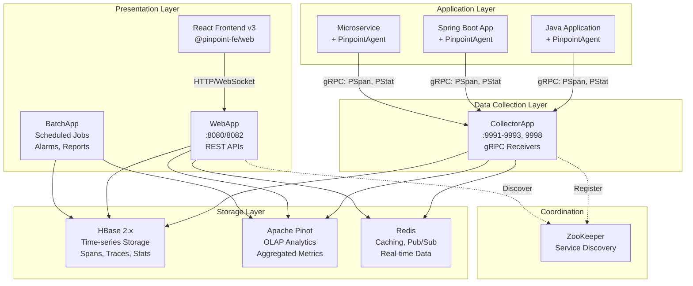
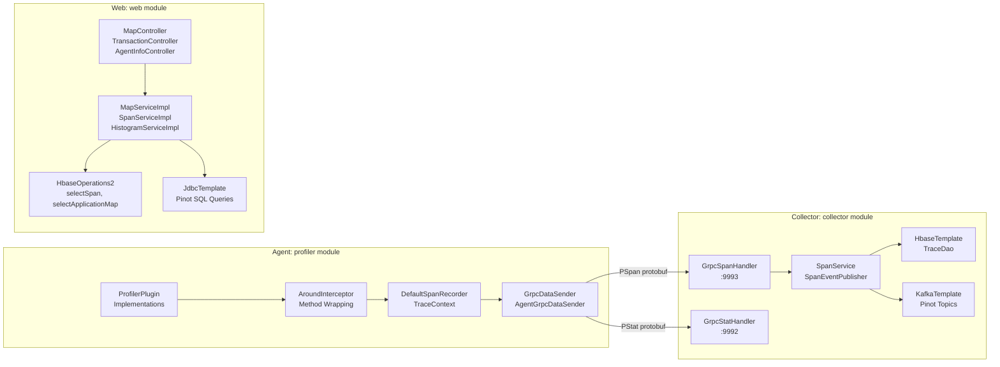

<!-- source: DeepWiki mcp.deepwiki.com · repo pinpoint-apm/pinpoint · page 1 Pinpoint APM Overview · fetched 2026-10-29 -->

# Pinpoint APM Overview

Relevant source files

The following files were used as context for generating this wiki page:

- [.github/ISSUE_TEMPLATE/bug_report.md](.github/ISSUE_TEMPLATE/bug_report.md)
- [.github/ISSUE_TEMPLATE/feature_request.md](.github/ISSUE_TEMPLATE/feature_request.md)
- [.github/ISSUE_TEMPLATE/question.md](.github/ISSUE_TEMPLATE/question.md)
- [.github/ISSUE_TEMPLATE/troubleshooting.md](.github/ISSUE_TEMPLATE/troubleshooting.md)
- [README.md](README.md)
- [agent-module/plugins/undertow-servlet/README.md](agent-module/plugins/undertow-servlet/README.md)
- [batch/pom.xml](batch/pom.xml)
- [collector/pom.xml](collector/pom.xml)
- [commons-hbase/pom.xml](commons-hbase/pom.xml)
- [commons-server/pom.xml](commons-server/pom.xml)
- [commons/pom.xml](commons/pom.xml)
- [commons/src/main/java/com/navercorp/pinpoint/common/Version.java](commons/src/main/java/com/navercorp/pinpoint/common/Version.java)
- [doc/images/ss_error-analysis1.png](doc/images/ss_error-analysis1.png)
- [doc/images/ss_error-analysis3.gif](doc/images/ss_error-analysis3.gif)
- [doc/modules.md](doc/modules.md)
- [hbase/pom.xml](hbase/pom.xml)
- [pom.xml](pom.xml)
- [quickstart/README.md](quickstart/README.md)
- [web/pom.xml](web/pom.xml)

## Purpose and Scope

This document provides a high-level introduction to Pinpoint APM, explaining its purpose as a distributed tracing solution, its architecture, and core components. It is intended for developers, operators, and architects who want to understand what Pinpoint does and how its components fit together.

For detailed information about specific components, see:
- Main features and capabilities: [Key Features and Capabilities](#1.1)
- Fundamental data structures: [Core Concepts and Data Model](#1.2)
- Agent instrumentation and plugins: [Agent Architecture](#3.2)
- Collector data processing: [Collector Architecture](#3.3)
- Web backend and APIs: [Web Application Architecture](#3.4)
- User interface features: [Frontend Architecture](#3.5)
- Installation and deployment: [Getting Started](#2)

**Sources:**
- [README.md:23-46]()
- [pom.xml:1-35]()

## What is Pinpoint APM

Pinpoint is an open-source **Application Performance Management (APM)** tool designed for large-scale distributed systems, primarily targeting applications written in Java, with support for PHP and Python through the [pinpoint-c-agent](https://github.com/pinpoint-apm/pinpoint-c-agent) [README.md:23-25]().

Inspired by Google's [Dapper paper](http://research.google.com/pubs/pub36356.html), Pinpoint enables you to:

| Capability | Description |
|------------|-------------|
| **Distributed Tracing** | Track individual transactions as they flow across multiple services in a distributed architecture [README.md:27-28]() |
| **Topology Visualization** | Automatically discover and visualize application topology through the ServerMap feature [README.md:48-49]() |
| **Real-time Monitoring** | Monitor active threads, request/response patterns, and system metrics in real-time [README.md:49-50]() |
| **Code-level Visibility** | Drill down into individual transactions to see method-level call stacks and execution times [README.md:54-56]() |
| **Zero Code Changes** | Install APM agents without modifying application code via Java agent bytecode instrumentation [README.md:34-35]() |
| **Low Overhead** | Minimal performance impact, typically around 3% resource overhead [README.md:35-36]() |

Pinpoint is maintained by Naver Corporation and has been in development since 2012 [pom.xml:21-43](). The current version is 3.1.0-SNAPSHOT, licensed under Apache License 2.0 [pom.xml:27-41]().

**Sources:**
- [README.md:23-36]()
- [pom.xml:21-43]()

## System Architecture Overview

Pinpoint consists of three primary components that work together to collect, process, store, and visualize application performance data:

**Pinpoint System Architecture** - Shows the three-tier architecture with monitored applications, data processing infrastructure, and presentation layer.

### Data Flow

The following diagram illustrates how performance data flows through Pinpoint from instrumented applications to user interfaces, mapping to actual code entities:

**Data Flow Through Pinpoint Components** - Traces the journey from agent instrumentation through collectors to storage and query layers.

**Sources:**
- [pom.xml:81-125]()
- [README.md:44-70]()
- [collector/pom.xml:27-28]()
- [web/pom.xml:27-28]()

## Core Components

### Pinpoint Agent

The **Pinpoint Agent** is a Java agent that attaches to target applications using the `-javaagent` JVM flag [quickstart/README.md:58](). It operates through bytecode instrumentation without requiring source code changes.

**Key Agent Modules:**
- `agent-module`: Parent module for agent-related code [pom.xml:83]().
- `profiler`: Core agent implementation (contained within agent-module).
- `plugins`: Instrumentation for frameworks like Spring, Tomcat, MySQL, Redis [README.md:73-85]().

**Java Version Support:** Agents support Java 8 and above [README.md:73]().

**Sources:**
- [README.md:73-85]()
- [pom.xml:83]()
- [quickstart/README.md:58]()

### Pinpoint Collector

The **Pinpoint Collector** (`pinpoint-collector`) is a Java application that receives trace data from agents via gRPC and processes it for storage [collector/pom.xml:27-28]().

**Collector Responsibilities:**
- Receives Agent metadata, statistics, and Span data via gRPC [README.md:77, 96]().
- Performs sampling and routing of trace data to storage backends like HBase and Pinot [collector/pom.xml:63, 79]().

**Technology:** Java 17, Spring Boot, gRPC [collector/pom.xml:32, 75, 183]().

**Sources:**
- [collector/pom.xml:27-183]()
- [README.md:77, 96]()

### Pinpoint Web

The **Pinpoint Web** component (`pinpoint-web`) provides the REST API backend and serves the frontend [web/pom.xml:27, 76]().

**Web Capabilities:**
- REST endpoints for querying traces, application maps, and agent information.
- WebSocket support for real-time features like Active Thread Count [web/pom.xml:179]().
- Integration with HBase for trace queries and Pinot for aggregated metrics [web/pom.xml:63, 107]().

**Technology:** Java 17, Spring Framework [web/pom.xml:32, 155]().

**Sources:**
- [web/pom.xml:27-179]()

### Pinpoint Batch

The **Pinpoint Batch** application (`pinpoint-batch`) runs scheduled background jobs [batch/pom.xml:12-13]():
- Alarm evaluation and notification [batch/pom.xml:46]().
- Data aggregation for URI statistics [batch/pom.xml:36]().

**Sources:**
- [batch/pom.xml:12-46]()

### Frontend Application

The Pinpoint frontend (`pinpoint-web-frontend`) is a modern React application [pom.xml:104](). It communicates with the Web backend via HTTP REST APIs and WebSocket for real-time updates.

**Key Visualizations:**
- **ServerMap**: Visualizes distributed system topology [README.md:48]().
- **Scatter Chart**: Visualizes request/response patterns [README.md:50]().
- **CallStack**: Provides code-level visibility into transactions [README.md:54]().

**Sources:**
- [pom.xml:104]()
- [README.md:48-54]()

## Storage Architecture

Pinpoint uses a multi-database architecture optimized for different query patterns:

| Storage | Purpose | Data Types |
|---------|---------|------------|
| **HBase** | Primary trace storage [pom.xml:93]() | Spans, Traces, Agent Metadata |
| **Apache Pinot** | OLAP analytics [pom.xml:108]() | Aggregated metrics, URI stats, Exceptions |
| **Redis** | Caching and real-time [pom.xml:112]() | Active thread counts, session data |
| **ZooKeeper** | Service coordination | Service discovery and synchronization |

**Sources:**
- [pom.xml:93, 108, 112]()
- [README.md:103-130]()

## Supported Modules

Pinpoint provides extensive plugin support for popular Java frameworks [doc/modules.md:4-86]():

- **Web Servers**: Tomcat, Jetty, JBoss, Weblogic, Undertow [doc/modules.md:6-13]().
- **Frameworks**: Spring, Spring Boot, Spring WebFlux, Vert.x [doc/modules.md:20-26]().
- **Databases**: MySQL, Oracle, MS SQL, PostgreSQL, MariaDB, MongoDB, Cassandra [doc/modules.md:50-66]().
- **Messaging**: Kafka, RabbitMQ, ActiveMQ, Paho MQTT [doc/modules.md:40, 73-77]().
- **HTTP Clients**: Apache HttpClient 3/4, OkHttp, Google HTTP Client [doc/modules.md:32-38]().

**Sources:**
- [doc/modules.md:4-86]()

## Deployment Options

Pinpoint supports multiple deployment strategies:

- **Docker**: Official Docker images are available for all components [quickstart/README.md:7]().
- **Kubernetes**: Manifests for deploying to K8s clusters [README.md:42]().
- **Standalone**: Running executable JARs for Collector, Web, and Batch [quickstart/README.md:31-38]().
- **Quickstart**: A pre-configured environment for testing [quickstart/README.md:1-2]().

**Sources:**
- [README.md:42]()
- [quickstart/README.md:1-38]()

---

