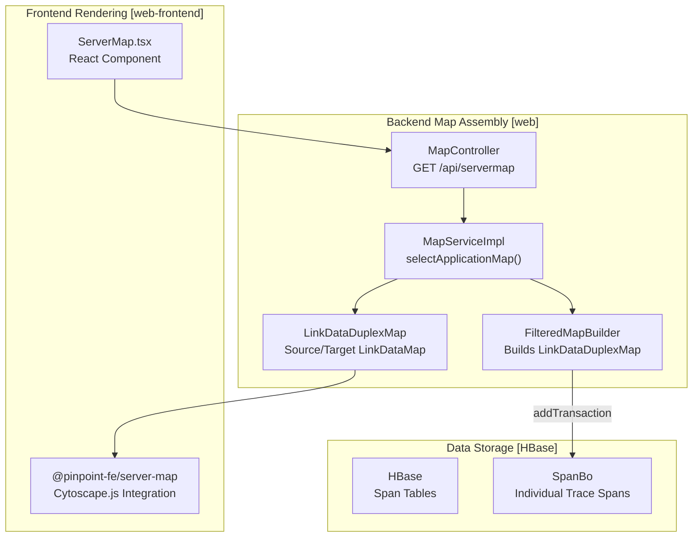
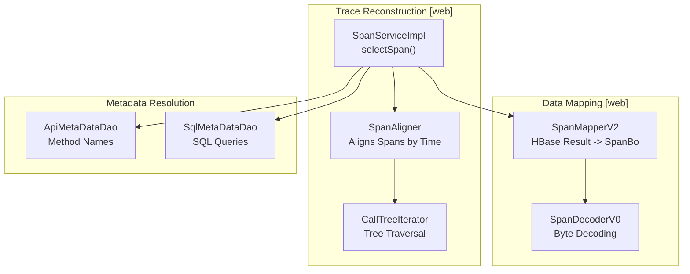

<!-- source: DeepWiki mcp.deepwiki.com · repo pinpoint-apm/pinpoint · page 1.1 Key Features and Capabilities · fetched 2026-10-29 -->

# Key Features and Capabilities

<details>
<summary>Relevant source files</summary>

The following files were used as context for generating this wiki page:

- [.github/ISSUE_TEMPLATE/bug_report.md](.github/ISSUE_TEMPLATE/bug_report.md)
- [.github/ISSUE_TEMPLATE/feature_request.md](.github/ISSUE_TEMPLATE/feature_request.md)
- [.github/ISSUE_TEMPLATE/question.md](.github/ISSUE_TEMPLATE/question.md)
- [.github/ISSUE_TEMPLATE/troubleshooting.md](.github/ISSUE_TEMPLATE/troubleshooting.md)
- [README.md](README.md)
- [agent-module/plugins/undertow-servlet/README.md](agent-module/plugins/undertow-servlet/README.md)
- [commons-profiler/src/main/java/com/navercorp/pinpoint/common/profiler/trace/DefaultDisplayArgument.java](commons-profiler/src/main/java/com/navercorp/pinpoint/common/profiler/trace/DefaultDisplayArgument.java)
- [commons-server/src/main/java/com/navercorp/pinpoint/common/server/bo/SpanEventComparator.java](commons-server/src/main/java/com/navercorp/pinpoint/common/server/bo/SpanEventComparator.java)
- [commons/src/main/java/com/navercorp/pinpoint/common/trace/AnnotationKey.java](commons/src/main/java/com/navercorp/pinpoint/common/trace/AnnotationKey.java)
- [commons/src/main/java/com/navercorp/pinpoint/common/trace/OpenTelemetryServiceTypeCategory.java](commons/src/main/java/com/navercorp/pinpoint/common/trace/OpenTelemetryServiceTypeCategory.java)
- [commons/src/main/java/com/navercorp/pinpoint/common/trace/ServiceType.java](commons/src/main/java/com/navercorp/pinpoint/common/trace/ServiceType.java)
- [doc/images/ss_error-analysis1.png](doc/images/ss_error-analysis1.png)
- [doc/images/ss_error-analysis3.gif](doc/images/ss_error-analysis3.gif)
- [doc/modules.md](doc/modules.md)
- [quickstart/README.md](quickstart/README.md)
- [web-frontend/src/main/v3/apps/web/public/img/icons/OPENTELEMETRY_SERVER.png](web-frontend/src/main/v3/apps/web/public/img/icons/OPENTELEMETRY_SERVER.png)
- [web-frontend/src/main/v3/apps/web/public/img/servers/OPENTELEMETRY_SERVER.png](web-frontend/src/main/v3/apps/web/public/img/servers/OPENTELEMETRY_SERVER.png)
- [web-frontend/src/main/v3/apps/web/public/img/servers/OPENTELEMETY_DB.png](web-frontend/src/main/v3/apps/web/public/img/servers/OPENTELEMETY_DB.png)
- [web/src/main/java/com/navercorp/pinpoint/web/applicationmap/map/FilteredMapBuilder.java](web/src/main/java/com/navercorp/pinpoint/web/applicationmap/map/FilteredMapBuilder.java)
- [web/src/main/java/com/navercorp/pinpoint/web/trace/dao/mapper/SpanMapperV2.java](web/src/main/java/com/navercorp/pinpoint/web/trace/dao/mapper/SpanMapperV2.java)
- [web/src/main/java/com/navercorp/pinpoint/web/trace/service/SpanServiceImpl.java](web/src/main/java/com/navercorp/pinpoint/web/trace/service/SpanServiceImpl.java)
- [web/src/main/java/com/navercorp/pinpoint/web/trace/span/Align.java](web/src/main/java/com/navercorp/pinpoint/web/trace/span/Align.java)
- [web/src/main/java/com/navercorp/pinpoint/web/trace/span/AlignComparator.java](web/src/main/java/com/navercorp/pinpoint/web/trace/span/AlignComparator.java)
- [web/src/main/java/com/navercorp/pinpoint/web/trace/span/CallTreeNode.java](web/src/main/java/com/navercorp/pinpoint/web/trace/span/CallTreeNode.java)
- [web/src/main/java/com/navercorp/pinpoint/web/trace/span/Link.java](web/src/main/java/com/navercorp/pinpoint/web/trace/span/Link.java)
- [web/src/main/java/com/navercorp/pinpoint/web/trace/span/LinkMap.java](web/src/main/java/com/navercorp/pinpoint/web/trace/span/LinkMap.java)
- [web/src/main/java/com/navercorp/pinpoint/web/trace/span/Node.java](web/src/main/java/com/navercorp/pinpoint/web/trace/span/Node.java)
- [web/src/main/java/com/navercorp/pinpoint/web/trace/span/NodeList.java](web/src/main/java/com/navercorp/pinpoint/web/trace/span/NodeList.java)
- [web/src/main/java/com/navercorp/pinpoint/web/trace/span/SpanAlign.java](web/src/main/java/com/navercorp/pinpoint/web/trace/span/SpanAlign.java)
- [web/src/main/java/com/navercorp/pinpoint/web/trace/span/SpanAligner.java](web/src/main/java/com/navercorp/pinpoint/web/trace/span/SpanAligner.java)
- [web/src/main/java/com/navercorp/pinpoint/web/trace/span/SpanEventAlign.java](web/src/main/java/com/navercorp/pinpoint/web/trace/span/SpanEventAlign.java)

</details>


## Purpose and Scope

This document details the primary features and capabilities of Pinpoint APM, including visualization tools, monitoring dashboards, transaction tracing, and the extensive plugin ecosystem. For fundamental concepts like `ServiceType` and trace data structures, see [Core Concepts and Data Model](1.2). For system architecture, see [System Architecture](3).

Pinpoint provides comprehensive Application Performance Management for distributed systems through:
- **Visual topology mapping** of application dependencies.
- **Real-time monitoring** of application health and performance.
- **Detailed transaction tracing** with code-level visibility.
- **Non-invasive instrumentation** requiring zero code changes.
- **Extensive technology support** via a plugin architecture.

---

## ServerMap: Application Topology Visualization

ServerMap provides an interactive visualization of distributed system topology, displaying how application components interconnect and communicate. The feature renders nodes representing applications and links representing RPC/HTTP calls between them.

### ServerMap Architecture and Data Flow

The following diagram bridges the visual representation in the UI to the backend logic that assembles the map from distributed trace data.



### Key Components

| Component | Location | Purpose |
|-----------|----------|---------|
| `MapController` | [web/src/main/java/com/navercorp/pinpoint/web/applicationmap/controller/MapController.java]() | REST endpoint for ServerMap data. |
| `FilteredMapBuilder` | [web/src/main/java/com/navercorp/pinpoint/web/applicationmap/map/FilteredMapBuilder.java:59-150]() | Logic to build maps from a list of `SpanBo` objects. |
| `LinkDataDuplexMap` | [web/src/main/java/com/navercorp/pinpoint/web/applicationmap/rawdata/LinkDataDuplexMap.java]() | Container for both inbound and outbound link data. |
| `@pinpoint-fe/server-map` | [web-frontend/src/main/v3/packages/server-map/package.json:1-29]() | Cytoscape-based topology renderer. |

### Features

- **Interactive Navigation**: Click nodes to reveal component details such as current status and transaction count [README.md:48]().
- **Node Merging**: Applications are grouped by `ServiceType` to reduce visual complexity.
- **Link Statistics**: Visualizes request count and response patterns between components [README.md:50]().

**Sources**: [README.md:48-52](), [web/src/main/java/com/navercorp/pinpoint/web/applicationmap/map/FilteredMapBuilder.java:59-150](), [web-frontend/src/main/v3/packages/server-map/package.json:1-29]()

---

## Real-time Active Thread Monitoring

Pinpoint monitors active thread counts inside applications in real-time, providing immediate visibility into application load [README.md:49]().

```mermaid
graph LR
    subgraph "Agent Instrumentation"
        ThreadCounter["Active Thread Counter"]
    end
    
    subgraph "Data Transport [gRPC]"
        StatSender["StatDataSender<br/>PStatMessage"]
    end
    
    subgraph "Collector Processing"
        StatReceiver["StatReceiver<br/>Port: 9992"]
    }
    
    subgraph "Real-time Messaging"
        RedisPub["Redis Publisher<br/>Real-time Channel"]
    end
    
    subgraph "Web Backend"
        ATCWS["ActiveThreadCountHandler<br/>WebSocket Endpoint"]
    end

    ThreadCounter --> StatSender
    StatSender --> StatReceiver
    StatReceiver --> RedisPub
    RedisPub --> ATCWS
```

### Implementation Details

- **WebSocket Support**: Real-time data is pushed to the UI via WebSockets [web/src/main/java/com/navercorp/pinpoint/web/websocket/ActiveThreadCountHandler.java:1-110]().
- **Agent Statistics**: The agent collects JVM and application stats (CPU, Memory, TPS) and streams them to the collector [README.md:58-60]().

**Sources**: [README.md:49](), [web/src/main/java/com/navercorp/pinpoint/web/websocket/ActiveThreadCountHandler.java:1-110]()

---

## Transaction Tracing and CallStack

Pinpoint provides code-level visibility into every transaction in a distributed environment, identifying bottlenecks and points of failure [README.md:54]().

### CallStack Data Model

The `SpanServiceImpl` is responsible for retrieving and ordering spans into a hierarchical call tree.

| Class | Location | Role |
|-------|----------|------|
| `SpanBo` | [commons-server/src/main/java/com/navercorp/pinpoint/common/server/bo/SpanBo.java]() | Represents a single RPC call or entry point. |
| `SpanEventBo` | [commons-server/src/main/java/com/navercorp/pinpoint/common/server/bo/SpanEventBo.java]() | Represents a method call within a Span. |
| `SpanServiceImpl` | [web/src/main/java/com/navercorp/pinpoint/web/trace/service/SpanServiceImpl.java:80-158]() | Selects and orders spans into a `CallTree`. |
| `SpanEventComparator` | [commons-server/src/main/java/com/navercorp/pinpoint/common/server/bo/SpanEventComparator.java:8-11]() | Sorts span events by sequence number. |

### Trace Visualization Flow



**Sources**: [README.md:54-56](), [web/src/main/java/com/navercorp/pinpoint/web/trace/service/SpanServiceImpl.java:80-158](), [web/src/main/java/com/navercorp/pinpoint/web/trace/dao/mapper/SpanMapperV2.java:58-144]()

---

## Supported Technologies and Plugins

Pinpoint supports a vast ecosystem of libraries and frameworks through its plugin architecture. Instrumentation is applied at runtime without changing the application code [README.md:34]().

### Key Supported Modules

| Category | Supported Technologies | Versions |
|----------|------------------------|----------|
| **Web Servers** | Tomcat, Jetty, JBoss, WebSphere, Vertx, WebLogic, Undertow [README.md:74](), [doc/modules.md:6-13]() | 6.x - 9.x (Tomcat) |
| **Frameworks** | Spring, Spring Boot, Spring WebFlux [README.md:75](), [doc/modules.md:20-26]() | 3.0.7 - 5.3.6 (SpringMVC) |
| **HTTP Clients** | Apache HttpClient (3/4/5), OkHttp, GoogleHttpClient [README.md:76](), [doc/modules.md:32-38]() | 4.0 - 4.5.4 (HttpClient4) |
| **RPC** | gRPC, Thrift, Dubbo, Apache CXF [README.md:77](), [doc/modules.md:34, 41, 82]() | 1.8.0 - 1.37.0 (gRPC) |
| **Databases** | MySQL, Oracle, MSSQL, PostgreSQL, MongoDB, Cassandra, Redis [README.md:79-81](), [doc/modules.md:55-69]() | 5.0 - 8.x (MySQL) |
| **Messaging** | Kafka, RabbitMQ, ActiveMQ, RocketMQ, Paho MQTT [README.md:78](), [doc/modules.md:40, 73, 75-77]() | 0.11.0.1+ (Kafka) |

### Metadata and Annotations

Pinpoint uses `ServiceType` and `AnnotationKey` to categorize and enrich trace data.

- **ServiceType**: Defines the type of node or event (e.g., `TOMCAT`=1010, `MYSQL`=2100) [commons/src/main/java/com/navercorp/pinpoint/common/trace/ServiceType.java:48, 113]().
- **AnnotationKey**: Keys for additional metadata like `http.url` (40) or `sql` (21) [commons/src/main/java/com/navercorp/pinpoint/common/trace/AnnotationKey.java:61, 66]().

**Sources**: [README.md:72-85](), [doc/modules.md:1-86](), [commons/src/main/java/com/navercorp/pinpoint/common/trace/ServiceType.java](), [commons/src/main/java/com/navercorp/pinpoint/common/trace/AnnotationKey.java]()

---

## Advanced Monitoring Capabilities

### Inspector
View deep details of application health including CPU usage, Memory/GC, TPS, and JVM arguments [README.md:58]().

### URI Metrics
Aggregates performance statistics (latency, throughput) at the URI level, allowing developers to identify specific slow endpoints [README.md:62]().

### Error Analysis
Provides grouped views of exceptions and errors across the system, enabling rapid identification of failure patterns [README.md:68-70]().

**Sources**: [README.md:58-71]()

---

