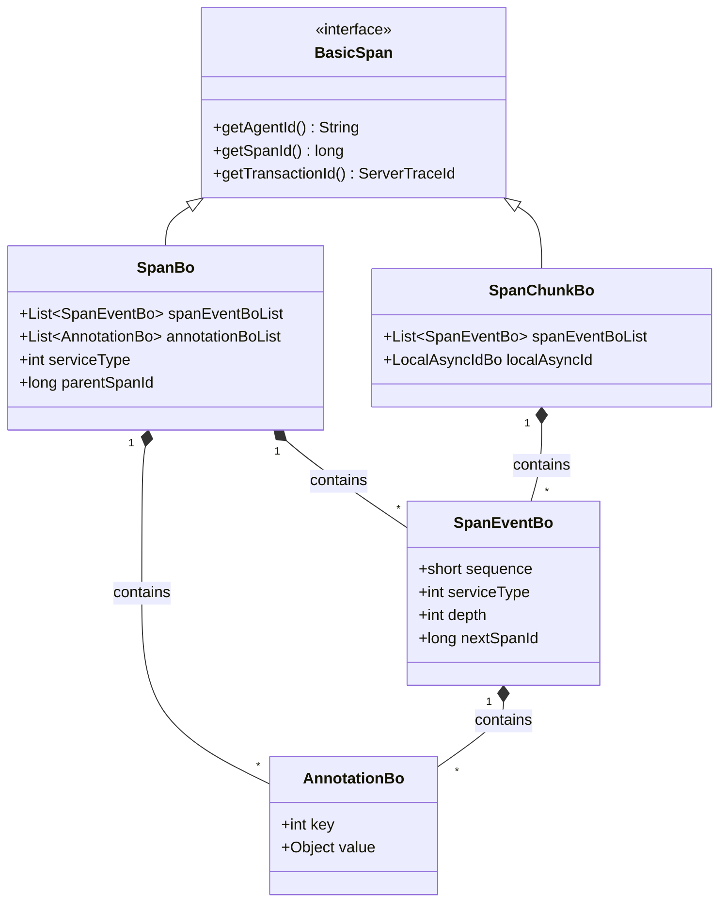
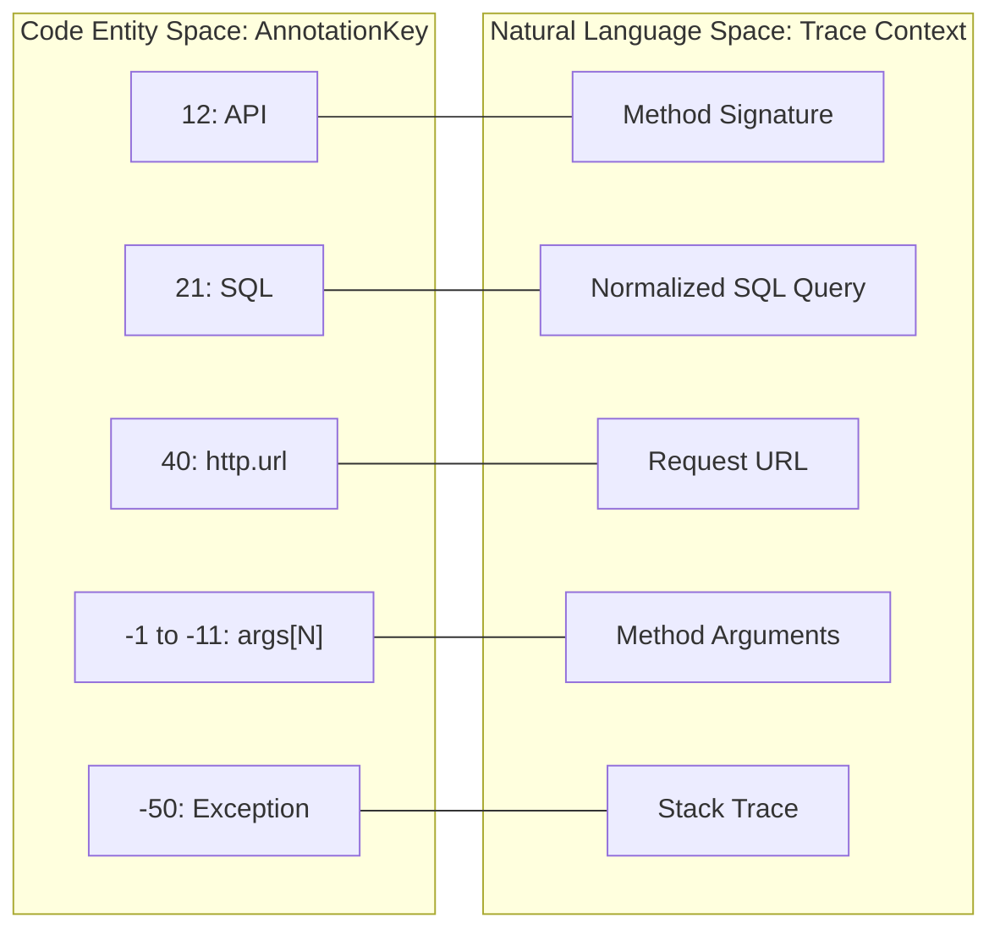
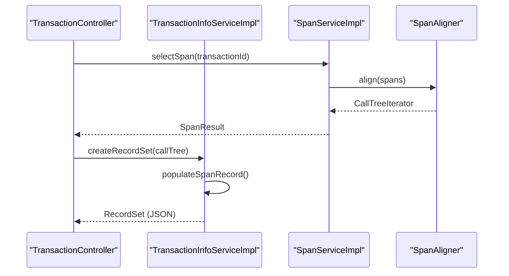

<!-- source: DeepWiki mcp.deepwiki.com · repo pinpoint-apm/pinpoint · page 1.2 Core Concepts and Data Model · fetched 2026-10-29 -->

# Core Concepts and Data Model

Relevant source files

The following files were used as context for generating this wiki page:

- [agent-module/profiler/src/main/java/com/navercorp/pinpoint/profiler/context/exception/model/ExceptionWrapper.java](agent-module/profiler/src/main/java/com/navercorp/pinpoint/profiler/context/exception/model/ExceptionWrapper.java)
- [agent-module/profiler/src/main/java/com/navercorp/pinpoint/profiler/monitor/metric/uri/URIKey.java](agent-module/profiler/src/main/java/com/navercorp/pinpoint/profiler/monitor/metric/uri/URIKey.java)
- [collector/src/main/java/com/navercorp/pinpoint/collector/util/MultipleAddress.java](collector/src/main/java/com/navercorp/pinpoint/collector/util/MultipleAddress.java)
- [commons-profiler/src/main/java/com/navercorp/pinpoint/common/profiler/trace/DefaultDisplayArgument.java](commons-profiler/src/main/java/com/navercorp/pinpoint/common/profiler/trace/DefaultDisplayArgument.java)
- [commons-server/src/main/java/com/navercorp/pinpoint/common/server/bo/BasicSpan.java](commons-server/src/main/java/com/navercorp/pinpoint/common/server/bo/BasicSpan.java)
- [commons-server/src/main/java/com/navercorp/pinpoint/common/server/bo/SpanBo.java](commons-server/src/main/java/com/navercorp/pinpoint/common/server/bo/SpanBo.java)
- [commons-server/src/main/java/com/navercorp/pinpoint/common/server/bo/SpanChunkBo.java](commons-server/src/main/java/com/navercorp/pinpoint/common/server/bo/SpanChunkBo.java)
- [commons-server/src/main/java/com/navercorp/pinpoint/common/server/bo/SpanEventBo.java](commons-server/src/main/java/com/navercorp/pinpoint/common/server/bo/SpanEventBo.java)
- [commons-server/src/main/java/com/navercorp/pinpoint/common/server/bo/SpanEventComparator.java](commons-server/src/main/java/com/navercorp/pinpoint/common/server/bo/SpanEventComparator.java)
- [commons-server/src/main/java/com/navercorp/pinpoint/common/server/bo/serializer/trace/v2/bitfield/SpanBitField.java](commons-server/src/main/java/com/navercorp/pinpoint/common/server/bo/serializer/trace/v2/bitfield/SpanBitField.java)
- [commons-server/src/main/java/com/navercorp/pinpoint/common/server/util/json/TypeRef.java](commons-server/src/main/java/com/navercorp/pinpoint/common/server/util/json/TypeRef.java)
- [commons-server/src/test/java/com/navercorp/pinpoint/common/server/bo/SpanBoTest.java](commons-server/src/test/java/com/navercorp/pinpoint/common/server/bo/SpanBoTest.java)
- [commons/src/main/java/com/navercorp/pinpoint/common/trace/AnnotationKey.java](commons/src/main/java/com/navercorp/pinpoint/common/trace/AnnotationKey.java)
- [commons/src/main/java/com/navercorp/pinpoint/common/trace/ErrorCategoryResolver.java](commons/src/main/java/com/navercorp/pinpoint/common/trace/ErrorCategoryResolver.java)
- [commons/src/main/java/com/navercorp/pinpoint/common/trace/OpenTelemetryServiceTypeCategory.java](commons/src/main/java/com/navercorp/pinpoint/common/trace/OpenTelemetryServiceTypeCategory.java)
- [commons/src/main/java/com/navercorp/pinpoint/common/trace/ServiceType.java](commons/src/main/java/com/navercorp/pinpoint/common/trace/ServiceType.java)
- [commons/src/test/java/com/navercorp/pinpoint/common/trace/ErrorCategoryResolverTest.java](commons/src/test/java/com/navercorp/pinpoint/common/trace/ErrorCategoryResolverTest.java)
- [web-frontend/src/main/v3/apps/web/public/img/icons/OPENTELEMETRY_SERVER.png](web-frontend/src/main/v3/apps/web/public/img/icons/OPENTELEMETRY_SERVER.png)
- [web-frontend/src/main/v3/apps/web/public/img/servers/OPENTELEMETRY_SERVER.png](web-frontend/src/main/v3/apps/web/public/img/servers/OPENTELEMETRY_SERVER.png)
- [web-frontend/src/main/v3/apps/web/public/img/servers/OPENTELEMETY_DB.png](web-frontend/src/main/v3/apps/web/public/img/servers/OPENTELEMETY_DB.png)
- [web/src/main/java/com/navercorp/pinpoint/web/applicationmap/map/FilteredMapBuilder.java](web/src/main/java/com/navercorp/pinpoint/web/applicationmap/map/FilteredMapBuilder.java)
- [web/src/main/java/com/navercorp/pinpoint/web/filter/responsetime/DefaultExecutionTypeFilter.java](web/src/main/java/com/navercorp/pinpoint/web/filter/responsetime/DefaultExecutionTypeFilter.java)
- [web/src/main/java/com/navercorp/pinpoint/web/filter/responsetime/SpanResponseConditionFilter.java](web/src/main/java/com/navercorp/pinpoint/web/filter/responsetime/SpanResponseConditionFilter.java)
- [web/src/main/java/com/navercorp/pinpoint/web/trace/dao/mapper/SpanMapperV2.java](web/src/main/java/com/navercorp/pinpoint/web/trace/dao/mapper/SpanMapperV2.java)
- [web/src/main/java/com/navercorp/pinpoint/web/trace/service/SpanServiceImpl.java](web/src/main/java/com/navercorp/pinpoint/web/trace/service/SpanServiceImpl.java)
- [web/src/main/java/com/navercorp/pinpoint/web/trace/service/TransactionInfoService.java](web/src/main/java/com/navercorp/pinpoint/web/trace/service/TransactionInfoService.java)
- [web/src/main/java/com/navercorp/pinpoint/web/trace/service/TransactionInfoServiceImpl.java](web/src/main/java/com/navercorp/pinpoint/web/trace/service/TransactionInfoServiceImpl.java)
- [web/src/main/java/com/navercorp/pinpoint/web/trace/span/Align.java](web/src/main/java/com/navercorp/pinpoint/web/trace/span/Align.java)
- [web/src/main/java/com/navercorp/pinpoint/web/trace/span/AlignComparator.java](web/src/main/java/com/navercorp/pinpoint/web/trace/span/AlignComparator.java)
- [web/src/main/java/com/navercorp/pinpoint/web/trace/span/CallTreeNode.java](web/src/main/java/com/navercorp/pinpoint/web/trace/span/CallTreeNode.java)
- [web/src/main/java/com/navercorp/pinpoint/web/trace/span/Link.java](web/src/main/java/com/navercorp/pinpoint/web/trace/span/Link.java)
- [web/src/main/java/com/navercorp/pinpoint/web/trace/span/LinkMap.java](web/src/main/java/com/navercorp/pinpoint/web/trace/span/LinkMap.java)
- [web/src/main/java/com/navercorp/pinpoint/web/trace/span/Node.java](web/src/main/java/com/navercorp/pinpoint/web/trace/span/Node.java)
- [web/src/main/java/com/navercorp/pinpoint/web/trace/span/NodeList.java](web/src/main/java/com/navercorp/pinpoint/web/trace/span/NodeList.java)
- [web/src/main/java/com/navercorp/pinpoint/web/trace/span/SpanAlign.java](web/src/main/java/com/navercorp/pinpoint/web/trace/span/SpanAlign.java)
- [web/src/main/java/com/navercorp/pinpoint/web/trace/span/SpanAligner.java](web/src/main/java/com/navercorp/pinpoint/web/trace/span/SpanAligner.java)
- [web/src/main/java/com/navercorp/pinpoint/web/trace/span/SpanEventAlign.java](web/src/main/java/com/navercorp/pinpoint/web/trace/span/SpanEventAlign.java)
- [web/src/test/java/com/navercorp/pinpoint/web/trace/callstacks/RecordFactoryTest.java](web/src/test/java/com/navercorp/pinpoint/web/trace/callstacks/RecordFactoryTest.java)

This page explains the fundamental data structures and models that form the foundation of Pinpoint APM. Understanding these concepts is essential for working with Pinpoint, whether you're analyzing application performance or extending its functionality.

## Distributed Tracing Model

Pinpoint's core functionality is built around distributed transaction tracing. The tracing model consists of the following key elements:

| Entity | Description | Code Reference |
| :--- | :--- | :--- |
| **TransactionId** | Uniquely identifies a transaction across multiple applications. Consists of AgentId, AgentStartTime, and a Sequence Number. | [commons-server/src/main/java/com/navercorp/pinpoint/common/server/bo/BasicSpan.java:46-47]() |
| **Span** | Represents a single RPC (Remote Procedure Call) or a unit of work within a single node (application instance). | [commons-server/src/main/java/com/navercorp/pinpoint/common/server/bo/SpanBo.java:35-35]() |
| **SpanEvent** | Represents an event within a Span, such as a method call, database query, or an external API call. | [commons-server/src/main/java/com/navercorp/pinpoint/common/server/bo/SpanEventBo.java:26-26]() |
| **SpanChunk** | A fragment of a Span, typically used to send SpanEvents that occur during an asynchronous process or a long-running transaction. | [commons-server/src/main/java/com/navercorp/pinpoint/common/server/bo/SpanChunkBo.java:33-33]() |
| **Annotation** | Key-value pairs (metadata) attached to Spans or SpanEvents to provide additional context (e.g., SQL queries, HTTP parameters). | [commons-server/src/main/java/com/navercorp/pinpoint/common/server/bo/AnnotationBo.java:23-23]() |

### Trace Data Hierarchy
The following diagram illustrates how these entities relate to each other in the code space:

Sources: [commons-server/src/main/java/com/navercorp/pinpoint/common/server/bo/BasicSpan.java:24-57](), [commons-server/src/main/java/com/navercorp/pinpoint/common/server/bo/SpanBo.java:35-76](), [commons-server/src/main/java/com/navercorp/pinpoint/common/server/bo/SpanChunkBo.java:33-62](), [commons-server/src/main/java/com/navercorp/pinpoint/common/server/bo/SpanEventBo.java:26-55]()

## ServiceType

`ServiceType` is a fundamental concept that categorizes the types of components Pinpoint monitors. Each service type has a unique code and specific properties that determine how the Collector and Web UI handle the data.

### Code Ranges and Categories
Service types are organized into specific numeric ranges:

| Range | Category | Examples |
| :--- | :--- | :--- |
| 0 ~ 999 | Pinpoint Internal | `UNDEFINED` (-1), `USER` (2), `ASYNC` (100) |
| 1000 ~ 1899 | Server (WAS) | `TOMCAT` (1010), `JETTY` (1030), `GRPC_SERVER` (1130) |
| 2000 ~ 2899 | Database | `MYSQL` (2100), `ORACLE` (2300), `MONGO` (2650) |
| 5000 ~ 7499 | Library | `SPRING` (5050), `MYBATIS` (5510) |
| 8000 ~ 8999 | Cache / Message Queue | `REDIS` (8200), `KAFKA_CLIENT` (8660) |
| 9000 ~ 9999 | RPC Client | `HTTP_CLIENT_4` (9052), `DUBBO_CONSUMER` (9110) |

### Key Properties
The behavior of a `ServiceType` is governed by `ServiceTypeProperty` flags:
*   `RECORD_STATISTICS`: If set, Pinpoint records performance statistics (TPS, response time) for this type. [commons/src/main/java/com/navercorp/pinpoint/common/trace/ServiceTypeProperty.java:21-21]()
*   `TERMINAL`: Indicates the node is a leaf in the ServerMap (e.g., a Database or Cache). [commons/src/main/java/com/navercorp/pinpoint/common/trace/ServiceTypeProperty.java:22-22]()
*   `INCLUDE_DESTINATION_ID`: Whether to include the destination address (e.g., DB IP/Port) in the visualization. [commons/src/main/java/com/navercorp/pinpoint/common/trace/ServiceTypeProperty.java:20-20]()

Sources: [commons/src/main/java/com/navercorp/pinpoint/common/trace/ServiceType.java:27-161](), [commons/src/main/java/com/navercorp/pinpoint/common/trace/ServiceTypeProperty.java:19-23]()

## AnnotationKey

`AnnotationKey` defines the metadata keys used to store additional information within a Span or SpanEvent.

### Notable Annotation Keys
*   **API (12) / API_METADATA (13)**: Used to store method signatures or mapping IDs to method names. [commons/src/main/java/com/navercorp/pinpoint/common/trace/AnnotationKey.java:54-55]()
*   **SQL (21) / SQL-ID (20)**: Used to store normalized SQL statements or IDs for cached SQL. [commons/src/main/java/com/navercorp/pinpoint/common/trace/AnnotationKey.java:60-61]()
*   **Exception (-50)**: Stores the exception message and stack trace. [commons/src/main/java/com/navercorp/pinpoint/common/trace/AnnotationKey.java:48-48]()

Sources: [commons/src/main/java/com/navercorp/pinpoint/common/trace/AnnotationKey.java:26-147]()

## Data Flow and Reconstruction

When a user requests a transaction view in the Web UI, Pinpoint reconstructs the call tree from individual `SpanBo` and `SpanEventBo` objects.

### Reconstruction Logic
The `SpanServiceImpl` and `TransactionInfoServiceImpl` collaborate to transform raw HBase data into a visual `RecordSet`.

1.  **Select Spans**: `SpanServiceImpl.selectSpan` fetches all spans associated with a `ServerTraceId`. [web/src/main/java/com/navercorp/pinpoint/web/trace/service/SpanServiceImpl.java:136-146]()
2.  **Align Call Tree**: `SpanAligner` orders spans based on `parentSpanId` and `spanId`. Within a span, `SpanEventBo` objects are ordered by their `sequence`. [web/src/main/java/com/navercorp/pinpoint/web/trace/service/SpanServiceImpl.java:157-158](), [commons-server/src/main/java/com/navercorp/pinpoint/common/server/bo/SpanEventComparator.java:10-10]()
3.  **Create RecordSet**: `TransactionInfoServiceImpl.createRecordSet` iterates through the aligned `CallTree` to create `Record` objects for the UI. [web/src/main/java/com/navercorp/pinpoint/web/trace/service/TransactionInfoServiceImpl.java:77-82]()
4.  **Identify Focus**: It identifies the "ViewPoint" (the specific span the user clicked on) and marks it in the `RecordSet`. [web/src/main/java/com/navercorp/pinpoint/web/trace/service/TransactionInfoServiceImpl.java:88-90]()

### Error Handling in Data
Errors are categorized using `ErrorCategory` bitmasks. The `ErrorCategoryResolver` decodes the `errCode` in a `SpanBo` to determine if it was a generic exception, a timeout, or a specific protocol error. [commons/src/main/java/com/navercorp/pinpoint/common/trace/ErrorCategoryResolver.java:36-44]()

Sources: [web/src/main/java/com/navercorp/pinpoint/web/trace/service/SpanServiceImpl.java:136-160](), [web/src/main/java/com/navercorp/pinpoint/web/trace/service/TransactionInfoServiceImpl.java:77-138](), [commons/src/main/java/com/navercorp/pinpoint/common/trace/ErrorCategoryResolver.java:25-45]()

## ServerMap Data Model

The ServerMap (Application Topology) is built using `FilteredMapBuilder`. It processes `SpanBo` objects to identify links between applications.

*   **Inbound Links**: Created by looking at the `parentApplicationName` and `parentApplicationServiceType` of a `SpanBo`. [commons-server/src/main/java/com/navercorp/pinpoint/common/server/bo/SpanBo.java:60-61](), [web/src/main/java/com/navercorp/pinpoint/web/applicationmap/map/FilteredMapBuilder.java:130-138]()
*   **Outbound Links**: Created by iterating through `SpanEventBo` list. If a `SpanEventBo` has a `nextSpanId` or a `destinationId`, it indicates a call to an external system. [commons-server/src/main/java/com/navercorp/pinpoint/common/server/bo/SpanEventBo.java:47-47](), [web/src/main/java/com/navercorp/pinpoint/web/applicationmap/map/FilteredMapBuilder.java:147-147]()

Sources: [web/src/main/java/com/navercorp/pinpoint/web/applicationmap/map/FilteredMapBuilder.java:102-149](), [commons-server/src/main/java/com/navercorp/pinpoint/common/server/bo/SpanBo.java:60-61](), [commons-server/src/main/java/com/navercorp/pinpoint/common/server/bo/SpanEventBo.java:117-123]()

---

