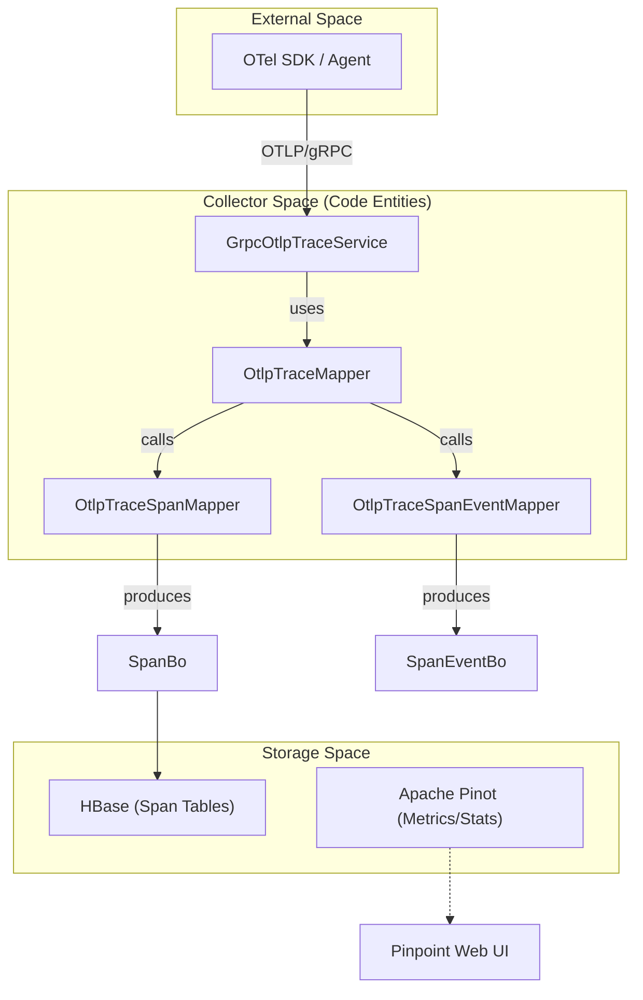
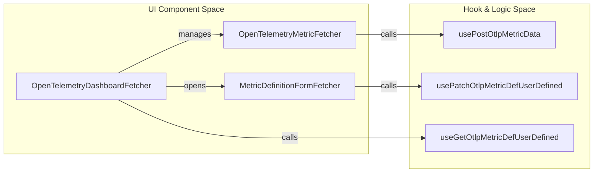

<!-- source: DeepWiki mcp.deepwiki.com · repo pinpoint-apm/pinpoint · page 10 Advanced Features and Integrations · fetched 2026-10-29 -->

# Advanced Features and Integrations

Relevant source files

The following files were used as context for generating this wiki page:

- [commons-server/src/main/java/com/navercorp/pinpoint/common/server/util/ByteStringUtils.java](commons-server/src/main/java/com/navercorp/pinpoint/common/server/util/ByteStringUtils.java)
- [commons-server/src/test/java/com/navercorp/pinpoint/common/util/ByteStringUtilsTest.java](commons-server/src/test/java/com/navercorp/pinpoint/common/util/ByteStringUtilsTest.java)
- [otlpmetric/otlpmetric-collector/src/main/java/com/navercorp/pinpoint/otlp/collector/OtlpMetricCollectorConfig.java](otlpmetric/otlpmetric-collector/src/main/java/com/navercorp/pinpoint/otlp/collector/OtlpMetricCollectorConfig.java)
- [otlpmetric/otlpmetric-collector/src/main/java/com/navercorp/pinpoint/otlp/collector/config/OtlpMetricPropertySources.java](otlpmetric/otlpmetric-collector/src/main/java/com/navercorp/pinpoint/otlp/collector/config/OtlpMetricPropertySources.java)
- [otlpmetric/otlpmetric-collector/src/main/java/com/navercorp/pinpoint/otlp/collector/controller/OpenTelemetryMetricController.java](otlpmetric/otlpmetric-collector/src/main/java/com/navercorp/pinpoint/otlp/collector/controller/OpenTelemetryMetricController.java)
- [otlptrace/otlptrace-collector/pom.xml](otlptrace/otlptrace-collector/pom.xml)
- [otlptrace/otlptrace-collector/src/main/java/com/navercorp/pinpoint/otlp/trace/collector/OtlpTraceCollectorApp.java](otlptrace/otlptrace-collector/src/main/java/com/navercorp/pinpoint/otlp/trace/collector/OtlpTraceCollectorApp.java)
- [otlptrace/otlptrace-collector/src/main/java/com/navercorp/pinpoint/otlp/trace/collector/OtlpTraceCollectorModule.java](otlptrace/otlptrace-collector/src/main/java/com/navercorp/pinpoint/otlp/trace/collector/OtlpTraceCollectorModule.java)
- [otlptrace/otlptrace-collector/src/main/java/com/navercorp/pinpoint/otlp/trace/collector/OtlpTraceCollectorRejectedSpan.java](otlptrace/otlptrace-collector/src/main/java/com/navercorp/pinpoint/otlp/trace/collector/OtlpTraceCollectorRejectedSpan.java)
- [otlptrace/otlptrace-collector/src/main/java/com/navercorp/pinpoint/otlp/trace/collector/mapper/IdAndName.java](otlptrace/otlptrace-collector/src/main/java/com/navercorp/pinpoint/otlp/trace/collector/mapper/IdAndName.java)
- [otlptrace/otlptrace-collector/src/main/java/com/navercorp/pinpoint/otlp/trace/collector/mapper/OtlpAgentInfoMapper.java](otlptrace/otlptrace-collector/src/main/java/com/navercorp/pinpoint/otlp/trace/collector/mapper/OtlpAgentInfoMapper.java)
- [otlptrace/otlptrace-collector/src/main/java/com/navercorp/pinpoint/otlp/trace/collector/mapper/OtlpTraceAttributeMapper.java](otlptrace/otlptrace-collector/src/main/java/com/navercorp/pinpoint/otlp/trace/collector/mapper/OtlpTraceAttributeMapper.java)
- [otlptrace/otlptrace-collector/src/main/java/com/navercorp/pinpoint/otlp/trace/collector/mapper/OtlpTraceConstants.java](otlptrace/otlptrace-collector/src/main/java/com/navercorp/pinpoint/otlp/trace/collector/mapper/OtlpTraceConstants.java)
- [otlptrace/otlptrace-collector/src/main/java/com/navercorp/pinpoint/otlp/trace/collector/mapper/OtlpTraceEventMapper.java](otlptrace/otlptrace-collector/src/main/java/com/navercorp/pinpoint/otlp/trace/collector/mapper/OtlpTraceEventMapper.java)
- [otlptrace/otlptrace-collector/src/main/java/com/navercorp/pinpoint/otlp/trace/collector/mapper/OtlpTraceLinkMapper.java](otlptrace/otlptrace-collector/src/main/java/com/navercorp/pinpoint/otlp/trace/collector/mapper/OtlpTraceLinkMapper.java)
- [otlptrace/otlptrace-collector/src/main/java/com/navercorp/pinpoint/otlp/trace/collector/mapper/OtlpTraceMapper.java](otlptrace/otlptrace-collector/src/main/java/com/navercorp/pinpoint/otlp/trace/collector/mapper/OtlpTraceMapper.java)
- [otlptrace/otlptrace-collector/src/main/java/com/navercorp/pinpoint/otlp/trace/collector/mapper/OtlpTraceMapperData.java](otlptrace/otlptrace-collector/src/main/java/com/navercorp/pinpoint/otlp/trace/collector/mapper/OtlpTraceMapperData.java)
- [otlptrace/otlptrace-collector/src/main/java/com/navercorp/pinpoint/otlp/trace/collector/mapper/OtlpTraceMapperUtils.java](otlptrace/otlptrace-collector/src/main/java/com/navercorp/pinpoint/otlp/trace/collector/mapper/OtlpTraceMapperUtils.java)
- [otlptrace/otlptrace-collector/src/main/java/com/navercorp/pinpoint/otlp/trace/collector/mapper/OtlpTraceSpanChunkMapper.java](otlptrace/otlptrace-collector/src/main/java/com/navercorp/pinpoint/otlp/trace/collector/mapper/OtlpTraceSpanChunkMapper.java)
- [otlptrace/otlptrace-collector/src/main/java/com/navercorp/pinpoint/otlp/trace/collector/mapper/OtlpTraceSpanEventMapper.java](otlptrace/otlptrace-collector/src/main/java/com/navercorp/pinpoint/otlp/trace/collector/mapper/OtlpTraceSpanEventMapper.java)
- [otlptrace/otlptrace-collector/src/main/java/com/navercorp/pinpoint/otlp/trace/collector/mapper/OtlpTraceSpanMapper.java](otlptrace/otlptrace-collector/src/main/java/com/navercorp/pinpoint/otlp/trace/collector/mapper/OtlpTraceSpanMapper.java)
- [otlptrace/otlptrace-collector/src/main/java/com/navercorp/pinpoint/otlp/trace/collector/service/GrpcOtlpTraceService.java](otlptrace/otlptrace-collector/src/main/java/com/navercorp/pinpoint/otlp/trace/collector/service/GrpcOtlpTraceService.java)
- [otlptrace/otlptrace-collector/src/main/java/com/navercorp/pinpoint/otlp/trace/collector/util/AttributeUtils.java](otlptrace/otlptrace-collector/src/main/java/com/navercorp/pinpoint/otlp/trace/collector/util/AttributeUtils.java)
- [otlptrace/otlptrace-collector/src/test/java/com/navercorp/pinpoint/otlp/trace/collector/mapper/OtlpAnyValueFactory.java](otlptrace/otlptrace-collector/src/test/java/com/navercorp/pinpoint/otlp/trace/collector/mapper/OtlpAnyValueFactory.java)
- [otlptrace/otlptrace-collector/src/test/java/com/navercorp/pinpoint/otlp/trace/collector/mapper/OtlpTraceAttributeMapperTest.java](otlptrace/otlptrace-collector/src/test/java/com/navercorp/pinpoint/otlp/trace/collector/mapper/OtlpTraceAttributeMapperTest.java)
- [otlptrace/otlptrace-collector/src/test/java/com/navercorp/pinpoint/otlp/trace/collector/mapper/OtlpTraceEventMapperTest.java](otlptrace/otlptrace-collector/src/test/java/com/navercorp/pinpoint/otlp/trace/collector/mapper/OtlpTraceEventMapperTest.java)
- [otlptrace/otlptrace-collector/src/test/java/com/navercorp/pinpoint/otlp/trace/collector/mapper/OtlpTraceMapperUtilsTest.java](otlptrace/otlptrace-collector/src/test/java/com/navercorp/pinpoint/otlp/trace/collector/mapper/OtlpTraceMapperUtilsTest.java)
- [web-frontend/src/main/v3/packages/ui/src/components/Dashboard/DashBoard.tsx](web-frontend/src/main/v3/packages/ui/src/components/Dashboard/DashBoard.tsx)
- [web-frontend/src/main/v3/packages/ui/src/components/Dashboard/Widget.tsx](web-frontend/src/main/v3/packages/ui/src/components/Dashboard/Widget.tsx)
- [web-frontend/src/main/v3/packages/ui/src/components/ErrorAnalysis/table/errorAnalysisGroupedTableColumn.tsx](web-frontend/src/main/v3/packages/ui/src/components/ErrorAnalysis/table/errorAnalysisGroupedTableColumn.tsx)
- [web-frontend/src/main/v3/packages/ui/src/components/OpenTelemetry/charts/OpenTelemetryChart.tsx](web-frontend/src/main/v3/packages/ui/src/components/OpenTelemetry/charts/OpenTelemetryChart.tsx)
- [web-frontend/src/main/v3/packages/ui/src/components/OpenTelemetry/charts/OpenTelemetryChartCommon.tsx](web-frontend/src/main/v3/packages/ui/src/components/OpenTelemetry/charts/OpenTelemetryChartCommon.tsx)
- [web-frontend/src/main/v3/packages/ui/src/components/OpenTelemetry/charts/OpenTelemetryChartTooltipContent.tsx](web-frontend/src/main/v3/packages/ui/src/components/OpenTelemetry/charts/OpenTelemetryChartTooltipContent.tsx)
- [web-frontend/src/main/v3/packages/ui/src/components/OpenTelemetry/charts/OpenTelemetryMetricFetcher.tsx](web-frontend/src/main/v3/packages/ui/src/components/OpenTelemetry/charts/OpenTelemetryMetricFetcher.tsx)
- [web-frontend/src/main/v3/packages/ui/src/components/OpenTelemetry/charts/OpenTelemetryTick.tsx](web-frontend/src/main/v3/packages/ui/src/components/OpenTelemetry/charts/OpenTelemetryTick.tsx)
- [web-frontend/src/main/v3/packages/ui/src/components/OpenTelemetry/charts/PreviewChart.tsx](web-frontend/src/main/v3/packages/ui/src/components/OpenTelemetry/charts/PreviewChart.tsx)
- [web-frontend/src/main/v3/packages/ui/src/components/OpenTelemetry/dashboard/OpenTelemteryDashboardFetcher.tsx](web-frontend/src/main/v3/packages/ui/src/components/OpenTelemetry/dashboard/OpenTelemteryDashboardFetcher.tsx)
- [web-frontend/src/main/v3/packages/ui/src/components/OpenTelemetry/definition/MeticDefinitionFormFetcher.tsx](web-frontend/src/main/v3/packages/ui/src/components/OpenTelemetry/definition/MeticDefinitionFormFetcher.tsx)
- [web-frontend/src/main/v3/packages/ui/src/components/OpenTelemetry/definition/MetricDefinitionSheet.tsx](web-frontend/src/main/v3/packages/ui/src/components/OpenTelemetry/definition/MetricDefinitionSheet.tsx)
- [web-frontend/src/main/v3/packages/ui/src/components/ReChart/ChartTooltipContent.tsx](web-frontend/src/main/v3/packages/ui/src/components/ReChart/ChartTooltipContent.tsx)
- [web-frontend/src/main/v3/packages/ui/src/components/ReChart/ReChart.tsx](web-frontend/src/main/v3/packages/ui/src/components/ReChart/ReChart.tsx)
- [web-frontend/src/main/v3/packages/ui/src/components/ReChart/index.tsx](web-frontend/src/main/v3/packages/ui/src/components/ReChart/index.tsx)
- [web-frontend/src/main/v3/packages/ui/src/components/ReChart/useRechart.tsx](web-frontend/src/main/v3/packages/ui/src/components/ReChart/useRechart.tsx)
- [web-frontend/src/main/v3/packages/ui/src/components/Transaction/transaction-list/TransactionListByFilterMapFetcher.tsx](web-frontend/src/main/v3/packages/ui/src/components/Transaction/transaction-list/TransactionListByFilterMapFetcher.tsx)
- [web-frontend/src/main/v3/packages/ui/src/components/Transaction/transaction-list/TransactionListProgressBar.tsx](web-frontend/src/main/v3/packages/ui/src/components/Transaction/transaction-list/TransactionListProgressBar.tsx)
- [web-frontend/src/main/v3/packages/ui/src/components/ui/switch.tsx](web-frontend/src/main/v3/packages/ui/src/components/ui/switch.tsx)
- [web-frontend/src/main/v3/packages/ui/src/constants/types/OtlpMetricData.ts](web-frontend/src/main/v3/packages/ui/src/constants/types/OtlpMetricData.ts)
- [web-frontend/src/main/v3/packages/ui/src/hooks/utility/index.ts](web-frontend/src/main/v3/packages/ui/src/hooks/utility/index.ts)
- [web-frontend/src/main/v3/packages/ui/src/hooks/utility/useStoragedSetting.ts](web-frontend/src/main/v3/packages/ui/src/hooks/utility/useStoragedSetting.ts)
- [web-frontend/src/main/v3/packages/ui/tailwind.config.js](web-frontend/src/main/v3/packages/ui/tailwind.config.js)
- [web-frontend/src/main/v3/packages/ui/tsconfig.json](web-frontend/src/main/v3/packages/ui/tsconfig.json)
- [web/src/main/java/com/navercorp/pinpoint/web/trace/span/LinkList.java](web/src/main/java/com/navercorp/pinpoint/web/trace/span/LinkList.java)
- [web/src/main/java/com/navercorp/pinpoint/web/trace/span/SpanChunkEventAlign.java](web/src/main/java/com/navercorp/pinpoint/web/trace/span/SpanChunkEventAlign.java)

This page provides an overview of the advanced capabilities of Pinpoint APM that extend beyond standard distributed tracing. These features include native support for OpenTelemetry, specialized performance statistics, deep application inspection, and scheduled batch processing.

## OpenTelemetry Integration

Pinpoint provides robust support for the OpenTelemetry (OTel) ecosystem, allowing it to ingest OTLP (OpenTelemetry Line Protocol) traces and metrics. This integration enables Pinpoint to act as a backend for applications instrumented with OpenTelemetry SDKs, mapping OTel data structures into the Pinpoint domain model.

### Trace Ingestion and Mapping
The `otlptrace-collector` module is responsible for receiving OTLP traces via gRPC [otlptrace/otlptrace-collector/src/main/java/com/navercorp/pinpoint/otlp/trace/collector/service/GrpcOtlpTraceService.java:42-43](). It uses specialized mappers to convert `io.opentelemetry.proto.trace.v1.Span` objects into Pinpoint's `SpanBo` [otlptrace/otlptrace-collector/src/main/java/com/navercorp/pinpoint/otlp/trace/collector/mapper/OtlpTraceSpanMapper.java:50-51]().

*   **Service Types**: OTel spans are assigned specific Pinpoint service types such as `OPENTELEMETRY_SERVER` [otlptrace/otlptrace-collector/src/main/java/com/navercorp/pinpoint/otlp/trace/collector/mapper/OtlpTraceSpanMapper.java:80]() or `OPENTELEMETRY_CLIENT` [otlptrace/otlptrace-collector/src/main/java/com/navercorp/pinpoint/otlp/trace/collector/mapper/OtlpTraceSpanEventMapper.java:81]().
*   **ID Mapping**: Trace IDs and Span IDs are converted from OTel's byte arrays to Pinpoint's internal formats [otlptrace/otlptrace-collector/src/main/java/com/navercorp/pinpoint/otlp/trace/collector/mapper/OtlpTraceSpanMapper.java:59-68]().

### Metric Dashboard
The frontend includes a dedicated OpenTelemetry dashboard system where users can define custom metric views using a form-based interface [web-frontend/src/main/v3/packages/ui/src/components/OpenTelemetry/definition/MeticDefinitionFormFetcher.tsx:97-102](). Metrics are fetched and rendered using the `OpenTelemetryMetricFetcher` [web-frontend/src/main/v3/packages/ui/src/components/OpenTelemetry/charts/OpenTelemetryMetricFetcher.tsx:22-27](), which supports various aggregation functions and chart types.

For details, see [OpenTelemetry Integration](#10.1).

---

## URI Statistics

The URI Statistics feature provides granular performance analysis at the endpoint level. Instead of viewing application-wide averages, users can analyze latency, failure rates, and Apdex scores for specific URIs.

*   **Aggregation**: Data is collected by agents and aggregated using Apache Pinot to support high-cardinality URI data.
*   **Metrics**: Provides total request counts, average response times, and distribution of status codes per URI.

For details, see [URI Statistics](#10.2).

---

## Exception Trace

Exception Tracing allows for deep analysis of application errors. It goes beyond simple error counts by capturing stack traces, error messages, and the context in which exceptions occurred.

*   **Grouping**: Errors are grouped by exception class and message to identify recurring issues [web-frontend/src/main/v3/packages/ui/src/components/ErrorAnalysis/table/errorAnalysisGroupedTableColumn.tsx]().
*   **Storage**: Uses Apache Pinot for efficient querying and filtering of large volumes of error data.

For details, see [Exception Trace](#10.3).

---

## Inspector Module

The Inspector provides a deep dive into the health of the JVM and the host environment. It collects and visualizes system-level metrics that are essential for troubleshooting resource-related performance bottlenecks.

*   **Metrics Captured**: JVM Heap/Non-heap usage, CPU Load (System/Process), Active Threads, and File Descriptors.
*   **Apdex Scoring**: Calculates application performance index scores to provide a standardized measure of user satisfaction.

For details, see [Inspector Module](#10.4).

---

## Batch Processing and Alarms

The `batch` module handles background tasks and asynchronous processing requirements for the Pinpoint ecosystem.

*   **Scheduled Jobs**: Manages tasks such as cleaning up metadata for inactive agents and aggregating long-term statistics.
*   **Alarm System**: Periodically checks collected metrics against user-defined thresholds. When a threshold is breached, it triggers notifications via webhooks or integrated alarm senders.

For details, see [Batch Processing and Alarms](#10.5).

---

## Pinot and Flink Integration

Pinpoint leverages Apache Pinot and Apache Flink to provide real-time and historical OLAP (Online Analytical Processing) capabilities.

### System Architecture Bridge: OTel to Storage
The following diagram illustrates how OpenTelemetry data flows through the system components into the storage layer.

**OTLP Data Pipeline Architecture**

**Sources:** [otlptrace/otlptrace-collector/src/main/java/com/navercorp/pinpoint/otlp/trace/collector/service/GrpcOtlpTraceService.java](), [otlptrace/otlptrace-collector/src/main/java/com/navercorp/pinpoint/otlp/trace/collector/mapper/OtlpTraceMapper.java](), [otlptrace/otlptrace-collector/src/main/java/com/navercorp/pinpoint/otlp/trace/collector/mapper/OtlpTraceSpanMapper.java]()

### UI to Code Entity Bridge: Metric Dashboard
The following diagram associates the User Interface components with the underlying React hooks and API fetchers used in the OpenTelemetry dashboard.

**Frontend Dashboard Entity Mapping**

**Sources:** [web-frontend/src/main/v3/packages/ui/src/components/OpenTelemetry/dashboard/OpenTelemteryDashboardFetcher.tsx](), [web-frontend/src/main/v3/packages/ui/src/components/OpenTelemetry/charts/OpenTelemetryMetricFetcher.tsx](), [web-frontend/src/main/v3/packages/ui/src/components/OpenTelemetry/definition/MeticDefinitionFormFetcher.tsx]()

For details, see [Pinot and Flink Integration](#10.6).

---

