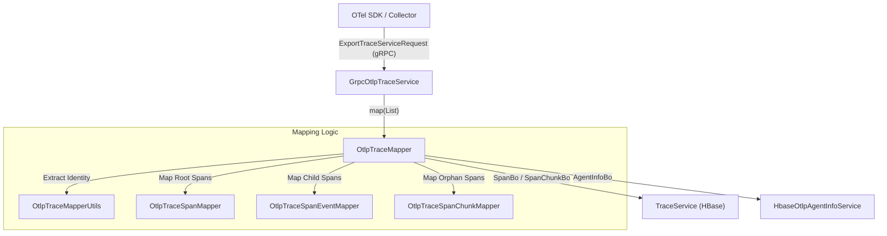
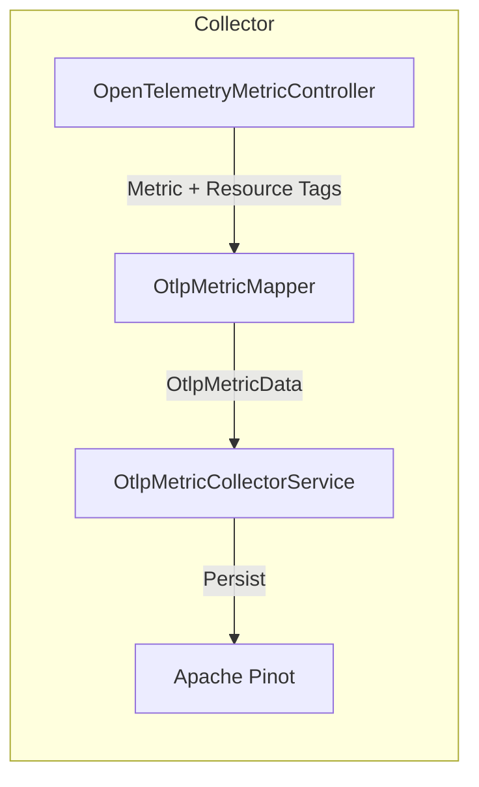
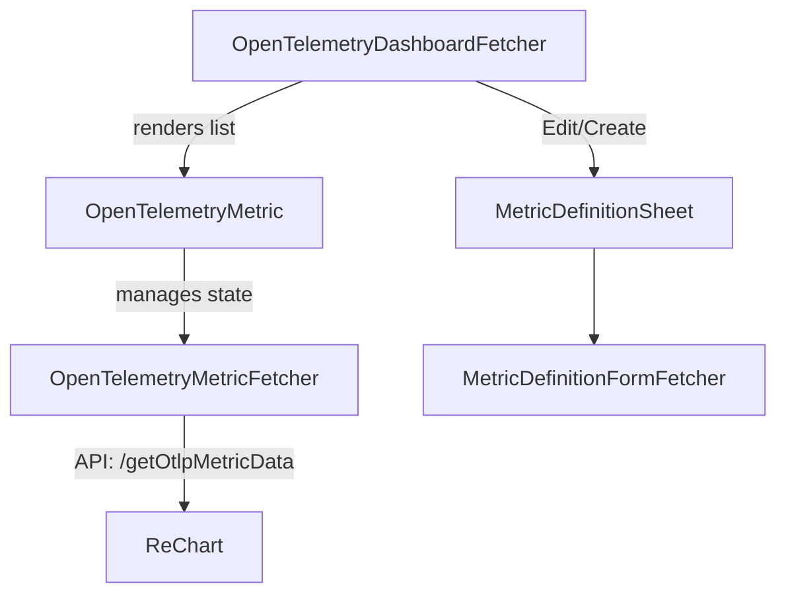

<!-- source: DeepWiki mcp.deepwiki.com · repo pinpoint-apm/pinpoint · page 10.1 OpenTelemetry Integration · fetched 2026-10-29 -->

# OpenTelemetry Integration

Relevant source files

The following files were used as context for generating this wiki page:

- [commons-server/src/main/java/com/navercorp/pinpoint/common/server/util/ByteStringUtils.java](commons-server/src/main/java/com/navercorp/pinpoint/common/server/util/ByteStringUtils.java)
- [commons-server/src/test/java/com/navercorp/pinpoint/common/util/ByteStringUtilsTest.java](commons-server/src/test/java/com/navercorp/pinpoint/common/util/ByteStringUtilsTest.java)
- [otlpmetric/otlpmetric-collector/src/main/java/com/navercorp/pinpoint/otlp/collector/OtlpMetricCollectorConfig.java](otlpmetric/otlpmetric-collector/src/main/java/com/navercorp/pinpoint/otlp/collector/OtlpMetricCollectorConfig.java)
- [otlpmetric/otlpmetric-collector/src/main/java/com/navercorp/pinpoint/otlp/collector/config/OtlpMetricPropertySources.java](otlpmetric/otlpmetric-collector/src/main/java/com/navercorp/pinpoint/otlp/collector/config/OtlpMetricPropertySources.java)
- [otlpmetric/otlpmetric-collector/src/main/java/com/navercorp/pinpoint/otlp/collector/controller/OpenTelemetryMetricController.java](otlpmetric/otlpmetric-collector/src/main/java/com/navercorp/pinpoint/otlp/collector/controller/OpenTelemetryMetricController.java)
- [otlptrace/otlptrace-collector/pom.xml](otlptrace/otlptrace-collector/pom.xml)
- [otlptrace/otlptrace-collector/src/main/java/com/navercorp/pinpoint/otlp/trace/collector/OtlpTraceCollectorApp.java](otlptrace/otlptrace-collector/src/main/java/com/navercorp/pinpoint/otlp/trace/collector/OtlpTraceCollectorApp.java)
- [otlptrace/otlptrace-collector/src/main/java/com/navercorp/pinpoint/otlp/trace/collector/OtlpTraceCollectorModule.java](otlptrace/otlptrace-collector/src/main/java/com/navercorp/pinpoint/otlp/trace/collector/OtlpTraceCollectorModule.java)
- [otlptrace/otlptrace-collector/src/main/java/com/navercorp/pinpoint/otlp/trace/collector/OtlpTraceCollectorRejectedSpan.java](otlptrace/otlptrace-collector/src/main/java/com/navercorp/pinpoint/otlp/trace/collector/OtlpTraceCollectorRejectedSpan.java)
- [otlptrace/otlptrace-collector/src/main/java/com/navercorp/pinpoint/otlp/trace/collector/mapper/IdAndName.java](otlptrace/otlptrace-collector/src/main/java/com/navercorp/pinpoint/otlp/trace/collector/mapper/IdAndName.java)
- [otlptrace/otlptrace-collector/src/main/java/com/navercorp/pinpoint/otlp/trace/collector/mapper/OtlpAgentInfoMapper.java](otlptrace/otlptrace-collector/src/main/java/com/navercorp/pinpoint/otlp/trace/collector/mapper/OtlpAgentInfoMapper.java)
- [otlptrace/otlptrace-collector/src/main/java/com/navercorp/pinpoint/otlp/trace/collector/mapper/OtlpTraceAttributeMapper.java](otlptrace/otlptrace-collector/src/main/java/com/navercorp/pinpoint/otlp/trace/collector/mapper/OtlpTraceAttributeMapper.java)
- [otlptrace/otlptrace-collector/src/main/java/com/navercorp/pinpoint/otlp/trace/collector/mapper/OtlpTraceConstants.java](otlptrace/otlptrace-collector/src/main/java/com/navercorp/pinpoint/otlp/trace/collector/mapper/OtlpTraceConstants.java)
- [otlptrace/otlptrace-collector/src/main/java/com/navercorp/pinpoint/otlp/trace/collector/mapper/OtlpTraceEventMapper.java](otlptrace/otlptrace-collector/src/main/java/com/navercorp/pinpoint/otlp/trace/collector/mapper/OtlpTraceEventMapper.java)
- [otlptrace/otlptrace-collector/src/main/java/com/navercorp/pinpoint/otlp/trace/collector/mapper/OtlpTraceLinkMapper.java](otlptrace/otlptrace-collector/src/main/java/com/navercorp/pinpoint/otlp/trace/collector/mapper/OtlpTraceLinkMapper.java)
- [otlptrace/otlptrace-collector/src/main/java/com/navercorp/pinpoint/otlp/trace/collector/mapper/OtlpTraceMapper.java](otlptrace/otlptrace-collector/src/main/java/com/navercorp/pinpoint/otlp/trace/collector/mapper/OtlpTraceMapper.java)
- [otlptrace/otlptrace-collector/src/main/java/com/navercorp/pinpoint/otlp/trace/collector/mapper/OtlpTraceMapperData.java](otlptrace/otlptrace-collector/src/main/java/com/navercorp/pinpoint/otlp/trace/collector/mapper/OtlpTraceMapperData.java)
- [otlptrace/otlptrace-collector/src/main/java/com/navercorp/pinpoint/otlp/trace/collector/mapper/OtlpTraceMapperUtils.java](otlptrace/otlptrace-collector/src/main/java/com/navercorp/pinpoint/otlp/trace/collector/mapper/OtlpTraceMapperUtils.java)
- [otlptrace/otlptrace-collector/src/main/java/com/navercorp/pinpoint/otlp/trace/collector/mapper/OtlpTraceSpanChunkMapper.java](otlptrace/otlptrace-collector/src/main/java/com/navercorp/pinpoint/otlp/trace/collector/mapper/OtlpTraceSpanChunkMapper.java)
- [otlptrace/otlptrace-collector/src/main/java/com/navercorp/pinpoint/otlp/trace/collector/mapper/OtlpTraceSpanEventMapper.java](otlptrace/otlptrace-collector/src/main/java/com/navercorp/pinpoint/otlp/trace/collector/mapper/OtlpTraceSpanEventMapper.java)
- [otlptrace/otlptrace-collector/src/main/java/com/navercorp/pinpoint/otlp/trace/collector/mapper/OtlpTraceSpanMapper.java](otlptrace/otlptrace-collector/src/main/java/com/navercorp/pinpoint/otlp/trace/collector/mapper/OtlpTraceSpanMapper.java)
- [otlptrace/otlptrace-collector/src/main/java/com/navercorp/pinpoint/otlp/trace/collector/service/GrpcOtlpTraceService.java](otlptrace/otlptrace-collector/src/main/java/com/navercorp/pinpoint/otlp/trace/collector/service/GrpcOtlpTraceService.java)
- [otlptrace/otlptrace-collector/src/main/java/com/navercorp/pinpoint/otlp/trace/collector/util/AttributeUtils.java](otlptrace/otlptrace-collector/src/main/java/com/navercorp/pinpoint/otlp/trace/collector/util/AttributeUtils.java)
- [otlptrace/otlptrace-collector/src/test/java/com/navercorp/pinpoint/otlp/trace/collector/mapper/OtlpAnyValueFactory.java](otlptrace/otlptrace-collector/src/test/java/com/navercorp/pinpoint/otlp/trace/collector/mapper/OtlpAnyValueFactory.java)
- [otlptrace/otlptrace-collector/src/test/java/com/navercorp/pinpoint/otlp/trace/collector/mapper/OtlpTraceAttributeMapperTest.java](otlptrace/otlptrace-collector/src/test/java/com/navercorp/pinpoint/otlp/trace/collector/mapper/OtlpTraceAttributeMapperTest.java)
- [otlptrace/otlptrace-collector/src/test/java/com/navercorp/pinpoint/otlp/trace/collector/mapper/OtlpTraceEventMapperTest.java](otlptrace/otlptrace-collector/src/test/java/com/navercorp/pinpoint/otlp/trace/collector/mapper/OtlpTraceEventMapperTest.java)
- [otlptrace/otlptrace-collector/src/test/java/com/navercorp/pinpoint/otlp/trace/collector/mapper/OtlpTraceMapperUtilsTest.java](otlptrace/otlptrace-collector/src/test/java/com/navercorp/pinpoint/otlp/trace/collector/mapper/OtlpTraceMapperUtilsTest.java)
- [web-frontend/src/main/v3/packages/ui/src/components/Dashboard/DashBoard.tsx](web-frontend/src/main/v3/packages/ui/src/components/Dashboard/DashBoard.tsx)
- [web-frontend/src/main/v3/packages/ui/src/components/Dashboard/Widget.tsx](web-frontend/src/main/v3/packages/ui/src/components/Dashboard/Widget.tsx)
- [web-frontend/src/main/v3/packages/ui/src/components/ErrorAnalysis/table/errorAnalysisGroupedTableColumn.tsx](web-frontend/src/main/v3/packages/ui/src/components/ErrorAnalysis/table/errorAnalysisGroupedTableColumn.tsx)
- [web-frontend/src/main/v3/packages/ui/src/components/OpenTelemetry/charts/OpenTelemetryChart.tsx](web-frontend/src/main/v3/packages/ui/src/components/OpenTelemetry/charts/OpenTelemetryChart.tsx)
- [web-frontend/src/main/v3/packages/ui/src/components/OpenTelemetry/charts/OpenTelemetryChartCommon.tsx](web-frontend/src/main/v3/packages/ui/src/components/OpenTelemetry/charts/OpenTelemetryChartCommon.tsx)
- [web-frontend/src/main/v3/packages/ui/src/components/OpenTelemetry/charts/OpenTelemetryChartTooltipContent.tsx](web-frontend/src/main/v3/packages/ui/src/components/OpenTelemetry/charts/OpenTelemetryChartTooltipContent.tsx)
- [web-frontend/src/main/v3/packages/ui/src/components/OpenTelemetry/charts/OpenTelemetryMetricFetcher.tsx](web-frontend/src/main/v3/packages/ui/src/components/OpenTelemetry/charts/OpenTelemetryMetricFetcher.tsx)
- [web-frontend/src/main/v3/packages/ui/src/components/OpenTelemetry/charts/OpenTelemetryTick.tsx](web-frontend/src/main/v3/packages/ui/src/components/OpenTelemetry/charts/OpenTelemetryTick.tsx)
- [web-frontend/src/main/v3/packages/ui/src/components/OpenTelemetry/charts/PreviewChart.tsx](web-frontend/src/main/v3/packages/ui/src/components/OpenTelemetry/charts/PreviewChart.tsx)
- [web-frontend/src/main/v3/packages/ui/src/components/OpenTelemetry/dashboard/OpenTelemteryDashboardFetcher.tsx](web-frontend/src/main/v3/packages/ui/src/components/OpenTelemetry/dashboard/OpenTelemteryDashboardFetcher.tsx)
- [web-frontend/src/main/v3/packages/ui/src/components/OpenTelemetry/definition/MeticDefinitionFormFetcher.tsx](web-frontend/src/main/v3/packages/ui/src/components/OpenTelemetry/definition/MeticDefinitionFormFetcher.tsx)
- [web-frontend/src/main/v3/packages/ui/src/components/OpenTelemetry/definition/MetricDefinitionSheet.tsx](web-frontend/src/main/v3/packages/ui/src/components/OpenTelemetry/definition/MetricDefinitionSheet.tsx)
- [web-frontend/src/main/v3/packages/ui/src/components/ReChart/ChartTooltipContent.tsx](web-frontend/src/main/v3/packages/ui/src/components/ReChart/ChartTooltipContent.tsx)
- [web-frontend/src/main/v3/packages/ui/src/components/ReChart/ReChart.tsx](web-frontend/src/main/v3/packages/ui/src/components/ReChart/ReChart.tsx)
- [web-frontend/src/main/v3/packages/ui/src/components/ReChart/index.tsx](web-frontend/src/main/v3/packages/ui/src/components/ReChart/index.tsx)
- [web-frontend/src/main/v3/packages/ui/src/components/ReChart/useRechart.tsx](web-frontend/src/main/v3/packages/ui/src/components/ReChart/useRechart.tsx)
- [web-frontend/src/main/v3/packages/ui/src/components/Transaction/transaction-list/TransactionListByFilterMapFetcher.tsx](web-frontend/src/main/v3/packages/ui/src/components/Transaction/transaction-list/TransactionListByFilterMapFetcher.tsx)
- [web-frontend/src/main/v3/packages/ui/src/components/Transaction/transaction-list/TransactionListProgressBar.tsx](web-frontend/src/main/v3/packages/ui/src/components/Transaction/transaction-list/TransactionListProgressBar.tsx)
- [web-frontend/src/main/v3/packages/ui/src/components/ui/switch.tsx](web-frontend/src/main/v3/packages/ui/src/components/ui/switch.tsx)
- [web-frontend/src/main/v3/packages/ui/src/constants/types/OtlpMetricData.ts](web-frontend/src/main/v3/packages/ui/src/constants/types/OtlpMetricData.ts)
- [web-frontend/src/main/v3/packages/ui/src/hooks/utility/index.ts](web-frontend/src/main/v3/packages/ui/src/hooks/utility/index.ts)
- [web-frontend/src/main/v3/packages/ui/src/hooks/utility/useStoragedSetting.ts](web-frontend/src/main/v3/packages/ui/src/hooks/utility/useStoragedSetting.ts)
- [web-frontend/src/main/v3/packages/ui/tailwind.config.js](web-frontend/src/main/v3/packages/ui/tailwind.config.js)
- [web-frontend/src/main/v3/packages/ui/tsconfig.json](web-frontend/src/main/v3/packages/ui/tsconfig.json)
- [web/src/main/java/com/navercorp/pinpoint/web/trace/span/LinkList.java](web/src/main/java/com/navercorp/pinpoint/web/trace/span/LinkList.java)
- [web/src/main/java/com/navercorp/pinpoint/web/trace/span/SpanChunkEventAlign.java](web/src/main/java/com/navercorp/pinpoint/web/trace/span/SpanChunkEventAlign.java)

Pinpoint supports the ingestion and visualization of OpenTelemetry (OTel) data, allowing it to act as an OTLP-compatible backend. This integration covers distributed tracing via OTLP spans and system/application monitoring via OTLP metrics.

## OTLP Trace Ingestion

The OTLP trace ingestion is handled by the `otlptrace-collector` module. It provides a gRPC service that implements the standard OpenTelemetry `ExportTraceService` [otlptrace/otlptrace-collector/src/main/java/com/navercorp/pinpoint/otlp/trace/collector/service/GrpcOtlpTraceService.java:42-42]().

### Trace Data Flow
The following diagram illustrates how OTLP `ResourceSpans` are transformed into Pinpoint internal models:

**OTLP Trace Processing Pipeline**

Sources: [otlptrace/otlptrace-collector/src/main/java/com/navercorp/pinpoint/otlp/trace/collector/service/GrpcOtlpTraceService.java:63-80](), [otlptrace/otlptrace-collector/src/main/java/com/navercorp/pinpoint/otlp/trace/collector/mapper/OtlpTraceMapper.java:67-126]()

### Mapping OTel Spans to Pinpoint Spans
Pinpoint maps OTel spans to its internal `SpanBo` and `SpanEventBo` structures based on the OTel `SpanKind`:

1.  **Root Spans**: Spans with `SPAN_KIND_SERVER` or `SPAN_KIND_CONSUMER` that have no parent are mapped to `SpanBo` [otlptrace/otlptrace-collector/src/main/java/com/navercorp/pinpoint/otlp/trace/collector/mapper/OtlpTraceMapper.java:153-157]().
2.  **Child Spans**: `SPAN_KIND_CLIENT`, `SPAN_KIND_PRODUCER`, or `SPAN_KIND_INTERNAL` are mapped to `SpanEventBo` and attached to the parent `SpanBo` [otlptrace/otlptrace-collector/src/main/java/com/navercorp/pinpoint/otlp/trace/collector/mapper/OtlpTraceSpanEventMapper.java:55-90]().
3.  **Orphan Spans**: Spans belonging to a trace where the root is missing are stored as `SpanChunkBo` [otlptrace/otlptrace-collector/src/main/java/com/navercorp/pinpoint/otlp/trace/collector/mapper/OtlpTraceSpanChunkMapper.java:44-68]().

| OTel Attribute | Pinpoint Field | Implementation |
| :--- | :--- | :--- |
| `trace_id` | `transactionId` | `OtelServerTraceId` [otlptrace/otlptrace-collector/src/main/java/com/navercorp/pinpoint/otlp/trace/collector/mapper/OtlpTraceSpanMapper.java:59-59]() |
| `span_id` | `spanId` | `OtlpTraceMapperUtils.getSpanId()` [otlptrace/otlptrace-collector/src/main/java/com/navercorp/pinpoint/otlp/trace/collector/mapper/OtlpTraceSpanMapper.java:67-67]() |
| `kind: SERVER` | `ServiceType` | `OPENTELEMETRY_SERVER` (1700) [otlptrace/otlptrace-collector/src/main/java/com/navercorp/pinpoint/otlp/trace/collector/mapper/OtlpTraceSpanMapper.java:80-80]() |
| `kind: CLIENT` | `ServiceType` | `OPENTELEMETRY_CLIENT` (9700) [otlptrace/otlptrace-collector/src/main/java/com/navercorp/pinpoint/otlp/trace/collector/mapper/OtlpTraceSpanEventMapper.java:81-81]() |
| `db.system` | `ServiceType` | `OPENTELEMETRY_DB` (2700) [otlptrace/otlptrace-collector/src/main/java/com/navercorp/pinpoint/otlp/trace/collector/mapper/OtlpTraceSpanEventMapper.java:73-73]() |

Sources: [otlptrace/otlptrace-collector/src/main/java/com/navercorp/pinpoint/otlp/trace/collector/mapper/OtlpTraceSpanMapper.java](), [otlptrace/otlptrace-collector/src/main/java/com/navercorp/pinpoint/otlp/trace/collector/mapper/OtlpTraceSpanEventMapper.java]()

## OTLP Metric Ingestion

Metrics are ingested via the `OpenTelemetryMetricController` which accepts Protobuf-encoded OTLP requests over HTTP [otlpmetric/otlpmetric-collector/src/main/java/com/navercorp/pinpoint/otlp/collector/controller/OpenTelemetryMetricController.java:60-61]().

**Metric Data Flow**

Sources: [otlpmetric/otlpmetric-collector/src/main/java/com/navercorp/pinpoint/otlp/collector/controller/OpenTelemetryMetricController.java:64-86]()

The controller extracts resource attributes (tags) and maps each `Metric` to a Pinpoint-specific `OtlpMetricData` object for storage in Apache Pinot [otlpmetric/otlpmetric-collector/src/main/java/com/navercorp/pinpoint/otlp/collector/controller/OpenTelemetryMetricController.java:72-74]().

## OpenTelemetry Dashboard in UI

The Pinpoint UI provides a specialized dashboard for visualizing OpenTelemetry metrics. Users can define custom charts by selecting metric groups and names discovered from the ingested OTLP data.

### Metric Definition and Fetching
The frontend uses a dynamic form (`MetricDefinitionFormFetcher`) to allow users to configure:
*   **Metric Group and Name**: Selected from discovered OTel metrics [web-frontend/src/main/v3/packages/ui/src/components/OpenTelemetry/definition/MeticDefinitionFormFetcher.tsx:45-52]().
*   **Aggregation**: Functions like `sum`, `avg`, `max`, `min` [web-frontend/src/main/v3/packages/ui/src/components/OpenTelemetry/definition/MeticDefinitionFormFetcher.tsx:56-58]().
*   **Visualization**: Chart types (Line, Bar, Area) and stacking options [web-frontend/src/main/v3/packages/ui/src/components/OpenTelemetry/definition/MeticDefinitionFormFetcher.tsx:60-65]().

**Frontend Dashboard Component Hierarchy**

Sources: [web-frontend/src/main/v3/packages/ui/src/components/OpenTelemetry/dashboard/OpenTelemteryDashboardFetcher.tsx:42-51](), [web-frontend/src/main/v3/packages/ui/src/components/OpenTelemetry/charts/OpenTelemetryMetricFetcher.tsx:22-31]()

### Data Fetching Implementation
The `OpenTelemetryMetricFetcher` component is responsible for retrieving the time-series data for a specific widget. It uses the `usePostOtlpMetricData` hook to send the metric definition and time range to the backend [web-frontend/src/main/v3/packages/ui/src/components/OpenTelemetry/charts/OpenTelemetryMetricFetcher.tsx:29-52](). It handles:
*   **Lazy Loading**: Only fetches data when the widget is in the viewport using `useInView` [web-frontend/src/main/v3/packages/ui/src/components/OpenTelemetry/charts/OpenTelemetryMetricFetcher.tsx:73-75]().
*   **Polling/Updates**: Refetches when the global `dateRange` or `agentId` changes [web-frontend/src/main/v3/packages/ui/src/components/OpenTelemetry/charts/OpenTelemetryMetricFetcher.tsx:78-90]().

Sources: [web-frontend/src/main/v3/packages/ui/src/components/OpenTelemetry/charts/OpenTelemetryMetricFetcher.tsx]()

---

