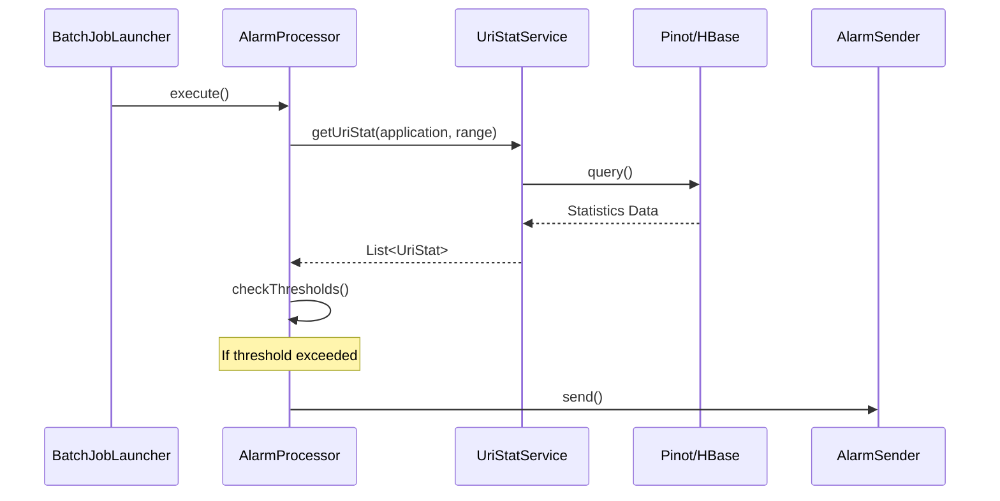

<!-- source: DeepWiki mcp.deepwiki.com · repo pinpoint-apm/pinpoint · page 10.2 URI Statistics · fetched 2026-10-29 -->

# URI Statistics

<details>
<summary>Relevant source files</summary>

The following files were used as context for generating this wiki page:

- [batch/src/main/java/com/navercorp/pinpoint/batch/BatchModule.java](batch/src/main/java/com/navercorp/pinpoint/batch/BatchModule.java)
- [batch/src/main/java/com/navercorp/pinpoint/batch/alarm/AlarmProcessor.java](batch/src/main/java/com/navercorp/pinpoint/batch/alarm/AlarmProcessor.java)
- [batch/src/main/java/com/navercorp/pinpoint/batch/alarm/AlarmReader.java](batch/src/main/java/com/navercorp/pinpoint/batch/alarm/AlarmReader.java)
- [batch/src/main/java/com/navercorp/pinpoint/batch/common/BatchJobLauncher.java](batch/src/main/java/com/navercorp/pinpoint/batch/common/BatchJobLauncher.java)
- [batch/src/main/java/com/navercorp/pinpoint/batch/common/BatchProperties.java](batch/src/main/java/com/navercorp/pinpoint/batch/common/BatchProperties.java)
- [batch/src/main/java/com/navercorp/pinpoint/batch/config/BatchInfrastructureConfig.java](batch/src/main/java/com/navercorp/pinpoint/batch/config/BatchInfrastructureConfig.java)
- [batch/src/main/java/com/navercorp/pinpoint/batch/config/BatchJavaConfigModule.java](batch/src/main/java/com/navercorp/pinpoint/batch/config/BatchJavaConfigModule.java)
- [batch/src/main/java/com/navercorp/pinpoint/batch/config/BatchScheduleConfig.java](batch/src/main/java/com/navercorp/pinpoint/batch/config/BatchScheduleConfig.java)
- [batch/src/main/java/com/navercorp/pinpoint/batch/config/CleanupAgentAndApplicationJobConfig.java](batch/src/main/java/com/navercorp/pinpoint/batch/config/CleanupAgentAndApplicationJobConfig.java)
- [batch/src/main/java/com/navercorp/pinpoint/batch/config/CleanupInactiveApplicationsJobConfig.java](batch/src/main/java/com/navercorp/pinpoint/batch/config/CleanupInactiveApplicationsJobConfig.java)
- [batch/src/main/java/com/navercorp/pinpoint/batch/job/AgentIdCleanupTasklet.java](batch/src/main/java/com/navercorp/pinpoint/batch/job/AgentIdCleanupTasklet.java)
- [batch/src/main/java/com/navercorp/pinpoint/batch/job/AgentRemover.java](batch/src/main/java/com/navercorp/pinpoint/batch/job/AgentRemover.java)
- [batch/src/main/java/com/navercorp/pinpoint/batch/job/ApplicationCleaningProcessor.java](batch/src/main/java/com/navercorp/pinpoint/batch/job/ApplicationCleaningProcessor.java)
- [batch/src/main/java/com/navercorp/pinpoint/batch/job/ApplicationCleanupTasklet.java](batch/src/main/java/com/navercorp/pinpoint/batch/job/ApplicationCleanupTasklet.java)
- [batch/src/main/java/com/navercorp/pinpoint/batch/job/ApplicationReader.java](batch/src/main/java/com/navercorp/pinpoint/batch/job/ApplicationReader.java)
- [batch/src/main/java/com/navercorp/pinpoint/batch/job/ApplicationRemover.java](batch/src/main/java/com/navercorp/pinpoint/batch/job/ApplicationRemover.java)
- [batch/src/main/java/com/navercorp/pinpoint/batch/job/CleanTargetWriter.java](batch/src/main/java/com/navercorp/pinpoint/batch/job/CleanTargetWriter.java)
- [batch/src/main/java/com/navercorp/pinpoint/batch/job/EmptyItemWriter.java](batch/src/main/java/com/navercorp/pinpoint/batch/job/EmptyItemWriter.java)
- [batch/src/main/java/com/navercorp/pinpoint/batch/service/BatchAgentService.java](batch/src/main/java/com/navercorp/pinpoint/batch/service/BatchAgentService.java)
- [batch/src/main/java/com/navercorp/pinpoint/batch/service/BatchAgentServiceImpl.java](batch/src/main/java/com/navercorp/pinpoint/batch/service/BatchAgentServiceImpl.java)
- [batch/src/main/java/com/navercorp/pinpoint/batch/service/BatchApplicationIndexService.java](batch/src/main/java/com/navercorp/pinpoint/batch/service/BatchApplicationIndexService.java)
- [batch/src/main/java/com/navercorp/pinpoint/batch/service/BatchApplicationIndexServiceImpl.java](batch/src/main/java/com/navercorp/pinpoint/batch/service/BatchApplicationIndexServiceImpl.java)
- [batch/src/main/java/com/navercorp/pinpoint/batch/util/JobParametersUtils.java](batch/src/main/java/com/navercorp/pinpoint/batch/util/JobParametersUtils.java)
- [batch/src/main/java/com/navercorp/pinpoint/batch/vo/CleanTarget.java](batch/src/main/java/com/navercorp/pinpoint/batch/vo/CleanTarget.java)
- [batch/src/main/resources/batch-root.properties](batch/src/main/resources/batch-root.properties)
- [batch/src/test/java/com/navercorp/pinpoint/batch/BatchPropertiesTest.java](batch/src/test/java/com/navercorp/pinpoint/batch/BatchPropertiesTest.java)
- [batch/src/test/java/com/navercorp/pinpoint/batch/alarm/AlarmReaderTest.java](batch/src/test/java/com/navercorp/pinpoint/batch/alarm/AlarmReaderTest.java)
- [collector/src/main/java/com/navercorp/pinpoint/collector/dao/AgentIdDao.java](collector/src/main/java/com/navercorp/pinpoint/collector/dao/AgentIdDao.java)
- [collector/src/main/java/com/navercorp/pinpoint/collector/dao/ApplicationDao.java](collector/src/main/java/com/navercorp/pinpoint/collector/dao/ApplicationDao.java)
- [collector/src/main/java/com/navercorp/pinpoint/collector/dao/hbase/HbaseAgentIdDao.java](collector/src/main/java/com/navercorp/pinpoint/collector/dao/hbase/HbaseAgentIdDao.java)
- [collector/src/main/java/com/navercorp/pinpoint/collector/dao/hbase/HbaseApplicationDao.java](collector/src/main/java/com/navercorp/pinpoint/collector/dao/hbase/HbaseApplicationDao.java)
- [collector/src/main/java/com/navercorp/pinpoint/collector/service/AgentListStateService.java](collector/src/main/java/com/navercorp/pinpoint/collector/service/AgentListStateService.java)
- [collector/src/main/java/com/navercorp/pinpoint/collector/service/ApplicationIndexV2Service.java](collector/src/main/java/com/navercorp/pinpoint/collector/service/ApplicationIndexV2Service.java)
- [commons-server/src/main/java/com/navercorp/pinpoint/common/server/config/AgentProperties.java](commons-server/src/main/java/com/navercorp/pinpoint/common/server/config/AgentProperties.java)
- [datasource/src/main/resources/datasource/jdbc-root.properties](datasource/src/main/resources/datasource/jdbc-root.properties)
- [web/src/main/java/com/navercorp/pinpoint/web/dao/AgentIdDao.java](web/src/main/java/com/navercorp/pinpoint/web/dao/AgentIdDao.java)
- [web/src/main/java/com/navercorp/pinpoint/web/dao/ApplicationIndexDao.java](web/src/main/java/com/navercorp/pinpoint/web/dao/ApplicationIndexDao.java)
- [web/src/main/java/com/navercorp/pinpoint/web/dao/hbase/HbaseAgentIdDao.java](web/src/main/java/com/navercorp/pinpoint/web/dao/hbase/HbaseAgentIdDao.java)
- [web/src/main/java/com/navercorp/pinpoint/web/dao/hbase/HbaseApplicationDao.java](web/src/main/java/com/navercorp/pinpoint/web/dao/hbase/HbaseApplicationDao.java)
- [web/src/main/java/com/navercorp/pinpoint/web/dao/hbase/HbaseApplicationIndexDao.java](web/src/main/java/com/navercorp/pinpoint/web/dao/hbase/HbaseApplicationIndexDao.java)
- [web/src/main/java/com/navercorp/pinpoint/web/interceptor/AdminAuthInterceptor.java](web/src/main/java/com/navercorp/pinpoint/web/interceptor/AdminAuthInterceptor.java)
- [web/src/main/java/com/navercorp/pinpoint/web/mapper/ApplicationMapper.java](web/src/main/java/com/navercorp/pinpoint/web/mapper/ApplicationMapper.java)
- [web/src/main/java/com/navercorp/pinpoint/web/service/AdminService.java](web/src/main/java/com/navercorp/pinpoint/web/service/AdminService.java)
- [web/src/main/java/com/navercorp/pinpoint/web/service/AdminServiceImpl.java](web/src/main/java/com/navercorp/pinpoint/web/service/AdminServiceImpl.java)
- [web/src/main/java/com/navercorp/pinpoint/web/service/AgentListV2Service.java](web/src/main/java/com/navercorp/pinpoint/web/service/AgentListV2Service.java)
- [web/src/main/java/com/navercorp/pinpoint/web/service/AgentListV2ServiceImpl.java](web/src/main/java/com/navercorp/pinpoint/web/service/AgentListV2ServiceImpl.java)
- [web/src/main/java/com/navercorp/pinpoint/web/service/ApplicationIndexService.java](web/src/main/java/com/navercorp/pinpoint/web/service/ApplicationIndexService.java)
- [web/src/main/java/com/navercorp/pinpoint/web/service/ApplicationIndexServiceImpl.java](web/src/main/java/com/navercorp/pinpoint/web/service/ApplicationIndexServiceImpl.java)
- [web/src/main/java/com/navercorp/pinpoint/web/service/component/ActiveAgentValidator.java](web/src/main/java/com/navercorp/pinpoint/web/service/component/ActiveAgentValidator.java)
- [web/src/main/java/com/navercorp/pinpoint/web/service/component/DefaultActiveAgentValidator.java](web/src/main/java/com/navercorp/pinpoint/web/service/component/DefaultActiveAgentValidator.java)
- [web/src/main/java/com/navercorp/pinpoint/web/uid/controller/ApplicationIndexV2CopyController.java](web/src/main/java/com/navercorp/pinpoint/web/uid/controller/ApplicationIndexV2CopyController.java)
- [web/src/main/java/com/navercorp/pinpoint/web/uid/service/ApplicationIndexV2CopyServiceImpl.java](web/src/main/java/com/navercorp/pinpoint/web/uid/service/ApplicationIndexV2CopyServiceImpl.java)
- [web/src/main/java/com/navercorp/pinpoint/web/vo/agent/AgentIdEntry.java](web/src/main/java/com/navercorp/pinpoint/web/vo/agent/AgentIdEntry.java)
- [web/src/test/java/com/navercorp/pinpoint/web/service/AdminServiceImplTest.java](web/src/test/java/com/navercorp/pinpoint/web/service/AdminServiceImplTest.java)
- [web/src/test/java/com/navercorp/pinpoint/web/service/AgentListV2ServiceImplTest.java](web/src/test/java/com/navercorp/pinpoint/web/service/AgentListV2ServiceImplTest.java)
- [web/src/test/java/com/navercorp/pinpoint/web/service/component/DefaultActiveAgentValidatorTest.java](web/src/test/java/com/navercorp/pinpoint/web/service/component/DefaultActiveAgentValidatorTest.java)

</details>


URI Statistics provides a granular view of application performance by tracking latency, failure rates, and Apdex scores at the individual endpoint (URI) level. This feature enables developers to identify specific slow or failing endpoints that might be masked by aggregate application-level metrics.

## Overview and Purpose

The URI Statistics feature extends Pinpoint's monitoring capabilities beyond the Service and Instance levels. By collecting data for each unique URI, the system can provide:
- **Latency Distribution**: Identifying which endpoints contribute most to response time.
- **Failure Analysis**: Pinpointing specific URIs with high error rates.
- **Apdex Scores**: Calculating the User Experience index per endpoint to prioritize optimizations.

The system utilizes **Apache Pinot** as its primary OLAP engine for storing and querying these statistics, allowing for high-concurrency, low-latency analytical queries over large volumes of trace data.

## Data Flow Architecture

The data flow for URI Statistics involves collection at the agent, ingestion by the collector, and storage in Pinot for subsequent querying by the Web module.

### Ingestion and Collection
1. **Agent**: Captures URI information during span collection.
2. **Collector**: Receives span data via gRPC and extracts URI-level metrics.
3. **Storage**: Data is persisted into Apache Pinot tables specialized for time-series URI metrics.

### Query and Visualization
1. **Web Module**: Requests statistics from Pinot via the `UriStatService` (referenced in [web/src/main/java/com/navercorp/pinpoint/web/service/AdminServiceImpl.java:49-51]()).
2. **UI**: Displays charts and tables showing performance metrics per URI.

### URI Statistics Component Interaction
The following diagram illustrates how the URI statistics components interact across different Pinpoint modules.

```mermaid
graph TD
    subgraph "Collector Module"
        [HbaseAgentIdDao] --> |"Validate Agent"| [AgentIdDao]
        [Collector] --> |"Persist URI Stats"| PINOT[("Apache Pinot")]
    end

    subgraph "Web Module"
        [AdminServiceImpl] --> |"Manage Metadata"| [ApplicationIndexService]
        [ApplicationIndexService] --> |"Query Applications"| [ApplicationIndexDao]
        [UriStatService] -.-> |"Query Stats"| PINOT
    end

    subgraph "Batch Module"
        [BatchModule] --> |"Load Config"| [UriStatAlarmConfiguration]
        [AlarmProcessor] --> |"Check Thresholds"| [UriStatService]
        [UriStatService] --> |"Trigger"| [AlarmSender]
    end

    [ApplicationIndexDao] --> |"HBase"| HBASE[("HBase Tables")]
```
Sources: [batch/src/main/java/com/navercorp/pinpoint/batch/BatchModule.java:83-85](), [web/src/main/java/com/navercorp/pinpoint/web/service/AdminServiceImpl.java:47-54](), [web/src/main/java/com/navercorp/pinpoint/web/dao/hbase/HbaseApplicationIndexDao.java:51-55]()

## Backend Implementation

### Data Access Objects (DAOs)
The system relies on several DAO implementations to manage the relationship between applications, agents, and their URIs. While the raw statistics reside in Pinot, the metadata (which application owns which URI) is often managed via HBase.

- **`HbaseApplicationIndexDao`**: Manages the mapping of application names to their constituent agent IDs and service types [web/src/main/java/com/navercorp/pinpoint/web/dao/hbase/HbaseApplicationIndexDao.java:51-60]().
- **`HbaseAgentIdDao`**: Handles the retrieval of agent identifiers which are used as dimensions in URI statistics [web/src/main/java/com/navercorp/pinpoint/web/dao/hbase/HbaseAgentIdDao.java:35-49]().
- **`HbaseApplicationDao`**: Provides modern V2 table access for application metadata [web/src/main/java/com/navercorp/pinpoint/web/dao/hbase/HbaseApplicationDao.java:23-36]().

### Service Layer
The `ApplicationIndexService` acts as the bridge between the Web UI and the underlying storage, ensuring that URI queries are scoped correctly to valid applications and agents.

```java
// Example of how the service resolves applications for URI stats
public List<Application> selectAllApplications() {
    if (applicationReadV2) {
        return this.applicationDao.getApplications(ServiceUid.DEFAULT_SERVICE_UID_CODE);
    }
    return this.applicationIndexDao.selectAllApplicationNames();
}
```
Sources: [web/src/main/java/com/navercorp/pinpoint/web/service/ApplicationIndexServiceImpl.java:76-81]()

## URI Statistics Alarm System

The Batch module runs scheduled jobs to monitor URI performance and trigger alarms based on predefined thresholds for latency or error rates.

### Configuration
Alarms are configured in the `batch-root.properties` file:
- `job.alarm.uristat.enable`: Enables/disables URI-specific alarms [batch/src/main/resources/batch-root.properties:36]().
- `job.alarm.uristat.cron`: Defines the execution frequency (default: every 3 minutes starting at minute 2) [batch/src/main/resources/batch-root.properties:37]().

### Batch Job Execution
The `BatchModule` imports `UriStatAlarmConfiguration` to initialize the necessary components for processing URI-level alerts [batch/src/main/java/com/navercorp/pinpoint/batch/BatchModule.java:83]().


Sources: [batch/src/main/java/com/navercorp/pinpoint/batch/BatchModule.java:115-120](), [batch/src/main/resources/batch-root.properties:36-37]()

## Metadata Management and Cleanup

To maintain performance, Pinpoint includes batch jobs to clean up inactive applications and agents that no longer report URI statistics.

- **Inactive Application Cleanup**: Configured via `job.cleanup.inactive.applications.cron` [batch/src/main/resources/batch-root.properties:41-42]().
- **Implementation**: The `AdminServiceImpl` provides methods to remove inactive agents based on a duration threshold [web/src/main/java/com/navercorp/pinpoint/web/service/AdminServiceImpl.java:79-93]().
- **Data Integrity**: The `ApplicationRemover` and `AgentRemover` classes in the batch module ensure that when an application is deleted, its associated metadata in the `ApplicationIndex` table is also purged [batch/src/main/java/com/navercorp/pinpoint/batch/job/ApplicationRemover.java:33-40](), [batch/src/main/java/com/navercorp/pinpoint/batch/job/AgentRemover.java:34-40]().

### Table Migration (V1 to V2)
Pinpoint is transitioning to a more efficient schema (V2). The `ApplicationIndexV2CopyServiceImpl` provides utilities to migrate existing application and agent metadata to the new tables used by URI Statistics [web/src/main/java/com/navercorp/pinpoint/web/uid/service/ApplicationIndexV2CopyServiceImpl.java:25-46]().

Sources: [web/src/main/java/com/navercorp/pinpoint/web/service/AdminServiceImpl.java:95-112](), [batch/src/main/java/com/navercorp/pinpoint/batch/job/AgentRemover.java:56-64]()

---

