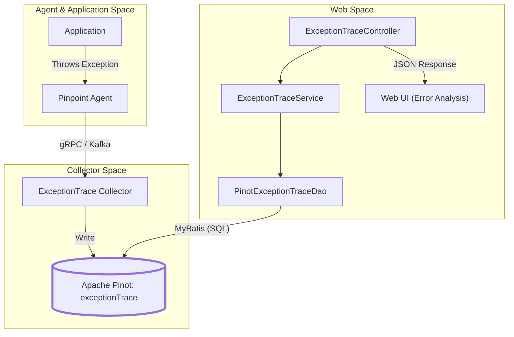
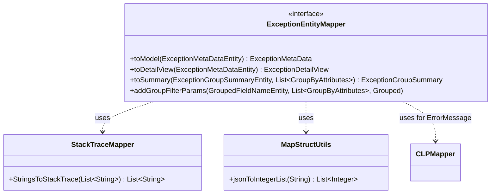

<!-- source: DeepWiki mcp.deepwiki.com · repo pinpoint-apm/pinpoint · page 10.3 Exception Trace · fetched 2026-10-29 -->

# Exception Trace

Relevant source files

The following files were used as context for generating this wiki page:

- [commons-server/src/main/java/com/navercorp/pinpoint/common/server/frontend/export/FrontendConfigExporter.java](commons-server/src/main/java/com/navercorp/pinpoint/common/server/frontend/export/FrontendConfigExporter.java)
- [commons-server/src/main/java/com/navercorp/pinpoint/common/server/mapper/MapStructUtils.java](commons-server/src/main/java/com/navercorp/pinpoint/common/server/mapper/MapStructUtils.java)
- [commons-server/src/main/java/com/navercorp/pinpoint/common/server/util/EnumGetter.java](commons-server/src/main/java/com/navercorp/pinpoint/common/server/util/EnumGetter.java)
- [commons-server/src/test/java/com/navercorp/pinpoint/common/server/mapper/MapStructUtilsTest.java](commons-server/src/test/java/com/navercorp/pinpoint/common/server/mapper/MapStructUtilsTest.java)
- [exceptiontrace/exceptiontrace-collector/src/main/java/com/navercorp/pinpoint/exceptiontrace/collector/dao/PinotExceptionTraceDao.java](exceptiontrace/exceptiontrace-collector/src/main/java/com/navercorp/pinpoint/exceptiontrace/collector/dao/PinotExceptionTraceDao.java)
- [exceptiontrace/exceptiontrace-collector/src/main/java/com/navercorp/pinpoint/exceptiontrace/collector/entity/ExceptionMetaDataEntity.java](exceptiontrace/exceptiontrace-collector/src/main/java/com/navercorp/pinpoint/exceptiontrace/collector/entity/ExceptionMetaDataEntity.java)
- [exceptiontrace/exceptiontrace-collector/src/test/java/com/navercorp/pinpoint/exceptiontrace/collector/mapper/ExceptionMetaDataMapperTest.java](exceptiontrace/exceptiontrace-collector/src/test/java/com/navercorp/pinpoint/exceptiontrace/collector/mapper/ExceptionMetaDataMapperTest.java)
- [exceptiontrace/exceptiontrace-common/src/main/java/com/navercorp/pinpoint/exceptiontrace/common/model/ExceptionMetaData.java](exceptiontrace/exceptiontrace-common/src/main/java/com/navercorp/pinpoint/exceptiontrace/common/model/ExceptionMetaData.java)
- [exceptiontrace/exceptiontrace-common/src/main/java/com/navercorp/pinpoint/exceptiontrace/common/pinot/CLPSuffix.java](exceptiontrace/exceptiontrace-common/src/main/java/com/navercorp/pinpoint/exceptiontrace/common/pinot/CLPSuffix.java)
- [exceptiontrace/exceptiontrace-common/src/main/java/com/navercorp/pinpoint/exceptiontrace/common/pinot/PinotColumns.java](exceptiontrace/exceptiontrace-common/src/main/java/com/navercorp/pinpoint/exceptiontrace/common/pinot/PinotColumns.java)
- [exceptiontrace/exceptiontrace-common/src/main/pinot/pinot-exceptionTrace-offline-table.json](exceptiontrace/exceptiontrace-common/src/main/pinot/pinot-exceptionTrace-offline-table.json)
- [exceptiontrace/exceptiontrace-common/src/main/pinot/pinot-exceptionTrace-realtime-table.json](exceptiontrace/exceptiontrace-common/src/main/pinot/pinot-exceptionTrace-realtime-table.json)
- [exceptiontrace/exceptiontrace-common/src/main/pinot/pinot-exceptionTrace-schema.json](exceptiontrace/exceptiontrace-common/src/main/pinot/pinot-exceptionTrace-schema.json)
- [exceptiontrace/exceptiontrace-web/src/main/java/com/navercorp/pinpoint/exceptiontrace/web/ExceptionTraceWebConfig.java](exceptiontrace/exceptiontrace-web/src/main/java/com/navercorp/pinpoint/exceptiontrace/web/ExceptionTraceWebConfig.java)
- [exceptiontrace/exceptiontrace-web/src/main/java/com/navercorp/pinpoint/exceptiontrace/web/ExceptionTraceWebPropertySources.java](exceptiontrace/exceptiontrace-web/src/main/java/com/navercorp/pinpoint/exceptiontrace/web/ExceptionTraceWebPropertySources.java)
- [exceptiontrace/exceptiontrace-web/src/main/java/com/navercorp/pinpoint/exceptiontrace/web/config/ExceptionTraceRegistryHandler.java](exceptiontrace/exceptiontrace-web/src/main/java/com/navercorp/pinpoint/exceptiontrace/web/config/ExceptionTraceRegistryHandler.java)
- [exceptiontrace/exceptiontrace-web/src/main/java/com/navercorp/pinpoint/exceptiontrace/web/controller/ExceptionTraceController.java](exceptiontrace/exceptiontrace-web/src/main/java/com/navercorp/pinpoint/exceptiontrace/web/controller/ExceptionTraceController.java)
- [exceptiontrace/exceptiontrace-web/src/main/java/com/navercorp/pinpoint/exceptiontrace/web/dao/ExceptionTraceDao.java](exceptiontrace/exceptiontrace-web/src/main/java/com/navercorp/pinpoint/exceptiontrace/web/dao/ExceptionTraceDao.java)
- [exceptiontrace/exceptiontrace-web/src/main/java/com/navercorp/pinpoint/exceptiontrace/web/dao/PinotExceptionTraceDao.java](exceptiontrace/exceptiontrace-web/src/main/java/com/navercorp/pinpoint/exceptiontrace/web/dao/PinotExceptionTraceDao.java)
- [exceptiontrace/exceptiontrace-web/src/main/java/com/navercorp/pinpoint/exceptiontrace/web/entity/ExceptionGroupSummaryEntity.java](exceptiontrace/exceptiontrace-web/src/main/java/com/navercorp/pinpoint/exceptiontrace/web/entity/ExceptionGroupSummaryEntity.java)
- [exceptiontrace/exceptiontrace-web/src/main/java/com/navercorp/pinpoint/exceptiontrace/web/entity/ExceptionMetaDataEntity.java](exceptiontrace/exceptiontrace-web/src/main/java/com/navercorp/pinpoint/exceptiontrace/web/entity/ExceptionMetaDataEntity.java)
- [exceptiontrace/exceptiontrace-web/src/main/java/com/navercorp/pinpoint/exceptiontrace/web/entity/GroupedFieldNameEntity.java](exceptiontrace/exceptiontrace-web/src/main/java/com/navercorp/pinpoint/exceptiontrace/web/entity/GroupedFieldNameEntity.java)
- [exceptiontrace/exceptiontrace-web/src/main/java/com/navercorp/pinpoint/exceptiontrace/web/mapper/CLPMapper.java](exceptiontrace/exceptiontrace-web/src/main/java/com/navercorp/pinpoint/exceptiontrace/web/mapper/CLPMapper.java)
- [exceptiontrace/exceptiontrace-web/src/main/java/com/navercorp/pinpoint/exceptiontrace/web/mapper/ExceptionEntityMapper.java](exceptiontrace/exceptiontrace-web/src/main/java/com/navercorp/pinpoint/exceptiontrace/web/mapper/ExceptionEntityMapper.java)
- [exceptiontrace/exceptiontrace-web/src/main/java/com/navercorp/pinpoint/exceptiontrace/web/mapper/StackTraceMapper.java](exceptiontrace/exceptiontrace-web/src/main/java/com/navercorp/pinpoint/exceptiontrace/web/mapper/StackTraceMapper.java)
- [exceptiontrace/exceptiontrace-web/src/main/java/com/navercorp/pinpoint/exceptiontrace/web/model/ExceptionGroupSummary.java](exceptiontrace/exceptiontrace-web/src/main/java/com/navercorp/pinpoint/exceptiontrace/web/model/ExceptionGroupSummary.java)
- [exceptiontrace/exceptiontrace-web/src/main/java/com/navercorp/pinpoint/exceptiontrace/web/model/Grouped.java](exceptiontrace/exceptiontrace-web/src/main/java/com/navercorp/pinpoint/exceptiontrace/web/model/Grouped.java)
- [exceptiontrace/exceptiontrace-web/src/main/java/com/navercorp/pinpoint/exceptiontrace/web/model/GroupedFieldName.java](exceptiontrace/exceptiontrace-web/src/main/java/com/navercorp/pinpoint/exceptiontrace/web/model/GroupedFieldName.java)
- [exceptiontrace/exceptiontrace-web/src/main/java/com/navercorp/pinpoint/exceptiontrace/web/service/ExceptionTraceService.java](exceptiontrace/exceptiontrace-web/src/main/java/com/navercorp/pinpoint/exceptiontrace/web/service/ExceptionTraceService.java)
- [exceptiontrace/exceptiontrace-web/src/main/java/com/navercorp/pinpoint/exceptiontrace/web/service/ExceptionTraceServiceImpl.java](exceptiontrace/exceptiontrace-web/src/main/java/com/navercorp/pinpoint/exceptiontrace/web/service/ExceptionTraceServiceImpl.java)
- [exceptiontrace/exceptiontrace-web/src/main/java/com/navercorp/pinpoint/exceptiontrace/web/util/ExceptionTraceQueryParameter.java](exceptiontrace/exceptiontrace-web/src/main/java/com/navercorp/pinpoint/exceptiontrace/web/util/ExceptionTraceQueryParameter.java)
- [exceptiontrace/exceptiontrace-web/src/main/java/com/navercorp/pinpoint/exceptiontrace/web/util/FilterByAttributes.java](exceptiontrace/exceptiontrace-web/src/main/java/com/navercorp/pinpoint/exceptiontrace/web/util/FilterByAttributes.java)
- [exceptiontrace/exceptiontrace-web/src/main/java/com/navercorp/pinpoint/exceptiontrace/web/util/GroupByAttributes.java](exceptiontrace/exceptiontrace-web/src/main/java/com/navercorp/pinpoint/exceptiontrace/web/util/GroupByAttributes.java)
- [exceptiontrace/exceptiontrace-web/src/main/java/com/navercorp/pinpoint/exceptiontrace/web/util/OrderByAttributes.java](exceptiontrace/exceptiontrace-web/src/main/java/com/navercorp/pinpoint/exceptiontrace/web/util/OrderByAttributes.java)
- [exceptiontrace/exceptiontrace-web/src/main/resources/exceptiontrace/mapper/ExceptionGroupMapper.xml](exceptiontrace/exceptiontrace-web/src/main/resources/exceptiontrace/mapper/ExceptionGroupMapper.xml)
- [exceptiontrace/exceptiontrace-web/src/test/java/com/navercorp/pinpoint/exceptiontrace/web/mapper/CLPMapperTest.java](exceptiontrace/exceptiontrace-web/src/test/java/com/navercorp/pinpoint/exceptiontrace/web/mapper/CLPMapperTest.java)
- [exceptiontrace/exceptiontrace-web/src/test/java/com/navercorp/pinpoint/exceptiontrace/web/mapper/ExceptionEntityMapperTest.java](exceptiontrace/exceptiontrace-web/src/test/java/com/navercorp/pinpoint/exceptiontrace/web/mapper/ExceptionEntityMapperTest.java)
- [metric-module/metric-commons/src/main/java/com/navercorp/pinpoint/metric/common/model/Tags.java](metric-module/metric-commons/src/main/java/com/navercorp/pinpoint/metric/common/model/Tags.java)
- [metric-module/metric-commons/src/main/java/com/navercorp/pinpoint/metric/common/mybatis/typehandler/TagListSerializer.java](metric-module/metric-commons/src/main/java/com/navercorp/pinpoint/metric/common/mybatis/typehandler/TagListSerializer.java)
- [metric-module/metric-commons/src/main/java/com/navercorp/pinpoint/metric/common/mybatis/typehandler/TagSerializer.java](metric-module/metric-commons/src/main/java/com/navercorp/pinpoint/metric/common/mybatis/typehandler/TagSerializer.java)
- [metric-module/metric-commons/src/test/java/com/navercorp/pinpoint/metric/common/mybatis/typehandler/TagListSerializerTest.java](metric-module/metric-commons/src/test/java/com/navercorp/pinpoint/metric/common/mybatis/typehandler/TagListSerializerTest.java)
- [metric-module/metric/src/main/java/com/navercorp/pinpoint/metric/collector/model/serialize/TelegrafJsonDeserializer.java](metric-module/metric/src/main/java/com/navercorp/pinpoint/metric/collector/model/serialize/TelegrafJsonDeserializer.java)
- [otlpmetric/otlpmetric-web/src/main/java/com/navercorp/pinpoint/otlp/web/OtlpMetricWebConfig.java](otlpmetric/otlpmetric-web/src/main/java/com/navercorp/pinpoint/otlp/web/OtlpMetricWebConfig.java)
- [otlpmetric/otlpmetric-web/src/main/java/com/navercorp/pinpoint/otlp/web/config/OtlpMetricPropertySources.java](otlpmetric/otlpmetric-web/src/main/java/com/navercorp/pinpoint/otlp/web/config/OtlpMetricPropertySources.java)
- [otlpmetric/otlpmetric-web/src/main/java/com/navercorp/pinpoint/otlp/web/config/mysql/OtlpMetricWebMysqlDaoConfiguration.java](otlpmetric/otlpmetric-web/src/main/java/com/navercorp/pinpoint/otlp/web/config/mysql/OtlpMetricWebMysqlDaoConfiguration.java)
- [otlpmetric/otlpmetric-web/src/main/java/com/navercorp/pinpoint/otlp/web/config/pinot/OtlpMetricWebPinotDaoConfiguration.java](otlpmetric/otlpmetric-web/src/main/java/com/navercorp/pinpoint/otlp/web/config/pinot/OtlpMetricWebPinotDaoConfiguration.java)
- [service-module/src/test/java/com/navercorp/pinpoint/service/dao/mysql/MysqlServiceDaoTest.java](service-module/src/test/java/com/navercorp/pinpoint/service/dao/mysql/MysqlServiceDaoTest.java)

The Exception Trace feature provides a centralized analysis platform for exceptions occurring within monitored applications. It moves beyond simple logging by collecting detailed exception metadata, storing it in a high-performance Apache Pinot OLAP store, and providing advanced grouping, filtering, and visualization capabilities via the Pinpoint Web UI.

## Overview and Data Flow

Exception Trace follows a pipeline where exception data is captured by agents, processed by the collector, and stored in Pinot. The Web component then queries this data using MyBatis templates mapped to Pinot queries.

### System Architecture Diagram

The following diagram illustrates the flow of exception data from the application to the storage layer and finally to the user interface.

**Sources:** [exceptiontrace/exceptiontrace-web/src/main/java/com/navercorp/pinpoint/exceptiontrace/web/controller/ExceptionTraceController.java:60-63](), [exceptiontrace/exceptiontrace-web/src/main/java/com/navercorp/pinpoint/exceptiontrace/web/dao/PinotExceptionTraceDao.java:41-42](), [exceptiontrace/exceptiontrace-common/src/main/pinot/pinot-exceptionTrace-realtime-table.json:2-10]()

## Data Storage (Apache Pinot)

Pinpoint uses Apache Pinot to store exception metadata, enabling sub-second analytical queries over large datasets. The schema is defined in `exceptionTrace-schema.json` and utilized in both REALTIME and OFFLINE table configurations.

### Table Configuration
*   **Table Name:** `exceptionTrace` [exceptiontrace/exceptiontrace-common/src/main/pinot/pinot-exceptionTrace-realtime-table.json:2]()
*   **Kafka Topic:** `exception-trace` [exceptiontrace/exceptiontrace-common/src/main/pinot/pinot-exceptionTrace-realtime-table.json:28]()
*   **Time Column:** `timestamp` [exceptiontrace/exceptiontrace-common/src/main/pinot/pinot-exceptionTrace-realtime-table.json:10]()
*   **Primary Keys/Indexing:** Uses `applicationName` as a sorted column and `agentId` with a Bloom filter for fast lookups [exceptiontrace/exceptiontrace-common/src/main/pinot/pinot-exceptionTrace-realtime-table.json:40-56]().

### CLP Encoding for Error Messages
To optimize storage for repetitive log patterns, Pinpoint utilizes the **Compressed Log Processor (CLP)**.
*   **errorMessage_logtype:** Stores the static template of the error message [exceptiontrace/exceptiontrace-common/src/main/pinot/pinot-exceptionTrace-realtime-table.json:45]().
*   **errorMessage_dictionaryVars:** Stores the variable parts of the message [exceptiontrace/exceptiontrace-common/src/main/pinot/pinot-exceptionTrace-realtime-table.json:46]().

The `CLPMapper` class is responsible for converting these encoded log types back into human-readable strings by replacing placeholder characters (`\u0011`, `\u0012`) with readable replacements [exceptiontrace/exceptiontrace-web/src/main/java/com/navercorp/pinpoint/exceptiontrace/web/mapper/CLPMapper.java:25-60]().

**Sources:** [exceptiontrace/exceptiontrace-common/src/main/pinot/pinot-exceptionTrace-realtime-table.json:1-88](), [exceptiontrace/exceptiontrace-web/src/main/java/com/navercorp/pinpoint/exceptiontrace/web/mapper/CLPMapper.java:25-60]()

## Querying and Analysis

The Web component provides several APIs to query exception data, encapsulated in `ExceptionTraceController`.

### Query Parameters and Attributes
All queries are driven by `ExceptionTraceQueryParameter`, which supports filtering, ordering, and grouping [exceptiontrace/exceptiontrace-web/src/main/java/com/navercorp/pinpoint/exceptiontrace/web/util/ExceptionTraceQueryParameter.java:36-54]().

| Attribute | Code Entity | Description |
| :--- | :--- | :--- |
| **Grouping** | `GroupByAttributes` | Supports grouping by URI Template, Error Message Log Type, Error Class Name, or Stack Trace Hash [exceptiontrace/exceptiontrace-web/src/main/java/com/navercorp/pinpoint/exceptiontrace/web/util/GroupByAttributes.java:26-30](). |
| **Ordering** | `OrderByAttributes` | Supports sorting by Error Class, Message, Timestamp, or Path [exceptiontrace/exceptiontrace-web/src/main/java/com/navercorp/pinpoint/exceptiontrace/web/util/OrderByAttributes.java:24-28](). |
| **Filtering** | `FilterByAttributes` | Allows filtering based on specific key-value pairs (e.g., `agentId:my-agent`) [exceptiontrace/exceptiontrace-web/src/main/java/com/navercorp/pinpoint/exceptiontrace/web/util/ExceptionTraceQueryParameter.java:196-205](). |

### Key API Endpoints
1.  **`/transactionInfo`**: Retrieves specific exception details using `transactionId`, `spanId`, and `exceptionId` [exceptiontrace/exceptiontrace-web/src/main/java/com/navercorp/pinpoint/exceptiontrace/web/controller/ExceptionTraceController.java:95-116]().
2.  **`/errorList`**: Returns a list of exceptions within a time range, supporting filters and pagination [exceptiontrace/exceptiontrace-web/src/main/java/com/navercorp/pinpoint/exceptiontrace/web/controller/ExceptionTraceController.java:118-147]().
3.  **`/errorList/groupBy`**: Aggregates exceptions based on specified `GroupByAttributes` to show frequency of specific error types [exceptiontrace/exceptiontrace-web/src/main/java/com/navercorp/pinpoint/exceptiontrace/web/controller/ExceptionTraceController.java:149-150]().

**Sources:** [exceptiontrace/exceptiontrace-web/src/main/java/com/navercorp/pinpoint/exceptiontrace/web/controller/ExceptionTraceController.java:63-150](), [exceptiontrace/exceptiontrace-web/src/main/java/com/navercorp/pinpoint/exceptiontrace/web/util/GroupByAttributes.java:26-30](), [exceptiontrace/exceptiontrace-web/src/main/java/com/navercorp/pinpoint/exceptiontrace/web/util/OrderByAttributes.java:24-28]()

## Implementation Details

### Data Access Layer (DAO)
The `PinotExceptionTraceDao` implements the `ExceptionTraceDao` interface using `SqlSessionTemplate` to execute MyBatis queries against Pinot [exceptiontrace/exceptiontrace-web/src/main/java/com/navercorp/pinpoint/exceptiontrace/web/dao/PinotExceptionTraceDao.java:42-63]().

Key MyBatis query IDs:
*   `selectExceptions`: Fetch raw metadata [exceptiontrace/exceptiontrace-web/src/main/java/com/navercorp/pinpoint/exceptiontrace/web/dao/PinotExceptionTraceDao.java:47]().
*   `selectGroupSummaries`: Fetch aggregated counts for grouped views [exceptiontrace/exceptiontrace-web/src/main/java/com/navercorp/pinpoint/exceptiontrace/web/dao/PinotExceptionTraceDao.java:50]().
*   `selectChartValueViews`: Fetch time-series data for exception charts [exceptiontrace/exceptiontrace-web/src/main/java/com/navercorp/pinpoint/exceptiontrace/web/dao/PinotExceptionTraceDao.java:51]().

### Object Mapping
Pinpoint uses **MapStruct** to transform between Database Entities (`ExceptionMetaDataEntity`) and Web Views/Models (`ExceptionDetailView`, `ExceptionMetaData`).

The `ExceptionEntityMapper` handles complex logic such as:
*   Mapping stack traces from stored string lists [exceptiontrace/exceptiontrace-web/src/main/java/com/navercorp/pinpoint/exceptiontrace/web/mapper/ExceptionEntityMapper.java:61-65]().
*   Dynamically constructing `GroupFilterParams` based on the attributes selected for grouping (e.g., if grouping by `STACK_TRACE`, it maps the `stackTraceHash`) [exceptiontrace/exceptiontrace-web/src/main/java/com/navercorp/pinpoint/exceptiontrace/web/mapper/ExceptionEntityMapper.java:89-105]().
*   Selecting the correct error message representation (raw vs. CLP-decoded) [exceptiontrace/exceptiontrace-web/src/main/java/com/navercorp/pinpoint/exceptiontrace/web/mapper/ExceptionEntityMapper.java:126-134]().

**Sources:** [exceptiontrace/exceptiontrace-web/src/main/java/com/navercorp/pinpoint/exceptiontrace/web/dao/PinotExceptionTraceDao.java:41-114](), [exceptiontrace/exceptiontrace-web/src/main/java/com/navercorp/pinpoint/exceptiontrace/web/mapper/ExceptionEntityMapper.java:50-139](), [commons-server/src/main/java/com/navercorp/pinpoint/common/server/mapper/MapStructUtils.java:40-59]()

---

