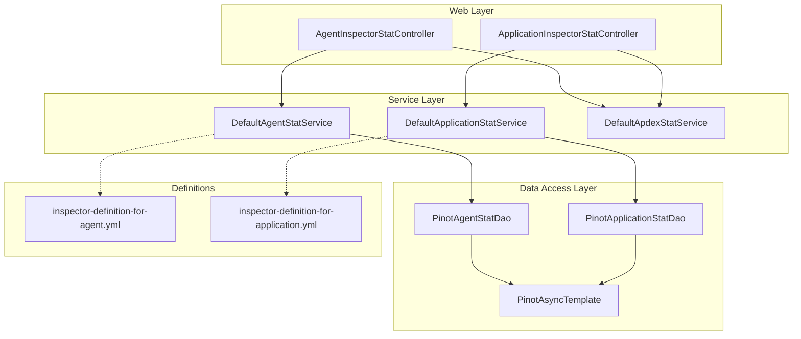
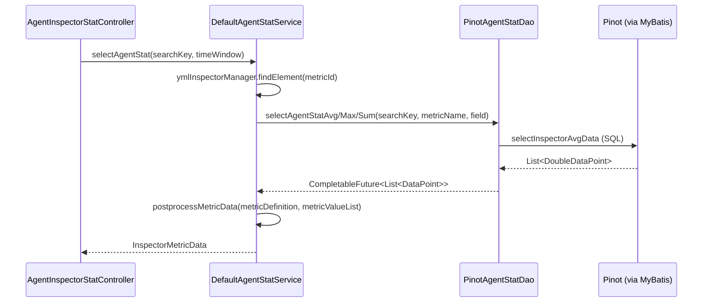

<!-- source: DeepWiki mcp.deepwiki.com · repo pinpoint-apm/pinpoint · page 10.4 Inspector Module · fetched 2026-10-29 -->

# Inspector Module

Relevant source files

The following files were used as context for generating this wiki page:

- [agent-module/bootstraps/bootstrap/src/main/java/com/navercorp/pinpoint/bootstrap/agentdir/JavaAgentPathResolver.java](agent-module/bootstraps/bootstrap/src/main/java/com/navercorp/pinpoint/bootstrap/agentdir/JavaAgentPathResolver.java)
- [agent-module/plugins/grpc/src/main/java/com/navercorp/pinpoint/plugin/grpc/GrpcUtils.java](agent-module/plugins/grpc/src/main/java/com/navercorp/pinpoint/plugin/grpc/GrpcUtils.java)
- [basic-login/src/main/java/com/navercorp/pinpoint/login/basic/service/PreAuthenticationCheckFilter.java](basic-login/src/main/java/com/navercorp/pinpoint/login/basic/service/PreAuthenticationCheckFilter.java)
- [inspector-module/inspector-web/pom.xml](inspector-module/inspector-web/pom.xml)
- [inspector-module/inspector-web/src/main/java/com/navercorp/pinpoint/inspector/web/config/InspectorRegistryHandler.java](inspector-module/inspector-web/src/main/java/com/navercorp/pinpoint/inspector/web/config/InspectorRegistryHandler.java)
- [inspector-module/inspector-web/src/main/java/com/navercorp/pinpoint/inspector/web/controller/AgentInspectorStatController.java](inspector-module/inspector-web/src/main/java/com/navercorp/pinpoint/inspector/web/controller/AgentInspectorStatController.java)
- [inspector-module/inspector-web/src/main/java/com/navercorp/pinpoint/inspector/web/controller/ApplicationInspectorStatController.java](inspector-module/inspector-web/src/main/java/com/navercorp/pinpoint/inspector/web/controller/ApplicationInspectorStatController.java)
- [inspector-module/inspector-web/src/main/java/com/navercorp/pinpoint/inspector/web/dao/AgentStatDao.java](inspector-module/inspector-web/src/main/java/com/navercorp/pinpoint/inspector/web/dao/AgentStatDao.java)
- [inspector-module/inspector-web/src/main/java/com/navercorp/pinpoint/inspector/web/dao/model/AgentStatPoint.java](inspector-module/inspector-web/src/main/java/com/navercorp/pinpoint/inspector/web/dao/model/AgentStatPoint.java)
- [inspector-module/inspector-web/src/main/java/com/navercorp/pinpoint/inspector/web/dao/model/InspectorQueryGroupParameter.java](inspector-module/inspector-web/src/main/java/com/navercorp/pinpoint/inspector/web/dao/model/InspectorQueryGroupParameter.java)
- [inspector-module/inspector-web/src/main/java/com/navercorp/pinpoint/inspector/web/dao/model/InspectorQueryParameter.java](inspector-module/inspector-web/src/main/java/com/navercorp/pinpoint/inspector/web/dao/model/InspectorQueryParameter.java)
- [inspector-module/inspector-web/src/main/java/com/navercorp/pinpoint/inspector/web/dao/pinot/PinotAgentStatDao.java](inspector-module/inspector-web/src/main/java/com/navercorp/pinpoint/inspector/web/dao/pinot/PinotAgentStatDao.java)
- [inspector-module/inspector-web/src/main/java/com/navercorp/pinpoint/inspector/web/dao/pinot/PinotApplicationStatDao.java](inspector-module/inspector-web/src/main/java/com/navercorp/pinpoint/inspector/web/dao/pinot/PinotApplicationStatDao.java)
- [inspector-module/inspector-web/src/main/java/com/navercorp/pinpoint/inspector/web/definition/metric/AvgUsingIntervalForTotalCountPostProcessor.java](inspector-module/inspector-web/src/main/java/com/navercorp/pinpoint/inspector/web/definition/metric/AvgUsingIntervalForTotalCountPostProcessor.java)
- [inspector-module/inspector-web/src/main/java/com/navercorp/pinpoint/inspector/web/definition/metric/AvgUsingIntervalPostProcessor.java](inspector-module/inspector-web/src/main/java/com/navercorp/pinpoint/inspector/web/definition/metric/AvgUsingIntervalPostProcessor.java)
- [inspector-module/inspector-web/src/main/java/com/navercorp/pinpoint/inspector/web/definition/metric/ServiceTypeMatchingPostProcessor.java](inspector-module/inspector-web/src/main/java/com/navercorp/pinpoint/inspector/web/definition/metric/ServiceTypeMatchingPostProcessor.java)
- [inspector-module/inspector-web/src/main/java/com/navercorp/pinpoint/inspector/web/definition/metric/UsingDataSourceTagForAgentPreProcessor.java](inspector-module/inspector-web/src/main/java/com/navercorp/pinpoint/inspector/web/definition/metric/UsingDataSourceTagForAgentPreProcessor.java)
- [inspector-module/inspector-web/src/main/java/com/navercorp/pinpoint/inspector/web/definition/metric/UsingDataSourceTagForApplicationPreProcessor.java](inspector-module/inspector-web/src/main/java/com/navercorp/pinpoint/inspector/web/definition/metric/UsingDataSourceTagForApplicationPreProcessor.java)
- [inspector-module/inspector-web/src/main/java/com/navercorp/pinpoint/inspector/web/model/InspectorDataSearchKey.java](inspector-module/inspector-web/src/main/java/com/navercorp/pinpoint/inspector/web/model/InspectorDataSearchKey.java)
- [inspector-module/inspector-web/src/main/java/com/navercorp/pinpoint/inspector/web/service/AgentStatService.java](inspector-module/inspector-web/src/main/java/com/navercorp/pinpoint/inspector/web/service/AgentStatService.java)
- [inspector-module/inspector-web/src/main/java/com/navercorp/pinpoint/inspector/web/service/ApdexStatService.java](inspector-module/inspector-web/src/main/java/com/navercorp/pinpoint/inspector/web/service/ApdexStatService.java)
- [inspector-module/inspector-web/src/main/java/com/navercorp/pinpoint/inspector/web/service/DefaultAgentStatService.java](inspector-module/inspector-web/src/main/java/com/navercorp/pinpoint/inspector/web/service/DefaultAgentStatService.java)
- [inspector-module/inspector-web/src/main/java/com/navercorp/pinpoint/inspector/web/service/DefaultApdexStatService.java](inspector-module/inspector-web/src/main/java/com/navercorp/pinpoint/inspector/web/service/DefaultApdexStatService.java)
- [inspector-module/inspector-web/src/main/java/com/navercorp/pinpoint/inspector/web/service/DefaultApplicationStatService.java](inspector-module/inspector-web/src/main/java/com/navercorp/pinpoint/inspector/web/service/DefaultApplicationStatService.java)
- [inspector-module/inspector-web/src/main/resources/inspector/web/inspector-definition-for-agent.yml](inspector-module/inspector-web/src/main/resources/inspector/web/inspector-definition-for-agent.yml)
- [inspector-module/inspector-web/src/main/resources/inspector/web/inspector-definition-for-application.yml](inspector-module/inspector-web/src/main/resources/inspector/web/inspector-definition-for-application.yml)
- [inspector-module/inspector-web/src/main/resources/inspector/web/mapper/pinot/agentInspectorMapper.xml](inspector-module/inspector-web/src/main/resources/inspector/web/mapper/pinot/agentInspectorMapper.xml)
- [inspector-module/inspector-web/src/main/resources/inspector/web/mapper/pinot/applicationInspectorMapper.xml](inspector-module/inspector-web/src/main/resources/inspector/web/mapper/pinot/applicationInspectorMapper.xml)
- [otlpmetric/otlpmetric-web/src/main/java/com/navercorp/pinpoint/otlp/web/view/legacy/OtlpChartSummaryViewBuilder.java](otlpmetric/otlpmetric-web/src/main/java/com/navercorp/pinpoint/otlp/web/view/legacy/OtlpChartSummaryViewBuilder.java)

The Inspector module provides deep JVM and application health monitoring by collecting, storing, and visualizing high-resolution performance statistics. Unlike standard metrics, the Inspector leverages Apache Pinot for flexible OLAP queries, allowing for detailed analysis of agent-level and application-level statistics including CPU, memory, transactions, and Apdex scores.

## Overview and Data Flow

The Inspector architecture follows a pipeline from the Pinpoint Agent to a Pinot-backed storage layer, which is then queried by the Web module.

1.  **Collection**: The Pinpoint Agent collects JVM stats (GC, CPU, Threads) and application stats (TPS, Response Time).
2.  **Storage**: Data is ingested into Apache Pinot tables. The `TableNameManager` handles table sharding and naming conventions based on application names [inspector-module/inspector-web/src/main/java/com/navercorp/pinpoint/inspector/web/dao/pinot/PinotAgentStatDao.java:60-61]().
3.  **Querying**: The `Inspector-Web` module translates UI requests into Pinot queries using MyBatis mappers and specialized DAOs.
4.  **Visualization**: The results are processed into `InspectorMetricData` and served via REST controllers for chart rendering.

### System Components Bridge

The following diagram maps the high-level Inspector features to their corresponding code entities.

**Inspector Feature to Code Mapping**

Sources: [inspector-module/inspector-web/src/main/java/com/navercorp/pinpoint/inspector/web/controller/AgentInspectorStatController.java:52-66](), [inspector-module/inspector-web/src/main/java/com/navercorp/pinpoint/inspector/web/service/DefaultAgentStatService.java:68-82](), [inspector-module/inspector-web/src/main/java/com/navercorp/pinpoint/inspector/web/dao/pinot/PinotAgentStatDao.java:49-61]()

## Metric Definitions and Processing

Inspector metrics are not hard-coded but defined via YAML files. This allows for dynamic configuration of how metrics are aggregated and displayed.

*   **Agent Definitions**: [inspector-module/inspector-web/src/main/resources/inspector/web/inspector-definition-for-agent.yml:1-230]() defines metrics like `heap`, `cpu`, `transaction`, and `activeTrace`.
*   **Application Definitions**: [inspector-module/inspector-web/src/main/resources/inspector/web/inspector-definition-for-application.yml:1-181]() defines aggregated views for the entire application.

### Key Configuration Attributes
| Attribute | Description |
| :--- | :--- |
| `definitionId` | Unique identifier for the metric (e.g., "heap"). |
| `metricName` | The raw metric name stored in Pinot. |
| `aggregationFunction` | How to aggregate data points (`AVG`, `MAX`, `SUM`, `AVG_MIN_MAX`). |
| `postProcess` | Post-processing logic (e.g., `delta` for counters, `percentageScale` for CPU). |

### Processing Pipeline
The `DefaultAgentStatService` and `DefaultApplicationStatService` use a multi-stage pipeline to handle data:
1.  **Pre-Processing**: `MetricPreProcessor` (e.g., `UsingDataSourceTagForAgentPreProcessor`) modifies the query key or adds tags before querying Pinot [inspector-module/inspector-web/src/main/java/com/navercorp/pinpoint/inspector/web/definition/metric/UsingDataSourceTagForAgentPreProcessor.java:37-53]().
2.  **DAO Query**: The `PinotAgentStatDao` executes asynchronous queries using `PinotAsyncTemplate` [inspector-module/inspector-web/src/main/java/com/navercorp/pinpoint/inspector/web/dao/pinot/PinotAgentStatDao.java:64-85]().
3.  **Post-Processing**: `MetricPostProcessor` (e.g., `AvgUsingIntervalPostProcessor`) adjusts the retrieved values, such as calculating rates from absolute counts [inspector-module/inspector-web/src/main/java/com/navercorp/pinpoint/inspector/web/service/DefaultAgentStatService.java:104-107]().

Sources: [inspector-module/inspector-web/src/main/resources/inspector/web/inspector-definition-for-agent.yml:1-21]()

## Data Access and Pinot Integration

The Inspector uses MyBatis to interface with Apache Pinot. The `PinotAgentStatDao` utilizes `InspectorQueryParameter` to encapsulate search criteria including `tenantId`, `applicationName`, `agentId`, and `timeWindow` [inspector-module/inspector-web/src/main/java/com/navercorp/pinpoint/inspector/web/dao/model/InspectorQueryParameter.java:1-30]().

**Data Retrieval Sequence**

Sources: [inspector-module/inspector-web/src/main/java/com/navercorp/pinpoint/inspector/web/service/DefaultAgentStatService.java:85-107](), [inspector-module/inspector-web/src/main/resources/inspector/web/mapper/pinot/agentInspectorMapper.xml:24-41]()

### MyBatis Mapping
The mapping between Java objects and Pinot results is defined in `agentInspectorMapper.xml`. It uses `DATETIME_CONVERT` to align Pinot timestamps with the requested `TimeWindow` [inspector-module/inspector-web/src/main/resources/inspector/web/mapper/pinot/agentInspectorMapper.xml:24-38]().

## Apdex Scoring

Apdex (Application Performance Index) is a specialized metric within the Inspector module. It is handled by the `ApdexStatService`.

*   **Agent Apdex**: Calculated for a specific agent using `apdexScoreService.selectAgentChart` [inspector-module/inspector-web/src/main/java/com/navercorp/pinpoint/inspector/web/service/DefaultApdexStatService.java:85-95]().
*   **Application Apdex**: Aggregated across all agents for an application using `apdexScoreService.selectApplicationChart` [inspector-module/inspector-web/src/main/java/com/navercorp/pinpoint/inspector/web/service/DefaultApdexStatService.java:115-123]().

The Apdex scores are converted into `InspectorMetricData` format to ensure consistency with other Inspector charts [inspector-module/inspector-web/src/main/java/com/navercorp/pinpoint/inspector/web/service/DefaultApdexStatService.java:125-130]().

Sources: [inspector-module/inspector-web/src/main/java/com/navercorp/pinpoint/inspector/web/service/DefaultApdexStatService.java:58-123]()

## API Endpoints

The module exposes several REST endpoints under `/api/inspector`.

### Agent Statistics
`AgentInspectorStatController` handles requests for individual agent health [inspector-module/inspector-web/src/main/java/com/navercorp/pinpoint/inspector/web/controller/AgentInspectorStatController.java:51-52]().

*   `GET /chart`: Returns a single metric chart for an agent [inspector-module/inspector-web/src/main/java/com/navercorp/pinpoint/inspector/web/controller/AgentInspectorStatController.java:70-86]().
*   `GET /chartList`: Returns grouped metrics (e.g., all data sources) for an agent [inspector-module/inspector-web/src/main/java/com/navercorp/pinpoint/inspector/web/controller/AgentInspectorStatController.java:105-121]().

### Application Statistics
`ApplicationInspectorStatController` handles aggregated application health [inspector-module/inspector-web/src/main/java/com/navercorp/pinpoint/inspector/web/controller/ApplicationInspectorStatController.java:30-31]().

*   `GET /chart`: Returns aggregated application stats (Min/Avg/Max) [inspector-module/inspector-web/src/main/java/com/navercorp/pinpoint/inspector/web/controller/ApplicationInspectorStatController.java:47-62]().

Sources: [inspector-module/inspector-web/src/main/java/com/navercorp/pinpoint/inspector/web/controller/AgentInspectorStatController.java:50-130](), [inspector-module/inspector-web/src/main/java/com/navercorp/pinpoint/inspector/web/controller/ApplicationInspectorStatController.java:29-95]()

---

