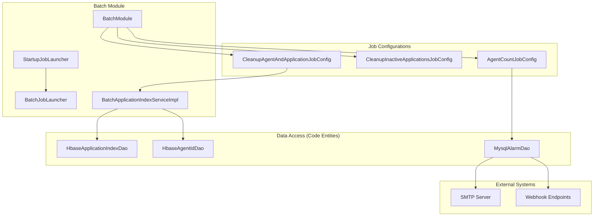
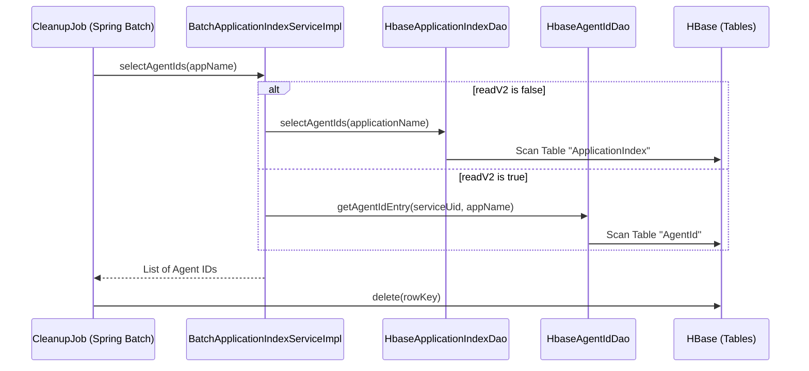

<!-- source: DeepWiki mcp.deepwiki.com · repo pinpoint-apm/pinpoint · page 10.5 Batch Processing and Alarms · fetched 2026-10-29 -->

# Batch Processing and Alarms

Relevant source files

The following files were used as context for generating this wiki page:

- [batch/src/main/java/com/navercorp/pinpoint/batch/BatchModule.java](batch/src/main/java/com/navercorp/pinpoint/batch/BatchModule.java)
- [batch/src/main/java/com/navercorp/pinpoint/batch/common/BatchJobLauncher.java](batch/src/main/java/com/navercorp/pinpoint/batch/common/BatchJobLauncher.java)
- [batch/src/main/java/com/navercorp/pinpoint/batch/common/BatchProperties.java](batch/src/main/java/com/navercorp/pinpoint/batch/common/BatchProperties.java)
- [batch/src/main/java/com/navercorp/pinpoint/batch/config/BatchInfrastructureConfig.java](batch/src/main/java/com/navercorp/pinpoint/batch/config/BatchInfrastructureConfig.java)
- [batch/src/main/java/com/navercorp/pinpoint/batch/config/BatchJavaConfigModule.java](batch/src/main/java/com/navercorp/pinpoint/batch/config/BatchJavaConfigModule.java)
- [batch/src/main/java/com/navercorp/pinpoint/batch/config/BatchScheduleConfig.java](batch/src/main/java/com/navercorp/pinpoint/batch/config/BatchScheduleConfig.java)
- [batch/src/main/java/com/navercorp/pinpoint/batch/config/CleanupAgentAndApplicationJobConfig.java](batch/src/main/java/com/navercorp/pinpoint/batch/config/CleanupAgentAndApplicationJobConfig.java)
- [batch/src/main/java/com/navercorp/pinpoint/batch/config/CleanupInactiveApplicationsJobConfig.java](batch/src/main/java/com/navercorp/pinpoint/batch/config/CleanupInactiveApplicationsJobConfig.java)
- [batch/src/main/java/com/navercorp/pinpoint/batch/job/AgentIdCleanupTasklet.java](batch/src/main/java/com/navercorp/pinpoint/batch/job/AgentIdCleanupTasklet.java)
- [batch/src/main/java/com/navercorp/pinpoint/batch/job/AgentRemover.java](batch/src/main/java/com/navercorp/pinpoint/batch/job/AgentRemover.java)
- [batch/src/main/java/com/navercorp/pinpoint/batch/job/ApplicationCleaningProcessor.java](batch/src/main/java/com/navercorp/pinpoint/batch/job/ApplicationCleaningProcessor.java)
- [batch/src/main/java/com/navercorp/pinpoint/batch/job/ApplicationCleanupTasklet.java](batch/src/main/java/com/navercorp/pinpoint/batch/job/ApplicationCleanupTasklet.java)
- [batch/src/main/java/com/navercorp/pinpoint/batch/job/ApplicationReader.java](batch/src/main/java/com/navercorp/pinpoint/batch/job/ApplicationReader.java)
- [batch/src/main/java/com/navercorp/pinpoint/batch/job/ApplicationRemover.java](batch/src/main/java/com/navercorp/pinpoint/batch/job/ApplicationRemover.java)
- [batch/src/main/java/com/navercorp/pinpoint/batch/job/EmptyItemWriter.java](batch/src/main/java/com/navercorp/pinpoint/batch/job/EmptyItemWriter.java)
- [batch/src/main/java/com/navercorp/pinpoint/batch/service/BatchApplicationIndexService.java](batch/src/main/java/com/navercorp/pinpoint/batch/service/BatchApplicationIndexService.java)
- [batch/src/main/java/com/navercorp/pinpoint/batch/service/BatchApplicationIndexServiceImpl.java](batch/src/main/java/com/navercorp/pinpoint/batch/service/BatchApplicationIndexServiceImpl.java)
- [batch/src/main/java/com/navercorp/pinpoint/batch/util/JobParametersUtils.java](batch/src/main/java/com/navercorp/pinpoint/batch/util/JobParametersUtils.java)
- [batch/src/main/java/com/navercorp/pinpoint/batch/vo/CleanTarget.java](batch/src/main/java/com/navercorp/pinpoint/batch/vo/CleanTarget.java)
- [batch/src/main/resources/batch-root.properties](batch/src/main/resources/batch-root.properties)
- [batch/src/test/java/com/navercorp/pinpoint/batch/BatchPropertiesTest.java](batch/src/test/java/com/navercorp/pinpoint/batch/BatchPropertiesTest.java)
- [collector/src/main/java/com/navercorp/pinpoint/collector/dao/AgentIdDao.java](collector/src/main/java/com/navercorp/pinpoint/collector/dao/AgentIdDao.java)
- [collector/src/main/java/com/navercorp/pinpoint/collector/dao/ApplicationDao.java](collector/src/main/java/com/navercorp/pinpoint/collector/dao/ApplicationDao.java)
- [collector/src/main/java/com/navercorp/pinpoint/collector/dao/hbase/HbaseAgentIdDao.java](collector/src/main/java/com/navercorp/pinpoint/collector/dao/hbase/HbaseAgentIdDao.java)
- [collector/src/main/java/com/navercorp/pinpoint/collector/dao/hbase/HbaseApplicationDao.java](collector/src/main/java/com/navercorp/pinpoint/collector/dao/hbase/HbaseApplicationDao.java)
- [collector/src/main/java/com/navercorp/pinpoint/collector/service/AgentListStateService.java](collector/src/main/java/com/navercorp/pinpoint/collector/service/AgentListStateService.java)
- [collector/src/main/java/com/navercorp/pinpoint/collector/service/ApplicationIndexV2Service.java](collector/src/main/java/com/navercorp/pinpoint/collector/service/ApplicationIndexV2Service.java)
- [commons-server/src/main/java/com/navercorp/pinpoint/common/server/config/AgentProperties.java](commons-server/src/main/java/com/navercorp/pinpoint/common/server/config/AgentProperties.java)
- [datasource/src/main/resources/datasource/jdbc-root.properties](datasource/src/main/resources/datasource/jdbc-root.properties)
- [web/src/main/java/com/navercorp/pinpoint/web/alarm/vo/Rule.java](web/src/main/java/com/navercorp/pinpoint/web/alarm/vo/Rule.java)
- [web/src/main/java/com/navercorp/pinpoint/web/dao/AgentIdDao.java](web/src/main/java/com/navercorp/pinpoint/web/dao/AgentIdDao.java)
- [web/src/main/java/com/navercorp/pinpoint/web/dao/AlarmDao.java](web/src/main/java/com/navercorp/pinpoint/web/dao/AlarmDao.java)
- [web/src/main/java/com/navercorp/pinpoint/web/dao/ApplicationIndexDao.java](web/src/main/java/com/navercorp/pinpoint/web/dao/ApplicationIndexDao.java)
- [web/src/main/java/com/navercorp/pinpoint/web/dao/hbase/HbaseAgentIdDao.java](web/src/main/java/com/navercorp/pinpoint/web/dao/hbase/HbaseAgentIdDao.java)
- [web/src/main/java/com/navercorp/pinpoint/web/dao/hbase/HbaseApplicationDao.java](web/src/main/java/com/navercorp/pinpoint/web/dao/hbase/HbaseApplicationDao.java)
- [web/src/main/java/com/navercorp/pinpoint/web/dao/hbase/HbaseApplicationIndexDao.java](web/src/main/java/com/navercorp/pinpoint/web/dao/hbase/HbaseApplicationIndexDao.java)
- [web/src/main/java/com/navercorp/pinpoint/web/dao/memory/IdGenerator.java](web/src/main/java/com/navercorp/pinpoint/web/dao/memory/IdGenerator.java)
- [web/src/main/java/com/navercorp/pinpoint/web/dao/mysql/MysqlAlarmDao.java](web/src/main/java/com/navercorp/pinpoint/web/dao/mysql/MysqlAlarmDao.java)
- [web/src/main/java/com/navercorp/pinpoint/web/dao/mysql/MysqlUserDao.java](web/src/main/java/com/navercorp/pinpoint/web/dao/mysql/MysqlUserDao.java)
- [web/src/main/java/com/navercorp/pinpoint/web/mapper/ApplicationMapper.java](web/src/main/java/com/navercorp/pinpoint/web/mapper/ApplicationMapper.java)
- [web/src/main/java/com/navercorp/pinpoint/web/service/AgentListV2Service.java](web/src/main/java/com/navercorp/pinpoint/web/service/AgentListV2Service.java)
- [web/src/main/java/com/navercorp/pinpoint/web/service/AgentListV2ServiceImpl.java](web/src/main/java/com/navercorp/pinpoint/web/service/AgentListV2ServiceImpl.java)
- [web/src/main/java/com/navercorp/pinpoint/web/service/AlarmService.java](web/src/main/java/com/navercorp/pinpoint/web/service/AlarmService.java)
- [web/src/main/java/com/navercorp/pinpoint/web/service/AlarmServiceImpl.java](web/src/main/java/com/navercorp/pinpoint/web/service/AlarmServiceImpl.java)
- [web/src/main/java/com/navercorp/pinpoint/web/service/ApplicationIndexService.java](web/src/main/java/com/navercorp/pinpoint/web/service/ApplicationIndexService.java)
- [web/src/main/java/com/navercorp/pinpoint/web/service/ApplicationIndexServiceImpl.java](web/src/main/java/com/navercorp/pinpoint/web/service/ApplicationIndexServiceImpl.java)
- [web/src/main/java/com/navercorp/pinpoint/web/uid/controller/ApplicationIndexV2CopyController.java](web/src/main/java/com/navercorp/pinpoint/web/uid/controller/ApplicationIndexV2CopyController.java)
- [web/src/main/java/com/navercorp/pinpoint/web/uid/service/ApplicationIndexV2CopyServiceImpl.java](web/src/main/java/com/navercorp/pinpoint/web/uid/service/ApplicationIndexV2CopyServiceImpl.java)
- [web/src/main/java/com/navercorp/pinpoint/web/util/ValueValidator.java](web/src/main/java/com/navercorp/pinpoint/web/util/ValueValidator.java)
- [web/src/main/java/com/navercorp/pinpoint/web/vo/agent/AgentIdEntry.java](web/src/main/java/com/navercorp/pinpoint/web/vo/agent/AgentIdEntry.java)
- [web/src/main/resources/mapper/AlarmMapper.xml](web/src/main/resources/mapper/AlarmMapper.xml)
- [web/src/main/resources/mapper/UserGroupMapper.xml](web/src/main/resources/mapper/UserGroupMapper.xml)
- [web/src/main/resources/mapper/UserMapper.xml](web/src/main/resources/mapper/UserMapper.xml)
- [web/src/main/resources/sql/CreateTableStatement-mysql.sql](web/src/main/resources/sql/CreateTableStatement-mysql.sql)
- [web/src/test/java/com/navercorp/pinpoint/web/controller/AlarmControllerTest.java](web/src/test/java/com/navercorp/pinpoint/web/controller/AlarmControllerTest.java)
- [web/src/test/java/com/navercorp/pinpoint/web/controller/ConfigControllerTest.java](web/src/test/java/com/navercorp/pinpoint/web/controller/ConfigControllerTest.java)
- [web/src/test/java/com/navercorp/pinpoint/web/controller/UserControllerTest.java](web/src/test/java/com/navercorp/pinpoint/web/controller/UserControllerTest.java)
- [web/src/test/java/com/navercorp/pinpoint/web/controller/UserGroupControllerTest.java](web/src/test/java/com/navercorp/pinpoint/web/controller/UserGroupControllerTest.java)
- [web/src/test/java/com/navercorp/pinpoint/web/dao/memory/MemoryAlarmDaoTest.java](web/src/test/java/com/navercorp/pinpoint/web/dao/memory/MemoryAlarmDaoTest.java)
- [web/src/test/java/com/navercorp/pinpoint/web/dao/memory/MemoryUserGroupDaoTest.java](web/src/test/java/com/navercorp/pinpoint/web/dao/memory/MemoryUserGroupDaoTest.java)
- [web/src/test/java/com/navercorp/pinpoint/web/service/AgentListV2ServiceImplTest.java](web/src/test/java/com/navercorp/pinpoint/web/service/AgentListV2ServiceImplTest.java)
- [web/src/test/java/com/navercorp/pinpoint/web/util/ValueValidatorTest.java](web/src/test/java/com/navercorp/pinpoint/web/util/ValueValidatorTest.java)
- [web/src/test/java/com/navercorp/pinpoint/web/vo/UserTest.java](web/src/test/java/com/navercorp/pinpoint/web/vo/UserTest.java)

The `batch` module in Pinpoint is responsible for executing scheduled maintenance tasks, background data aggregation, and alarm monitoring. It leverages Spring Batch and Spring Task Scheduling to manage jobs such as cleaning up inactive agents, calculating agent statistics, and triggering notifications based on user-defined alarm rules.

## Module Architecture and Configuration

The `BatchModule` serves as the central configuration hub, importing necessary infrastructure for data access (HBase and MySQL), user management, and webhook integrations [batch/src/main/java/com/navercorp/pinpoint/batch/BatchModule.java:56-86]().

### Component Interaction Diagram

The following diagram illustrates how the Batch module interacts with storage layers and external notification systems.

**Batch System Entity Map**

Sources: [batch/src/main/java/com/navercorp/pinpoint/batch/BatchModule.java:56-101](), [batch/src/main/java/com/navercorp/pinpoint/batch/service/BatchApplicationIndexServiceImpl.java:46-54](), [web/src/main/resources/sql/CreateTableStatement-mysql.sql:33-80]()

## Scheduled Jobs and Operations

Pinpoint Batch runs several critical maintenance jobs defined via cron expressions in `batch-root.properties` [batch/src/main/resources/batch-root.properties:29-55]().

### 1. Alarm Checking
The alarm system monitors application metrics and triggers alerts.
*   **Frequency**: Every 3 minutes by default (`job.alarm.cron=0 0/3 * * * *`) [batch/src/main/resources/batch-root.properties:29]().
*   **Implementation**: It queries `alarm_rule` from MySQL [web/src/main/resources/sql/CreateTableStatement-mysql.sql:33-45](), evaluates them against collected statistics, and records results in `alarm_history` [web/src/main/resources/sql/CreateTableStatement-mysql.sql:48-57]().
*   **Senders**: Supports Email (via `JavaMailSender`), Webhooks, and SMS [batch/src/main/resources/batch-root.properties:6-23]().

### 2. Inactive Application and Agent Cleanup
This job prevents storage bloat by removing metadata for agents and applications that have not sent data for a specific duration.
*   **Inactive Application Cleanup**: Triggered weekly (`job.cleanup.inactive.applications.cron=0 0 3 * * THU`) [batch/src/main/resources/batch-root.properties:42]().
*   **Threshold**: Applications inactive for 35 days (`P35D`) are targeted [batch/src/main/resources/batch-root.properties:43]().
*   **Logic**: Uses `BatchApplicationIndexServiceImpl` to identify candidates by scanning `HbaseApplicationIndexDao` or `HbaseAgentIdDao` depending on the `readV2` flag [batch/src/main/java/com/navercorp/pinpoint/batch/service/BatchApplicationIndexServiceImpl.java:57-87]().

### 3. Agent Statistics Aggregation
Aggregates the total count of active agents for historical reporting.
*   **Frequency**: Daily at 2 AM (`job.agent.count.cron=0 0 2 * * *`) [batch/src/main/resources/batch-root.properties:34]().
*   **Storage**: Results are persisted into the `agent_statistics` table in MySQL [web/src/main/resources/sql/CreateTableStatement-mysql.sql:60-64]().

## Data Flow: Inactive Agent Cleanup

The cleanup process transitions through several DAO layers to safely remove data from HBase.

**Cleanup Data Flow**

Sources: [batch/src/main/java/com/navercorp/pinpoint/batch/service/BatchApplicationIndexServiceImpl.java:79-88](), [web/src/main/java/com/navercorp/pinpoint/web/dao/hbase/HbaseApplicationIndexDao.java:92-107](), [web/src/main/java/com/navercorp/pinpoint/web/dao/hbase/HbaseAgentIdDao.java:52-55]()

## Alarm and User Management

Alarms are tied to User Groups. Users and groups are managed in a relational database (MySQL) to support complex querying and persistence.

### Alarm Rule Structure
Alarm rules (`Rule` class) define the conditions for alerting [web/src/main/java/com/navercorp/pinpoint/web/alarm/vo/Rule.java]().
*   **checkerName**: The type of metric to check (e.g., Error Rate, Heap Usage) [web/src/main/resources/sql/CreateTableStatement-mysql.sql:37]().
*   **threshold**: The value that triggers the alarm [web/src/main/resources/sql/CreateTableStatement-mysql.sql:38]().
*   **userGroupId**: The group of users to notify [web/src/main/resources/sql/CreateTableStatement-mysql.sql:39]().

### User and Group Persistence
The `UserModule` handles the lifecycle of users (`puser` table) and their associations (`user_group_member` table) [web/src/main/resources/sql/CreateTableStatement-mysql.sql:13-31](). These are queried by the Batch module's alarm senders to resolve destination email addresses or phone numbers [web/src/main/resources/mapper/UserGroupMapper.xml:98-126]().

## Key Implementation Classes

| Class | Responsibility |
| :--- | :--- |
| `BatchJobLauncher` | Wrapper for Spring Batch `JobLauncher` to execute jobs programmatically [batch/src/main/java/com/navercorp/pinpoint/batch/common/BatchJobLauncher.java]() |
| `StartupJobLauncher` | Executes specific batch jobs immediately upon application startup if configured [batch/src/main/java/com/navercorp/pinpoint/batch/BatchModule.java:115-120]() |
| `BatchApplicationIndexServiceImpl` | Bridges the gap between Batch jobs and HBase DAOs for application/agent lookups [batch/src/main/java/com/navercorp/pinpoint/batch/service/BatchApplicationIndexServiceImpl.java:37-45]() |
| `AlarmServiceImpl` | Manages CRUD operations for alarm rules and publishes `DeleteRuleEvent` when rules are removed [web/src/main/java/com/navercorp/pinpoint/web/service/AlarmServiceImpl.java:36-59]() |
| `HbaseAgentIdDao` | Handles low-level HBase operations for the `AgentId` table, including prefix scans and deletions [web/src/main/java/com/navercorp/pinpoint/web/dao/hbase/HbaseAgentIdDao.java:35-50]() |

Sources: [batch/src/main/java/com/navercorp/pinpoint/batch/BatchModule.java](), [batch/src/main/java/com/navercorp/pinpoint/batch/service/BatchApplicationIndexServiceImpl.java](), [web/src/main/java/com/navercorp/pinpoint/web/service/AlarmServiceImpl.java](), [web/src/main/java/com/navercorp/pinpoint/web/dao/hbase/HbaseAgentIdDao.java]()

---

