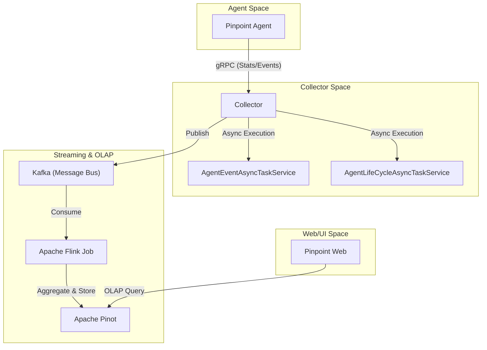
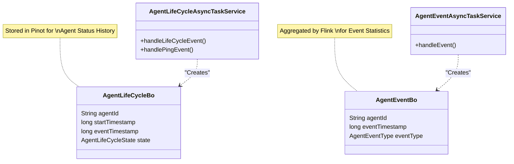

<!-- source: DeepWiki mcp.deepwiki.com · repo pinpoint-apm/pinpoint · page 10.6 Pinot and Flink Integration · fetched 2026-10-29 -->

# Pinot and Flink Integration

<details>
<summary>Relevant source files</summary>

The following files were used as context for generating this wiki page:

- [collector/src/main/java/com/navercorp/pinpoint/collector/service/async/AgentEventAsyncTaskService.java](collector/src/main/java/com/navercorp/pinpoint/collector/service/async/AgentEventAsyncTaskService.java)
- [collector/src/main/java/com/navercorp/pinpoint/collector/service/async/AgentLifeCycleAsyncTaskService.java](collector/src/main/java/com/navercorp/pinpoint/collector/service/async/AgentLifeCycleAsyncTaskService.java)

</details>


The Pinpoint APM system leverages Apache Pinot and Apache Flink to provide high-performance OLAP (Online Analytical Processing) capabilities and real-time streaming analytics. While HBase serves as the primary storage for trace data, Pinot is utilized for complex metrics queries, URI statistics, and exception tracing, while Flink handles the real-time aggregation of these statistics from the raw data stream.

## Architecture Overview

The integration follows a Lambda-style architecture where real-time data is processed by Flink and historical or aggregated data is queried from Pinot.

### Data Flow Diagram

The following diagram illustrates how data flows from the Pinpoint Agent through the Collector to the Pinot and Flink components.


Sources: [collector/src/main/java/com/navercorp/pinpoint/collector/service/async/AgentEventAsyncTaskService.java:34-58](), [collector/src/main/java/com/navercorp/pinpoint/collector/service/async/AgentLifeCycleAsyncTaskService.java:40-78]()

## Apache Flink Streaming Integration

Apache Flink is used for real-time stream processing of agent statistics and events. It acts as a bridge between the raw data ingestion in the Collector and the structured OLAP storage in Pinot.

### Real-time Event Handling
The Collector dispatches events asynchronously to prevent blocking the ingestion pipeline.
- `AgentEventAsyncTaskService` handles general agent events (e.g., startup, shutdown) using the `@Async("agentEventWorker")` executor [collector/src/main/java/com/navercorp/pinpoint/collector/service/async/AgentEventAsyncTaskService.java:43-44]().
- `AgentLifeCycleAsyncTaskService` manages the state of the agent, including "Ping" events and lifecycle transitions [collector/src/main/java/com/navercorp/pinpoint/collector/service/async/AgentLifeCycleAsyncTaskService.java:63-88]().

### Key Functions and Processing
| Class | Function | Responsibility |
| :--- | :--- | :--- |
| `AgentLifeCycleAsyncTaskService` | `handleLifeCycleEvent` | Inserts `AgentLifeCycleBo` and updates `AgentListStateService` [collector/src/main/java/com/navercorp/pinpoint/collector/service/async/AgentLifeCycleAsyncTaskService.java:64-75](). |
| `AgentLifeCycleAsyncTaskService` | `handlePingEvent` | Updates the agent's last-seen state to maintain real-time visibility [collector/src/main/java/com/navercorp/pinpoint/collector/service/async/AgentLifeCycleAsyncTaskService.java:81-88](). |
| `AgentEventAsyncTaskService` | `handleEvent` | Records specific `AgentEventType` occurrences into the `AgentEventService` [collector/src/main/java/com/navercorp/pinpoint/collector/service/async/AgentEventAsyncTaskService.java:44-52](). |

## Apache Pinot OLAP Integration

Apache Pinot is the primary engine for multi-dimensional queries. It is used to power features that require fast aggregations over large datasets, such as URI statistics, Inspector metrics, and Exception metadata.

### System Mapping: Code to Pinot Entities

The following diagram maps internal Pinpoint Business Objects (BO) and services to the analytical components processed via Pinot and Flink.


Sources: [collector/src/main/java/com/navercorp/pinpoint/collector/service/async/AgentLifeCycleAsyncTaskService.java:71-73](), [collector/src/main/java/com/navercorp/pinpoint/collector/service/async/AgentEventAsyncTaskService.java:48-51]()

### Statistics Aggregation Logic
The integration supports updating agent states for statistics purposes. This is controlled by the `statistics.agent.state.enable` property in `CollectorProperties` [collector/src/main/java/com/navercorp/pinpoint/collector/service/async/AgentLifeCycleAsyncTaskService.java:98-99]().

When enabled, the `updateAgentState` method in `AgentLifeCycleAsyncTaskService` triggers a link service update:
1. It validates the `ServiceType` via the `ServiceTypeRegistryService` [collector/src/main/java/com/navercorp/pinpoint/collector/service/async/AgentLifeCycleAsyncTaskService.java:91-92]().
2. It calls `linkService.updateAgentState` to persist the event timestamp and agent identity for topology mapping [collector/src/main/java/com/navercorp/pinpoint/collector/service/async/AgentLifeCycleAsyncTaskService.java:93]().

## Implementation Details

### Event Identification
To uniquely identify events across the distributed system (especially for Pinot's upsert or deduplication features), Pinpoint generates a 64-bit event identifier.

```java
public static long createEventIdentifier(int socketId, int eventCounter) {
    // socketId shifted by 32 bits ORed with eventCounter
    return ((long) socketId << INTEGER_BIT_COUNT) | eventCounter;
}
```
Sources: [collector/src/main/java/com/navercorp/pinpoint/collector/service/async/AgentLifeCycleAsyncTaskService.java:107-115]()

This identifier combines the `socketId` (identifying the connection) and an `eventCounter` to ensure uniqueness for lifecycle events within a single collector instance.

### Performance Considerations
- **Asynchronous Execution**: All Pinot/Flink-related data preparation in the Collector is performed in a separate thread pool (`agentEventWorker`) to ensure that gRPC request threads from agents are released immediately [collector/src/main/java/com/navercorp/pinpoint/collector/service/async/AgentLifeCycleAsyncTaskService.java:63]().
- **State Filtering**: Not all service types are sent for state updates. Undefined or disabled statistics types are filtered out early in the pipeline [collector/src/main/java/com/navercorp/pinpoint/collector/service/async/AgentLifeCycleAsyncTaskService.java:97-105]().

Sources: [collector/src/main/java/com/navercorp/pinpoint/collector/service/async/AgentLifeCycleAsyncTaskService.java:1-116](), [collector/src/main/java/com/navercorp/pinpoint/collector/service/async/AgentEventAsyncTaskService.java:1-59]()

---

