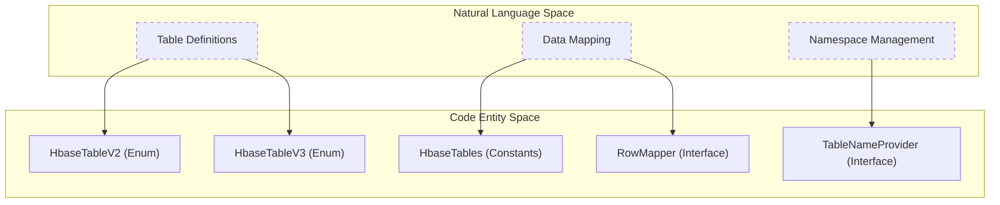
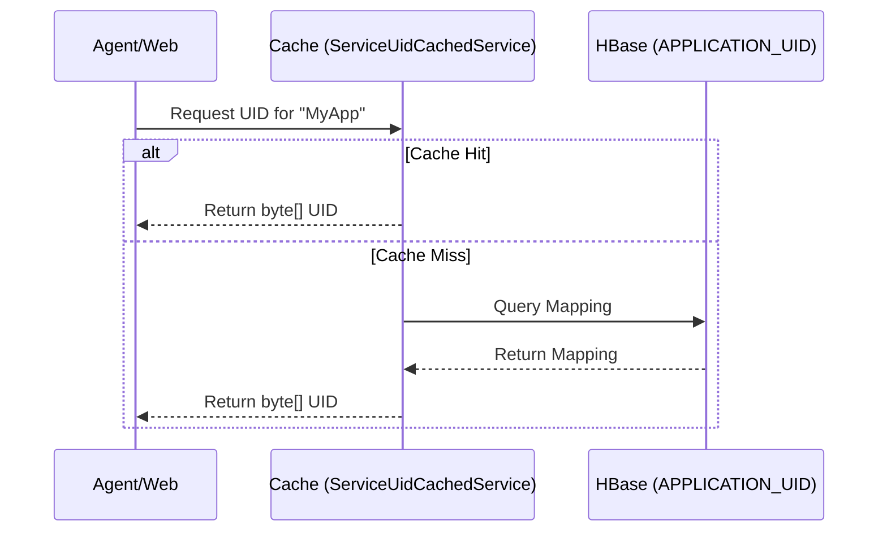

<!-- source: DeepWiki mcp.deepwiki.com · repo pinpoint-apm/pinpoint · page 11 Storage Layer · fetched 2026-10-29 -->

# Storage Layer

Relevant source files

The following files were used as context for generating this wiki page:

- [collector/src/main/java/com/navercorp/pinpoint/collector/manage/HBaseManager.java](collector/src/main/java/com/navercorp/pinpoint/collector/manage/HBaseManager.java)
- [collector/src/main/java/com/navercorp/pinpoint/collector/manage/HBaseManagerMBean.java](collector/src/main/java/com/navercorp/pinpoint/collector/manage/HBaseManagerMBean.java)
- [commons-hbase/src/main/java/com/navercorp/pinpoint/common/hbase/HBaseAccessException.java](commons-hbase/src/main/java/com/navercorp/pinpoint/common/hbase/HBaseAccessException.java)
- [commons-hbase/src/main/java/com/navercorp/pinpoint/common/hbase/HbaseColumnFamily.java](commons-hbase/src/main/java/com/navercorp/pinpoint/common/hbase/HbaseColumnFamily.java)
- [commons-hbase/src/main/java/com/navercorp/pinpoint/common/hbase/HbaseTable.java](commons-hbase/src/main/java/com/navercorp/pinpoint/common/hbase/HbaseTable.java)
- [commons-hbase/src/main/java/com/navercorp/pinpoint/common/hbase/HbaseTableNameProvider.java](commons-hbase/src/main/java/com/navercorp/pinpoint/common/hbase/HbaseTableNameProvider.java)
- [commons-hbase/src/main/java/com/navercorp/pinpoint/common/hbase/HbaseTableV2.java](commons-hbase/src/main/java/com/navercorp/pinpoint/common/hbase/HbaseTableV2.java)
- [commons-hbase/src/main/java/com/navercorp/pinpoint/common/hbase/HbaseTableV3.java](commons-hbase/src/main/java/com/navercorp/pinpoint/common/hbase/HbaseTableV3.java)
- [commons-hbase/src/main/java/com/navercorp/pinpoint/common/hbase/HbaseTables.java](commons-hbase/src/main/java/com/navercorp/pinpoint/common/hbase/HbaseTables.java)
- [commons-hbase/src/main/java/com/navercorp/pinpoint/common/hbase/TableNameProvider.java](commons-hbase/src/main/java/com/navercorp/pinpoint/common/hbase/TableNameProvider.java)
- [commons-hbase/src/main/java/com/navercorp/pinpoint/common/hbase/bo/ColumnGetCount.java](commons-hbase/src/main/java/com/navercorp/pinpoint/common/hbase/bo/ColumnGetCount.java)
- [commons-hbase/src/main/java/com/navercorp/pinpoint/common/hbase/namespace/HbaseNamespaceValidator.java](commons-hbase/src/main/java/com/navercorp/pinpoint/common/hbase/namespace/HbaseNamespaceValidator.java)
- [commons-hbase/src/main/java/com/navercorp/pinpoint/common/hbase/namespace/NamespaceValidator.java](commons-hbase/src/main/java/com/navercorp/pinpoint/common/hbase/namespace/NamespaceValidator.java)
- [commons-hbase/src/main/java/com/navercorp/pinpoint/common/hbase/rowmapper/ResultSizeMapper.java](commons-hbase/src/main/java/com/navercorp/pinpoint/common/hbase/rowmapper/ResultSizeMapper.java)
- [commons-hbase/src/main/java/com/navercorp/pinpoint/common/hbase/rowmapper/RowMapperResultAdaptor.java](commons-hbase/src/main/java/com/navercorp/pinpoint/common/hbase/rowmapper/RowMapperResultAdaptor.java)
- [commons-hbase/src/main/java/com/navercorp/pinpoint/common/hbase/util/HbaseTableNameCache.java](commons-hbase/src/main/java/com/navercorp/pinpoint/common/hbase/util/HbaseTableNameCache.java)
- [commons-hbase/src/test/java/com/navercorp/pinpoint/common/hbase/HbaseTableNameProviderTest.java](commons-hbase/src/test/java/com/navercorp/pinpoint/common/hbase/HbaseTableNameProviderTest.java)
- [commons-hbase/src/test/java/com/navercorp/pinpoint/common/hbase/bo/ColumnGetCountTest.java](commons-hbase/src/test/java/com/navercorp/pinpoint/common/hbase/bo/ColumnGetCountTest.java)
- [commons-hbase/src/test/java/com/navercorp/pinpoint/common/hbase/namespace/HbaseNamespaceValidatorTest.java](commons-hbase/src/test/java/com/navercorp/pinpoint/common/hbase/namespace/HbaseNamespaceValidatorTest.java)
- [commons-hbase/src/test/java/com/navercorp/pinpoint/common/hbase/util/HbaseTableNameCacheTest.java](commons-hbase/src/test/java/com/navercorp/pinpoint/common/hbase/util/HbaseTableNameCacheTest.java)
- [commons-server/src/main/java/com/navercorp/pinpoint/common/server/uid/ApplicationUid.java](commons-server/src/main/java/com/navercorp/pinpoint/common/server/uid/ApplicationUid.java)
- [commons/src/test/resources/test-hbase.properties](commons/src/test/resources/test-hbase.properties)
- [hbase/scripts/README.md](hbase/scripts/README.md)
- [hbase/scripts/hbase-create-snappy.hbase](hbase/scripts/hbase-create-snappy.hbase)
- [hbase/scripts/hbase-create.hbase](hbase/scripts/hbase-create.hbase)
- [hbase/scripts/hbase-drop.hbase](hbase/scripts/hbase-drop.hbase)
- [hbase/scripts/hbase-flush-table.hbase](hbase/scripts/hbase-flush-table.hbase)
- [hbase/scripts/hbase-major-compact-htable.hbase](hbase/scripts/hbase-major-compact-htable.hbase)
- [web/src/main/java/com/navercorp/pinpoint/web/service/FetchResult.java](web/src/main/java/com/navercorp/pinpoint/web/service/FetchResult.java)
- [web/src/main/java/com/navercorp/pinpoint/web/uid/WebUidConfiguration.java](web/src/main/java/com/navercorp/pinpoint/web/uid/WebUidConfiguration.java)
- [web/src/main/java/com/navercorp/pinpoint/web/uid/service/ServiceUidCachedService.java](web/src/main/java/com/navercorp/pinpoint/web/uid/service/ServiceUidCachedService.java)

The Storage Layer is responsible for the persistent retention of trace data, metadata, and statistical information collected from agents. Pinpoint primarily utilizes **Apache HBase** as its core storage engine, leveraging its wide-column capabilities to handle high-volume write workloads and time-series data.

This layer provides the foundational infrastructure for the Collector to write spans and for the Web application to query and visualize distributed traces.

### System Architecture Overview

The storage infrastructure is abstracted through several key components that bridge the gap between Java business objects and HBase's byte-oriented storage.

#### Storage Component Mapping
The following diagram maps high-level storage concepts to their respective code entities within the Pinpoint codebase.

**Sources:**
- [commons-hbase/src/main/java/com/navercorp/pinpoint/common/hbase/HbaseTableV2.java]()
- [commons-hbase/src/main/java/com/navercorp/pinpoint/common/hbase/HbaseTableV3.java]()
- [commons-hbase/src/main/java/com/navercorp/pinpoint/common/hbase/HbaseTables.java:21-23]()
- [commons-hbase/src/main/java/com/navercorp/pinpoint/common/hbase/TableNameProvider.java]()

---

## HBase Schema and Operations

Pinpoint uses a specific set of HBase tables designed for different data types, ranging from short-lived trace data to long-lived metadata.

### Core Table Categories
- **Trace Data**: Tables like `TraceV2` store the actual span data [hbase/scripts/hbase-create.hbase:13]().
- **Metadata**: Tables such as `ApiMetaData`, `SqlMetaData_Ver2`, and `StringMetaData` map integer IDs or UIDs to full strings to reduce storage overhead in trace rows [hbase/scripts/hbase-create.hbase:7-11]().
- **Statistics**: Tables like `ApplicationMapStatisticsCaller_Ver2` and `ApplicationMapStatisticsCallee_Ver2` store aggregated link data for the ServerMap [hbase/scripts/hbase-create.hbase:17-18]().
- **Index**: `ApplicationTraceIndex` and `ApplicationIndex` provide lookups for finding traces by application name and time range [hbase/scripts/hbase-create.hbase:3, 15]().

### Schema Management
Schema lifecycle is managed via HBase shell scripts located in `hbase/scripts/`. These scripts handle:
- **Creation**: Defining column families, TTL (Time-To-Live), and compression (e.g., SNAPPY) [hbase/scripts/hbase-create-snappy.hbase:1-19]().
- **Maintenance**: Operations like `flush` and `major_compact` [hbase/scripts/hbase-flush-table.hbase:1-25](), [hbase/scripts/hbase-major-compact-htable.hbase:1-28]().
- **Cleanup**: Disabling and dropping tables [hbase/scripts/hbase-drop.hbase:1-50]().

For detailed information on table definitions, row key design, and the `HbaseTemplate` abstraction, see **[HBase Schema and Operations](#11.1)**.

**Sources:**
- [hbase/scripts/README.md:20-33]()
- [hbase/scripts/hbase-create.hbase:1-20]()
- [commons-hbase/src/main/java/com/navercorp/pinpoint/common/hbase/HbaseTables.java:21-134]()

---

## Application UID System

To optimize storage and query performance, Pinpoint employs a UID (Unique Identifier) system. This system maps human-readable application names and agent IDs to compact byte representations.

### Key Components
- **Mapping Logic**: Converts application names into a fixed-length byte identifier used in row keys.
- **Caching**: Components like `ServiceUidCachedService` ensure that frequent lookups do not saturate HBase [web/src/main/java/com/navercorp/pinpoint/web/uid/service/ServiceUidCachedService.java]().
- **Tables**: Uses dedicated tables like `APPLICATION_UID` and `APPLICATION_UID_ATTR` for storing these mappings [commons-hbase/src/main/java/com/navercorp/pinpoint/common/hbase/HbaseTables.java:57-59]().

### UID Flow

For details on the DAO layer and mapping utilities, see **[Application UID System](#11.2)**.

**Sources:**
- [commons-hbase/src/main/java/com/navercorp/pinpoint/common/hbase/HbaseTables.java:57-63]()
- [web/src/main/java/com/navercorp/pinpoint/web/uid/service/ServiceUidCachedService.java]()
- [commons-server/src/main/java/com/navercorp/pinpoint/common/server/uid/ApplicationUid.java]()

---

## Storage Utilities and Abstractions

The codebase provides several utilities to handle HBase-specific constraints and operations:

- **Namespace Management**: `HbaseTableNameProvider` manages table names across different environments by prepending namespaces [commons-hbase/src/main/java/com/navercorp/pinpoint/common/hbase/HbaseTableNameProvider.java:31-54]().
- **Result Mapping**: `RowMapper` and its implementations (e.g., `RowMapperResultAdaptor`) transform HBase `Result` objects into domain-specific Buffer Objects (BOs) [commons-hbase/src/main/java/com/navercorp/pinpoint/common/hbase/rowmapper/RowMapperResultAdaptor.java:9-25]().
- **Query Constraints**: `ColumnGetCount` allows for limiting the number of columns retrieved in a single scan to prevent memory issues [commons-hbase/src/main/java/com/navercorp/pinpoint/common/hbase/bo/ColumnGetCount.java:26-41]().

**Sources:**
- [commons-hbase/src/main/java/com/navercorp/pinpoint/common/hbase/HbaseTableNameProvider.java]()
- [commons-hbase/src/main/java/com/navercorp/pinpoint/common/hbase/rowmapper/RowMapperResultAdaptor.java]()
- [commons-hbase/src/main/java/com/navercorp/pinpoint/common/hbase/bo/ColumnGetCount.java]()

---

