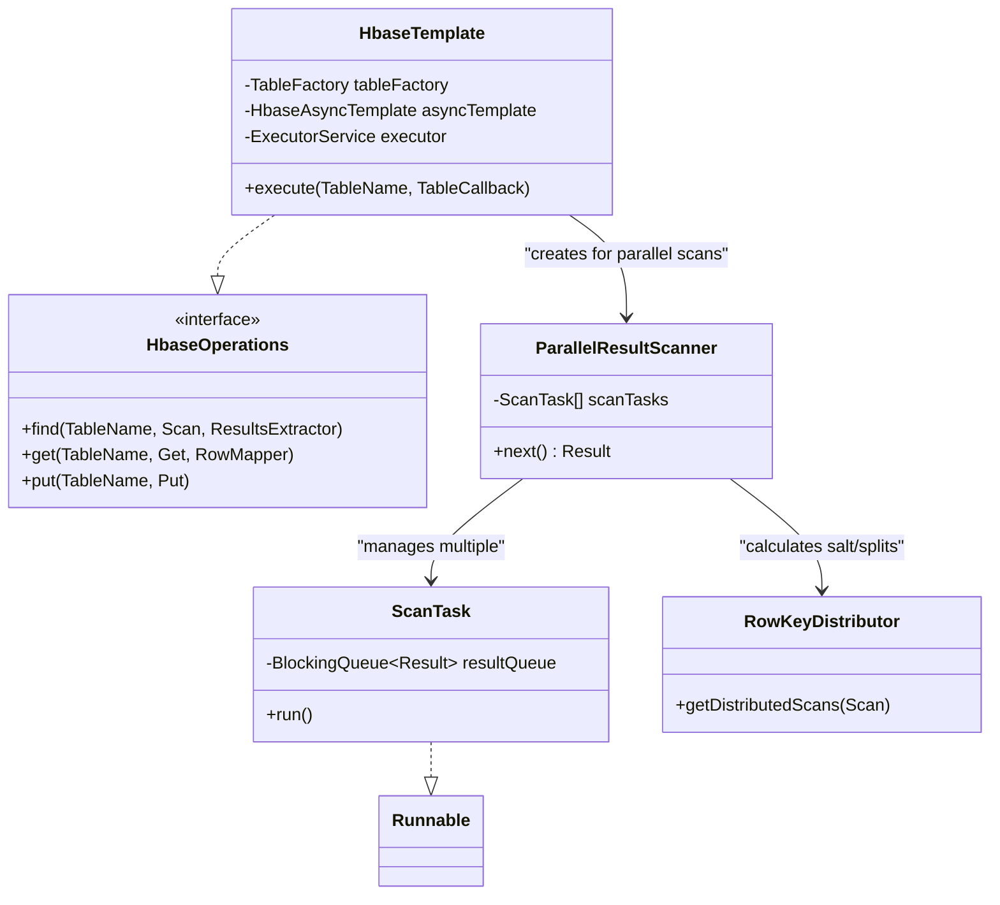
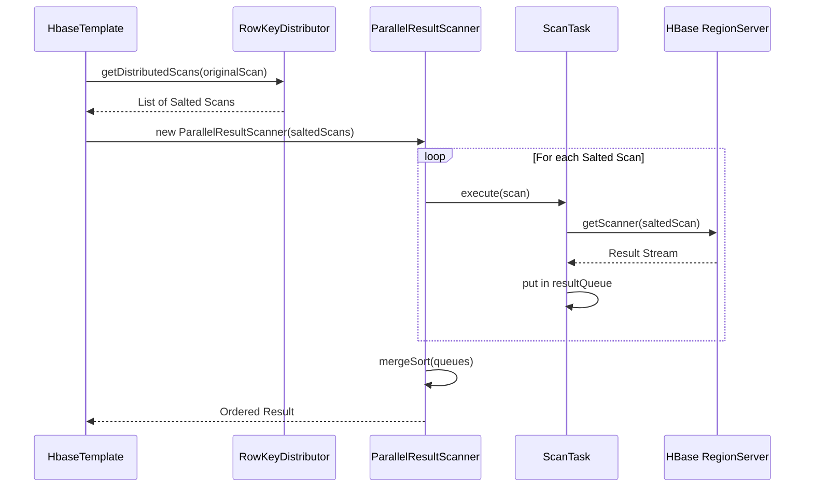

<!-- source: DeepWiki mcp.deepwiki.com · repo pinpoint-apm/pinpoint · page 11.1 HBase Schema and Operations · fetched 2026-10-29 -->

# HBase Schema and Operations

Relevant source files

The following files were used as context for generating this wiki page:

- [collector/src/main/java/com/navercorp/pinpoint/collector/manage/HBaseManager.java](collector/src/main/java/com/navercorp/pinpoint/collector/manage/HBaseManager.java)
- [collector/src/main/java/com/navercorp/pinpoint/collector/manage/HBaseManagerMBean.java](collector/src/main/java/com/navercorp/pinpoint/collector/manage/HBaseManagerMBean.java)
- [commons-hbase/src/main/java/com/navercorp/pinpoint/common/hbase/HBaseAccessException.java](commons-hbase/src/main/java/com/navercorp/pinpoint/common/hbase/HBaseAccessException.java)
- [commons-hbase/src/main/java/com/navercorp/pinpoint/common/hbase/HbaseColumnFamily.java](commons-hbase/src/main/java/com/navercorp/pinpoint/common/hbase/HbaseColumnFamily.java)
- [commons-hbase/src/main/java/com/navercorp/pinpoint/common/hbase/HbaseTable.java](commons-hbase/src/main/java/com/navercorp/pinpoint/common/hbase/HbaseTable.java)
- [commons-hbase/src/main/java/com/navercorp/pinpoint/common/hbase/HbaseTableNameProvider.java](commons-hbase/src/main/java/com/navercorp/pinpoint/common/hbase/HbaseTableNameProvider.java)
- [commons-hbase/src/main/java/com/navercorp/pinpoint/common/hbase/HbaseTableV2.java](commons-hbase/src/main/java/com/navercorp/pinpoint/common/hbase/HbaseTableV2.java)
- [commons-hbase/src/main/java/com/navercorp/pinpoint/common/hbase/HbaseTableV3.java](commons-hbase/src/main/java/com/navercorp/pinpoint/common/hbase/HbaseTableV3.java)
- [commons-hbase/src/main/java/com/navercorp/pinpoint/common/hbase/HbaseTables.java](commons-hbase/src/main/java/com/navercorp/pinpoint/common/hbase/HbaseTables.java)
- [commons-hbase/src/main/java/com/navercorp/pinpoint/common/hbase/HbaseTemplate.java](commons-hbase/src/main/java/com/navercorp/pinpoint/common/hbase/HbaseTemplate.java)
- [commons-hbase/src/main/java/com/navercorp/pinpoint/common/hbase/TableNameProvider.java](commons-hbase/src/main/java/com/navercorp/pinpoint/common/hbase/TableNameProvider.java)
- [commons-hbase/src/main/java/com/navercorp/pinpoint/common/hbase/async/HbaseAsyncTemplate.java](commons-hbase/src/main/java/com/navercorp/pinpoint/common/hbase/async/HbaseAsyncTemplate.java)
- [commons-hbase/src/main/java/com/navercorp/pinpoint/common/hbase/bo/ColumnGetCount.java](commons-hbase/src/main/java/com/navercorp/pinpoint/common/hbase/bo/ColumnGetCount.java)
- [commons-hbase/src/main/java/com/navercorp/pinpoint/common/hbase/namespace/HbaseNamespaceValidator.java](commons-hbase/src/main/java/com/navercorp/pinpoint/common/hbase/namespace/HbaseNamespaceValidator.java)
- [commons-hbase/src/main/java/com/navercorp/pinpoint/common/hbase/namespace/NamespaceValidator.java](commons-hbase/src/main/java/com/navercorp/pinpoint/common/hbase/namespace/NamespaceValidator.java)
- [commons-hbase/src/main/java/com/navercorp/pinpoint/common/hbase/parallel/ParallelResultScanner.java](commons-hbase/src/main/java/com/navercorp/pinpoint/common/hbase/parallel/ParallelResultScanner.java)
- [commons-hbase/src/main/java/com/navercorp/pinpoint/common/hbase/parallel/ScanTask.java](commons-hbase/src/main/java/com/navercorp/pinpoint/common/hbase/parallel/ScanTask.java)
- [commons-hbase/src/main/java/com/navercorp/pinpoint/common/hbase/parallel/ScanTaskConfig.java](commons-hbase/src/main/java/com/navercorp/pinpoint/common/hbase/parallel/ScanTaskConfig.java)
- [commons-hbase/src/main/java/com/navercorp/pinpoint/common/hbase/rowmapper/ResultSizeMapper.java](commons-hbase/src/main/java/com/navercorp/pinpoint/common/hbase/rowmapper/ResultSizeMapper.java)
- [commons-hbase/src/main/java/com/navercorp/pinpoint/common/hbase/rowmapper/RowMapperResultAdaptor.java](commons-hbase/src/main/java/com/navercorp/pinpoint/common/hbase/rowmapper/RowMapperResultAdaptor.java)
- [commons-hbase/src/main/java/com/navercorp/pinpoint/common/hbase/scan/DefaultResultScannerSupplier.java](commons-hbase/src/main/java/com/navercorp/pinpoint/common/hbase/scan/DefaultResultScannerSupplier.java)
- [commons-hbase/src/main/java/com/navercorp/pinpoint/common/hbase/scan/DefaultScanner.java](commons-hbase/src/main/java/com/navercorp/pinpoint/common/hbase/scan/DefaultScanner.java)
- [commons-hbase/src/main/java/com/navercorp/pinpoint/common/hbase/scan/ResultScannerSupplier.java](commons-hbase/src/main/java/com/navercorp/pinpoint/common/hbase/scan/ResultScannerSupplier.java)
- [commons-hbase/src/main/java/com/navercorp/pinpoint/common/hbase/scan/ScanUtils.java](commons-hbase/src/main/java/com/navercorp/pinpoint/common/hbase/scan/ScanUtils.java)
- [commons-hbase/src/main/java/com/navercorp/pinpoint/common/hbase/scan/Scanner.java](commons-hbase/src/main/java/com/navercorp/pinpoint/common/hbase/scan/Scanner.java)
- [commons-hbase/src/main/java/com/navercorp/pinpoint/common/hbase/util/DefaultScanMetricReporter.java](commons-hbase/src/main/java/com/navercorp/pinpoint/common/hbase/util/DefaultScanMetricReporter.java)
- [commons-hbase/src/main/java/com/navercorp/pinpoint/common/hbase/util/EmptyScanMetricReporter.java](commons-hbase/src/main/java/com/navercorp/pinpoint/common/hbase/util/EmptyScanMetricReporter.java)
- [commons-hbase/src/main/java/com/navercorp/pinpoint/common/hbase/util/HbaseTableNameCache.java](commons-hbase/src/main/java/com/navercorp/pinpoint/common/hbase/util/HbaseTableNameCache.java)
- [commons-hbase/src/main/java/com/navercorp/pinpoint/common/hbase/util/ScanMetricReporter.java](commons-hbase/src/main/java/com/navercorp/pinpoint/common/hbase/util/ScanMetricReporter.java)
- [commons-hbase/src/main/java/com/navercorp/pinpoint/common/hbase/util/ScanMetricUtils.java](commons-hbase/src/main/java/com/navercorp/pinpoint/common/hbase/util/ScanMetricUtils.java)
- [commons-hbase/src/main/java/com/navercorp/pinpoint/common/hbase/wd/DistributedScanner.java](commons-hbase/src/main/java/com/navercorp/pinpoint/common/hbase/wd/DistributedScanner.java)
- [commons-hbase/src/main/java/com/navercorp/pinpoint/common/hbase/wd/LocalScanner.java](commons-hbase/src/main/java/com/navercorp/pinpoint/common/hbase/wd/LocalScanner.java)
- [commons-hbase/src/main/java/com/navercorp/pinpoint/common/hbase/wd/LocalScannerImpl.java](commons-hbase/src/main/java/com/navercorp/pinpoint/common/hbase/wd/LocalScannerImpl.java)
- [commons-hbase/src/main/java/com/navercorp/pinpoint/common/hbase/wd/RowKeyDistributor.java](commons-hbase/src/main/java/com/navercorp/pinpoint/common/hbase/wd/RowKeyDistributor.java)
- [commons-hbase/src/main/java/com/navercorp/pinpoint/common/hbase/wd/ScanKey.java](commons-hbase/src/main/java/com/navercorp/pinpoint/common/hbase/wd/ScanKey.java)
- [commons-hbase/src/test/java/com/navercorp/pinpoint/common/hbase/HbaseTableNameProviderTest.java](commons-hbase/src/test/java/com/navercorp/pinpoint/common/hbase/HbaseTableNameProviderTest.java)
- [commons-hbase/src/test/java/com/navercorp/pinpoint/common/hbase/bo/ColumnGetCountTest.java](commons-hbase/src/test/java/com/navercorp/pinpoint/common/hbase/bo/ColumnGetCountTest.java)
- [commons-hbase/src/test/java/com/navercorp/pinpoint/common/hbase/namespace/HbaseNamespaceValidatorTest.java](commons-hbase/src/test/java/com/navercorp/pinpoint/common/hbase/namespace/HbaseNamespaceValidatorTest.java)
- [commons-hbase/src/test/java/com/navercorp/pinpoint/common/hbase/util/HbaseTableNameCacheTest.java](commons-hbase/src/test/java/com/navercorp/pinpoint/common/hbase/util/HbaseTableNameCacheTest.java)
- [commons-server/src/main/java/com/navercorp/pinpoint/common/server/uid/ApplicationUid.java](commons-server/src/main/java/com/navercorp/pinpoint/common/server/uid/ApplicationUid.java)
- [commons/src/test/resources/test-hbase.properties](commons/src/test/resources/test-hbase.properties)
- [hbase/scripts/README.md](hbase/scripts/README.md)
- [hbase/scripts/hbase-create-snappy.hbase](hbase/scripts/hbase-create-snappy.hbase)
- [hbase/scripts/hbase-create.hbase](hbase/scripts/hbase-create.hbase)
- [hbase/scripts/hbase-drop.hbase](hbase/scripts/hbase-drop.hbase)
- [hbase/scripts/hbase-flush-table.hbase](hbase/scripts/hbase-flush-table.hbase)
- [hbase/scripts/hbase-major-compact-htable.hbase](hbase/scripts/hbase-major-compact-htable.hbase)
- [web/src/main/java/com/navercorp/pinpoint/web/service/FetchResult.java](web/src/main/java/com/navercorp/pinpoint/web/service/FetchResult.java)
- [web/src/main/java/com/navercorp/pinpoint/web/uid/WebUidConfiguration.java](web/src/main/java/com/navercorp/pinpoint/web/uid/WebUidConfiguration.java)
- [web/src/main/java/com/navercorp/pinpoint/web/uid/service/ServiceUidCachedService.java](web/src/main/java/com/navercorp/pinpoint/web/uid/service/ServiceUidCachedService.java)

This page documents the HBase storage layer in Pinpoint, covering table definitions, schema management, and the data access abstraction layer provided by `HbaseTemplate`. HBase serves as the primary persistent storage for distributed traces, metadata, and aggregated statistics.

## HBase Table Definitions

Pinpoint uses a specific set of HBase tables to store different types of APM data. These tables are designed with Time-To-Live (TTL) settings to manage data retention and use data block encoding to optimize storage efficiency.

### Core Tables and Retention

| Table Name | Column Family | TTL (Seconds) | Purpose |
| :--- | :--- | :--- | :--- |
| `AgentInfo` | `Info` | 31,536,000 (1y) | Stores agent metadata (OS, JVM version, etc.) |
| `ApplicationIndex` | `Agents` | 31,536,000 (1y) | Maps application names to agent IDs |
| `AgentLifeCycle` | `S` | 5,184,000 (60d) | Tracks agent start/stop/keep-alive status |
| `TraceV2` | `S` | 5,184,000 (60d) | Stores the actual span data for distributed traces |
| `ApplicationTraceIndex` | `I`, `M` | 5,184,000 (60d) | Index for searching traces by application |
| `SqlMetaData_Ver2` | `Sql` | 15,552,000 (180d) | Stores original SQL statements mapped by hash |
| `ApiMetaData` | `Api` | 31,536,000 (1y) | Stores method signatures for API IDs |

### Schema Optimization
The schema uses several HBase features to enhance performance:
*   **Compression**: Scripts support `SNAPPY` compression to reduce disk I/O and storage footprint [hbase/scripts/hbase-create-snappy.hbase:1-20]().
*   **Data Block Encoding**: Most tables use `PREFIX` encoding to optimize row key storage [hbase/scripts/hbase-create.hbase:1-15]().
*   **Pre-splitting**: Tables like `TraceV2` are created with `NUMREGIONS => 256` and `UniformSplit` to prevent region server hotspots during high-volume ingestion [hbase/scripts/hbase-create.hbase:13]().

Sources: [hbase/scripts/hbase-create.hbase:1-20](), [hbase/scripts/hbase-create-snappy.hbase:1-20]()

## Schema Management Scripts

Pinpoint provides a collection of HBase shell scripts for lifecycle management of the database schema.

*   **Creation**: `hbase-create.hbase` and `hbase-create-snappy.hbase` define the tables, column families, and region splits [hbase/scripts/hbase-create.hbase:1-40]().
*   **Maintenance**: 
    *   `hbase-major-compact-htable.hbase`: Triggers major compactions to reclaim space from deleted/expired cells [hbase/scripts/hbase-major-compact-htable.hbase:1-25]().
    *   `hbase-flush-table.hbase`: Flushes MemStores to HFiles.
*   **Cleanup**: `hbase-drop.hbase` disables and deletes all Pinpoint-related tables [hbase/scripts/hbase-drop.hbase:1-40]().

Sources: [hbase/scripts/hbase-create.hbase:1-40](), [hbase/scripts/hbase-drop.hbase:1-40](), [hbase/scripts/hbase-major-compact-htable.hbase:1-28]()

## HbaseTemplate Abstraction Layer

`HbaseTemplate` is the primary interface for HBase operations in Pinpoint, providing a Spring-like abstraction over the native HBase client. It handles resource management (connection/table pooling) and provides synchronous and asynchronous execution models.

### Class Hierarchy and Core Entities

The following diagram shows how `HbaseTemplate` interacts with HBase client entities and Pinpoint's parallel scanning infrastructure.

Title: HbaseTemplate Entity Mapping

Sources: [commons-hbase/src/main/java/com/navercorp/pinpoint/common/hbase/HbaseTemplate.java:75-100](), [commons-hbase/src/main/java/com/navercorp/pinpoint/common/hbase/parallel/ParallelResultScanner.java:39-60]()

### Parallel Scanning Mechanism

To overcome HBase region server bottlenecks when scanning large ranges, Pinpoint implements a `ParallelResultScanner`.

1.  **Distributed Scan**: The `RowKeyDistributor` splits a single `Scan` into multiple sub-scans based on row key salting (prefixing) [commons-hbase/src/main/java/com/navercorp/pinpoint/common/hbase/parallel/ParallelResultScanner.java:55-57]().
2.  **Task Execution**: `HbaseTemplate` assigns these sub-scans to `ScanTask` instances, which are executed in a dedicated `ExecutorService` [commons-hbase/src/main/java/com/navercorp/pinpoint/common/hbase/parallel/ParallelResultScanner.java:60-63]().
3.  **Result Merging**: The `ParallelResultScanner` collects results from multiple `ScanTask` queues and merges them, ensuring the original row ordering is preserved via `CellUtils.compareFirstRow` [commons-hbase/src/main/java/com/navercorp/pinpoint/common/hbase/parallel/ParallelResultScanner.java:136-140]().

### Asynchronous Operations

`HbaseAsyncTemplate` provides non-blocking operations using `CompletableFuture`.

*   **Callbacks**: It uses `AsyncTableCallback` to wrap native HBase `AsyncTable` operations [commons-hbase/src/main/java/com/navercorp/pinpoint/common/hbase/async/HbaseAsyncTemplate.java:101-111]().
*   **Decorators**: `FutureDecorator` (specifically `FutureLoggingDecorator`) is used to log the success or failure of asynchronous mutations like `put` and `delete` [commons-hbase/src/main/java/com/navercorp/pinpoint/common/hbase/async/HbaseAsyncTemplate.java:124-126]().

Sources: [commons-hbase/src/main/java/com/navercorp/pinpoint/common/hbase/HbaseTemplate.java:151-159](), [commons-hbase/src/main/java/com/navercorp/pinpoint/common/hbase/parallel/ScanTask.java:80-108](), [commons-hbase/src/main/java/com/navercorp/pinpoint/common/hbase/async/HbaseAsyncTemplate.java:114-141]()

## Row Key Design and Distribution

Pinpoint utilizes "Salting" to prevent hotspotting in HBase. This is managed by the `RowKeyDistributor`.

Title: Data Flow for Distributed Scanning

### Key Logic
*   **Salt Generation**: Row keys are prefixed with a salt byte (calculated from the original key's hash) to distribute writes across all region servers.
*   **Distributed Scanner**: The `DistributedScanner` and `ParallelResultScanner` use the `saltKeySize` to strip prefixes before comparing rows during the merge-sort process [commons-hbase/src/main/java/com/navercorp/pinpoint/common/hbase/wd/DistributedScanner.java:146-150]().

Sources: [commons-hbase/src/main/java/com/navercorp/pinpoint/common/hbase/wd/DistributedScanner.java:39-60](), [commons-hbase/src/main/java/com/navercorp/pinpoint/common/hbase/parallel/ParallelResultScanner.java:46-63]()

## Metrics and Monitoring

HBase operations are monitored via `ScanMetricReporter`.
*   **Reporting**: Scanners report `ScanMetrics` (e.g., bytes scanned, cells filtered) which are aggregated by `ScanMetricUtils` [commons-hbase/src/main/java/com/navercorp/pinpoint/common/hbase/util/DefaultScanMetricReporter.java:62-79]().
*   **Logging**: `DefaultScanMetricReporter` logs these metrics at the `INFO` level, allowing administrators to tune scan caching and batch sizes [commons-hbase/src/main/java/com/navercorp/pinpoint/common/hbase/util/DefaultScanMetricReporter.java:105-107]().

Sources: [commons-hbase/src/main/java/com/navercorp/pinpoint/common/hbase/util/ScanMetricReporter.java:25-45](), [commons-hbase/src/main/java/com/navercorp/pinpoint/common/hbase/util/DefaultScanMetricReporter.java:29-48]()

---

