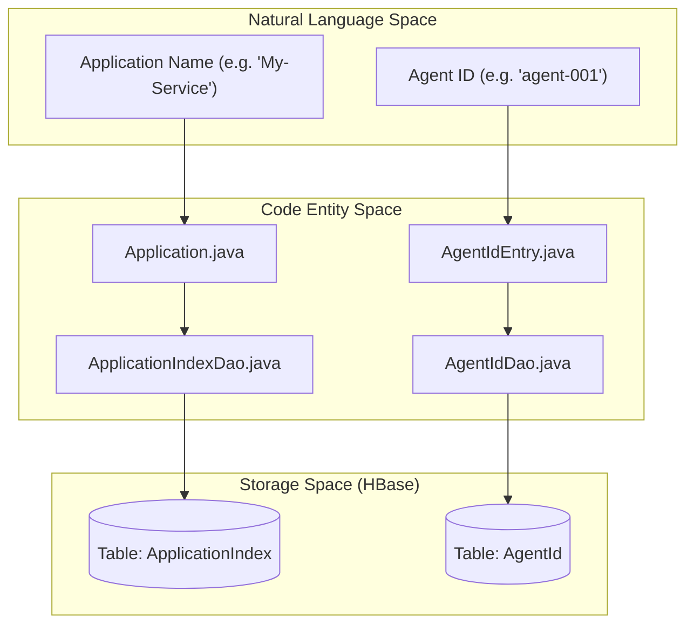
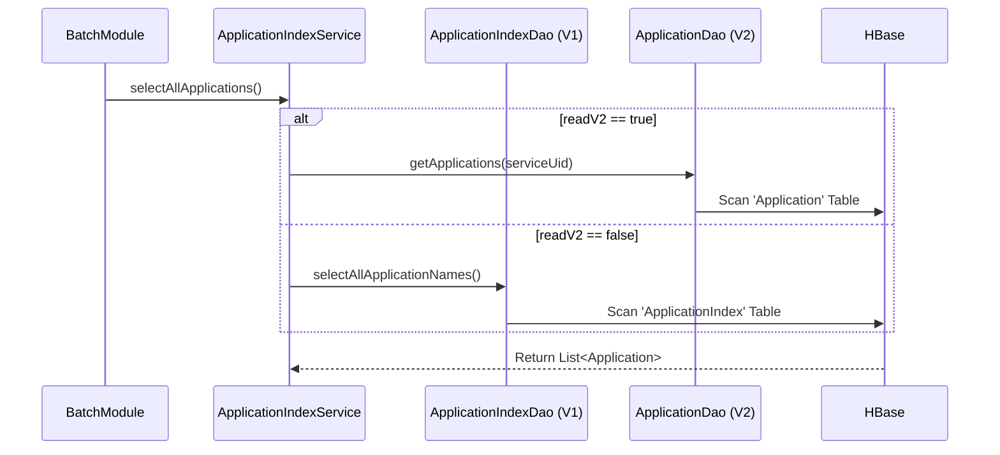

<!-- source: DeepWiki mcp.deepwiki.com · repo pinpoint-apm/pinpoint · page 11.2 Application UID System · fetched 2026-10-29 -->

# Application UID System

Relevant source files

The following files were used as context for generating this wiki page:

- [batch/src/main/java/com/navercorp/pinpoint/batch/BatchModule.java](batch/src/main/java/com/navercorp/pinpoint/batch/BatchModule.java)
- [batch/src/main/java/com/navercorp/pinpoint/batch/common/BatchJobLauncher.java](batch/src/main/java/com/navercorp/pinpoint/batch/common/BatchJobLauncher.java)
- [batch/src/main/java/com/navercorp/pinpoint/batch/common/BatchProperties.java](batch/src/main/java/com/navercorp/pinpoint/batch/common/BatchProperties.java)
- [batch/src/main/java/com/navercorp/pinpoint/batch/config/BatchInfrastructureConfig.java](batch/src/main/java/com/navercorp/pinpoint/batch/config/BatchInfrastructureConfig.java)
- [batch/src/main/java/com/navercorp/pinpoint/batch/config/BatchJavaConfigModule.java](batch/src/main/java/com/navercorp/pinpoint/batch/config/BatchJavaConfigModule.java)
- [batch/src/main/java/com/navercorp/pinpoint/batch/config/BatchScheduleConfig.java](batch/src/main/java/com/navercorp/pinpoint/batch/config/BatchScheduleConfig.java)
- [batch/src/main/java/com/navercorp/pinpoint/batch/config/CleanupAgentAndApplicationJobConfig.java](batch/src/main/java/com/navercorp/pinpoint/batch/config/CleanupAgentAndApplicationJobConfig.java)
- [batch/src/main/java/com/navercorp/pinpoint/batch/config/CleanupInactiveApplicationsJobConfig.java](batch/src/main/java/com/navercorp/pinpoint/batch/config/CleanupInactiveApplicationsJobConfig.java)
- [batch/src/main/java/com/navercorp/pinpoint/batch/job/AgentIdCleanupTasklet.java](batch/src/main/java/com/navercorp/pinpoint/batch/job/AgentIdCleanupTasklet.java)
- [batch/src/main/java/com/navercorp/pinpoint/batch/job/AgentRemover.java](batch/src/main/java/com/navercorp/pinpoint/batch/job/AgentRemover.java)
- [batch/src/main/java/com/navercorp/pinpoint/batch/job/ApplicationCleaningProcessor.java](batch/src/main/java/com/navercorp/pinpoint/batch/job/ApplicationCleaningProcessor.java)
- [batch/src/main/java/com/navercorp/pinpoint/batch/job/ApplicationCleanupTasklet.java](batch/src/main/java/com/navercorp/pinpoint/batch/job/ApplicationCleanupTasklet.java)
- [batch/src/main/java/com/navercorp/pinpoint/batch/job/ApplicationReader.java](batch/src/main/java/com/navercorp/pinpoint/batch/job/ApplicationReader.java)
- [batch/src/main/java/com/navercorp/pinpoint/batch/job/ApplicationRemover.java](batch/src/main/java/com/navercorp/pinpoint/batch/job/ApplicationRemover.java)
- [batch/src/main/java/com/navercorp/pinpoint/batch/job/EmptyItemWriter.java](batch/src/main/java/com/navercorp/pinpoint/batch/job/EmptyItemWriter.java)
- [batch/src/main/java/com/navercorp/pinpoint/batch/service/BatchApplicationIndexService.java](batch/src/main/java/com/navercorp/pinpoint/batch/service/BatchApplicationIndexService.java)
- [batch/src/main/java/com/navercorp/pinpoint/batch/service/BatchApplicationIndexServiceImpl.java](batch/src/main/java/com/navercorp/pinpoint/batch/service/BatchApplicationIndexServiceImpl.java)
- [batch/src/main/java/com/navercorp/pinpoint/batch/util/JobParametersUtils.java](batch/src/main/java/com/navercorp/pinpoint/batch/util/JobParametersUtils.java)
- [batch/src/main/java/com/navercorp/pinpoint/batch/vo/CleanTarget.java](batch/src/main/java/com/navercorp/pinpoint/batch/vo/CleanTarget.java)
- [batch/src/main/resources/batch-root.properties](batch/src/main/resources/batch-root.properties)
- [batch/src/test/java/com/navercorp/pinpoint/batch/BatchPropertiesTest.java](batch/src/test/java/com/navercorp/pinpoint/batch/BatchPropertiesTest.java)
- [collector/src/main/java/com/navercorp/pinpoint/collector/dao/AgentIdDao.java](collector/src/main/java/com/navercorp/pinpoint/collector/dao/AgentIdDao.java)
- [collector/src/main/java/com/navercorp/pinpoint/collector/dao/ApplicationDao.java](collector/src/main/java/com/navercorp/pinpoint/collector/dao/ApplicationDao.java)
- [collector/src/main/java/com/navercorp/pinpoint/collector/dao/hbase/HbaseAgentIdDao.java](collector/src/main/java/com/navercorp/pinpoint/collector/dao/hbase/HbaseAgentIdDao.java)
- [collector/src/main/java/com/navercorp/pinpoint/collector/dao/hbase/HbaseApplicationDao.java](collector/src/main/java/com/navercorp/pinpoint/collector/dao/hbase/HbaseApplicationDao.java)
- [collector/src/main/java/com/navercorp/pinpoint/collector/service/AgentListStateService.java](collector/src/main/java/com/navercorp/pinpoint/collector/service/AgentListStateService.java)
- [collector/src/main/java/com/navercorp/pinpoint/collector/service/ApplicationIndexV2Service.java](collector/src/main/java/com/navercorp/pinpoint/collector/service/ApplicationIndexV2Service.java)
- [commons-hbase/src/main/java/com/navercorp/pinpoint/common/hbase/HbaseColumnFamily.java](commons-hbase/src/main/java/com/navercorp/pinpoint/common/hbase/HbaseColumnFamily.java)
- [commons-hbase/src/main/java/com/navercorp/pinpoint/common/hbase/HbaseTable.java](commons-hbase/src/main/java/com/navercorp/pinpoint/common/hbase/HbaseTable.java)
- [commons-hbase/src/main/java/com/navercorp/pinpoint/common/hbase/HbaseTableV2.java](commons-hbase/src/main/java/com/navercorp/pinpoint/common/hbase/HbaseTableV2.java)
- [commons-hbase/src/main/java/com/navercorp/pinpoint/common/hbase/HbaseTableV3.java](commons-hbase/src/main/java/com/navercorp/pinpoint/common/hbase/HbaseTableV3.java)
- [commons-hbase/src/main/java/com/navercorp/pinpoint/common/hbase/HbaseTables.java](commons-hbase/src/main/java/com/navercorp/pinpoint/common/hbase/HbaseTables.java)
- [commons-server/src/main/java/com/navercorp/pinpoint/common/server/config/AgentProperties.java](commons-server/src/main/java/com/navercorp/pinpoint/common/server/config/AgentProperties.java)
- [commons-server/src/main/java/com/navercorp/pinpoint/common/server/uid/ApplicationUid.java](commons-server/src/main/java/com/navercorp/pinpoint/common/server/uid/ApplicationUid.java)
- [datasource/src/main/resources/datasource/jdbc-root.properties](datasource/src/main/resources/datasource/jdbc-root.properties)
- [hbase/scripts/README.md](hbase/scripts/README.md)
- [hbase/scripts/hbase-create-snappy.hbase](hbase/scripts/hbase-create-snappy.hbase)
- [hbase/scripts/hbase-create.hbase](hbase/scripts/hbase-create.hbase)
- [hbase/scripts/hbase-drop.hbase](hbase/scripts/hbase-drop.hbase)
- [hbase/scripts/hbase-flush-table.hbase](hbase/scripts/hbase-flush-table.hbase)
- [hbase/scripts/hbase-major-compact-htable.hbase](hbase/scripts/hbase-major-compact-htable.hbase)
- [web/src/main/java/com/navercorp/pinpoint/web/dao/AgentIdDao.java](web/src/main/java/com/navercorp/pinpoint/web/dao/AgentIdDao.java)
- [web/src/main/java/com/navercorp/pinpoint/web/dao/ApplicationIndexDao.java](web/src/main/java/com/navercorp/pinpoint/web/dao/ApplicationIndexDao.java)
- [web/src/main/java/com/navercorp/pinpoint/web/dao/hbase/HbaseAgentIdDao.java](web/src/main/java/com/navercorp/pinpoint/web/dao/hbase/HbaseAgentIdDao.java)
- [web/src/main/java/com/navercorp/pinpoint/web/dao/hbase/HbaseApplicationDao.java](web/src/main/java/com/navercorp/pinpoint/web/dao/hbase/HbaseApplicationDao.java)
- [web/src/main/java/com/navercorp/pinpoint/web/dao/hbase/HbaseApplicationIndexDao.java](web/src/main/java/com/navercorp/pinpoint/web/dao/hbase/HbaseApplicationIndexDao.java)
- [web/src/main/java/com/navercorp/pinpoint/web/mapper/ApplicationMapper.java](web/src/main/java/com/navercorp/pinpoint/web/mapper/ApplicationMapper.java)
- [web/src/main/java/com/navercorp/pinpoint/web/service/AgentListV2Service.java](web/src/main/java/com/navercorp/pinpoint/web/service/AgentListV2Service.java)
- [web/src/main/java/com/navercorp/pinpoint/web/service/AgentListV2ServiceImpl.java](web/src/main/java/com/navercorp/pinpoint/web/service/AgentListV2ServiceImpl.java)
- [web/src/main/java/com/navercorp/pinpoint/web/service/ApplicationIndexService.java](web/src/main/java/com/navercorp/pinpoint/web/service/ApplicationIndexService.java)
- [web/src/main/java/com/navercorp/pinpoint/web/service/ApplicationIndexServiceImpl.java](web/src/main/java/com/navercorp/pinpoint/web/service/ApplicationIndexServiceImpl.java)
- [web/src/main/java/com/navercorp/pinpoint/web/uid/WebUidConfiguration.java](web/src/main/java/com/navercorp/pinpoint/web/uid/WebUidConfiguration.java)
- [web/src/main/java/com/navercorp/pinpoint/web/uid/controller/ApplicationIndexV2CopyController.java](web/src/main/java/com/navercorp/pinpoint/web/uid/controller/ApplicationIndexV2CopyController.java)
- [web/src/main/java/com/navercorp/pinpoint/web/uid/service/ApplicationIndexV2CopyServiceImpl.java](web/src/main/java/com/navercorp/pinpoint/web/uid/service/ApplicationIndexV2CopyServiceImpl.java)
- [web/src/main/java/com/navercorp/pinpoint/web/uid/service/ServiceUidCachedService.java](web/src/main/java/com/navercorp/pinpoint/web/uid/service/ServiceUidCachedService.java)
- [web/src/main/java/com/navercorp/pinpoint/web/vo/agent/AgentIdEntry.java](web/src/main/java/com/navercorp/pinpoint/web/vo/agent/AgentIdEntry.java)
- [web/src/test/java/com/navercorp/pinpoint/web/service/AgentListV2ServiceImplTest.java](web/src/test/java/com/navercorp/pinpoint/web/service/AgentListV2ServiceImplTest.java)

The Application UID (Unique Identifier) system is a core component of Pinpoint's storage layer designed to map human-readable application names to compact, efficient identifiers within HBase. This system facilitates rapid lookups, reduces storage overhead in high-volume trace tables, and manages the lifecycle of application-to-agent relationships.

## System Overview

The system is currently undergoing an architectural transition from a flat "V1" indexing model to a more structured "V2" model that supports `ServiceUid` for multi-tenancy and improved data isolation.

### Core Objectives
*   **Compact Storage**: Mapping long application strings to byte-efficient row keys in HBase [web/src/main/java/com/navercorp/pinpoint/web/dao/hbase/HbaseApplicationDao.java:78-85]().
*   **Efficient Lookups**: Providing fast retrieval of agent IDs associated with specific applications [web/src/main/java/com/navercorp/pinpoint/web/dao/hbase/HbaseApplicationIndexDao.java:92-95]().
*   **Lifecycle Management**: Handling the registration and cleanup of inactive applications and agents through batch jobs [batch/src/main/resources/batch-root.properties:39-47]().

---

## Data Model & Storage Schema

The UID system spans several HBase tables, primarily focusing on the mapping between `Application` names, `ServiceTypes`, and `AgentIds`.

### HBase Table Definitions

| Table Name | Column Family | Purpose |
| :--- | :--- | :--- |
| `ApplicationIndex` | `Agents` | **(V1)** Maps application names to a list of associated Agent IDs [hbase/scripts/hbase-create.hbase:3](). |
| `Application` | `Info` | **(V2)** Stores application metadata indexed by `ServiceUid` [web/src/main/java/com/navercorp/pinpoint/web/dao/hbase/HbaseApplicationDao.java:24-25](). |
| `AgentId` | `Info` | **(V2)** Maps Service UIDs and Application names to specific Agent instances [web/src/main/java/com/navercorp/pinpoint/web/dao/hbase/HbaseAgentIdDao.java:37-38](). |

### Logical to Physical Mapping
The following diagram illustrates how natural language concepts (Application, Agent) map to specific Code Entities and HBase structures.

**Application Mapping Flow**

Sources: [web/src/main/java/com/navercorp/pinpoint/web/vo/Application.java](), [web/src/main/java/com/navercorp/pinpoint/web/vo/agent/AgentIdEntry.java:17](), [web/src/main/java/com/navercorp/pinpoint/web/dao/ApplicationIndexDao.java:27](), [web/src/main/java/com/navercorp/pinpoint/web/dao/AgentIdDao.java:9]().

---

## DAO Layer Implementation

The system utilizes specialized DAOs to interact with HBase, abstracting the row key construction and serialization logic.

### Application Index (V1)
`HbaseApplicationIndexDao` manages the legacy mapping. It uses the application name as the row key and stores Agent IDs as column qualifiers.
*   `selectAllApplicationNames()`: Scans the entire table to retrieve all registered applications [web/src/main/java/com/navercorp/pinpoint/web/dao/hbase/HbaseApplicationIndexDao.java:77-84]().
*   `deleteAgentIds()`: Removes specific agents from an application's index [web/src/main/java/com/navercorp/pinpoint/web/dao/hbase/HbaseApplicationIndexDao.java:154-167]().

### Application & Agent ID (V2)
The V2 implementation introduces `ServiceUid` for better multi-tenant support.
*   `HbaseApplicationDao`: Handles application registration using `ApplicationRowKeyUtils` to generate keys containing `serviceUid` [web/src/main/java/com/navercorp/pinpoint/web/dao/hbase/HbaseApplicationDao.java:39-42]().
*   `HbaseAgentIdDao`: Manages agent lookups. It supports prefix scans based on `serviceUid`, `applicationName`, and `serviceTypeCode` [web/src/main/java/com/navercorp/pinpoint/web/dao/hbase/HbaseAgentIdDao.java:52-67]().

---

## Migration and Synchronization

As the system moves toward V2, Pinpoint provides utilities to copy data between versions and ensure consistency.

### ApplicationIndexV2CopyService
This service is responsible for migrating legacy data to the new schema.
*   `copyApplication()`: Fetches all names from V1 and inserts them into the V2 `Application` table [web/src/main/java/com/navercorp/pinpoint/web/uid/service/ApplicationIndexV2CopyServiceImpl.java:49-64]().
*   `copyAgentId()`: Migrates agent information by fetching `AgentInfoBo` and populating the V2 `AgentId` table [web/src/main/java/com/navercorp/pinpoint/web/uid/service/ApplicationIndexV2CopyServiceImpl.java:67-102]().

### Configuration Flags
The behavior of the UID system is controlled via Spring properties, allowing gradual migration:
*   `pinpoint.web.application.read.v2`: Toggle for reading application data from V2 [web/src/main/java/com/navercorp/pinpoint/web/service/ApplicationIndexServiceImpl.java:77-80]().
*   `pinpoint.web.agent.read.v2`: Toggle for reading agent data from V2 [web/src/main/java/com/navercorp/pinpoint/web/service/ApplicationIndexServiceImpl.java:141-147]().

---

## Batch Operations and Cleanup

The UID system includes batch jobs to maintain storage health by removing inactive entries.

### Cleanup Jobs
1.  **Inactive Application Cleanup**: Monitored by `CleanupInactiveApplicationsJobConfig`. It identifies applications that haven't sent data for a threshold (default 35 days) [batch/src/main/resources/batch-root.properties:41-43]().
2.  **Application Remover**: Uses `ApplicationRemover` to delete applications from the index. It checks if an application has multiple service types before deciding whether to delete the entire name or just specific agent IDs [batch/src/main/java/com/navercorp/pinpoint/batch/job/ApplicationRemover.java:49-60]().

### Component Interaction Diagram

Sources: [batch/src/main/java/com/navercorp/pinpoint/batch/BatchModule.java:74-76](), [web/src/main/java/com/navercorp/pinpoint/web/service/ApplicationIndexServiceImpl.java:76-81](), [web/src/main/java/com/navercorp/pinpoint/web/dao/hbase/HbaseApplicationDao.java:39-42](), [web/src/main/java/com/navercorp/pinpoint/web/dao/hbase/HbaseApplicationIndexDao.java:77-84]().

## Key Classes Reference

| Class | Responsibility |
| :--- | :--- |
| `ApplicationIndexService` | High-level service for application/agent discovery and deletion [web/src/main/java/com/navercorp/pinpoint/web/service/ApplicationIndexServiceImpl.java:41](). |
| `BatchApplicationIndexService` | Specialized service for batch processing needs, supporting V2 toggles [batch/src/main/java/com/navercorp/pinpoint/batch/service/BatchApplicationIndexServiceImpl.java:37](). |
| `AgentIdRowKeyUtils` | Utility for creating HBase row keys for the AgentId table [web/src/main/java/com/navercorp/pinpoint/web/dao/hbase/HbaseAgentIdDao.java:10](). |
| `ApplicationRowKeyUtils` | Utility for creating HBase row keys for the Application table [web/src/main/java/com/navercorp/pinpoint/web/dao/hbase/HbaseApplicationDao.java:8](). |

Sources: [web/src/main/java/com/navercorp/pinpoint/web/service/ApplicationIndexServiceImpl.java](), [batch/src/main/java/com/navercorp/pinpoint/batch/service/BatchApplicationIndexServiceImpl.java](), [web/src/main/java/com/navercorp/pinpoint/web/dao/hbase/HbaseAgentIdDao.java](), [web/src/main/java/com/navercorp/pinpoint/web/dao/hbase/HbaseApplicationDao.java]().

---

