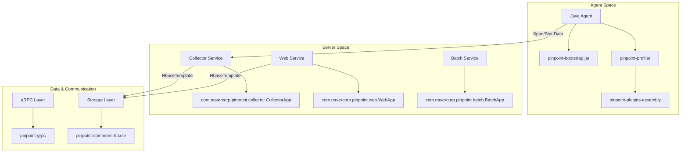
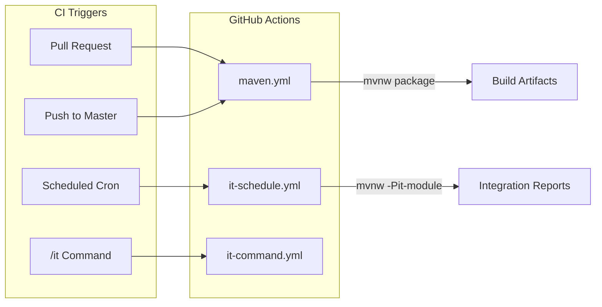

<!-- source: DeepWiki mcp.deepwiki.com · repo pinpoint-apm/pinpoint · page 12 Development Guide · fetched 2026-10-29 -->

# Development Guide

Relevant source files

The following files were used as context for generating this wiki page:

- [.github/workflows/homepage.yml](.github/workflows/homepage.yml)
- [.github/workflows/it-command.yml](.github/workflows/it-command.yml)
- [.github/workflows/it-schedule.yml](.github/workflows/it-schedule.yml)
- [.github/workflows/maven-central-deploy.yml](.github/workflows/maven-central-deploy.yml)
- [.github/workflows/maven.yml](.github/workflows/maven.yml)
- [.github/workflows/slash-command-dispatch.yml](.github/workflows/slash-command-dispatch.yml)
- [batch/pom.xml](batch/pom.xml)
- [collector/pom.xml](collector/pom.xml)
- [commons-hbase/pom.xml](commons-hbase/pom.xml)
- [commons-server/pom.xml](commons-server/pom.xml)
- [commons/pom.xml](commons/pom.xml)
- [commons/src/main/java/com/navercorp/pinpoint/common/Version.java](commons/src/main/java/com/navercorp/pinpoint/common/Version.java)
- [grpc/src/main/java/com/navercorp/pinpoint/grpc/security/SslOption.java](grpc/src/main/java/com/navercorp/pinpoint/grpc/security/SslOption.java)
- [hbase/pom.xml](hbase/pom.xml)
- [pom.xml](pom.xml)
- [web/pom.xml](web/pom.xml)

This guide provides high-level instructions and best practices for developers who want to contribute to or extend the Pinpoint APM project. It covers the project organization, build system, CI/CD pipeline, and contribution workflows.

Pinpoint is a complex, multi-module distributed system. This page serves as a central entry point for development-related information, linking to detailed child pages for specific topics.

## Project Structure and Organization

Pinpoint is organized as a multi-module Maven project with over 60 modules [pom.xml:81-125](). The project is logically divided into core utilities, the Java agent, server-side components (Collector, Web, Batch), and storage integrations.

For a detailed breakdown of each module's purpose and the physical code layout, see **[Project Structure](#12.1)**.

### High-Level Component Mapping

The following diagram bridges the functional components to their primary code entities.

**Sources**: [pom.xml:81-125](), [collector/pom.xml:27-29](), [web/pom.xml:27-29](), [batch/pom.xml:12-13](), [batch/pom.xml:91]()

## Build System

Pinpoint uses Maven as its primary build tool. The root `pom.xml` manages global dependencies, compiler settings, and build profiles [pom.xml:1-30](). 

### Build Requirements
The project utilizes a multi-JDK setup. While the agent modules target Java 8 for compatibility, the server modules (Collector, Web, Batch) require Java 17 [pom.xml:131-136](), [collector/pom.xml:32-33](), [web/pom.xml:32-33]().

For detailed instructions on Maven profiles, dependency management, and building Docker images via the Jib plugin, see **[Build System](#12.2)**.

**Sources**: [pom.xml:131-136](), [collector/pom.xml:32-33](), [web/pom.xml:32-33](), [batch/pom.xml:16-17]()

## CI/CD Pipeline

The project relies on GitHub Actions for automated building, testing, and deployment.

### Workflow Overview
The CI pipeline handles several critical tasks:
*   **Continuous Integration**: Building the project and running unit tests on every PR [.github/workflows/maven.yml:1-11]().
*   **Integration Testing**: Running complex, containerized plugin tests on a schedule or via chat-ops commands [.github/workflows/it-schedule.yml:1-4](), [.github/workflows/it-command.yml:1-4]().
*   **Deployment**: Publishing snapshots and releases to Maven Central [.github/workflows/maven-central-deploy.yml:1-13]().

For details on workflow triggers and test automation, see **[CI/CD Pipeline](#12.3)**.

**Sources**: [.github/workflows/maven.yml:1-11](), [.github/workflows/it-schedule.yml:1-4](), [.github/workflows/it-command.yml:1-4](), [.github/workflows/it-command.yml:61-65]()

## Contributing Guidelines

We welcome contributions ranging from bug fixes to new instrumentation plugins. 

### Contribution Areas
*   **Plugins**: Extending Pinpoint to support new libraries by implementing `ProfilerPlugin`.
*   **Core**: Improving the collector pipeline or storage efficiency.
*   **UI**: Enhancing the React-based frontend in `web-frontend`.

For the full contributor's checklist, coding standards, and PR submission process, see **[Contributing Guidelines](#12.4)**.

**Sources**: [pom.xml:104](), [web/pom.xml:76-77](), [collector/pom.xml:83-85]()

---

