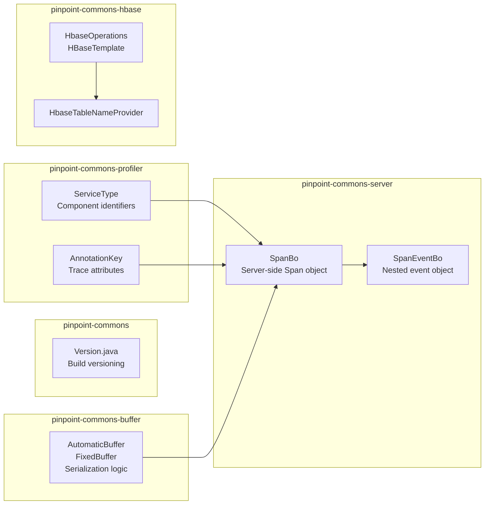
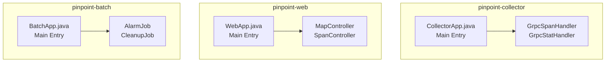

<!-- source: DeepWiki mcp.deepwiki.com · repo pinpoint-apm/pinpoint · page 12.1 Project Structure · fetched 2026-10-29 -->

# Project Structure

Relevant source files

The following files were used as context for generating this wiki page:

- [.github/ISSUE_TEMPLATE/bug_report.md](.github/ISSUE_TEMPLATE/bug_report.md)
- [.github/ISSUE_TEMPLATE/feature_request.md](.github/ISSUE_TEMPLATE/feature_request.md)
- [.github/ISSUE_TEMPLATE/question.md](.github/ISSUE_TEMPLATE/question.md)
- [.github/ISSUE_TEMPLATE/troubleshooting.md](.github/ISSUE_TEMPLATE/troubleshooting.md)
- [README.md](README.md)
- [agent-module/plugins/undertow-servlet/README.md](agent-module/plugins/undertow-servlet/README.md)
- [batch/pom.xml](batch/pom.xml)
- [collector/pom.xml](collector/pom.xml)
- [commons-hbase/pom.xml](commons-hbase/pom.xml)
- [commons-server/pom.xml](commons-server/pom.xml)
- [commons/pom.xml](commons/pom.xml)
- [commons/src/main/java/com/navercorp/pinpoint/common/Version.java](commons/src/main/java/com/navercorp/pinpoint/common/Version.java)
- [doc/images/ss_error-analysis1.png](doc/images/ss_error-analysis1.png)
- [doc/images/ss_error-analysis3.gif](doc/images/ss_error-analysis3.gif)
- [doc/modules.md](doc/modules.md)
- [hbase/pom.xml](hbase/pom.xml)
- [pom.xml](pom.xml)
- [quickstart/README.md](quickstart/README.md)
- [web/pom.xml](web/pom.xml)

This document explains the overall organization of the Pinpoint APM codebase, including the Maven module hierarchy, directory layout, and the purpose of each module group. This information is essential for developers who need to navigate the codebase, understand dependencies between components, or add new functionality.

For information about building the project from source, see [Building from Source](#2.2). For details about Maven build system configuration and profiles, see [Build System](#12.2).

---

## Overview

Pinpoint is organized as a Maven multi-module project with 60+ modules grouped by functional area. The root directory contains the parent POM that manages shared dependencies, plugin configurations, and version properties for all child modules. The project follows a modular architecture where common functionality is isolated in reusable modules, while server components (`collector`, `web`, `batch`) and the agent system exist as independent subsystems with their own module hierarchies.

**Sources**: [pom.xml:1-125]()

---

## Maven Module Hierarchy

The following diagram illustrates the top-level module structure as defined in the parent POM. Modules are organized into logical groups based on their roles in the system.

### Diagram: Top-Level Maven Modules

```mermaid
graph TB
    Root["pinpoint<br/>(Parent POM)<br/>version: 3.1.0-SNAPSHOT"]
    
    subgraph "Core Commons"
        Commons["pinpoint-commons<br/>Shared utilities"]
        CommonsBuffer["pinpoint-commons-buffer<br/>Buffer utilities"]
        CommonsConfig["pinpoint-commons-config<br/>Configuration framework"]
        CommonsProfiler["pinpoint-commons-profiler<br/>Profiler data structures"]
        CommonsServer["pinpoint-commons-server<br/>Server-side core<br/>SpanBo, ServiceType"]
        CommonsHBase["pinpoint-commons-hbase<br/>HBase access layer"]
        CommonsTimeseries["pinpoint-commons-timeseries<br/>Time series data"]
        CommonsMybatis["pinpoint-commons-mybatis<br/>MyBatis integration"]
        CommonsMapstruct["pinpoint-commons-mapstruct-spi<br/>MapStruct extensions"]
    end
    
    subgraph "Agent System"
        AgentModule["agent-module<br/>Agent parent POM"]
        Annotations["annotations<br/>Agent annotations"]
        Banner["banner<br/>Startup banners"]
    end
    
    subgraph "Server Applications"
        Collector["collector<br/>Data collection server<br/>CollectorApp"]
        CollectorMonitor["collector-monitor<br/>Collector metrics"]
        CollectorStarter["collector-starter<br/>Multi-type launcher"]
        Web["web<br/>Web backend<br/>WebApp"]
        WebStarter["web-starter<br/>Multi-app launcher"]
        Batch["batch<br/>Background jobs<br/>BatchApp"]
        BatchAlarm["batch-alarmsender<br/>Alarm sender"]
    end
    
    subgraph "Frontend"
        WebFrontend["web-frontend<br/>React v3 monorepo"]
    end
    
    subgraph "Storage & Messaging"
        HBase["hbase<br/>Schema modules"]
        Pinot["pinot<br/>OLAP integration"]
        Redis["redis<br/>Redis integration"]
        GRPC["grpc<br/>gRPC definitions"]
        Datasource["datasource<br/>Data source configs"]
    end
    
    subgraph "Feature Modules"
        Metric["metric-module<br/>Metrics collection"]
        URIStat["uristat<br/>URI statistics"]
        Inspector["inspector-module<br/>System inspection"]
        Realtime["realtime<br/>Real-time features"]
        Log["log<br/>Log collection"]
        User["user<br/>User management"]
        Webhook["webhook<br/>Webhook integration"]
        ExceptionTrace["exceptiontrace<br/>Exception tracking"]
        AgentStats["agent-statistics<br/>Agent stats"]
        OTLPMetric["otlpmetric<br/>OTLP metrics"]
        OTLPTrace["otlptrace<br/>OTLP traces"]
        FeatureFlag["feature-flag<br/>Feature toggles"]
        Channel["channel<br/>Communication channels"]
        ServiceModule["service-module<br/>Service layer"]
        HBaseUID["hbase-uid-module<br/>HBase UID management"]
        BasicLogin["basic-login<br/>Authentication"]
    end
    
    Root --> Commons
    Root --> CommonsBuffer
    Root --> CommonsConfig
    Root --> CommonsProfiler
    Root --> CommonsServer
    Root --> CommonsHBase
    Root --> CommonsTimeseries
    Root --> CommonsMybatis
    Root --> CommonsMapstruct
    
    Root --> AgentModule
    Root --> Annotations
    Root --> Banner
    
    Root --> Collector
    Root --> CollectorMonitor
    Root --> CollectorStarter
    Root --> Web
    Root --> WebStarter
    Root --> Batch
    Root --> BatchAlarm
    
    Root --> WebFrontend
    
    Root --> HBase
    Root --> Pinot
    Root --> Redis
    Root --> GRPC
    Root --> Datasource
    
    Root --> Metric
    Root --> URIStat
    Root --> Inspector
    Root --> Realtime
    Root --> Log
    Root --> User
    Root --> Webhook
    Root --> ExceptionTrace
    Root --> AgentStats
    Root --> OTLPMetric
    Root --> OTLPTrace
    Root --> FeatureFlag
    Root --> Channel
    Root --> ServiceModule
    Root --> HBaseUID
    Root --> BasicLogin
```

**Sources**: [pom.xml:81-125]()

---

## Directory Layout

The repository follows a standard Maven project layout. The root directory contains:

| Directory/File | Purpose |
|----------------|---------|
| `agent-module/` | Agent subsystem with plugins, profiler, and bootstrap |
| `annotations/` | Java annotations for agent instrumentation |
| `banner/` | Startup banner ASCII art |
| `batch/` | Background job application (alarm sending, cleanup) |
| `batch-alarmsender/` | Alarm sender functionality |
| `collector/` | Data collection server application |
| `collector-monitor/` | Collector monitoring and metrics |
| `collector-starter/` | Launcher for multiple collector types |
| `commons/` | Core shared utilities |
| `commons-buffer/` | Buffer and serialization utilities |
| `commons-config/` | Configuration framework |
| `commons-hbase/` | HBase client abstraction layer |
| `commons-mybatis/` | MyBatis integration utilities |
| `commons-profiler/` | Profiler data structures (AnnotationKey, ServiceType) |
| `commons-server/` | Server-side shared code (SpanBo, trace models) |
| `commons-timeseries/` | Time series data handling |
| `datasource/` | Database connection configuration |
| `grpc/` | gRPC Protocol Buffer definitions |
| `hbase/` | HBase schema definitions and management |
| `inspector-module/` | System inspection and metrics |
| `log/` | Log collection modules |
| `metric-module/` | Application metrics collection |
| `otlpmetric/` | OpenTelemetry metrics support |
| `otlptrace/` | OpenTelemetry trace support |
| `pinot/` | Apache Pinot integration |
| `realtime/` | Real-time monitoring features |
| `redis/` | Redis integration |
| `uristat/` | URI-level statistics |
| `user/` | User management |
| `web/` | Web backend application |
| `web-frontend/` | React v3 frontend monorepo |
| `web-starter/` | Launcher for multiple web app types |
| `webhook/` | Webhook notification integration |
| `pom.xml` | Parent POM defining all modules |

**Sources**: [pom.xml:81-125]()

---

## Core Commons Modules

The commons modules provide foundational functionality shared across agent, collector, and web applications. These modules contain minimal external service dependencies and focus on data structures, utilities, and abstractions.

### Diagram: Commons Data Flow and Relationships

### pinpoint-commons
[commons/pom.xml:1-47]()
The core utility module containing basic shared classes. It includes the `Version` class used to identify the current Pinpoint version.
**Key classes**:
- `com.navercorp.pinpoint.common.Version`: Exposes the `VERSION` constant [commons/src/main/java/com/navercorp/pinpoint/common/Version.java:1-4]().

### pinpoint-commons-buffer
The buffer module provides efficient serialization and deserialization utilities for trace data.
**Sources**: [pom.xml:90]()

### pinpoint-commons-profiler
Defines core profiling metadata used by both agents and servers.
- `ServiceType`: Enumeration of all supported service types (databases, frameworks, etc.)
- `AnnotationKey`: Trace annotation definitions.
**Sources**: [pom.xml:92]()

### pinpoint-commons-server
[commons-server/pom.xml:1-216]()
Contains server-side data models and business logic shared between `collector`, `web`, and `batch` applications.
**Key components**:
- `SpanBo`, `SpanChunkBo`, `SpanEventBo`: Server-side trace data models.
- Plugin loader utilities.
**Dependencies**: Requires `pinpoint-commons`, `pinpoint-commons-buffer`, `pinpoint-commons-profiler`, and `pinpoint-commons-hbase`.
**Sources**: [commons-server/pom.xml:37-73]()

### pinpoint-commons-hbase
[commons-hbase/pom.xml:1-137]()
Provides an abstraction layer over the HBase client.
- `HbaseOperations`: Interface for HBase operations.
- `HbaseTemplate`: Spring-style template for interacting with HBase.
**Dependencies**: Uses `hbase-shaded-client` [commons-hbase/pom.xml:75-77]().
**Sources**: [commons-hbase/pom.xml:1-137]()

---

## Server Application Modules

The three main server applications (`collector`, `web`, `batch`) are packaged as executable Spring Boot JARs.

### Diagram: Server Application Components

### pinpoint-collector
[collector/pom.xml:1-278]()
The data collection server that receives trace data from agents via gRPC.
- **Main class**: `com.navercorp.pinpoint.collector.CollectorApp`.
- **Functionality**: Receives Spans, Stats, and Agent Info; applies sampling; stores data in HBase/Pinot.
- **Build**: Uses `spring-boot-maven-plugin` and `jib-maven-plugin` for Docker image creation [collector/pom.xml:246-273]().

### pinpoint-web
[web/pom.xml:1-410]()
The REST API backend and UI server.
- **Main class**: `com.navercorp.pinpoint.web.WebApp`.
- **Functionality**: Serves the application map, trace details, and metrics; manages WebSockets for real-time features.
- **Dependencies**: Depends on `pinpoint-web-frontend` [web/pom.xml:75-77]().

### pinpoint-batch
[batch/pom.xml:1-125]()
Implements scheduled background jobs.
- **Main class**: `com.navercorp.pinpoint.batch.BatchApp` [batch/pom.xml:91]().
- **Functionality**: Sends alarms, cleans up inactive agents, and aggregates URI statistics.
- **Dependencies**: Uses `spring-batch-core` [batch/pom.xml:59-61]().

---

## Agent Module Hierarchy

The agent subsystem is organized under `agent-module/` and is built with Java 8 compatibility.

| Module | Purpose |
|--------|---------|
| `pinpoint-bootstrap` | Agent entry point loaded via `-javaagent`. |
| `pinpoint-profiler` | Main agent implementation including bytecode transformers. |
| `plugins` | Directory containing all instrumentation plugins (Tomcat, MySQL, etc.). |

**Sources**: [pom.xml:83](), [doc/modules.md:4-86]()

---

## Frontend Module

The web frontend is a React application located in `web-frontend/`.
- **Build process**: Maven invokes `frontend-maven-plugin` to build the React assets [pom.xml:280-285]().
- **Integration**: The built assets are packaged into the `pinpoint-web` JAR.

---

## Storage and Integration Modules

### pinpoint-hbase
[hbase/pom.xml:1-73]()
Parent module for HBase schema management.
- `pinpoint-hbase-schema`: Table schema definitions.
- `pinpoint-hbase-schema-manager`: Tool for managing HBase tables.

### pinpoint-pinot
Provides integration with Apache Pinot for OLAP queries (metrics and statistics).
**Sources**: [pom.xml:108]()

### pinpoint-grpc
Contains Protocol Buffer definitions and generated gRPC classes for agent-collector communication.
**Sources**: [pom.xml:100]()

---

## Module Java Version Requirements

Pinpoint uses different Java versions for different components to ensure compatibility and leverage modern features.

| Component | Java Version | Property |
|-----------|--------------|----------|
| Parent POM | 1.8 | `jdk.version=1.8` [pom.xml:131]() |
| Collector | 17 | `jdk.version=17` [collector/pom.xml:32]() |
| Web | 17 | `jdk.version=17` [web/pom.xml:32]() |
| Batch | 17 | `jdk.version=17` [batch/pom.xml:16]() |
| Commons-HBase | 17 | `jdk.version=17` [commons-hbase/pom.xml:32]() |
| Commons-Server| 17 | `jdk.version=17` [commons-server/pom.xml:32]() |

**Sources**: [pom.xml:131-136](), [collector/pom.xml:31-34](), [web/pom.xml:31-34](), [batch/pom.xml:15-18]()

---

