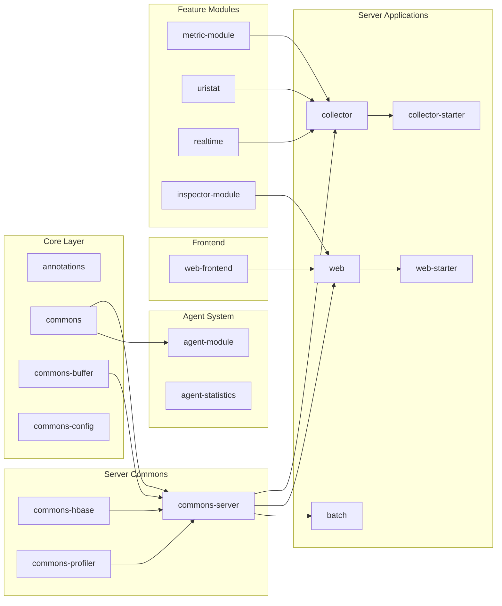
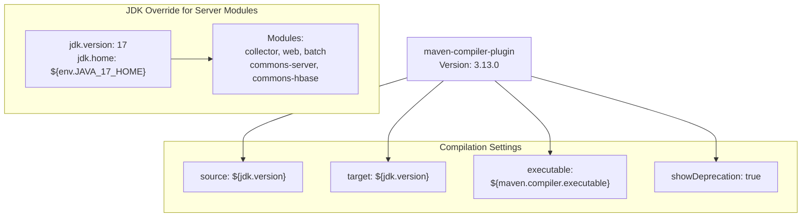
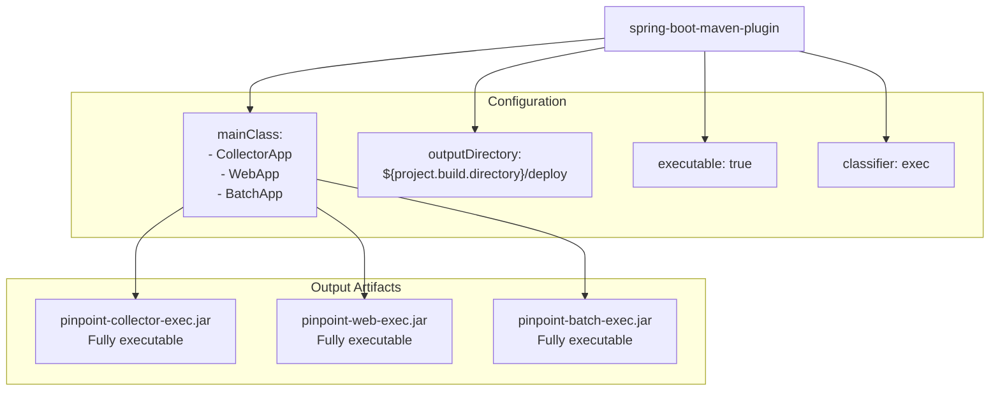
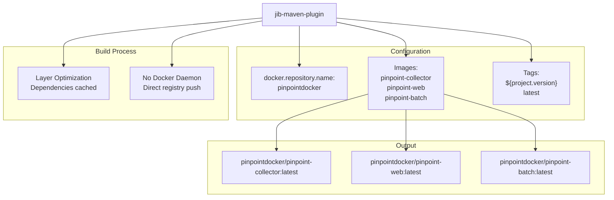
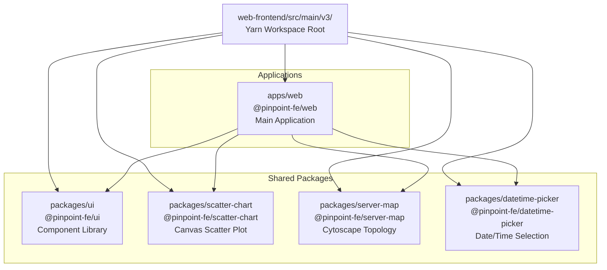

<!-- source: DeepWiki mcp.deepwiki.com · repo pinpoint-apm/pinpoint · page 12.2 Build System · fetched 2026-10-29 -->

# Build System

<details>
<summary>Relevant source files</summary>

The following files were used as context for generating this wiki page:

- [batch/pom.xml](batch/pom.xml)
- [collector/pom.xml](collector/pom.xml)
- [commons-hbase/pom.xml](commons-hbase/pom.xml)
- [commons-server/pom.xml](commons-server/pom.xml)
- [commons/pom.xml](commons/pom.xml)
- [commons/src/main/java/com/navercorp/pinpoint/common/Version.java](commons/src/main/java/com/navercorp/pinpoint/common/Version.java)
- [hbase/pom.xml](hbase/pom.xml)
- [pom.xml](pom.xml)
- [web/pom.xml](web/pom.xml)

</details>


This document describes the build system architecture for Pinpoint APM, covering both the Java backend (Maven-based) and the React frontend (Yarn-based). The build system manages compilation, packaging, dependency resolution, and Docker image creation across 60+ Maven modules and a TypeScript monorepo.

For information about the overall project structure and module organization, see [Project Structure](). For information about continuous integration and automated builds, see [CI/CD Pipeline]().

---

## Maven Parent POM Architecture

Pinpoint uses a multi-module Maven build with a parent POM at the repository root that defines shared configuration, dependency versions, and build plugins for all Java modules.

### Parent POM Structure

```mermaid
graph TB
    ParentPOM["pinpoint (Parent POM)<br/>pom.xml<br/>Version: 3.1.0-SNAPSHOT"]
    
    subgraph "Version Properties"
        JavaVer["jdk.version: 1.8<br/>Java 17 for servers"]
        SpringBoot["spring-boot.version: 3.5.5"]
        HBase["hbase.shaded.client.version: 2.5.12-hadoop3"]
        gRPC["grpc.version: 1.75.0"]
    end
    
    subgraph "Module Categories"
        Core["Core Modules<br/>commons, commons-server<br/>commons-hbase"]
        Agent["Agent Modules<br/>agent-module, profiler<br/>agent-statistics"]
        Server["Server Modules<br/>collector, web<br/>batch"]
        Frontend["Frontend<br/>web-frontend"]
    end
    
    subgraph "Dependency Management"
        BOM["Spring Boot BOM<br/>Managed Dependencies"]
        Internal["Internal Dependencies<br/>pinpoint-* artifacts"]
        External["External Libraries<br/>Versions centralized"]
    end
    
    ParentPOM --> JavaVer
    ParentPOM --> SpringBoot
    ParentPOM --> HBase
    ParentPOM --> gRPC
    
    ParentPOM --> Core
    ParentPOM --> Agent
    ParentPOM --> Server
    ParentPOM --> Frontend
    
    ParentPOM --> BOM
    ParentPOM --> Internal
    ParentPOM --> External
```



**Sources**: [pom.xml:1-287]()

The parent POM defines critical build properties that control compilation and packaging:

| Property | Value | Purpose |
|----------|-------|---------|
| `jdk.version` | 1.8 | Agent compatibility (Java 8+) |
| `jdk.home` | `${env.JAVA_8_HOME}` | Default compiler path |
| `maven.compiler.source/target` | `${jdk.version}` | Compilation target |
| `test.jdk.home` | `${jdk.home}` | Test execution JDK |
| `project.build.sourceEncoding` | UTF-8 | Source file encoding |

**Sources**: [pom.xml:127-139]()

### Module Declaration

The parent POM declares all 60+ Maven modules in build order:



**Sources**: [pom.xml:81-125]()

### Dependency Version Management

The parent POM uses `<dependencyManagement>` to centrally control all library versions:

| Library | Version | Property | Usage |
|---------|---------|----------|-------|
| Spring Framework | 6.2.10 | `spring.version` | Core framework |
| Spring Boot | 3.5.5 | `spring-boot.version` | Application framework |
| HBase Client | 2.5.12-hadoop3 | `hbase.shaded.client.version` | Storage access |
| gRPC | 1.75.0 | `grpc.version` | Agent-Collector communication |
| Netty | 4.1.124.Final | `netty4.version` | Async I/O |
| Jackson | 2.19.2 | `fastxml.jackson.version` | JSON serialization |
| Guava | 33.3.1-jre | `guava.version` | Utilities |
| Kafka Client | 3.7.1 | `kafka.client.version` | Event streaming |
| Pinot Client | 1.3.0 | `pinot.client.version` | OLAP access |

**Sources**: [pom.xml:127-287]()

All child modules inherit these versions through the dependency management mechanism:

```xml
<!-- In child module pom.xml -->
<dependency>
    <groupId>org.springframework.boot</groupId>
    <artifactId>spring-boot-starter-web</artifactId>
    <!-- Version inherited from parent -->
</dependency>
```

**Sources**: [web/pom.xml:212-220](), [collector/pom.xml:183-195]()

---

## Maven Build Plugins

### Compiler Plugin Configuration

The `maven-compiler-plugin` is configured in the parent POM with specific settings for Java compilation:



**Sources**: [pom.xml:131-135](), [collector/pom.xml:31-34](), [web/pom.xml:31-34](), [batch/pom.xml:15-18]()

Server modules override the default Java 8 requirement to use Java 17:

```xml
<properties>
    <jdk.version>17</jdk.version>
    <jdk.home>${env.JAVA_17_HOME}</jdk.home>
</properties>
```

This allows the agent (Java 8+) and servers (Java 17) to have different compilation targets.

**Sources**: [collector/pom.xml:31-34](), [web/pom.xml:31-34](), [commons-server/pom.xml:31-34]()

### Spring Boot Maven Plugin

The `spring-boot-maven-plugin` creates executable JAR files for server applications:



**Sources**: [batch/pom.xml:86-97]()

Configuration in the `batch` module:

```xml
<plugin>
    <groupId>org.springframework.boot</groupId>
    <artifactId>spring-boot-maven-plugin</artifactId>
    <configuration>
        <mainClass>com.navercorp.pinpoint.batch.BatchApp</mainClass>
        <outputDirectory>${project.build.directory}/deploy</outputDirectory>
        <executable>true</executable>
        <attach>true</attach>
        <classifier>exec</classifier>
    </configuration>
</plugin>
```

The `executable: true` setting makes the JAR directly executable on Unix systems with a shebang line, and `classifier: exec` creates a separate artifact named `pinpoint-batch-3.1.0-SNAPSHOT-exec.jar`.

**Sources**: [batch/pom.xml:86-97]()

### Jib Maven Plugin (Docker Image Builder)

The `jib-maven-plugin` builds Docker images without requiring a Docker daemon:



**Sources**: [batch/pom.xml:98-110](), [hbase/pom.xml:50-67]()

Example configuration in `batch`:

```xml
<plugin>
    <groupId>com.google.cloud.tools</groupId>
    <artifactId>jib-maven-plugin</artifactId>
    <configuration>
        <to>
            <image>${docker.repository.name}/pinpoint-batch</image>
            <tags>
                <tag>${project.version}</tag>
                <tag>latest</tag>
            </tags>
        </to>
    </configuration>
</plugin>
```

**Sources**: [batch/pom.xml:98-110]()

---

## Frontend Build System

### Yarn Workspace Monorepo Structure

The frontend is organized as a Yarn workspace monorepo under `web-frontend/src/main/v3/`:



**Sources**: [web-frontend/pom.xml:1-151]()

### Package Build Configuration

Each package has a standardized build configuration using Vite and TypeScript.

**UI Package Build** (`@pinpoint-fe/ui`):

| Script | Command | Purpose |
|--------|---------|---------|
| `build` | `yarn format && yarn lint && tsc && vite build` | Production build |
| `lint` | `yarn format && eslint ./src` | Linting |
| `storybook` | `storybook dev -p 6006` | Component development |

**Sources**: [web-frontend/src/main/v3/packages/ui/package.json:7-18]()

**Scatter Chart Package** (`@pinpoint-fe/scatter-chart`):

Uses Vite with TypeScript declaration generation. The `tsconfig.json` ensures strict type checking:

```json
{
  "compilerOptions": {
    "target": "ES6",
    "module": "ESNext",
    "strict": true,
    "declaration": true
  }
}
```

**Sources**: [web-frontend/src/main/v3/packages/scatter-chart/tsconfig.json:4-18]()

### Build Flow Integration

The frontend build integrates with Maven through the `frontend-maven-plugin`. The `build.frontend.skip` property can be used to bypass this during backend development.

**Sources**: [pom.xml:143-144]()

---

## Build Profiles and Environment Configuration

### Profile-Based Configuration

Pinpoint uses Maven profiles to adjust build parameters. For example, the `hbase` module uses `docker-maven-plugin` to build images:

```xml
<plugin>
    <groupId>io.fabric8</groupId>
    <artifactId>docker-maven-plugin</artifactId>
    <version>0.48.0</version>
    <configuration>
        <images>
            <image>
                <name>${docker.repository.name}/pinpoint-hbase</name>
                <build>
                    <contextDir>${basedir}</contextDir>
                    <tags>
                        <tag>${project.version}</tag>
                        <tag>latest</tag>
                    </tags>
                </build>
            </image>
        </images>
    </configuration>
</plugin>
```

**Sources**: [hbase/pom.xml:50-67]()

### Worker Thread Configuration

Builds often include testing configurations. For example, the `batch` module disables Java assertions for `hbase-client` compatibility during tests:

```xml
<plugin>
    <groupId>org.apache.maven.plugins</groupId>
    <artifactId>maven-surefire-plugin</artifactId>
    <configuration>
        <enableAssertions>false</enableAssertions>
    </configuration>
</plugin>
```

**Sources**: [batch/pom.xml:115-122]()

---

## Build Commands Reference

### Common Build Commands

| Command | Purpose | Output |
|---------|---------|--------|
| `mvn clean install` | Full build with tests | JARs in `target/` directories |
| `mvn clean install -DskipTests` | Build without tests | Faster build |
| `mvn clean install -Dbuild.frontend.skip=true` | Backend-only build | Skip frontend compilation |
| `mvn clean package jib:dockerBuild` | Build Docker images locally | Docker images |

**Sources**: [pom.xml:1-287](), [batch/pom.xml:85-124]()

---

## Version Management

### Version Properties in Parent POM

Critical version numbers are centralized in the root `pom.xml`:

```xml
<properties>
    <jdk.version>1.8</jdk.version>
    <spring-boot.version>3.5.5</spring-boot.version>
    <hbase.shaded.client.version>2.5.12-hadoop3</hbase.shaded.client.version>
    <grpc.version>1.75.0</grpc.version>
    <fastxml.jackson.version>2.19.2</fastxml.jackson.version>
</properties>
```

**Sources**: [pom.xml:127-287]()

### Version Template for Runtime

The `commons` module uses the `templating-maven-plugin` to inject the version at build time into the `Version` class:

```java
// commons/src/main/java/com/navercorp/pinpoint/common/Version.java
package com.navercorp.pinpoint.common;
public final class Version {
    public static final String VERSION = VersionTemplate.VERSION_TEMPLATE;
}
```

**Sources**: [commons/src/main/java/com/navercorp/pinpoint/common/Version.java:1-4](), [commons/pom.xml:38-45]()

---

## Build System Architecture Summary

The Pinpoint build system combines Maven for Java modules with Yarn for the React frontend, providing:

1. **Multi-module Maven build** with 60+ modules.
2. **Centralized dependency management** through parent POM.
3. **Docker image creation** via Jib and Docker-maven-plugins.
4. **Integrated frontend build** within the Maven lifecycle.
5. **TypeScript monorepo** for modular UI components.
6. **Executable JAR generation** via Spring Boot.

**Sources**: [pom.xml:1-287](), [batch/pom.xml:1-125](), [web/pom.xml:1-410](), [collector/pom.xml:1-278]()

---

