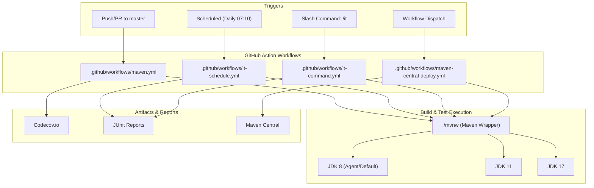
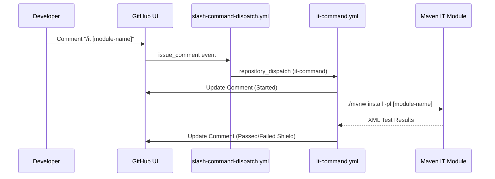

<!-- source: DeepWiki mcp.deepwiki.com · repo pinpoint-apm/pinpoint · page 12.3 CI/CD Pipeline · fetched 2026-10-29 -->

# CI/CD Pipeline

<details>
<summary>Relevant source files</summary>

The following files were used as context for generating this wiki page:

- [.github/workflows/homepage.yml](.github/workflows/homepage.yml)
- [.github/workflows/it-command.yml](.github/workflows/it-command.yml)
- [.github/workflows/it-schedule.yml](.github/workflows/it-schedule.yml)
- [.github/workflows/maven-central-deploy.yml](.github/workflows/maven-central-deploy.yml)
- [.github/workflows/maven.yml](.github/workflows/maven.yml)
- [.github/workflows/slash-command-dispatch.yml](.github/workflows/slash-command-dispatch.yml)
- [grpc/src/main/java/com/navercorp/pinpoint/grpc/security/SslOption.java](grpc/src/main/java/com/navercorp/pinpoint/grpc/security/SslOption.java)

</details>


This document describes the continuous integration and continuous deployment (CI/CD) pipeline for Pinpoint APM. It covers the GitHub Actions workflow configurations, automated testing strategies, and the release process for both backend and frontend components.

---

## Overview

Pinpoint utilizes **GitHub Actions** as its primary CI/CD platform. The pipeline is designed to automate the build, test, and deployment phases across multiple Java environments (JDK 8, 11, and 17) to ensure compatibility across the agent and server modules.

The pipeline consists of several specialized workflows:
- **Main Build (Maven)**: Triggered on every push and pull request to the `master` branch.
- **Integration Tests (IT)**: Scheduled daily and available via on-demand slash commands.
- **Deployment**: Manual and automated workflows for publishing to Maven Central and updating the project homepage.

**Sources**: [.github/workflows/maven.yml:1-11](), [.github/workflows/it-schedule.yml:1-4](), [.github/workflows/maven-central-deploy.yml:1-13]()

---

## CI/CD Workflow Architecture

The following diagram maps the GitHub Action workflows to the specific Maven commands and environments they manage.



**Diagram: CI/CD Workflow Mapping**

**Sources**: [.github/workflows/maven.yml:6-15](), [.github/workflows/it-schedule.yml:2-7](), [.github/workflows/it-command.yml:2-8](), [.github/workflows/maven-central-deploy.yml:7-16]()

---

## Continuous Integration (Maven Workflow)

The core CI process is defined in `maven.yml`. It runs on `ubuntu-22.04` and performs a full build and code coverage analysis.

### Environment Setup
The pipeline configures multiple Java versions to support the cross-compilation requirements of the Pinpoint Agent (JDK 8) and the Collector/Web modules (JDK 17).

```bash
# Environment variables set in GitHub Actions
JAVA_8_HOME=$JAVA_HOME_8_X64
JAVA_11_HOME=$JAVA_HOME_11_X64
JAVA_17_HOME=$JAVA_HOME_17_X64
JAVA_HOME=$JAVA_HOME_8_X64
```

### Build Steps
1. **Caching**: Uses `actions/cache` for Maven dependencies (`~/.m2`), Node modules, and the frontend `node_install` directory to accelerate subsequent runs.
2. **Compilation & Packaging**: Executes `./mvnw package` with the `code.coverage` profile.
3. **Coverage Reporting**: Generates a JaCoCo report and uploads it to Codecov.

**Sources**: [.github/workflows/maven.yml:15-56]()

---

## Integration Testing (IT)

Pinpoint maintains a rigorous integration testing suite, specifically for agent plugins, managed via two primary workflows.

### Scheduled Integration Tests
The `it-schedule.yml` workflow runs every day at 07:10 UTC. It performs a clean install of the `it-module` and executes all plugin integration tests located in `agent-module/plugins-it`.

**Key Commands**:
- Build: `./mvnw -Pit-module -DskipTests clean install` [[.github/workflows/it-schedule.yml:45-46]]()
- Test: `../../mvnw clean install -Pit-module -Dmaven.test.failure.ignore=true` [[.github/workflows/it-schedule.yml:49]]()

### On-Demand (Slash Command) Tests
Developers can trigger specific integration tests on Pull Requests using the `/it` command. This is handled by `slash-command-dispatch.yml` and `it-command.yml`.

- **Workflow Dispatch**: `slash-command-dispatch.yml` listens for issue comments and dispatches an `it-command` event. [[.github/workflows/slash-command-dispatch.yml:1-15]]()
- **Execution**: `it-command.yml` checks out the PR branch and runs either the whole suite or a specific module passed as an argument. [[.github/workflows/it-command.yml:62-69]]()



**Diagram: Slash Command Integration Test Flow**

**Sources**: [.github/workflows/it-command.yml:1-90](), [.github/workflows/slash-command-dispatch.yml:1-15]()

---

## Automated Deployment

### Maven Central Release
The `maven-central-deploy.yml` workflow handles the publication of artifacts to the Maven Central Repository. This is a manual process triggered via `workflow_dispatch`.

**Security & Signing**:
- Uses `actions/setup-java` with GPG keys for artifact signing.
- Credentials (`CENTRAL_USERNAME`, `CENTRAL_PASSWORD`) and GPG passphrases are retrieved from GitHub Secrets. [[.github/workflows/maven-central-deploy.yml:44-67]]()

**Deployment Command**:
```bash
./mvnw deploy -P '!it-module,!agent-testweb-module' -DskipTests=true -Pmaven.central.release
```
This command explicitly excludes integration test modules to prevent publishing test artifacts. [[.github/workflows/maven-central-deploy.yml:63]]()

### Homepage Updates
When a new release is published on GitHub, the `homepage.yml` workflow triggers a `repository-dispatch` to the `pinpoint-apm/pinpoint-apm.github.io` repository. This automates the update of the official website with the latest release information.

**Sources**: [.github/workflows/maven-central-deploy.yml:1-68](), [.github/workflows/homepage.yml:1-17]()

---

## Build Infrastructure Configuration

### Java Environment Matrix
Pinpoint relies on specific Java versions for different components. The CI environment reflects the `SslOption` and gRPC requirements which often necessitate modern JDKs for the server-side while maintaining legacy support for the agent.

| Component | Target JDK | CI Variable |
|-----------|------------|-------------|
| Agent | JDK 8 | `JAVA_8_HOME` |
| Collector | JDK 17 | `JAVA_17_HOME` |
| Web | JDK 17 | `JAVA_17_HOME` |

**Sources**: [.github/workflows/maven.yml:39-44](), [grpc/src/main/java/com/navercorp/pinpoint/grpc/security/SslOption.java:22-35]()

### Resource Management
To ensure build stability on GitHub-hosted runners, the IT workflows include a cleanup step to remove unnecessary pre-installed software (Android SDK, .NET) to free up disk space.

```bash
sudo rm -rf /usr/local/lib/android
sudo rm -rf /usr/share/dotnet
```

**Sources**: [.github/workflows/it-schedule.yml:31-35](), [.github/workflows/it-command.yml:46-50]()

---

