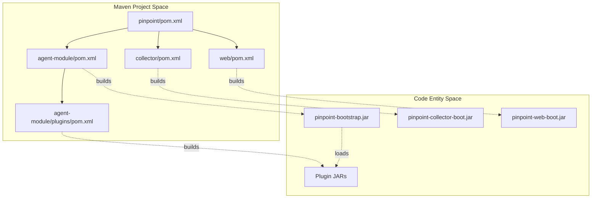
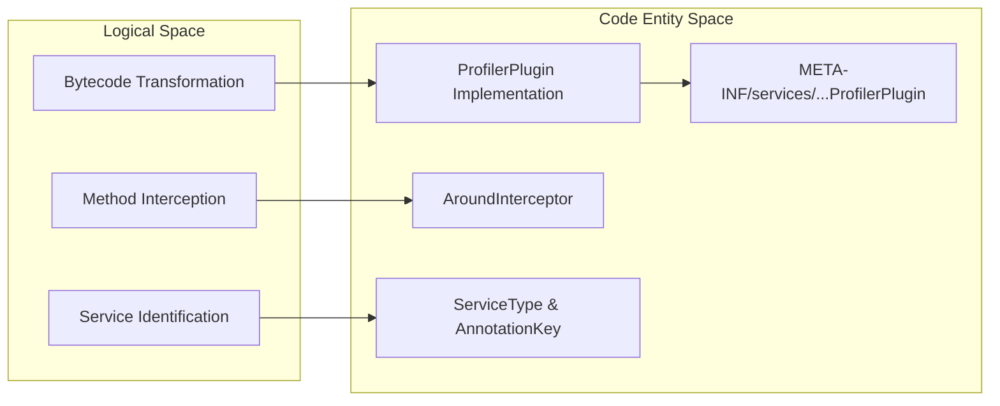

<!-- source: DeepWiki mcp.deepwiki.com · repo pinpoint-apm/pinpoint · page 12.4 Contributing Guidelines · fetched 2026-10-29 -->

# Contributing Guidelines

<details>
<summary>Relevant source files</summary>

The following files were used as context for generating this wiki page:

- [.github/ISSUE_TEMPLATE/bug_report.md](.github/ISSUE_TEMPLATE/bug_report.md)
- [.github/ISSUE_TEMPLATE/feature_request.md](.github/ISSUE_TEMPLATE/feature_request.md)
- [.github/ISSUE_TEMPLATE/question.md](.github/ISSUE_TEMPLATE/question.md)
- [.github/ISSUE_TEMPLATE/troubleshooting.md](.github/ISSUE_TEMPLATE/troubleshooting.md)
- [README.md](README.md)
- [agent-module/plugins/undertow-servlet/README.md](agent-module/plugins/undertow-servlet/README.md)
- [doc/images/ss_error-analysis1.png](doc/images/ss_error-analysis1.png)
- [doc/images/ss_error-analysis3.gif](doc/images/ss_error-analysis3.gif)
- [doc/modules.md](doc/modules.md)
- [quickstart/README.md](quickstart/README.md)

</details>


## Purpose and Scope

This document provides guidelines for developers who want to contribute code, plugins, or documentation to the Pinpoint APM project. It covers the development environment setup, build system, project structure navigation, and the contribution submission process. Pinpoint is a distributed tracing solution inspired by Google Dapper, supporting Java, PHP, and Python applications [README.md:23-27]().

---

## Prerequisites

Before contributing to Pinpoint, ensure your development environment meets these requirements:

| Component | Version | Required For |
|-----------|---------|--------------|
| JDK 8 | 8+ | Agent development and building [quickstart/README.md:46](), [README.md:73]() |
| Maven | 3.6+ | Building all modules [README.md:5]() |
| Node.js | Latest | Frontend development |
| Git | Latest | Version control [README.md:62]() |
| Docker | Latest | Container testing and quickstart [quickstart/README.md:4-7]() |

**Sources:** [README.md:5](), [README.md:73](), [quickstart/README.md:4-7](), [quickstart/README.md:46]()

---

## Getting the Source Code

Clone the Pinpoint repository from GitHub:

```bash
git clone https://github.com/pinpoint-apm/pinpoint.git
cd pinpoint
```

Alternatively, you can download the project as a ZIP file [quickstart/README.md:62]().

**Sources:** [README.md:62](), [quickstart/README.md:62]()

---

## Building the Project

### Full Build

Build all modules using the Maven wrapper included in the repository:

```bash
./mvnw install -DskipTests=true
```

### Building Specific Components

**Quickstart TestApp:**
```bash
cd quickstart/testapp
./mvnw clean package
```

**Sources:** [quickstart/README.md:67-68](), [quickstart/README.md:73-75]()

---

## Build System Architecture

The following diagram illustrates the relationship between the Maven build system and the core code entities.

### Build Entity Map

**Sources:** [quickstart/README.md:31](), [quickstart/README.md:38](), [quickstart/README.md:58](), [quickstart/README.md:67]()

---

## Development Workflow

### Local Component Execution

For local testing, components can be started using `java -jar`. Note that a running HBase instance with the correct schema is required [quickstart/README.md:12-25]().

**Collector:**
```bash
java -jar -Dpinpoint.zookeeper.address=localhost pinpoint-collector-boot-2.3.1.jar
```

**Web:**
```bash
java -jar -Dpinpoint.zookeeper.address=localhost pinpoint-web-boot-2.3.1.jar
```

**Agent (with Javaagent):**
```bash
java -jar -javaagent:pinpoint-agent/pinpoint-bootstrap.jar \
  -Dpinpoint.agentId=test-agent \
  -Dpinpoint.applicationName=TESTAPP \
  application.jar
```

**Sources:** [quickstart/README.md:31](), [quickstart/README.md:38](), [quickstart/README.md:58-59]()

---

## Submitting Contributions

### Reporting Issues

Pinpoint uses GitHub Issue templates to ensure high-quality reports. Before creating an issue, check the [FAQ](https://pinpoint-apm.gitbook.io/pinpoint/faq) and search existing [issues](https://github.com/pinpoint-apm/pinpoint/issues) [.github/ISSUE_TEMPLATE/bug_report.md:7-10]().

| Template | Purpose | Key Fields |
|----------|---------|------------|
| Bug Report | Reporting a bug | Steps to reproduce, Expected vs Actual, Logs [.github/ISSUE_TEMPLATE/bug_report.md:15-31]() |
| Feature Request | Suggesting an idea | Related module, Solution description [.github/ISSUE_TEMPLATE/feature_request.md:7-15]() |
| Troubleshooting | Technical support | Version, Problem description, Logs [.github/ISSUE_TEMPLATE/troubleshooting.md:12-29]() |
| Question | General questions | Detailed description [.github/ISSUE_TEMPLATE/question.md:12-14]() |

**Sources:** [.github/ISSUE_TEMPLATE/bug_report.md:1-35](), [.github/ISSUE_TEMPLATE/feature_request.md:1-21](), [.github/ISSUE_TEMPLATE/troubleshooting.md:1-33](), [.github/ISSUE_TEMPLATE/question.md:1-15]()

---

## Plugin Development

Plugins are the primary way to extend Pinpoint's tracing capabilities to new libraries.

### Plugin Component Map
The following diagram bridges the logical concept of a plugin to the specific code artifacts required for implementation.



### Plugin Module Guidelines
1. **Location**: Plugins must be placed under `agent-module/plugins/` [doc/modules.md:6]().
2. **Library Versioning**: Document the instrumented library version range in the plugin's `README.md` [agent-module/plugins/undertow-servlet/README.md:7]().
3. **Instrumentation**: Use the `ProfilerPlugin` interface to define where to inject interceptors.
4. **ClassLoader Isolation**: If the target library uses separate ClassLoaders (e.g., WildFly), ensure the plugin handles this appropriately [agent-module/plugins/undertow-servlet/README.md:10]().

**Sources:** [doc/modules.md:6-86](), [agent-module/plugins/undertow-servlet/README.md:1-11]()

---

## Code Standards

### Logging
When submitting code, ensure debug logs are included for critical execution paths. This is essential for troubleshooting [ .github/ISSUE_TEMPLATE/bug_report.md:31]().

### Compatibility
- **JDK**: Ensure agent code remains compatible with JDK 8 [README.md:73]().
- **Modules**: Check the existing module list in `doc/modules.md` to avoid duplicating work and to ensure version compatibility [doc/modules.md:4-86]().

**Sources:** [README.md:73](), [doc/modules.md:4-86](), [.github/ISSUE_TEMPLATE/bug_report.md:31]()

---

