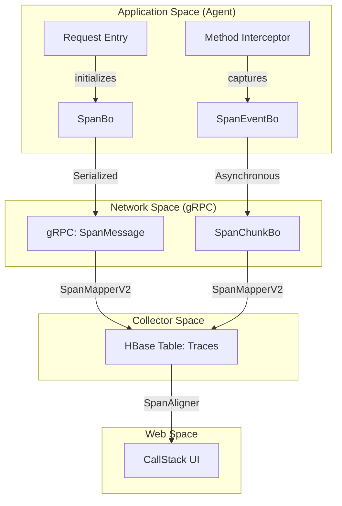
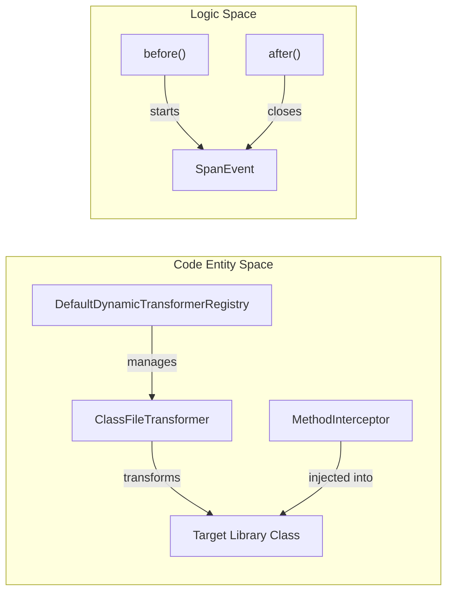

<!-- source: DeepWiki mcp.deepwiki.com · repo pinpoint-apm/pinpoint · page 13 Glossary · fetched 2026-10-29 -->

# Glossary

Relevant source files

The following files were used as context for generating this wiki page:

- [.github/ISSUE_TEMPLATE/bug_report.md](.github/ISSUE_TEMPLATE/bug_report.md)
- [.github/ISSUE_TEMPLATE/feature_request.md](.github/ISSUE_TEMPLATE/feature_request.md)
- [.github/ISSUE_TEMPLATE/question.md](.github/ISSUE_TEMPLATE/question.md)
- [.github/ISSUE_TEMPLATE/troubleshooting.md](.github/ISSUE_TEMPLATE/troubleshooting.md)
- [README.md](README.md)
- [agent-module/plugins/undertow-servlet/README.md](agent-module/plugins/undertow-servlet/README.md)
- [agent-module/profiler/src/main/java/com/navercorp/pinpoint/profiler/context/exception/model/ExceptionWrapper.java](agent-module/profiler/src/main/java/com/navercorp/pinpoint/profiler/context/exception/model/ExceptionWrapper.java)
- [agent-module/profiler/src/main/java/com/navercorp/pinpoint/profiler/monitor/metric/uri/URIKey.java](agent-module/profiler/src/main/java/com/navercorp/pinpoint/profiler/monitor/metric/uri/URIKey.java)
- [batch/pom.xml](batch/pom.xml)
- [collector/pom.xml](collector/pom.xml)
- [collector/src/main/java/com/navercorp/pinpoint/collector/util/MultipleAddress.java](collector/src/main/java/com/navercorp/pinpoint/collector/util/MultipleAddress.java)
- [commons-hbase/pom.xml](commons-hbase/pom.xml)
- [commons-profiler/src/main/java/com/navercorp/pinpoint/common/profiler/trace/DefaultDisplayArgument.java](commons-profiler/src/main/java/com/navercorp/pinpoint/common/profiler/trace/DefaultDisplayArgument.java)
- [commons-server/pom.xml](commons-server/pom.xml)
- [commons-server/src/main/java/com/navercorp/pinpoint/common/server/bo/BasicSpan.java](commons-server/src/main/java/com/navercorp/pinpoint/common/server/bo/BasicSpan.java)
- [commons-server/src/main/java/com/navercorp/pinpoint/common/server/bo/SpanBo.java](commons-server/src/main/java/com/navercorp/pinpoint/common/server/bo/SpanBo.java)
- [commons-server/src/main/java/com/navercorp/pinpoint/common/server/bo/SpanChunkBo.java](commons-server/src/main/java/com/navercorp/pinpoint/common/server/bo/SpanChunkBo.java)
- [commons-server/src/main/java/com/navercorp/pinpoint/common/server/bo/SpanEventBo.java](commons-server/src/main/java/com/navercorp/pinpoint/common/server/bo/SpanEventBo.java)
- [commons-server/src/main/java/com/navercorp/pinpoint/common/server/bo/SpanEventComparator.java](commons-server/src/main/java/com/navercorp/pinpoint/common/server/bo/SpanEventComparator.java)
- [commons-server/src/main/java/com/navercorp/pinpoint/common/server/bo/serializer/trace/v2/bitfield/SpanBitField.java](commons-server/src/main/java/com/navercorp/pinpoint/common/server/bo/serializer/trace/v2/bitfield/SpanBitField.java)
- [commons-server/src/main/java/com/navercorp/pinpoint/common/server/util/json/TypeRef.java](commons-server/src/main/java/com/navercorp/pinpoint/common/server/util/json/TypeRef.java)
- [commons-server/src/test/java/com/navercorp/pinpoint/common/server/bo/SpanBoTest.java](commons-server/src/test/java/com/navercorp/pinpoint/common/server/bo/SpanBoTest.java)
- [commons/pom.xml](commons/pom.xml)
- [commons/src/main/java/com/navercorp/pinpoint/common/Version.java](commons/src/main/java/com/navercorp/pinpoint/common/Version.java)
- [commons/src/main/java/com/navercorp/pinpoint/common/trace/AnnotationKey.java](commons/src/main/java/com/navercorp/pinpoint/common/trace/AnnotationKey.java)
- [commons/src/main/java/com/navercorp/pinpoint/common/trace/ErrorCategoryResolver.java](commons/src/main/java/com/navercorp/pinpoint/common/trace/ErrorCategoryResolver.java)
- [commons/src/main/java/com/navercorp/pinpoint/common/trace/OpenTelemetryServiceTypeCategory.java](commons/src/main/java/com/navercorp/pinpoint/common/trace/OpenTelemetryServiceTypeCategory.java)
- [commons/src/main/java/com/navercorp/pinpoint/common/trace/ServiceType.java](commons/src/main/java/com/navercorp/pinpoint/common/trace/ServiceType.java)
- [commons/src/test/java/com/navercorp/pinpoint/common/trace/ErrorCategoryResolverTest.java](commons/src/test/java/com/navercorp/pinpoint/common/trace/ErrorCategoryResolverTest.java)
- [doc/images/ss_error-analysis1.png](doc/images/ss_error-analysis1.png)
- [doc/images/ss_error-analysis3.gif](doc/images/ss_error-analysis3.gif)
- [doc/modules.md](doc/modules.md)
- [hbase/pom.xml](hbase/pom.xml)
- [pom.xml](pom.xml)
- [quickstart/README.md](quickstart/README.md)
- [web-frontend/src/main/v3/apps/web/public/img/icons/OPENTELEMETRY_SERVER.png](web-frontend/src/main/v3/apps/web/public/img/icons/OPENTELEMETRY_SERVER.png)
- [web-frontend/src/main/v3/apps/web/public/img/servers/OPENTELEMETRY_SERVER.png](web-frontend/src/main/v3/apps/web/public/img/servers/OPENTELEMETRY_SERVER.png)
- [web-frontend/src/main/v3/apps/web/public/img/servers/OPENTELEMETY_DB.png](web-frontend/src/main/v3/apps/web/public/img/servers/OPENTELEMETY_DB.png)
- [web/pom.xml](web/pom.xml)
- [web/src/main/java/com/navercorp/pinpoint/web/applicationmap/map/FilteredMapBuilder.java](web/src/main/java/com/navercorp/pinpoint/web/applicationmap/map/FilteredMapBuilder.java)
- [web/src/main/java/com/navercorp/pinpoint/web/filter/responsetime/DefaultExecutionTypeFilter.java](web/src/main/java/com/navercorp/pinpoint/web/filter/responsetime/DefaultExecutionTypeFilter.java)
- [web/src/main/java/com/navercorp/pinpoint/web/filter/responsetime/SpanResponseConditionFilter.java](web/src/main/java/com/navercorp/pinpoint/web/filter/responsetime/SpanResponseConditionFilter.java)
- [web/src/main/java/com/navercorp/pinpoint/web/trace/dao/mapper/SpanMapperV2.java](web/src/main/java/com/navercorp/pinpoint/web/trace/dao/mapper/SpanMapperV2.java)
- [web/src/main/java/com/navercorp/pinpoint/web/trace/service/SpanServiceImpl.java](web/src/main/java/com/navercorp/pinpoint/web/trace/service/SpanServiceImpl.java)
- [web/src/main/java/com/navercorp/pinpoint/web/trace/service/TransactionInfoService.java](web/src/main/java/com/navercorp/pinpoint/web/trace/service/TransactionInfoService.java)
- [web/src/main/java/com/navercorp/pinpoint/web/trace/service/TransactionInfoServiceImpl.java](web/src/main/java/com/navercorp/pinpoint/web/trace/service/TransactionInfoServiceImpl.java)
- [web/src/main/java/com/navercorp/pinpoint/web/trace/span/Align.java](web/src/main/java/com/navercorp/pinpoint/web/trace/span/Align.java)
- [web/src/main/java/com/navercorp/pinpoint/web/trace/span/AlignComparator.java](web/src/main/java/com/navercorp/pinpoint/web/trace/span/AlignComparator.java)
- [web/src/main/java/com/navercorp/pinpoint/web/trace/span/CallTreeNode.java](web/src/main/java/com/navercorp/pinpoint/web/trace/span/CallTreeNode.java)
- [web/src/main/java/com/navercorp/pinpoint/web/trace/span/Link.java](web/src/main/java/com/navercorp/pinpoint/web/trace/span/Link.java)
- [web/src/main/java/com/navercorp/pinpoint/web/trace/span/LinkMap.java](web/src/main/java/com/navercorp/pinpoint/web/trace/span/LinkMap.java)
- [web/src/main/java/com/navercorp/pinpoint/web/trace/span/Node.java](web/src/main/java/com/navercorp/pinpoint/web/trace/span/Node.java)
- [web/src/main/java/com/navercorp/pinpoint/web/trace/span/NodeList.java](web/src/main/java/com/navercorp/pinpoint/web/trace/span/NodeList.java)
- [web/src/main/java/com/navercorp/pinpoint/web/trace/span/SpanAlign.java](web/src/main/java/com/navercorp/pinpoint/web/trace/span/SpanAlign.java)
- [web/src/main/java/com/navercorp/pinpoint/web/trace/span/SpanAligner.java](web/src/main/java/com/navercorp/pinpoint/web/trace/span/SpanAligner.java)
- [web/src/main/java/com/navercorp/pinpoint/web/trace/span/SpanEventAlign.java](web/src/main/java/com/navercorp/pinpoint/web/trace/span/SpanEventAlign.java)
- [web/src/test/java/com/navercorp/pinpoint/web/trace/callstacks/RecordFactoryTest.java](web/src/test/java/com/navercorp/pinpoint/web/trace/callstacks/RecordFactoryTest.java)

This glossary defines the technical terms, abbreviations, and domain-specific concepts used throughout the Pinpoint APM codebase. It serves as a reference for onboarding engineers to understand the internal data structures, architectural components, and tracing terminology.

## Core APM Concepts

### Trace & Span
Pinpoint follows the Google Dapper model for distributed tracing. A **Trace** represents the entire journey of a request as it moves through a distributed system. A **Span** is the basic unit of work, representing a single RPC or method execution within a service.

*   **Span**: The root unit of work within a single node. It contains information like `agentId`, `applicationName`, and `startTime` [commons-server/src/main/java/com/navercorp/pinpoint/common/server/bo/SpanBo.java:44-63]().
*   **SpanEvent**: Represents an internal method call or a nested event within a Span. Multiple `SpanEvent`s are contained within a single `Span` [commons-server/src/main/java/com/navercorp/pinpoint/common/server/bo/SpanBo.java:75]().
*   **SpanChunk**: A partial piece of a Span, used to send SpanEvents to the Collector asynchronously before the entire Span is completed [commons-server/src/main/java/com/navercorp/pinpoint/common/server/bo/SpanChunkBo.java:1-30]().

### Trace IDs
*   **TransactionId**: A unique identifier for a single distributed trace. It is typically composed of `AgentId`, `AgentStartTime`, and a `SequenceNumber`.
*   **SpanId**: A unique 64-bit identifier for a specific span within a trace [commons-server/src/main/java/com/navercorp/pinpoint/common/server/bo/SpanBo.java:57]().
*   **ParentSpanId**: The ID of the span that called the current span, used to reconstruct the call tree [commons-server/src/main/java/com/navercorp/pinpoint/common/server/bo/SpanBo.java:58]().

### Data Flow Overview
The following diagram illustrates how trace data entities move from the Instrumented Application to the Storage layer.

**Trace Data Entity Mapping**

**Sources:** [commons-server/src/main/java/com/navercorp/pinpoint/common/server/bo/SpanBo.java:35-90](), [web/src/main/java/com/navercorp/pinpoint/web/trace/dao/mapper/SpanMapperV2.java:1-50](), [web/src/main/java/com/navercorp/pinpoint/web/trace/span/SpanAligner.java:1-40]()

---

## Pinpoint-Specific Terms

### ServiceType
A numerical code (short) used to categorize different software components (e.g., Tomcat, MySQL, Redis). 
*   **Internal Codes (0-999)**: Reserved for Pinpoint internal use [commons/src/main/java/com/navercorp/pinpoint/common/trace/ServiceType.java:27-39]().
*   **Server Codes (1000-1899)**: Used for application servers like Tomcat (1010) or Jetty (1030) [commons/src/main/java/com/navercorp/pinpoint/common/trace/ServiceType.java:42-53]().
*   **Database Codes (2000-2899)**: Used for DBs like MySQL (2100) or Oracle (2300) [commons/src/main/java/com/navercorp/pinpoint/common/trace/ServiceType.java:109-128]().

### Annotation
Annotations are key-value pairs attached to Spans or SpanEvents to store metadata such as SQL queries, HTTP URLs, or method arguments.
*   **AnnotationKey**: Predefined keys like `http.url` (40) or `sql` (21) [commons/src/main/java/com/navercorp/pinpoint/common/trace/AnnotationKey.java:60-66]().

### ServerMap
The visual topology map in the Pinpoint Web UI that shows how applications are interconnected. It is built using `FilteredMapBuilder` by analyzing caller-callee relationships in Span data [web/src/main/java/com/navercorp/pinpoint/web/applicationmap/map/FilteredMapBuilder.java:1-50]().

---

## Module Definitions

| Module | Description |
| :--- | :--- |
| `agent-module` | Contains the Java Agent that performs bytecode instrumentation [pom.xml:83](). |
| `collector` | Receives data from agents via gRPC and stores it in HBase [collector/pom.xml:27-29](). |
| `web` | Backend for the UI, providing REST APIs and ServerMap visualization [web/pom.xml:27-29](). |
| `commons-hbase` | Shared utilities for HBase interaction and `HbaseTemplate` [commons-hbase/pom.xml:27-29](). |
| `hbase-uid-module` | Manages mapping between long strings (application names) and compact IDs [pom.xml:124](). |
| `batch` | Handles background tasks like alarms and data cleanup [batch/pom.xml:12-13](). |

---

## Technical Infrastructure

### HBase Schema
Pinpoint uses Apache HBase as its primary storage. Key tables include:
*   **AgentInfo**: Stores agent metadata.
*   **TraceV2**: Stores serialized `SpanBo` and `SpanEventBo` data.
*   **ApplicationIndex**: Maps application names to their associated agents.

### Instrumentation Logic
The Agent uses **Bytecode Transformation** to inject tracing code into target libraries without requiring source code changes.

**Instrumentation Entity Mapping**

**Sources:** [quickstart/README.md:100-104](), [commons-server/src/main/java/com/navercorp/pinpoint/common/server/bo/SpanEventBo.java:1-50]()

### BO (Business Object)
In Pinpoint, classes suffixed with `Bo` (e.g., `SpanBo`, `AgentInfoBo`) represent the internal data models used for serialization and storage in HBase [commons-server/src/main/java/com/navercorp/pinpoint/common/server/bo/SpanBo.java:35]().

---

## Abbreviations

*   **APM**: Application Performance Management.
*   **RPC**: Remote Procedure Call.
*   **TPS**: Transactions Per Second.
*   **UID**: Unique Identifier (often referring to the `hbase-uid-module` which compresses strings to bytes).
*   **OTLP**: OpenTelemetry Protocol (supported via `otlptrace` and `otlpmetric` modules) [pom.xml:120-121]().

**Sources:**
- [pom.xml:81-125]()
- [commons/src/main/java/com/navercorp/pinpoint/common/trace/ServiceType.java:17-104]()
- [commons/src/main/java/com/navercorp/pinpoint/common/trace/AnnotationKey.java:23-147]()
- [commons-server/src/main/java/com/navercorp/pinpoint/common/server/bo/SpanBo.java:35-90]()
- [web/pom.xml:27-120]()
- [collector/pom.xml:27-85]()
- [README.md:23-71]()