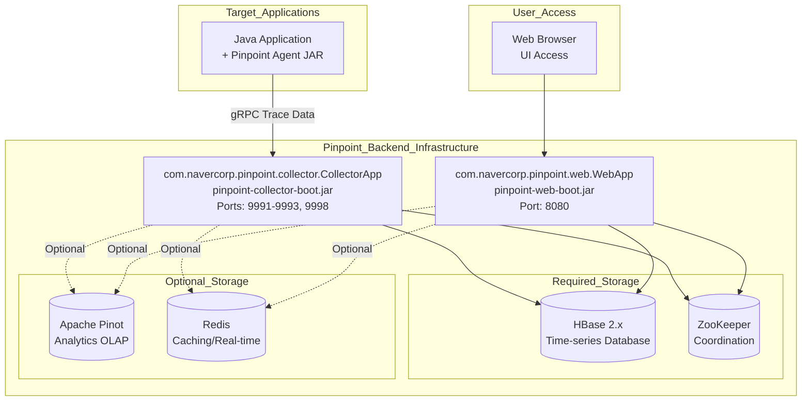
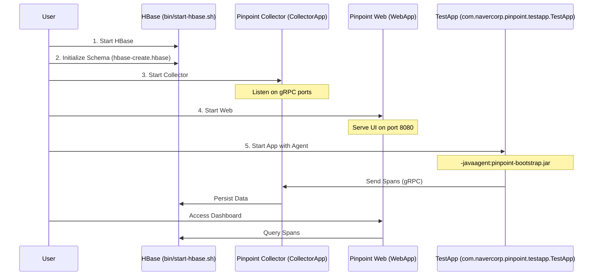

<!-- source: DeepWiki mcp.deepwiki.com · repo pinpoint-apm/pinpoint · page 2 Getting Started · fetched 2026-10-29 -->

# Getting Started

<details>
<summary>Relevant source files</summary>

The following files were used as context for generating this wiki page:

- [.github/ISSUE_TEMPLATE/bug_report.md](.github/ISSUE_TEMPLATE/bug_report.md)
- [.github/ISSUE_TEMPLATE/feature_request.md](.github/ISSUE_TEMPLATE/feature_request.md)
- [.github/ISSUE_TEMPLATE/question.md](.github/ISSUE_TEMPLATE/question.md)
- [.github/ISSUE_TEMPLATE/troubleshooting.md](.github/ISSUE_TEMPLATE/troubleshooting.md)
- [README.md](README.md)
- [agent-module/plugins/undertow-servlet/README.md](agent-module/plugins/undertow-servlet/README.md)
- [doc/images/ss_error-analysis1.png](doc/images/ss_error-analysis1.png)
- [doc/images/ss_error-analysis3.gif](doc/images/ss_error-analysis3.gif)
- [doc/modules.md](doc/modules.md)
- [quickstart/README.md](quickstart/README.md)
- [quickstart/testapp/pom.xml](quickstart/testapp/pom.xml)
- [quickstart/testapp/src/main/java/com/navercorp/pinpoint/testapp/controller/ApisController.java](quickstart/testapp/src/main/java/com/navercorp/pinpoint/testapp/controller/ApisController.java)
- [quickstart/testapp/src/main/java/com/navercorp/pinpoint/testapp/controller/CallSelfController.java](quickstart/testapp/src/main/java/com/navercorp/pinpoint/testapp/controller/CallSelfController.java)
- [quickstart/testapp/src/main/java/com/navercorp/pinpoint/testapp/controller/HttpClient4Controller.java](quickstart/testapp/src/main/java/com/navercorp/pinpoint/testapp/controller/HttpClient4Controller.java)
- [quickstart/testapp/src/main/java/com/navercorp/pinpoint/testapp/controller/SimpleController.java](quickstart/testapp/src/main/java/com/navercorp/pinpoint/testapp/controller/SimpleController.java)
- [quickstart/testapp/src/main/java/com/navercorp/pinpoint/testapp/controller/StressController.java](quickstart/testapp/src/main/java/com/navercorp/pinpoint/testapp/controller/StressController.java)
- [quickstart/testapp/src/main/java/com/navercorp/pinpoint/testapp/service/remote/HttpRemoteService.java](quickstart/testapp/src/main/java/com/navercorp/pinpoint/testapp/service/remote/HttpRemoteService.java)

</details>


This page provides an overview of how to set up and deploy Pinpoint APM for the first time. It covers system requirements, architectural components that need to be deployed, and the available installation methods. For detailed step-by-step instructions, see the child pages: [Quick Start Guide](#2.1) for a rapid local setup, [Building from Source](#2.2) for development and customization, or [Deployment Options](#2.3) for production deployments using Docker or Kubernetes.

## Pinpoint System Components

Pinpoint APM consists of four primary components that must be deployed to create a working monitoring system:



**Component Roles:**

| Component | Purpose | Deployment Target |
|-----------|---------|------------------|
| **Pinpoint Agent** | Bytecode instrumentation of target applications; collects trace data without code changes | Attached to each monitored JVM via `-javaagent` flag |
| **Pinpoint Collector** | Receives trace data via gRPC; processes and stores in HBase/Pinot | Standalone Java application (Spring Boot) |
| **Pinpoint Web** | REST API server and UI; queries stored traces; serves React frontend | Standalone Java application (Spring Boot) |
| **HBase** | Primary storage for detailed trace data (`SpanBo`, `SpanChunkBo`) | Distributed database cluster |
| **ZooKeeper** | Service coordination between Collector and Web instances | Required for cluster coordination |

**Sources:** [README.md:25-60](), [quickstart/README.md:1-41](), [quickstart/README.md:113-115]()

## Prerequisites and System Requirements

### Java Version Requirements

Pinpoint requires JDK 8 or higher for monitored applications, while the backend components have specific requirements:

| Component | Requirement |
|-----------|-------------|
| **Target Application (Agent)** | JDK 8+ [README.md:73-73]() |
| **Building Pinpoint** | JDK 8+ [quickstart/README.md:46-46]() |
| **Quickstart TestApp** | Java 1.8 [quickstart/testapp/pom.xml:30-32]() |

### Storage Compatibility

| Component | Version | Role |
|-----------|---------|------|
| **HBase** | 1.2.x+ | Primary trace storage [quickstart/README.md:12-13]() |
| **ZooKeeper** | Required | Coordination for Collector/Web [quickstart/README.md:31-38]() |

**Sources:** [README.md:73-73](), [quickstart/README.md:12-46](), [quickstart/testapp/pom.xml:30-32]()

## Installation Deployment Flow

The typical deployment sequence for Pinpoint involves initializing storage before starting the application logic:



**Critical Configuration Points:**

1. **HBase Schema**: Run the creation script located in `hbase/scripts` [quickstart/README.md:21-25]().
2. **ZooKeeper Address**: Pass `-Dpinpoint.zookeeper.address` to both Collector and Web [quickstart/README.md:31-38]().
3. **Agent Identity**: Each agent requires a unique `pinpoint.agentId` and a logical `pinpoint.applicationName` [quickstart/README.md:58-59]().

**Sources:** [quickstart/README.md:12-59](), [quickstart/testapp/pom.xml:36-36]()

## Installation Approaches

Pinpoint offers three main approaches for installation:

### 1. Quick Start (Fastest - Local Testing)
**Use Case:** Evaluation and local development.
**Method:** Download pre-built binaries from the [Latest Release](https://github.com/pinpoint-apm/pinpoint/releases/latest).
**Components:** Includes `pinpoint-agent`, `pinpoint-collector-boot`, `pinpoint-web-boot`, and a `pinpoint-quickstart-testapp`.
**See:** [Quick Start Guide](#2.1) for details.
**Sources:** [quickstart/README.md:1-54]()

### 2. Building from Source
**Use Case:** Customization and contributing.
**Method:** Clone the repository and build using the Maven wrapper:
```bash
./mvnw install -DskipTests=true
```
**See:** [Building from Source](#2.2) for details.
**Sources:** [quickstart/README.md:61-68]()

### 3. Container Deployment (Production)
**Use Case:** Scalable production environments.
**Method:** Use the official [Pinpoint-Docker](https://github.com/pinpoint-apm/pinpoint-docker) or [Pinpoint-Kubernetes](https://github.com/pinpoint-apm/pinpoint-kubernetes) repositories.
**See:** [Deployment Options](#2.3) for details.
**Sources:** [README.md:41-42](), [quickstart/README.md:4-7]()

## Agent Attachment

The Pinpoint Agent instruments applications at runtime using the `-javaagent` JVM argument. No code changes are required in the target application [README.md:34-34]().

```bash
java -jar -javaagent:pinpoint-bootstrap.jar \
     -Dpinpoint.agentId=test-agent \
     -Dpinpoint.applicationName=TESTAPP \
     your-application.jar
```

**Required Parameters:**
* `pinpoint.agentId`: A unique ID for the specific instance (max 24 characters).
* `pinpoint.applicationName`: A name to group multiple instances of the same service.

**Sources:** [quickstart/README.md:56-59](), [README.md:34-34]()

## Verification

After deployment, you can verify the setup by accessing the Web UI at `http://localhost:8080` [README.md:17-17]().

If using the `pinpoint-quickstart-testapp`, you can generate sample traffic by visiting `http://localhost:8082` [quickstart/README.md:113-113](). The test application provides several endpoints to simulate different behaviors:
* `/getCurrentTimestamp`: Simple success response [quickstart/testapp/src/main/java/com/navercorp/pinpoint/testapp/controller/SimpleController.java:17-24]().
* `/sleep3`, `/sleep5`, `/sleep7`: Simulates latency [quickstart/testapp/src/main/java/com/navercorp/pinpoint/testapp/controller/SimpleController.java:35-66]().
* `/httpclient4/getGeoCode`: Simulates external HTTP calls using `HttpClient4` [quickstart/testapp/src/main/java/com/navercorp/pinpoint/testapp/controller/HttpClient4Controller.java:32-40]().

**Sources:** [README.md:17-17](), [quickstart/README.md:113-113](), [quickstart/testapp/src/main/java/com/navercorp/pinpoint/testapp/controller/SimpleController.java:17-66](), [quickstart/testapp/src/main/java/com/navercorp/pinpoint/testapp/controller/HttpClient4Controller.java:32-40]()

---

