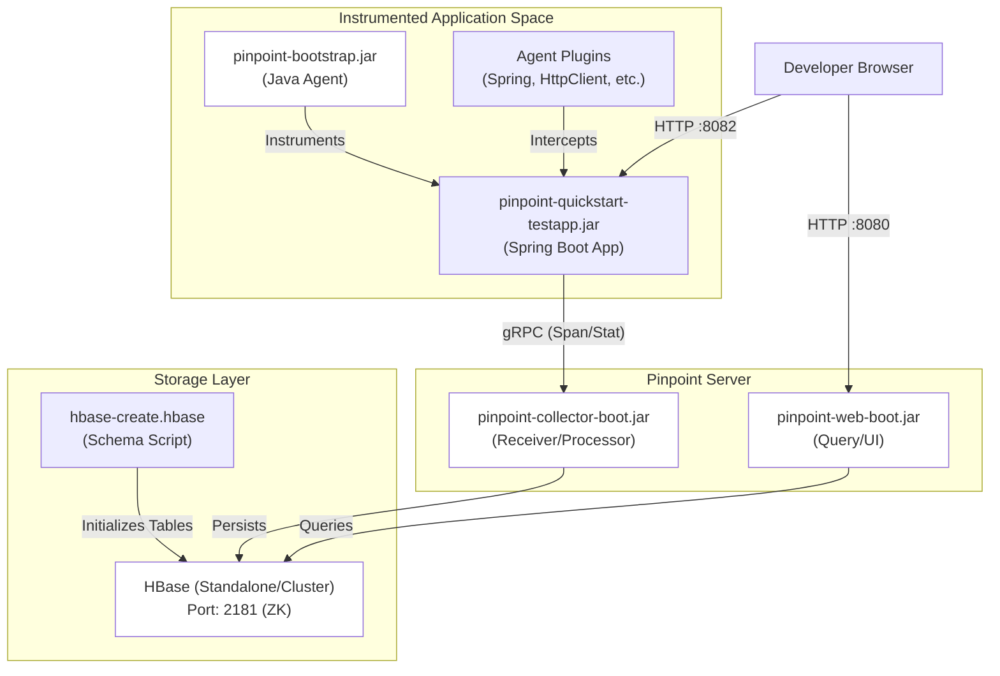
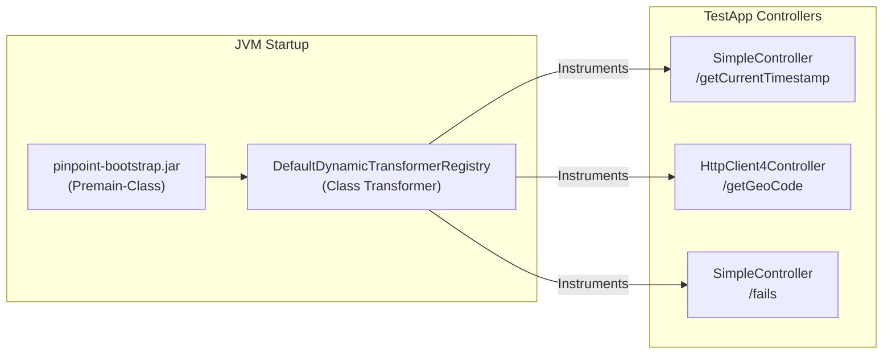

<!-- source: DeepWiki mcp.deepwiki.com · repo pinpoint-apm/pinpoint · page 2.1 Quick Start Guide · fetched 2026-10-29 -->

# Quick Start Guide

<details>
<summary>Relevant source files</summary>

The following files were used as context for generating this wiki page:

- [.github/ISSUE_TEMPLATE/bug_report.md](.github/ISSUE_TEMPLATE/bug_report.md)
- [.github/ISSUE_TEMPLATE/feature_request.md](.github/ISSUE_TEMPLATE/feature_request.md)
- [.github/ISSUE_TEMPLATE/question.md](.github/ISSUE_TEMPLATE/question.md)
- [.github/ISSUE_TEMPLATE/troubleshooting.md](.github/ISSUE_TEMPLATE/troubleshooting.md)
- [README.md](README.md)
- [agent-module/plugins/undertow-servlet/README.md](agent-module/plugins/undertow-servlet/README.md)
- [doc/images/ss_error-analysis1.png](doc/images/ss_error-analysis1.png)
- [doc/images/ss_error-analysis3.gif](doc/images/ss_error-analysis3.gif)
- [doc/modules.md](doc/modules.md)
- [quickstart/README.md](quickstart/README.md)
- [quickstart/testapp/pom.xml](quickstart/testapp/pom.xml)
- [quickstart/testapp/src/main/java/com/navercorp/pinpoint/testapp/controller/ApisController.java](quickstart/testapp/src/main/java/com/navercorp/pinpoint/testapp/controller/ApisController.java)
- [quickstart/testapp/src/main/java/com/navercorp/pinpoint/testapp/controller/CallSelfController.java](quickstart/testapp/src/main/java/com/navercorp/pinpoint/testapp/controller/CallSelfController.java)
- [quickstart/testapp/src/main/java/com/navercorp/pinpoint/testapp/controller/HttpClient4Controller.java](quickstart/testapp/src/main/java/com/navercorp/pinpoint/testapp/controller/HttpClient4Controller.java)
- [quickstart/testapp/src/main/java/com/navercorp/pinpoint/testapp/controller/SimpleController.java](quickstart/testapp/src/main/java/com/navercorp/pinpoint/testapp/controller/SimpleController.java)
- [quickstart/testapp/src/main/java/com/navercorp/pinpoint/testapp/controller/StressController.java](quickstart/testapp/src/main/java/com/navercorp/pinpoint/testapp/controller/StressController.java)
- [quickstart/testapp/src/main/java/com/navercorp/pinpoint/testapp/service/remote/HttpRemoteService.java](quickstart/testapp/src/main/java/com/navercorp/pinpoint/testapp/service/remote/HttpRemoteService.java)

</details>


This document provides step-by-step instructions for running Pinpoint locally using pre-built release binaries and the provided quickstart package. By following this guide, you will set up a complete Pinpoint environment including HBase storage, Collector, Web UI, and attach an agent to a test application.

**Sources:** [README.md:37-39](), [quickstart/README.md:1-3]()

---

## System Architecture and Data Flow

The following diagram illustrates the interaction between the QuickStart components and the primary data flow from the instrumented application to the storage layer.

### System Component Mapping


**Sources:** [quickstart/README.md:12-39](), [README.md:45-60]()

---

## Installation Steps

### 1. Storage Setup (HBase)
Pinpoint uses Apache HBase as its primary time-series data store. For the quickstart, a standalone HBase instance is sufficient.

1. **Download and Start:**
   Extract the HBase binary and execute the start script.
   ```bash
   $ tar xzvf hbase-x.x.x-bin.tar.gz
   $ cd hbase-x.x.x/
   $ ./bin/start-hbase.sh
   ```
2. **Initialize Schema:**
   Run the provided HBase shell script to create the necessary tables (e.g., `AgentInfo`, `TraceV2`, `ApplicationStatAggre`).
   ```bash
   $ ./bin/hbase shell hbase-create.hbase
   ```

**Sources:** [quickstart/README.md:12-25]()

### 2. Pinpoint Collector
The Collector receives data from agents via gRPC and persists it to HBase.

```bash
$ java -jar -Dpinpoint.zookeeper.address=localhost pinpoint-collector-boot-3.0.4.jar
```
*   **Key Parameter:** `-Dpinpoint.zookeeper.address` points the collector to the HBase ZooKeeper instance for data persistence coordination.

**Sources:** [quickstart/README.md:27-32]()

### 3. Pinpoint Web
The Web component provides the graphical user interface and REST APIs for analyzing trace data.

```bash
$ java -jar -Dpinpoint.zookeeper.address=localhost pinpoint-web-boot-3.0.4.jar
```
Once started, the UI is typically accessible at `http://localhost:8080`.

**Sources:** [quickstart/README.md:34-39]()

---

## Running the Quickstart TestApp

The Pinpoint repository includes a `quickstart/testapp` module. This is a Spring Boot application designed to demonstrate Pinpoint's tracing capabilities across various scenarios (HTTP calls, errors, etc.).

### Agent Attachment Mechanism
The agent is attached to the JVM using the `-javaagent` argument. It performs bytecode transformation at class-loading time.



### Execution Command
To run the test application with the agent:
```bash
$ java -jar \
  -javaagent:pinpoint-agent-3.0.4/pinpoint-bootstrap.jar \
  -Dpinpoint.agentId=test-agent \
  -Dpinpoint.applicationName=TESTAPP \
  pinpoint-quickstart-testapp-3.0.4.jar
```

**Required System Properties:**
*   `pinpoint.agentId`: A unique ID for the specific JVM instance (max 24 characters).
*   `pinpoint.applicationName`: A logical group name for the service (max 24 characters).

**Sources:** [quickstart/README.md:41-59](), [quickstart/testapp/pom.xml:24-36]()

---

## Exploring the Test Application

The `TestApp` exposes several endpoints via `ApisController` to simulate real-world behavior:

| Endpoint | Controller | Description |
| :--- | :--- | :--- |
| `/getCurrentTimestamp` | `SimpleController` | Simple request returning server time. |
| `/httpclient4/getGeoCode` | `HttpClient4Controller` | Traces an external HTTP GET call using Apache HttpClient. |
| `/sleep3`, `/sleep5` | `SimpleController` | Simulates latency (3s and 5s respectively). |
| `/fails` | `SimpleController` | Simulates an application error (RuntimeException). |
| `/randomResponseTime` | `SimpleController` | Simulates random latency and intermittent failures (20% chance). |

**Code Implementation Details:**
*   The `ApisController` uses `RequestMappingHandlerMapping` to dynamically discover and list available test endpoints at the index page [quickstart/testapp/src/main/java/com/navercorp/pinpoint/testapp/controller/ApisController.java:27-57]().
*   External calls in `HttpClient4Controller` are handled by `HttpRemoteService`, which utilizes `CloseableHttpClient` [quickstart/testapp/src/main/java/com/navercorp/pinpoint/testapp/service/remote/HttpRemoteService.java:94-100]().

**Sources:** [quickstart/testapp/src/main/java/com/navercorp/pinpoint/testapp/controller/SimpleController.java:17-90](), [quickstart/testapp/src/main/java/com/navercorp/pinpoint/testapp/controller/HttpClient4Controller.java:32-47]()

---

## Verifying Results

After generating traffic to `http://localhost:8082`, verify the data in the Pinpoint Web UI:

1.  **ServerMap:** You should see a node named `TESTAPP`. Clicking it reveals the transaction volume and health.
2.  **Scatter Chart:** Drag over the dots in the scatter chart to view the **Transaction List**.
3.  **CallStack:** Select a transaction to see the method-level execution trace. For `/httpclient4/getGeoCode`, you will see the internal Spring Controller call followed by the `HttpClient` execution [README.md:48-56]().
4.  **Inspector:** Check the "Inspector" tab to see JVM metrics like Heap usage and CPU load for the `test-agent` [README.md:58-60]().

**Sources:** [README.md:48-70](), [quickstart/README.md:113-115]()

---

