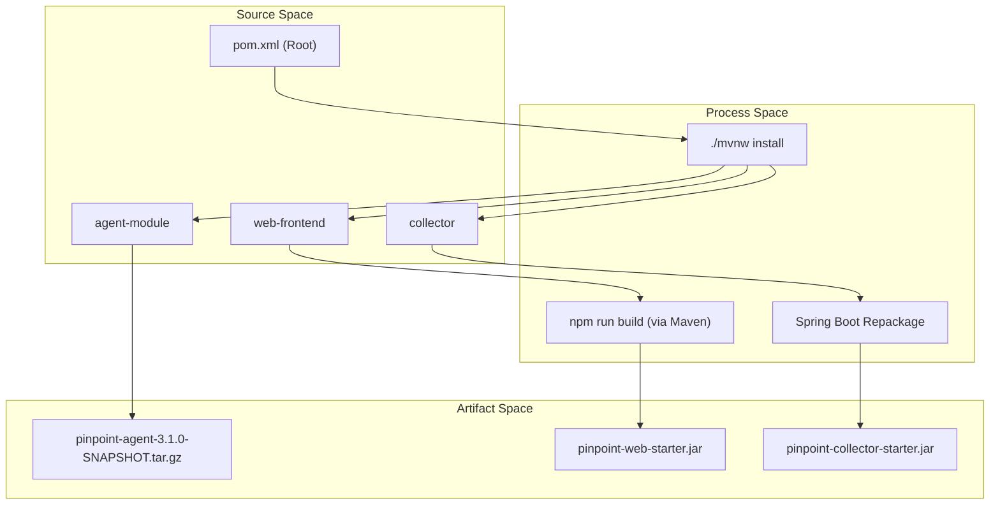
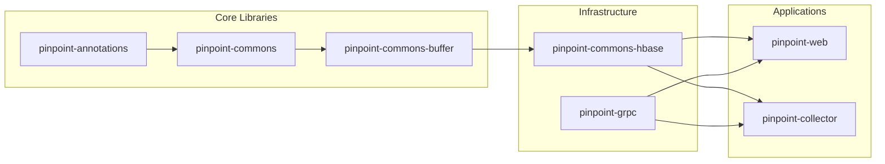

<!-- source: DeepWiki mcp.deepwiki.com · repo pinpoint-apm/pinpoint · page 2.2 Building from Source · fetched 2026-10-29 -->

# Building from Source

<details>
<summary>Relevant source files</summary>

The following files were used as context for generating this wiki page:

- [.github/workflows/homepage.yml](.github/workflows/homepage.yml)
- [.github/workflows/it-command.yml](.github/workflows/it-command.yml)
- [.github/workflows/it-schedule.yml](.github/workflows/it-schedule.yml)
- [.github/workflows/maven-central-deploy.yml](.github/workflows/maven-central-deploy.yml)
- [.github/workflows/maven.yml](.github/workflows/maven.yml)
- [.github/workflows/slash-command-dispatch.yml](.github/workflows/slash-command-dispatch.yml)
- [batch/pom.xml](batch/pom.xml)
- [collector/pom.xml](collector/pom.xml)
- [commons-hbase/pom.xml](commons-hbase/pom.xml)
- [commons-server/pom.xml](commons-server/pom.xml)
- [commons/pom.xml](commons/pom.xml)
- [commons/src/main/java/com/navercorp/pinpoint/common/Version.java](commons/src/main/java/com/navercorp/pinpoint/common/Version.java)
- [grpc/src/main/java/com/navercorp/pinpoint/grpc/security/SslOption.java](grpc/src/main/java/com/navercorp/pinpoint/grpc/security/SslOption.java)
- [hbase/pom.xml](hbase/pom.xml)
- [pom.xml](pom.xml)
- [web/pom.xml](web/pom.xml)

</details>


This document provides technical instructions for building Pinpoint APM from source code. Pinpoint uses a multi-module Maven project structure and requires specific Java environments for different components.

## Prerequisites

Pinpoint 3.x requires a specific matrix of Java Development Kits (JDK) due to the architectural split between the instrumentation agent and the server-side components.

| Component | Requirement | Configuration Property |
|-----------|-------------|------------------------|
| **Agent** | JDK 8 - 21 | `jdk.version` 1.8 [pom.xml:131-133]() |
| **Collector** | JDK 17+ | `jdk.version` 17 [collector/pom.xml:32-33]() |
| **Web** | JDK 17+ | `jdk.version` 17 [web/pom.xml:32-33]() |
| **Batch** | JDK 17+ | `jdk.version` 17 [batch/pom.xml:16-17]() |
| **HBase Tooling** | JDK 17+ | `jdk.version` 17 [hbase/pom.xml:17-18]() |

### Environment Variables
The build system relies on environment variables to locate different JDK installations:
- `JAVA_8_HOME`: Points to the JDK 8 installation path [pom.xml:134-135]().
- `JAVA_17_HOME`: Points to the JDK 17 installation path [web/pom.xml:33]().

Sources: [pom.xml:131-136](), [web/pom.xml:31-34](), [collector/pom.xml:31-34](), [.github/workflows/maven.yml:39-44]()

## Build Process Overview

The build process bridges the Java source code (Maven) and the React-based frontend. The `pinpoint-web-frontend` module is integrated into the Maven lifecycle, allowing a single command to produce a deployable artifact.

### Natural Language to Code Entity Mapping: Build Pipeline

The following diagram maps high-level build stages to specific Maven modules and CI steps.


Sources: [pom.xml:81-125](), [.github/workflows/maven.yml:47-48](), [web/pom.xml:74-77]()

## Build Commands

### Standard Full Build
To build the entire project while skipping unit tests:
```bash
./mvnw clean install -DskipTests
```
This command triggers the `templating-maven-plugin` in `pinpoint-commons` [commons/pom.xml:41-44]() and handles the frontend build within `web-frontend` [pom.xml:104]().

### Building Specific Components
You can use Maven's project list (`-pl`) and also-make (`-am`) flags to build individual components:

| Target | Command | Output Location |
|--------|---------|-----------------|
| **Collector** | `./mvnw install -pl collector-starter -am` | `collector-starter/target/` |
| **Web** | `./mvnw install -pl web-starter -am` | `web-starter/target/` |
| **Agent** | `./mvnw install -pl agent-module/agent -am` | `agent-module/agent/target/` |
| **Batch** | `./mvnw install -pl batch -am` | `batch/target/` |

Sources: [pom.xml:81-125](), [batch/pom.xml:85-97]()

## Build Configuration and Profiles

The root `pom.xml` defines several properties and profiles that control the build output.

### Key Build Properties
- `build.frontend.skip`: Set to `true` to skip the React frontend build when working only on the Java backend [pom.xml:144]().
- `maven.compiler.executable`: Dynamically points to the `javac` of the required JDK [pom.xml:135]().

### Maven Profiles
- `it-module`: Includes integration test modules [it-command.yml:61]().
- `code.coverage`: Enables JaCoCo for testing [maven.yml:48]().
- `maven.central.release`: Configures GPG signing and deployment for Maven Central [maven-central-deploy.yml:63]().

Sources: [pom.xml:127-144](), [.github/workflows/maven.yml:48-50](), [.github/workflows/it-command.yml:61]()

## Dependency Management and Data Flow

The build architecture ensures that shared logic (HBase templates, gRPC definitions) is compiled before the application starters.

### Natural Language to Code Entity Mapping: Module Dependencies


Sources: [web/pom.xml:41-120](), [collector/pom.xml:37-85](), [commons-hbase/pom.xml:37-56](), [commons-server/pom.xml:38-73]()

## Advanced Build Options

### Docker Integration
Pinpoint supports building Docker images directly via Maven using the `jib-maven-plugin` or `docker-maven-plugin`.
- **Batch Module**: Uses Jib to containerize the Spring Boot application [batch/pom.xml:98-110]().
- **HBase Module**: Uses `docker-maven-plugin` to build schema-management images [hbase/pom.xml:49-68]().

### Integration Testing (IT)
The `it-module` profile is used for running extensive plugin integration tests. These tests are executed in the `agent-module/plugins-it` directory [it-command.yml:64-69]().

Sources: [batch/pom.xml:98-110](), [hbase/pom.xml:49-68](), [.github/workflows/it-command.yml:61-69]()

## Troubleshooting the Build

1.  **Node/NPM Cache**: If the frontend build fails, clear the `node_modules` or the `node_install` directory [maven.yml:25-38]().
2.  **JDK Pathing**: Ensure `JAVA_8_HOME` and `JAVA_17_HOME` are correctly exported. The build will fail if it cannot find the `javac` executable at `${jdk.home}/bin/javac` [pom.xml:135]().
3.  **Memory Constraints**: The CI environment uses `ubuntu-22.04` with resource cleanup to handle the large build footprint [it-schedule.yml:7-35]().

Sources: [.github/workflows/maven.yml:25-44](), [.github/workflows/it-schedule.yml:31-41]()

---

