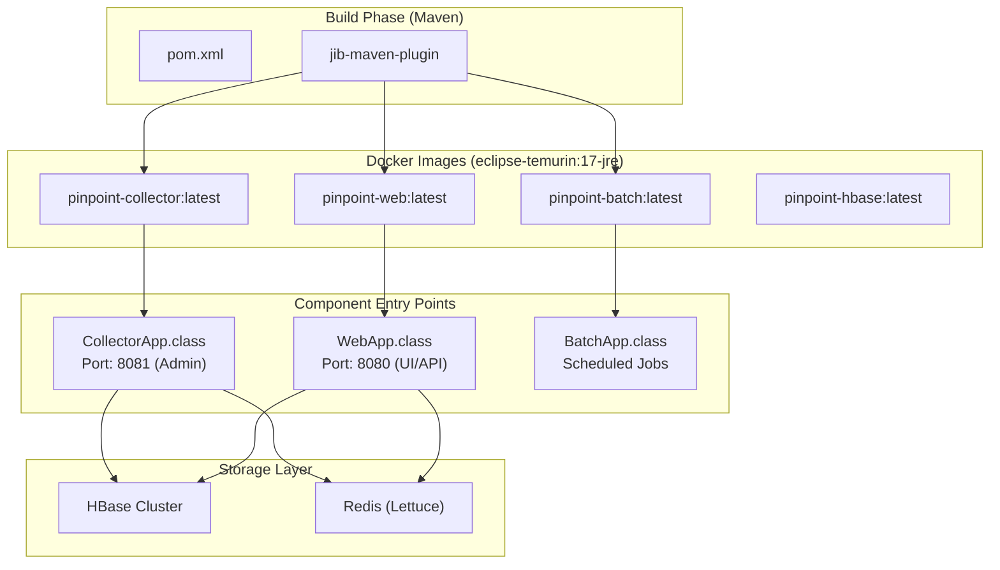
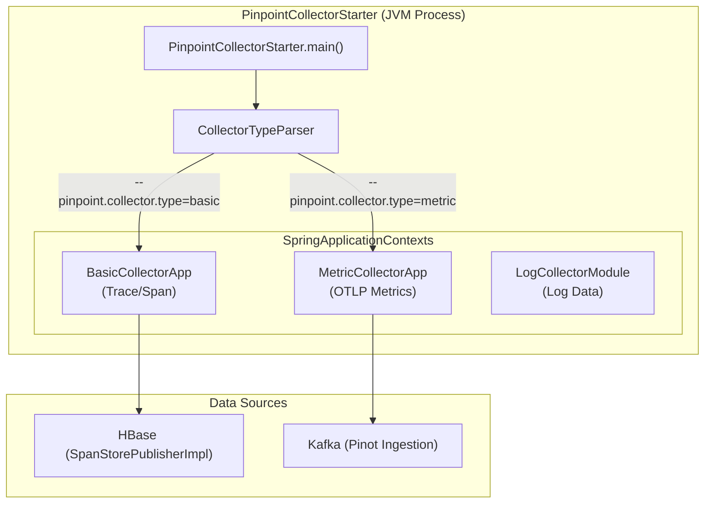

<!-- source: DeepWiki mcp.deepwiki.com · repo pinpoint-apm/pinpoint · page 2.3 Deployment Options · fetched 2026-10-29 -->

# Deployment Options

<details>
<summary>Relevant source files</summary>

The following files were used as context for generating this wiki page:

- [batch/pom.xml](batch/pom.xml)
- [collector-starter/src/main/java/com/navercorp/pinpoint/collector/starter/multi/application/BasicCollectorApp.java](collector-starter/src/main/java/com/navercorp/pinpoint/collector/starter/multi/application/BasicCollectorApp.java)
- [collector-starter/src/main/java/com/navercorp/pinpoint/collector/starter/multi/application/PinpointCollectorStarter.java](collector-starter/src/main/java/com/navercorp/pinpoint/collector/starter/multi/application/PinpointCollectorStarter.java)
- [collector-starter/src/main/resources/application.yml](collector-starter/src/main/resources/application.yml)
- [collector/pom.xml](collector/pom.xml)
- [collector/src/main/java/com/navercorp/pinpoint/collector/CollectorApp.java](collector/src/main/java/com/navercorp/pinpoint/collector/CollectorApp.java)
- [collector/src/main/java/com/navercorp/pinpoint/collector/PinpointCollectorModule.java](collector/src/main/java/com/navercorp/pinpoint/collector/PinpointCollectorModule.java)
- [collector/src/main/java/com/navercorp/pinpoint/collector/event/SpanStorePublisher.java](collector/src/main/java/com/navercorp/pinpoint/collector/event/SpanStorePublisher.java)
- [collector/src/main/java/com/navercorp/pinpoint/collector/event/SpanStorePublisherImpl.java](collector/src/main/java/com/navercorp/pinpoint/collector/event/SpanStorePublisherImpl.java)
- [collector/src/main/java/com/navercorp/pinpoint/collector/event/config/CollectorEventConfiguration.java](collector/src/main/java/com/navercorp/pinpoint/collector/event/config/CollectorEventConfiguration.java)
- [collector/src/main/resources/application.yml](collector/src/main/resources/application.yml)
- [commons-hbase/pom.xml](commons-hbase/pom.xml)
- [commons-hbase/src/main/java/com/navercorp/pinpoint/common/hbase/config/HbaseNamespaceConfiguration.java](commons-hbase/src/main/java/com/navercorp/pinpoint/common/hbase/config/HbaseNamespaceConfiguration.java)
- [commons-server/pom.xml](commons-server/pom.xml)
- [commons-server/src/main/java/com/navercorp/pinpoint/common/server/event/ContextData.java](commons-server/src/main/java/com/navercorp/pinpoint/common/server/event/ContextData.java)
- [commons-server/src/main/java/com/navercorp/pinpoint/common/server/event/ContextSupplier.java](commons-server/src/main/java/com/navercorp/pinpoint/common/server/event/ContextSupplier.java)
- [commons-server/src/main/java/com/navercorp/pinpoint/common/server/event/InsertEvent.java](commons-server/src/main/java/com/navercorp/pinpoint/common/server/event/InsertEvent.java)
- [commons-server/src/main/java/com/navercorp/pinpoint/common/server/event/SimpleContextSupplier.java](commons-server/src/main/java/com/navercorp/pinpoint/common/server/event/SimpleContextSupplier.java)
- [commons-server/src/main/java/com/navercorp/pinpoint/common/server/event/SpanChunkInsertEvent.java](commons-server/src/main/java/com/navercorp/pinpoint/common/server/event/SpanChunkInsertEvent.java)
- [commons-server/src/main/java/com/navercorp/pinpoint/common/server/event/SpanInsertEvent.java](commons-server/src/main/java/com/navercorp/pinpoint/common/server/event/SpanInsertEvent.java)
- [commons/pom.xml](commons/pom.xml)
- [commons/src/main/java/com/navercorp/pinpoint/common/Version.java](commons/src/main/java/com/navercorp/pinpoint/common/Version.java)
- [datasource/src/main/java/com/navercorp/pinpoint/datasource/MainDataSourceConfiguration.java](datasource/src/main/java/com/navercorp/pinpoint/datasource/MainDataSourceConfiguration.java)
- [hbase/pom.xml](hbase/pom.xml)
- [pom.xml](pom.xml)
- [realtime/realtime-collector/src/main/java/com/navercorp/pinpoint/realtime/collector/RealtimeCollectorServerConfig.java](realtime/realtime-collector/src/main/java/com/navercorp/pinpoint/realtime/collector/RealtimeCollectorServerConfig.java)
- [redis/src/main/java/com/navercorp/pinpoint/redis/RedisBasicConfig.java](redis/src/main/java/com/navercorp/pinpoint/redis/RedisBasicConfig.java)
- [redis/src/main/java/com/navercorp/pinpoint/redis/RedisPropertySources.java](redis/src/main/java/com/navercorp/pinpoint/redis/RedisPropertySources.java)
- [redis/src/main/resources/redis/profiles/local/redis.properties](redis/src/main/resources/redis/profiles/local/redis.properties)
- [redis/src/main/resources/redis/profiles/release/redis.properties](redis/src/main/resources/redis/profiles/release/redis.properties)
- [redis/src/main/resources/redis/redis-root.properties](redis/src/main/resources/redis/redis-root.properties)
- [web-starter/src/main/java/com/navercorp/pinpoint/web/starter/multi/PinpointWebStarter.java](web-starter/src/main/java/com/navercorp/pinpoint/web/starter/multi/PinpointWebStarter.java)
- [web-starter/src/main/resources/application.yml](web-starter/src/main/resources/application.yml)
- [web/pom.xml](web/pom.xml)
- [web/src/main/java/com/navercorp/pinpoint/web/WebApp.java](web/src/main/java/com/navercorp/pinpoint/web/WebApp.java)
- [web/src/main/resources/application.yml](web/src/main/resources/application.yml)

</details>


## Purpose and Scope

This page describes the various deployment options available for Pinpoint server components (Collector, Web, Batch). It covers Docker-based deployment via Jib, Kubernetes orchestration, and traditional Spring Boot executable JAR deployment. This guide details implementation specifics of the `PinpointCollectorStarter` and `PinpointWebStarter` modules, data flow between components, and environment-specific configuration management.

**Sources:** [pom.xml:26-34](), [collector/src/main/java/com/navercorp/pinpoint/collector/CollectorApp.java:52-64](), [web/src/main/java/com/navercorp/pinpoint/web/WebApp.java:51-63]()

## Deployment Methods Overview

Pinpoint server components are built as Spring Boot applications and support three primary deployment methods:

| Method | Use Case | Components | Implementation |
|--------|----------|------------|----------------|
| **Docker** | Containerized environments | All | `jib-maven-plugin` creates layered images |
| **Kubernetes** | Production orchestration | All | Helm charts (external) + ConfigMaps/Secrets |
| **Traditional JAR** | Bare metal / VMs | All | `spring-boot-maven-plugin` executable JARs |

Each method utilizes Spring Profiles (`local`, `release`) to toggle between development and production-grade thread pool and buffer configurations.

**Sources:** [pom.xml:141-144](), [collector/src/main/resources/application.yml:1-3](), [web/src/main/resources/application.yml:1-3]()

---

## Docker Deployment Architecture



### Docker Image Build Process
Pinpoint uses the **Jib Maven Plugin** to build optimized, daemon-less Docker images. The configuration is centralized in the parent `pom.xml` [pom.xml:141-144]() and specific modules like `batch/pom.xml` [batch/pom.xml:98-110]().

**Image Build Command:**
```bash
./mvnw clean package -DskipTests jib:dockerBuild
```

**Sources:** [pom.xml:141-144](), [batch/pom.xml:98-110](), [hbase/pom.xml:50-67]()

---

## Multi-Application Deployment (Starters)

Pinpoint provides "Starter" modules that allow running multiple functional types within a single JVM process to optimize resource utilization.

### PinpointCollectorStarter
The `PinpointCollectorStarter` [collector-starter/src/main/java/com/navercorp/pinpoint/collector/starter/multi/application/PinpointCollectorStarter.java:53-55]() uses a `CollectorType` parameter to determine which modules to initialize.



- **BasicCollectorApp**: Configures receivers for agent statistics, spans, and traces [collector-starter/src/main/java/com/navercorp/pinpoint/collector/starter/multi/application/BasicCollectorApp.java:36-57]().
- **Data Flow**: Spans are processed and published via `SpanStorePublisherImpl` [collector/src/main/java/com/navercorp/pinpoint/collector/event/SpanStorePublisherImpl.java:31-35]().

**Sources:** [collector-starter/src/main/java/com/navercorp/pinpoint/collector/starter/multi/application/PinpointCollectorStarter.java:53-125](), [collector-starter/src/main/java/com/navercorp/pinpoint/collector/starter/multi/application/BasicCollectorApp.java:36-57]()

### PinpointWebStarter
The `PinpointWebStarter` [web-starter/src/main/java/com/navercorp/pinpoint/web/starter/multi/PinpointWebStarter.java:46-48]() aggregates all web-related feature modules into a single interface.

**Enabled Features (via application.yml):**
- **Exception Trace**: `pinpoint.modules.web.exceptiontrace.enabled=true` [web-starter/src/main/resources/application.yml:88-89]()
- **Inspector**: `pinpoint.modules.web.inspector.enabled=true` [web-starter/src/main/resources/application.yml:90-91]()
- **OTLP Metric**: `pinpoint.modules.web.otlpmetric.enabled=true` [web-starter/src/main/resources/application.yml:92-93]()

---

## Configuration Management

Pinpoint uses a hierarchical configuration system combining YAML and Properties files.

### Spring Profiles
- **local**: Used for development. Disables resource caching [web/src/main/resources/application.yml:116-117]().
- **release**: Default production profile. Enables optimized thread pools and production storage settings [web/src/main/resources/application.yml:1-3]().

### Component Configuration
| Component | Configuration File | Key Properties |
|-----------|--------------------|----------------|
| **Web** | `web/src/main/resources/application.yml` | `server.port: 8080`, `pinpoint.web.websocket` [web/src/main/resources/application.yml:12,108]() |
| **Collector** | `collector/src/main/resources/application.yml` | `server.port: 8081`, `pinpoint.modules.collector.grpc.ssl` [collector/src/main/resources/application.yml:6,70-72]() |
| **Redis** | `redis/src/main/resources/redis/profiles/release/redis.properties` | `spring.data.redis.host`, `spring.data.redis.lettuce` [redis/src/main/resources/redis/profiles/release/redis.properties:1-10]() |

### Storage Layer Configuration
- **HBase**: Configured via `HbaseNamespaceConfiguration` to support multi-tenancy [commons-hbase/src/main/java/com/navercorp/pinpoint/common/hbase/config/HbaseNamespaceConfiguration.java:12-26]().
- **Redis**: Initialized via `RedisBasicConfig` using Lettuce [redis/src/main/java/com/navercorp/pinpoint/redis/RedisBasicConfig.java:46-60]().

**Sources:** [web/src/main/resources/application.yml:1-120](), [collector/src/main/resources/application.yml:1-78](), [redis/src/main/java/com/navercorp/pinpoint/redis/RedisBasicConfig.java:46-146]()

---

## Traditional JAR Deployment

For deployments on virtual machines or bare metal, Pinpoint components are packaged as executable JARs.

### Build and Run
1. **Build**:
   ```bash
   ./mvnw clean package -DskipTests
   ```
2. **Execute Collector**:
   ```bash
   java -jar collector/target/pinpoint-collector-boot.jar --spring.profiles.active=release
   ```
3. **Execute Web**:
   ```bash
   java -jar web/target/pinpoint-web-boot.jar --spring.profiles.active=release
   ```

### JVM Requirements
- **JDK 17**: Required for Web and Collector modules [web/pom.xml:32](), [collector/pom.xml:32]().
- **JDK 8**: Required for the Agent module [pom.xml:131-135]().

**Sources:** [web/pom.xml:32](), [collector/pom.xml:32](), [pom.xml:131-135](), [batch/pom.xml:88-97]()

---

## Deployment Verification

### Health Checks
Pinpoint components expose health endpoints via Spring Boot Actuator.
- **Web**: `http://<web-host>:8080/monitor/l7check` [web/src/main/resources/application.yml:75-77]()
- **Collector**: `http://<collector-host>:8081/monitor/l7check` [collector/src/main/resources/application.yml:63-65]()

### Actuator Exposure
The following endpoints are exposed for monitoring: `health, beans, conditions, configprops, env, logfile, loggers, mappings, info, threaddump, heapdump` [web/src/main/resources/application.yml:73-74]().

**Sources:** [web/src/main/resources/application.yml:27-82](), [collector/src/main/resources/application.yml:11-66]()

---

