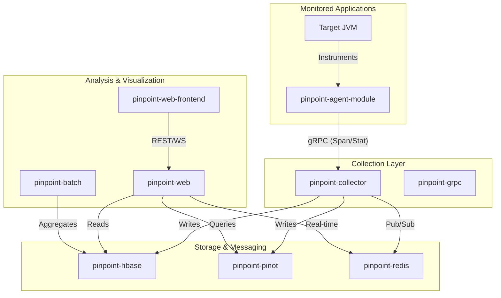
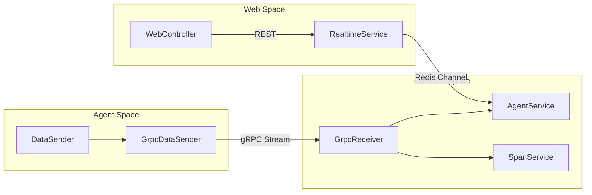

<!-- source: DeepWiki mcp.deepwiki.com · repo pinpoint-apm/pinpoint · page 3 System Architecture · fetched 2026-10-29 -->

# System Architecture

Relevant source files

The following files were used as context for generating this wiki page:

- [.github/ISSUE_TEMPLATE/bug_report.md](.github/ISSUE_TEMPLATE/bug_report.md)
- [.github/ISSUE_TEMPLATE/feature_request.md](.github/ISSUE_TEMPLATE/feature_request.md)
- [.github/ISSUE_TEMPLATE/question.md](.github/ISSUE_TEMPLATE/question.md)
- [.github/ISSUE_TEMPLATE/troubleshooting.md](.github/ISSUE_TEMPLATE/troubleshooting.md)
- [README.md](README.md)
- [agent-module/plugins/undertow-servlet/README.md](agent-module/plugins/undertow-servlet/README.md)
- [batch/pom.xml](batch/pom.xml)
- [collector/pom.xml](collector/pom.xml)
- [commons-hbase/pom.xml](commons-hbase/pom.xml)
- [commons-server/pom.xml](commons-server/pom.xml)
- [commons/pom.xml](commons/pom.xml)
- [commons/src/main/java/com/navercorp/pinpoint/common/Version.java](commons/src/main/java/com/navercorp/pinpoint/common/Version.java)
- [doc/images/ss_error-analysis1.png](doc/images/ss_error-analysis1.png)
- [doc/images/ss_error-analysis3.gif](doc/images/ss_error-analysis3.gif)
- [doc/modules.md](doc/modules.md)
- [hbase/pom.xml](hbase/pom.xml)
- [pom.xml](pom.xml)
- [quickstart/README.md](quickstart/README.md)
- [web/pom.xml](web/pom.xml)

This document provides a comprehensive overview of Pinpoint APM's multi-module architecture and the interactions between its core components. Pinpoint is a distributed tracing solution designed for large-scale systems, providing code-level visibility and application topology mapping.

For detailed information on specific areas, please refer to the following child pages:
- [Module Structure](#3.1) — Maven organization and build system.
- [Agent Architecture](#3.2) — Bytecode instrumentation and plugin system.
- [Collector Architecture](#3.3) — Data reception and processing pipeline.
- [Web Application Architecture](#3.4) — Backend services and REST APIs.
- [Frontend Architecture](#3.5) — React-based UI and visualization.
- [gRPC Communication Layer](#3.6) — Transport protocols and channel security.
- [Channel and Messaging Infrastructure](#3.7) — Inter-service communication via Redis.

## High-Level Component Interaction

Pinpoint follows a traditional collector-agent model where telemetry data flows from instrumented applications to a centralized storage and visualization layer.

### System Components Diagram
The following diagram bridges the natural language components to the actual code modules and entities found in the repository.

Sources:
- [pom.xml:81-125]()
- [README.md:23-43]()
- [collector/pom.xml:36-102]()

## Core Component Overview

### 1. Agent Module
The agent is a Java agent that performs bytecode instrumentation at runtime using `pinpoint-bootstrap.jar`. It uses a plugin-based system to intercept library calls without manual code changes.

For details, see [Agent Architecture](#3.2).

### 2. Collector
The collector is responsible for receiving telemetry data (Spans, Stats, and Agent information) via gRPC. It handles sampling, data normalization, and persistence into HBase or Pinot.

For details, see [Collector Architecture](#3.3).

### 3. Web and Frontend
The Web application (`pinpoint-web`) serves as the API backend, while `pinpoint-web-frontend` is a React monorepo that provides the dashboard, ServerMap, and CallStack views.

For details, see [Web Application Architecture](#3.4) and [Frontend Architecture](#3.5).

### 4. Storage Layer
Pinpoint uses HBase as its primary trace storage and Pinot for high-performance OLAP queries (URI statistics, Inspector metrics).

| Component | Code Entity / Module | Role |
| :--- | :--- | :--- |
| **HBase** | `pinpoint-commons-hbase` | Primary Trace/Span storage [commons-hbase/pom.xml:27-28]() |
| **Pinot** | `pinpoint-pinot` | Metrics and OLAP analytics [pom.xml:108]() |
| **Redis** | `pinpoint-redis` | Real-time data and messaging [pom.xml:112]() |

Sources:
- [pom.xml:93-112]()
- [hbase/pom.xml:11-12]()

## Data Flow and Communication

The system relies on a unified gRPC layer for agent-to-collector communication and a Redis-backed channel for inter-service messaging.

### Communication Bridge Diagram
This diagram maps communication paths to specific code identifiers.

Sources:
- [grpc/pom.xml:1-20]()
- [collector/pom.xml:75-76]()
- [web/pom.xml:94-96]()
- [channel/pom.xml:1-20]()

## Compatibility and Deployment
Pinpoint is built primarily with Java 17 for the server-side components (Web, Collector, Batch) while the Agent maintains compatibility with JDK 8+.

- **JDK Version**: Server modules use JDK 17 [web/pom.xml:32-33](), [collector/pom.xml:32-33]().
- **Build System**: Maven multi-module project [pom.xml:18-29]().
- **Deployment**: Supports Docker, Kubernetes, and standalone JAR execution [quickstart/README.md:4-40]().

Sources:
- [pom.xml:131-136]()
- [web/pom.xml:32-34]()
- [collector/pom.xml:32-34]()
- [batch/pom.xml:16-18]()
- [quickstart/README.md:1-115]()

---

