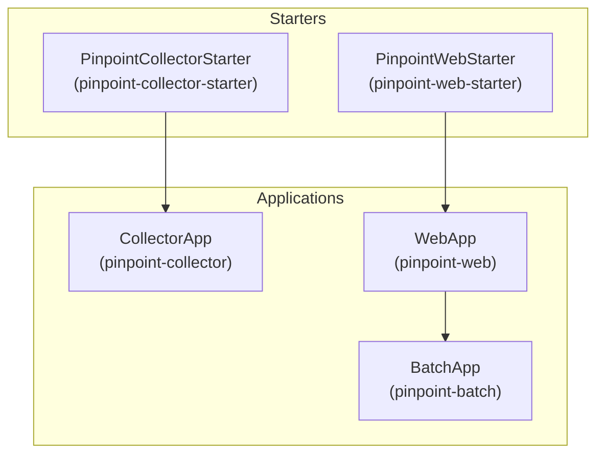
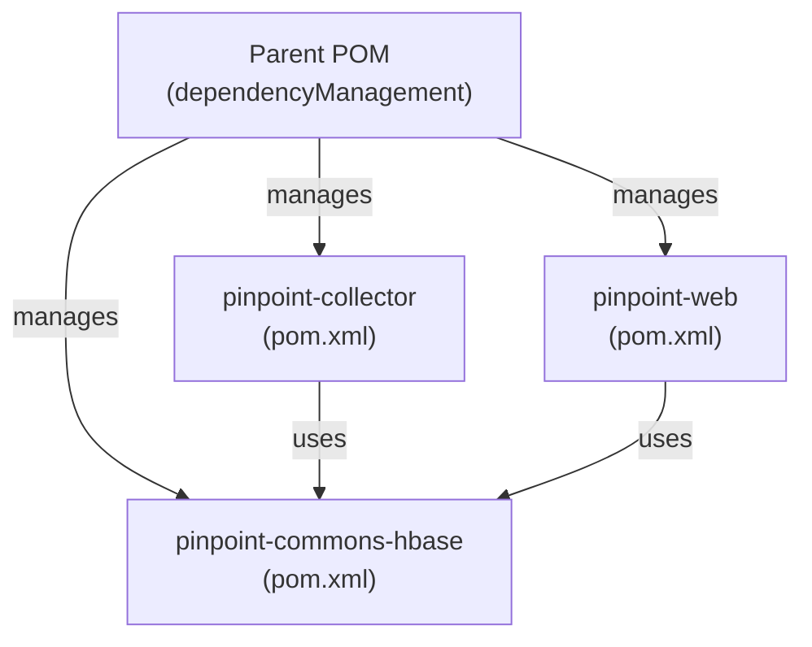
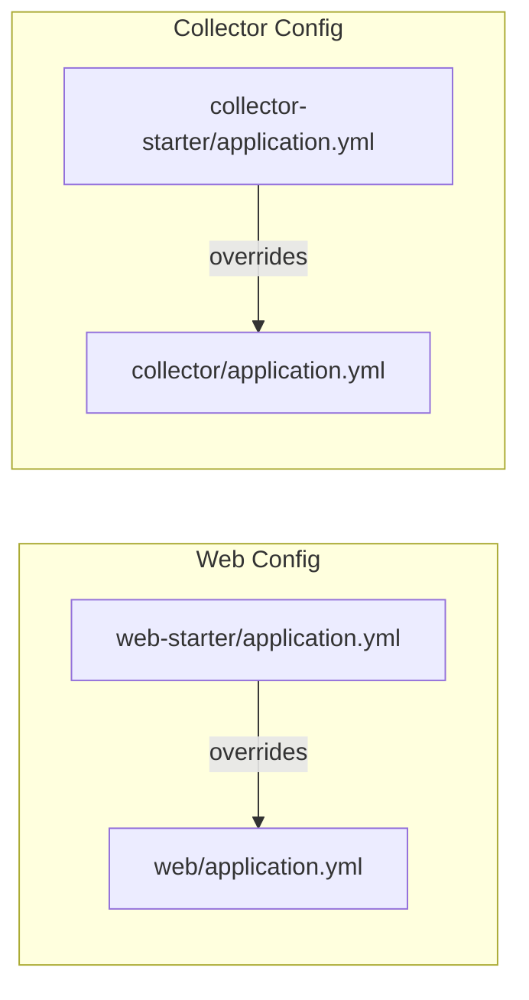

<!-- source: DeepWiki mcp.deepwiki.com · repo pinpoint-apm/pinpoint · page 3.1 Module Structure · fetched 2026-10-29 -->

# Module Structure

Relevant source files

The following files were used as context for generating this wiki page:

- [batch/pom.xml](batch/pom.xml)
- [collector-starter/src/main/java/com/navercorp/pinpoint/collector/starter/multi/application/BasicCollectorApp.java](collector-starter/src/main/java/com/navercorp/pinpoint/collector/starter/multi/application/BasicCollectorApp.java)
- [collector-starter/src/main/java/com/navercorp/pinpoint/collector/starter/multi/application/PinpointCollectorStarter.java](collector-starter/src/main/java/com/navercorp/pinpoint/collector/starter/multi/application/PinpointCollectorStarter.java)
- [collector-starter/src/main/resources/application.yml](collector-starter/src/main/resources/application.yml)
- [collector/pom.xml](collector/pom.xml)
- [collector/src/main/java/com/navercorp/pinpoint/collector/CollectorApp.java](collector/src/main/java/com/navercorp/pinpoint/collector/CollectorApp.java)
- [collector/src/main/java/com/navercorp/pinpoint/collector/PinpointCollectorModule.java](collector/src/main/java/com/navercorp/pinpoint/collector/PinpointCollectorModule.java)
- [collector/src/main/java/com/navercorp/pinpoint/collector/event/SpanStorePublisher.java](collector/src/main/java/com/navercorp/pinpoint/collector/event/SpanStorePublisher.java)
- [collector/src/main/java/com/navercorp/pinpoint/collector/event/SpanStorePublisherImpl.java](collector/src/main/java/com/navercorp/pinpoint/collector/event/SpanStorePublisherImpl.java)
- [collector/src/main/java/com/navercorp/pinpoint/collector/event/config/CollectorEventConfiguration.java](collector/src/main/java/com/navercorp/pinpoint/collector/event/config/CollectorEventConfiguration.java)
- [collector/src/main/resources/application.yml](collector/src/main/resources/application.yml)
- [commons-hbase/pom.xml](commons-hbase/pom.xml)
- [commons-hbase/src/main/java/com/navercorp/pinpoint/common/hbase/config/HbaseNamespaceConfiguration.java](commons-hbase/src/main/java/com/navercorp/pinpoint/common/hbase/config/HbaseNamespaceConfiguration.java)
- [commons-server/pom.xml](commons-server/pom.xml)
- [commons-server/src/main/java/com/navercorp/pinpoint/common/server/event/ContextData.java](commons-server/src/main/java/com/navercorp/pinpoint/common/server/event/ContextData.java)
- [commons-server/src/main/java/com/navercorp/pinpoint/common/server/event/ContextSupplier.java](commons-server/src/main/java/com/navercorp/pinpoint/common/server/event/ContextSupplier.java)
- [commons-server/src/main/java/com/navercorp/pinpoint/common/server/event/InsertEvent.java](commons-server/src/main/java/com/navercorp/pinpoint/common/server/event/InsertEvent.java)
- [commons-server/src/main/java/com/navercorp/pinpoint/common/server/event/SimpleContextSupplier.java](commons-server/src/main/java/com/navercorp/pinpoint/common/server/event/SimpleContextSupplier.java)
- [commons-server/src/main/java/com/navercorp/pinpoint/common/server/event/SpanChunkInsertEvent.java](commons-server/src/main/java/com/navercorp/pinpoint/common/server/event/SpanChunkInsertEvent.java)
- [commons-server/src/main/java/com/navercorp/pinpoint/common/server/event/SpanInsertEvent.java](commons-server/src/main/java/com/navercorp/pinpoint/common/server/event/SpanInsertEvent.java)
- [commons/pom.xml](commons/pom.xml)
- [commons/src/main/java/com/navercorp/pinpoint/common/Version.java](commons/src/main/java/com/navercorp/pinpoint/common/Version.java)
- [datasource/src/main/java/com/navercorp/pinpoint/datasource/MainDataSourceConfiguration.java](datasource/src/main/java/com/navercorp/pinpoint/datasource/MainDataSourceConfiguration.java)
- [hbase/pom.xml](hbase/pom.xml)
- [pom.xml](pom.xml)
- [realtime/realtime-collector/src/main/java/com/navercorp/pinpoint/realtime/collector/RealtimeCollectorServerConfig.java](realtime/realtime-collector/src/main/java/com/navercorp/pinpoint/realtime/collector/RealtimeCollectorServerConfig.java)
- [redis/src/main/java/com/navercorp/pinpoint/redis/RedisBasicConfig.java](redis/src/main/java/com/navercorp/pinpoint/redis/RedisBasicConfig.java)
- [redis/src/main/java/com/navercorp/pinpoint/redis/RedisPropertySources.java](redis/src/main/java/com/navercorp/pinpoint/redis/RedisPropertySources.java)
- [redis/src/main/resources/redis/profiles/local/redis.properties](redis/src/main/resources/redis/profiles/local/redis.properties)
- [redis/src/main/resources/redis/profiles/release/redis.properties](redis/src/main/resources/redis/profiles/release/redis.properties)
- [redis/src/main/resources/redis/redis-root.properties](redis/src/main/resources/redis/redis-root.properties)
- [web-starter/src/main/java/com/navercorp/pinpoint/web/starter/multi/PinpointWebStarter.java](web-starter/src/main/java/com/navercorp/pinpoint/web/starter/multi/PinpointWebStarter.java)
- [web-starter/src/main/resources/application.yml](web-starter/src/main/resources/application.yml)
- [web/pom.xml](web/pom.xml)
- [web/src/main/java/com/navercorp/pinpoint/web/WebApp.java](web/src/main/java/com/navercorp/pinpoint/web/WebApp.java)
- [web/src/main/resources/application.yml](web/src/main/resources/application.yml)

This document explains Pinpoint's Maven-based module organization, dependency management hierarchy, and build system architecture. It describes how the codebase is divided into modules, their relationships, and how they are built and packaged. For information about specific component architectures within these modules, see [Agent Architecture](#3.2), [Collector Architecture](#3.3), [Web Application Architecture](#3.4), and [Frontend Architecture](#3.5).

## Maven Parent POM Structure

Pinpoint uses a multi-module Maven project structure with a parent POM at [pom.xml:18-287]() that manages all child modules. The parent POM defines shared properties, dependency versions, and build configurations inherited by all modules.

**Parent POM Configuration:**

| Property | Value | Purpose |
|----------|-------|---------|
| `groupId` | `com.navercorp.pinpoint` | Maven group identifier [pom.xml:25-25]() |
| `artifactId` | `pinpoint` | Parent artifact name [pom.xml:26-26]() |
| `version` | `3.1.0-SNAPSHOT` | Project version [pom.xml:27-27]() |
| `packaging` | `pom` | Indicates aggregator project [pom.xml:29-29]() |
| `jdk.version` | `1.8` | Default Java version [pom.xml:131-131]() |

The parent POM declares over 40 modules in [pom.xml:81-125]() and centralizes dependency version management through properties in [pom.xml:127-287](). This ensures consistent library versions across all modules.

**Key Managed Dependency Versions:**
- `spring-boot.version`: Defined via properties [pom.xml:181-184]()
- `hbase.shaded.client.version`: `2.5.12-hadoop3` [pom.xml:147-147]()
- `pinot.client.version`: `1.3.0` [pom.xml:152-152]()
- `jackson.version`: `2.19.2` [pom.xml:164-164]()

**Sources:** [pom.xml:18-287](), [pom.xml:81-125](), [pom.xml:127-184]()

## Module Categories

Pinpoint's modules are organized into functional categories. Each category serves a specific architectural role in the APM system.

```mermaid
graph TB
    Parent["pinpoint<br/>(Parent POM)"]
    
    subgraph "Core Modules"
        Commons["pinpoint-commons"]
        CommonsBuffer["pinpoint-commons-buffer"]
        CommonsConfig["pinpoint-commons-config"]
        CommonsProfiler["pinpoint-commons-profiler"]
        CommonsServer["pinpoint-commons-server"]
        CommonsHBase["pinpoint-commons-hbase"]
        CommonsTimeseries["pinpoint-commons-timeseries"]
        Annotations["pinpoint-annotations"]
        Datasource["pinpoint-datasource"]
        Grpc["pinpoint-grpc"]
    end
    
    subgraph "Agent Modules"
        AgentModule["agent-module"]
        AgentStats["agent-statistics"]
    end
    
    subgraph "Server Modules"
        Collector["pinpoint-collector"]
        CollectorStarter["pinpoint-collector-starter"]
        Web["pinpoint-web"]
        WebStarter["pinpoint-web-starter"]
        Batch["pinpoint-batch"]
    end
    
    subgraph "Frontend Module"
        WebFrontend["pinpoint-web-frontend"]
    end
    
    subgraph "Feature Modules"
        MetricModule["metric-module"]
        Uristat["uristat"]
        InspectorModule["inspector-module"]
        Realtime["realtime"]
        Redis["redis"]
        Pinot["pinot"]
        Exceptiontrace["exceptiontrace"]
        OtlpMetric["otlpmetric"]
        OtlpTrace["otlptrace"]
        HBase["hbase"]
    end
    
    Parent --> Commons
    Parent --> AgentModule
    Parent --> Collector
    Parent --> Web
    Parent --> WebFrontend
    Parent --> MetricModule
```

**Sources:** [pom.xml:81-125]()

### Core Modules

Core modules provide foundational utilities, data structures, and abstractions used by both agent and server components.

| Module | Artifact ID | Purpose |
|--------|-------------|---------|
| commons | `pinpoint-commons` | Base utilities and Version class [commons/pom.xml:11-11]() |
| commons-buffer | `pinpoint-commons-buffer` | Binary serialization utilities [pom.xml:90-90]() |
| commons-profiler | `pinpoint-commons-profiler` | Trace data model [pom.xml:92-92]() |
| commons-server | `pinpoint-commons-server` | Server-side data models and events [commons-server/pom.xml:27-27]() |
| commons-hbase | `pinpoint-commons-hbase` | HBase client abstraction and configuration [commons-hbase/pom.xml:27-27]() |
| grpc | `pinpoint-grpc` | gRPC communication layer [pom.xml:100-100]() |

**Key Code Entities:**
- `com.navercorp.pinpoint.common.Version`: Version information [commons/src/main/java/com/navercorp/pinpoint/common/Version.java:1-4]()
- `SpanInsertEvent`: Server-side event for trace data [commons-server/src/main/java/com/navercorp/pinpoint/common/server/event/SpanInsertEvent.java:1-10]()
- `HbaseNamespaceConfiguration`: HBase connection setup [commons-hbase/src/main/java/com/navercorp/pinpoint/common/hbase/config/HbaseNamespaceConfiguration.java:1-10]()

**Sources:** [pom.xml:89-100](), [commons/pom.xml:1-47](), [commons-server/pom.xml:1-189](), [commons-hbase/pom.xml:1-137]()

### Server Modules

Server modules implement the data collection and web serving infrastructure. These modules require Java 17 [collector/pom.xml:32-33](), [web/pom.xml:32-33]().

**Module Details:**

- **Collector (`pinpoint-collector`)**: Receives trace data via gRPC. It depends on `pinpoint-grpc`, `pinpoint-commons-hbase`, and `pinpoint-realtime-collector` [collector/pom.xml:36-101]().
- **Web (`pinpoint-web`)**: Serves REST APIs and the UI. It depends on `pinpoint-web-frontend`, `pinpoint-commons-hbase`, and `pinpoint-pinot-datasource` [web/pom.xml:36-120]().
- **Batch (`pinpoint-batch`)**: Handles background jobs like alarms. It depends on `pinpoint-web` and `spring-batch-core` [batch/pom.xml:20-61]().

**Sources:** [collector/pom.xml:1-278](), [web/pom.xml:1-410](), [batch/pom.xml:1-125]()

### Feature and Specialized Modules

Feature modules provide optional capabilities enabled via Spring profiles or configuration [web-starter/src/main/resources/application.yml:85-101]().

- **Real-time**: `realtime-collector` and `realtime-web` for active thread monitoring [collector/pom.xml:39-39](), [web/pom.xml:39-39]().
- **Pinot**: Integration for OLAP metrics [web/pom.xml:107-112]().
- **HBase UID**: `pinpoint-hbase-uid-module` for mapping application names to IDs [web/pom.xml:115-116]().
- **Redis**: Caching and pub/sub infrastructure [pom.xml:112-112]().
- **OTLP**: Support for OpenTelemetry metrics and traces [pom.xml:120-121]().

**Sources:** [pom.xml:108-125](), [web-starter/src/main/resources/application.yml:85-101]()

## Build System Architecture

Pinpoint uses a complex build pipeline involving Java compilation, Node.js frontend builds, and Docker image generation.

### Dependency Management Hierarchy

The parent POM uses `<dependencyManagement>` to control versions [pom.xml:317-1457]().

**Sources:** [pom.xml:317-1457](), [collector/pom.xml:63-63](), [web/pom.xml:63-63]()

### Build and Deployment

Pinpoint utilizes the `spring-boot-maven-plugin` for creating executable JARs and `jib-maven-plugin` for Docker images.

| Module | Main Class | Docker Image |
|--------|------------|--------------|
| Collector | `com.navercorp.pinpoint.collector.CollectorApp` [collector/pom.xml:251-251]() | `pinpointdocker/pinpoint-collector` [collector/pom.xml:263-263]() |
| Web | `com.navercorp.pinpoint.web.WebApp` [web/pom.xml:385-385]() | `pinpointdocker/pinpoint-web` [web/pom.xml:397-397]() |
| Batch | `com.navercorp.pinpoint.batch.BatchApp` [batch/pom.xml:91-91]() | `pinpointdocker/pinpoint-batch` [batch/pom.xml:103-103]() |

**Sources:** [collector/pom.xml:247-271](), [web/pom.xml:381-406](), [batch/pom.xml:86-110]()

## Configuration Data Flow

Configuration is managed through `application.yml` files in the starter and application modules.

**Key Configuration Keys:**
- `pinpoint.modules.realtime.enabled`: Controls real-time features [web-starter/src/main/resources/application.yml:100-101]().
- `pinpoint.modules.uid.version`: Controls HBase UID table version (e.g., `v3`) [web/src/main/resources/application.yml:94-96]().
- `server.port`: Web server port (8080 for Web, 8081 for Collector) [web/src/main/resources/application.yml:12-12](), [collector/src/main/resources/application.yml:6-6]().

**Sources:** [web/src/main/resources/application.yml:1-114](), [collector/src/main/resources/application.yml:1-78](), [web-starter/src/main/resources/application.yml:1-110](), [collector-starter/src/main/resources/application.yml:1-95]()

---

