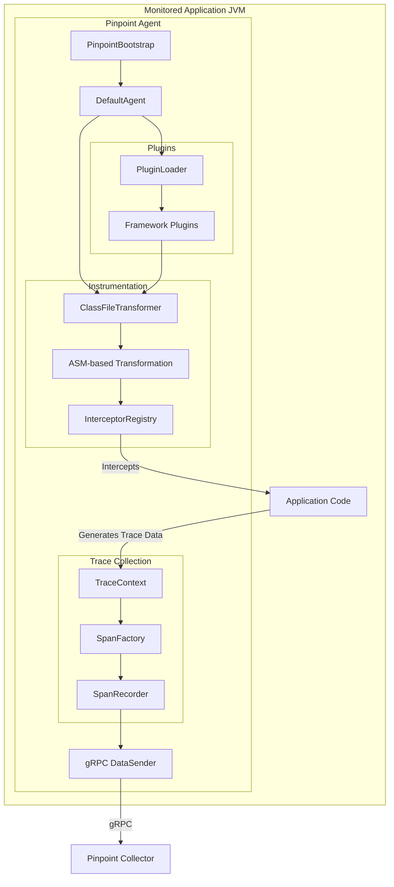
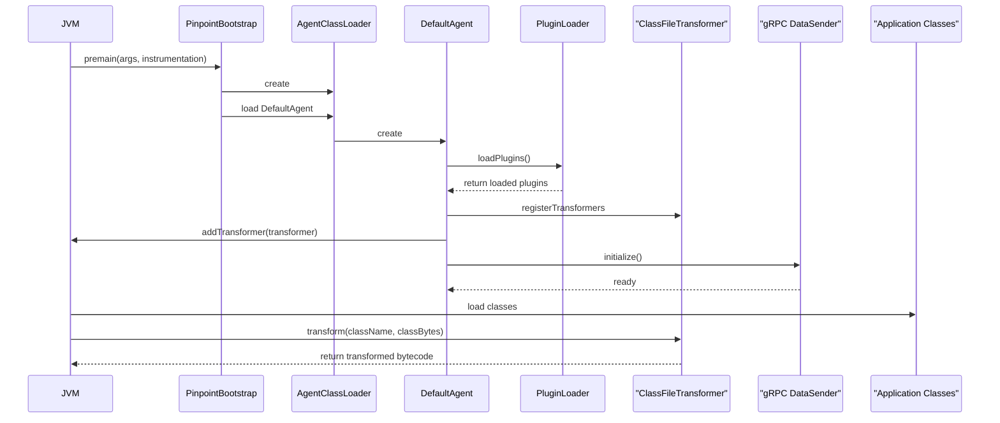
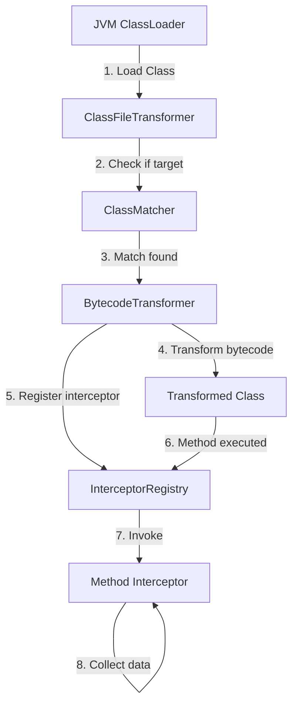
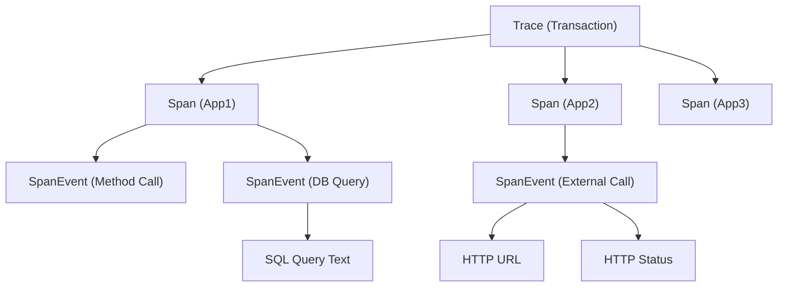
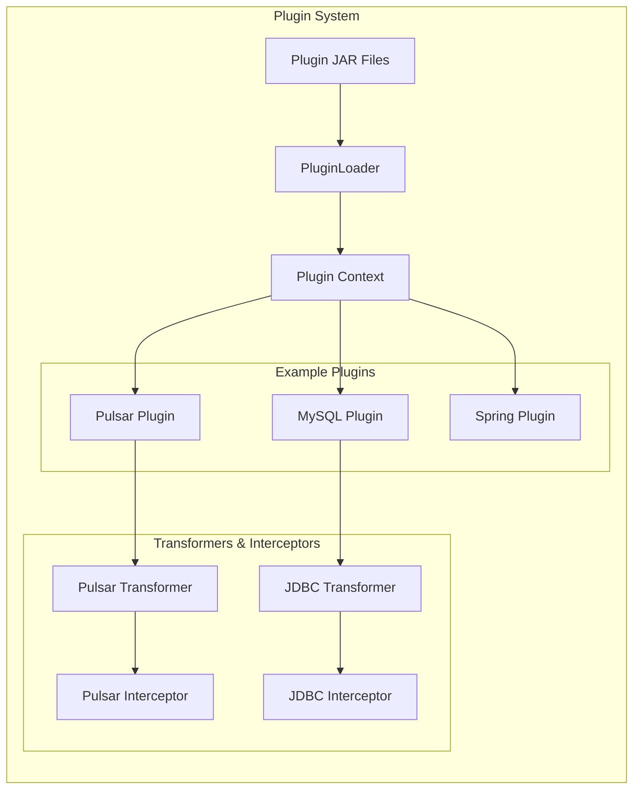
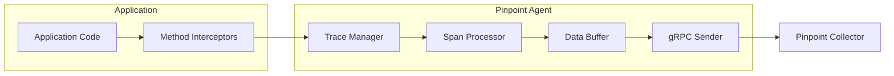

<!-- source: DeepWiki mcp.deepwiki.com · repo pinpoint-apm/pinpoint · page 3.2 Agent Architecture · fetched 2026-10-29 -->

# Agent Architecture

Relevant source files

The following files were used as context for generating this wiki page:

- [collector/src/main/java/com/navercorp/pinpoint/collector/util/PacketUtils.java](collector/src/main/java/com/navercorp/pinpoint/collector/util/PacketUtils.java)

This document details the architecture and core components of the Pinpoint Agent, which is responsible for instrumenting applications to collect performance data without modifying application code.

## Overview

The Pinpoint Agent is a Java agent that uses bytecode instrumentation to monitor applications at runtime. It collects transaction data, performance metrics, and distributed trace information, which is then sent to the Pinpoint Collector. The agent is designed to have minimal impact on application performance.

Sources:
- `pom.xml`
- `README.md`

## Agent Initialization Process

The agent initialization follows these steps:

1. JVM starts with the `-javaagent:pinpoint-bootstrap.jar` parameter.
2. Java's Instrumentation API calls the `premain` method in the bootstrap.
3. Bootstrap loads the agent's core classes using a separate class loader.
4. Agent core discovers and loads available plugins via `PluginLoader`.
5. Plugins register their target classes and transformation rules.
6. `ClassFileTransformer` is registered with the JVM to intercept class loading.
7. Agent connects to the Collector using gRPC.

Sources:
- `README.md`
- `quickstart/README.md`

## Bytecode Instrumentation Mechanism

Pinpoint uses bytecode instrumentation to monitor applications without code modifications:

1.  **Class Transformation**: When a class is loaded, the agent's `ClassFileTransformer` intercepts it.
2.  **Matcher Application**: The transformer checks if the class matches any plugin's transformation targets.
3.  **Bytecode Modification**: If matched, the class bytecode is modified (typically using ASM) to inject interceptor calls at method entry/exit points.
4.  **Interceptor Registration**: Interceptors for the transformed methods are registered in the `InterceptorRegistry`.
5.  **Runtime Interception**: When the instrumented methods execute, the injected code calls the corresponding interceptors.

Sources:
- `commons/src/main/java/com/navercorp/pinpoint/common/trace/ServiceType.java`
- `commons/src/main/java/com/navercorp/pinpoint/common/trace/AnnotationKey.java`

## Trace Data Model

Pinpoint's data model consists of several key components that represent a distributed transaction:

*   **Trace**: A complete transaction that may span multiple applications.
*   **Span**: A unit of work in a single application. Each trace has one or more spans.
*   **SpanEvent**: A method call within a span (e.g., a database query or external service call).
*   **Annotations**: Additional metadata attached to spans and span events via `AnnotationKey`.

Each Span includes:
- Transaction ID (unique across the distributed system).
- Application information.
- Start/end timestamps.
- Success/failure information.

Each SpanEvent includes:
- Reference to its parent span.
- Method information.
- Execution time.
- `ServiceType` (e.g., `TOMCAT`, `MYSQL`).

Sources:
- `commons/src/main/java/com/navercorp/pinpoint/common/trace/ServiceType.java:1-100`()
- `commons/src/main/java/com/navercorp/pinpoint/common/trace/AnnotationKey.java:1-100`()

## Plugin System

The Pinpoint Agent includes an extensive plugin system that allows it to monitor various frameworks and libraries. Plugins are decoupled from the agent core.

1.  **Plugin Structure**:
    *   Each plugin defines which classes to transform.
    *   Plugins provide custom interceptors for specific methods.
    *   Plugins register unique `ServiceType` and `AnnotationKey` constants.
2.  **Plugin Loading**:
    *   Plugins are loaded from the agent's plugin directory.
    *   Each plugin has its own class loader to avoid version conflicts.
3.  **Supported Technologies**:
    *   Web servers: Tomcat, Jetty, JBoss, etc.
    *   Databases: MySQL, Oracle, PostgreSQL, etc.
    *   Messaging: Kafka, RabbitMQ, Pulsar.

Sources:
- `agent-module/plugins/pulsar/src/main/java/com/navercorp/pinpoint/plugin/pulsar/PulsarConstants.java:1-50`()
- `pom.xml`

## Data Collection and Transmission

1.  **Data Collection**: Interceptors collect data when instrumented methods execute. Data is organized into `Span` and `SpanEvent` objects.
2.  **Data Processing**: The agent processes data asynchronously to minimize application impact. It uses sampling to control volume.
3.  **Data Transmission**: The agent uses gRPC to communicate with the Collector.
    *   Data is batched and compressed before transmission.
    *   Utility classes like `PacketUtils` are used for debugging and logging packet contents.

Sources:
- `collector/src/main/java/com/navercorp/pinpoint/collector/util/PacketUtils.java:26-43`()
- `collector/pom.xml`

## Performance Considerations

The Pinpoint Agent is designed for production environments with minimal overhead:

*   **Low Overhead**: Typically adds ~3% performance overhead to the application.
*   **Sampling**: Only a percentage of transactions are recorded based on configuration.
*   **Async Processing**: Data processing and transmission occur in separate background threads.
*   **Adaptive Behavior**: The agent can reduce activity under high system load.
*   **Optimized Data Structures**: Uses compact byte-level serialization for efficient transmission.

Sources:
- `README.md`
- `collector/src/main/java/com/navercorp/pinpoint/collector/util/PacketUtils.java:30-35`()

## Compatibility

Pinpoint Agent supports a wide range of Java versions:

| Pinpoint Version | Java Version Support |
|------------------|----------------------|
| 2.5.x            | Java 8-19            |
| 3.0.x            | Java 8-21            |
| 3.1.x            | Java 8-24            |

Sources:
- `README.md`

---

