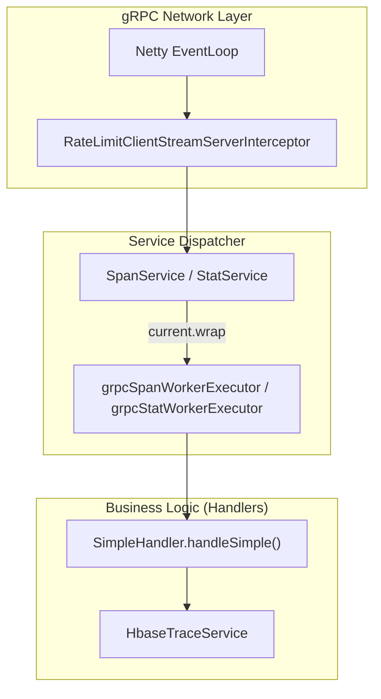
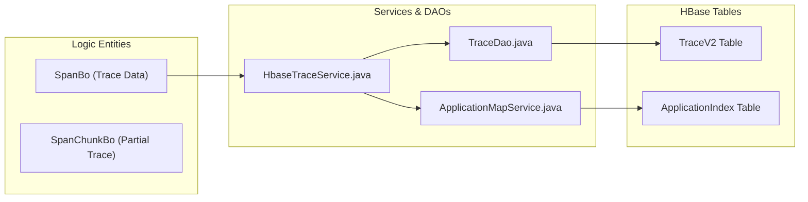

<!-- source: DeepWiki mcp.deepwiki.com · repo pinpoint-apm/pinpoint · page 3.3 Collector Architecture · fetched 2026-10-29 -->

# Collector Architecture

Relevant source files

The following files were used as context for generating this wiki page:

- [agent-module/profiler/src/main/java/com/navercorp/pinpoint/profiler/name/v1/ObjectNameResolverV1.java](agent-module/profiler/src/main/java/com/navercorp/pinpoint/profiler/name/v1/ObjectNameResolverV1.java)
- [collector-starter/src/main/java/com/navercorp/pinpoint/collector/starter/multi/application/type/CollectorType.java](collector-starter/src/main/java/com/navercorp/pinpoint/collector/starter/multi/application/type/CollectorType.java)
- [collector-starter/src/main/java/com/navercorp/pinpoint/collector/starter/multi/application/type/CollectorTypeParser.java](collector-starter/src/main/java/com/navercorp/pinpoint/collector/starter/multi/application/type/CollectorTypeParser.java)
- [collector-starter/src/main/java/com/navercorp/pinpoint/collector/starter/multi/application/type/CollectorTypeSet.java](collector-starter/src/main/java/com/navercorp/pinpoint/collector/starter/multi/application/type/CollectorTypeSet.java)
- [collector-starter/src/main/java/com/navercorp/pinpoint/collector/starter/multi/application/type/FallbackCollectorTypeParser.java](collector-starter/src/main/java/com/navercorp/pinpoint/collector/starter/multi/application/type/FallbackCollectorTypeParser.java)
- [collector-starter/src/main/java/com/navercorp/pinpoint/collector/starter/multi/application/type/ShellBlockerConfig.java](collector-starter/src/main/java/com/navercorp/pinpoint/collector/starter/multi/application/type/ShellBlockerConfig.java)
- [collector-starter/src/main/java/com/navercorp/pinpoint/collector/starter/multi/application/type/ShellCollectorTypeParser.java](collector-starter/src/main/java/com/navercorp/pinpoint/collector/starter/multi/application/type/ShellCollectorTypeParser.java)
- [collector-starter/src/main/java/com/navercorp/pinpoint/collector/starter/multi/application/type/SimpleCollectorTypeParser.java](collector-starter/src/main/java/com/navercorp/pinpoint/collector/starter/multi/application/type/SimpleCollectorTypeParser.java)
- [collector-starter/src/main/resources/.gitignore](collector-starter/src/main/resources/.gitignore)
- [collector/src/main/java/com/navercorp/pinpoint/collector/applicationmap/config/ApplicationMapModule.java](collector/src/main/java/com/navercorp/pinpoint/collector/applicationmap/config/ApplicationMapModule.java)
- [collector/src/main/java/com/navercorp/pinpoint/collector/applicationmap/config/MapDualWriteConfiguration.java](collector/src/main/java/com/navercorp/pinpoint/collector/applicationmap/config/MapDualWriteConfiguration.java)
- [collector/src/main/java/com/navercorp/pinpoint/collector/applicationmap/config/MapV2Configuration.java](collector/src/main/java/com/navercorp/pinpoint/collector/applicationmap/config/MapV2Configuration.java)
- [collector/src/main/java/com/navercorp/pinpoint/collector/applicationmap/config/MapV2Import.java](collector/src/main/java/com/navercorp/pinpoint/collector/applicationmap/config/MapV2Import.java)
- [collector/src/main/java/com/navercorp/pinpoint/collector/applicationmap/config/MapV3Configuration.java](collector/src/main/java/com/navercorp/pinpoint/collector/applicationmap/config/MapV3Configuration.java)
- [collector/src/main/java/com/navercorp/pinpoint/collector/applicationmap/config/MapV3Import.java](collector/src/main/java/com/navercorp/pinpoint/collector/applicationmap/config/MapV3Import.java)
- [collector/src/main/java/com/navercorp/pinpoint/collector/applicationmap/dao/HostApplicationMapDao.java](collector/src/main/java/com/navercorp/pinpoint/collector/applicationmap/dao/HostApplicationMapDao.java)
- [collector/src/main/java/com/navercorp/pinpoint/collector/applicationmap/dao/HostApplicationMapDaoDelegate.java](collector/src/main/java/com/navercorp/pinpoint/collector/applicationmap/dao/HostApplicationMapDaoDelegate.java)
- [collector/src/main/java/com/navercorp/pinpoint/collector/applicationmap/dao/MapInLinkDao.java](collector/src/main/java/com/navercorp/pinpoint/collector/applicationmap/dao/MapInLinkDao.java)
- [collector/src/main/java/com/navercorp/pinpoint/collector/applicationmap/dao/MapOutLinkDao.java](collector/src/main/java/com/navercorp/pinpoint/collector/applicationmap/dao/MapOutLinkDao.java)
- [collector/src/main/java/com/navercorp/pinpoint/collector/applicationmap/dao/hbase/HbaseHostApplicationMapDao.java](collector/src/main/java/com/navercorp/pinpoint/collector/applicationmap/dao/hbase/HbaseHostApplicationMapDao.java)
- [collector/src/main/java/com/navercorp/pinpoint/collector/applicationmap/dao/hbase/HbaseMapInLinkDao.java](collector/src/main/java/com/navercorp/pinpoint/collector/applicationmap/dao/hbase/HbaseMapInLinkDao.java)
- [collector/src/main/java/com/navercorp/pinpoint/collector/applicationmap/dao/hbase/HbaseMapOutLinkDao.java](collector/src/main/java/com/navercorp/pinpoint/collector/applicationmap/dao/hbase/HbaseMapOutLinkDao.java)
- [collector/src/main/java/com/navercorp/pinpoint/collector/applicationmap/dao/hbase/InLinkFactory.java](collector/src/main/java/com/navercorp/pinpoint/collector/applicationmap/dao/hbase/InLinkFactory.java)
- [collector/src/main/java/com/navercorp/pinpoint/collector/applicationmap/dao/hbase/OutLinkFactory.java](collector/src/main/java/com/navercorp/pinpoint/collector/applicationmap/dao/hbase/OutLinkFactory.java)
- [collector/src/main/java/com/navercorp/pinpoint/collector/applicationmap/dao/hbase/SelfAgentNodeFactory.java](collector/src/main/java/com/navercorp/pinpoint/collector/applicationmap/dao/hbase/SelfAgentNodeFactory.java)
- [collector/src/main/java/com/navercorp/pinpoint/collector/applicationmap/dao/v3/InLinkFactoryV3.java](collector/src/main/java/com/navercorp/pinpoint/collector/applicationmap/dao/v3/InLinkFactoryV3.java)
- [collector/src/main/java/com/navercorp/pinpoint/collector/applicationmap/dao/v3/OutLinkFactoryV3.java](collector/src/main/java/com/navercorp/pinpoint/collector/applicationmap/dao/v3/OutLinkFactoryV3.java)
- [collector/src/main/java/com/navercorp/pinpoint/collector/applicationmap/dao/v3/SelfAgentNodeFactoryV3.java](collector/src/main/java/com/navercorp/pinpoint/collector/applicationmap/dao/v3/SelfAgentNodeFactoryV3.java)
- [collector/src/main/java/com/navercorp/pinpoint/collector/applicationmap/dao/v3/SelfAppNodeFactory.java](collector/src/main/java/com/navercorp/pinpoint/collector/applicationmap/dao/v3/SelfAppNodeFactory.java)
- [collector/src/main/java/com/navercorp/pinpoint/collector/applicationmap/dao/v3/SelfAppNodeFactoryV3.java](collector/src/main/java/com/navercorp/pinpoint/collector/applicationmap/dao/v3/SelfAppNodeFactoryV3.java)
- [collector/src/main/java/com/navercorp/pinpoint/collector/applicationmap/service/ApplicationMapService.java](collector/src/main/java/com/navercorp/pinpoint/collector/applicationmap/service/ApplicationMapService.java)
- [collector/src/main/java/com/navercorp/pinpoint/collector/applicationmap/service/HbaseApplicationMapService.java](collector/src/main/java/com/navercorp/pinpoint/collector/applicationmap/service/HbaseApplicationMapService.java)
- [collector/src/main/java/com/navercorp/pinpoint/collector/applicationmap/service/LinkService.java](collector/src/main/java/com/navercorp/pinpoint/collector/applicationmap/service/LinkService.java)
- [collector/src/main/java/com/navercorp/pinpoint/collector/applicationmap/service/LinkServiceDualWriteImpl.java](collector/src/main/java/com/navercorp/pinpoint/collector/applicationmap/service/LinkServiceDualWriteImpl.java)
- [collector/src/main/java/com/navercorp/pinpoint/collector/applicationmap/service/LinkServiceImpl.java](collector/src/main/java/com/navercorp/pinpoint/collector/applicationmap/service/LinkServiceImpl.java)
- [collector/src/main/java/com/navercorp/pinpoint/collector/applicationmap/statistics/ResponseColumnName.java](collector/src/main/java/com/navercorp/pinpoint/collector/applicationmap/statistics/ResponseColumnName.java)
- [collector/src/main/java/com/navercorp/pinpoint/collector/config/CollectorConfiguration.java](collector/src/main/java/com/navercorp/pinpoint/collector/config/CollectorConfiguration.java)
- [collector/src/main/java/com/navercorp/pinpoint/collector/dao/AgentInfoDao.java](collector/src/main/java/com/navercorp/pinpoint/collector/dao/AgentInfoDao.java)
- [collector/src/main/java/com/navercorp/pinpoint/collector/grpc/config/GrpcAgentConfiguration.java](collector/src/main/java/com/navercorp/pinpoint/collector/grpc/config/GrpcAgentConfiguration.java)
- [collector/src/main/java/com/navercorp/pinpoint/collector/grpc/config/GrpcComponentConfiguration.java](collector/src/main/java/com/navercorp/pinpoint/collector/grpc/config/GrpcComponentConfiguration.java)
- [collector/src/main/java/com/navercorp/pinpoint/collector/grpc/config/GrpcSpanReceiverConfiguration.java](collector/src/main/java/com/navercorp/pinpoint/collector/grpc/config/GrpcSpanReceiverConfiguration.java)
- [collector/src/main/java/com/navercorp/pinpoint/collector/grpc/config/GrpcStatReceiverConfiguration.java](collector/src/main/java/com/navercorp/pinpoint/collector/grpc/config/GrpcStatReceiverConfiguration.java)
- [collector/src/main/java/com/navercorp/pinpoint/collector/grpc/config/ServerServiceDefinitions.java](collector/src/main/java/com/navercorp/pinpoint/collector/grpc/config/ServerServiceDefinitions.java)
- [collector/src/main/java/com/navercorp/pinpoint/collector/grpc/lifecycle/DefaultPingEventHandler.java](collector/src/main/java/com/navercorp/pinpoint/collector/grpc/lifecycle/DefaultPingEventHandler.java)
- [collector/src/main/java/com/navercorp/pinpoint/collector/grpc/lifecycle/DefaultPingSessionRegistry.java](collector/src/main/java/com/navercorp/pinpoint/collector/grpc/lifecycle/DefaultPingSessionRegistry.java)
- [collector/src/main/java/com/navercorp/pinpoint/collector/grpc/lifecycle/PingEventHandler.java](collector/src/main/java/com/navercorp/pinpoint/collector/grpc/lifecycle/PingEventHandler.java)
- [collector/src/main/java/com/navercorp/pinpoint/collector/grpc/lifecycle/PingSession.java](collector/src/main/java/com/navercorp/pinpoint/collector/grpc/lifecycle/PingSession.java)
- [collector/src/main/java/com/navercorp/pinpoint/collector/grpc/lifecycle/PingSessionRegistry.java](collector/src/main/java/com/navercorp/pinpoint/collector/grpc/lifecycle/PingSessionRegistry.java)
- [collector/src/main/java/com/navercorp/pinpoint/collector/grpc/ssl/GrpcSslModule.java](collector/src/main/java/com/navercorp/pinpoint/collector/grpc/ssl/GrpcSslModule.java)
- [collector/src/main/java/com/navercorp/pinpoint/collector/grpc/ssl/GrpcSslProperties.java](collector/src/main/java/com/navercorp/pinpoint/collector/grpc/ssl/GrpcSslProperties.java)
- [collector/src/main/java/com/navercorp/pinpoint/collector/grpc/ssl/GrpcSslReceiverProperties.java](collector/src/main/java/com/navercorp/pinpoint/collector/grpc/ssl/GrpcSslReceiverProperties.java)
- [collector/src/main/java/com/navercorp/pinpoint/collector/receiver/grpc/flow/RateLimitClientStreamServerInterceptor.java](collector/src/main/java/com/navercorp/pinpoint/collector/receiver/grpc/flow/RateLimitClientStreamServerInterceptor.java)
- [collector/src/main/java/com/navercorp/pinpoint/collector/receiver/grpc/service/AgentLifecycleListener.java](collector/src/main/java/com/navercorp/pinpoint/collector/receiver/grpc/service/AgentLifecycleListener.java)
- [collector/src/main/java/com/navercorp/pinpoint/collector/receiver/grpc/service/AgentService.java](collector/src/main/java/com/navercorp/pinpoint/collector/receiver/grpc/service/AgentService.java)
- [collector/src/main/java/com/navercorp/pinpoint/collector/receiver/grpc/service/DefaultServerRequestFactory.java](collector/src/main/java/com/navercorp/pinpoint/collector/receiver/grpc/service/DefaultServerRequestFactory.java)
- [collector/src/main/java/com/navercorp/pinpoint/collector/receiver/grpc/service/KeepAliveService.java](collector/src/main/java/com/navercorp/pinpoint/collector/receiver/grpc/service/KeepAliveService.java)
- [collector/src/main/java/com/navercorp/pinpoint/collector/receiver/grpc/service/MetadataService.java](collector/src/main/java/com/navercorp/pinpoint/collector/receiver/grpc/service/MetadataService.java)
- [collector/src/main/java/com/navercorp/pinpoint/collector/receiver/grpc/service/ServerCallStream.java](collector/src/main/java/com/navercorp/pinpoint/collector/receiver/grpc/service/ServerCallStream.java)
- [collector/src/main/java/com/navercorp/pinpoint/collector/receiver/grpc/service/ServerRequestFactory.java](collector/src/main/java/com/navercorp/pinpoint/collector/receiver/grpc/service/ServerRequestFactory.java)
- [collector/src/main/java/com/navercorp/pinpoint/collector/receiver/grpc/service/SpanService.java](collector/src/main/java/com/navercorp/pinpoint/collector/receiver/grpc/service/SpanService.java)
- [collector/src/main/java/com/navercorp/pinpoint/collector/receiver/grpc/service/StatService.java](collector/src/main/java/com/navercorp/pinpoint/collector/receiver/grpc/service/StatService.java)
- [collector/src/main/java/com/navercorp/pinpoint/collector/service/HbaseTraceService.java](collector/src/main/java/com/navercorp/pinpoint/collector/service/HbaseTraceService.java)
- [collector/src/main/java/com/navercorp/pinpoint/collector/service/async/AgentProperty.java](collector/src/main/java/com/navercorp/pinpoint/collector/service/async/AgentProperty.java)
- [collector/src/main/java/com/navercorp/pinpoint/collector/service/async/DefaultAgentProperty.java](collector/src/main/java/com/navercorp/pinpoint/collector/service/async/DefaultAgentProperty.java)
- [collector/src/main/resources/pinpoint-collector-root.properties](collector/src/main/resources/pinpoint-collector-root.properties)
- [collector/src/main/resources/profiles/local/pinpoint-collector-grpc.properties](collector/src/main/resources/profiles/local/pinpoint-collector-grpc.properties)
- [collector/src/main/resources/profiles/release/pinpoint-collector-grpc.properties](collector/src/main/resources/profiles/release/pinpoint-collector-grpc.properties)
- [collector/src/test/java/com/navercorp/pinpoint/collector/grpc/lifecycle/DefaultPingSessionRegistryTest.java](collector/src/test/java/com/navercorp/pinpoint/collector/grpc/lifecycle/DefaultPingSessionRegistryTest.java)
- [collector/src/test/java/com/navercorp/pinpoint/collector/grpc/lifecycle/PingSessionTest.java](collector/src/test/java/com/navercorp/pinpoint/collector/grpc/lifecycle/PingSessionTest.java)
- [collector/src/test/java/com/navercorp/pinpoint/collector/receiver/grpc/AgentServerTestMain.java](collector/src/test/java/com/navercorp/pinpoint/collector/receiver/grpc/AgentServerTestMain.java)
- [collector/src/test/java/com/navercorp/pinpoint/collector/receiver/grpc/SpanServerTestMain.java](collector/src/test/java/com/navercorp/pinpoint/collector/receiver/grpc/SpanServerTestMain.java)
- [collector/src/test/java/com/navercorp/pinpoint/collector/receiver/grpc/StatServerTestMain.java](collector/src/test/java/com/navercorp/pinpoint/collector/receiver/grpc/StatServerTestMain.java)
- [collector/src/test/java/com/navercorp/pinpoint/collector/receiver/grpc/flow/StreamRateLimitServerInterceptorTest.java](collector/src/test/java/com/navercorp/pinpoint/collector/receiver/grpc/flow/StreamRateLimitServerInterceptorTest.java)
- [collector/src/test/java/com/navercorp/pinpoint/collector/receiver/grpc/service/ServerCallStreamTest.java](collector/src/test/java/com/navercorp/pinpoint/collector/receiver/grpc/service/ServerCallStreamTest.java)
- [commons-server/src/main/java/com/navercorp/pinpoint/common/server/applicationmap/statistics/LinkRowKey.java](commons-server/src/main/java/com/navercorp/pinpoint/common/server/applicationmap/statistics/LinkRowKey.java)
- [commons-server/src/main/java/com/navercorp/pinpoint/common/server/bo/serializer/RowKeyDecoder.java](commons-server/src/main/java/com/navercorp/pinpoint/common/server/bo/serializer/RowKeyDecoder.java)
- [commons-server/src/main/java/com/navercorp/pinpoint/common/server/bo/serializer/RowKeyEncoder.java](commons-server/src/main/java/com/navercorp/pinpoint/common/server/bo/serializer/RowKeyEncoder.java)
- [commons-server/src/main/java/com/navercorp/pinpoint/common/server/dao/hbase/mapper/SingleResultsExtractor.java](commons-server/src/main/java/com/navercorp/pinpoint/common/server/dao/hbase/mapper/SingleResultsExtractor.java)
- [commons-server/src/main/java/com/navercorp/pinpoint/common/server/util/MapSlotUtils.java](commons-server/src/main/java/com/navercorp/pinpoint/common/server/util/MapSlotUtils.java)
- [commons-server/src/test/java/com/navercorp/pinpoint/common/server/applicationmap/statistics/LinkRowKeyTest.java](commons-server/src/test/java/com/navercorp/pinpoint/common/server/applicationmap/statistics/LinkRowKeyTest.java)
- [commons-server/src/test/java/com/navercorp/pinpoint/common/server/bo/serializer/metadata/MetadataEncoderTest.java](commons-server/src/test/java/com/navercorp/pinpoint/common/server/bo/serializer/metadata/MetadataEncoderTest.java)
- [otlpmetric/otlpmetric-web/src/main/resources/otlpmetric/web/profiles/local/otlpmetric-web.properties](otlpmetric/otlpmetric-web/src/main/resources/otlpmetric/web/profiles/local/otlpmetric-web.properties)
- [otlpmetric/otlpmetric-web/src/main/resources/otlpmetric/web/profiles/release/otlpmetric-web.properties](otlpmetric/otlpmetric-web/src/main/resources/otlpmetric/web/profiles/release/otlpmetric-web.properties)
- [web/src/main/java/com/navercorp/pinpoint/web/applicationmap/config/MapV3DaoConfiguration.java](web/src/main/java/com/navercorp/pinpoint/web/applicationmap/config/MapV3DaoConfiguration.java)
- [web/src/main/java/com/navercorp/pinpoint/web/applicationmap/dao/v3/ApplicationResponseTimeV3ResultExtractor.java](web/src/main/java/com/navercorp/pinpoint/web/applicationmap/dao/v3/ApplicationResponseTimeV3ResultExtractor.java)
- [web/src/main/java/com/navercorp/pinpoint/web/applicationmap/dao/v3/InLinkV3Mapper.java](web/src/main/java/com/navercorp/pinpoint/web/applicationmap/dao/v3/InLinkV3Mapper.java)
- [web/src/main/java/com/navercorp/pinpoint/web/applicationmap/dao/v3/OutLinkV3Mapper.java](web/src/main/java/com/navercorp/pinpoint/web/applicationmap/dao/v3/OutLinkV3Mapper.java)
- [web/src/main/java/com/navercorp/pinpoint/web/applicationmap/dao/v3/ResponseTimeV3ResultExtractor.java](web/src/main/java/com/navercorp/pinpoint/web/applicationmap/dao/v3/ResponseTimeV3ResultExtractor.java)
- [web/src/main/java/com/navercorp/pinpoint/web/applicationmap/dao/v3/UidAgentLinkRowKeyDecoder.java](web/src/main/java/com/navercorp/pinpoint/web/applicationmap/dao/v3/UidAgentLinkRowKeyDecoder.java)
- [web/src/main/java/com/navercorp/pinpoint/web/applicationmap/dao/v3/UidAppRowKeyDecoder.java](web/src/main/java/com/navercorp/pinpoint/web/applicationmap/dao/v3/UidAppRowKeyDecoder.java)
- [web/src/main/java/com/navercorp/pinpoint/web/applicationmap/dao/v3/UidLinkRowKeyDecoder.java](web/src/main/java/com/navercorp/pinpoint/web/applicationmap/dao/v3/UidLinkRowKeyDecoder.java)
- [web/src/main/java/com/navercorp/pinpoint/web/config/ConfigProperties.java](web/src/main/java/com/navercorp/pinpoint/web/config/ConfigProperties.java)
- [web/src/main/java/com/navercorp/pinpoint/web/servlet/HttpIntentRoutingFilter.java](web/src/main/java/com/navercorp/pinpoint/web/servlet/HttpIntentRoutingFilter.java)
- [web/src/main/resources/pinpoint-web-root.properties](web/src/main/resources/pinpoint-web-root.properties)
- [web/src/test/java/com/navercorp/pinpoint/web/servlet/HttpIntentRoutingFilterTest.java](web/src/test/java/com/navercorp/pinpoint/web/servlet/HttpIntentRoutingFilterTest.java)

## Purpose and Scope

This document explains the internal architecture of the Pinpoint Collector, focusing on how it receives, processes, and stores monitoring data. It details the gRPC service implementations, the internal service layer, and the integration with HBase and other storage backends.

For agent-side data collection details, see [Agent Architecture](#3.2). For data visualization, see [Web Application Architecture](#3.4).

---

## Data Reception Layer (gRPC Services)

The Collector acts as a gRPC server for Pinpoint Agents. It implements specific services defined in the Pinpoint gRPC protocol to handle different data streams: Agent metadata, Statistics, and Spans.

### Service Implementations

| gRPC Service | Class | Responsibility |
|--------------|-------|----------------|
| `AgentInfo` | `AgentService` | Handles `PAgentInfo` requests and `PPing` sessions for lifecycle management. |
| `Stat` | `StatService` | Receives `PAgentStat`, `PAgentStatBatch`, and `PAgentUriStat` messages. |
| `Span` | `SpanService` | Receives `PSpan` (full traces) and `PSpanChunk` (partial traces) messages. |

**1. Agent Service (`AgentService`)**
This service manages the agent's identity and connection state.
- **`requestAgentInfo`**: Processes initial agent registration. It updates the `TransportMutableContext` with the agent's `ServiceType` and notifies the `PingEventHandler` [collector/src/main/java/com/navercorp/pinpoint/collector/receiver/grpc/service/AgentService.java:74-92]().
- **`pingSession`**: Maintains a bi-directional stream for keep-alive. It creates a `PingSession` and responds to `PPing` messages [collector/src/main/java/com/navercorp/pinpoint/collector/receiver/grpc/service/AgentService.java:105-159]().

**2. Stat Service (`StatService`)**
Handles the ingestion of performance metrics.
- **`sendAgentStat`**: Opens a `ServerCallStream` to receive a stream of `PStatMessage` [collector/src/main/java/com/navercorp/pinpoint/collector/receiver/grpc/service/StatService.java:81-86]().
- **Dispatching**: Based on the message type, it routes data to `statHandler`, `statBatchHandler`, or `uriStatHandler` [collector/src/main/java/com/navercorp/pinpoint/collector/receiver/grpc/service/StatService.java:102-117]().

**3. Span Service (`SpanService`)**
The high-throughput endpoint for distributed tracing data.
- **`sendSpan`**: Receives `PSpanMessage` objects [collector/src/main/java/com/navercorp/pinpoint/collector/receiver/grpc/service/SpanService.java:77-83]().
- **Dispatching**: It distinguishes between full `PSpan` and `PSpanChunk` (used for long-running transactions) and delegates to the respective handlers [collector/src/main/java/com/navercorp/pinpoint/collector/receiver/grpc/service/SpanService.java:99-115]().

**Sources:**
- [collector/src/main/java/com/navercorp/pinpoint/collector/receiver/grpc/service/AgentService.java:49-161]()
- [collector/src/main/java/com/navercorp/pinpoint/collector/receiver/grpc/service/StatService.java:47-133]()
- [collector/src/main/java/com/navercorp/pinpoint/collector/receiver/grpc/service/SpanService.java:46-130]()

---

## Processing Pipeline

The Collector uses an asynchronous processing model to ensure gRPC network threads are not blocked by storage I/O.

### Threading and Flow Control

Each receiver is backed by a dedicated thread pool and flow control mechanism to prevent cascading failures during high load.

**Flow Control Diagram: gRPC to Worker**

- **Rate Limiting**: `RateLimitClientStreamServerInterceptor` uses a `Bandwidth` bucket to throttle incoming streams if they exceed configured limits [collector/src/main/java/com/navercorp/pinpoint/collector/grpc/config/GrpcSpanReceiverConfiguration.java:64-80]().
- **Executors**: Business logic is executed in worker pools like `grpcSpanWorkerExecutor` [collector/src/main/java/com/navercorp/pinpoint/collector/grpc/config/GrpcSpanReceiverConfiguration.java:86-93]().

**Sources:**
- [collector/src/main/java/com/navercorp/pinpoint/collector/grpc/config/GrpcSpanReceiverConfiguration.java:61-93]()
- [collector/src/main/java/com/navercorp/pinpoint/collector/receiver/grpc/flow/RateLimitClientStreamServerInterceptor.java:1-50]()

---

## Trace Service and Storage Integration

The `HbaseTraceService` is the primary orchestrator for persisting trace data and updating auxiliary structures like the ServerMap and Scatter Chart.

### Trace Processing Flow

When a span arrives, `HbaseTraceService.insertSpan` performs the following actions:

1. **Context Capture**: Captures the current span context using `SpanStorePublisher` [collector/src/main/java/com/navercorp/pinpoint/collector/service/HbaseTraceService.java:78]().
2. **Asynchronous HBase Write**: Calls `traceDao.asyncInsert(spanBo)` to write the raw trace to HBase [collector/src/main/java/com/navercorp/pinpoint/collector/service/HbaseTraceService.java:80]().
3. **Scatter Chart Update**: Sends data to `scatterService` to populate the UI's response time scatter plot [collector/src/main/java/com/navercorp/pinpoint/collector/service/HbaseTraceService.java:82]().
4. **Application Map Update**: Updates the `applicationMapService` to build the topology of service interactions [collector/src/main/java/com/navercorp/pinpoint/collector/service/HbaseTraceService.java:84]().
5. **Event Publication**: Upon completion of the HBase write, it publishes a `SpanInsertEvent` via the `publisher` [collector/src/main/java/com/navercorp/pinpoint/collector/service/HbaseTraceService.java:86-92]().

**Entity Mapping Diagram: Logic to Storage**

**Sources:**
- [collector/src/main/java/com/navercorp/pinpoint/collector/service/HbaseTraceService.java:40-94]()

---

## Lifecycle and Health Monitoring

The Collector tracks the state of connected agents through a heartbeat mechanism.

### KeepAlive Service (`KeepAliveService`)

The `KeepAliveService` is responsible for updating the `AgentLifeCycle` state in storage.
- **State Updates**: It transitions agent states (e.g., `RUNNING`, `SHUTDOWN`) based on `PingSession` events [collector/src/main/java/com/navercorp/pinpoint/collector/receiver/grpc/service/KeepAliveService.java:57-65]().
- **Asynchronous Execution**: It delegates heavy lifting to `AgentLifeCycleAsyncTaskService` and `AgentEventAsyncTaskService` [collector/src/main/java/com/navercorp/pinpoint/collector/receiver/grpc/service/KeepAliveService.java:116-117]().

### Configuration Reference

Key collector behaviors are tuned via `pinpoint-collector-root.properties`:
- **Sampling**: `collector.span.sampling.enable` toggles whether the collector drops traces to save space [collector/src/main/resources/pinpoint-collector-root.properties:33]().
- **Worker Pools**: `collector.agentEventWorker.corePoolSize` defines the concurrency for lifecycle events [collector/src/main/resources/pinpoint-collector-root.properties:14]().
- **Sequence Limits**: `collector.spanEvent.sequence.limit` prevents extremely large traces from overwhelming the system [collector/src/main/resources/pinpoint-collector-root.properties:46]().

**Sources:**
- [collector/src/main/java/com/navercorp/pinpoint/collector/receiver/grpc/service/KeepAliveService.java:40-133]()
- [collector/src/main/resources/pinpoint-collector-root.properties:1-123]()

---

