<!-- source: DeepWiki mcp.deepwiki.com · repo pinpoint-apm/pinpoint · page 3.4 Web Application Architecture · fetched 2026-10-29 -->

# Web Application Architecture

Relevant source files

The following files were used as context for generating this wiki page:

- [collector-starter/src/main/java/com/navercorp/pinpoint/collector/starter/multi/application/BasicCollectorApp.java](collector-starter/src/main/java/com/navercorp/pinpoint/collector/starter/multi/application/BasicCollectorApp.java)
- [collector-starter/src/main/java/com/navercorp/pinpoint/collector/starter/multi/application/PinpointCollectorStarter.java](collector-starter/src/main/java/com/navercorp/pinpoint/collector/starter/multi/application/PinpointCollectorStarter.java)
- [collector-starter/src/main/resources/application.yml](collector-starter/src/main/resources/application.yml)
- [collector/src/main/java/com/navercorp/pinpoint/collector/CollectorApp.java](collector/src/main/java/com/navercorp/pinpoint/collector/CollectorApp.java)
- [collector/src/main/java/com/navercorp/pinpoint/collector/PinpointCollectorModule.java](collector/src/main/java/com/navercorp/pinpoint/collector/PinpointCollectorModule.java)
- [collector/src/main/java/com/navercorp/pinpoint/collector/event/SpanStorePublisher.java](collector/src/main/java/com/navercorp/pinpoint/collector/event/SpanStorePublisher.java)
- [collector/src/main/java/com/navercorp/pinpoint/collector/event/SpanStorePublisherImpl.java](collector/src/main/java/com/navercorp/pinpoint/collector/event/SpanStorePublisherImpl.java)
- [collector/src/main/java/com/navercorp/pinpoint/collector/event/config/CollectorEventConfiguration.java](collector/src/main/java/com/navercorp/pinpoint/collector/event/config/CollectorEventConfiguration.java)
- [collector/src/main/resources/application.yml](collector/src/main/resources/application.yml)
- [commons-hbase/src/main/java/com/navercorp/pinpoint/common/hbase/config/HbaseNamespaceConfiguration.java](commons-hbase/src/main/java/com/navercorp/pinpoint/common/hbase/config/HbaseNamespaceConfiguration.java)
- [commons-server/src/main/java/com/navercorp/pinpoint/common/server/event/ContextData.java](commons-server/src/main/java/com/navercorp/pinpoint/common/server/event/ContextData.java)
- [commons-server/src/main/java/com/navercorp/pinpoint/common/server/event/ContextSupplier.java](commons-server/src/main/java/com/navercorp/pinpoint/common/server/event/ContextSupplier.java)
- [commons-server/src/main/java/com/navercorp/pinpoint/common/server/event/InsertEvent.java](commons-server/src/main/java/com/navercorp/pinpoint/common/server/event/InsertEvent.java)
- [commons-server/src/main/java/com/navercorp/pinpoint/common/server/event/SimpleContextSupplier.java](commons-server/src/main/java/com/navercorp/pinpoint/common/server/event/SimpleContextSupplier.java)
- [commons-server/src/main/java/com/navercorp/pinpoint/common/server/event/SpanChunkInsertEvent.java](commons-server/src/main/java/com/navercorp/pinpoint/common/server/event/SpanChunkInsertEvent.java)
- [commons-server/src/main/java/com/navercorp/pinpoint/common/server/event/SpanInsertEvent.java](commons-server/src/main/java/com/navercorp/pinpoint/common/server/event/SpanInsertEvent.java)
- [datasource/src/main/java/com/navercorp/pinpoint/datasource/MainDataSourceConfiguration.java](datasource/src/main/java/com/navercorp/pinpoint/datasource/MainDataSourceConfiguration.java)
- [realtime/realtime-collector/src/main/java/com/navercorp/pinpoint/realtime/collector/RealtimeCollectorServerConfig.java](realtime/realtime-collector/src/main/java/com/navercorp/pinpoint/realtime/collector/RealtimeCollectorServerConfig.java)
- [redis/src/main/java/com/navercorp/pinpoint/redis/RedisBasicConfig.java](redis/src/main/java/com/navercorp/pinpoint/redis/RedisBasicConfig.java)
- [redis/src/main/java/com/navercorp/pinpoint/redis/RedisPropertySources.java](redis/src/main/java/com/navercorp/pinpoint/redis/RedisPropertySources.java)
- [redis/src/main/resources/redis/profiles/local/redis.properties](redis/src/main/resources/redis/profiles/local/redis.properties)
- [redis/src/main/resources/redis/profiles/release/redis.properties](redis/src/main/resources/redis/profiles/release/redis.properties)
- [redis/src/main/resources/redis/redis-root.properties](redis/src/main/resources/redis/redis-root.properties)
- [service-module/pom.xml](service-module/pom.xml)
- [web-starter/src/main/java/com/navercorp/pinpoint/web/starter/multi/PinpointWebStarter.java](web-starter/src/main/java/com/navercorp/pinpoint/web/starter/multi/PinpointWebStarter.java)
- [web-starter/src/main/resources/application.yml](web-starter/src/main/resources/application.yml)
- [web/src/main/java/com/navercorp/pinpoint/web/PinpointWebModule.java](web/src/main/java/com/navercorp/pinpoint/web/PinpointWebModule.java)
- [web/src/main/java/com/navercorp/pinpoint/web/WebApp.java](web/src/main/java/com/navercorp/pinpoint/web/WebApp.java)
- [web/src/main/java/com/navercorp/pinpoint/web/agentlist/AgentsFactory.java](web/src/main/java/com/navercorp/pinpoint/web/agentlist/AgentsFactory.java)
- [web/src/main/java/com/navercorp/pinpoint/web/agentlist/config/AgentListModule.java](web/src/main/java/com/navercorp/pinpoint/web/agentlist/config/AgentListModule.java)
- [web/src/main/java/com/navercorp/pinpoint/web/agentlist/controller/AgentsController.java](web/src/main/java/com/navercorp/pinpoint/web/agentlist/controller/AgentsController.java)
- [web/src/main/java/com/navercorp/pinpoint/web/agentlist/service/AgentsService.java](web/src/main/java/com/navercorp/pinpoint/web/agentlist/service/AgentsService.java)
- [web/src/main/java/com/navercorp/pinpoint/web/agentlist/service/AgentsServiceImpl.java](web/src/main/java/com/navercorp/pinpoint/web/agentlist/service/AgentsServiceImpl.java)
- [web/src/main/java/com/navercorp/pinpoint/web/applicationmap/dao/ApplicationResponse.java](web/src/main/java/com/navercorp/pinpoint/web/applicationmap/dao/ApplicationResponse.java)
- [web/src/main/java/com/navercorp/pinpoint/web/applicationmap/histogram/AgentTimeHistogramBuilder.java](web/src/main/java/com/navercorp/pinpoint/web/applicationmap/histogram/AgentTimeHistogramBuilder.java)
- [web/src/main/java/com/navercorp/pinpoint/web/applicationmap/histogram/ApplicationTimeHistogramBuilder.java](web/src/main/java/com/navercorp/pinpoint/web/applicationmap/histogram/ApplicationTimeHistogramBuilder.java)
- [web/src/main/java/com/navercorp/pinpoint/web/applicationmap/rawdata/AgentHistogram.java](web/src/main/java/com/navercorp/pinpoint/web/applicationmap/rawdata/AgentHistogram.java)
- [web/src/main/java/com/navercorp/pinpoint/web/applicationmap/rawdata/AgentHistogramList.java](web/src/main/java/com/navercorp/pinpoint/web/applicationmap/rawdata/AgentHistogramList.java)
- [web/src/main/java/com/navercorp/pinpoint/web/applicationmap/rawdata/LinkCallData.java](web/src/main/java/com/navercorp/pinpoint/web/applicationmap/rawdata/LinkCallData.java)
- [web/src/main/java/com/navercorp/pinpoint/web/applicationmap/rawdata/LinkCallDataMap.java](web/src/main/java/com/navercorp/pinpoint/web/applicationmap/rawdata/LinkCallDataMap.java)
- [web/src/main/java/com/navercorp/pinpoint/web/applicationmap/rawdata/LinkData.java](web/src/main/java/com/navercorp/pinpoint/web/applicationmap/rawdata/LinkData.java)
- [web/src/main/java/com/navercorp/pinpoint/web/applicationmap/rawdata/LinkDataMap.java](web/src/main/java/com/navercorp/pinpoint/web/applicationmap/rawdata/LinkDataMap.java)
- [web/src/main/java/com/navercorp/pinpoint/web/applicationmap/view/ResponseTimeViewModelBuilder.java](web/src/main/java/com/navercorp/pinpoint/web/applicationmap/view/ResponseTimeViewModelBuilder.java)
- [web/src/main/java/com/navercorp/pinpoint/web/applicationmap/view/TimeHistogramView.java](web/src/main/java/com/navercorp/pinpoint/web/applicationmap/view/TimeHistogramView.java)
- [web/src/main/java/com/navercorp/pinpoint/web/applicationmap/view/TimeseriesHistogramView.java](web/src/main/java/com/navercorp/pinpoint/web/applicationmap/view/TimeseriesHistogramView.java)
- [web/src/main/java/com/navercorp/pinpoint/web/applicationmap/view/TimeseriesHistogramViewBuilder.java](web/src/main/java/com/navercorp/pinpoint/web/applicationmap/view/TimeseriesHistogramViewBuilder.java)
- [web/src/main/java/com/navercorp/pinpoint/web/controller/ApdexScoreController.java](web/src/main/java/com/navercorp/pinpoint/web/controller/ApdexScoreController.java)
- [web/src/main/java/com/navercorp/pinpoint/web/problem/CustomExceptionHandler.java](web/src/main/java/com/navercorp/pinpoint/web/problem/CustomExceptionHandler.java)
- [web/src/main/java/com/navercorp/pinpoint/web/problem/ProblemSpringWebConfig.java](web/src/main/java/com/navercorp/pinpoint/web/problem/ProblemSpringWebConfig.java)
- [web/src/main/java/com/navercorp/pinpoint/web/service/AgentService.java](web/src/main/java/com/navercorp/pinpoint/web/service/AgentService.java)
- [web/src/main/java/com/navercorp/pinpoint/web/service/AgentServiceImpl.java](web/src/main/java/com/navercorp/pinpoint/web/service/AgentServiceImpl.java)
- [web/src/main/java/com/navercorp/pinpoint/web/service/ApdexScoreService.java](web/src/main/java/com/navercorp/pinpoint/web/service/ApdexScoreService.java)
- [web/src/main/java/com/navercorp/pinpoint/web/service/ApdexScoreServiceImpl.java](web/src/main/java/com/navercorp/pinpoint/web/service/ApdexScoreServiceImpl.java)
- [web/src/main/java/com/navercorp/pinpoint/web/service/DotExtractor.java](web/src/main/java/com/navercorp/pinpoint/web/service/DotExtractor.java)
- [web/src/main/java/com/navercorp/pinpoint/web/service/ProxyRequestTypeRegistryServiceImpl.java](web/src/main/java/com/navercorp/pinpoint/web/service/ProxyRequestTypeRegistryServiceImpl.java)
- [web/src/main/java/com/navercorp/pinpoint/web/vo/ResponseHistograms.java](web/src/main/java/com/navercorp/pinpoint/web/vo/ResponseHistograms.java)
- [web/src/main/java/com/navercorp/pinpoint/web/vo/timeline/inspector/AgentStatusTimelineBuilder.java](web/src/main/java/com/navercorp/pinpoint/web/vo/timeline/inspector/AgentStatusTimelineBuilder.java)
- [web/src/main/java/com/navercorp/pinpoint/web/websocket/ActiveThreadCountHandler.java](web/src/main/java/com/navercorp/pinpoint/web/websocket/ActiveThreadCountHandler.java)
- [web/src/main/java/com/navercorp/pinpoint/web/websocket/CustomHandshakeInterceptor.java](web/src/main/java/com/navercorp/pinpoint/web/websocket/CustomHandshakeInterceptor.java)
- [web/src/main/java/com/navercorp/pinpoint/web/websocket/DefaultWebSocketHandlerDecoratorFactory.java](web/src/main/java/com/navercorp/pinpoint/web/websocket/DefaultWebSocketHandlerDecoratorFactory.java)
- [web/src/main/java/com/navercorp/pinpoint/web/websocket/PinpointWebSocketHandlerManager.java](web/src/main/java/com/navercorp/pinpoint/web/websocket/PinpointWebSocketHandlerManager.java)
- [web/src/main/java/com/navercorp/pinpoint/web/websocket/message/PingMessage.java](web/src/main/java/com/navercorp/pinpoint/web/websocket/message/PingMessage.java)
- [web/src/main/java/com/navercorp/pinpoint/web/websocket/message/PinpointWebSocketMessageConverter.java](web/src/main/java/com/navercorp/pinpoint/web/websocket/message/PinpointWebSocketMessageConverter.java)
- [web/src/main/java/com/navercorp/pinpoint/web/websocket/message/PongMessage.java](web/src/main/java/com/navercorp/pinpoint/web/websocket/message/PongMessage.java)
- [web/src/main/java/com/navercorp/pinpoint/web/websocket/message/RequestMessage.java](web/src/main/java/com/navercorp/pinpoint/web/websocket/message/RequestMessage.java)
- [web/src/main/java/com/navercorp/pinpoint/web/websocket/message/ResponseMessage.java](web/src/main/java/com/navercorp/pinpoint/web/websocket/message/ResponseMessage.java)
- [web/src/main/java/com/navercorp/pinpoint/web/websocket/message/SendMessage.java](web/src/main/java/com/navercorp/pinpoint/web/websocket/message/SendMessage.java)
- [web/src/main/java/com/navercorp/pinpoint/web/websocket/message/UnknownMessage.java](web/src/main/java/com/navercorp/pinpoint/web/websocket/message/UnknownMessage.java)
- [web/src/main/resources/application.yml](web/src/main/resources/application.yml)
- [web/src/test/java/com/navercorp/pinpoint/web/service/ApdexScoreServiceImplTest.java](web/src/test/java/com/navercorp/pinpoint/web/service/ApdexScoreServiceImplTest.java)
- [web/src/test/java/com/navercorp/pinpoint/web/vo/ResponseHistogramsTest.java](web/src/test/java/com/navercorp/pinpoint/web/vo/ResponseHistogramsTest.java)
- [web/src/test/java/com/navercorp/pinpoint/web/websocket/message/PinpointWebSocketMessageConverterTest.java](web/src/test/java/com/navercorp/pinpoint/web/websocket/message/PinpointWebSocketMessageConverterTest.java)

## Purpose and Scope

This document describes the architecture of the Pinpoint Web backend application, which serves as the API layer between the React frontend and the data storage systems (HBase, Pinot, Redis). It covers the Spring Boot application structure, REST API controllers, service layer design, WebSocket support for real-time features, and configuration management.

For information about the frontend UI components and React architecture, see [Frontend Architecture](#3.5). For details about the Collector's data ingestion pipeline, see [Collector Architecture](#3.3).

---

## Application Bootstrap and Module Structure

### Main Application Class

The Web application is a Spring Boot application launched via the `WebApp` class. It uses a custom `WebStarter` to initialize the application context with specific configuration modules.

**Application Entry Point**

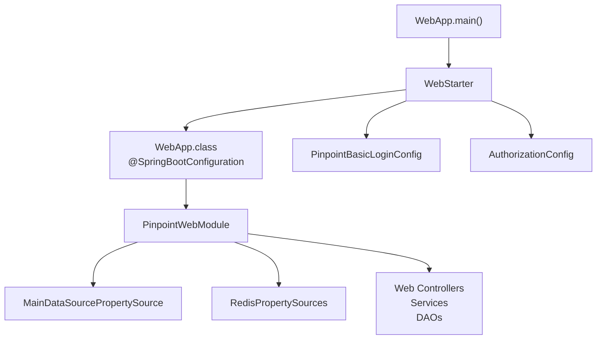

Sources: [web/src/main/java/com/navercorp/pinpoint/web/WebApp.java:54-61]()

The application excludes several Spring Boot auto-configurations to have fine-grained control over component initialization:
- `TransactionAutoConfiguration`
- `SecurityAutoConfiguration` 
- `SqlInitializationAutoConfiguration`
- `RedisAutoConfiguration` (custom Redis config used instead)

Sources: [web/src/main/java/com/navercorp/pinpoint/web/WebApp.java:36-44]()

### Multi-Application Starter

For deployments requiring multiple web features, the `PinpointWebStarter` provides a combined initialization that includes optional modules:

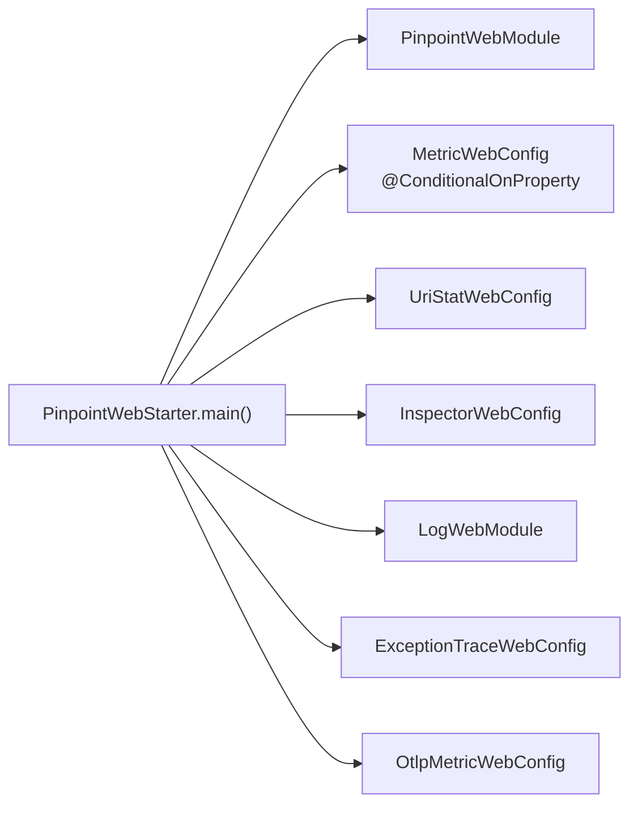

Sources: [web-starter/src/main/java/com/navercorp/pinpoint/web/starter/multi/PinpointWebStarter.java:64-77]()

---

## Configuration Management

### Application Configuration Hierarchy

The Web application uses a layered configuration approach combining Spring Boot's `application.yml` with profile-specific properties files.

**Configuration Structure**

| Configuration File | Purpose | Profile |
|-------------------|---------|---------|
| `application.yml` | Base Spring Boot settings (server, management, actuator) | All |
| `pinpoint-web-root.properties` | Core web properties (feature flags, API limits) | All |
| `profiles/{profile}/pinpoint-web.properties` | Profile-specific overrides | local/release |

**Key Configuration Properties**

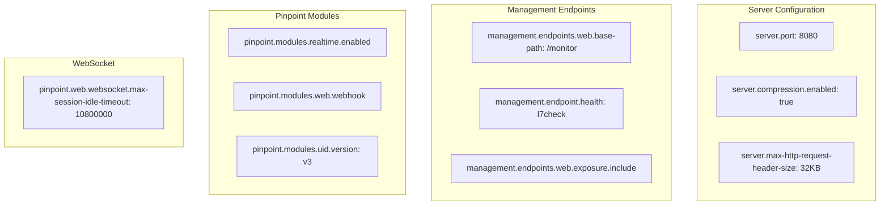

Sources: [web/src/main/resources/application.yml:1-120](), [web-starter/src/main/resources/application.yml:1-110]()

### ConfigProperties Bean

The `ConfigProperties` class binds YAML/properties to type-safe Java objects using Spring Boot's `@ConfigurationProperties`:

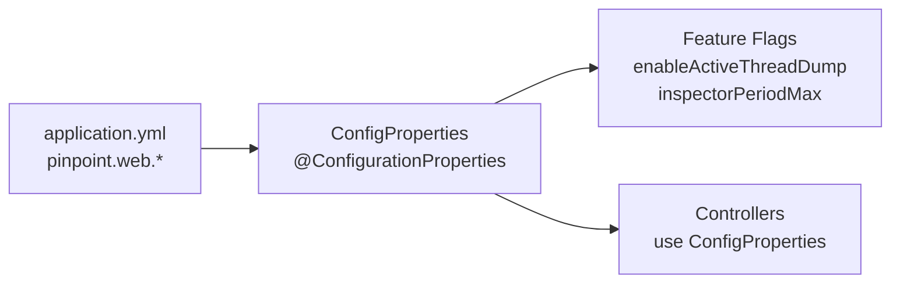

Sources: [web/src/main/java/com/navercorp/pinpoint/web/PinpointWebModule.java:97-99]()

---

## REST API Layer

### Controller Architecture

The Web application exposes a comprehensive REST API through Spring MVC controllers organized by functional domain. Controllers are divided between public APIs and authorization-protected APIs.

**Controller Organization**

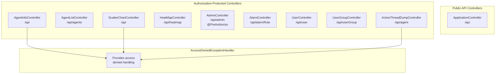

Sources: [web/src/main/java/com/navercorp/pinpoint/web/PinpointWebModule.java:85-93]()

### Key Controller Endpoints

**Agent Management API**

| Endpoint | Method | Controller | Purpose |
|----------|--------|------------|---------|
| `/api/getAgentInfo` | GET | `AgentInfoController` | Retrieve agent info and status |
| `/api/getDetailedAgentInfo` | GET | `AgentInfoController` | Detailed agent info with JVM data |
| `/api/getAgentStatus` | GET | `AgentInfoController` | Current agent status |
| `/api/getAgentEvents` | GET | `AgentInfoController` | Agent lifecycle events |
| `/api/getAgentStatusTimeline` | GET | `AgentInfoController` | Status timeline with events |
| `/api/agents/statistics` | GET | `AgentsController` | All agents statistics |

Sources: [web/src/main/java/com/navercorp/pinpoint/web/agentlist/controller/AgentsController.java:44-65]()

**Application Data API**

| Endpoint | Method | Controller | Purpose |
|----------|--------|------------|---------|
| `/api/getApplicationHostInfo` | GET | `ApplicationController` | Application-agent-host hierarchy |
| `/api/isAvailableApplicationName` | GET | `ApplicationController` | Validate application name |
| `/api/isAvailableAgentId` | GET | `AgentInfoController` | Validate agent ID |

**Scatter Chart and Transaction API**

| Endpoint | Method | Controller | Purpose |
|----------|--------|------------|---------|
| `/api/getScatterData` | GET | `ScatterChartController` | Scatter plot data for response time distribution |
| `/api/transactionmetadata` | POST | `ScatterChartController` | Transaction metadata for selected points |
| `/api/heatmap/drag` | GET | `HeatMapController` | Drag selection on scatter chart |

**Administrative API**

| Endpoint | Method | Controller | Authorization |
|----------|--------|------------|---------------|
| `/api/admin/removeApplicationName` | POST | `AdminController` | `PERMISSION_ADMINISTRATION_CALL_API_FOR_APP_AGENT_MANAGEMENT` |
| `/api/admin/removeApplication` | POST | `AdminController` | `PERMISSION_ADMINISTRATION_CALL_API_FOR_APP_AGENT_MANAGEMENT` |
| `/api/admin/removeAgentId` | POST | `AdminController` | `PERMISSION_ADMINISTRATION_CALL_API_FOR_APP_AGENT_MANAGEMENT` |
| `/api/admin/agentIdMap` | GET | `AdminController` | `PERMISSION_ADMINISTRATION_CALL_API_FOR_APP_AGENT_MANAGEMENT` |
| `/api/admin/duplicateAgentIdMap` | GET | `AdminController` | `PERMISSION_ADMINISTRATION_CALL_API_FOR_APP_AGENT_MANAGEMENT` |

### Request Flow Architecture

**Typical Request Processing Flow**

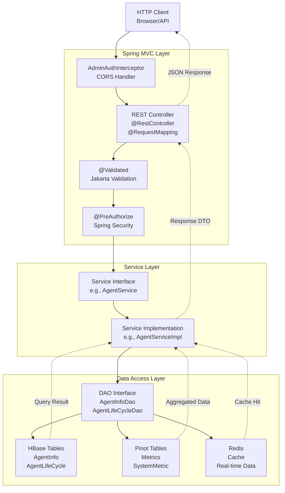

Sources: [web/src/main/java/com/navercorp/pinpoint/web/PinpointWebModule.java:51-84](), [web/src/main/java/com/navercorp/pinpoint/web/service/AgentServiceImpl.java:30-31]()

---

## Service Layer

### Service Architecture Pattern

The Web application follows a clean service layer pattern where controllers delegate business logic to service interfaces. Service implementations orchestrate data access through multiple DAOs.

**Service Layer Structure**

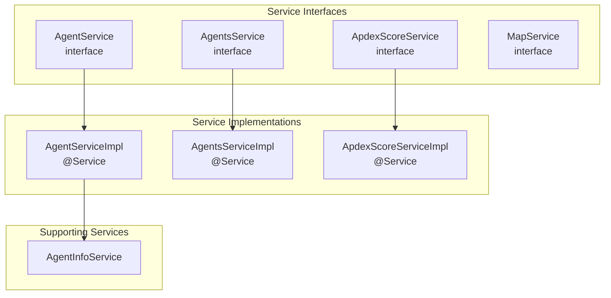

Sources: [web/src/main/java/com/navercorp/pinpoint/web/service/AgentServiceImpl.java:30-38](), [web/src/main/java/com/navercorp/pinpoint/web/agentlist/service/AgentsServiceImpl.java:30-31]()

### AgentService Example

The `AgentServiceImpl` demonstrates cluster key resolution for communication with agents:

**Cluster Key Resolution**

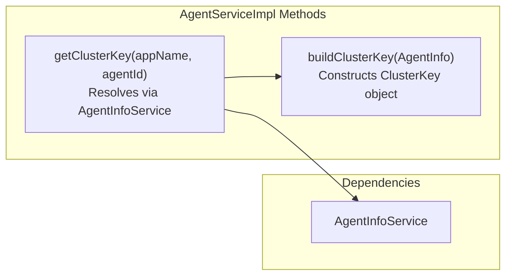

Sources: [web/src/main/java/com/navercorp/pinpoint/web/service/AgentServiceImpl.java:40-87]()

---

## WebSocket Support

### Real-time Features Architecture

The Web application provides WebSocket endpoints for real-time monitoring features, particularly Active Thread Count (ATC) monitoring.

**WebSocket Configuration**

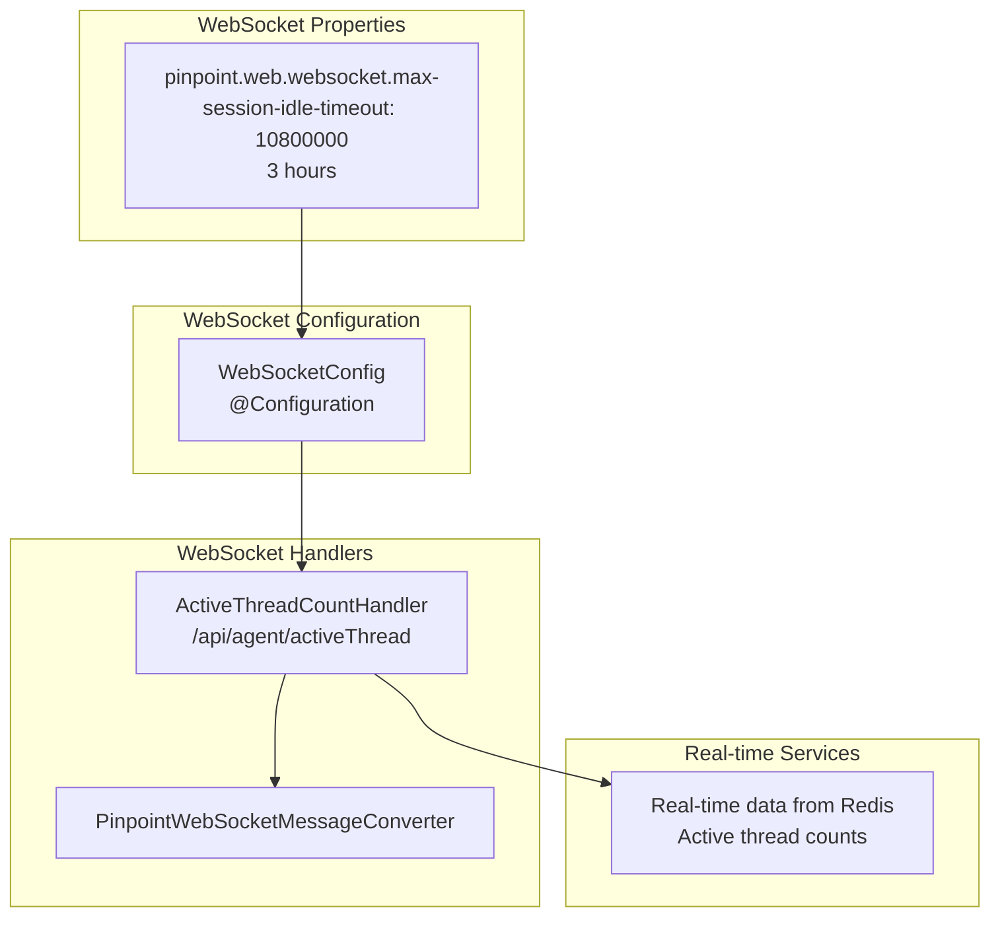

Sources: [web/src/main/resources/application.yml:108-112](), [web/src/main/java/com/navercorp/pinpoint/web/websocket/ActiveThreadCountHandler.java:39-59]()

### Active Thread Count Handler

The `ActiveThreadCountHandler` manages WebSocket sessions and handles incoming request messages for real-time thread data.

**Message Processing Flow**

1. `handleTextMessage` receives a JSON payload.
2. `PinpointWebSocketMessageConverter` deserializes the payload into a `PinpointWebSocketMessage`.
3. If the type is `REQUEST`, it extracts the command (e.g., `activeThreadCount`).
4. `handleActiveThreadCount` is invoked to subscribe the session to specific application updates.

Sources: [web/src/main/java/com/navercorp/pinpoint/web/websocket/ActiveThreadCountHandler.java:75-114]()

---

## Error Handling and Problem Details

### Custom Exception Handler

Pinpoint Web uses a centralized `CustomExceptionHandler` that extends `ResponseEntityExceptionHandler` to provide RFC 7807 Problem Details for HTTP APIs.

**Error Response Processing**

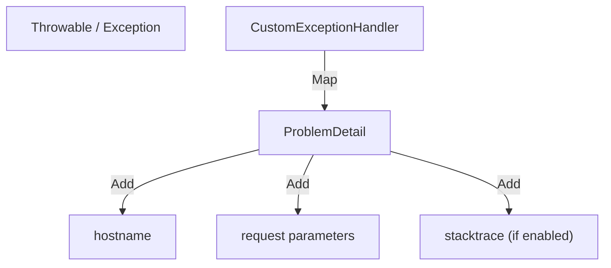

Sources: [web/src/main/java/com/navercorp/pinpoint/web/problem/CustomExceptionHandler.java:73-94](), [web/src/main/java/com/navercorp/pinpoint/web/problem/CustomExceptionHandler.java:178-182]()

**Configuration for Error Responses**

| Property | Default | Purpose |
|----------|---------|--------|
| `server.error.include-stacktrace` | `always` | Include stack traces in API errors |
| `server.error.include-message` | `always` | Include exception messages |
| `spring.mvc.problemdetails.enabled` | `true` | Enable RFC 7807 support |

Sources: [web/src/main/resources/application.yml:5-20]()

---

## Data Storage Integration

### Storage System Architecture

The Web application integrates with three primary storage systems through dedicated configurations.

**Storage System Architecture**

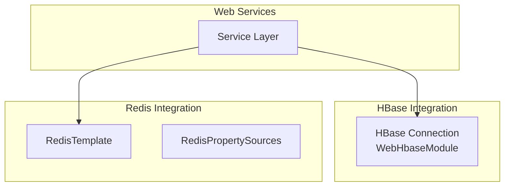

Sources: [web/src/main/java/com/navercorp/pinpoint/web/PinpointWebModule.java:62-69](), [web/src/main/java/com/navercorp/pinpoint/web/WebApp.java:46-50]()

### Redis Configuration

Redis is configured to support both standalone and cluster modes, used for caching and real-time message passing.

**Redis Connection Configuration**

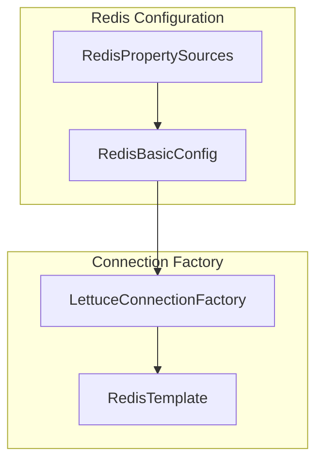

Sources: [redis/src/main/java/com/navercorp/pinpoint/redis/RedisBasicConfig.java:90-104]()

---

## Management and Monitoring

### Spring Boot Actuator Endpoints

The Web application exposes various management endpoints through Spring Boot Actuator for operational monitoring.

**Actuator Configuration**

- Base path: `/monitor`
- Health endpoint mapped to: `l7check` (for load balancer health checks)
- Separate management port: `8443` (with SSL disabled by default)
- Tomcat mbean registry enabled for JMX monitoring

Sources: [web/src/main/resources/application.yml:8-11](), [web/src/main/resources/application.yml:71-81]()

---

## Summary

The Pinpoint Web application is a Spring Boot-based REST API server that provides:

1. **Controller Layer**: Domain-organized REST endpoints for agent management, application maps, and statistics.
2. **Service Layer**: Business logic orchestration, including cluster key resolution via `AgentService`.
3. **WebSocket Support**: Real-time active thread monitoring through `ActiveThreadCountHandler`.
4. **Error Handling**: Standardized RFC 7807 Problem Details via `CustomExceptionHandler`.
5. **Modularity**: Support for optional features like Inspector, OTLP metrics, and URI statistics via property-based module activation.

The architecture emphasizes separation of concerns, with clear boundaries between the web layer, business logic, and storage abstractions, ensuring scalability and maintainability for the Pinpoint APM ecosystem.

---

