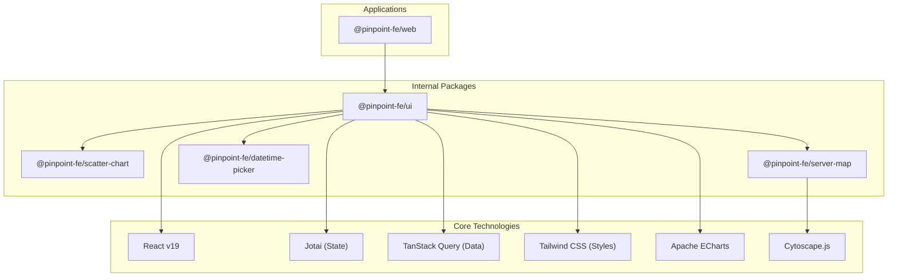
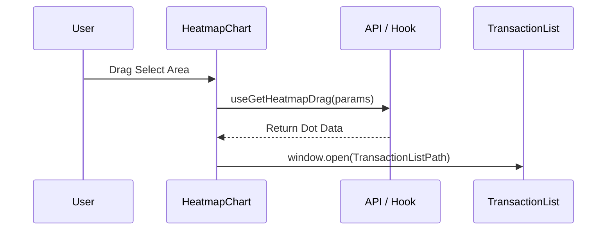

<!-- source: DeepWiki mcp.deepwiki.com · repo pinpoint-apm/pinpoint · page 3.5 Frontend Architecture · fetched 2026-10-29 -->

# Frontend Architecture

Relevant source files

The following files were used as context for generating this wiki page:

- [.github/workflows/frontend-test.yml](.github/workflows/frontend-test.yml)
- [web-frontend/src/main/v3/.gitignore](web-frontend/src/main/v3/.gitignore)
- [web-frontend/src/main/v3/.husky/pre-commit](web-frontend/src/main/v3/.husky/pre-commit)
- [web-frontend/src/main/v3/apps/web/.gitignore](web-frontend/src/main/v3/apps/web/.gitignore)
- [web-frontend/src/main/v3/apps/web/package.json](web-frontend/src/main/v3/apps/web/package.json)
- [web-frontend/src/main/v3/apps/web/playwright.config.ts](web-frontend/src/main/v3/apps/web/playwright.config.ts)
- [web-frontend/src/main/v3/apps/web/src/components/Layout/LayoutWithSideNavigation.tsx](web-frontend/src/main/v3/apps/web/src/components/Layout/LayoutWithSideNavigation.tsx)
- [web-frontend/src/main/v3/apps/web/src/hooks/useMenuItems.tsx](web-frontend/src/main/v3/apps/web/src/hooks/useMenuItems.tsx)
- [web-frontend/src/main/v3/apps/web/src/pages/ErrorAnalysis.tsx](web-frontend/src/main/v3/apps/web/src/pages/ErrorAnalysis.tsx)
- [web-frontend/src/main/v3/apps/web/src/pages/FilteredMap.tsx](web-frontend/src/main/v3/apps/web/src/pages/FilteredMap.tsx)
- [web-frontend/src/main/v3/apps/web/src/pages/Inspector.tsx](web-frontend/src/main/v3/apps/web/src/pages/Inspector.tsx)
- [web-frontend/src/main/v3/apps/web/src/pages/OpenTelemetry.tsx](web-frontend/src/main/v3/apps/web/src/pages/OpenTelemetry.tsx)
- [web-frontend/src/main/v3/apps/web/src/pages/ScatterOrHeatmapFullScreen.tsx](web-frontend/src/main/v3/apps/web/src/pages/ScatterOrHeatmapFullScreen.tsx)
- [web-frontend/src/main/v3/apps/web/src/pages/ServerMap/Realtime.tsx](web-frontend/src/main/v3/apps/web/src/pages/ServerMap/Realtime.tsx)
- [web-frontend/src/main/v3/apps/web/src/pages/ServerMap/index.tsx](web-frontend/src/main/v3/apps/web/src/pages/ServerMap/index.tsx)
- [web-frontend/src/main/v3/apps/web/src/pages/SystemMetric.tsx](web-frontend/src/main/v3/apps/web/src/pages/SystemMetric.tsx)
- [web-frontend/src/main/v3/apps/web/src/pages/ThreadDump.tsx](web-frontend/src/main/v3/apps/web/src/pages/ThreadDump.tsx)
- [web-frontend/src/main/v3/apps/web/src/pages/UrlStatistic.tsx](web-frontend/src/main/v3/apps/web/src/pages/UrlStatistic.tsx)
- [web-frontend/src/main/v3/apps/web/src/pages/config/AgentManagement.tsx](web-frontend/src/main/v3/apps/web/src/pages/config/AgentManagement.tsx)
- [web-frontend/src/main/v3/apps/web/src/pages/config/AgentStatistic.tsx](web-frontend/src/main/v3/apps/web/src/pages/config/AgentStatistic.tsx)
- [web-frontend/src/main/v3/package.json](web-frontend/src/main/v3/package.json)
- [web-frontend/src/main/v3/packages/datetime-picker/.storybook/main.ts](web-frontend/src/main/v3/packages/datetime-picker/.storybook/main.ts)
- [web-frontend/src/main/v3/packages/datetime-picker/jest.config.cjs](web-frontend/src/main/v3/packages/datetime-picker/jest.config.cjs)
- [web-frontend/src/main/v3/packages/datetime-picker/package.json](web-frontend/src/main/v3/packages/datetime-picker/package.json)
- [web-frontend/src/main/v3/packages/datetime-picker/src/test/mock/svgMock.tsx](web-frontend/src/main/v3/packages/datetime-picker/src/test/mock/svgMock.tsx)
- [web-frontend/src/main/v3/packages/datetime-picker/src/types/custom.d.ts](web-frontend/src/main/v3/packages/datetime-picker/src/types/custom.d.ts)
- [web-frontend/src/main/v3/packages/scatter-chart/.storybook/main.js](web-frontend/src/main/v3/packages/scatter-chart/.storybook/main.js)
- [web-frontend/src/main/v3/packages/scatter-chart/eslint.config.js](web-frontend/src/main/v3/packages/scatter-chart/eslint.config.js)
- [web-frontend/src/main/v3/packages/scatter-chart/package.json](web-frontend/src/main/v3/packages/scatter-chart/package.json)
- [web-frontend/src/main/v3/packages/scatter-chart/test/__snapshots__/axis.test.ts.snap](web-frontend/src/main/v3/packages/scatter-chart/test/__snapshots__/axis.test.ts.snap)
- [web-frontend/src/main/v3/packages/scatter-chart/test/__snapshots__/scatter.test.ts.snap](web-frontend/src/main/v3/packages/scatter-chart/test/__snapshots__/scatter.test.ts.snap)
- [web-frontend/src/main/v3/packages/scatter-chart/test/scatter.test.ts](web-frontend/src/main/v3/packages/scatter-chart/test/scatter.test.ts)
- [web-frontend/src/main/v3/packages/scatter-chart/tsconfig.json](web-frontend/src/main/v3/packages/scatter-chart/tsconfig.json)
- [web-frontend/src/main/v3/packages/server-map/.storybook/main.js](web-frontend/src/main/v3/packages/server-map/.storybook/main.js)
- [web-frontend/src/main/v3/packages/server-map/package.json](web-frontend/src/main/v3/packages/server-map/package.json)
- [web-frontend/src/main/v3/packages/server-map/src/storybook/index.stories.tsx](web-frontend/src/main/v3/packages/server-map/src/storybook/index.stories.tsx)
- [web-frontend/src/main/v3/packages/server-map/tsconfig.json](web-frontend/src/main/v3/packages/server-map/tsconfig.json)
- [web-frontend/src/main/v3/packages/ui/babel.config.cjs](web-frontend/src/main/v3/packages/ui/babel.config.cjs)
- [web-frontend/src/main/v3/packages/ui/components.json](web-frontend/src/main/v3/packages/ui/components.json)
- [web-frontend/src/main/v3/packages/ui/jest.config.cjs](web-frontend/src/main/v3/packages/ui/jest.config.cjs)
- [web-frontend/src/main/v3/packages/ui/package.json](web-frontend/src/main/v3/packages/ui/package.json)
- [web-frontend/src/main/v3/packages/ui/src/atoms/index.ts](web-frontend/src/main/v3/packages/ui/src/atoms/index.ts)
- [web-frontend/src/main/v3/packages/ui/src/atoms/searchParameters.ts](web-frontend/src/main/v3/packages/ui/src/atoms/searchParameters.ts)
- [web-frontend/src/main/v3/packages/ui/src/atoms/serverMap.ts](web-frontend/src/main/v3/packages/ui/src/atoms/serverMap.ts)
- [web-frontend/src/main/v3/packages/ui/src/atoms/serverMapMock.ts](web-frontend/src/main/v3/packages/ui/src/atoms/serverMapMock.ts)
- [web-frontend/src/main/v3/packages/ui/src/components/Agent/AgentSearchList.tsx](web-frontend/src/main/v3/packages/ui/src/components/Agent/AgentSearchList.tsx)
- [web-frontend/src/main/v3/packages/ui/src/components/Chart/Load/LoadChart.stories.tsx](web-frontend/src/main/v3/packages/ui/src/components/Chart/Load/LoadChart.stories.tsx)
- [web-frontend/src/main/v3/packages/ui/src/components/Chart/Load/LoadChart.tsx](web-frontend/src/main/v3/packages/ui/src/components/Chart/Load/LoadChart.tsx)
- [web-frontend/src/main/v3/packages/ui/src/components/Chart/ResponseAvgMax/ResponseAvgMaxChart.stories.tsx](web-frontend/src/main/v3/packages/ui/src/components/Chart/ResponseAvgMax/ResponseAvgMaxChart.stories.tsx)
- [web-frontend/src/main/v3/packages/ui/src/components/Chart/ResponseAvgMax/ResponseAvgMaxChart.tsx](web-frontend/src/main/v3/packages/ui/src/components/Chart/ResponseAvgMax/ResponseAvgMaxChart.tsx)
- [web-frontend/src/main/v3/packages/ui/src/components/Chart/ResponseSummary/ResponseSummaryChart.stories.tsx](web-frontend/src/main/v3/packages/ui/src/components/Chart/ResponseSummary/ResponseSummaryChart.stories.tsx)
- [web-frontend/src/main/v3/packages/ui/src/components/Chart/ResponseSummary/ResponseSummaryChart.tsx](web-frontend/src/main/v3/packages/ui/src/components/Chart/ResponseSummary/ResponseSummaryChart.tsx)
- [web-frontend/src/main/v3/packages/ui/src/components/ChartsBoard/ChartsBoard.tsx](web-frontend/src/main/v3/packages/ui/src/components/ChartsBoard/ChartsBoard.tsx)
- [web-frontend/src/main/v3/packages/ui/src/components/Drawer/Drawer.stories.tsx](web-frontend/src/main/v3/packages/ui/src/components/Drawer/Drawer.stories.tsx)
- [web-frontend/src/main/v3/packages/ui/src/components/ErrorAnalysis/sidebar/ErrorAnalysisSidebar.tsx](web-frontend/src/main/v3/packages/ui/src/components/ErrorAnalysis/sidebar/ErrorAnalysisSidebar.tsx)
- [web-frontend/src/main/v3/packages/ui/src/components/Heatmap/Heatmap.tsx](web-frontend/src/main/v3/packages/ui/src/components/Heatmap/Heatmap.tsx)
- [web-frontend/src/main/v3/packages/ui/src/components/Heatmap/HeatmapFetcher.tsx](web-frontend/src/main/v3/packages/ui/src/components/Heatmap/HeatmapFetcher.tsx)
- [web-frontend/src/main/v3/packages/ui/src/components/Heatmap/HeatmapRealtimeFetcher.tsx](web-frontend/src/main/v3/packages/ui/src/components/Heatmap/HeatmapRealtimeFetcher.tsx)
- [web-frontend/src/main/v3/packages/ui/src/components/Heatmap/core/HeatmapChart.tsx](web-frontend/src/main/v3/packages/ui/src/components/Heatmap/core/HeatmapChart.tsx)
- [web-frontend/src/main/v3/packages/ui/src/components/Heatmap/core/HeatmapChartCore.tsx](web-frontend/src/main/v3/packages/ui/src/components/Heatmap/core/HeatmapChartCore.tsx)
- [web-frontend/src/main/v3/packages/ui/src/components/Heatmap/core/HeatmapSetting.tsx](web-frontend/src/main/v3/packages/ui/src/components/Heatmap/core/HeatmapSetting.tsx)
- [web-frontend/src/main/v3/packages/ui/src/components/Heatmap/index.tsx](web-frontend/src/main/v3/packages/ui/src/components/Heatmap/index.tsx)
- [web-frontend/src/main/v3/packages/ui/src/components/Inspector/charts/InspectorChart.tsx](web-frontend/src/main/v3/packages/ui/src/components/Inspector/charts/InspectorChart.tsx)
- [web-frontend/src/main/v3/packages/ui/src/components/Inspector/sidebar/InspectorSidebar.tsx](web-frontend/src/main/v3/packages/ui/src/components/Inspector/sidebar/InspectorSidebar.tsx)
- [web-frontend/src/main/v3/packages/ui/src/components/Layout/LayoutWithContentSidebar.tsx](web-frontend/src/main/v3/packages/ui/src/components/Layout/LayoutWithContentSidebar.tsx)
- [web-frontend/src/main/v3/packages/ui/src/components/Layout/LayoutWithSideNavigation.tsx](web-frontend/src/main/v3/packages/ui/src/components/Layout/LayoutWithSideNavigation.tsx)
- [web-frontend/src/main/v3/packages/ui/src/components/MainHeader/MainHeader.tsx](web-frontend/src/main/v3/packages/ui/src/components/MainHeader/MainHeader.tsx)
- [web-frontend/src/main/v3/packages/ui/src/components/ProgressBar/ProgressBar.stories.tsx](web-frontend/src/main/v3/packages/ui/src/components/ProgressBar/ProgressBar.stories.tsx)
- [web-frontend/src/main/v3/packages/ui/src/components/ProgressBar/ProgressBarWithControls.stories.tsx](web-frontend/src/main/v3/packages/ui/src/components/ProgressBar/ProgressBarWithControls.stories.tsx)
- [web-frontend/src/main/v3/packages/ui/src/components/Realtime/Realtime.tsx](web-frontend/src/main/v3/packages/ui/src/components/Realtime/Realtime.tsx)
- [web-frontend/src/main/v3/packages/ui/src/components/ScatterChart/core/ScatterChartCore.tsx](web-frontend/src/main/v3/packages/ui/src/components/ScatterChart/core/ScatterChartCore.tsx)
- [web-frontend/src/main/v3/packages/ui/src/components/ServerMap/ChartTypeButtons.tsx](web-frontend/src/main/v3/packages/ui/src/components/ServerMap/ChartTypeButtons.tsx)
- [web-frontend/src/main/v3/packages/ui/src/components/ServerMap/index.tsx](web-frontend/src/main/v3/packages/ui/src/components/ServerMap/index.tsx)
- [web-frontend/src/main/v3/packages/ui/src/components/Sidebar/Sidebar.stories.tsx](web-frontend/src/main/v3/packages/ui/src/components/Sidebar/Sidebar.stories.tsx)
- [web-frontend/src/main/v3/packages/ui/src/components/Sidebar/Sidebar.tsx](web-frontend/src/main/v3/packages/ui/src/components/Sidebar/Sidebar.tsx)
- [web-frontend/src/main/v3/packages/ui/src/components/URL/sidebar/UrlSidebar.tsx](web-frontend/src/main/v3/packages/ui/src/components/URL/sidebar/UrlSidebar.tsx)
- [web-frontend/src/main/v3/packages/ui/src/components/index.ts](web-frontend/src/main/v3/packages/ui/src/components/index.ts)
- [web-frontend/src/main/v3/packages/ui/src/components/ui/sidebar.tsx](web-frontend/src/main/v3/packages/ui/src/components/ui/sidebar.tsx)
- [web-frontend/src/main/v3/packages/ui/src/components/ui/skeleton.tsx](web-frontend/src/main/v3/packages/ui/src/components/ui/skeleton.tsx)
- [web-frontend/src/main/v3/packages/ui/src/constants/ExperimentalConfigKeys.ts](web-frontend/src/main/v3/packages/ui/src/constants/ExperimentalConfigKeys.ts)
- [web-frontend/src/main/v3/packages/ui/src/constants/locales/index.ts](web-frontend/src/main/v3/packages/ui/src/constants/locales/index.ts)
- [web-frontend/src/main/v3/packages/ui/src/constants/path.ts](web-frontend/src/main/v3/packages/ui/src/constants/path.ts)
- [web-frontend/src/main/v3/packages/ui/src/constants/types/Configuration.ts](web-frontend/src/main/v3/packages/ui/src/constants/types/Configuration.ts)
- [web-frontend/src/main/v3/packages/ui/src/constants/types/FilteredMap.ts](web-frontend/src/main/v3/packages/ui/src/constants/types/FilteredMap.ts)
- [web-frontend/src/main/v3/packages/ui/src/constants/types/GetHeatmapAppData.ts](web-frontend/src/main/v3/packages/ui/src/constants/types/GetHeatmapAppData.ts)
- [web-frontend/src/main/v3/packages/ui/src/constants/types/GetScatter.ts](web-frontend/src/main/v3/packages/ui/src/constants/types/GetScatter.ts)
- [web-frontend/src/main/v3/packages/ui/src/constants/types/GetServerMap.ts](web-frontend/src/main/v3/packages/ui/src/constants/types/GetServerMap.ts)
- [web-frontend/src/main/v3/packages/ui/src/constants/types/MenuItem.ts](web-frontend/src/main/v3/packages/ui/src/constants/types/MenuItem.ts)
- [web-frontend/src/main/v3/packages/ui/src/globals.css](web-frontend/src/main/v3/packages/ui/src/globals.css)
- [web-frontend/src/main/v3/packages/ui/src/hooks/api/useGetHeatmapDrag.ts](web-frontend/src/main/v3/packages/ui/src/hooks/api/useGetHeatmapDrag.ts)
- [web-frontend/src/main/v3/packages/ui/src/hooks/api/useGetScatterData.ts](web-frontend/src/main/v3/packages/ui/src/hooks/api/useGetScatterData.ts)
- [web-frontend/src/main/v3/packages/ui/src/hooks/api/useGetScatterRealtimeData.ts](web-frontend/src/main/v3/packages/ui/src/hooks/api/useGetScatterRealtimeData.ts)
- [web-frontend/src/main/v3/packages/ui/src/hooks/index.ts](web-frontend/src/main/v3/packages/ui/src/hooks/index.ts)
- [web-frontend/src/main/v3/packages/ui/src/hooks/searchParameters/useSearchParameters.ts](web-frontend/src/main/v3/packages/ui/src/hooks/searchParameters/useSearchParameters.ts)
- [web-frontend/src/main/v3/packages/ui/src/hooks/serverMap/index.tsx](web-frontend/src/main/v3/packages/ui/src/hooks/serverMap/index.tsx)
- [web-frontend/src/main/v3/packages/ui/src/hooks/serverMap/useFilterWizardOnClickApply.ts](web-frontend/src/main/v3/packages/ui/src/hooks/serverMap/useFilterWizardOnClickApply.ts)
- [web-frontend/src/main/v3/packages/ui/src/hooks/serverMap/useServerMapOnClickMenuItem.ts](web-frontend/src/main/v3/packages/ui/src/hooks/serverMap/useServerMapOnClickMenuItem.ts)
- [web-frontend/src/main/v3/packages/ui/src/hooks/use-mobile.tsx](web-frontend/src/main/v3/packages/ui/src/hooks/use-mobile.tsx)
- [web-frontend/src/main/v3/packages/ui/src/hooks/utility/useExperimentals.ts](web-frontend/src/main/v3/packages/ui/src/hooks/utility/useExperimentals.ts)
- [web-frontend/src/main/v3/packages/ui/src/loader/index.ts](web-frontend/src/main/v3/packages/ui/src/loader/index.ts)
- [web-frontend/src/main/v3/packages/ui/src/pages/ErrorAnalysis.tsx](web-frontend/src/main/v3/packages/ui/src/pages/ErrorAnalysis.tsx)
- [web-frontend/src/main/v3/packages/ui/src/pages/FilteredMap.tsx](web-frontend/src/main/v3/packages/ui/src/pages/FilteredMap.tsx)
- [web-frontend/src/main/v3/packages/ui/src/pages/Inspector.tsx](web-frontend/src/main/v3/packages/ui/src/pages/Inspector.tsx)
- [web-frontend/src/main/v3/packages/ui/src/pages/OpenTelemetry.tsx](web-frontend/src/main/v3/packages/ui/src/pages/OpenTelemetry.tsx)
- [web-frontend/src/main/v3/packages/ui/src/pages/Realtime.tsx](web-frontend/src/main/v3/packages/ui/src/pages/Realtime.tsx)
- [web-frontend/src/main/v3/packages/ui/src/pages/ScatterOrHeatmapFullScreen.tsx](web-frontend/src/main/v3/packages/ui/src/pages/ScatterOrHeatmapFullScreen.tsx)
- [web-frontend/src/main/v3/packages/ui/src/pages/ServerMap.tsx](web-frontend/src/main/v3/packages/ui/src/pages/ServerMap.tsx)
- [web-frontend/src/main/v3/packages/ui/src/pages/SystemMetric.tsx](web-frontend/src/main/v3/packages/ui/src/pages/SystemMetric.tsx)
- [web-frontend/src/main/v3/packages/ui/src/pages/UrlStatistic.tsx](web-frontend/src/main/v3/packages/ui/src/pages/UrlStatistic.tsx)
- [web-frontend/src/main/v3/packages/ui/src/pages/config/Alarm.tsx](web-frontend/src/main/v3/packages/ui/src/pages/config/Alarm.tsx)
- [web-frontend/src/main/v3/packages/ui/src/pages/config/Help.tsx](web-frontend/src/main/v3/packages/ui/src/pages/config/Help.tsx)
- [web-frontend/src/main/v3/packages/ui/src/pages/config/Webhook.tsx](web-frontend/src/main/v3/packages/ui/src/pages/config/Webhook.tsx)
- [web-frontend/src/main/v3/packages/ui/src/utils/helper/filteredMap/merge.test.ts](web-frontend/src/main/v3/packages/ui/src/utils/helper/filteredMap/merge.test.ts)
- [web-frontend/src/main/v3/packages/ui/src/utils/helper/filteredMap/merge.ts](web-frontend/src/main/v3/packages/ui/src/utils/helper/filteredMap/merge.ts)
- [web-frontend/src/main/v3/packages/ui/src/utils/helper/filteredMap/mergeMock.ts](web-frontend/src/main/v3/packages/ui/src/utils/helper/filteredMap/mergeMock.ts)
- [web-frontend/src/main/v3/packages/ui/src/utils/helper/route.ts](web-frontend/src/main/v3/packages/ui/src/utils/helper/route.ts)
- [web-frontend/src/main/v3/packages/ui/vite.config.ts](web-frontend/src/main/v3/packages/ui/vite.config.ts)
- [web-frontend/src/main/v3/yarn.lock](web-frontend/src/main/v3/yarn.lock)

## Purpose and Scope

This document details the React v3 frontend architecture for Pinpoint APM. The frontend is a modern TypeScript/React application organized as a monorepo, designed to consume REST APIs and WebSocket data from the Pinpoint Web backend. It features a custom UI component system, atomic state management using Jotai, and specialized high-performance visualization libraries for distributed tracing data.

**Sources**: [web-frontend/src/main/v3/packages/ui/package.json:1-140](), [web-frontend/src/main/v3/apps/web/package.json:1-54]()

---

## Monorepo Structure

The frontend utilizes a Yarn monorepo located at `web-frontend/src/main/v3/`. This structure allows for the separation of core visualization logic from the main application shell, promoting reusability and isolated testing.

### Workspace Organization

| Package | Path | Description |
|:---|:---|:---|
| `@pinpoint-fe/web` | `apps/web` | The main application entry point and route orchestrator. |
| `@pinpoint-fe/ui` | `packages/ui` | Core component library, hooks, atoms, and shared pages. |
| `@pinpoint-fe/scatter-chart` | `packages/scatter-chart` | Canvas-based engine for request/response pattern visualization. |
| `@pinpoint-fe/server-map` | `packages/server-map` | Cytoscape.js based topology visualization library. |
| `@pinpoint-fe/datetime-picker` | `packages/datetime-picker` | Specialized time-range selection component. |

**Sources**: [web-frontend/src/main/v3/package.json:1-40](), [web-frontend/src/main/v3/packages/ui/package.json:31-33]()

### Dependency Graph

The following diagram illustrates the internal and external dependencies of the Pinpoint v3 frontend.

**Sources**: [web-frontend/src/main/v3/packages/ui/package.json:28-97](), [web-frontend/src/main/v3/apps/web/package.json:19-33]()

---

## Core Application Logic (@pinpoint-fe/web)

The `@pinpoint-fe/web` package acts as the deployment unit. It handles top-level routing and integrates the components provided by `@pinpoint-fe/ui`.

### Navigation and Layout
The application uses a side-navigation layout defined in `LayoutWithSideNavigation`. This component manages the sidebar state (collapsed vs. expanded) and renders menu items based on the current path.

- **Sidebar Widths**: Expanded is `200px`, Collapsed is `64px`. [web-frontend/src/main/v3/packages/ui/src/components/Layout/LayoutWithSideNavigation.tsx:43-44]()
- **Persistence**: The sidebar scale is persisted in `localStorage` using the key `APP_SETTING_KEYS.SIDE_NAV_BAR_SCALE`. [web-frontend/src/main/v3/packages/ui/src/components/Layout/LayoutWithSideNavigation.tsx:80]()

### State Management (Jotai Atoms)
Pinpoint uses an atomic state model. Key atoms include:
- `serverMapDataAtom`: Stores the current topology data. [web-frontend/src/main/v3/packages/ui/src/pages/ServerMap.tsx:15]()
- `serverMapCurrentTargetAtom`: Tracks the currently selected node or edge in the map. [web-frontend/src/main/v3/packages/ui/src/pages/ServerMap.tsx:16]()
- `globalSearchDisplayAtom`: Controls the visibility of the global search overlay. [web-frontend/src/main/v3/packages/ui/src/components/Layout/LayoutWithSideNavigation.tsx:25]()

**Sources**: [web-frontend/src/main/v3/packages/ui/src/components/Layout/LayoutWithSideNavigation.tsx:74-95](), [web-frontend/src/main/v3/packages/ui/src/pages/ServerMap.tsx:60-66]()

---

## Visualization Systems

### ServerMap Visualization
The ServerMap renders the application topology. It leverages `cytoscape` for graph management and custom logic for merging nodes.

- **Implementation**: The `ServerMapPage` component uses `useServerMapSearchParameters` to sync the view with URL parameters (from, to, application). [web-frontend/src/main/v3/packages/ui/src/pages/ServerMap.tsx:60-61]()
- **Real-time Support**: When in real-time mode, the `ServerMap` component is configured with `shouldPoll={true}`. [web-frontend/src/main/v3/packages/ui/src/components/Realtime/Realtime.tsx:119]()

### Heatmap and Scatter Chart
These components visualize request distributions.
- **Heatmap**: Implemented using `echarts`. It supports drag-selection to zoom into specific transaction clusters. [web-frontend/src/main/v3/packages/ui/src/components/Heatmap/core/HeatmapChart.tsx:22-27]()
- **Scatter Chart**: A high-performance canvas library (`@pinpoint-fe/scatter-chart`) specifically designed for large volumes of request data points. [web-frontend/src/main/v3/packages/scatter-chart/package.json:4]()

**Sources**: [web-frontend/src/main/v3/packages/ui/src/components/Heatmap/core/HeatmapChart.tsx:10-27](), [web-frontend/src/main/v3/packages/ui/src/components/Heatmap/core/HeatmapChartCore.tsx:104-118]()

---

## Component Architecture (@pinpoint-fe/ui)

The UI package contains the bulk of the feature implementations. It is built on `shadcn/ui` (Radix UI primitives) and `Tailwind CSS`.

### Key UI Components
- **ResponseSummaryChart**: Uses ECharts `BarChart` to show response time distributions (1s, 3s, 5s, Slow, Error). It features an "Axis Break" to handle outliers in data volume. [web-frontend/src/main/v3/packages/ui/src/components/Chart/ResponseSummary/ResponseSummaryChart.tsx:32-42]()
- **Realtime**: Orchestrates the `ServerMap` and `AgentActiveThreadFetcher` for live monitoring. [web-frontend/src/main/v3/packages/ui/src/components/Realtime/Realtime.tsx:44-130]()
- **MainHeader**: Provides a consistent header with breadcrumbs and the `DatetimePicker`. [web-frontend/src/main/v3/packages/ui/src/pages/ServerMap.tsx:159-191]()

### Data Fetching
The frontend uses `@tanstack/react-query` for server state. Hooks like `useGetHeatmapDrag` abstract the complexity of fetching and caching trace data. [web-frontend/src/main/v3/packages/ui/src/components/Heatmap/core/HeatmapChartCore.tsx:19-20]()

**Sources**: [web-frontend/src/main/v3/packages/ui/src/components/Chart/ResponseSummary/ResponseSummaryChart.tsx:1-12](), [web-frontend/src/main/v3/packages/ui/package.json:35-55]()

---

## Build and Integration

The frontend build is integrated into the main Pinpoint Maven lifecycle.

1. **Vite Compilation**: Each package uses Vite for fast bundling. The `apps/web` package runs `vite build` which outputs static assets. [web-frontend/src/main/v3/apps/web/package.json:8]()
2. **Asset Migration**: The `move:dist` script copies the built files from `dist/` to the Spring Boot static resources directory: `../../../../../target/classes/static/`. [web-frontend/src/main/v3/apps/web/package.json:15]()
3. **Maven Orchestration**: The `frontend-maven-plugin` ensures that `yarn install` and `yarn build` are executed during the Maven `compile` or `package` phases.

| Build Command | Purpose |
|:---|:---|
| `yarn dev` | Starts Vite dev server with HMR. |
| `yarn build` | Production build including Type checking (`tsc`). |
| `yarn lint` | Runs ESLint and Prettier for code quality. |
| `yarn storybook` | Starts isolated component documentation server. |

**Sources**: [web-frontend/src/main/v3/apps/web/package.json:6-17](), [web-frontend/src/main/v3/packages/ui/package.json:7-17]()

---

