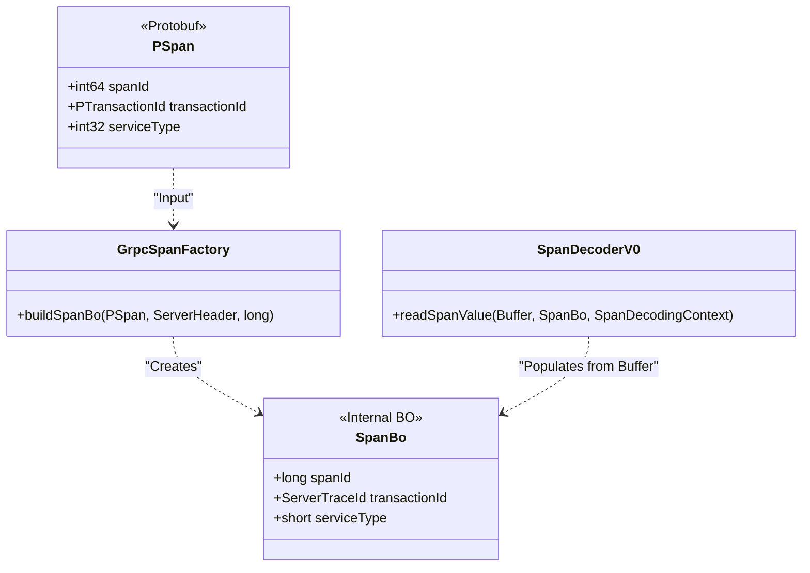

<!-- source: DeepWiki mcp.deepwiki.com · repo pinpoint-apm/pinpoint · page 3.6 gRPC Communication Layer · fetched 2026-10-29 -->

# gRPC Communication Layer

<details>
<summary>Relevant source files</summary>

The following files were used as context for generating this wiki page:

- [.gitmodules](.gitmodules)
- [collector/src/main/java/com/navercorp/pinpoint/collector/grpc/config/GrpcPropertiesServerOptionBuilder.java](collector/src/main/java/com/navercorp/pinpoint/collector/grpc/config/GrpcPropertiesServerOptionBuilder.java)
- [collector/src/main/java/com/navercorp/pinpoint/collector/handler/grpc/GrpcSpanChunkHandler.java](collector/src/main/java/com/navercorp/pinpoint/collector/handler/grpc/GrpcSpanChunkHandler.java)
- [collector/src/main/java/com/navercorp/pinpoint/collector/handler/grpc/GrpcSpanHandler.java](collector/src/main/java/com/navercorp/pinpoint/collector/handler/grpc/GrpcSpanHandler.java)
- [collector/src/main/java/com/navercorp/pinpoint/collector/receiver/grpc/GrpcReceiver.java](collector/src/main/java/com/navercorp/pinpoint/collector/receiver/grpc/GrpcReceiver.java)
- [collector/src/main/resources/pinpoint-collector-grpc-root.properties](collector/src/main/resources/pinpoint-collector-grpc-root.properties)
- [collector/src/test/java/com/navercorp/pinpoint/collector/receiver/grpc/AgentClientMock.java](collector/src/test/java/com/navercorp/pinpoint/collector/receiver/grpc/AgentClientMock.java)
- [collector/src/test/java/com/navercorp/pinpoint/collector/receiver/grpc/MetadataClientMock.java](collector/src/test/java/com/navercorp/pinpoint/collector/receiver/grpc/MetadataClientMock.java)
- [collector/src/test/java/com/navercorp/pinpoint/collector/receiver/grpc/SpanClientMock.java](collector/src/test/java/com/navercorp/pinpoint/collector/receiver/grpc/SpanClientMock.java)
- [collector/src/test/java/com/navercorp/pinpoint/collector/receiver/grpc/SpanClientTestMain.java](collector/src/test/java/com/navercorp/pinpoint/collector/receiver/grpc/SpanClientTestMain.java)
- [collector/src/test/java/com/navercorp/pinpoint/collector/receiver/grpc/StatClientMock.java](collector/src/test/java/com/navercorp/pinpoint/collector/receiver/grpc/StatClientMock.java)
- [commons-buffer/src/main/java/com/navercorp/pinpoint/common/buffer/CachedStringAllocator.java](commons-buffer/src/main/java/com/navercorp/pinpoint/common/buffer/CachedStringAllocator.java)
- [commons-buffer/src/main/java/com/navercorp/pinpoint/common/buffer/StringAllocator.java](commons-buffer/src/main/java/com/navercorp/pinpoint/common/buffer/StringAllocator.java)
- [commons-buffer/src/main/java/com/navercorp/pinpoint/common/buffer/StringCacheableBuffer.java](commons-buffer/src/main/java/com/navercorp/pinpoint/common/buffer/StringCacheableBuffer.java)
- [commons-buffer/src/test/java/com/navercorp/pinpoint/common/buffer/CachedStringAllocatorTest.java](commons-buffer/src/test/java/com/navercorp/pinpoint/common/buffer/CachedStringAllocatorTest.java)
- [commons-buffer/src/test/java/com/navercorp/pinpoint/common/buffer/StringCacheableBufferTest.java](commons-buffer/src/test/java/com/navercorp/pinpoint/common/buffer/StringCacheableBufferTest.java)
- [commons-server/src/main/java/com/navercorp/pinpoint/common/server/bo/serializer/trace/v2/SpanDecoder.java](commons-server/src/main/java/com/navercorp/pinpoint/common/server/bo/serializer/trace/v2/SpanDecoder.java)
- [commons-server/src/main/java/com/navercorp/pinpoint/common/server/bo/serializer/trace/v2/SpanDecoderV0.java](commons-server/src/main/java/com/navercorp/pinpoint/common/server/bo/serializer/trace/v2/SpanDecoderV0.java)
- [commons-server/src/main/java/com/navercorp/pinpoint/common/server/bo/serializer/trace/v2/SpanDecodingContext.java](commons-server/src/main/java/com/navercorp/pinpoint/common/server/bo/serializer/trace/v2/SpanDecodingContext.java)
- [commons-server/src/main/java/com/navercorp/pinpoint/common/server/bo/serializer/trace/v2/SpanEncoderV0.java](commons-server/src/main/java/com/navercorp/pinpoint/common/server/bo/serializer/trace/v2/SpanEncoderV0.java)
- [commons-server/src/main/java/com/navercorp/pinpoint/common/server/bo/serializer/trace/v2/bitfield/SpanEventBitField.java](commons-server/src/main/java/com/navercorp/pinpoint/common/server/bo/serializer/trace/v2/bitfield/SpanEventBitField.java)
- [commons-server/src/main/java/com/navercorp/pinpoint/common/server/bo/serializer/trace/v2/bitfield/SpanEventQualifierBitField.java](commons-server/src/main/java/com/navercorp/pinpoint/common/server/bo/serializer/trace/v2/bitfield/SpanEventQualifierBitField.java)
- [commons-server/src/test/java/com/navercorp/pinpoint/common/server/bo/RandomTSpan.java](commons-server/src/test/java/com/navercorp/pinpoint/common/server/bo/RandomTSpan.java)
- [commons-server/src/test/java/com/navercorp/pinpoint/common/server/bo/SpanFactoryAssert.java](commons-server/src/test/java/com/navercorp/pinpoint/common/server/bo/SpanFactoryAssert.java)
- [commons-server/src/test/java/com/navercorp/pinpoint/common/server/bo/serializer/trace/v2/SpanEncoderTest.java](commons-server/src/test/java/com/navercorp/pinpoint/common/server/bo/serializer/trace/v2/SpanEncoderTest.java)
- [commons-server/src/test/java/com/navercorp/pinpoint/common/server/bo/serializer/trace/v2/bitfield/SpanEventBitFieldTest.java](commons-server/src/test/java/com/navercorp/pinpoint/common/server/bo/serializer/trace/v2/bitfield/SpanEventBitFieldTest.java)
- [commons/src/main/java/com/navercorp/pinpoint/common/cache/Cache.java](commons/src/main/java/com/navercorp/pinpoint/common/cache/Cache.java)
- [commons/src/main/java/com/navercorp/pinpoint/common/cache/LRUCache.java](commons/src/main/java/com/navercorp/pinpoint/common/cache/LRUCache.java)
- [commons/src/test/java/com/navercorp/pinpoint/common/cache/LRUCacheTest.java](commons/src/test/java/com/navercorp/pinpoint/common/cache/LRUCacheTest.java)
- [grpc/src/main/java/com/navercorp/pinpoint/grpc/Header.java](grpc/src/main/java/com/navercorp/pinpoint/grpc/Header.java)
- [grpc/src/main/java/com/navercorp/pinpoint/grpc/client/ChannelFactory.java](grpc/src/main/java/com/navercorp/pinpoint/grpc/client/ChannelFactory.java)
- [grpc/src/main/java/com/navercorp/pinpoint/grpc/client/ChannelFactoryBuilder.java](grpc/src/main/java/com/navercorp/pinpoint/grpc/client/ChannelFactoryBuilder.java)
- [grpc/src/main/java/com/navercorp/pinpoint/grpc/client/DefaultChannelFactory.java](grpc/src/main/java/com/navercorp/pinpoint/grpc/client/DefaultChannelFactory.java)
- [grpc/src/main/java/com/navercorp/pinpoint/grpc/client/DefaultChannelFactoryBuilder.java](grpc/src/main/java/com/navercorp/pinpoint/grpc/client/DefaultChannelFactoryBuilder.java)
- [grpc/src/main/java/com/navercorp/pinpoint/grpc/client/retry/RetryHeaderFactory.java](grpc/src/main/java/com/navercorp/pinpoint/grpc/client/retry/RetryHeaderFactory.java)
- [grpc/src/main/java/com/navercorp/pinpoint/grpc/server/ServerFactory.java](grpc/src/main/java/com/navercorp/pinpoint/grpc/server/ServerFactory.java)
- [grpc/src/main/java/com/navercorp/pinpoint/grpc/server/ServerOption.java](grpc/src/main/java/com/navercorp/pinpoint/grpc/server/ServerOption.java)
- [grpc/src/test/java/com/navercorp/pinpoint/grpc/ChannelFactoryTest.java](grpc/src/test/java/com/navercorp/pinpoint/grpc/ChannelFactoryTest.java)

</details>


The gRPC communication layer serves as the primary transport mechanism for data exchange between Pinpoint Agents and the Pinpoint Collector. It replaces the legacy Thrift-based implementation with a high-performance, streaming-capable framework that supports bidirectional communication, flow control, and modern security standards.

## Protocol Definitions and Data Flow

Pinpoint utilizes Protobuf (Protocol Buffers) to define the structured data transmitted over gRPC. Key message types include `PSpan`, `PSpanChunk`, `PAgentInfo`, and `PStatMessage`. The communication is categorized into three main streams: Agent, Stat, and Span.

### Trace Data Flow (Agent to Collector)

The following diagram illustrates the lifecycle of a Trace message (Span) from the Profiler to the Collector's storage services.

**Diagram: Trace Data Processing Pipeline**
```mermaid
graph TD
    subgraph "Pinpoint Agent (Profiler)"
        "SpanClientMock"["SpanClientMock"] -- "PSpanMessage" --> "SpanStub"["SpanGrpc.SpanStub"]
    end

    subgraph "Pinpoint Collector"
        "GrpcReceiver"["GrpcReceiver"] -- "receives" --> "GrpcSpanHandler"["GrpcSpanHandler"]
        "GrpcSpanHandler" -- "builds" --> "SpanBo"["SpanBo"]
        "GrpcSpanHandler" -- "calls" --> "TraceService"["TraceService.insertSpan()"]
        
        "GrpcSpanFactory"["GrpcSpanFactory"] -- "converts" --> "SpanBo"
    end

    "SpanStub" -- "gRPC Stream" --> "GrpcReceiver"
    "TraceService" -- "persists" --> "HBase"["HBase Storage"]
```
Sources: [collector/src/main/java/com/navercorp/pinpoint/collector/receiver/grpc/GrpcReceiver.java:148-153](), [collector/src/main/java/com/navercorp/pinpoint/collector/handler/grpc/GrpcSpanHandler.java:69-105](), [collector/src/test/java/com/navercorp/pinpoint/collector/receiver/grpc/SpanClientMock.java:157-158]()

## Channel and Server Infrastructure

Pinpoint abstracts the complexity of gRPC channel management and server lifecycle through factory classes.

### Client-Side: ChannelFactory
The `ChannelFactory` is responsible for creating and managing `ManagedChannel` instances. It uses a `ChannelFactoryBuilder` to configure interceptors, header factories, and name resolvers.
*   **Header Injection**: `HeaderFactory` (e.g., `ClientHeaderFactoryV1`) injects mandatory metadata such as `agentid`, `applicationname`, and `starttime` into every request [grpc/src/main/java/com/navercorp/pinpoint/grpc/Header.java:11-14]().
*   **Interceptors**: Common interceptors include `DiscardClientInterceptor` for load shedding and `UnaryCallDeadlineInterceptor` for timeout management [collector/src/test/java/com/navercorp/pinpoint/collector/receiver/grpc/SpanClientMock.java:28-32]().

### Server-Side: GrpcReceiver
The `GrpcReceiver` acts as the gRPC server container in the Collector. It uses `ServerFactory` to initialize the Netty-based server with specific transport filters and interceptors.
*   **Transport Filters**: 
    *   `PermissionServerTransportFilter`: Validates client IP addresses against an `AddressFilter` [collector/src/main/java/com/navercorp/pinpoint/collector/receiver/grpc/GrpcReceiver.java:108-109]().
    *   `ConnectionCountServerTransportFilter`: Tracks active connections for monitoring [collector/src/main/java/com/navercorp/pinpoint/collector/receiver/grpc/GrpcReceiver.java:111-112]().
    *   `MetadataServerTransportFilter`: Extracts agent metadata from headers into the `ServerContext` [collector/src/main/java/com/navercorp/pinpoint/collector/receiver/grpc/GrpcReceiver.java:116-117]().

Sources: [grpc/src/main/java/com/navercorp/pinpoint/grpc/server/ServerFactory.java:148-170](), [grpc/src/test/java/com/navercorp/pinpoint/grpc/ChannelFactoryTest.java:113-120](), [collector/src/main/java/com/navercorp/pinpoint/collector/receiver/grpc/GrpcReceiver.java:102-140]()

## Configuration and Tuning

### Server Options
The `ServerOption` class defines the low-level gRPC and Netty parameters used by the Collector [grpc/src/main/java/com/navercorp/pinpoint/grpc/server/ServerOption.java:29-87]().

| Property | Default Value | Description |
| :--- | :--- | :--- |
| `flowControlWindow` | 1 MiB | HTTP/2 flow control window size [grpc/src/main/java/com/navercorp/pinpoint/grpc/server/ServerOption.java:30]() |
| `keepAliveTime` | 30s | Delay for sending keepalive pings [grpc/src/main/java/com/navercorp/pinpoint/grpc/server/ServerOption.java:31]() |
| `maxInboundMessageSize` | 4 MiB | Maximum size for a single incoming message [grpc/src/main/java/com/navercorp/pinpoint/grpc/server/ServerOption.java:42]() |
| `handshakeTimeout` | 120s | Timeout for SSL/TLS handshakes [grpc/src/main/java/com/navercorp/pinpoint/grpc/server/ServerOption.java:45]() |

### Flow Control and Reliability
*   **Flow Control**: Managed via `flowControlWindow`. If the collector is overwhelmed, gRPC's built-in backpressure mechanism triggers, eventually slowing down the agent's sender [grpc/src/main/java/com/navercorp/pinpoint/grpc/server/ServerOption.java:157-159]().
*   **Reconnection**: Agents implement a `Reconnector` with exponential backoff logic to handle transient network failures or collector restarts [collector/src/test/java/com/navercorp/pinpoint/collector/receiver/grpc/SpanClientMock.java:120-127]().

Sources: [grpc/src/main/java/com/navercorp/pinpoint/grpc/server/ServerOption.java:30-50](), [collector/src/test/java/com/navercorp/pinpoint/collector/receiver/grpc/SpanClientMock.java:139-155]()

## Serialization and Decoding

While gRPC handles the transport of Protobuf messages, Pinpoint often converts these into internal Business Objects (`Bo`) for storage efficiency in HBase.

### Span Decoding
The `SpanDecoderV0` is used to reconstruct `SpanBo` and `SpanChunkBo` objects from the received gRPC data. It handles versioning (supporting `TRACE_V2`) and bitfield-based optimization for service types and parent IDs [commons-server/src/main/java/com/navercorp/pinpoint/common/server/bo/serializer/trace/v2/SpanDecoderV0.java:99-132]().

**Diagram: Serialization Logic Mapping**

Sources: [commons-server/src/main/java/com/navercorp/pinpoint/common/server/bo/serializer/trace/v2/SpanDecoderV0.java:107-171](), [collector/src/main/java/com/navercorp/pinpoint/collector/handler/grpc/GrpcSpanHandler.java:83-84](), [commons-server/src/test/java/com/navercorp/pinpoint/common/server/bo/serializer/trace/v2/SpanEncoderTest.java:65-70]()

## Security (TLS/SSL)

Pinpoint supports encrypted communication between the Agent and Collector using TLS.
*   **Server-side**: `GrpcReceiver` accepts an `SslContext`. If provided, the `ServerFactory` initializes the `NettyServerBuilder` with the SSL context [collector/src/main/java/com/navercorp/pinpoint/collector/receiver/grpc/GrpcReceiver.java:102-106]().
*   **Client-side**: The `ChannelFactory` can be configured via `ChannelFactoryBuilder` to include necessary trust managers or certificates for mutual TLS or standard encryption [grpc/src/main/java/com/navercorp/pinpoint/grpc/client/DefaultChannelFactoryBuilder.java:1-50]().

Sources: [collector/src/main/java/com/navercorp/pinpoint/collector/receiver/grpc/GrpcReceiver.java:81-106](), [grpc/src/main/java/com/navercorp/pinpoint/grpc/server/ServerFactory.java:91-96]()

---

