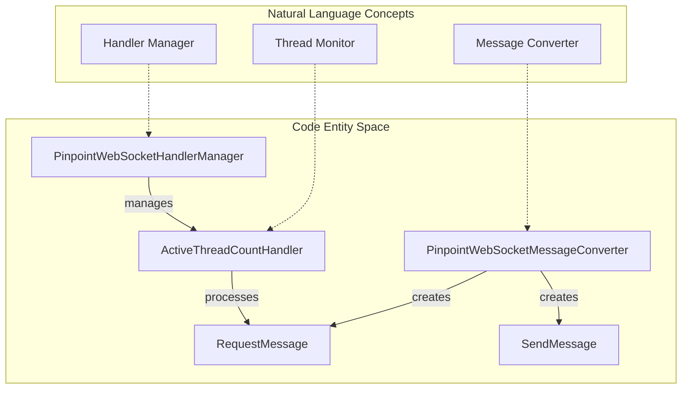
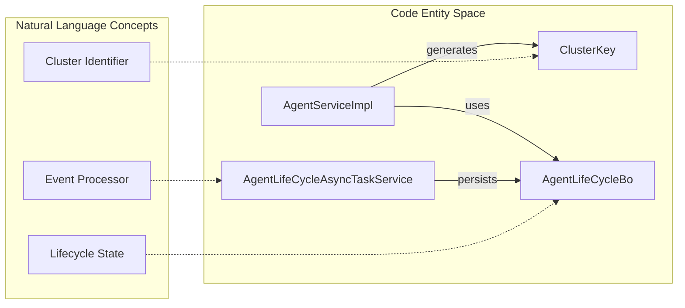

<!-- source: DeepWiki mcp.deepwiki.com · repo pinpoint-apm/pinpoint · page 3.7 Channel and Messaging Infrastructure · fetched 2026-10-29 -->

# Channel and Messaging Infrastructure

Relevant source files

The following files were used as context for generating this wiki page:

- [collector/src/main/java/com/navercorp/pinpoint/collector/service/async/AgentEventAsyncTaskService.java](collector/src/main/java/com/navercorp/pinpoint/collector/service/async/AgentEventAsyncTaskService.java)
- [collector/src/main/java/com/navercorp/pinpoint/collector/service/async/AgentLifeCycleAsyncTaskService.java](collector/src/main/java/com/navercorp/pinpoint/collector/service/async/AgentLifeCycleAsyncTaskService.java)
- [web/src/main/java/com/navercorp/pinpoint/web/service/AgentService.java](web/src/main/java/com/navercorp/pinpoint/web/service/AgentService.java)
- [web/src/main/java/com/navercorp/pinpoint/web/service/AgentServiceImpl.java](web/src/main/java/com/navercorp/pinpoint/web/service/AgentServiceImpl.java)
- [web/src/main/java/com/navercorp/pinpoint/web/websocket/ActiveThreadCountHandler.java](web/src/main/java/com/navercorp/pinpoint/web/websocket/ActiveThreadCountHandler.java)
- [web/src/main/java/com/navercorp/pinpoint/web/websocket/CustomHandshakeInterceptor.java](web/src/main/java/com/navercorp/pinpoint/web/websocket/CustomHandshakeInterceptor.java)
- [web/src/main/java/com/navercorp/pinpoint/web/websocket/DefaultWebSocketHandlerDecoratorFactory.java](web/src/main/java/com/navercorp/pinpoint/web/websocket/DefaultWebSocketHandlerDecoratorFactory.java)
- [web/src/main/java/com/navercorp/pinpoint/web/websocket/PinpointWebSocketHandlerManager.java](web/src/main/java/com/navercorp/pinpoint/web/websocket/PinpointWebSocketHandlerManager.java)
- [web/src/main/java/com/navercorp/pinpoint/web/websocket/message/PingMessage.java](web/src/main/java/com/navercorp/pinpoint/web/websocket/message/PingMessage.java)
- [web/src/main/java/com/navercorp/pinpoint/web/websocket/message/PinpointWebSocketMessageConverter.java](web/src/main/java/com/navercorp/pinpoint/web/websocket/message/PinpointWebSocketMessageConverter.java)
- [web/src/main/java/com/navercorp/pinpoint/web/websocket/message/PongMessage.java](web/src/main/java/com/navercorp/pinpoint/web/websocket/message/PongMessage.java)
- [web/src/main/java/com/navercorp/pinpoint/web/websocket/message/RequestMessage.java](web/src/main/java/com/navercorp/pinpoint/web/websocket/message/RequestMessage.java)
- [web/src/main/java/com/navercorp/pinpoint/web/websocket/message/ResponseMessage.java](web/src/main/java/com/navercorp/pinpoint/web/websocket/message/ResponseMessage.java)
- [web/src/main/java/com/navercorp/pinpoint/web/websocket/message/SendMessage.java](web/src/main/java/com/navercorp/pinpoint/web/websocket/message/SendMessage.java)
- [web/src/main/java/com/navercorp/pinpoint/web/websocket/message/UnknownMessage.java](web/src/main/java/com/navercorp/pinpoint/web/websocket/message/UnknownMessage.java)
- [web/src/test/java/com/navercorp/pinpoint/web/websocket/message/PinpointWebSocketMessageConverterTest.java](web/src/test/java/com/navercorp/pinpoint/web/websocket/message/PinpointWebSocketMessageConverterTest.java)

The Channel and Messaging Infrastructure in Pinpoint provides an abstraction layer for inter-service communication, real-time data propagation, and event handling. This infrastructure supports features such as real-time Active Thread Count monitoring and agent lifecycle event propagation. It utilizes a combination of WebSocket communication for frontend-to-backend interaction and internal messaging services for backend component synchronization.

## Messaging Abstraction and WebSocket Layer

Pinpoint employs a structured messaging system for its WebSocket connections, allowing the Web module to push real-time updates to the UI. This is primarily handled through a specialized message converter and a set of typed message objects.

### Message Types and Serialization
The system defines several message types to handle different communication patterns between the client (browser) and the server (Web module).

| Message Type | Class | Purpose |
| :--- | :--- | :--- |
| `REQUEST` | `RequestMessage` | Client requests data (e.g., start monitoring an application). |
| `RESPONSE` | `ResponseMessage` | Server responds to a specific request. |
| `SEND` | `SendMessage` | Server pushes unsolicited data (e.g., real-time thread counts). |
| `PING` / `PONG` | `PingMessage` / `PongMessage` | Heartbeat mechanism to maintain connection health. |

Messages are serialized and deserialized using `PinpointWebSocketMessageConverter` [web/src/main/java/com/navercorp/pinpoint/web/websocket/message/PinpointWebSocketMessageConverter.java:34-143](), which uses Jackson for JSON processing.

### WebSocket Handling Infrastructure
The lifecycle of WebSocket handlers is managed by the `PinpointWebSocketHandlerManager` [web/src/main/java/com/navercorp/pinpoint/web/websocket/PinpointWebSocketHandlerManager.java:31-71](). It organizes handlers by their request mappings and priorities, ensuring that incoming WebSocket requests are routed to the correct logic.

**Sources:**
- [web/src/main/java/com/navercorp/pinpoint/web/websocket/message/PinpointWebSocketMessageConverter.java:34-143]()
- [web/src/main/java/com/navercorp/pinpoint/web/websocket/PinpointWebSocketHandlerManager.java:31-71]()
- [web/src/main/java/com/navercorp/pinpoint/web/websocket/message/RequestMessage.java:27-50]()
- [web/src/main/java/com/navercorp/pinpoint/web/websocket/message/ResponseMessage.java:26-50]()

## Real-time Active Thread Count Infrastructure

One of the primary consumers of the messaging infrastructure is the Active Thread Count feature. This allows users to see the real-time execution status of threads across all agents in an application.

### Data Flow for Real-time Monitoring
1.  **Subscription**: The client sends a `RequestMessage` with the command `activeThreadCount` and an `applicationName` parameter [web/src/main/java/com/navercorp/pinpoint/web/websocket/ActiveThreadCountHandler.java:96-114]().
2.  **Handling**: The `ActiveThreadCountHandler` validates the request using a `ServerMapDataFilter` [web/src/main/java/com/navercorp/pinpoint/web/websocket/ActiveThreadCountHandler.java:91-94]().
3.  **Propagation**: The server begins pushing thread count updates back to the client using `SendMessage` objects.

### Entity Relationship: WebSocket Messaging
The following diagram illustrates how natural language concepts map to specific code entities within the messaging layer.

**WebSocket Messaging Entity Map**

**Sources:**
- [web/src/main/java/com/navercorp/pinpoint/web/websocket/ActiveThreadCountHandler.java:39-138]()
- [web/src/main/java/com/navercorp/pinpoint/web/websocket/PinpointWebSocketHandlerManager.java:31-71]()

## Inter-Service Communication and Event Propagation

Beyond WebSockets, the infrastructure includes services for propagating agent events and lifecycle changes across the collector and web components.

### Agent Lifecycle Events
The `AgentLifeCycleAsyncTaskService` handles asynchronous processing of agent events such as heartbeats (ping) and lifecycle state changes (e.g., shutdown, disconnect) [collector/src/main/java/com/navercorp/pinpoint/collector/service/async/AgentLifeCycleAsyncTaskService.java:40-116]().

*   **Lifecycle Events**: When an agent state changes, `handleLifeCycleEvent` is called. It persists the state in `AgentLifeCycleBo` and updates the agent list state [collector/src/main/java/com/navercorp/pinpoint/collector/service/async/AgentLifeCycleAsyncTaskService.java:64-78]().
*   **Ping Events**: Periodic pings from agents are handled via `handlePingEvent`, which updates the last known active timestamp [collector/src/main/java/com/navercorp/pinpoint/collector/service/async/AgentLifeCycleAsyncTaskService.java:81-88]().

### Cluster Key Management
For inter-service communication (e.g., when the Web module needs to send a command to a specific agent via the Collector), the `ClusterKey` is used as a unique identifier. The `AgentServiceImpl` is responsible for building these keys, which include the `applicationName`, `agentId`, and `startTimestamp` [web/src/main/java/com/navercorp/pinpoint/web/service/AgentServiceImpl.java:31-88]().

### Entity Relationship: Event Propagation
This diagram bridges the event handling logic to the underlying data structures.

**Event Propagation Entity Map**

**Sources:**
- [collector/src/main/java/com/navercorp/pinpoint/collector/service/async/AgentLifeCycleAsyncTaskService.java:40-116]()
- [web/src/main/java/com/navercorp/pinpoint/web/service/AgentServiceImpl.java:31-88]()
- [web/src/main/java/com/navercorp/pinpoint/web/service/AgentService.java:24-30]()

## Implementation Details

### Asynchronous Task Execution
The system uses Spring's `@Async` annotation with a specific executor named `agentEventWorker` to ensure that message processing and event persistence do not block the main ingestion or request threads [collector/src/main/java/com/navercorp/pinpoint/collector/service/async/AgentLifeCycleAsyncTaskService.java:63-64]().

### Event Identification
To uniquely identify events across distributed components, the system generates an `eventIdentifier` by bit-shifting the `socketId` and combining it with an `eventCounter` [collector/src/main/java/com/navercorp/pinpoint/collector/service/async/AgentLifeCycleAsyncTaskService.java:107-115]().

**Sources:**
- [collector/src/main/java/com/navercorp/pinpoint/collector/service/async/AgentLifeCycleAsyncTaskService.java:63-64]()
- [collector/src/main/java/com/navercorp/pinpoint/collector/service/async/AgentLifeCycleAsyncTaskService.java:107-115]()
- [collector/src/main/java/com/navercorp/pinpoint/collector/service/async/AgentEventAsyncTaskService.java:34-58]()

---

