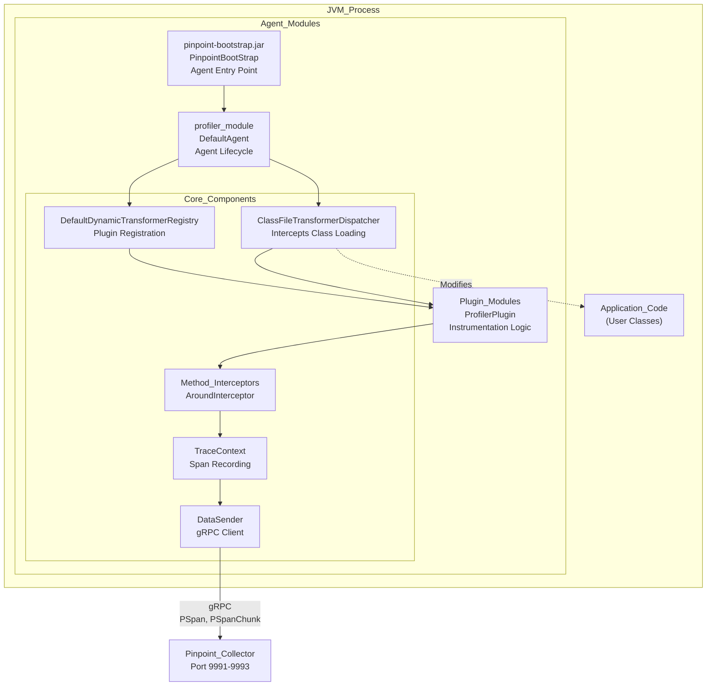
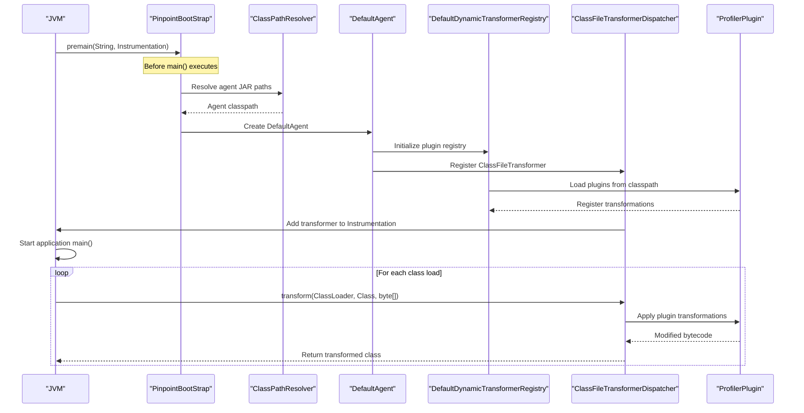
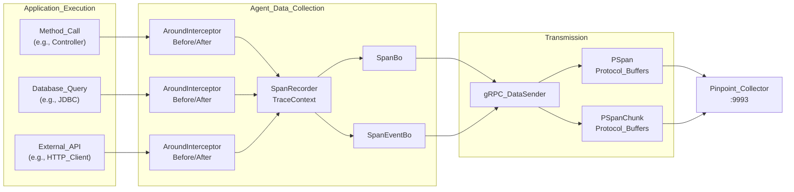
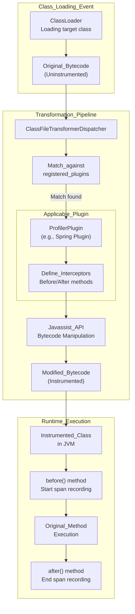

<!-- source: DeepWiki mcp.deepwiki.com · repo pinpoint-apm/pinpoint · page 4 Agent · fetched 2026-10-29 -->

# Agent

<details>
<summary>Relevant source files</summary>

The following files were used as context for generating this wiki page:

- [collector/src/main/java/com/navercorp/pinpoint/collector/util/PacketUtils.java](collector/src/main/java/com/navercorp/pinpoint/collector/util/PacketUtils.java)

</details>


The Pinpoint Agent is a Java instrumentation component that attaches to monitored applications to collect distributed tracing data without requiring any code changes. The agent performs bytecode manipulation at class load time to inject tracing logic into application code, capturing method executions, external calls, and performance metrics with minimal overhead (approximately 3% resource usage increase).

For detailed information about how the agent modifies bytecode, see [Agent Instrumentation](#4.1). For information about developing or configuring plugins, see [Plugin System](#4.2). For agent configuration options, see [Agent Configuration](#9.4).

---

## Overview

The Pinpoint Agent operates as a JVM agent loaded via the `-javaagent` parameter before the application's main method executes. It intercepts class loading events, applies registered plugins to modify bytecode, and instruments methods to record trace data that is transmitted to the Pinpoint Collector via gRPC.

### Key Characteristics

| Characteristic | Description |
|---|---|
| **Installation Method** | JVM agent (`-javaagent:pinpoint-bootstrap.jar`) |
| **Instrumentation Approach** | Bytecode transformation at class load time |
| **Code Changes Required** | None - fully transparent to application |
| **Performance Impact** | ~3% increase in resource usage |
| **Supported JDK Versions** | 8-24 (varies by Pinpoint version) |
| **Transport Protocol** | gRPC with Protocol Buffers |
| **Plugin Architecture** | Extensible plugin system for framework support |

**Sources:** [README.md:25-35](), [README.md:89-101]()

---

## Agent Architecture

The agent consists of several core modules that work together to instrument applications and collect trace data. The `profiler` module contains the core logic for lifecycle management and data transmission.



**Diagram: Agent Core Architecture showing the relationship between bootstrap, profiler, plugins, and core components**

### Module Responsibilities

| Module | Primary Classes | Responsibility |
|--------|----------------|----------------|
| **bootstrap** | `PinpointBootStrap` | Agent entry point via `-javaagent`, classloader setup |
| **profiler** | `DefaultAgent` | Manages agent lifecycle, coordinates transformation |
| **profiler** | `ClassFileTransformerDispatcher` | Intercepts all class loads, applies plugins |
| **profiler** | `DefaultDynamicTransformerRegistry` | Registers and manages plugin transformers |
| **plugins/** | `ProfilerPlugin` implementations | Framework-specific instrumentation logic |
| **profiler** | `TraceContext`, `Trace`, `SpanRecorder` | Records span and span event data |
| **profiler** | `DataSender`, gRPC client | Transmits trace data to collector |

**Sources:** [README.md:74-85](), [doc/modules.md:1-86]()

---

## Startup and Initialization

The agent initialization follows a precise sequence from JVM startup through active instrumentation:



**Diagram: Agent startup sequence from JVM premain to active class transformation**

### Initialization Steps

1. **JVM Agent Loading** - JVM invokes `PinpointBootStrap.premain()` before the application's `main()` method
2. **Classpath Resolution** - `ClassPathResolver` locates and loads agent JAR files
3. **Agent Instantiation** - `DefaultAgent` is created and manages the agent lifecycle
4. **Plugin Registration** - `DefaultDynamicTransformerRegistry` discovers and registers all `ProfilerPlugin` implementations
5. **Transformer Registration** - `ClassFileTransformerDispatcher` is registered with the JVM's `Instrumentation` API
6. **Application Start** - Application classes are loaded and transformed as needed

**Sources:** [quickstart/README.md:56-81]()

---

## Agent Attachment

Applications attach the Pinpoint Agent by adding the `-javaagent` JVM parameter:

```bash
java -javaagent:pinpoint-agent-{version}/pinpoint-bootstrap.jar \
     -Dpinpoint.agentId=test-agent \
     -Dpinpoint.applicationName=TESTAPP \
     -jar application.jar
```

### Required Parameters

| Parameter | Description | Example |
|-----------|-------------|---------|
| `-javaagent` | Path to `pinpoint-bootstrap.jar` | `-javaagent:/opt/pinpoint-agent/pinpoint-bootstrap.jar` |
| `-Dpinpoint.agentId` | Unique identifier for this agent instance | `-Dpinpoint.agentId=user-service-01` |
| `-Dpinpoint.applicationName` | Logical application name (groups agents) | `-Dpinpoint.applicationName=USER-SERVICE` |

### Optional Configuration

Additional configuration is typically provided via `pinpoint-root.config` file in the agent directory. Common configurations include:

- Collector addresses and ports
- Sampling rate configuration
- Plugin enable/disable flags
- Method trace configuration

See [Agent Configuration](#9.4) for comprehensive configuration reference.

**Sources:** [quickstart/README.md:56-81]()

---

## Data Collection and Transmission

The agent collects various types of monitoring data and transmits it to the Collector via gRPC. Utilities like `PacketUtils` may be used for debugging raw data packets during transmission.



**Diagram: Data flow from instrumented method calls through span recording to gRPC transmission**

### Data Types Collected

| Data Type | Description | gRPC Port |
|-----------|-------------|-----------|
| **Spans** | Root transaction data (entry point of a trace) | 9993 |
| **Span Events** | Individual method calls within a span | 9993 |
| **Agent Info** | Agent metadata, application info | 9991 |
| **Agent Statistics** | JVM metrics, response times, TPS | 9992 |

### Span Data Structure

The agent records trace data in a hierarchical structure:

- **Span (SpanBo)**: Represents a single transaction, typically an entry point like an HTTP request
  - Transaction ID: Unique identifier for the distributed trace
  - Span ID: Unique identifier for this span
  - Parent Span ID: Links to parent span (for distributed traces)
  - Service Type: Type of service (e.g., SPRING_BOOT, TOMCAT)
  - API Information: Method signature, endpoint
  - Start/End Time: Timing information
  
- **Span Event (SpanEventBo)**: Represents an individual operation within a span
  - Sequence: Order within the span
  - Depth: Call stack depth
  - Service Type: Type of operation (e.g., MYSQL, REDIS)
  - Method/API: Specific method called
  - Start/End Time: Timing information
  - Exception Information: If an error occurred
  - Annotations: Additional metadata (e.g., SQL queries, parameters)

**Sources:** [README.md:54-56](), [README.md:48-51](), [collector/src/main/java/com/navercorp/pinpoint/collector/util/PacketUtils.java:26-43]()

---

## Plugin System Overview

The agent's instrumentation capabilities are provided through a plugin architecture. Each plugin targets specific frameworks or libraries and defines how to instrument them.

### Plugin Discovery and Loading

Plugins are automatically discovered from the agent's plugin directory and registered during initialization. Each plugin implements the `ProfilerPlugin` interface and declares:

- **Target classes**: Which classes to instrument
- **Transformation logic**: How to modify bytecode
- **Interceptors**: Before/after logic to inject

### Example Supported Plugins

| Category | Plugins | Module Path |
|----------|---------|-------------|
| **Web Servers** | Tomcat, Jetty, Undertow, WebLogic | `agent-module/plugins/tomcat`, `jetty`, etc. |
| **Web Frameworks** | Spring MVC, Spring Boot, Spring WebFlux | `agent-module/plugins/spring`, `spring-boot` |
| **HTTP Clients** | Apache HttpClient, OkHttp, JDK HttpClient | `agent-module/plugins/httpclient4`, `okhttp` |
| **Databases** | MySQL, PostgreSQL, Oracle, MongoDB | `agent-module/plugins/mysql-jdbc`, `postgresql-jdbc` |
| **Caching** | Redis (Jedis, Lettuce), Memcached | `agent-module/plugins/redis`, `redis-lettuce` |
| **Messaging** | Kafka, RabbitMQ, ActiveMQ | `agent-module/plugins/kafka`, `rabbitmq` |
| **RPC** | gRPC, Thrift, Dubbo | `agent-module/plugins/grpc`, `thrift`, `dubbo` |

For detailed information about the plugin architecture and developing custom plugins, see [Plugin System](#4.2). For a comprehensive list of all supported technologies and version ranges, see [Supported Technologies](#4.3).

**Sources:** [README.md:72-85](), [doc/modules.md:1-86](), [agent-module/plugins/undertow-servlet/README.md:1-11]()

---

## Instrumentation Mechanism

The agent uses Java's Instrumentation API combined with bytecode manipulation to inject tracing logic:



**Diagram: Bytecode transformation pipeline from class loading to instrumented execution**

### Transformation Process

1. **Class Load Interception**: `ClassFileTransformerDispatcher` receives all class load events from the JVM
2. **Plugin Matching**: Registered plugins are queried to determine if the class should be instrumented
3. **Bytecode Modification**: Matching plugins use Javassist to inject interceptor calls before and after target methods
4. **Interceptor Injection**: `AroundInterceptor` implementations wrap the original method logic
5. **Span Recording**: Interceptors use `TraceContext` to record span and span event data
6. **Class Loading**: Modified bytecode is loaded into the JVM

This mechanism allows the agent to instrument application code completely transparently without requiring any source code modifications or recompilation.

**Sources:** [README.md:30-34]()

---

## Dynamic Transformation

In addition to instrumenting classes at load time, the agent supports dynamic re-transformation of already-loaded classes.

### Use Cases for Dynamic Transformation

- **Plugin Updates**: Apply new or updated plugins without restarting the application
- **Configuration Changes**: Enable/disable instrumentation for specific classes at runtime
- **Selective Instrumentation**: Instrument only specific instances or components

The `DynamicTransformService` uses the Java Instrumentation API's `retransformClasses()` capability to re-trigger the transformation pipeline for already-loaded classes.

---

## Performance Considerations

The agent is designed to minimize performance impact on monitored applications:

### Overhead Characteristics

| Aspect | Impact |
|--------|--------|
| **CPU Overhead** | ~3% average increase |
| **Memory Overhead** | Depends on trace data volume, configurable via sampling |
| **Network Overhead** | Asynchronous gRPC transmission, batching supported |
| **Class Loading** | One-time cost at application startup |

### Optimization Techniques

1. **Sampling**: Configurable sampling rates reduce data collection volume
   - MOD sampling: Sample every Nth transaction
   - PERCENT sampling: Sample X% of transactions
   
2. **Asynchronous Transmission**: Trace data is sent asynchronously to avoid blocking application threads

3. **Span Chunking**: Large spans are automatically split into chunks to prevent memory issues

4. **Selective Instrumentation**: Plugins can be enabled/disabled per application needs

For configuration of sampling rates and other performance-related settings, see [Collector Configuration Reference](#9.2) and [Agent Configuration](#9.4).

**Sources:** [README.md:35]()

---

## Agent-Collector Communication

The agent communicates with the Pinpoint Collector using gRPC over TCP:

### gRPC Endpoints

| Data Type | Collector Port | Message Type | Description |
|-----------|----------------|--------------|-------------|
| Agent Info | 9991 | `PAgentInfo` | Agent metadata, application name, JVM info |
| Agent Stats | 9992 | `PStatMessage` | JVM metrics, GC info, CPU, memory |
| Span Data | 9993 | `PSpan`, `PSpanChunk` | Trace data, spans, span events |

### Message Protocol

All messages are serialized using Protocol Buffers (protobuf) for efficient binary encoding. The key message types include:

- **PAgentInfo**: Sent once at agent startup, contains agent ID, application name, service type
- **PStatMessage**: Sent periodically (default: every 5 seconds), contains JVM statistics
- **PSpan**: Complete span data for a transaction
- **PSpanChunk**: Partial span data when a span is split into multiple chunks

### Connection Management

The agent maintains persistent gRPC connections to the collector. If the collector is unavailable:
- Trace data is buffered temporarily
- Connection retries occur automatically
- Data may be dropped if buffer limits are exceeded (configurable)

---

## Compatibility

### JDK Version Support

The agent's supported JDK versions depend on the Pinpoint version:

| Pinpoint Version | Minimum JDK | Maximum JDK |
|------------------|-------------|-------------|
| 2.0.x - 2.1.x | JDK 6 | JDK 14 |
| 2.2.x | JDK 7 | JDK 14 |
| 2.3.x | JDK 7 | JDK 17 |
| 2.4.x - 2.5.x | JDK 8 | JDK 19 |
| 3.0.x | JDK 8 | JDK 21 |
| 3.1.x | JDK 8 | JDK 24 |

### Collector Compatibility

| Agent Version | Collector 2.x.x | Collector 3.0.x | Collector 3.1.x |
|---------------|-----------------|-----------------|-----------------|
| 2.x.x | ✓ | ✓ | ✓ |
| 3.0.x | ✗ | ✓ | ✓ |
| 3.1.x | ✗ | ✗ | ✓ |

Agents from Pinpoint 2.x can communicate with all collector versions, but 3.x agents require matching or newer collectors.

**Sources:** [README.md:89-122]()

---

## Getting Started

To attach the Pinpoint Agent to your application:

1. **Download the Agent**: Get the agent package from the [latest release](https://github.com/pinpoint-apm/pinpoint/releases/latest)

2. **Extract the Agent**:
   ```bash
   tar xvzf pinpoint-agent-{version}.tar.gz
   ```

3. **Configure Agent ID and Application Name**: Edit `pinpoint-root.config` or use JVM parameters

4. **Attach to Application**:
   ```bash
   java -javaagent:/path/to/pinpoint-agent/pinpoint-bootstrap.jar \
        -Dpinpoint.agentId=my-agent-01 \
        -Dpinpoint.applicationName=MY-APP \
        -jar application.jar
   ```

5. **Verify**: Check agent logs in `pinpoint-agent/logs/` directory and confirm data appears in Pinpoint Web UI

For more detailed setup instructions, see [Quick Start Guide](#2.1) and [Deployment Options](#2.3).

For building the agent from source, see [Building from Source](#2.2).

**Sources:** [quickstart/README.md:41-81]()

---

## Related Components

The Agent is one component in the Pinpoint APM system. For information about other components:

- **Collector**: See [Collector](#5) for how trace data is received and processed
- **Web Application**: See [Web Application](#6) for querying and visualizing agent data
- **Data Model**: See [Data Model](#8) for details on span and annotation structures
- **Configuration**: See [Agent Configuration](#9.4) for comprehensive configuration reference

**Sources:** [README.md:1-167]()

---

