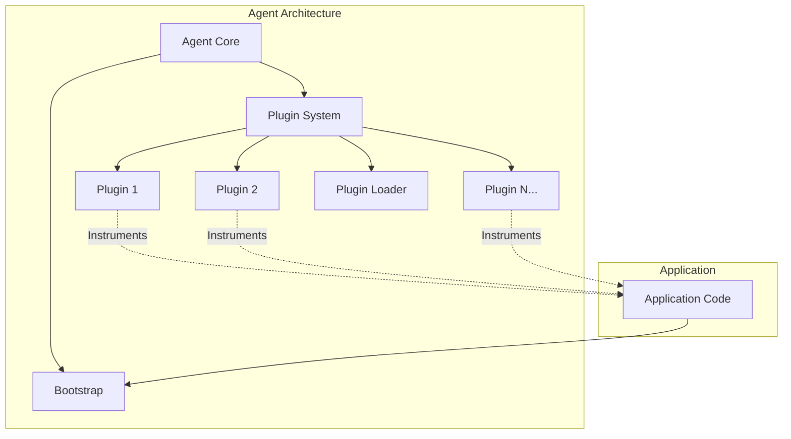
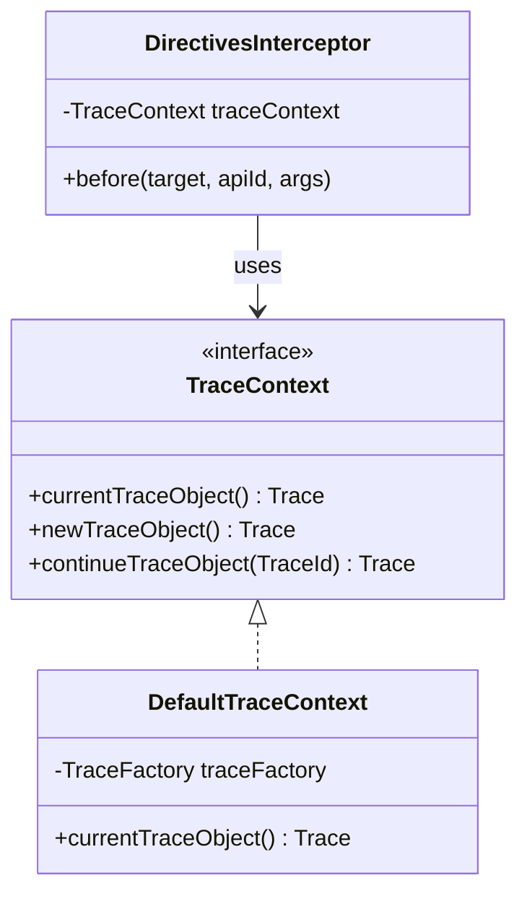
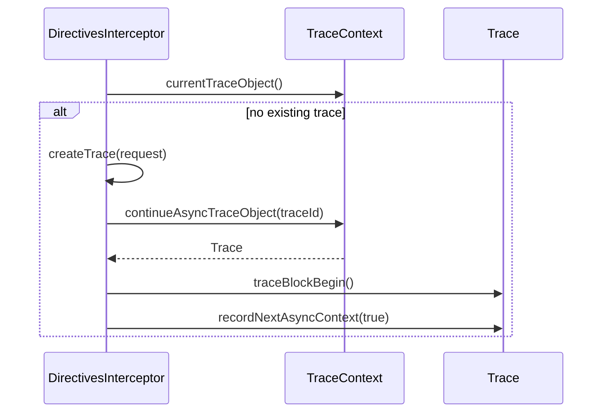

<!-- source: DeepWiki mcp.deepwiki.com · repo pinpoint-apm/pinpoint · page 4.2 Plugin System · fetched 2026-10-29 -->

# Plugin System

Relevant source files

The following files were used as context for generating this wiki page:

- [agent-module/bootstraps/bootstrap-core/src/main/java/com/navercorp/pinpoint/bootstrap/context/Header.java](agent-module/bootstraps/bootstrap-core/src/main/java/com/navercorp/pinpoint/bootstrap/context/Header.java)
- [agent-module/bootstraps/bootstrap-core/src/main/java/com/navercorp/pinpoint/bootstrap/context/TraceContext.java](agent-module/bootstraps/bootstrap-core/src/main/java/com/navercorp/pinpoint/bootstrap/context/TraceContext.java)
- [agent-module/bootstraps/bootstrap-core/src/main/java/com/navercorp/pinpoint/bootstrap/plugin/request/ServerRequestRecorder.java](agent-module/bootstraps/bootstrap-core/src/main/java/com/navercorp/pinpoint/bootstrap/plugin/request/ServerRequestRecorder.java)
- [agent-module/plugins/activemq-client/src/main/java/com/navercorp/pinpoint/plugin/activemq/client/ActiveMQClientHeader.java](agent-module/plugins/activemq-client/src/main/java/com/navercorp/pinpoint/plugin/activemq/client/ActiveMQClientHeader.java)
- [agent-module/plugins/activemq-client/src/main/java/com/navercorp/pinpoint/plugin/activemq/client/interceptor/ActiveMQMessageConsumerDispatchInterceptor.java](agent-module/plugins/activemq-client/src/main/java/com/navercorp/pinpoint/plugin/activemq/client/interceptor/ActiveMQMessageConsumerDispatchInterceptor.java)
- [agent-module/plugins/activemq-client/src/main/java/com/navercorp/pinpoint/plugin/activemq/client/interceptor/ActiveMQMessageProducerSendInterceptor.java](agent-module/plugins/activemq-client/src/main/java/com/navercorp/pinpoint/plugin/activemq/client/interceptor/ActiveMQMessageProducerSendInterceptor.java)
- [agent-module/plugins/akka-http/src/main/java/com/navercorp/pinpoint/plugin/akka/http/interceptor/DirectivesInterceptor.java](agent-module/plugins/akka-http/src/main/java/com/navercorp/pinpoint/plugin/akka/http/interceptor/DirectivesInterceptor.java)
- [agent-module/plugins/apache-dubbo/src/main/java/com/navercorp/pinpoint/plugin/apache/dubbo/ApacheDubboConstants.java](agent-module/plugins/apache-dubbo/src/main/java/com/navercorp/pinpoint/plugin/apache/dubbo/ApacheDubboConstants.java)
- [agent-module/plugins/apache-dubbo/src/main/java/com/navercorp/pinpoint/plugin/apache/dubbo/interceptor/ApacheDubboConsumerInterceptor.java](agent-module/plugins/apache-dubbo/src/main/java/com/navercorp/pinpoint/plugin/apache/dubbo/interceptor/ApacheDubboConsumerInterceptor.java)
- [agent-module/profiler/src/main/java/com/navercorp/pinpoint/profiler/context/DefaultTraceContext.java](agent-module/profiler/src/main/java/com/navercorp/pinpoint/profiler/context/DefaultTraceContext.java)
- [commons/src/main/java/com/navercorp/pinpoint/common/util/DelegateEnumeration.java](commons/src/main/java/com/navercorp/pinpoint/common/util/DelegateEnumeration.java)
- [commons/src/main/java/com/navercorp/pinpoint/common/util/EmptyEnumeration.java](commons/src/main/java/com/navercorp/pinpoint/common/util/EmptyEnumeration.java)
- [commons/src/main/java/com/navercorp/pinpoint/common/util/NextElementAction.java](commons/src/main/java/com/navercorp/pinpoint/common/util/NextElementAction.java)
- [commons/src/main/java/com/navercorp/pinpoint/common/util/NoSuchElementExceptionAction.java](commons/src/main/java/com/navercorp/pinpoint/common/util/NoSuchElementExceptionAction.java)
- [commons/src/main/java/com/navercorp/pinpoint/common/util/NullNextElementAction.java](commons/src/main/java/com/navercorp/pinpoint/common/util/NullNextElementAction.java)
- [commons/src/main/java/com/navercorp/pinpoint/common/util/Predicates.java](commons/src/main/java/com/navercorp/pinpoint/common/util/Predicates.java)
- [commons/src/test/java/com/navercorp/pinpoint/common/util/DelegateEnumerationTest.java](commons/src/test/java/com/navercorp/pinpoint/common/util/DelegateEnumerationTest.java)
- [commons/src/test/java/com/navercorp/pinpoint/common/util/PredicatesTest.java](commons/src/test/java/com/navercorp/pinpoint/common/util/PredicatesTest.java)

Pinpoint plugins are the extension modules that enable the Pinpoint Agent to monitor and trace applications built with various frameworks and libraries. They provide the instrumentation code necessary to collect performance data from specific technologies without requiring any changes to the application code.

## 1. Plugin System Overview

Plugins are a core component of Pinpoint's architecture, allowing it to support a wide range of technologies while maintaining a modular codebase. Each plugin is responsible for instrumenting specific frameworks or libraries, collecting trace data, and sending it to the Collector for processing and storage.

The plugin system operates by intercepting method calls and managing the `Trace` lifecycle via the `TraceContext` [agent-module/bootstraps/bootstrap-core/src/main/java/com/navercorp/pinpoint/bootstrap/context/TraceContext.java:29-106]().

### 1.1 Plugin Interaction Diagram

Sources:
- [agent-module/profiler/src/main/java/com/navercorp/pinpoint/profiler/context/DefaultTraceContext.java:45-88]()
- [agent-module/bootstraps/bootstrap-core/src/main/java/com/navercorp/pinpoint/bootstrap/context/TraceContext.java:29-106]()

## 2. Plugin Architecture

### 2.1 Core Concepts

Plugins in Pinpoint are built around several core concepts:

1.  **ServiceType**: Identifies the type of service or technology being monitored (e.g., `PULSAR_CLIENT` [agent-module/plugins/pulsar/src/main/java/com/navercorp/pinpoint/plugin/pulsar/PulsarConstants.java:36-37]()).
2.  **AnnotationKey**: Defines attributes to be collected during monitoring, such as `PULSAR_TOPIC_ANNOTATION_KEY` [agent-module/plugins/pulsar/src/main/java/com/navercorp/pinpoint/plugin/pulsar/PulsarConstants.java:49-50]().
3.  **Transformer**: Performs bytecode instrumentation for target classes.
4.  **Interceptor**: Contains the logic for collecting data. Interceptors typically implement `ApiIdAwareAroundInterceptor` [agent-module/plugins/akka-http/src/main/java/com/navercorp/pinpoint/plugin/akka/http/interceptor/DirectivesInterceptor.java:47]() or similar interfaces to provide `before` and `after` logic.

### 2.2 Interceptor Implementation

Interceptors use the `TraceContext` to manage the lifecycle of a trace. For example, `DirectivesInterceptor` checks for an existing trace and creates a new one if necessary using `traceContext.continueAsyncTraceObject(traceId)` [agent-module/plugins/akka-http/src/main/java/com/navercorp/pinpoint/plugin/akka/http/interceptor/DirectivesInterceptor.java:168]().

Sources:
- [agent-module/bootstraps/bootstrap-core/src/main/java/com/navercorp/pinpoint/bootstrap/context/TraceContext.java:29-106]()
- [agent-module/profiler/src/main/java/com/navercorp/pinpoint/profiler/context/DefaultTraceContext.java:95-97]()
- [agent-module/plugins/akka-http/src/main/java/com/navercorp/pinpoint/plugin/akka/http/interceptor/DirectivesInterceptor.java:47-116]()

## 3. Distributed Tracing and Headers

Plugins facilitate distributed tracing by propagating trace metadata across network boundaries using specific HTTP headers defined in `Header` [agent-module/bootstraps/bootstrap-core/src/main/java/com/navercorp/pinpoint/bootstrap/context/Header.java:25-36]().

| Header Constant | HTTP Header Name | Purpose |
| :--- | :--- | :--- |
| `HTTP_TRACE_ID` | `Pinpoint-TraceID` | Unique ID for the entire transaction |
| `HTTP_SPAN_ID` | `Pinpoint-SpanID` | ID for the current span |
| `HTTP_PARENT_SPAN_ID` | `Pinpoint-pSpanID` | ID of the caller's span |
| `HTTP_SAMPLED` | `Pinpoint-Sampled` | Sampling flag (1 or 0) |

Plugins use a `Predicate` to filter these headers when necessary, as seen in `Header.FILTER` [agent-module/bootstraps/bootstrap-core/src/main/java/com/navercorp/pinpoint/bootstrap/context/Header.java:59-67]().

Sources:
- [agent-module/bootstraps/bootstrap-core/src/main/java/com/navercorp/pinpoint/bootstrap/context/Header.java:25-68]()

## 4. Internal Utilities for Plugins

### 4.1 Enumeration Handling
The system provides utilities like `DelegateEnumeration` to wrap and filter `Enumeration` objects commonly found in legacy Java EE APIs (like Servlet headers) [commons/src/main/java/com/navercorp/pinpoint/common/util/DelegateEnumeration.java:25-42]().

### 4.2 Predicates
Standard predicates are provided via `Predicates` (e.g., `isTrue()`, `isFalse()`) to simplify logic within interceptors and filters [commons/src/main/java/com/navercorp/pinpoint/common/util/Predicates.java:6-52]().

Sources:
- [commons/src/main/java/com/navercorp/pinpoint/common/util/DelegateEnumeration.java:25-42]()
- [commons/src/main/java/com/navercorp/pinpoint/common/util/Predicates.java:6-52]()

## 5. Plugin Implementation Example: Akka HTTP

The `DirectivesInterceptor` demonstrates how a plugin intercepts a request:
1.  **Check Context**: It retrieves the `RequestContextImpl` from arguments [agent-module/plugins/akka-http/src/main/java/com/navercorp/pinpoint/plugin/akka/http/interceptor/DirectivesInterceptor.java:94]().
2.  **Trace Initialization**: If no trace exists, it calls `createTrace(request)` [agent-module/plugins/akka-http/src/main/java/com/navercorp/pinpoint/plugin/akka/http/interceptor/DirectivesInterceptor.java:103]().
3.  **Async Support**: It records an `AsyncContext` and attaches it to the request context via `AsyncContextAccessor` [agent-module/plugins/akka-http/src/main/java/com/navercorp/pinpoint/plugin/akka/http/interceptor/DirectivesInterceptor.java:111-112]().

Sources:
- [agent-module/plugins/akka-http/src/main/java/com/navercorp/pinpoint/plugin/akka/http/interceptor/DirectivesInterceptor.java:80-116]()
- [agent-module/bootstraps/bootstrap-core/src/main/java/com/navercorp/pinpoint/bootstrap/context/TraceContext.java:62]()

## 6. Plugin Configuration

Plugins are configured via the `ProfilerConfig`. A plugin typically initializes its local configuration by passing the `ProfilerConfig` to its own config class (e.g., `AkkaHttpConfig` [agent-module/plugins/akka-http/src/main/java/com/navercorp/pinpoint/plugin/akka/http/interceptor/DirectivesInterceptor.java:69]()).

Key configuration features include:
- **Exclude URL Filtering**: Prevents tracing of specific endpoints [agent-module/plugins/akka-http/src/main/java/com/navercorp/pinpoint/plugin/akka/http/interceptor/DirectivesInterceptor.java:131]().
- **HTTP Method Filtering**: Prevents tracing of specific methods like `OPTIONS` [agent-module/plugins/akka-http/src/main/java/com/navercorp/pinpoint/plugin/akka/http/interceptor/DirectivesInterceptor.java:149]().

Sources:
- [agent-module/plugins/akka-http/src/main/java/com/navercorp/pinpoint/plugin/akka/http/interceptor/DirectivesInterceptor.java:66-76]()
- [agent-module/bootstraps/bootstrap-core/src/main/java/com/navercorp/pinpoint/bootstrap/context/TraceContext.java:97]()

---

