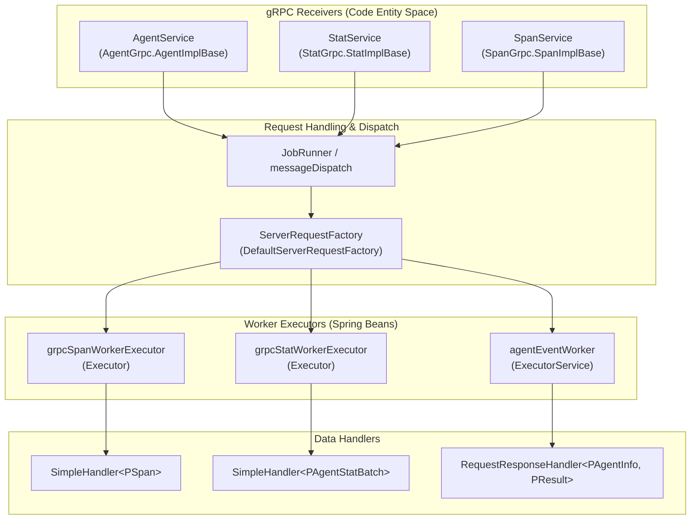
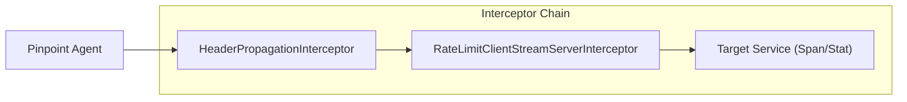
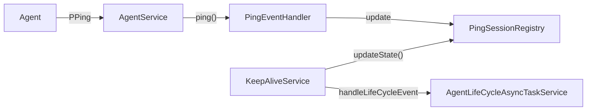

<!-- source: DeepWiki mcp.deepwiki.com · repo pinpoint-apm/pinpoint · page 5 Collector · fetched 2026-10-29 -->

# Collector

<details>
<summary>Relevant source files</summary>

The following files were used as context for generating this wiki page:

- [collector-starter/src/main/java/com/navercorp/pinpoint/collector/starter/multi/application/type/CollectorType.java](collector-starter/src/main/java/com/navercorp/pinpoint/collector/starter/multi/application/type/CollectorType.java)
- [collector-starter/src/main/java/com/navercorp/pinpoint/collector/starter/multi/application/type/CollectorTypeParser.java](collector-starter/src/main/java/com/navercorp/pinpoint/collector/starter/multi/application/type/CollectorTypeParser.java)
- [collector-starter/src/main/java/com/navercorp/pinpoint/collector/starter/multi/application/type/CollectorTypeSet.java](collector-starter/src/main/java/com/navercorp/pinpoint/collector/starter/multi/application/type/CollectorTypeSet.java)
- [collector-starter/src/main/java/com/navercorp/pinpoint/collector/starter/multi/application/type/FallbackCollectorTypeParser.java](collector-starter/src/main/java/com/navercorp/pinpoint/collector/starter/multi/application/type/FallbackCollectorTypeParser.java)
- [collector-starter/src/main/java/com/navercorp/pinpoint/collector/starter/multi/application/type/ShellBlockerConfig.java](collector-starter/src/main/java/com/navercorp/pinpoint/collector/starter/multi/application/type/ShellBlockerConfig.java)
- [collector-starter/src/main/java/com/navercorp/pinpoint/collector/starter/multi/application/type/ShellCollectorTypeParser.java](collector-starter/src/main/java/com/navercorp/pinpoint/collector/starter/multi/application/type/ShellCollectorTypeParser.java)
- [collector-starter/src/main/java/com/navercorp/pinpoint/collector/starter/multi/application/type/SimpleCollectorTypeParser.java](collector-starter/src/main/java/com/navercorp/pinpoint/collector/starter/multi/application/type/SimpleCollectorTypeParser.java)
- [collector-starter/src/main/resources/.gitignore](collector-starter/src/main/resources/.gitignore)
- [collector/src/main/java/com/navercorp/pinpoint/collector/config/CollectorConfiguration.java](collector/src/main/java/com/navercorp/pinpoint/collector/config/CollectorConfiguration.java)
- [collector/src/main/java/com/navercorp/pinpoint/collector/dao/AgentInfoDao.java](collector/src/main/java/com/navercorp/pinpoint/collector/dao/AgentInfoDao.java)
- [collector/src/main/java/com/navercorp/pinpoint/collector/grpc/config/GrpcAgentConfiguration.java](collector/src/main/java/com/navercorp/pinpoint/collector/grpc/config/GrpcAgentConfiguration.java)
- [collector/src/main/java/com/navercorp/pinpoint/collector/grpc/config/GrpcComponentConfiguration.java](collector/src/main/java/com/navercorp/pinpoint/collector/grpc/config/GrpcComponentConfiguration.java)
- [collector/src/main/java/com/navercorp/pinpoint/collector/grpc/config/GrpcSpanReceiverConfiguration.java](collector/src/main/java/com/navercorp/pinpoint/collector/grpc/config/GrpcSpanReceiverConfiguration.java)
- [collector/src/main/java/com/navercorp/pinpoint/collector/grpc/config/GrpcStatReceiverConfiguration.java](collector/src/main/java/com/navercorp/pinpoint/collector/grpc/config/GrpcStatReceiverConfiguration.java)
- [collector/src/main/java/com/navercorp/pinpoint/collector/grpc/config/ServerServiceDefinitions.java](collector/src/main/java/com/navercorp/pinpoint/collector/grpc/config/ServerServiceDefinitions.java)
- [collector/src/main/java/com/navercorp/pinpoint/collector/grpc/lifecycle/DefaultPingEventHandler.java](collector/src/main/java/com/navercorp/pinpoint/collector/grpc/lifecycle/DefaultPingEventHandler.java)
- [collector/src/main/java/com/navercorp/pinpoint/collector/grpc/lifecycle/DefaultPingSessionRegistry.java](collector/src/main/java/com/navercorp/pinpoint/collector/grpc/lifecycle/DefaultPingSessionRegistry.java)
- [collector/src/main/java/com/navercorp/pinpoint/collector/grpc/lifecycle/PingEventHandler.java](collector/src/main/java/com/navercorp/pinpoint/collector/grpc/lifecycle/PingEventHandler.java)
- [collector/src/main/java/com/navercorp/pinpoint/collector/grpc/lifecycle/PingSession.java](collector/src/main/java/com/navercorp/pinpoint/collector/grpc/lifecycle/PingSession.java)
- [collector/src/main/java/com/navercorp/pinpoint/collector/grpc/lifecycle/PingSessionRegistry.java](collector/src/main/java/com/navercorp/pinpoint/collector/grpc/lifecycle/PingSessionRegistry.java)
- [collector/src/main/java/com/navercorp/pinpoint/collector/grpc/ssl/GrpcSslModule.java](collector/src/main/java/com/navercorp/pinpoint/collector/grpc/ssl/GrpcSslModule.java)
- [collector/src/main/java/com/navercorp/pinpoint/collector/grpc/ssl/GrpcSslProperties.java](collector/src/main/java/com/navercorp/pinpoint/collector/grpc/ssl/GrpcSslProperties.java)
- [collector/src/main/java/com/navercorp/pinpoint/collector/grpc/ssl/GrpcSslReceiverProperties.java](collector/src/main/java/com/navercorp/pinpoint/collector/grpc/ssl/GrpcSslReceiverProperties.java)
- [collector/src/main/java/com/navercorp/pinpoint/collector/receiver/grpc/flow/RateLimitClientStreamServerInterceptor.java](collector/src/main/java/com/navercorp/pinpoint/collector/receiver/grpc/flow/RateLimitClientStreamServerInterceptor.java)
- [collector/src/main/java/com/navercorp/pinpoint/collector/receiver/grpc/service/AgentLifecycleListener.java](collector/src/main/java/com/navercorp/pinpoint/collector/receiver/grpc/service/AgentLifecycleListener.java)
- [collector/src/main/java/com/navercorp/pinpoint/collector/receiver/grpc/service/AgentService.java](collector/src/main/java/com/navercorp/pinpoint/collector/receiver/grpc/service/AgentService.java)
- [collector/src/main/java/com/navercorp/pinpoint/collector/receiver/grpc/service/DefaultServerRequestFactory.java](collector/src/main/java/com/navercorp/pinpoint/collector/receiver/grpc/service/DefaultServerRequestFactory.java)
- [collector/src/main/java/com/navercorp/pinpoint/collector/receiver/grpc/service/KeepAliveService.java](collector/src/main/java/com/navercorp/pinpoint/collector/receiver/grpc/service/KeepAliveService.java)
- [collector/src/main/java/com/navercorp/pinpoint/collector/receiver/grpc/service/MetadataService.java](collector/src/main/java/com/navercorp/pinpoint/collector/receiver/grpc/service/MetadataService.java)
- [collector/src/main/java/com/navercorp/pinpoint/collector/receiver/grpc/service/ServerCallStream.java](collector/src/main/java/com/navercorp/pinpoint/collector/receiver/grpc/service/ServerCallStream.java)
- [collector/src/main/java/com/navercorp/pinpoint/collector/receiver/grpc/service/ServerRequestFactory.java](collector/src/main/java/com/navercorp/pinpoint/collector/receiver/grpc/service/ServerRequestFactory.java)
- [collector/src/main/java/com/navercorp/pinpoint/collector/receiver/grpc/service/SpanService.java](collector/src/main/java/com/navercorp/pinpoint/collector/receiver/grpc/service/SpanService.java)
- [collector/src/main/java/com/navercorp/pinpoint/collector/receiver/grpc/service/StatService.java](collector/src/main/java/com/navercorp/pinpoint/collector/receiver/grpc/service/StatService.java)
- [collector/src/main/java/com/navercorp/pinpoint/collector/service/async/AgentProperty.java](collector/src/main/java/com/navercorp/pinpoint/collector/service/async/AgentProperty.java)
- [collector/src/main/java/com/navercorp/pinpoint/collector/service/async/DefaultAgentProperty.java](collector/src/main/java/com/navercorp/pinpoint/collector/service/async/DefaultAgentProperty.java)
- [collector/src/main/resources/pinpoint-collector-root.properties](collector/src/main/resources/pinpoint-collector-root.properties)
- [collector/src/main/resources/profiles/local/pinpoint-collector-grpc.properties](collector/src/main/resources/profiles/local/pinpoint-collector-grpc.properties)
- [collector/src/main/resources/profiles/release/pinpoint-collector-grpc.properties](collector/src/main/resources/profiles/release/pinpoint-collector-grpc.properties)
- [collector/src/test/java/com/navercorp/pinpoint/collector/grpc/lifecycle/DefaultPingSessionRegistryTest.java](collector/src/test/java/com/navercorp/pinpoint/collector/grpc/lifecycle/DefaultPingSessionRegistryTest.java)
- [collector/src/test/java/com/navercorp/pinpoint/collector/grpc/lifecycle/PingSessionTest.java](collector/src/test/java/com/navercorp/pinpoint/collector/grpc/lifecycle/PingSessionTest.java)
- [collector/src/test/java/com/navercorp/pinpoint/collector/receiver/grpc/AgentServerTestMain.java](collector/src/test/java/com/navercorp/pinpoint/collector/receiver/grpc/AgentServerTestMain.java)
- [collector/src/test/java/com/navercorp/pinpoint/collector/receiver/grpc/SpanServerTestMain.java](collector/src/test/java/com/navercorp/pinpoint/collector/receiver/grpc/SpanServerTestMain.java)
- [collector/src/test/java/com/navercorp/pinpoint/collector/receiver/grpc/StatServerTestMain.java](collector/src/test/java/com/navercorp/pinpoint/collector/receiver/grpc/StatServerTestMain.java)
- [collector/src/test/java/com/navercorp/pinpoint/collector/receiver/grpc/flow/StreamRateLimitServerInterceptorTest.java](collector/src/test/java/com/navercorp/pinpoint/collector/receiver/grpc/flow/StreamRateLimitServerInterceptorTest.java)
- [collector/src/test/java/com/navercorp/pinpoint/collector/receiver/grpc/service/ServerCallStreamTest.java](collector/src/test/java/com/navercorp/pinpoint/collector/receiver/grpc/service/ServerCallStreamTest.java)
- [commons-server/src/main/java/com/navercorp/pinpoint/common/server/dao/hbase/mapper/SingleResultsExtractor.java](commons-server/src/main/java/com/navercorp/pinpoint/common/server/dao/hbase/mapper/SingleResultsExtractor.java)
- [otlpmetric/otlpmetric-web/src/main/resources/otlpmetric/web/profiles/local/otlpmetric-web.properties](otlpmetric/otlpmetric-web/src/main/resources/otlpmetric/web/profiles/local/otlpmetric-web.properties)
- [otlpmetric/otlpmetric-web/src/main/resources/otlpmetric/web/profiles/release/otlpmetric-web.properties](otlpmetric/otlpmetric-web/src/main/resources/otlpmetric/web/profiles/release/otlpmetric-web.properties)
- [web/src/main/java/com/navercorp/pinpoint/web/config/ConfigProperties.java](web/src/main/java/com/navercorp/pinpoint/web/config/ConfigProperties.java)
- [web/src/main/java/com/navercorp/pinpoint/web/servlet/HttpIntentRoutingFilter.java](web/src/main/java/com/navercorp/pinpoint/web/servlet/HttpIntentRoutingFilter.java)
- [web/src/main/resources/pinpoint-web-root.properties](web/src/main/resources/pinpoint-web-root.properties)
- [web/src/test/java/com/navercorp/pinpoint/web/servlet/HttpIntentRoutingFilterTest.java](web/src/test/java/com/navercorp/pinpoint/web/servlet/HttpIntentRoutingFilterTest.java)

</details>


The Collector is Pinpoint's data ingestion and processing server component. It receives monitoring data from Pinpoint Agents via gRPC, processes and samples the data through a multi-threaded pipeline, and persists it to various storage backends (HBase, Kafka, Redis). The Collector operates multiple specialized gRPC receivers on different ports to handle agent metadata, statistics, span traces, and OpenTelemetry data.

For information about the Agent that sends data to the Collector, see [Agent](#4). For information about data querying and visualization, see [Web Application](#6).

## Architecture Overview

The Collector is organized around a multi-receiver architecture where different types of monitoring data arrive through dedicated gRPC endpoints. Each receiver has its own thread pool configuration and processing pipeline.

### Component Mapping

The following diagram maps high-level functional blocks to the specific Java classes and configurations that implement them.



**Sources:**
- [collector/src/main/java/com/navercorp/pinpoint/collector/receiver/grpc/service/AgentService.java:49-71]()
- [collector/src/main/java/com/navercorp/pinpoint/collector/receiver/grpc/service/StatService.java:47-78]()
- [collector/src/main/java/com/navercorp/pinpoint/collector/receiver/grpc/service/SpanService.java:46-74]()
- [collector/src/main/java/com/navercorp/pinpoint/collector/config/CollectorConfiguration.java:59-69]()
- [collector/src/main/java/com/navercorp/pinpoint/collector/grpc/config/GrpcStatReceiverConfiguration.java:77-89]()

## Collector Types

The Collector supports multiple deployment types that enable or disable specific receivers and processing modules. This allows for horizontal scaling by running specialized collector instances.

| Collector Type | Description | Receivers Enabled |
|----------------|-------------|-------------------|
| `ALL` | Default mode with all receivers enabled | Agent, Stat, Span, OTLP |
| `BASIC` | Core span and agent data collection | Agent, Span |
| `BASIC_WITH_INSPECTOR` | BASIC plus system inspection | Agent, Span, Inspector |
| `METRIC` | Statistics and metrics collection | Stat, Metric |
| `LOG` | Log data collection | Log |
| `LEGACY` | Compatibility mode for older agents | Agent, Stat, Span |

**Sources:**
- [collector-starter/src/main/java/com/navercorp/pinpoint/collector/starter/multi/application/type/CollectorType.java:22-37]()

## gRPC Receivers

Each receiver operates as an independent gRPC server with dedicated thread pools and configuration. The Collector uses Netty for network I/O with configurable channel types.

### Service Implementations

| Service Class | Protobuf Base | Handled Messages |
|---------------|---------------|------------------|
| `AgentService` | `AgentGrpc.AgentImplBase` | `PAgentInfo`, `PPing` |
| `StatService` | `StatGrpc.StatImplBase` | `PAgentStat`, `PAgentStatBatch`, `PAgentUriStat` |
| `SpanService` | `SpanGrpc.SpanImplBase` | `PSpan`, `PSpanChunk` |

For details on gRPC configuration and ports, see [gRPC Receivers](#5.2).

**Sources:**
- [collector/src/main/java/com/navercorp/pinpoint/collector/receiver/grpc/service/AgentService.java:49-56]()
- [collector/src/main/java/com/navercorp/pinpoint/collector/receiver/grpc/service/StatService.java:47-63]()
- [collector/src/main/java/com/navercorp/pinpoint/collector/receiver/grpc/service/SpanService.java:46-54]()

### Flow Control and Interceptors

The Collector implements rate limiting to prevent overload using `RateLimitClientStreamServerInterceptor`. This is configured via `Bandwidth` beans that define capacity and refill rates.



**Sources:**
- [collector/src/main/java/com/navercorp/pinpoint/collector/grpc/config/GrpcSpanReceiverConfiguration.java:61-80]()
- [collector/src/main/java/com/navercorp/pinpoint/collector/grpc/config/GrpcStatReceiverConfiguration.java:63-75]()
- [collector/src/test/java/com/navercorp/pinpoint/collector/receiver/grpc/SpanServerTestMain.java:105-119]()

## Data Processing Pipeline

The Collector implements a staged processing pipeline that samples, transforms, and routes data. For a detailed explanation of the flow from reception to storage, see [Data Collection Pipeline](#5.1).

### Span Sampling

Sampling logic is encapsulated in the `SpanSampler` interface, created via `SpanSamplerFactory`.

```java
@Bean
public SpanSamplerFactory spanSamplerFactory(CollectorProperties collectorProperties) {
    return new SimpleSpanSamplerFactory(collectorProperties);
}
```

**Sources:**
- [collector/src/main/java/com/navercorp/pinpoint/collector/config/CollectorConfiguration.java:71-74]()
- [collector/src/main/resources/pinpoint-collector-root.properties:31-44]()

### Agent Lifecycle Management

The `KeepAliveService` and `PingEventHandler` manage agent connectivity status. When an agent pings the collector via `AgentService.pingSession`, the `PingSession` is updated in the `PingSessionRegistry`.



**Sources:**
- [collector/src/main/java/com/navercorp/pinpoint/collector/receiver/grpc/service/AgentService.java:105-128]()
- [collector/src/main/java/com/navercorp/pinpoint/collector/receiver/grpc/service/KeepAliveService.java:40-56]()
- [collector/src/main/java/com/navercorp/pinpoint/collector/receiver/grpc/service/KeepAliveService.java:101-121]()

## Configuration Reference

The Collector's behavior is highly tunable through properties files and Spring profiles. For a complete guide to all configuration keys, see [Collector Configuration](#5.3).

### Core Properties

| Property | Default | Description |
|----------|---------|-------------|
| `collector.agentEventWorker.corePoolSize` | 4 | Core threads for lifecycle events |
| `collector.span.sampling.enable` | false | Global toggle for span sampling |
| `collector.statistics.agent-state.enable` | true | Enable state tracking in ServerMap |
| `pinpoint.zookeeper.address` | localhost | Coordination for real-time features |

**Sources:**
- [collector/src/main/resources/pinpoint-collector-root.properties:1-25]()
- [collector/src/main/resources/pinpoint-collector-root.properties:33-35]()

### Banner and Discovery

The Collector displays a banner on startup listing active configurations, including gRPC bind addresses and HBase connection details.

**Sources:**
- [collector/src/main/resources/pinpoint-collector-root.properties:90-122]()

---

