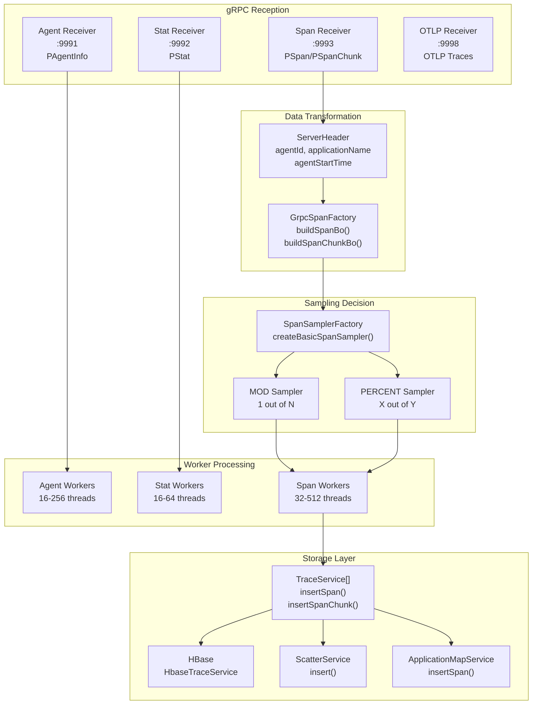
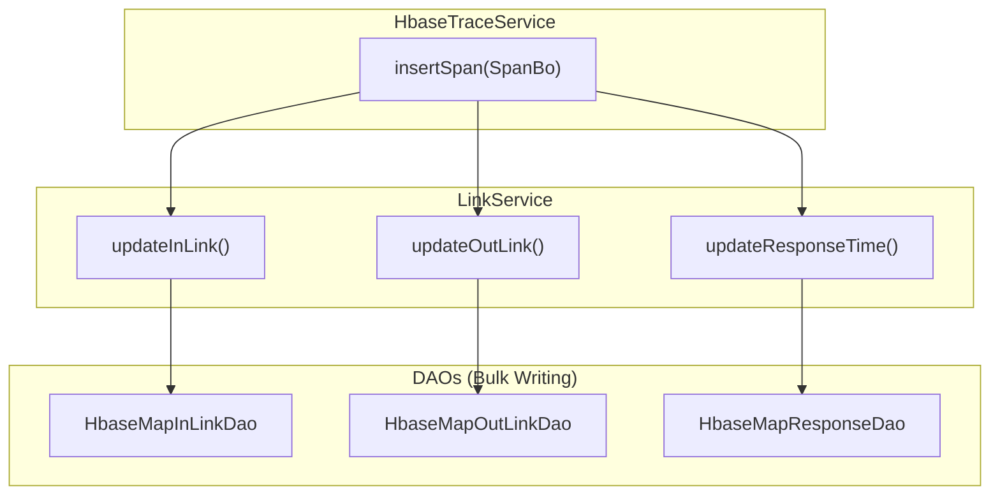

<!-- source: DeepWiki mcp.deepwiki.com · repo pinpoint-apm/pinpoint · page 5.1 Data Collection Pipeline · fetched 2026-10-29 -->

# Data Collection Pipeline

<details>
<summary>Relevant source files</summary>

The following files were used as context for generating this wiki page:

- [agent-module/profiler/src/main/java/com/navercorp/pinpoint/profiler/name/v1/ObjectNameResolverV1.java](agent-module/profiler/src/main/java/com/navercorp/pinpoint/profiler/name/v1/ObjectNameResolverV1.java)
- [batch/src/main/resources/hbase-root.properties](batch/src/main/resources/hbase-root.properties)
- [collector/src/main/java/com/navercorp/pinpoint/collector/applicationmap/config/ApplicationMapModule.java](collector/src/main/java/com/navercorp/pinpoint/collector/applicationmap/config/ApplicationMapModule.java)
- [collector/src/main/java/com/navercorp/pinpoint/collector/applicationmap/config/MapDualWriteConfiguration.java](collector/src/main/java/com/navercorp/pinpoint/collector/applicationmap/config/MapDualWriteConfiguration.java)
- [collector/src/main/java/com/navercorp/pinpoint/collector/applicationmap/config/MapV2Configuration.java](collector/src/main/java/com/navercorp/pinpoint/collector/applicationmap/config/MapV2Configuration.java)
- [collector/src/main/java/com/navercorp/pinpoint/collector/applicationmap/config/MapV2Import.java](collector/src/main/java/com/navercorp/pinpoint/collector/applicationmap/config/MapV2Import.java)
- [collector/src/main/java/com/navercorp/pinpoint/collector/applicationmap/config/MapV3Configuration.java](collector/src/main/java/com/navercorp/pinpoint/collector/applicationmap/config/MapV3Configuration.java)
- [collector/src/main/java/com/navercorp/pinpoint/collector/applicationmap/config/MapV3Import.java](collector/src/main/java/com/navercorp/pinpoint/collector/applicationmap/config/MapV3Import.java)
- [collector/src/main/java/com/navercorp/pinpoint/collector/applicationmap/dao/HostApplicationMapDao.java](collector/src/main/java/com/navercorp/pinpoint/collector/applicationmap/dao/HostApplicationMapDao.java)
- [collector/src/main/java/com/navercorp/pinpoint/collector/applicationmap/dao/HostApplicationMapDaoDelegate.java](collector/src/main/java/com/navercorp/pinpoint/collector/applicationmap/dao/HostApplicationMapDaoDelegate.java)
- [collector/src/main/java/com/navercorp/pinpoint/collector/applicationmap/dao/MapInLinkDao.java](collector/src/main/java/com/navercorp/pinpoint/collector/applicationmap/dao/MapInLinkDao.java)
- [collector/src/main/java/com/navercorp/pinpoint/collector/applicationmap/dao/MapOutLinkDao.java](collector/src/main/java/com/navercorp/pinpoint/collector/applicationmap/dao/MapOutLinkDao.java)
- [collector/src/main/java/com/navercorp/pinpoint/collector/applicationmap/dao/hbase/HbaseHostApplicationMapDao.java](collector/src/main/java/com/navercorp/pinpoint/collector/applicationmap/dao/hbase/HbaseHostApplicationMapDao.java)
- [collector/src/main/java/com/navercorp/pinpoint/collector/applicationmap/dao/hbase/HbaseMapInLinkDao.java](collector/src/main/java/com/navercorp/pinpoint/collector/applicationmap/dao/hbase/HbaseMapInLinkDao.java)
- [collector/src/main/java/com/navercorp/pinpoint/collector/applicationmap/dao/hbase/HbaseMapOutLinkDao.java](collector/src/main/java/com/navercorp/pinpoint/collector/applicationmap/dao/hbase/HbaseMapOutLinkDao.java)
- [collector/src/main/java/com/navercorp/pinpoint/collector/applicationmap/dao/hbase/InLinkFactory.java](collector/src/main/java/com/navercorp/pinpoint/collector/applicationmap/dao/hbase/InLinkFactory.java)
- [collector/src/main/java/com/navercorp/pinpoint/collector/applicationmap/dao/hbase/OutLinkFactory.java](collector/src/main/java/com/navercorp/pinpoint/collector/applicationmap/dao/hbase/OutLinkFactory.java)
- [collector/src/main/java/com/navercorp/pinpoint/collector/applicationmap/dao/hbase/SelfAgentNodeFactory.java](collector/src/main/java/com/navercorp/pinpoint/collector/applicationmap/dao/hbase/SelfAgentNodeFactory.java)
- [collector/src/main/java/com/navercorp/pinpoint/collector/applicationmap/dao/v3/InLinkFactoryV3.java](collector/src/main/java/com/navercorp/pinpoint/collector/applicationmap/dao/v3/InLinkFactoryV3.java)
- [collector/src/main/java/com/navercorp/pinpoint/collector/applicationmap/dao/v3/OutLinkFactoryV3.java](collector/src/main/java/com/navercorp/pinpoint/collector/applicationmap/dao/v3/OutLinkFactoryV3.java)
- [collector/src/main/java/com/navercorp/pinpoint/collector/applicationmap/dao/v3/SelfAgentNodeFactoryV3.java](collector/src/main/java/com/navercorp/pinpoint/collector/applicationmap/dao/v3/SelfAgentNodeFactoryV3.java)
- [collector/src/main/java/com/navercorp/pinpoint/collector/applicationmap/dao/v3/SelfAppNodeFactory.java](collector/src/main/java/com/navercorp/pinpoint/collector/applicationmap/dao/v3/SelfAppNodeFactory.java)
- [collector/src/main/java/com/navercorp/pinpoint/collector/applicationmap/dao/v3/SelfAppNodeFactoryV3.java](collector/src/main/java/com/navercorp/pinpoint/collector/applicationmap/dao/v3/SelfAppNodeFactoryV3.java)
- [collector/src/main/java/com/navercorp/pinpoint/collector/applicationmap/service/ApplicationMapService.java](collector/src/main/java/com/navercorp/pinpoint/collector/applicationmap/service/ApplicationMapService.java)
- [collector/src/main/java/com/navercorp/pinpoint/collector/applicationmap/service/HbaseApplicationMapService.java](collector/src/main/java/com/navercorp/pinpoint/collector/applicationmap/service/HbaseApplicationMapService.java)
- [collector/src/main/java/com/navercorp/pinpoint/collector/applicationmap/service/LinkService.java](collector/src/main/java/com/navercorp/pinpoint/collector/applicationmap/service/LinkService.java)
- [collector/src/main/java/com/navercorp/pinpoint/collector/applicationmap/service/LinkServiceDualWriteImpl.java](collector/src/main/java/com/navercorp/pinpoint/collector/applicationmap/service/LinkServiceDualWriteImpl.java)
- [collector/src/main/java/com/navercorp/pinpoint/collector/applicationmap/service/LinkServiceImpl.java](collector/src/main/java/com/navercorp/pinpoint/collector/applicationmap/service/LinkServiceImpl.java)
- [collector/src/main/java/com/navercorp/pinpoint/collector/applicationmap/statistics/ResponseColumnName.java](collector/src/main/java/com/navercorp/pinpoint/collector/applicationmap/statistics/ResponseColumnName.java)
- [collector/src/main/java/com/navercorp/pinpoint/collector/config/SchedulerConfiguration.java](collector/src/main/java/com/navercorp/pinpoint/collector/config/SchedulerConfiguration.java)
- [collector/src/main/java/com/navercorp/pinpoint/collector/dao/TraceDao.java](collector/src/main/java/com/navercorp/pinpoint/collector/dao/TraceDao.java)
- [collector/src/main/java/com/navercorp/pinpoint/collector/dao/hbase/IgnoreStatFilter.java](collector/src/main/java/com/navercorp/pinpoint/collector/dao/hbase/IgnoreStatFilter.java)
- [collector/src/main/java/com/navercorp/pinpoint/collector/dao/hbase/ReactorNettyBugWorkaroundFilter.java](collector/src/main/java/com/navercorp/pinpoint/collector/dao/hbase/ReactorNettyBugWorkaroundFilter.java)
- [collector/src/main/java/com/navercorp/pinpoint/collector/receiver/grpc/service/StreamCloseOnError.java](collector/src/main/java/com/navercorp/pinpoint/collector/receiver/grpc/service/StreamCloseOnError.java)
- [collector/src/main/java/com/navercorp/pinpoint/collector/scheduler/AvgMaxLinkScheduler.java](collector/src/main/java/com/navercorp/pinpoint/collector/scheduler/AvgMaxLinkScheduler.java)
- [collector/src/main/java/com/navercorp/pinpoint/collector/scheduler/JitterStartTimeDistributor.java](collector/src/main/java/com/navercorp/pinpoint/collector/scheduler/JitterStartTimeDistributor.java)
- [collector/src/main/java/com/navercorp/pinpoint/collector/scheduler/StartTimeDistributor.java](collector/src/main/java/com/navercorp/pinpoint/collector/scheduler/StartTimeDistributor.java)
- [collector/src/main/java/com/navercorp/pinpoint/collector/scheduler/StatisticsLinkScheduler.java](collector/src/main/java/com/navercorp/pinpoint/collector/scheduler/StatisticsLinkScheduler.java)
- [collector/src/main/java/com/navercorp/pinpoint/collector/service/HbaseTraceService.java](collector/src/main/java/com/navercorp/pinpoint/collector/service/HbaseTraceService.java)
- [collector/src/test/java/com/navercorp/pinpoint/collector/dao/hbase/ReactorNettyBugWorkaroundFilterTest.java](collector/src/test/java/com/navercorp/pinpoint/collector/dao/hbase/ReactorNettyBugWorkaroundFilterTest.java)
- [collector/src/test/java/com/navercorp/pinpoint/collector/scheduler/JitterStartTimeDistributorTest.java](collector/src/test/java/com/navercorp/pinpoint/collector/scheduler/JitterStartTimeDistributorTest.java)
- [commons-hbase/README.md](commons-hbase/README.md)
- [commons-hbase/src/main/java/com/navercorp/pinpoint/common/hbase/ConnectionFactoryBean.java](commons-hbase/src/main/java/com/navercorp/pinpoint/common/hbase/ConnectionFactoryBean.java)
- [commons-hbase/src/main/java/com/navercorp/pinpoint/common/hbase/HadoopResourceCleanerRegistry.java](commons-hbase/src/main/java/com/navercorp/pinpoint/common/hbase/HadoopResourceCleanerRegistry.java)
- [commons-hbase/src/main/java/com/navercorp/pinpoint/common/hbase/LazyResultSizeHandler.java](commons-hbase/src/main/java/com/navercorp/pinpoint/common/hbase/LazyResultSizeHandler.java)
- [commons-hbase/src/main/java/com/navercorp/pinpoint/common/hbase/LimitRowMapperResultsExtractor.java](commons-hbase/src/main/java/com/navercorp/pinpoint/common/hbase/LimitRowMapperResultsExtractor.java)
- [commons-hbase/src/main/java/com/navercorp/pinpoint/common/hbase/ResultSizeHandlers.java](commons-hbase/src/main/java/com/navercorp/pinpoint/common/hbase/ResultSizeHandlers.java)
- [commons-hbase/src/main/java/com/navercorp/pinpoint/common/hbase/RowTypeHint.java](commons-hbase/src/main/java/com/navercorp/pinpoint/common/hbase/RowTypeHint.java)
- [commons-hbase/src/test/java/com/navercorp/pinpoint/common/hbase/limit/ResultSizeHandlersTest.java](commons-hbase/src/test/java/com/navercorp/pinpoint/common/hbase/limit/ResultSizeHandlersTest.java)
- [commons-server/src/main/java/com/navercorp/pinpoint/common/server/applicationmap/statistics/LinkRowKey.java](commons-server/src/main/java/com/navercorp/pinpoint/common/server/applicationmap/statistics/LinkRowKey.java)
- [commons-server/src/main/java/com/navercorp/pinpoint/common/server/bo/serializer/RowKeyDecoder.java](commons-server/src/main/java/com/navercorp/pinpoint/common/server/bo/serializer/RowKeyDecoder.java)
- [commons-server/src/main/java/com/navercorp/pinpoint/common/server/bo/serializer/RowKeyEncoder.java](commons-server/src/main/java/com/navercorp/pinpoint/common/server/bo/serializer/RowKeyEncoder.java)
- [commons-server/src/main/java/com/navercorp/pinpoint/common/server/util/MapSlotUtils.java](commons-server/src/main/java/com/navercorp/pinpoint/common/server/util/MapSlotUtils.java)
- [commons-server/src/test/java/com/navercorp/pinpoint/common/server/applicationmap/statistics/LinkRowKeyTest.java](commons-server/src/test/java/com/navercorp/pinpoint/common/server/applicationmap/statistics/LinkRowKeyTest.java)
- [commons-server/src/test/java/com/navercorp/pinpoint/common/server/bo/serializer/metadata/MetadataEncoderTest.java](commons-server/src/test/java/com/navercorp/pinpoint/common/server/bo/serializer/metadata/MetadataEncoderTest.java)
- [hbase/hbase-schema-manager/src/main/resources/hbase.properties](hbase/hbase-schema-manager/src/main/resources/hbase.properties)
- [web/src/main/java/com/navercorp/pinpoint/web/applicationmap/config/MapV3DaoConfiguration.java](web/src/main/java/com/navercorp/pinpoint/web/applicationmap/config/MapV3DaoConfiguration.java)
- [web/src/main/java/com/navercorp/pinpoint/web/applicationmap/dao/v3/ApplicationResponseTimeV3ResultExtractor.java](web/src/main/java/com/navercorp/pinpoint/web/applicationmap/dao/v3/ApplicationResponseTimeV3ResultExtractor.java)
- [web/src/main/java/com/navercorp/pinpoint/web/applicationmap/dao/v3/InLinkV3Mapper.java](web/src/main/java/com/navercorp/pinpoint/web/applicationmap/dao/v3/InLinkV3Mapper.java)
- [web/src/main/java/com/navercorp/pinpoint/web/applicationmap/dao/v3/OutLinkV3Mapper.java](web/src/main/java/com/navercorp/pinpoint/web/applicationmap/dao/v3/OutLinkV3Mapper.java)
- [web/src/main/java/com/navercorp/pinpoint/web/applicationmap/dao/v3/ResponseTimeV3ResultExtractor.java](web/src/main/java/com/navercorp/pinpoint/web/applicationmap/dao/v3/ResponseTimeV3ResultExtractor.java)
- [web/src/main/java/com/navercorp/pinpoint/web/applicationmap/dao/v3/UidAgentLinkRowKeyDecoder.java](web/src/main/java/com/navercorp/pinpoint/web/applicationmap/dao/v3/UidAgentLinkRowKeyDecoder.java)
- [web/src/main/java/com/navercorp/pinpoint/web/applicationmap/dao/v3/UidAppRowKeyDecoder.java](web/src/main/java/com/navercorp/pinpoint/web/applicationmap/dao/v3/UidAppRowKeyDecoder.java)
- [web/src/main/java/com/navercorp/pinpoint/web/applicationmap/dao/v3/UidLinkRowKeyDecoder.java](web/src/main/java/com/navercorp/pinpoint/web/applicationmap/dao/v3/UidLinkRowKeyDecoder.java)
- [web/src/main/java/com/navercorp/pinpoint/web/dao/AgentInfoQuery.java](web/src/main/java/com/navercorp/pinpoint/web/dao/AgentInfoQuery.java)
- [web/src/main/java/com/navercorp/pinpoint/web/filter/RpcURLPatternFilter.java](web/src/main/java/com/navercorp/pinpoint/web/filter/RpcURLPatternFilter.java)
- [web/src/main/java/com/navercorp/pinpoint/web/mapper/AgentEventMapper.java](web/src/main/java/com/navercorp/pinpoint/web/mapper/AgentEventMapper.java)
- [web/src/main/java/com/navercorp/pinpoint/web/mapper/AgentIdMapper.java](web/src/main/java/com/navercorp/pinpoint/web/mapper/AgentIdMapper.java)
- [web/src/main/java/com/navercorp/pinpoint/web/mapper/AgentLifeCycleMapper.java](web/src/main/java/com/navercorp/pinpoint/web/mapper/AgentLifeCycleMapper.java)
- [web/src/main/java/com/navercorp/pinpoint/web/mapper/ApplicationNameMapper.java](web/src/main/java/com/navercorp/pinpoint/web/mapper/ApplicationNameMapper.java)
- [web/src/main/java/com/navercorp/pinpoint/web/vo/agent/AgentStatus.java](web/src/main/java/com/navercorp/pinpoint/web/vo/agent/AgentStatus.java)
- [web/src/main/resources/hbase-root.properties](web/src/main/resources/hbase-root.properties)

</details>


## Purpose and Scope

This page documents the Collector's data collection pipeline, explaining how trace data flows from agents through gRPC receivers, undergoes sampling and transformation, and is persisted to storage systems. The pipeline handles three primary data types: agent metadata, application statistics, and span/trace data.

For gRPC receiver configuration details, see [gRPC Receivers](#5.2). For collector configuration options, see [Collector Configuration](#5.3). For storage implementation details, consult the specific storage layer documentation.

---

## Pipeline Overview

The data collection pipeline processes trace data through four stages: reception, transformation, sampling, and storage. Data enters through dedicated gRPC ports and is processed by independent worker pools before being written to HBase, published to Kafka, and cached in Redis.



**Sources:**
- [collector/src/main/java/com/navercorp/pinpoint/collector/service/HbaseTraceService.java:40-94]()
- [collector/src/main/java/com/navercorp/pinpoint/collector/applicationmap/service/HbaseApplicationMapService.java:1-88]()

---

## Data Reception Layer

### gRPC Receivers

The collector exposes four gRPC endpoints, each handling specific data types. These receivers operate on separate ports with independent thread pools and connection management.

| Receiver Type | Default Port | Message Type | Purpose |
|---------------|-------------|--------------|---------|
| Agent | 9991 | `PAgentInfo` | Agent lifecycle and metadata |
| Stat | 9992 | `PStat` | Application statistics and metrics |
| Span | 9993 | `PSpan`, `PSpanChunk` | Distributed trace spans |
| OTLP | 9998 | OTLP Traces | OpenTelemetry-compatible traces |

### Connection Management

gRPC server options control connection lifecycle and resource limits. Pinpoint uses a `ConnectionFactoryBean` to manage HBase connections, which are crucial for the final stage of the pipeline.

**Sources:**
- [commons-hbase/src/main/java/com/navercorp/pinpoint/common/hbase/ConnectionFactoryBean.java:40-127]()

---

## Data Transformation

### Protobuf to Business Objects

The pipeline converts Protocol Buffer messages into internal business objects like `SpanBo` and `SpanChunkBo`. These objects are then passed to the service layer for persistence.

| Business Object | Description | Key Components |
|-----------------|-------------|----------------|
| `SpanBo` | Represents a completed span | [commons-server/src/main/java/com/navercorp/pinpoint/common/server/bo/SpanBo.java:23-23]() |
| `SpanChunkBo` | Represents a fragment of a span (async/long-running) | [commons-server/src/main/java/com/navercorp/pinpoint/common/server/bo/SpanChunkBo.java:24-24]() |

---

## Storage and Statistics Pipeline

Once data is transformed into Business Objects, it is processed by the `HbaseTraceService`. This service coordinates multiple operations: persistence to the trace table, updating scatter charts, and aggregating application map statistics.

### Trace Persistence

The `HbaseTraceService` uses `TraceDao` to asynchronously insert spans into HBase.

```java
@Override
public void insertSpan(final SpanBo spanBo) {
    SpanInsertEvent event = publisher.captureContext(spanBo);
    CompletableFuture<Void> future = traceDao.asyncInsert(spanBo);
    this.scatterService.insert(spanBo);
    this.applicationMapService.insertSpan(spanBo);
    // ... handling completion
}
```

**Sources:**
- [collector/src/main/java/com/navercorp/pinpoint/collector/service/HbaseTraceService.java:77-93]()

### Application Map Aggregation

The `ApplicationMapService` (specifically `HbaseApplicationMapService`) is responsible for updating the topology and link statistics. It tracks:
1. **In-Links**: Updates statistics for the callee node.
2. **Out-Links**: Updates statistics for the caller node.
3. **Response Times**: Tracks latency and error rates for nodes.



**Sources:**
- [collector/src/main/java/com/navercorp/pinpoint/collector/applicationmap/service/LinkServiceImpl.java:35-94]()
- [collector/src/main/java/com/navercorp/pinpoint/collector/applicationmap/dao/hbase/HbaseMapInLinkDao.java:43-124]()
- [collector/src/main/java/com/navercorp/pinpoint/collector/applicationmap/dao/hbase/HbaseMapOutLinkDao.java:42-111]()

### Bulk Writing and Scheduling

To maintain high performance, map statistics are not written to HBase for every single span. Instead, they are buffered and written in bulk.

1. **BulkWriters**: The DAOs use `BulkWriter` to increment counters in memory.
2. **Schedulers**: Background tasks like `StatisticsLinkScheduler` and `AvgMaxLinkScheduler` periodically flush these increments to HBase.

| Scheduler | Target DAO Method | Default Interval |
|-----------|-------------------|------------------|
| `StatisticsLinkScheduler` | `flushLink()` | 5000ms |
| `AvgMaxLinkScheduler` | `flushAvgMax()` | 5000ms |

**Sources:**
- [collector/src/main/java/com/navercorp/pinpoint/collector/scheduler/StatisticsLinkScheduler.java:36-71]()
- [collector/src/main/java/com/navercorp/pinpoint/collector/scheduler/AvgMaxLinkScheduler.java:35-70]()
- [collector/src/main/java/com/navercorp/pinpoint/collector/applicationmap/dao/hbase/HbaseMapInLinkDao.java:101-110]()

---

## Filtering and Mapping

During the collection process, certain filters are applied to ensure data quality and relevance.

### RPC URL Filtering
The `RpcURLPatternFilter` identifies RPC calls and extracts URL paths for statistics, ensuring that only relevant RPC endpoints are tracked in the service map. It looks for specific annotation keys like `HTTP_URL` and `MESSAGE_QUEUE_URI`.

**Sources:**
- [web/src/main/java/com/navercorp/pinpoint/web/filter/RpcURLPatternFilter.java:40-141]()

### Application Mapping
The `ApplicationNameMapper` translates raw HBase cells into `Application` objects, which are the fundamental unit of Pinpoint's data model.

**Sources:**
- [web/src/main/java/com/navercorp/pinpoint/web/mapper/ApplicationNameMapper.java:43-90]()

---

## Storage Layout (v3)

Pinpoint uses a salted and distributed row key design for map statistics in version 3 (v3) to avoid HBase region hotspots. Key decoders like `UidLinkRowKeyDecoder` and `UidAppRowKeyDecoder` are used to translate these keys back into business identifiers.

**Sources:**
- [web/src/main/java/com/navercorp/pinpoint/web/applicationmap/config/MapV3DaoConfiguration.java:85-132]()
- [collector/src/main/java/com/navercorp/pinpoint/collector/applicationmap/config/ApplicationMapModule.java:54-100]()

---

